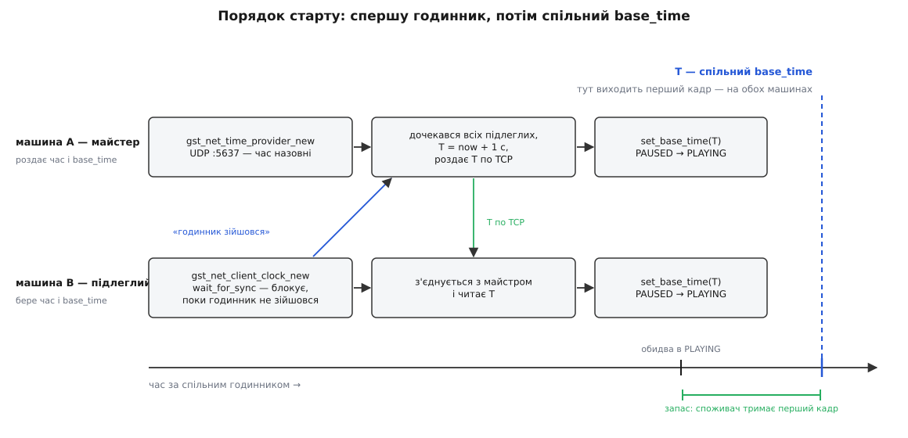
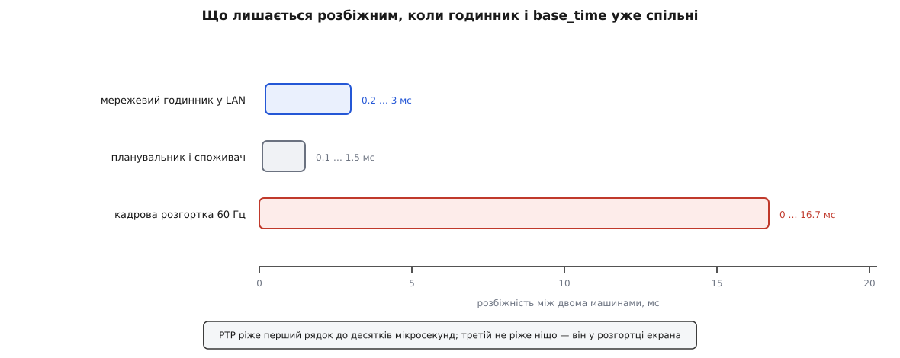

# ⚙️ Дві машини — один кадр: синхронний показ на спільному годиннику

Це робочий проєкт на C: два комп'ютери показують на своїх екранах ту саму мить відео так, щоб різниця між ними ховалася в одному кадрі — і код, і спосіб перевірити результат числом, а не враженням.

<preknowlist>
- [Конвеєр GStreamer](root:sys-media/pipeline-model) — елементи, зчеплені в ланцюг, і дані, що течуть від джерела до споживача.
- [Стани конвеєра](root:sys-media/states-lifecycle) — що саме відбувається на переходах NULL → READY → PAUSED → PLAYING і що таке прерол.
- [Затримка й буферизація](root:sys-media/latency-and-buffering) — звідки береться число latency і чому воно однакове для всіх споживачів одного конвеєра.
- [Дрейф годинників](root:sf-distributed/clock-offset-drift) — два кварци ніколи не йдуть однаково, ppm як міра розбіжності.
- [TCP проти UDP](root:com-transport/tcp-vs-udp) — чому одні дані шлють дейтаграмами без гарантій, а інші — потоком із доставкою.
</preknowlist>

## Задача

Дві машини, два екрани поруч — половинки однієї панорами, або дві проєкції на одну стіну, або просто відеостіна з чотирьох кутів. На кожній машині свій конвеєр, свій відеофайл (точна копія), свій відеоспоживач. Треба, щоб у будь-яку мить обидва екрани показували **той самий кадр**.

Що означає «той самий» у числах — питання не риторичне: від відповіді залежить уся конструкція. При 25 кадрах за секунду сусідній кадр відстоїть на 40 мс; якщо дві половини картини розійшлися на кадр, то на швидкому русі шов між екранами стає видимим розривом — верхня половина об'єкта вже поїхала, нижня ще ні. Тому робоча ціль — **одиниці мілісекунд**, тобто істотно менше за кадровий інтервал.

Найпростіша ідея — запустити обидві програми одночасно — розсипається двічі. По-перше, «одночасно» через `ssh` коштує десятки мілісекунд розкиду на самому лише запуску процесу, а ще ж декодер має підняти перший кадр. По-друге, навіть ідеальний старт не тримається: [два кварци](root:sf-distributed/clock-offset-drift) розходяться на 10 ppm, це 37 мс за годину, і за зміну відеостіна розлазиться сама собою.

Отже, спільним має бути не момент запуску, а дві речі, з яких споживач рахує мить показу: **годинник** і **`base_time`**. Тоді рівність `sync_time = running_time + base_time` дає на обох машинах не просто однакове число, а однакову фізичну мить — бо число вимірюють одним приладом.

## Ідея: порядок дій диктує причинність

Розкладемо, що з чого випливає, і порядок вибудується сам.

`base_time` — це значення **спільного** годинника. Отже, підлеглий не може ані обчислити його, ані навіть зрозуміти отримане число, доки його годинник не підігнано під годинник майстра: до синхронізації обидві машини рахують наносекунди від власного вмикання, і різниця між ними — години.

Звідси перший крок: **майстер віддає час у мережу**, підлеглий будує клієнтський годинник і **чекає**, доки той зійдеться. Лише після цього підлеглий має право просити `base_time`.

Другий крок теж вимушений. Хто б не назвав число `T`, це мить у майбутньому, і всі учасники мають отримати її **до** того, як вона настане. Тут ховається пастка порядку запуску: якщо майстер обере `T = зараз + 3 с` і одразу почне роздавати, підлеглий, який щойно піднявся й тільки-но почав підганяти годинник, отримає число, мить якого вже минула. Тому майстер не призначає `T` наосліп, а **чекає, поки всі підлеглі оголосять себе готовими** — і саме факт з'єднання й означає готовність, бо підлеглий стукає в двері вже після того, як його годинник зійшовся.

І третій крок — власне спільний старт. Він виявляється безкоштовним. Оскільки `T` лежить у майбутньому, кожен споживач, отримавши перший кадр із `running_time = 0`, обчислить мить показу `0 + T` і **чекатиме на годиннику**. Ніякої команди «почали» не потрібно: усі конвеєри вже в PLAYING, усі тримають перший кадр, і всі відпустять його рівно тоді, коли спільний годинник дійде до `T`. Запас у секунду покриває і мережевий розкид на роздачі, і різницю в швидкості реакції.



*Годинник має зійтися раніше, ніж хтось назве число T; T у майбутньому робить старт спільним без жодної команди «почали».*

> 🔧 **Навіщо це.** Спокуса замінити рандеву на фіксовану паузу («поспимо десять секунд, усі встигнуть») велика й оманлива. Мережевому годиннику потрібно від часток секунди до кількох секунд залежно від завантаженості каналу, а підлеглий, який завантажився на п'ять секунд пізніше через довгий `fsck`, тихо пропустить `T` і показуватиме кіно сам собі зі своєю точкою відліку. Рандеву перетворює гонку на домовленість: майстер фізично не може призначити `T`, поки не порахує всіх, а підлеглий фізично не може попроситися, поки не має спільної шкали часу.

## Робочий код

Одна програма, два режими. Час іде по UDP — там доречні дейтаграми, бо запізнілий пакет із виміром нікому не потрібен, а от `base_time` — це одне число, яке мусить дійти напевно, тож для нього [TCP](root:com-transport/tcp-vs-udp).

:::code proj-net-clock-sync/c/syncplay.c

Проба показу. `fakesink` із `sync=true` віддає буфер у сигнал `handoff` **після** чекання на годиннику, тобто в ту саму мить, коли сусідня гілка малює цей кадр у вікно. Друкуємо час за **спільним** годинником — і саме тому журнали двох машин можна відняти один від одного:

:::code proj-net-clock-sync/c/robochyi-kod.c

Шина. Крім помилок, ловимо повідомлення `gst-netclock-statistics` — клієнтський годинник шле його після кожного виміру, якщо дати йому шину:

:::code proj-net-clock-sync/c/robochyi-kod-2.c

Підготовка конвеєра — три виклики, у яких і живе весь фокус:

:::code proj-net-clock-sync/c/robochyi-kod-3.c

Майстер: постачальник часу, рандеву й роздача `T`.

:::code proj-net-clock-sync/c/robochyi-kod-4.c

Підлеглий: клієнтський годинник, чекання синхронізації, запит `T`.

:::code proj-net-clock-sync/c/robochyi-kod-5.c

Усього коду близько двохсот рядків, і рівно **три** з них несуть синхронність: `gst_pipeline_use_clock`, `gst_pipeline_set_start_time (…, GST_CLOCK_TIME_NONE)` і `gst_element_set_base_time`. Решта — рандеву, транспорт числа й вимірювальна проба.

## Перевірка: на око й числом

**На око.** У конвеєрі стоїть `timeoverlay time-mode=running-time`, тож кожен кадр несе на собі свій `running_time` намальованими цифрами. Ставимо екрани поруч і знімаємо обидва одним кадром телефона: цифри мають збігатися до останнього розряду, який встигає прочитати камера. М'яч `videotestsrc pattern=ball` при цьому летить швидко — розбіжність у кадр видно як два м'ячі в різних місцях, без жодних приладів.

**Числом.** Проба друкує на кожній машині мить показу **в шкалі спільного годинника**, тому журнали віднімаються напряму:

```
машина A:  PTS 0:00:05.000000000  показано о 41530011736 нс  (running 0:00:05.100000000)
машина B:  PTS 0:00:05.000000000  показано о 41531482210 нс  (running 0:00:05.100000000)

різниця = 41531482210 − 41530011736 = 1470474 нс ≈ 1.47 мс
```

Однаковий `running_time` у дужках — це перевірка арифметики: обидві машини поклали кадр `PTS = 5.000` на ту саму позицію спільної осі, а 100 мс зверху — це виставлена нами `latency`. Розбіжність в абсолютній миті — уже фізика: скільки насправді коштували мережевий годинник, планувальник і сам споживач.

Якщо різниця вилазить за кадровий інтервал, подивіться на `r²` зі статистики годинника. Клієнтський годинник підганяє пряму «мій час ↔ час майстра» [найменшими квадратами](root:math-probability/least-squares), і `r²` — це частка розкиду, яку та пряма пояснює. Значення на кшталт 0.9999 означає, що вимірювання лягли на пряму й калібруванню можна вірити; 0.97 при стрибучому `rtt-average` — що канал шумить і сама шкала часу гуляє на мілісекунди.

## Пастки

**Конвеєр стартував раніше, ніж зійшовся годинник.** Найдорожча помилка, бо виглядає як щось інше. Свіжий `GstNetClientClock` до першого вдалого виміру показує власний внутрішній час, а це наносекунди від увімкнення машини. Підлеглий, який стартував без `gst_clock_wait_for_sync`, отримає від майстра `base_time`, вирахуваний у чужій шкалі, і різниця між шкалами становитиме години. Далі два симптоми на вибір: або весь потік «спізнився» на години, і споживач мовчки викидає геть усе, або `base_time` виявився в далекому майбутньому, і на екрані просто нічого не з'являється. Помилки при цьому немає жодної.

Тому чекання обов'язкове — і воно ж має право провалитися: якщо годинник не зійшовся, правильна реакція не «стартуємо як є», а «не стартуємо».

Другий шар цієї ж пастки тонший: **«зійшовся» ≠ «точний»**. Прапорець синхронності підіймається після першого ж прийнятого виміру. Далі годинник ще довго поліпшується: він тримає вікно з дев'яти останніх значень часу обігу, викидає ті, що більш ніж удвічі перевищують медіану, і опитує майстра не частіше ніж раз на 50 мс. Тобто саме вікно фільтра набирається щонайменше пів секунди, а до сталого калібрування минає ще кілька секунд. Якщо потрібні саме мілісекунди — дайте годиннику постояти кілька секунд або дочекайтеся, поки `r²` перестане стрибати.

**Конвеєр сам перепризначає `base_time`.** За звичайних умов конвеєр на переході PAUSED → PLAYING обчислює `base_time` заново як `now − start_time`, а перехід у READY і кожне перемотування з очищенням скидають `start_time` у нуль — саме так пауза не рахується як програний час. Для нас це смерть: досить одному учасникові стати на паузу й повернутися, як його точка відліку поїде, а другого це не торкнеться. Симптом підступний — «працювало пів години, а потім розлізлося», і причина не там, де шукають.

Ліки — `gst_pipeline_set_start_time (pipeline, GST_CLOCK_TIME_NONE)`. Це прямо каже конвеєрові: керування `base_time` бере на себе застосунок. Перевірити, що воно спрацювало, можна в журналі — з `GST_DEBUG=GST_PIPELINE:5` конвеєр пише «NOT adjusting base_time because start_time is NONE» на кожному переході в PLAYING.

Зворотний бік домовленості: тепер **усе**, що раніше робилося само, ваше. Перемотали — самі порахуйте новий `base_time` і роздайте його всім, бо `running_time` більше не скидається. Того самого штибу й `gst_pipeline_use_clock`: без нього конвеєр вибирає годинник сам, а поява чи зникнення елемента з власним годинником (типово — аудіоспоживача) змусить його переобрати годинник і роздати нові точки відліку — на кожній машині у свою мить.

**Закритий порт.** Дірок треба дві, і забувають зазвичай другу. UDP 5637 на майстрі — обмін вимірами; TCP 5638 — роздача `base_time`. Обмін часом іде «запит-відповідь», тож на майстрі мусить бути дозволений **вхідний** UDP, а стан «з'єднання» міжмережевий екран для UDP тримає лише за таймером — надто короткий таймер ріже відповіді на рівному місці.

Симптом закритого UDP — знову ж таки не помилка, а тиша: `gst_clock_wait_for_sync` просто достоює свій тайм-аут і повертає `FALSE`. Швидка діагностика — `GST_DEBUG=netclientclock:6`: якщо в журналі немає жодного рядка про прийняте спостереження, пакети не доходять. На майстрі варто перевірити, що сокет справді піднявся: `ss -ulpn | grep 5637`.

Окремо про NAT і Wi-Fi. Алгоритм вимірює час обігу й ділить його навпіл, **припускаючи симетричність шляху** — так само, як це робить [NTP](root:com-protocol/ntp-sync). Якщо шлях туди й назад коштує по-різному (типово: одна сторона на Wi-Fi, або десь стоїть шейпер), половина асиметрії осідає в калібруванні як **стала** похибка. Усереднення її не бере: вона не шум, а зсув.

**`base_time` у майбутньому й живі джерела.** Наш проєкт бере файл або тестове джерело, і `T` у майбутньому там абсолютно безпечний: споживач просто чекає. Але щойно джерелом стане камера, той самий прийом вибухає. Живе джерело обчислює мітку кадру як `running_time = зараз − base_time`, а це беззнакове 64-бітове віднімання:

```
base_time = 41531000000000 нс      (через 1 с після «зараз»)
зараз     = 41530000000000 нс

running_time = зараз − base_time = −1000000000
          у guint64 це 18446744072709551616 нс ≈ 585 років
```

Кадр із міткою в 585 років не покажуть ніколи; помилки при цьому не виникне, на екрані просто порожньо. Для живих конвеєрів `base_time` роздають **у минулому або рівним поточному часу**, а запас на старт купують не зсувом точки відліку, а `latency`.

**Різна latency у двох конвеєрів.** Мить показу — це `running_time + base_time + latency`, і третій доданок конвеєр рахує **сам**, зі своїх елементів. Машина з апаратним оверлейним споживачем оголосить мінімальну затримку 30 мс, машина зі звичайним вікном — 5 мс, і ви отримаєте стабільні 25 мс розбіжності, які жодна перевірка `base_time` не покаже, бо `base_time` в них однаковий. Тому в коді стоїть `gst_pipeline_set_latency` з одним числом на всіх. Брати його треба не меншим за найбільшу мінімальну затримку серед усіх машин — інакше конвеєр покладе в шину попередження «Configured latency is lower than detected minimum latency».

**Залишок, якого не прибрати.** Споживач віддає кадр графічній системі точно о `sync_time`, але екран оновлюється 60 разів на секунду і чекає найближчого свого оновлення. Фази розгорток двох моніторів незалежні й повільно пливуть одна відносно одної, тож навіть при бездоганній синхронізації конвеєрів лишається до 16.7 мс залишку — більше, ніж дає весь мережевий годинник.



*Найбільший доданок лежить поза GStreamer; синхронізація конвеєрів доводить машини до однакового вікна оновлення, а не до однакового фотона.*

Це варто знати заздалегідь, щоб не полювати на мілісекунди там, де вони нічого не змінюють. Прибирають цей залишок не в коді конвеєра, а на рівні відеовиходу — genlock чи framelock на професійних відеокартах, які замикають розгортки всіх екранів на один сигнал.

**Той, хто прийшов пізно.** Машина, яка під'єдналася через десять хвилин після старту, отримає той самий `base_time` — і почне з початку матеріалу, тобто з `running_time = 0`, який минув десять хвилин тому. Усі її буфери спізнені, споживач викидає їх пачками. Такий учасник мусить спершу перемотатися туди, де всі:

```c
GstClockTime pos = gst_clock_get_time (app->clock) - base_time;   /* поточний running_time */
gst_element_seek_simple (app->pipeline, GST_FORMAT_TIME,
                         GST_SEEK_FLAG_FLUSH | GST_SEEK_FLAG_KEY_UNIT, pos);
```

Точність тут — до найближчого ключового кадру, тож або матеріал із частими ключовими кадрами, або перемотування з невеликим запасом назад.

## Що змінює перехід на GstPtpClock

Якщо трьох мілісекунд забагато, годинник змінюють на реалізацію [PTP (IEEE 1588)](root:sf-distributed/ptp-1588), додану в GStreamer 1.6. З погляду коду змінюється рівно один шматок:

```c
if (!gst_ptp_is_supported () || !gst_ptp_init (GST_PTP_CLOCK_ID_NONE, NULL)) {
  g_printerr ("PTP недоступний: немає прав або допоміжника\n");
  return 1;
}
app->clock = gst_ptp_clock_new ("shared", 0);            /* домен 0 */
if (!gst_clock_wait_for_sync (app->clock, SYNC_TIMEOUT))
  return 1;
```

Далі — три наслідки, які легко проґавити.

Перший: **постачальник часу зникає зовсім**. `GstPtpClock` — це «звичайний годинник» (*ordinary clock*) **виключно в ролі підлеглого**; GStreamer не вміє бути майстром PTP. Отже, майстер має бути в мережі окремо: комутатор із підтримкою PTP, окремий грандмайстер (*grandmaster*) або демон `ptp4l` із пакета linuxptp на одній із машин. Роль «майстра» в нашій програмі звужується до роздачі `base_time` — і саме тому цю частину коду міняти не доведеться взагалі.

Другий: **потрібні привілеї**. PTP слухає порти 319 і 320, а це менше за 1024. Тому `gst_ptp_init` не відкриває сокети сам, а запускає окремий процес-допоміжник `gst-ptp-helper`, якому дистрибутив під час встановлення видає окреме право `cap_net_bind_service` (Linux-capability) або ставить біт setuid. Якщо пакет зібрано без цього, `gst_ptp_init` поверне `FALSE` — звідси й перевірка в коді.

Третій: **точність краща, але не «як у даташиті»**. Мікросекундні числа, які приписують PTP, беруться з апаратних міток часу в мережевій карті й комутаторі. Реалізація в GStreamer читає пакети звичайними сокетами й позначає їх у процесі, тож частину виграшу з'їдає джитер планувальника. Практично це десятки-сотні мікросекунд замість мілісекунд — на порядок або два краще за годинник на обміні пакетами, але для справді апаратної точності потрібна вся ланка: карта з підтримкою міток, комутатор із PTP і майстер, який на них спирається.

І остання деталь, заради якої все й будувалося: **другий доданок PTP не дає**. Спільний годинник — це спільна лінійка; спільний нуль на ній усе одно роздаєте ви. Код рандеву й `base_time` лишається слово в слово тим самим, хоч на годиннику з обміном пакетами, хоч на PTP.
