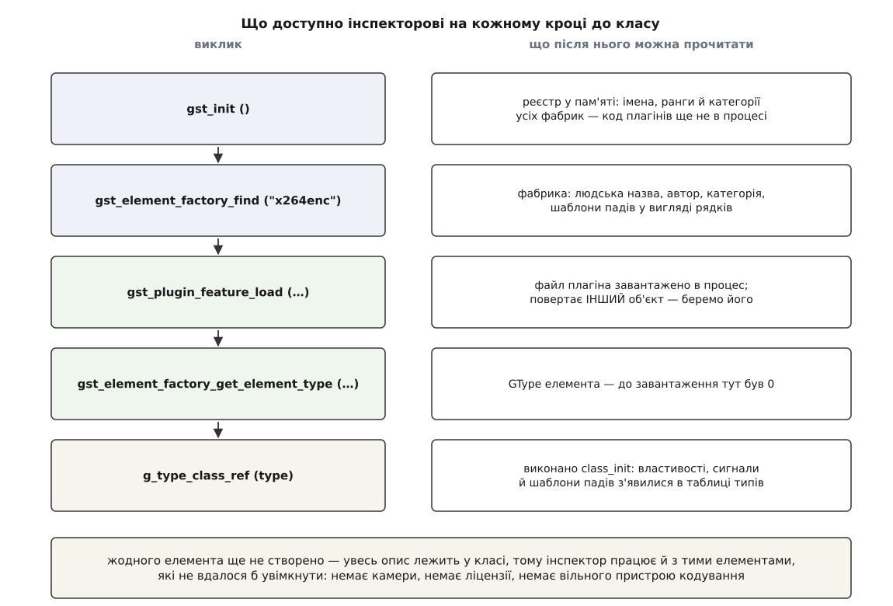

# ⚙️ Власний інспектор елемента: двісті рядків, які читають чужий опис

Напишемо мовою C програму, що за одним іменем — `filesrc`, `x264enc`, `appsink` — друкує родовід елемента, усі його ручки з типами й межами, усі сигнали із сигнатурами та шаблони падів, не знаючи про жоден із цих елементів анічогісінько. Такий інспектор варто написати раз не заради самої програми (готовий `gst-inspect-1.0` є в кожній збірці), а заради того, що видно зсередини: усе, що інспектор друкує, лежить у пам'яті процесу як **дані**, і дістати їх можна десятком викликів.

## Задача: відповісти на питання, якого не ставлять документації

Питання, з якого все починається, звучить так: **чи можна крутити оцю ручку, поки потік уже йде, і в яких межах**. Сторінка в мережі на нього не відповідає, бо описує не ту версію плагіна, що стоїть у вас; вихідний код відповідає, але його треба знайти й прочитати; а помилка тут не падає, а тихо псує кадри.

Тому інспектор мусить друкувати для кожної властивості п'ять речей: **ім'я**, **у якому саме класі її оголошено** (щоб було зрозуміло, чому в декодера є ручка, якої автор декодера не писав), **тип із межами**, **типове значення** і **прапорці — до якого стану включно її можна міняти**. Плюс родовід типу, перелік сигналів із сигнатурами й шаблони падів.

Умова, що робить задачу цікавою: програму збирають окремо від усіх плагінів і проти самої лише `libgstreamer-1.0`. Жодного заголовка `x264enc` вона не бачить і бачити не може.

## Ідея: не питати об'єкт, а взяти клас

Спокуса зробити просто — створити елемент і подивитися, що в ньому. Але створити виходить не завжди: приймач у вікно хоче дисплей, кодувальник — вільний пристрій, джерело з камери — саму камеру. А описи ручок і сигналів до жодної камери стосунку не мають: вони живуть у **структурі класу**, яка існує в одному примірнику на весь процес.

Отже, план такий: дійти до класу, а примірника не робити взагалі.

Дорога до класу коротша, ніж здається, але має два місця, де новачок спотикається. Реєстр GStreamer, який будує [модель плагінів](root:sys-media/plugin-model), тримає метадані всіх фабрик, **не завантаживши жодного файла плагіна**: імена, ранги, категорії й шаблони падів записано текстом у кеші реєстру. Тому фабрику ви знайдете миттєво, а типу за нею ще не існує — його реєструє код плагіна, якого в процесі немає. Отже, спершу плагін треба [довантажити в процес](root:sf-lang/dynamic-linking), і аж тоді питати GType.

Друге місце — сам клас. Структура класу створюється **ліниво**: GObject виділяє під неї пам'ять і виконує `class_init` лише тоді, коли клас комусь уперше знадобився. А `class_init` — це і є те місце, де виконуються всі `g_object_class_install_property` і `g_signal_new`. Доки цього не сталося, у таблиці типів немає ані властивостей, ані сигналів: тип є, опису немає. Тому інспектор мусить сказати `g_type_class_ref` — виклик, що робить дві речі одразу: за потреби створює клас (виконуючи `class_init`) і бере на нього посилання, щоб клас не звільнили, поки ми з нього читаємо.



*Жодного елемента при цьому не створено — і саме тому інспектор працює з елементами, які не вдалося б увімкнути.*

## Кістяк: від рядка до класу

Увесь файл — `mininspect.c`. Спершу `main`, бо в ньому видно весь маршрут.

:::code proj-inspect-element/c/mininspect.c

Три різні `unref` в одній функції — не недбалість, а три різні системи володіння, і про них окремо нижче.

## Родовід і інтерфейси

Ланцюг предків тримається в таблиці типів, тому обхід тривіальний: `g_type_parent` дає батька, нуль означає вершину. Друкувати треба у зворотному порядку — від `GObject` донизу, — тож спершу збираємо ланцюг у масив.

:::code proj-inspect-element/c/rodovid-i-interfeisy.c

`g_type_interfaces` повертає щойно виділений масив ідентифікаторів — його звільняє `g_free`. Самі типи, звісно, нікуди не діваються: масив — це копія переліку, а не володіння типами.

## Властивості: опис, а не поле

Далі — головне. `g_object_class_list_properties` віддає масив описів усіх властивостей класу, разом із успадкованими.

:::code proj-inspect-element/c/vlastyvosti-opys-a-ne-pole.c

Поле `owner_type` — те, заради чого варто було все затівати. Воно каже, у чиєму `class_init` властивість оголошено, і одразу пояснює, звідки в елемента взялося те, чого його автор не писав: `blocksize` і `num-buffers` приходять від `GstBaseSrc`, `name` — від `GstObject`.

Тепер тип і межі. Опис властивості — не просто «тип», а окремий підклас `GParamSpec` на кожен різновид значення, і саме в ньому лежать найменше, найбільше й типове. Тому розбір — це низка перевірок «а чи це опис цілого зі знаком».

:::code proj-inspect-element/c/vlastyvosti-opys-a-ne-pole-2.c

`g_param_value_set_default` разом із `g_strdup_value_contents` — пара, що позбавляє від окремої гілки на кожен тип: перша кладе типове значення у `GValue`, друга друкує вміст `GValue`, яким би він не був. Гілки нижче потрібні тільки заради **меж**, бо межі не є значенням і в `GValue` не поміщаються.

Перелічувані типи розбираються особливо приємно. Опис властивості-переліку тримає посилання на клас переліку, а в тому класі — масив із трьома полями на кожне значення: число, машинний псевдонім (той, що ви пишете в рядку конвеєра) і людське ім'я. Тому `speed-preset=medium` можна перекласти в шістку, ні разу не заглянувши в заголовки x264.

## Прапорці: коли саме дозволено крутити

Прапорці — те, заради чого весь інспектор і писався. GObject дає загальні біти, GStreamer додає власні у зоні, відведеній для розширень: `G_PARAM_USER_SHIFT` дорівнює восьми, і `GST_PARAM_MUTABLE_PLAYING` — це просто `1 << (8 + 4)`.

:::code proj-inspect-element/c/praportsi-koly-same.c

Остання гілка ланцюжка потребує чесності. Відсутність прапорця `MUTABLE_*` — це не доказ, що властивість не можна міняти на ходу; це відсутність обіцянки з боку автора елемента. Практичний висновок один і той самий: без прапорця значення міняють, опустивши елемент до `NULL`, бо [перехід між станами](root:sys-media/states-lifecycle) — єдиний момент, коли ніхто інший цього поля не читає.

> 🔧 **Навіщо це.** Найдорожча помилка при налаштуванні живого конвеєра — записати властивість із власної нитки, поки [нитка потоку](root:sys-media/threads-and-queues) уже працює за старим значенням. Симптом не схожий на причину: замість зрозумілої помилки ви бачите кілька зіпсованих кадрів або мовчазне ігнорування нового значення. Рядок «прапорці» вашого інспектора відповідає на це питання за десяту частку секунди — і саме для тієї збірки, що стоїть на цій машині, а не для тієї, чию сторінку показав пошук.

## Сигнали: перелік і сигнатура

Сигнали теж зареєстровані в таблиці типів, але прив'язані **до конкретного типу**, а не успадковані в один список. Тому їх збирають, ідучи вгору по родоводу.

:::code proj-inspect-element/c/syhnaly-perelik-i.c

Позначка `[дія]` варта окремого рядка коду, бо міняє сенс усього запису. Звичайний сигнал — сповіщення, на яке підписуються; сигнал із прапорцем `G_SIGNAL_ACTION` — навпаки, метод, який **викликають** через `g_signal_emit_by_name`. Так `appsink` віддає кадр: `pull-sample` виглядає в переліку як сигнал, а є функцією, що чекає й повертає буфер.

## Шаблони падів

Шаблони теж живуть у класі — їх кладе туди `class_init`, — тож примірник знову не потрібен.

:::code proj-inspect-element/c/shablony-padiv.c

Сам список належить класові — його не звільняють і не міняють. А от `gst_pad_template_get_caps` віддає **нове посилання** на набір [узгоджуваних форматів](root:sys-media/caps-negotiation), і його повертають. Слово «інколи» в колонці присутності — не дрібниця: воно означає, що пад з'явиться лише під час роботи, і саме на такі елементи чіпляють обробник `pad-added`, як описує [з'єднання елементів](root:sys-media/pads-and-linking).

## Вивід

Двісті рядків на виході дають приблизно таке (скорочено):

```
$ ./mininspect filesrc
filesrc — File Source
категорія: Source/File
плагін: coreelements

Родовід:
  GObject
    GInitiallyUnowned
      GstObject
        GstElement
          GstBaseSrc
            GstFileSrc
  інтерфейси: GstURIHandler

Шаблони падів:
  src            вихід, завжди
      ANY

Властивості (8):

  location   ← оголошено в GstFileSrc
      Location of the file to read
      рядок, типово NULL
      прапорці: читання, запис, коли міняти — не позначено (покладайся на NULL)

  blocksize   ← оголошено в GstBaseSrc
      Size in bytes to read per buffer (-1 = default)
      ціле без знака, межі 0 … 4294967295, типово 4096
      прапорці: читання, запис, коли міняти — не позначено (покладайся на NULL)

  num-buffers   ← оголошено в GstBaseSrc
      Number of buffers to output before sending EOS (-1 = unlimited)
      ціле зі знаком, межі -1 … 2147483647, типово -1
      прапорці: читання, запис, коли міняти — не позначено (покладайся на NULL)

Сигнали:
  "pad-added"  ← від GstElement
      void user_function (GstElement *self, GstPad *arg0, gpointer user_data)
  "deep-notify"  ← від GstObject
      void user_function (GstObject *self, GstObject *arg0, GParam *arg1, gpointer user_data)
  "notify"  ← від GObject
      void user_function (GObject *self, GParam *arg0, gpointer user_data)
```

Найповчальніше тут — порожнеча. У `filesrc` **немає жодного власного сигналу**: усі три прийшли від предків. І з восьми властивостей своя рівно одна.

На елементі з переліками картина інша:

```
$ ./mininspect x264enc
…
  bitrate   ← оголошено в GstX264Enc
      Bitrate in kbit/sec
      ціле без знака, межі 1 … 2048000, типово 2048
      прапорці: читання, запис, міняти можна аж до PLAYING

  speed-preset   ← оголошено в GstX264Enc
      Preset name for speed/quality tradeoff options
      перелік GstX264EncPreset, типово ((GstX264EncPreset) 6)
          (0) None           No preset
          (1) ultrafast      ultrafast
          …
          (6) medium         medium
```

Ось звідки береться `bitrate=4096` у рядку конвеєра: парсер робить рівно те саме, що щойно зробили ми, — знаходить опис за іменем, дізнається з нього тип і межі й перетворює текст. Уся ця техніка — [читання власної будови під час роботи](root:sf-lang/reflection-metaprogramming) — у мовах із багатою системою типів вбудована; у C її довелося збудувати як бібліотеку, і саме тому вона тут така помітна.

## Складність і пастки

Обчислень у програмі немає: вартість — це `O(властивостей + сигналів + шаблонів)` рядків друку. Реальний час з'їдають дві речі: перший запуск `gst_init` після оновлення плагінів перебирає всі файли й перебудовує кеш реєстру (секунди), а `gst_plugin_feature_load` робить одне завантаження бібліотеки. Пам'яті програма не тримає жодної — усе, що вона показує, уже лежало в процесі.

Гострі місця варто перелічити разом, бо кожне ловилося окремо й дорого.

**Забутий `gst_init`.** Без нього немає таблиці типів GStreamer, і `gst_element_factory_find` поверне `NULL` для всього на світі. Виглядає це як «елемента немає в системі», хоча елемент є. Другий бік того самого: `gst_init` виймає з `argv` свої аргументи, тому власний розбір командного рядка ставлять **після** нього, інакше `--gst-debug-level=4` виглядатиме як ім'я елемента.

**Тип, який дорівнює нулю.** `gst_element_factory_get_element_type` віддає нуль, якщо фабрику не завантажено, — а `gst_element_factory_find` фабрику **не завантажує**. Пропустивши `gst_plugin_feature_load`, ви отримаєте нуль і падіння на першому ж `g_type_class_ref`. І окремо: завантаження повертає **інший об'єкт фабрики**; той, що ви передали, лишається чинним, але порожнім, тож правильний зразок — узяти повернене, а старе відпустити.

**Клас, який не створено.** `g_type_class_peek` віддає клас, лише якщо той уже існує, і `NULL` інакше; на щойно завантаженому плагіні це майже завжди `NULL`. Потрібен саме `g_type_class_ref` — він створить клас, якщо треба, і триматиме його. Парний `g_type_class_unref` наприкінці обов'язковий: клас має власний лічильник, окремий від лічильників об'єктів, і жоден `unref` об'єкта його не зменшує. Той самий підхід із інтерфейсами вимагає іншої пари — `g_type_default_interface_ref` і `..._unref`, — тому перелічувати сигнали інтерфейсів так, як класів, не вийде.

**Три різні системи звільнення в одній програмі.** Це головна пастка, і сплутати їх легко, бо всі виглядають однаково:

```
масив від GLib      props, ids, ifaces, рядки        →  g_free
GObject / GstObject фабрика, елемент, пад            →  gst_object_unref
GstMiniObject       GstCaps, GstBuffer, GstEvent     →  gst_caps_unref і рідня
структура класу     GObjectClass, GEnumClass         →  g_type_class_unref
GValue              будь-яке типізоване значення     →  g_value_unset
GParamSpec          опис властивості                 →  нічого, він не ваш
```

Для `GstObject` `gst_object_unref` і `g_object_unref` роблять те саме — перший лише додає перевірку типу. Смертельна плутанина починається рядком нижче: `g_object_unref` на `GstCaps` чи `GstBuffer` мовчки псує пам'ять, бо міні-об'єкт **не є** GObject — у ньому немає ані вказівника на клас, ані лічильника там, де їх шукає GObject. Тому правило простіше за пояснення: тип із префіксом `Gst`, який ходить конвеєром із кадром, звільняють функцією зі своїм-таки іменем.

**Масив описів — ваш, описи — ні.** `g_object_class_list_properties` і `g_signal_list_ids` виділяють **тільки масив**; його віддають `g_free`. Пробіг циклом із `g_param_spec_unref` по елементах вкраде посилання в класу і зруйнує його при наступному зверненні. Дзеркальна помилка — не звільнити масив узагалі: у програмі, що інспектує один елемент і завершується, це непомітно, у службі, що перелічує весь реєстр, — тисячі витоків.

**`GValue` без `g_value_unset`.** Для чисел це просто акуратність. Для рядків, боксованих типів і об'єктів — справжній витік: `g_param_value_set_default` кладе туди **копію** значення, і чистить її саме `g_value_unset`.

**Опис — не поточне значення.** Ваш інспектор друкує те, що оголошено в описі; готовий `gst-inspect-1.0` створює елемент і друкує значення, які поле має **після** конструктора. Це різні числа: конструктор має право підправити типове під версію бібліотеки чи можливості машини. Хочете живих значень — створіть елемент, читайте `g_object_get_property` у `GValue` і не забудьте, що щойно створений елемент несе плавальне посилання, тож звільняють його теж не як завгодно.
