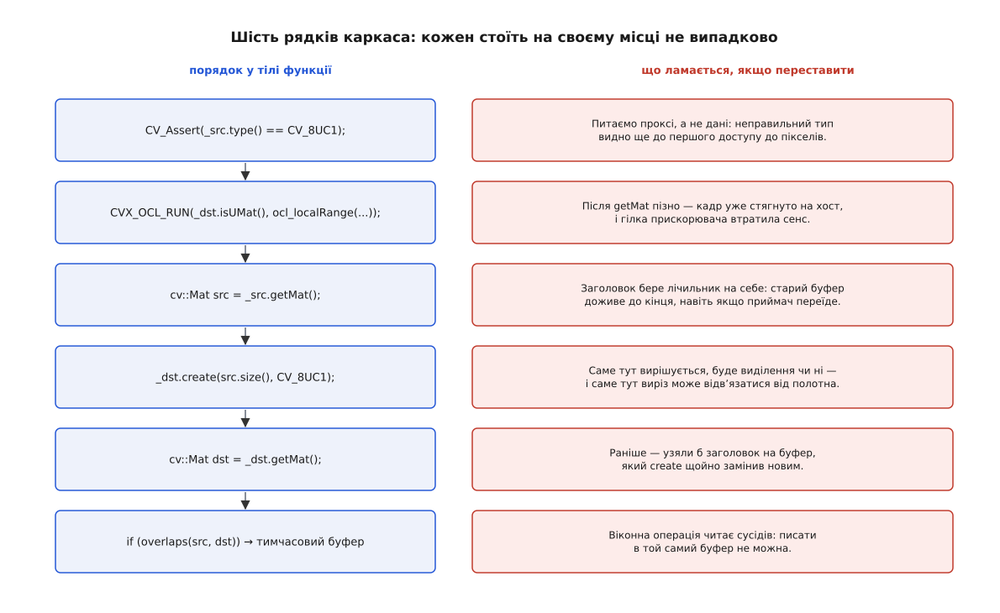
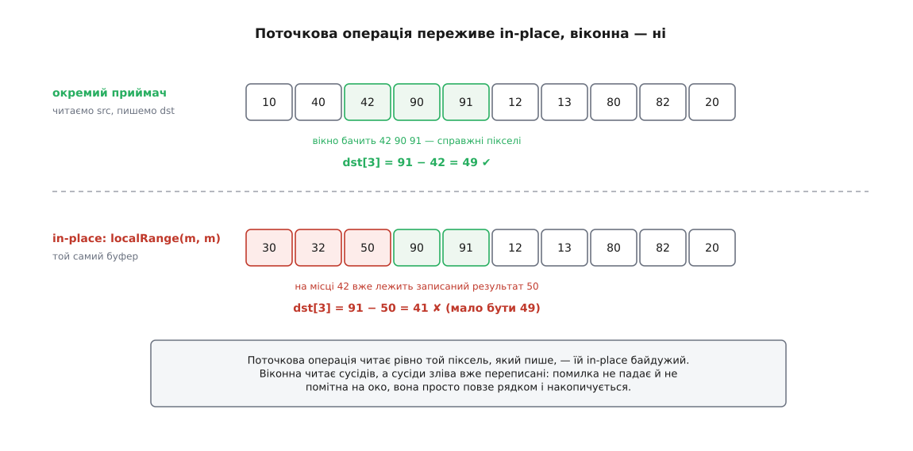

# ⚙️ Своя функція, яку OpenCV не відрізнить від власної

Це робоча реалізація `cvx::localRange` — функції з сигнатурою `(InputArray src, OutputArray dst, int ksize, InputArray mask, OutputArray hist)`, яка приймає `cv::Mat`, `cv::UMat` і `std::vector<uchar>` однаково, не вибиває кадр із ланцюжка на прискорювачі, переживає виклик `f(m, m)` і в сталому режимі не виділяє жодного байта на кадр. Потрібна вона тому, що власна функція з такою сигнатурою — не питання смаку: щойно ваш крок стає в один ряд із бібліотечними, він або дотримується тієї самої домовленості, або тихо ламає весь конвеєр навколо себе.

## Що саме рахуємо

Операція навмисно проста: **локальний розмах** — для кожного пікселя різниця між максимумом і мінімумом у вікні `ksize×ksize`. Там, де кадр рівний, розмах близький до нуля; там, де є деталь чи різкий край, він великий. У камерних конвеєрах це дешева міра деталізації: за нею відрізняють розмиту сцену від різкої й шукають зони, де взагалі є що обробляти.

Скажемо чесно одразу: саме цю операцію бібліотека вже вміє — `cv::morphologyEx(src, dst, cv::MORPH_GRADIENT, kernel)` з прямокутним елементом дає рівно те саме, бо морфологічний градієнт визначено як різницю дилатації та ерозії, а вони і є максимум та мінімум у вікні. Механіка самих цих операцій розібрана в темі [пороги й морфологія](root:sf-visual/threshold-morphology): дилатація ставить у піксель максимум по структурному елементу, ерозія — мінімум, а їхня різниця обводить межі об'єктів.

Ми пишемо своє не тому, що бібліотеці бракує цієї функції, а тому, що потрібне маленьке чесне тіло, на якому видно все інше. Домовленість, яку ми зараз розберемо, однакова для будь-якого власного кроку — власної моделі шуму, нестандартного зшивання каналів, детектора під конкретну камеру.

Одна властивість цієї операції важить окремо: вона **віконна**. Результат у пікселі залежить від сусідів. Саме через це половина пасток нижче взагалі існує — для поточкової операції їх просто немає.

## Каркас: шість рядків у єдино можливому порядку

```cpp
namespace cvx {
void localRange(cv::InputArray src, cv::OutputArray dst, int ksize = 3,
                cv::InputArray  mask = cv::noArray(),
                cv::OutputArray hist = cv::noArray());
}
```

Тіло починається так:

:::code proj-universal-function/cpp/karkas-shist-riadkiv-u.cpp



*Порядок тут не стилістичний: кожен рядок спирається на стан, який лишив попередній.*

Розберімо, звідки береться саме такий порядок.

**Перевірки питають проксі, а не дані.** `_src.type()` не торкається жодного пікселя: тип уже вкладено в поле `flags` ще на місці виклику. Тому неправильний аргумент падає з читабельним повідомленням до того, як щось було відображено, стягнуто чи виділено. Окремо стоїть `!_dst.fixedType() || _dst.type() == CV_8UC1`: приймач із зафіксованим типом — `std::vector<cv::Point2f>`, `cv::Matx33d` — усе одно не переживе нашого `create`, але наш `CV_Assert` скаже про це в термінах нашої функції, а не з глибини бібліотеки.

**Гілка прискорювача стоїть до `getMat`.** Це не оптимізація, а необхідність. `getMat()` над `UMat` відображає буфер пристрою в адресний простір процесора — після цього рядка кадр уже на хості, і питати «а чи не порахувати це на прискорювачі» пізно: пересилання відбулося.

**`src` беруть до `create`.** Виклик `localRange(m, m)` законний, а `create` має право перевиділити буфер приймача. Якби ми спершу викликали `create`, лічильник посилань старого блоку впав би до нуля, пікселі звільнилися б — і читати вже було б нічого. Заголовок `src`, узятий заздалегідь, тримає лічильник на собі, і старий буфер доживає до кінця роботи функції.

**`getMat` приймача — після `create`.** Інакше ми взяли б заголовок на буфер, який `create` наступним рядком замінив би новим.

Шостий крок — перевірка, чи не виявилися `src` і `dst` тією самою пам'яттю, — стоїть одразу за цим і потребує окремої розмови; до нього повернемося, коли буде готове тіло.

## Гілка прискорювача: чому `CV_OCL_RUN` не можна просто підключити

У джерелах OpenCV гілка на прискорювач виглядає як один макрос. Спокуса підключити його й собі природна — і одразу впирається в стіну. Макрос живе в `opencv2/core/opencl/ocl_defs.hpp`, а цей заголовок першим рядком підключає `cvconfig.h` — файл, який породжується під час збірки самої бібліотеки й у встановлений набір заголовків не потрапляє. Спроба вимикається сама: без `HAVE_OPENCL` макрос розгортається в порожнечу, тобто гілка прискорювача просто зникає, нічого не сказавши.

Отже, пишемо свій — за тим самим зразком, але на публічних викликах:

```cpp
// Відповідник CV_OCL_RUN на публічному API. Бібліотечний спирається на
// cv::ocl::isOpenCLActivated() — дешеву перевірку без спроби підняти контекст;
// зовні доступний cv::ocl::useOpenCL(), який контекст за потреби створить.
#define CVX_OCL_RUN(condition, func)                          \
    do {                                                      \
        if (cv::ocl::useOpenCL() && (condition) && (func))     \
            return;                                           \
    } while (0)
```

Одну рису оригіналу ми свідомо не повторюємо. Бібліотечний `CV_OCL_RUN_` загорнуто в `try`, який ковтає `cv::Exception` і мовчки пускає обчислення процесорною гілкою; на це є відкрите зауваження в самому проєкті OpenCV — така поведінка ховає помилки. У власному коді ковтати виняток немає жодного сенсу: якщо ваше ядро кинуло, ви хочете це побачити, а не отримати правильний результат утричі повільніше й ніколи не дізнатися чому.

Умова — `_dst.isUMat()`. Дивимось саме на **приймач**, як це робить бібліотека: тип змінної, у яку піде результат, і є вимикачем гілки. Оголосили `cv::UMat out` — пішли на прискорювач; оголосили `cv::Mat out` — лишилися на процесорі, навіть якщо джерело було `UMat`. Ціну таких перетинів і те, як їх лічити, розібрано в темі про [бекенди й прискорення](root:sys-media/opencv-backends).

Саме ядро — прямий переказ віконного циклу. Параметри не довільні: їх диктують помічники `KernelArg`, і порядок у ядрі мусить точно повторювати порядок помічників у `args`. Що таке контекст, черга команд і глобальний розмір задачі — у темі про [модель обчислень OpenCL](root:sf-visual/opencl-compute-model).

:::code proj-universal-function/c/main.c

`KSIZE` і `HAVE_MASK` приходять не як аргументи, а як опції збірки ядра — і це загальний прийом OpenCV: ядро компілюють під конкретну конфігурацію, а результат лягає в кеш під ключем, у який ці опції входять. Розмір вікна стає сталою часу компіляції, і драйвер розгортає цикл.

:::code proj-universal-function/cpp/hilka-pryskoriuvacha-chomu.cpp

Два рядки тут важать більше, ніж здаються.

Перший — `k.empty()` перевіряють **до** `_dst.create`. Функція гілки повертає `false` як «я не впоралася, роби процесором» — і при цьому не має права лишити приймач у зміненому стані. Наш ранній вихід чистий: ми ще нічого не чіпали. Якщо ж `k.run` повернув `false` уже після `create`, процесорна гілка успадкує приймач із новим розміром; у нашому випадку це нешкідливо (`create` там просто нічого не зробить), але в загальному разі гілку прискорювача треба писати так, щоб її невдача не була видима ззовні.

Другий — `_hist.needed()`. Про це нижче.

> 🔧 **Навіщо це.** Найпоширеніша причина, чому конвеєр на `UMat` виявляється повільнішим за процесорний, — одна власна функція посеред ланцюжка, у якої гілки на прискорювач немає. Вона отримує `UMat`, робить `getMat()`, і кадр їде на хост і назад — двічі за виклик, без жодного натяку в коді. Свою функцію варто писати або з гілкою, або з чесною відмовою: якщо гілки нема, хай `CV_Assert` вимагає `Mat` — краще помилка збірки конвеєра, ніж мовчазні два перетини шини на кожному кадрі.

## Тіло на процесорі

Максимум і мінімум у прямокутному вікні **розділювані**: максимум по `k×k` дорівнює максимуму по стовпчику з максимумів по рядках. Тому замість `k²` порівнянь на піксель робимо два проходи по `k`.

:::code proj-universal-function/cpp/tilo-na-protsesori.cpp

Обрізання індексів на краях — це рівно `BORDER_REPLICATE`, і не наближено, а точно: повторений крайовий піксель уже входить у вкорочене вікно, тож на максимум і мінімум він не впливає. Для згорток так не вийшло б, а для порядкових операцій виходить безплатно.

## Аліасинг: чому віконна операція ламається на місці

Поточковій операції збіг входу з виходом байдужий: вона читає рівно той піксель, який пише. Віконна читає сусідів — і зліва вони вже переписані результатом.



*Помилка не падає й не помітна на око — вона просто повзе рядком і накопичується.*

Виявити збіг треба до першого записаного пікселя. Найпростіша перевірка — `_src.getObj() == _dst.getObj()`: проксі зберігає адресу самого об'єкта викликача, тож `f(m, m)` видно одразу. Але вона ловить лише буквальний збіг змінних, а не спільний буфер: `f(canvas, canvas(roi))` — це два різні `Mat` над однією пам'яттю. Тому питати треба про дані:

:::code proj-universal-function/cpp/aliasynh-chomu-vikonna.cpp

Дві дрібниці в цих п'яти рядках варті окремого слова. Перевірка керівних блоків відсікає найчастіший випадок дешево: якщо обидва заголовки мають свій `UMatData` і він різний, буфери різні напевно. А `std::less` замість голого `<` — не педантизм: у C++ результат порівняння оператором `<` двох покажчиків у різні об'єкти стандарт лишає неуточненим, тоді як спеціалізація `std::less` для покажчиків зобов'язана задавати повний порядок на будь-яких покажчиках того самого типу. Про те, чим взагалі загрожує припущення «ці два покажчики не перетинаються», — тема [аліасинг покажчиків і UB](root:sf-lang/pointer-aliasing).

Далі все просто: перетинаються — рахуємо в тимчасовий буфер і копіюємо.

:::code proj-universal-function/cpp/aliasynh-chomu-vikonna-2.cpp

Звідси, до речі, випливає протилежне тому, що зазвичай думають: `f(m, m)` не економить пам'ять, а витрачає її. In-place-виклик для віконної операції коштує **зайвого** буфера й зайвого копіювання — просто ця ціна схована в бібліотеці, а не в коді викликача.

## Маска: `empty()` проти `needed()`

Ці два методи легко переплутати, а вони відповідають на різні питання й навіть живуть у різних класах.

`needed()` — метод `_OutputArray`, і його тіло вміщається в рядок: `return kind() != NONE;`. Питання, на яке він відповідає, — «чи взагалі просили цей результат». На `InputArray` його немає й бути не може: вхід або є, або порожній, а «просити» його нема кому.

Для необов'язкового **входу** правильне питання — `empty()`. Проксі виду `NONE` вважає себе порожнім, а `getMat()` на ньому повертає порожній `Mat`. Тому маска обробляється без жодного `if` на початку:

```cpp
    cv::Mat mask = _mask.getMat();     // порожній Mat, якщо передали noArray()
    // ...
    const uchar* m = mask.empty() ? nullptr : mask.ptr<uchar>(y);
```

А `needed()` показує себе там, де йому місце, — на необов'язковому виході. Гістограма розмахів потрібна не завжди, і рахувати її «про всяк випадок» означає зайвий прохід по кадру:

:::code proj-universal-function/cpp/maska-empty-proty-needed.cpp

Тепер видно, навіщо гілка прискорювача першим рядком робить `if (_hist.needed()) return false;`: рахувати гістограму на пристрої ми не вміємо, а віддавати половину роботи — гірше, ніж віддати всю.

І окрема радість такого приймача: `CV_32SC1` — це тип елемента `std::vector<int>`. Тому обидва виклики нижче законні, і жоден не потребує перевантаження:

```cpp
cv::Mat            h1;   cvx::localRange(frame, dst, 3, cv::noArray(), h1);
std::vector<int>   h2;   cvx::localRange(frame, dst, 3, cv::noArray(), h2);
```

Ще одне рішення, яке варто ухвалити свідомо: що робити з пікселями, які маска відкинула. Ми пишемо туди нуль. Друга поширена домовленість — «не чіпати приймач» — виглядає ощадливішою, але погано дружить із `create`: якщо приймач щойно виділено, «не чіпати» означає лишити читачеві сирі байти купи. Або пишемо визначене значення, або документуємо, що приймач мусить приходити заповненим.

## Приймач, який тихо перестає бути вирізом

Складати мозаїку записом у прямокутники великого полотна — прийом природний і робочий:

```cpp
cv::Mat canvas(1080, 1920, CV_8UC1);
cv::Mat cell = canvas(cv::Rect(0, 0, 640, 360));

cvx::localRange(frame640x360, cell, 3);   // ✔ пише в canvas
cvx::localRange(frame1920x1080, cell, 3); // ✘ canvas лишиться незайманим
```

Другий виклик просить `create` про розмір, якого в `cell` немає; той відпускає старий заголовок і виділяє свіжий буфер. Формально все спрацювало — тільки `cell` більше не виріз, а окреме зображення, і полотно про нього не знає. Механіка самого відв'язування — у темі про [види без копії](root:sys-media/mat-views-no-copy).

Функція тут безсила: через проксі виріз не відрізнити від звичайного `Mat`, і жодної перевірки, яка це вловила б, не існує. Що можна — це не дивувати: домовитися, що функція викликає `create(src.size(), CV_8UC1)`, і сказати про це в коментарі до сигнатури. Далі відповідальність викликача — подавати приймач уже потрібного розміру. Нижче ми побачимо, що цей випадок усе-таки видно приладом — лічильником виділень.

## Не зберігати проксі — і чому `getMat` не завжди рятує

Правило «`InputArray` існує лише в дужках виклику» відоме. Менш відоме інше: очевидний обхід — «зберігаю не проксі, а `Mat`, узятий із нього» — рятує **не завжди**.

:::code proj-universal-function/cpp/ne-zberihaty-proksi-i.cpp

Ось звідки береться `if (!m.u)`. Коли джерело було `Mat`, `getMat()` віддає копію заголовка зі спільним керівним блоком — лічильник посилань зростає, і збережений заголовок сам тримає пікселі при житті. Коли джерело було `std::vector` або чужа пам'ять, бібліотека будує заголовок **над** буфером: керівного блоку немає, лічильника немає, звільняти нічого — і такий `Mat` не тримає при житті нічого. Поле `u` і є цією різницею: `nullptr` означає «я нічим не володію». Що всередині керівного блока й чому лічильник живе саме там — у темі про [пам'ять і володіння в cv::Mat](root:sys-media/mat-memory-model).

Той самий `if` рятує й на стику з відеоконвеєром: кадр, відображений із `GstBuffer`, теж приходить заголовком без керівного блока, і після `gst_buffer_unmap` він перетворюється на брехню. Подробиці про формати й сам міст — у темі про [стик із відеоконвеєром](root:sys-media/frame-interop).

## Скільки виділень коштує кадр

Тепер прилад. Кількість виділень за кадр — величина, яку не треба вгадувати: OpenCV дозволяє підмінити розподільник пам'яті для всіх `Mat` у програмі.

:::code proj-universal-function/cpp/skilky-vydilen-koshtuie.cpp

Ставимо його один раз на старті — і всі `Mat::create` у програмі, наші й бібліотечні, проходять через лічильник:

```cpp
static CountingAllocator counter(cv::Mat::getStdAllocator());
cv::Mat::setDefaultAllocator(&counter);
```

Базою беремо саме `getStdAllocator()`, а не `getDefaultAllocator()` — інакше після підміни обгортка почала б викликати саму себе.

Далі — по одному сценарію на варіант. Перший виклик кожного сценарію робимо до обнулення лічильника: він грає роль прогріву, бо саме на ньому виділяється приймач.

:::code proj-universal-function/cpp/skilky-vydilen-koshtuie-2.cpp

Числа виходять такі (кадр 1920×1080, одноканальний):

```
варіант                                  виділень/кадр   МБ/кадр
приймач поза циклом                            1.00        3.96
приймач усередині циклу                        2.00        5.93
приймач — виріз потрібного розміру             1.00        3.96
приймач — виріз іншого розміру                 2.00        5.93
in-place: localRange(m, m)                     2.00        5.93
робочий буфер у структурі стану                0.00        0.00
```

Перевірити їх можна олівцем — вони не виміряні, а виведені зі структури коду:

```
кадр   b  = 1920 · 1080     = 2 073 600 Б = 1.98 МБ
scratch   = b · 2 (CV_8UC2) = 4 147 200 Б = 3.96 МБ

приймач поза циклом:     create — рання відмова (розмір і тип збігаються)
                         лишається лише scratch → 1 · 3.96 МБ
приймач у циклі:         + виділення dst        → 2 · (3.96 + 1.98) = 5.93 МБ
in-place:                + тимчасовий буфер tmp  → 2 · 5.93 МБ
```

Три висновки з цієї таблиці варті більше, ніж самі числа.

**Рядок «поза циклом» ще не нуль.** Приймач винесли, а функція далі виділяє свій робочий буфер щокадру. Дисципліна викликача — половина справи; друга половина всередині функції.

**Рядок in-place дорожчий за звичайний.** Той самий результат, на буфер більше. Це прямий наслідок віконності операції, і жодним переписуванням тіла його не прибрати.

**Рядок «виріз іншого розміру» видно приладом.** Він єдиний зовні нічим не відрізняється від правильного: результат правильний, помилки немає, полотно порожнє. А в таблиці він стоїть у стовпчику «2», хоча за задумом мусив стояти в «1». Лічильник виділень тут працює не як бенчмарк, а як детектор тихого відв'язування вирізу. Про те, чому взагалі «виділити 4 МБ» — це не одна дія, а похід у структуру даних із фрагментацією й пошуком блока, — тема [внутрішня будова алокатора](root:sf-lang/memory-allocator-internals).

Дві чесні межі цього приладу. Він рахує **логічні** виділення `Mat`, а не звернення до `malloc`: стандартний розподільник OpenCV може віддати блок із власного запасу. І він не бачить `UMat` — буфери пристрою йдуть іншим шляхом. Якщо поруч міряти ще й час, до нього застосовна вся звичайна дисципліна виміру — [мікробенчмарк: як не збрехати собі виміром](root:sf-release/microbenchmarking).

## Робочий буфер: як дійти до нуля

Останній рядок таблиці отримується перевантаженням, яке приймає робочий стан ззовні:

```cpp
namespace cvx {
struct RangeWorkspace { cv::Mat scratch, tmp; };

void localRange(cv::InputArray src, cv::OutputArray dst, int ksize,
                cv::InputArray mask, cv::OutputArray hist, RangeWorkspace& ws);
}
```

Тіло не змінюється — просто замість локальних `scratch` і `tmp` беруться поля `ws`, а їхній `create` після першого кадру щоразу виходить одразу. Коротка форма викликає довгу з локальним робочим станом, тож обидві лишаються доступними.

Тут видно, чому в самій OpenCV важкі алгоритми — це не вільні функції, а об'єкти: `cv::CLAHE`, `cv::BackgroundSubtractorMOG2`, `cv::StereoBM` створюються через `cv::Ptr<>` і живуть між кадрами. Причина рівно ця: усе, що інакше довелося б виділяти щокадру, переїжджає в поля об'єкта. Вільна функція з `InputArray`/`OutputArray` — правильна форма для кроку без пам'яті; щойно у кроку з'являється робочий стан, форма змінюється.

## Складність

```
наївний обхід вікна:      (2r+1)² порівнянь на піксель   → O(k²)
розділюваний (наш):       2·(2r+1) на піксель            → O(k)
```

Наступний щабель — алгоритм van Herk – Gil – Werman: три проходи по рядку з накопиченими максимумами по блоках довжини `k` дають сталу кількість порівнянь на піксель **незалежно від розміру вікна**. Marcel van Herk описав його для прямокутних і восьмикутних ядер у 1992 році (*Pattern Recognition Letters* 13(7), 517–521), Joseph Gil і Michael Werman незалежно дійшли до тієї самої ідеї для мінімуму, медіани й максимуму в 1993-му (*IEEE TPAMI* 15(5), 504–507); звідси й подвійна назва. Для `k = 3` виграшу немає, для `k = 15` він разючий — саме цей алгоритм і стоїть під `cv::dilate` з великим прямокутним елементом.

На прискорювачі наше ядро свідомо наївне, і це не недогляд. Розділюваний варіант вимагав би глобального тимчасового буфера й двох запусків ядра, тоді як наївний обхід читає сусідів із кеша, спільного між сусідніми робочими елементами. Виграш від меншої кількості порівнянь там менший за ціну другого запуску.

## Пастки

**`getMat()` перед перевіркою `isUMat()`.** Один переставлений рядок — і гілка прискорювача мертва назавжди: умова далі буде істинною, але кадр уже на хості.

**Повернення `false` з гілки прискорювача після `create`.** Функція гілки — це «спробуй»; невдала спроба не повинна лишати сліду в приймачі. Усе, що може відмовити (порожнє ядро, непідтримуваний тип), перевіряйте до першої зміни стану.

**`needed()` на вході.** Його там немає — метод належить `_OutputArray`. Для необов'язкового входу питання — `empty()`.

**Ковтання винятку в гілці прискорювача.** Бібліотечний `CV_OCL_RUN_` це робить; у власному коді результат — правильна відповідь у три рази повільніше й жодного натяку, чому.

**Ключ кеша ядра.** Останній аргумент `ProgramSource` — ім'я, під яким зібране ядро лежить у дисковому кеші. Змінили текст, лишили старий ключ — і правка не діє.

**Зберігання `Mat`, узятого з `InputArray`, без перевірки `u`.** Коли джерелом був вектор або чужий буфер, збережений заголовок нічим не володіє. Падіння приходить не одразу, а раз на тисячі кадрів — саме тому, що звільнена пам'ять деякий час іще містить старі байти.

**Мовчазне відв'язування вирізу.** Найтихіша з усіх: код правильний, результат правильний, місце призначення не те. Ловиться лічильником виділень або перевіркою `dst.u` до й після виклику.

**Підміна розподільника на льоту.** `cv::Mat::setDefaultAllocator` міняє глобальний стан; робіть це один раз на старті програми, а не між сценаріями виміру.
