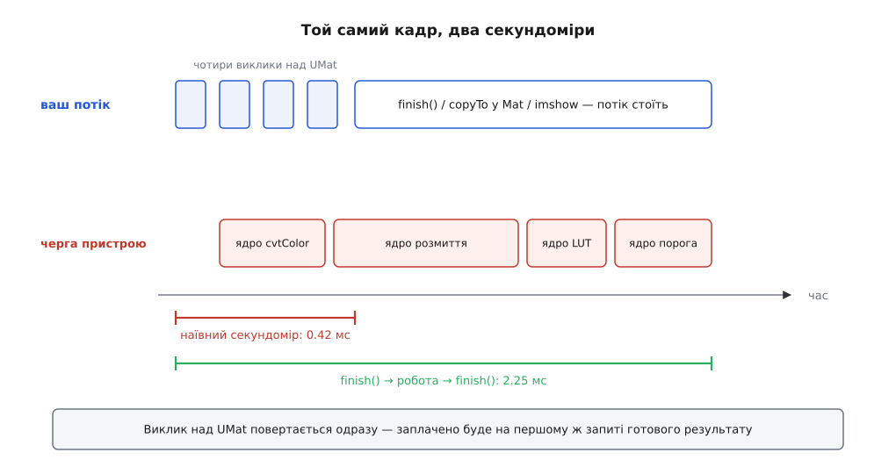
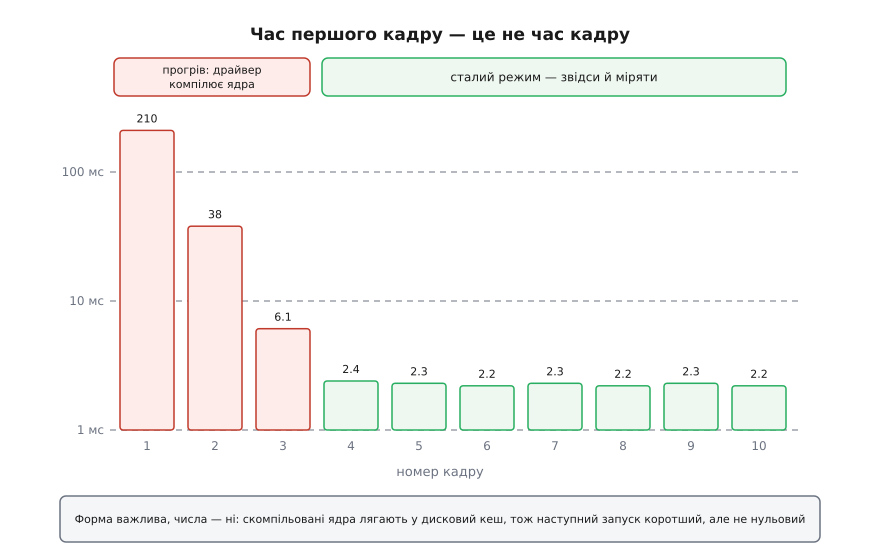

# ⚙️ Конвеєр на UMat, який не бреше про свій час

Це робоча програма на C++: вона проганяє той самий ланцюжок обробки кадру чотирма маршрутами, міряє кожен так, щоб число справді означало час кадру, і тут-таки друкує, скільки байтів за кадр перетнуло межу між системною пам'яттю й пам'яттю прискорювача. Потрібна вона тому, що звичайний секундомір навколо коду на `UMat` показує зовсім не те, що людина думає, — і рішення «прискорення не працює, вертаємо `Mat`» зазвичай ухвалюють на підставі числа, яке до кадру стосунку не має.

## Ланцюжок, на якому все видно

Беремо найкоротший ланцюжок, у якому стається все цікаве: **BGR → сірий**, **розмиття 5×5**, **крива яскравості поточково**, **поріг**. Три з чотирьох кроків — бібліотечні, у них є гілка для прискорювача. Четвертий, криву, ми напишемо власним циклом — і саме він створить у середині ланцюжка межу, якої в коді не видно.

Маршрути такі:

1. **усе на `Mat`** — межі не існує взагалі, це точка відліку;
2. **усе на `UMat`**, крива — бібліотечним `cv::LUT`, у якого гілка на пристрої є;
3. **усе на `UMat`**, крива — нашим циклом: кадр посеред ланцюжка їде на хост і назад;
4. **усе на `UMat`**, крива — власним ядром OpenCL: межа зникає знову.

Другий і третій маршрути рахують той самий результат і відрізняються рівно одним: скільки разів кадр перетнув межу. Четвертий показує, що робити, коли потрібної операції в бібліотеці немає й переписати крок нема на що.

## Три речі, через які секундомір бреше

**Перше — черга асинхронна.** Виклик над `UMat` ставить ядро в чергу команд і повертає керування; на цей момент результату ще немає. Секундомір навколо чотирьох таких викликів виміряє час постановки в чергу — десяті частки мілісекунди незалежно від роздільності кадру. Заплатите ви пізніше, на першому ж запиті готового результату, і виглядатиме це так, наче вся програма стоїть у `imshow`.



*Наївна дужка міряє постановку в чергу, чесна — роботу; різниця між ними на цій машині п'ятикратна.*

**Друге — перші кадри інші за всі наступні.** Ядра OpenCL живуть у бібліотеці вихідним текстом, а компілює їх драйвер під час виконання, уже знаючи конкретний пристрій. Перший виклик кожної функції платить за цю компіляцію.

**Третє — межі приховані.** Перетин не має свого імені у вашому коді: він народжується всередині `copyTo`, `getMat`, `imshow`, звернення до `.at<>()`. Тому байти, що перетнули шину, доводиться рахувати вручну — на кожному місці, де ви свідомо переходите з одного світу в другий.

Із цих трьох спостережень і складається каркас виміру: закривати чергу до й після, викидати кадри прогріву, рахувати перетини явно. Загальна дисципліна вимірювання, від якої тут нікуди не подітися — [мікробенчмарк: як не збрехати собі виміром](root:sf-release/microbenchmarking): прогрів, багато повторів, медіана замість середнього, той самий вхід для всіх варіантів.

## Каркас: секундомір, синхронізація, лічильник байтів

:::code proj-umat-boundaries/cpp/umat_boundaries.cpp

`copyTo` тут не випадковий. Коли приймач — `UMat`, `Mat::copyTo` не робить проміжного заголовка й не відображає буфер у адресний простір процесу: він створює приймач потрібного розміру й віддає байти прямо в `upload` алокатора. Зворотний бік симетричний. Це найдешевший спосіб перейти межу, і — що важливіше для нас — єдине місце, де перехід можна порахувати.

## Кроки ланцюжка

Крива яскравості — одна таблиця на 256 значень, спільна для всіх маршрутів: інакше маршрути рахували б різне й порівнювати їх не було б сенсу.

:::code proj-umat-boundaries/cpp/kroky-lantsiuzhka.cpp

Той самий крок ядром OpenCL. Це найкоротший приклад того, як узагалі виглядає власне ядро в термінах OpenCV; що таке контекст, черга й глобальний розмір задачі, розібрано окремо — [OpenCL: контекст, черга команд, ядра й буфери](root:sf-visual/opencl-compute-model).

:::code proj-umat-boundaries/c/main.c

Список параметрів ядра не довільний: його диктують помічники `KernelArg`. `ReadOnlyNoSize` розгортається у трійку «покажчик, крок, зсув», `WriteOnly` — у п'ятірку «покажчик, крок, зсув, рядки, стовпці», `PtrReadOnly` — в один покажчик. Порядок аргументів у ядрі мусить точно повторювати порядок помічників у `args`.

:::code proj-umat-boundaries/cpp/kroky-lantsiuzhka-2.cpp

`sync = false` — навмисно: ядро йде в чергу й повертає керування, як і решта викликів у маршруті. Синхронізуватися ми будемо в одному місці й свідомо.

## Чотири маршрути

:::code proj-umat-boundaries/cpp/chotyry-marshruty.cpp

Різниця між другим і третім маршрутом — сім рядків, і в них немає жодного слова про шину.

## Прогін: чотири числа на кадр замість одного

:::code proj-umat-boundaries/cpp/prohin-chotyry-chysla-na.cpp

Розділення на чотири числа — не педантизм, а власне діагностика. **Постановка** каже, скільки часу ваш потік провів у бібліотеці; у чесно асинхронного маршруту вона майже нульова. **Рахунок** — це те, що додалося після закриття черги, тобто справжня робота прискорювача. **Доставка** — ціна того, що результат потрібен процесорові. Щойно стовпчик «постановка» роздувся, десь усередині маршруту є синхронна межа, і шукати її треба не профільником, а очима по коду.

Кадри зробимо синтетичні — щоб програму можна було запустити де завгодно й дістати повторюваний результат:

:::code proj-umat-boundaries/cpp/prohin-chotyry-chysla-na-2.cpp

Останній цикл — не формальність. Бенчмарк, який порівнює чотири маршрути, зобов'язаний спершу довести, що вони рахують одне й те саме; інакше ви порівнюєте швидкість двох різних програм. Кілька десятків розбіжних пікселів на межах — нормально: округлення у згортці на пристрої й на процесорі різні, і піксель, що стояв упритул до порога, може перекинутися. Тисячі розбіжних пікселів означають помилку в коді, а не в залізі.

## Як читати вивід

Числа нижче зняті на одній конкретній машині з інтегрованою графікою; ваші будуть інші, важать співвідношення, а не абсолютні значення.

```
маршрут                     постан.  рахунок доставка   разом   через шину
усе на Mat                     4.92     0.00     0.00     4.92     0.00 МБ / 0
усе на UMat                    0.42     1.83     0.51     2.76     8.29 МБ / 2
UMat + процесорний крок        2.61     0.28     0.49     3.38    12.43 МБ / 4
UMat + власне ядро             0.45     1.79     0.50     2.74     8.29 МБ / 2
```

Перший рядок — точка відліку. Другий показує весь виграш прозорого шляху: 4.92 проти 2.76 мс, тобто менш ніж удвічі. Це нормальний, а не поганий результат для інтегрованої графіки; обіцянки «у десять разів» беруться з розрахунків, у яких доставки немає.

Третій рядок — уся суть вставки. Обчислення там ті самі, що й у другому, а кадр повільніший, ніж у другому, і ледве швидший за чесний процесорний перший. Подивіться, куди подівся час: стовпчик «рахунок» майже спорожнів (на пристрої лишився один поріг), зате «постановка» виросла в шість разів. Ці шість разів — не робота, а очікування: `download` посеред маршруту зупиняє потік, доки прискорювач не доробить розмиття. Байти теж видно: 12.43 МБ проти 8.29 МБ і чотири перетини замість двох.

Четвертий рядок повертає все на місце. Крок лишився нашим, а межа зникла — бо зник перехід у світ `Mat`.

## Три способи впіймати тихий відкат

Тепер найважче: у виводі вище ми знали, де межа, бо самі її поставили. У чужому конвеєрі її ставить бібліотека — там, де в потрібної функції не знайшлося гілки для прискорювача або де ця гілка відмовилася працювати з вашим типом даних. Нічого не падає, результат правильний, кадр просто повільніший.

**Спосіб перший — прогнати той самий маршрут із вимкненим прозорим шляхом.**

```cpp
    cv::ocl::setUseOpenCL(false);
    Report off = bench("UMat, OpenCL вимкнено", routeDevice, true, frames, 3, 20);
    cv::ocl::setUseOpenCL(true);
```

Якщо `off.total` не відрізняється від маршруту з увімкненим OpenCL — на пристрої не було нічого. Якщо відрізняється мало — на пристрої була дрібниця, за яку ви заплатили доставкою. Лічильник байтів у цьому прогоні, до речі, покаже ті самі 8.29 МБ: він рахує наші наміри, а не шину, і при вимкненому OpenCL ті самі два «перетини» вироджуються у звичайне копіювання всередині системної пам'яті.

**Спосіб другий — спитати керівний блок, де тепер правда.** Поля `UMatData` доступні з коду, і після кожного кроку по них видно, хто цей крок виконав:

:::code proj-umat-boundaries/cpp/try-sposoby-vpiimaty.cpp

Крок, що справді відпрацював на пристрої, лишає по собі свіжу копію на пристрої: `handle` є, системної копії часто немає взагалі, стоїть позначка застарілості хостової копії. Процесорна ж гілка починається з `_src.getMat()` і закінчується записом у системну пам'ять — після неї в керівному блоці з'являється `data`, а свіжою оголошено саме її. Одне застереження: на залізі зі спільною пам'яттю, де буфер відображається в адресний простір процесу замість копіювання, картина розмита — там обидві «копії» є однією ділянкою, і прапорці не такі промовисті. На дискретній карті ознака працює надійно.

**Спосіб третій — вбудоване трасування.** Змінна середовища `OPENCV_TRACE=1` вмикає журнал усіх внутрішніх викликів; `OPENCV_TRACE_LOCATION` задає префікс файлів (типово `OpenCVTrace`), а `OPENCV_TRACE_SYNC_OPENCL=1` змушує бібліотеку синхронізувати чергу навколо запусків ядер, без чого час у журналі так само переїжджає, як і в наївному секундомірі.

```
OPENCV_TRACE=1 OPENCV_TRACE_SYNC_OPENCL=1 ./umat_boundaries
```

Кожен запуск ядра OpenCL лишає в журналі власний запис із назвою ядра. Немає запису для вашого кроку — не було й кроку на пристрої. Це найдорожчий спосіб (трасування саме собою сповільнює програму й роздуває файл), зате єдиний, що показує весь ланцюжок, а не одну точку.

## Як прибрати межу, коли її знайдено

Способів рівно три, і вони йдуть за спаданням лінощів.

**Знайти операцію, яка вже вміє.** Наша крива — рівно `cv::LUT`, у якого гілка для прискорювача працює, коли дані восьмибітні, а таблиця має 256 значень. Величезна частка «власних» поточкових кроків розкладається на наявні операції над `UMat`: арифметику, `compare`, `inRange`, `convertTo`. Кожна така заміна прибирає два перетини.

**Написати ядро.** Це наш четвертий маршрут: тридцять рядків, з яких десять — список параметрів. Своє ядро варто писати тоді, коли крок справді свій — власна модель шуму, нестандартна морфологія, зшивання каналів у чужий формат.

**Пересунути межу, а не прибрати.** Якщо процесорний крок неминучий — чужа бібліотека, послідовний алгоритм, робота не над пікселями, — його майже завжди можна переставити **в кінець** ланцюжка. Кадр тоді перетинає межу один раз, а не двічі; хвіст конвеєра після нього просто лишається на процесорі. Правило те саме, що й для всього прозорого шляху: важить не кількість кроків на кожному боці, а кількість переходів між боками.

## Скільки має коштувати крок, щоб пристрій його окупив

Просте міркування, яке рятує від переписування, що не окупиться. Порівняймо два числа для сірого кадру 1080p:

```
b = 1920 · 1080 = 2 073 600 Б ≈ 2.07 МБ

доставка кадру через PCIe 3.0 ×16 (практично ≈ 10 ГБ/с):
    b / S_шини = 2 073 600 / 10 000 000 000 ≈ 0.21 мс

поточковий крок на процесорі — прочитати кадр і записати кадр,
при пропускній здатності системної пам'яті ≈ 25 ГБ/с:
    2b / S_пам'яті = 4 147 200 / 25 000 000 000 ≈ 0.17 мс
```

Числа однакового порядку — і це не збіг. Поточкова операція нічим не зайнята, крім читання й запису пам'яті; доставка кадру теж. Обидві впираються в пропускну здатність, а шина й системна пам'ять різняться в рази, а не на порядки. Звідси залізний висновок: **одна поточкова операція ніколи не окупить власного переїзду**, хоч би яким швидким було ядро — ви заплатите за доставку більше, ніж заощадите на обчисленні.

Окупається інше — кількість обчислень на прочитаний байт і довжина ланцюжка. Розмиття 5×5 у розділюваному вигляді — це десять множень-додавань на піксель замість одного читання; тут прискорювач має що робити. А доставка ділиться на всі кроки, які кадр устиг пройти, не перетинаючи межі: у нашому другому маршруті одна доставка припадає на чотири кроки, у третьому — дві доставки на ті самі чотири кроки, з яких на пристрої лишилося три. Це й видно у виводі.

## Пастки

**Вимір без закриття черги.** Найпоширеніша: секундомір навколо викликів на `UMat` без `cv::ocl::finish()` показує час постановки в чергу. Симптом — підозріло стабільні десяті частки мілісекунди, які не залежать від роздільності кадру.

**Прогрів.** Перші кадри після старту повільніші на порядки, бо драйвер компілює ядра під конкретний пристрій. Скомпільовані двійкові ядра OpenCV кладе в дисковий кеш, тож другий запуск програми коротший — але після оновлення драйвера кеш недійсний, і все повторюється. Вимикати кеш (`OPENCV_OPENCL_CACHE_ENABLE=0`) варто лише тоді, коли ви налагоджуєте власне ядро.



*Три перші кадри — це компіляція ядер, а не обробка; міряти можна лише з четвертого.*

**`getUMat` на вирізі.** Якщо `Mat` — це прямокутник усередині більшого кадру, `getUMat` спершу розтягує його назад до цілого батьківського кадру й переганяє на пристрій усе. Виріз 64×64 із кадру 4K коштує пересилання цілого кадру. Правильно — завантажити кадр один раз і брати виріз уже на боці `UMat`: `u(cv::Rect(...))` там є звичайним заголовком зі зсувом. Механіку вирізів і те, чому заголовок не володіє пікселями, розібрано в темі [види без копії: ROI і заголовок над чужим буфером](root:sys-media/mat-views-no-copy).

**`imshow` усередині циклу виміру.** Показ кадру — це і доставка на хост, і очікування віконної системи. У виміряному циклі йому не місце; у робочому — показуйте кожен n-й кадр, а не кожен.

**Потоко-локальний прапорець.** `cv::ocl::setUseOpenCL(false)` діє тільки на потік, у якому його викликано: значення живе в пам'яті потоку. Вимкнули прозорий шлях у головному потоці, а обробку робите в робочому — там він і далі ввімкнений. Те саме навпаки: діагностичне вимкнення в робочому потоці не вплине на решту програми.

**Проміжні `UMat` усередині гарячого циклу.** Оголошуйте їх поза циклом і перевикористовуйте: буфер потрібного розміру вже виділений, і драйверові менше роботи. У прикладах вище вони всередині маршрутів навмисно — так видно ланцюжок, — але в робочому конвеєрі їм місце в структурі стану.

**Ключ кеша власного ядра.** Останній аргумент `ProgramSource` — це ім'я, під яким скомпільоване ядро лежить у кеші. Змінили текст ядра, лишивши старий ключ, — і можете дуже довго дивуватися, чому правка нічого не змінює.
