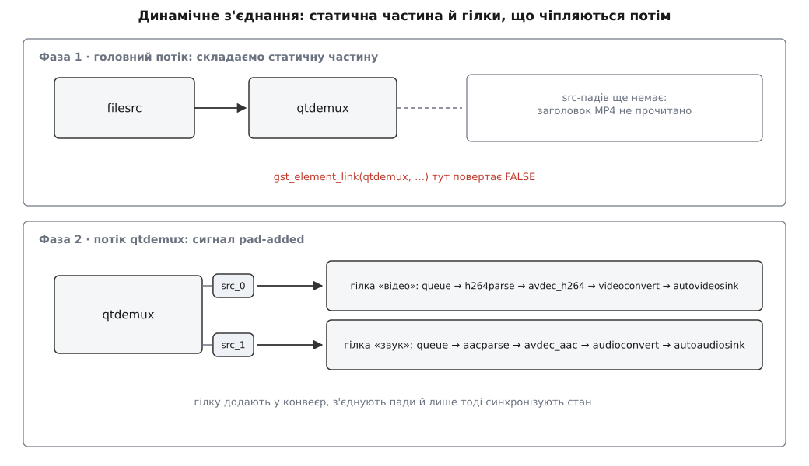
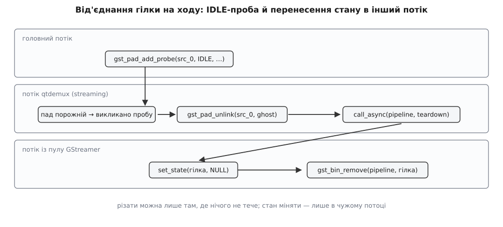

# ⚙️ Динамічне з'єднання: гілка, що з'являється під час роботи

Робоча програма на C, яка складає конвеєр `filesrc ! qtdemux` наперед, гілку розбору й декодування чіпляє до демультиплексора вже під час відтворення — коли той прочитав заголовок і повідомив, які доріжки в файлі, — а потім від'єднує цю гілку на ходу, не зупиняючи конвеєра. Мова тут не вибіркова: ядро GStreamer має C-API, сигнали й проби — це C-колбеки з фіксованими підписами, і будь-яка обгортка над бібліотекою все одно повторює ту саму послідовність викликів.

## Задача

На вході — файл MP4, про який відомо лише те, що це MP4. Скільки в ньому доріжок, які саме, у якому порядку — знає лише заголовок, і прочитає його `qtdemux` уже після запуску конвеєра. Отже, у момент складання нижньої половини конвеєра просто не існує: нема до чого чіпляти декодер, бо нема пада, з якого пішли б дані.

Треба зробити три речі. Перше — зібрати ту частину, що відома наперед, і запустити її. Друге — на кожен новий пад демультиплексора вирішити, що це за доріжка, побудувати відповідну гілку й приєднати її до конвеєра, який уже грає. Третє — через задану кількість секунд вирізати відеогілку так, щоб звук грав далі, а конвеєр не помітив хірургії.

## Ідея: два збирання замість одного

Конвеєр розпадається на дві частини з різними правилами. **Статичний кістяк** (`filesrc ! qtdemux`) складають у головному потоці до старту — тут працює звичайний `gst_element_link`. **Гілки** народжуються в обробнику сигналу `pad-added`, який GStreamer викликає зі свого потоку обробки, коли конвеєр уже в стані `PLAYING`.

Друге рішення економить більшу частину коду: кожну гілку роблять окремим **біном з одним привидним sink-падом**. Тоді гілка будь-якої довжини — це один об'єкт із одним входом, який додають, синхронізують, від'єднують і вилучають одним викликом кожної дії. Без біна довелося б тримати список елементів гілки й повторювати кожну операцію по всьому списку, не переплутавши порядку.



*Перша фаза складається як звичайний конвеєр; друга — щоразу, коли демультиплексор оголошує чергову доріжку.*

## Кістяк і підписка

:::code proj-dynamic-linking/c/dynlink.c

Головний цикл `GMainLoop` тут не декорація. Обробник `pad-added` виконуватиметься в потоці демультиплексора, а помилки, які він може накоїти, прилітають окремим каналом — повідомленнями на шину конвеєра. Читає шину `gst_bus_add_watch`, і читає її **в головному потоці**: доки цикл крутиться, потік обробки може щось повідомити, нікого не чекаючи ([шина повідомлень](root:sys-media/bus-and-messages) — асинхронний канал від конвеєра до програми саме для того, щоб потоки обробки ніколи не блокувалися на розмові з нею).

:::code proj-dynamic-linking/c/kistiak-i-pidpyska.c

## Гілка як бін з одним входом

:::code proj-dynamic-linking/c/hilka-iak-bin-z-odnym.c

Перший елемент кожної гілки — `queue`, і це не про запас пам'яті. Черга розриває ланцюг вкладених викликів: далі за нею гілка живе у **власному потоці**, а демультиплексор, штовхнувши буфер, одразу вертається до розбору файлу замість того, щоб чекати на декодування ([потоки виконання й черги](root:sys-media/threads-and-queues) — де саме конвеєр міняє потік і чого це коштує). Для розрізу це теж важить: гілка з чергою вимикається, не чіпаючи потоку, у якому працює `qtdemux`.

## Обробник pad-added

:::code proj-dynamic-linking/c/obrobnyk-pad-added.c

Порядок трьох дій — не питання смаку, кожна перестановка карається по-своєму. З'єднати до `gst_bin_add` не дасть перевірка ієрархії: обидва пади мусять мати спільного предка, бо станами й годинником керують згори вниз по дереву об'єктів. Синхронізувати стан до `gst_bin_add` теж не вийде — синхронізувати нема з чим, батька ще немає. А от забути третій крок легко, і саме це найпідступніше: конвеєр грає, гілка приєднана, помилок нема, картинки нема. Елемент, доданий у працюючий конвеєр, залишається в стані `NULL` доти, доки хтось явно не підніме його ([стани конвеєра](root:sys-media/states-lifecycle) — перехід у `PLAYING` активує пади й запускає потоки, і новачок у конвеєрі його не отримує задарма).

> 🔧 **Навіщо це.** Рівно цю процедуру виконують `decodebin`, `uridecodebin` і `playbin` усередині — вони будують гілки під розпізнаний вміст і чіпляють їх на ходу. Тому розібраний обробник — це не лише спосіб написати свій програвач, а й спосіб читати чужі проблеми: коли `playbin` мовчить на одному файлі й грає на іншому, питання завжди те саме — який пад він оголосив, які на ньому caps і що з ним сталося далі.

## Різати на ходу

Тепер найтонше. Потік даних у GStreamer — це стек вкладених викликів: доки нижній елемент обробляє буфер, верхній стоїть усередині свого `gst_pad_push`. Якщо в цей момент інший потік почне вимикати й вилучати елементи гілки, вони руйнуватимуться просто під час власного виклику.

Тому різати можна лише там, де в цю мить нічого не тече, а знає про це сам GStreamer. Проба типу `GST_PAD_PROBE_TYPE_IDLE` викликається саме тоді, коли пад порожній: якщо він порожній уже в мить установлення проби, обробник викличуть негайно, з того ж потоку; інакше — зі streaming-потоку, щойно пад звільниться.



*Розрив робить той потік, що володіє падом; вимикання й вилучення — будь-який інший.*

:::code proj-dynamic-linking/c/rizaty-na-khodu.c

Розділення двох дій — розрив тут, вимикання деінде — має точну причину. Перехід у `NULL` зупиняє потоки елемента й **чекає**, доки вони справді зупиняться. Якщо викликати його з потоку, що належить тому самому елементові, чекати доведеться на самого себе — класичне взаємне блокування ([взаємне блокування](root:sf-tasks/deadlock) — коли учасник чекає на подію, яку сам і мав би спричинити). Документація GStreamer на цей випадок дає готовий інструмент: `gst_element_call_async` викликає передану функцію з іншого потоку саме для змін стану зі streaming-потоку. У нашому складі гілки з чергою перехід, можливо, минувся б і без цього, але правило безумовне, а ціна його — один рядок.

## Коли в гілці запис у файл

Миттєвий розрив губить усе, що встигло накопичитися в черзі гілки. Для екрана це кілька непоказаних кадрів, для запису у файл — зіпсований файл: мультиплексор дописує таблиці й правильні розміри лише тоді, коли дістане `EOS`. Отже, гілку спершу зливають, а вимикають після.

:::code proj-dynamic-linking/c/koly-v-hiltsi-zapys-u-fail.c

Пробу вішають на sink-пад **останнього** елемента гілки: `EOS`, що дійшов туди, означає, що все попереднє вже віддало свій хвіст і мультиплексор дописав, що мав.

## Скільки це коштує

**Умова.** Відео 30 кадрів за секунду, у гілці стандартний `queue` — три ліміти одночасно: 200 буферів, 10 485 760 байтів, 1 000 000 000 наносекунд. Розріз просять у довільний момент.

```
період кадру                        = 1000 / 30            = 33.33 мс
пад порожній між штовханнями → проба спрацює
    найпізніше за один період                              ≈ 33 мс
сам розрив (два покажчики)                                 ≈ 0 мс

скільки даних зникне разом із гілкою:
    за часом                        ліміт черги            = 1.00 с
    за кадрами                      200 / 30               = 6.67 с
    спрацює менший                  min(1.00; 6.67)        = 1.00 с
```

Тобто затримка від «хочу різати» до розриву — частки кадру, а от непоказаного вмісту в черзі може бути до секунди. Дорога тут лише третя дія: перехід у `NULL` руйнує контексти декодера й звільняє буфери, і це вже мілісекунди роботи — саме тому її винесено з потоку, яким тече відео.

## Пастки

**Обробник виконують у чужому потоці.** `pad-added` приходить зі streaming-потоку `qtdemux`, і доки ви в обробнику — демультиплексор стоїть. Звідси заборони: не спати, не чекати на відповідь від головного потоку, не малювати інтерфейс і не читати шину блокувально — `gst_bus_timed_pop_filtered` чекатиме на повідомлення від конвеєра, а конвеєр у цю мить стоїть у вашому обробнику. Треба сказати щось назовні — покладіть повідомлення на шину або віддайте роботу головному циклу через `g_idle_add`.

**Гілку додають у бін, а вже потім з'єднують.** `GST_PAD_LINK_WRONG_HIERARCHY` означає рівно одне: у двох падів немає спільного предка. У динамічному коді це майже завжди забутий `gst_bin_add`.

**`queue` на початку гілки ховає невідповідність форматів.** Черга пропускає будь-які caps, тож `gst_pad_link` завжди скаже `OK`, навіть якщо далі стоїть декодер зовсім не того кодека. Помилка вилізе пізніше й в іншому місці — повідомленням на шину від того елемента, який не зміг домовитися. Перевіряти вміст треба на `media`, а не сподіватися на код повернення з'єднання.

**Права власності різні в кожному виклику.** Пад, що приходить у сигнал, — позичений на час виклику; хочете тримати його довше, як ми для розрізу, — беріть `gst_object_ref`. `gst_element_get_static_pad` і `gst_pad_get_peer` віддають вам зайве посилання, яке треба зняти. `gst_bin_add` і `gst_element_add_pad`, навпаки, забирають ваше посилання собі — саме тому в `make_branch` елементи ніде не звільняють окремо, а один `gst_object_unref (bin)` в аварійній гілці прибирає весь недобудований бін ([лічильник посилань](root:sf-lang/reference-counting) — володіння визначає не тип, а домовленість функції).

**Порожній демультиплексор — це помилка, а не тиша.** Коли ми відрізали відеогілку, `qtdemux` штовхає у від'єднаний пад і дістає `GST_FLOW_NOT_LINKED`. Рятує те, що демультиплексор зводить коди повернення всіх своїх падів разом і повідомляє `NOT_LINKED` угору лише тоді, коли **всі** пади не з'єднані. Доки грає звук, конвеєр живий. Ріжте останню гілку — і на шину прилетить знайоме `Internal data stream error.` з поясненням `streaming stopped, reason not-linked (-1)`. Якщо потік має тривати без споживача, не лишайте пад голим: приєднайте `fakesink` із `sync=false`.

**IDLE-проба може спрацювати всередині `gst_pad_add_probe`.** Якщо пад у цю мить порожній, обробник викличуть негайно, у потоці, який пробу ставить. Тому не тримайте в момент установлення замка, який бере сам обробник, і не покладайтеся на те, що `gst_pad_add_probe` уже повернувся, коли обробник починає працювати.

**Доріжок може бути більше, ніж ви чекаєте.** Перевірки `app->video_branch == NULL` — це свідоме рішення «беремо першу доріжку кожного типу»; без них файл із двома звуковими доріжками дасть два вивідні пристрої одночасно. І не вважайте, що після першого `pad-added` більше нічого не буде: коли демультиплексор оголосив усе, він надсилає окремий сигнал `no-more-pads` — саме на нього вішають логіку «усі доріжки на місці», а не на таймер.

**Гілка зашита під кодек.** `h264parse ! avdec_h264` — це припущення про вміст, зроблене за префіксом `video/`. У бойовому коді на місці такої гілки ставлять `decodebin` і повторюють на його `pad-added` рівно ту саму процедуру — або дивляться на повний рядок caps і добирають елементи за ним.

## Подивитися, що вийшло

Дві команди дають повну картину без жодного налагоджувача. `GST_DEBUG=qtdemux:5,GST_PADS:5 ./dynlink кіно.mp4` покаже кожне створення й з'єднання пада з іменами та кодами повернення. А `GST_DEBUG_DUMP_DOT_DIR=. ./dynlink кіно.mp4` разом із рядком

```c
GST_DEBUG_BIN_TO_DOT_FILE (GST_BIN (app->pipeline),
                           GST_DEBUG_GRAPH_SHOW_ALL, "after-cut");
```

у кінці `teardown_video_branch` покладе поруч файл `.dot` — граф конвеєра з усіма падами й погодженими caps на кожному зв'язку. Поставте такий самий рядок наприкінці `on_pad_added`, і матимете два знімки: до хірургії й після ([діагностика конвеєра](root:sys-media/pipeline-debugging) — графи, рівні журналу й читання типових затиків).
