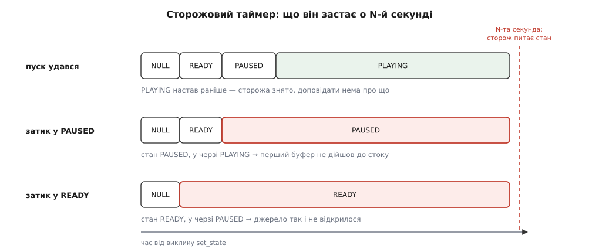

# ⚙️ Спостерігач шини, що сам збирає докази

Це діагностична обв'язка на двісті рядків, яку прикручують до готового конвеєра одним викликом і більше про неї не згадують: доки все гаразд, вона мовчить, а коли ламається — сама друкує обидві половини помилки, сама скидає граф конвеєра на диск **у мілісекунду аварії** й сама доповідає, у якому саме стані все застрягло, якщо `PLAYING` так і не настав.

Потреба в ній береться з простої арифметики часу. Несправність у конвеєрі триває мить: елемент постить `ERROR`, конвеєр згортається, і вже за секунду в пам'яті немає ні того графа, ні тих узгоджених форматів, ні тих станів, які могли б пояснити, що сталося. Людина за терміналом цієї втрати не помічає — вона просто перезапускає з `GST_DEBUG=4` і дивиться ще раз. Пристрій, що місяць працює в полі, другого разу не дає: наступний збій буде через тиждень, і біля нього знову нікого не буде. Тому докази має збирати той, хто на місці події, — сама програма, тоді ж, коли подія відбувається.

## Задача

Обв'язка мусить робити п'ять речей.

**Друкувати помилку цілком.** Повідомлення `ERROR` несе дві частини: `GError` із текстом для людини й окремий зневаджувальний рядок, у якому записано файл із номером рядка, ім'я функції та повний шлях елемента в графі. Перша частина часто не означає нічого («Internal data stream error»), друга називає винного поіменно. Те саме стосується `WARNING` та `INFO` — вони влаштовані однаково й розбираються тією ж парою вказівників.

**Ловити брак плагіна.** Повідомлення про кодек, якого в системі не знайшлося, приходить **окремо й раніше** за помилку, іншим типом, і тільки в ньому написано, чого саме бракує. Програма, яка дивиться лише на `ERROR`, дізнається «не змогли декодувати» замість «немає декодера H.264».

**Скидати граф у момент аварії.** З часовою міткою в імені, щоб серія знімків не затирала сама себе.

**Стежити за годинником.** Якщо за `N` секунд конвеєр не доїхав до `PLAYING` — доповісти, де він стоїть. Це єдиний спосіб відрізнити «застряг у `PAUSED`» від «не вийшов із `READY`», а це два зовсім різні діагнози.

**Розбирати відповідь `set_state`.** Зокрема `NO_PREROLL`, яке не є помилкою й читається як «джерело живе».

І одну річ вона робити **не мусить**: вирішувати за програму, що робити далі. Не зупиняти цикл, не перебудовувати конвеєр, не глушити помилку. Обв'язка — свідок, а не суддя; логіка застосунку живе окремо й будується зовсім інакше — приклад такої логіки розібрано у [робочому циклі шини](root:sys-media/bus-and-messages/proj-bus-loop.md).

## Ідея: одна структура, два виклики

Усе, що обв'язці потрібно пам'ятати, — це вказівник на конвеєр, вказівник на його шину, два ідентифікатори джерел подій (стеження й таймер), префікс для імен файлів і два прапорці. Одна структура, один виклик на приєднання, один на від'єднання.

Ключове рішення тут — **де взяти стан у момент, коли конвеєр не відповідає**. Спокуса очевидна: спитати `gst_element_get_state()` і зачекати на відповідь. Саме так обв'язка й перетворюється на частину несправності — про це нижче окремо. Правильний хід протилежний: питати з **нульовою** витримкою, тобто «що є просто зараз, не чекаючи ні миті». Відповідь із нулем ніколи не блокує й повертає рівно те, що потрібно: поточний стан, стан у черзі та код переходу.

Друге рішення — **скидати граф не за розкладом, а за подією**. Граф, знятий раз на хвилину, майже завжди знімає здоровий конвеєр. Граф, знятий з обробника помилки, знімає той єдиний, який має значення.

## Код

### Каркас і приєднання

:::tabs
:::code proj-bus-watch-diagnostics/c/gstdiag.c
:::code proj-bus-watch-diagnostics/py/gstdiag.py
:::

Перевірка `watch_id == 0` варта того рядка, який вона займає. Шина тримає рівно **одне** стеження; другий виклик `gst_bus_add_watch()` нічого не приєднає й поверне нуль. Ситуація виникає сама собою, щойно обв'язку прикручують до конвеєра, у якому вже є свій обробник, — і без перевірки виглядає це як мовчазна діагностика, що чомусь не діагностує.

### Розбір помилки: друга половина важливіша за першу

`ERROR`, `WARNING` та `INFO` влаштовані однаково: усі три віддають пару «`GError` плюс зневаджувальний рядок» і різняться лише тим, що з ними робить програма. Тому розбір спільний, а рішення — назовні.

:::tabs
:::code proj-bus-watch-diagnostics/c/rozbir-pomylky-druha.c
:::code proj-bus-watch-diagnostics/py/rozbir-pomylky-druha.py
:::

Виглядає вивід так — і саме рядок «місце» перетворює безглузду фразу на адресу:

```
ПОМИЛКА: Internal data stream error.
  елемент: /GstPipeline:pipeline0/GstQTDemux:qtdemux0
  домен:   gst-stream-error-quark, код 1
  місце:   ../gst/isomp4/qtdemux.c(6073): gst_qtdemux_loop ():
           /GstPipeline:pipeline0/GstQTDemux:qtdemux0:
           streaming stopped, reason not-linked (-1)
  граф скинуто: $GST_DEBUG_DUMP_DOT_DIR/<час>-cam0-error.dot
```

> 🔧 **Навіщо це.** Перший рядок однаковий для доброї сотні різних несправностей — він каже лише «потік урвався». Останній рядок зневаджувальної частини називає **код зупинки потоку**, і саме він розводить причини: `not-linked (-1)` означає непід'єднаний пад, `not-negotiated (-4)` — порожній перетин форматів, `flushing (-2)` — конвеєр саме розчищають. Три різні механізми, три різні місця, де шукати, — і одна спільна фраза нагорі.

### Брак плагіна приходить окремо

Коли `decodebin` не знаходить декодера, він спершу постить повідомлення типу `ELEMENT` із докладним описом того, чого бракує, і аж потім — звичайну помилку. Перше повідомлення розпізнає й розбирає бібліотека `pbutils`; про те, звідки взагалі береться перелік доступних елементів, ідеться в темі про [модель плагінів](root:sys-media/plugin-model).

:::code proj-bus-watch-diagnostics/c/brak-plahina-prykhodyt.c

Опис читається людиною («H.264 decoder»), а другий рядок — це машинний ключ, за яким система вміє сама доставити потрібний пакунок. На робочому пристрої другий рядок цінніший: він однозначно ідентифікує брак, тоді як опис міняється від версії до версії.

### QoS: скільки кадрів уже викинуто

`QOS` — єдине повідомлення в цьому наборі, яке приходить **часто**. Стік, що не встигає, постить його на кожен викинутий кадр, тож друкувати все підряд означає утопити журнал. Тому тут стоїть загорожа за часом: не частіше ніж раз на секунду, зате з накопиченими лічильниками.

:::code proj-bus-watch-diagnostics/c/qos-skilky-kadriv-uzhe.h

Три числа тут читаються по-різному. **Викинуто** — факт: стільки кадрів уже не побачив ніхто. **Запізнення** (`jitter`) — різниця між тим, коли буфер дійшов, і тим, коли він мав дійти; додатне означає «спізнився», і його величина каже, наскільки серйозно. **Темп** (`proportion`) — довгострокова оцінка того, у скільки разів треба змінити швидкість обробки проти нормальної, щоб триматися реального часу; значення понад одиницю означає, що конвеєр стабільно не встигає, а не спіткнувся один раз. Стала одиниця з поодинокими сплесками — це нормальна робота; двійка, яка тримається, — це нестача продуктивності, і далі йдеться вже про [затримку й буферизацію](root:sys-media/latency-and-buffering).

### Стани — тільки конвеєра

Повідомлення `STATE_CHANGED` постить **кожен** елемент на кожному переході. Конвеєр із дванадцяти елементів дає під п'ятдесят рядків на один пуск, і серед них губиться те єдине, що має значення. Нас цікавить лише перехід конвеєра як цілого, бо він оголошується тоді, коли всі всередині вже перейшли.

:::code proj-bus-watch-diagnostics/c/stany-tilky-konveiera.c

Тут же знімається сторожовий таймер. Це не оптимізація, а умова правильності: сторож, який вистрелив у конвеєрі, що вже грає, друкує неправдиву тривогу, і наступного разу їй ніхто не повірить.

Решта обробника — це кілька рядків диспетчеризації, які лишилося дописати навколо наведених гілок:

:::tabs
:::code proj-bus-watch-diagnostics/c/stany-tilky-konveiera-2.c
:::code proj-bus-watch-diagnostics/py/stany-tilky-konveiera.py
:::

### Сторож: що застає таймер о N-й секунді

Тепер найцінніша частина. Помилка сама себе оголошує — конвеєр, який просто **стоїть**, не оголошує нічого. Сторожовий таймер потрібен саме для другого випадку, і його доповідь має розводити три різні ситуації.



*Ті самі N секунд і той самий чорний екран дають три різні діагнози залежно від того, до якого стану конвеєр устиг дійти. Без сторожа вони не розрізняються ніяк.*

`PAUSED` за домовленістю означає, що перший буфер уже дійшов до стоку — тому «застряг у `PAUSED`» читається однозначно: між джерелом і стоком є місце, де перший кадр зупинився. `READY` означає, що ресурси відкрито, але дані ще не пішли, тож «застряг у `READY`» — це майже завжди джерело, яке не відкрилося. Що саме обіцяє кожен стан, розібрано у темі про [стани конвеєра](root:sys-media/states-lifecycle).

:::tabs
:::code proj-bus-watch-diagnostics/c/storozh-shcho-zastaie.c
:::code proj-bus-watch-diagnostics/py/storozh-shcho-zastaie.py
:::

Поле `pending` тут не менш промовисте за `cur`. `PAUSED` із порожньою чергою (`VOID_PENDING`) означає, що конвеєр дійшов до `PAUSED` і **зупинився там навмисно** — ніхто не просив його йти далі. `PAUSED` із `PLAYING` у черзі означає, що просили, але перехід не завершується. Це знову два різні діагнози: перший — помилка в коді програми, другий — затик у самому конвеєрі.

### Пуск: `NO_PREROLL` — не помилка

Пуск робиться у два кроки не з обережності. Відповідь на перший крок — єдиний надійний спосіб дізнатися, чи джерело живе, а від цього залежить, який вирок має право виносити сторож.

:::tabs
:::code proj-bus-watch-diagnostics/c/pusk-no-preroll-ne-pomylka.c
:::code proj-bus-watch-diagnostics/py/pusk-no-preroll-ne-pomylka.py
:::

`NO_PREROLL` — це відповідь камери, мікрофона чи мережевого потоку: даних наперед узяти нізвідки, вони існують лише в реальному часі. Програма, яка тлумачить це значення як невдачу, відмовляється працювати з живими джерелами. Програма, яка його ігнорує, чекає на `ASYNC_DONE`, якого не буде ніколи, — і висить не через несправність, а через власне очікування неможливого.

Гілка `FAILURE` — місце, де більшість прикладів обриваються рядком «не вдалося запустити конвеєр». Помилка на шині вже лежить: елемент устиг її запостити просто всередині `set_state()`. Але головний цикл іще не крутиться, і стеження не спрацює ніколи, бо програма зараз піде у вихід. Один виклик `gst_bus_timed_pop_filtered()` із нульовою витримкою забирає її звідти, і вона друкується так само докладно, як усі інші.

### Складання

:::tabs
:::code proj-bus-watch-diagnostics/c/skladannia.c
:::code proj-bus-watch-diagnostics/py/skladannia.py
:::

```sh
gcc gstdiag.c -o gstdiag $(pkg-config --cflags --libs gstreamer-1.0 gstreamer-pbutils-1.0)
./gstdiag "rtspsrc location=rtsp://cam/stream ! decodebin ! autovideosink"
```

Пакунок `gstreamer-pbutils-1.0` приїжджає разом із заголовками `gst-plugins-base` — окремо його встановлювати не треба, але в рядку складання він має бути, інакше розпізнавання браку плагінів не злінкується.

## Пастки

П'ять способів отримати обв'язку, яка виглядає працездатною і не працює.

**Стеження без циклу.** `gst_bus_add_watch()` не запускає нічого — воно лише **чіпляє джерело подій** до типового головного контексту GLib. Доки цей контекст ніхто не обертає, обробник не викликається жодного разу, повідомлення накопичуються в черзі, і програма мовчить так само переконливо, як мовчала б без обв'язки. Найчастіше це трапляється в застосунку, у якого вже є **свій** цикл подій — власний сервер, чужий набір віджетів, — бо той контекст не є типовим. Ліків два: підняти `GMainLoop` в окремій нитці або взагалі не приєднувати стеження, а вичерпувати шину `gst_bus_pop()` із таймера свого циклу — і тоді власником повідомлень стаєте ви, з обов'язком звільнити кожне. Коли контекст свій, але не типовий, є третій шлях: `gst_bus_create_watch()` віддає джерело, яке ви самі приєднуєте куди треба. Механіка того, чому джерело подій без циклу — просто структура в пам'яті, розібрана в темі про [цикл подій](root:sf-tasks/event-loop).

**Блокувальний запит стану.** `gst_element_get_state (pipeline, &s, &p, GST_CLOCK_TIME_NONE)` чекає, доки перехід завершиться — тобто **вічно**, якщо конвеєр застряг. Сторож, написаний так, помирає разом із тим, що мав спіймати. Гірше: якщо він викликається з нитки головного циклу, то заразом зупиняє й стеження за шиною, і та сама `ERROR`, яка все б пояснила, лишається непрочитаною назавжди. Нуль означає «скажи, що є зараз», і не блокує ніколи; скінченна витримка на кшталт `100 * GST_MSECOND` доречна лише там, де ви справді хочете почекати й готові до того, що не дочекаєтеся.

**Забутий `g_free`.** `gst_message_parse_error()` віддає **у власність** і `GError`, і зневаджувальний рядок; те саме роблять `gst_object_get_path_string()` та обидві функції розбору браку плагінів. На помилці, що трапляється раз за запуск, витік невидимий. На `WARNING`, який деякі елементи постять на кожен проблемний буфер, він стає помітним за години. Безпечніший близнюк `g_error_free()` — це `g_clear_error()`: він і `NULL` переживе, і вказівник по собі занулить. Зворотна помилка так само реальна: `GstMessage`, що прийшов у стеження, **позичений**, і `gst_message_unref()` на нього — подвійне звільнення, яке виявиться десь у надрах наступного повідомлення. Своїм повідомлення стає лише тоді, коли ви забрали його `pop`-ом самі.

**Теки, якої немає.** `GST_DEBUG_DUMP_DOT_DIR` не створюється — ні бібліотекою, ні макросом. Указали неіснуючий шлях, і скидання графа мовчки не робить нічого: ні попередження, ні коду помилки, ні рядка в журналі. Друга половина тієї ж пастки — час: змінну читають під час `gst_init()`, тож виставляти її після ініціалізації безглуздо. Якщо теки взагалі не має бути (незмінна файлова система, немає куди писати), є обхід: `gst_debug_bin_to_dot_data()` повертає той самий опис графа **рядком** і жодних змінних середовища не питає — далі його можна покласти у власний журнал, відправити по мережі або втиснути в повідомлення про аварію.

**Макроси, що компілюються в ніщо.** Обидва скидачі графа — це макроси, і в бібліотеці, зібраній без діагностики (`GST_DISABLE_GST_DEBUG`, звична економія в урізаних вбудованих збірках), вони розкриваються в порожнечу. Разом із ними перестає діяти й `GST_DEBUG` — журналу теж не буде. Ззовні це виглядає як обв'язка, що бездоганно друкує повідомлення й ніколи не залишає жодного графа. Тому перевірку варто зробити гучною **на старті**, а не на місці аварії: `#ifdef GST_DISABLE_GST_DEBUG` у діагностичній функції коштує нуль і рятує від довгого здивування. У Python цієї пастки в такій формі немає — там викликається сама функція, а не макрос, — але якщо діагностику вимкнено в самій бібліотеці, функція буде порожньою заглушкою.

І шоста, яка не належить до GStreamer, але з'їдає ту саму годину: **сторож живе в тому ж циклі, що й усе інше**. Він ловить конвеєр, який стоїть, — і не ловить програму, яка стоїть, бо разом із нею стоїть і він сам. Для другого випадку потрібен незалежний спостерігач: окрема нитка з власним контекстом або зовнішній [сторожовий таймер](root:sf-devices/watchdog), який дивиться на процес ззовні.

## Що це коштує

Дорога даних не зачіпається взагалі: шина — окремий канал, і жоден буфер крізь обв'язку не проходить. Ціна складається з трьох дрібних доданків. Одне джерело подій у циклі й один таймер — константа, помітна хіба що в лічильнику дескрипторів. Одне виділення пам'яті на повідомлення шини: на здоровому конвеєрі це кілька штук за пуск і нуль потім, на конвеєрі, що не встигає, — десятки `QOS` за секунду, які й зрізає загорожа за часом.

Третій доданок єдиний вартий уваги: **скидання графа — це синхронний запис файлу**. Із прапорцем `SHOW_ALL` у файл іде повний перелік caps на кожному з'єднанні, і на розлогому конвеєрі це від кількох до кількох десятків кілобайт. Один запис у момент аварії — безкоштовно; той самий виклик із обробника `pad-added` на потоці, де пади з'являються постійно, — уже помітна витрата. Правило просте: скидати за подією, яка трапляється рідко, і ніколи — за подією, прив'язаною до буфера.
