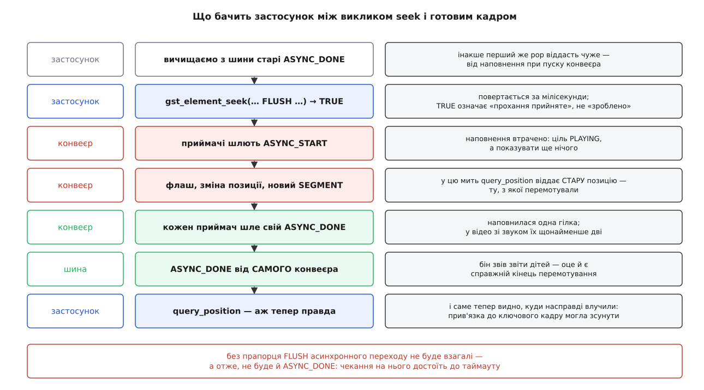
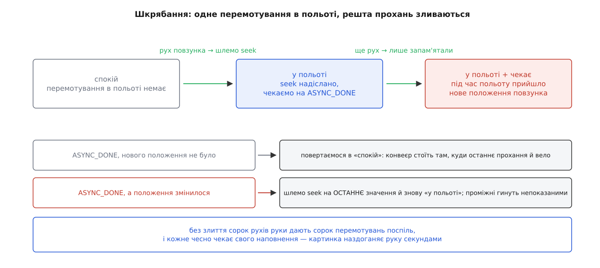

# ⚙️ Перемотування з коду: чекання, точність і петля

Десь три сотні рядків мовою C — маленький пульт перемотування, який робить чотири речі, що їх найчастіше пишуть неправильно: стрибає на задану позицію й **чесно дочікується**, доки конвеєр справді там опиниться; міряє, у скільки обходиться точність порівняно з прив'язкою до ключового кадру; шкрябає стрічку в PAUSED, не захлинаючись власними проханнями; крутить фрагмент по колу без жодного шва. Одна пара функцій обслуговує всі чотири режими, бо всі вони спираються на те саме: `gst_element_seek()` віддає керування задовго до того, як щось справді сталося, і вся робота застосунку — правильно дочекатися.

Мова тут не з вибору, а з обмеження: [GStreamer](root:sys-media/pipeline-model) написаний мовою C, і seek-подія живе саме там. Прив'язки для інших мов переносять ті самі виклики й ті самі правила, тому дивитися варто на первісний вигляд.

## Чому «перемотати» — це не один виклик

Найкоротший варіант, який зустрічається в чужому коді, виглядає так:

```c
gst_element_seek_simple (pipeline, GST_FORMAT_TIME,
                         GST_SEEK_FLAG_FLUSH, 12.5 * GST_SECOND);
gst_element_query_position (pipeline, GST_FORMAT_TIME, &pos);
g_print ("тепер ми на %" GST_TIME_FORMAT "\n", GST_TIME_ARGS (pos));
```

Два виклики, і обидва брешуть у різний спосіб.

Перший не питає, чи це джерело взагалі вміє перемотуватися, і мовчки ковтає відмову: `gst_element_seek_simple()` повертає `gboolean`, і його тут ніхто не читає. Другий питає про позицію негайно — а конвеєр у ту мить іще навіть не почав викидати старе, тож `pos` віддасть те місце, звідки перемотували. Прапорців точності немає жодного, тож куди саме влучили, невідомо: типово це буде найближчий ключовий кадр, тобто на пів секунди раніше, ніж просили. І якщо конвеєр десь застрягне, програма зависне без жодного натяку на причину.

Чотири помилки у двох викликах — не через недбальство, а тому, що перемотування має форму, якої не видно з сигнатури. Виклик **надсилає прохання**; виконують його інші потоки; звітують вони на шину. Отже, робочий код мусить складатися з трьох частин: запитати, чи можна; надіслати; дочекатися звіту. Далі — програма, у якій кожна з них написана повністю.

## Чи можна тут перемотувати взагалі

Почнімо з запиту, бо саме його найчастіше пропускають — та й розташований він незручно. Ядро дає зручні обгортки `gst_element_query_position()` і `gst_element_query_duration()`, а от такої самої обгортки для питання «чи перемотується» немає: запит доводиться складати руками.

:::code proj-seek-driver/c/seek-driver.c

Дві негативні відповіді тут різні, і розрізняти їх варто. `gst_element_query()` повернув `FALSE` — запит нікого не зацікавив, ланцюг узагалі не має кому на нього відповідати; так поводиться напівзібраний конвеєр. Запит відповів, а `seekable` дорівнює `FALSE` — ланцюг зрозумів питання і сказав «ні»; так відповідає жива камера. Для повзунка в інтерфейсі різниці немає — його не малюють в обох випадках, — а от у журналі це два різні діагнози.

Межі `lo` і `hi` — не декорація й не копія тривалості. Для файлу вони справді дорівнюють нулю й тривалості. Для мережевого потоку, який елемент тримає в кільцевому буфері, `lo` повзе вперед разом із записом: перемотати можна лише в межах того, що ще не витіснено. Повзунок, намальований від нуля, у такому конвеєрі просто не працюватиме на лівій третині.

Питати все це має сенс тільки після того, як конвеєр дійшов до PAUSED: доти демультиплексор не встиг прочитати таблицю індексів, тож перекладати час у байти йому нічим, і відповідь буде «не можна».

:::code proj-seek-driver/c/chy-mozhna-tut.c

`GST_STATE_CHANGE_NO_PREROLL` у відповідь на PAUSED — це і є те саме «джерело живе», яке пізніше видасть `seekable == FALSE`. Дізнатися про це на пуску дешевше, ніж на першому клацу користувача.

## Ядро: перемотування, яке чекає

Тепер головна функція програми. Її будова цілком продиктована тим, як конвеєр звітує про роботу.



*Виклик повертається на другому рядку, а перемотування закінчується на шостому; усе, що застосунок читає між ними, стосується старої позиції.*

:::code proj-seek-driver/c/iadro-peremotuvannia-iake.c

Тут чотири рішення, кожне з яких лікує окрему невдачу.

**Вичищення шини перед надсиланням.** Конвеєр наповнився ще на пуску й поклав на шину `ASYNC_DONE`. Ніхто його не забирав: `gst_element_get_state()` чекає на стан, а не на повідомлення. Тому перший же `pop` після перемотування віддасть саме той, старий, — і функція звітує «готово» за пів мілісекунди, коли флаш іще навіть не пішов униз. Симптом виходить особливо підступний: перше перемотування в програмі «миттєве», а решта нормальні.

**Порівняння джерела повідомлення з конвеєром.** `ASYNC_DONE` шле кожен приймач, коли наповнилася його гілка. У ролику зі звуком гілок дві, і перший `ASYNC_DONE` означає лише те, що встиг звук. Бін збирає звіти дітей і, зібравши всі, постить свій — від власного імені. Саме він і є кінцем перемотування; решту треба пропускати, а не приймати за відповідь.

**ERROR і EOS у тому самому фільтрі.** Файл із побитим місцем зламає декодер саме на новій позиції — і чекання на `ASYNC_DONE`, якого вже ніколи не буде, з'їсть увесь таймаут, після чого програма скаже «конвеєр не відповідає» замість справжньої причини. `EOS` тут теж не екзотика: перемотування за межі матеріалу цілком законне, і приймачі відповідають на нього кінцем потоку.

**Спадний залишок таймауту.** Якщо в кожній ітерації чекати повних десяти секунд, то десяток чужих `ASYNC_DONE` розтягне граничне чекання на хвилини. Таймаут має бути на всю операцію, а не на кожне повідомлення.

І окремо — перевірка на початку. Чекання на `ASYNC_DONE` після безфлашевого перемотування не має сенсу: асинхронного переходу немає, тож і звіту не буде. Функція не мовчить про це, а падає на `g_return_val_if_fail`, бо це помилка того, хто пише код, а не стан конвеєра.

## Скільки коштує точність

Тепер, коли є чим міряти, можна поставити питання руба: наскільки `ACCURATE` повільніший за `KEY_UNIT` на цьому конкретному матеріалі.

:::code proj-seek-driver/c/skilky-koshtuie-tochnist.c

Методика тут важить не менше за вимір. Відхід на нуль перед кожним заміром потрібен тому, що перемотування «на місці» коштує майже нічого: якщо `ACCURATE` стартує з позиції, куди щойно потрапив `KEY_UNIT`, декодувати вже майже нема чого й різниця зникає. Розігрівальний прохід потрібен тому, що перший доступ до нової області файлу йде з диска, а другий — зі сторінкового кешу, і без нього ви поміряєте швидкість диска замість швидкості декодера.

Що покаже вивід, можна передбачити арифметикою — і саме передбачуваність тут цінніша за конкретні мілісекунди на вашій машині. `KEY_UNIT` віддає перший кадр після одного розгортання ключового кадру, тож його час майже не залежить від матеріалу: одиниці мілісекунд плюс читання з диска. `ACCURATE` мусить розгорнути все від ключового кадру до цілі й викинути розгорнуте:

```
матеріал:      1920×1080, 30 кадрів/с, ключовий кадр раз на 2 с
відстань:      прохання впало посередині проміжку → 1.0 с матеріалу
зайвих кадрів: 1.0 с · 30 кадрів/с = 30
одне розгортання (програмний декодер): ≈ 2 мс
надбавка:      30 · 2 мс = 60 мс

той самий матеріал із ключовим кадром раз на 10 с:
зайвих кадрів: 5.0 с · 30 = 150   →   надбавка ≈ 300 мс
```

Пів секунди на клац — це вже не «трохи повільніше», це затинання, яке видно рукою. І лікується воно не швидшим декодером, а або відмовою від `ACCURATE` там, де вистачає прив'язки, або частішими ключовими кадрами на боці того, хто записує.

Другий стовпчик виводу не менш красномовний: `промах` для `KEY_UNIT` буде від'ємний і завбільшки до відстані між ключовими кадрами. Саме цю величину програвач мусить показати користувачеві — інакше повзунок після відпускання стрибне назад сам собою, і виглядатиме це як хиба.

## Шкрябання: те саме, але не блокувально

Поки ми міряємо, блокувальна форма зручна. У програвачі вона неприйнятна: `seek_and_wait()` тримає потік застосунку сотні мілісекунд, і всі ці сотні мілісекунд вікно не перемальовується. А під час шкрябання — коли користувач тягне повзунок і не відпускає — прохання надходять швидше, ніж конвеєр устигає їх виконувати, і кожне наступне робить попереднє непотрібним.

Отже, ті самі дві дії — «надіслати» і «дочекатися» — треба розчепити: надсилати з обробника руху повзунка, дочікуватися з обробника шини, а між ними тримати рівно один політ.



*Проміжні положення повзунка гинуть непоказаними — і це правильно: показати їх однаково нікуди, бо рука вже поїхала далі.*

:::code proj-seek-driver/c/shkriabannia-te-same-ale.c

Конвеєр тут увесь час стоїть у PAUSED — саме так шкрябання й влаштоване. Кожне перемотування з флашем спорожняє приймач, той наповнюється кадром із нової позиції й показує його, лишаючись на паузі. Відтворення не йде, а картинка змінюється.

Два місця тут варті окремого наголосу.

Перше — **умисна втрата проміжних положень**. Спокуса поставити чергу прохань і виконати їх усі виникає щоразу; піддаватися їй не можна. Якщо кожне перемотування коштує сорок мілісекунд, а рука видає нове положення кожні п'ятнадцять, черга росте швидше, ніж спорожнюється, і картинка відстає від пальця дедалі більше — спершу на пів секунди, потім на п'ять. Зі злиттям затримка обмежена тривалістю одного перемотування назавжди, хоч би скільки часу тривало шкрябання.

Друге — **несумісність двох способів читати шину**. Щойно ви поставили спостерігача через `gst_bus_add_watch()`, повідомлення забирає він, і `gst_bus_timed_pop_filtered()` в іншому місці програми чекатиме порожньої черги до самого таймауту. Тому режими цієї програми й розділені: `goto` та `compare` працюють блокувально й спостерігача не ставлять, `scrub` та `loop` живуть у [циклі подій](root:sf-tasks/event-loop) і читають шину лише через нього. Мішанина цих двох способів у одній програмі — класична причина «конвеєр перестав відповідати після того, як я додав обробник».

Коли потрібне не шкрябання, а точний крок на один кадр — скажімо, стрілками на клавіатурі, — перемотування взагалі не найкращий інструмент: воно оперує часом, а кадри лежать нерівномірно. Для цього є окрема подія кроку.

:::code proj-seek-driver/c/shkriabannia-te-same-ale-2.c

Різниця з перемотуванням принципова. Крок виконує **приймач**, а не демультиплексор: ніхто не змінює позиції в джерелі, не перечитує індексу й не розгортає нічого зайвого — просто пропускається рівно один буфер із тих, що й так ідуть. Тому крок коштує одне розгортання незалежно від того, де стоять ключові кадри, і не має жодного промаху: `duration` у звіті каже, скільки часу матеріалу насправді пройшло, а не скільки просили. Ціна — крок ходить тільки вперед; щоб відступити на кадр назад, доводиться перемотуватися й ступати наново.

## Петля без шва

Останній режим — той, заради якого безфлашеве перемотування взагалі існує. Треба крутити відрізок від 10 до 20 секунди по колу так, щоб у динаміку не було ні клацу, ні паузи на стику.

:::code proj-seek-driver/c/petlia-bez-shva.c

Асиметрія двох перемотувань тут неминуча. Перше стрибає **зовні всередину**: конвеєр стоїть на іншому місці, у ньому лежать чужі дані, і без флаша нове прохання стало б у чергу за ними — тобто дочекалося б кінця матеріалу. Друге стрибає **зсередини всередину**: у мить `SEGMENT_DONE` у конвеєрі лежить рівно те, чого ми хочемо, — хвіст поточного кола, який ще не дійшов до екрана. Викидати його й означало б зробити той самий шов, від якого ми тікаємо.

Часовий запас тут теж не випадковий. `SEGMENT_DONE` постить елемент, який веде відтворення, — тобто демультиплексор, — і постить його не тоді, коли останній кадр вийшов з екрана, а тоді, коли останній кадр **відданий** униз. Між цими двома митями лежить усе, що ще стоїть у чергах і в приймачах: типово кілька десятків мілісекунд, іноді кілька секунд. Це і є вікно, у яке застосунок мусить укластися з наступним перемотуванням. Тому обробник петлі має бути коротким: усе, що ви зробите в ньому перед `gst_element_seek()`, з'їдає цей запас, а коли запас скінчиться, шов таки з'явиться.

Одна річ, про яку в цьому місці забувають майже всі, — **петля не має природного кінця**. Прапорець `SEGMENT` тим і працює, що заміняє кінець потоку повідомленням; отже, дограти до кінця й самому зупинитися конвеєр більше не вміє. Якщо на останньому колі просто нічого не зробити, програма зависне в живому конвеєрі, який мовчки нічого не грає. Тому вихід із петлі — окрема дія: або надіслати кінець потоку самому, як тут, або зробити останнє перемотування **без** прапорця `SEGMENT`, щоб конвеєр дограв відрізок і оголосив кінець як завжди.

І дрібниця, яка кусає пізніше: після петлі в сегменті лишається `stop = 20 с`. Наступне ж перемотування, зроблене з `GST_SEEK_TYPE_NONE` для кінця, цей `stop` збереже — і відтворення зупиниться на двадцятій секунді, хоч ніхто про це не просив. Саме тому `seek_and_wait()` вище задає кінець явним `GST_SEEK_TYPE_SET` зі значенням `GST_CLOCK_TIME_NONE`, тобто «до кінця матеріалу». Так само, до речі, робить і `gst_element_seek_simple()`.

## Збирання докупи

:::code proj-seek-driver/c/zbyrannia-dokupy.c

Спостерігача шини прибираємо через `gst_bus_remove_watch()`, а не через `g_source_remove()` із номером, який повернув `gst_bus_add_watch()`: обидва спрацюють, але перший не потребує зберігати той номер, а отже, не дає шансу переплутати його з номером таймера.

Порядок прибирання в кінці має значення: спершу конвеєр у NULL, і аж тоді відпускати посилання. Поки конвеєр не в NULL, його потоки живі й можуть постити на шину; віддати шину раніше означає віддати її з-під тих, хто в неї пише.

## Пастка, через яку зависають найчастіше

Усе вище мовчки припускало, що перемотування надсилається з потоку застосунку. Порушення цього припущення дає найнеприємніший з усіх симптомів: програма завмирає намертво, без помилки, без журналу й без жодної підказки, у якому саме рядку.

Причина проста, коли її побачити. Перемотування з флашем усередині чекає, доки потоки конвеєра вийдуть із роботи, — інакше змінювати позицію під ними було б небезпечно. Якщо ви викликали його **з** потоку конвеєра, цей потік чекає на самого себе, і чекатиме вічно. Це звичайне [взаємне блокування](root:sf-tasks/deadlock), просто добре замасковане, бо в коді видно один виклик, а не два потоки.

Небезпечних місць рівно стільки, скільки є способів опинитися в потоці конвеєра:

- зонд на паді — і буферний, і подієвий;
- колбек `new-sample` в `appsink`;
- функція обробки буфера у власному елементі;
- **синхронний** обробник шини, поставлений через `gst_bus_set_sync_handler()`;
- будь-який сигнал GObject, який елемент видає зі свого робочого потоку, — наприклад `pad-added` у `decodebin`.

Безпечних — два. Перший ми вже використали: `gst_bus_add_watch()` ставить спостерігача в [цикл подій](root:sf-tasks/event-loop), і його колбек виконується в потоці цього циклу, а не конвеєра. Саме тому обробники петлі й шкрябача можуть перемотувати просто в собі. Другий стає в пригоді, коли рішення таки народжується в потоці конвеєра — скажімо, зонд помітив щось у даних і хоче стрибнути:

:::code proj-seek-driver/c/pastka-cherez-iaku.c

`gst_element_call_async()` (з версії 1.10) виконує вашу функцію в окремому потоці [з пулу](root:sf-tasks/thread-pool) і повертається негайно. Той потік нічого в конвеєрі не тримає, тож чекати на звільнення потоків конвеєра йому нічого не заважає. У версії 1.28 цю функцію оголошено застарілою на користь `gst_object_call_async()` — механізм і поведінка ті самі, змінилося лише те, що він більше не прив'язаний до елементів.

Той самий трюк розв'язує й дзеркальну задачу — зміну стану з потоку конвеєра; це та сама причина й та сама пастка.

## Ціна й межі

**Одне перемотування з флашем коштує стільки, скільки триває наповнення наново.** Це щонайменше одне розгортання ключового кадру, плюс читання з носія, плюс — з прапорцем `ACCURATE` — розгортання всього проміжку до цілі. На локальному файлі з частими ключовими кадрами виходить десяток мілісекунд; на мережевому потоці з ключовим кадром раз на десять секунд може вийти кілька секунд, з яких більшість — чекання даних, а не робота процесора.

**Крок на кадр коштує одне розгортання** й не залежить від розташування ключових кадрів — але ходить лише вперед.

**Безфлашеве перемотування не коштує майже нічого**, бо нічого не викидає й не наповнює наново; його ціна — зобов'язання встигнути з наступним проханням, доки грає хвіст попереднього.

Пастки, повний список для звірки:

- **Читати позицію одразу після виклику.** Поверне стару. Чекати треба на `ASYNC_DONE` від самого конвеєра.
- **Не вичистити шину перед перемотуванням.** Старий `ASYNC_DONE` від наповнення на пуску вдасть завершення першого ж перемотування.
- **Прийняти перший-ліпший `ASYNC_DONE`.** Він, найімовірніше, від однієї гілки. Звіт конвеєра — той, у якого `GST_MESSAGE_SRC` дорівнює самому конвеєру.
- **Чекати на `ASYNC_DONE` після перемотування без флаша.** Його не буде взагалі: асинхронного переходу не сталося.
- **Безфлашеве перемотування в PAUSED.** Стане в чергу за даними, які стоять у наповненому приймачі, і не зрушить, доки конвеєр не піде в PLAYING.
- **Чекати без таймауту або з таймаутом на кожне повідомлення.** Перше дає мовчазне зависання, друге — граничне чекання, яке множиться на кількість чужих повідомлень.
- **Не тримати `ERROR` у фільтрі чекання.** Побите місце у файлі перетворюється на «конвеєр не відповідає».
- **Черга прохань під час шкрябання замість злиття.** Затримка картинки росте, доки триває рух.
- **Змішати `gst_bus_add_watch()` із `gst_bus_timed_pop_filtered()`.** Повідомлення забирає спостерігач, а блокувальне чекання достоїть до таймауту.
- **Перемотування з потоку конвеєра.** Взаємне блокування без жодного сліду в журналі.
- **Залишити чинним `stop` від сегментного перемотування.** Наступне відтворення несподівано зупиниться на межі старої петлі.
- **Не передбачити виходу з сегментної петлі.** Кінця потоку не буде — його задавив прапорець `SEGMENT`.
