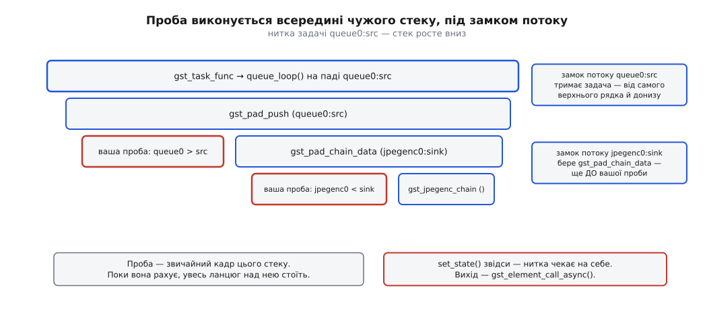

# ⚙️ Надрукувати мапу ниток: проба на кожному паді

Двісті рядків мовою C, які на будь-якому конвеєрі відповідають на питання «скільки тут ниток і де саме межа» не здогадом за виглядом рядка, а виміром: програма чіпляє пробу на кожен пад кожного елемента й на першому ж буфері друкує ім'я елемента, ім'я пада та нитку, у якій це сталося. З готової таблиці межа читається очима. Другим прогоном та сама програма прибирає черги з гілок і показує, як конвеєр не доїжджає до `PAUSED`, — разом із трьома способами побачити, хто на кого чекає.

Мова тут не з вибору. Проби, задачі й пул ниток — це API самої бібліотеки, написаної мовою C поверх GObject; обгортки для інших мов переносять ті самі виклики, не міняючи ні порядку, ні змісту.

## Чому мапу не можна вивести з опису

Спокуса порахувати нитки в голові велика: подивився на рядок, полічив `queue`, додав одиницю за джерело. На простому ланцюзі це навіть спрацює — і саме тому потім боляче.

Наочних пасток тут три. Перша: `autovideosink` — не елемент, а бін, який у `READY` підбирає собі справжній стік і ховає його всередині; що там усередині й скільки в нього падів, з рядка не видно взагалі. Друга: чимало елементів заводять власні нитки поза моделлю падів — декодер бере стільки робітників, скільки в машині ядер, `rtspsrc` розгортає всередині цілий вузол зі своїми задачами. Третя: пади бувають запитувані й динамічні, тож набір падів у момент складання конвеєра й набір падів через секунду роботи — це різні набори.

Тому єдиний чесний спосіб — спитати сам конвеєр, коли він уже працює. Питання ставиться пробою: функцією, яку бібліотека покличе просто посеред передачі буфера, у тій самій нитці, що цей буфер несе. Проба не змінює нічого; вона лише дивиться, де опинилася.

## Що тримає програма

:::code proj-thread-map/c/thread-map.c

Найважливіше тут — короткий номер. `GThread *` цілком годиться, щоб розрізняти нитки, але вісім шістнадцяткових цифр у кожному рядку перетворюють вивід на шифр, який доводиться розгадувати замість читати. Тому кожна нова нитка дістає порядковий номер при першій же появі, а вказівник друкується один раз у підсумку.

Побічний наслідок цього рішення виявиться корисним: номер `T1` дістанеться тій нитці, яка звернеться першою, — а першою звернеться нитка застосунку, ще до будь-яких даних. Далі буде видно, що біля `T1` у мапі не з'явиться жодного пада, і це не збій, а найкоротший доказ того, що нитка застосунку й нитки потоку — різні речі.

## Проба: один буфер, один рядок, і відразу геть

:::code proj-thread-map/c/proba-odyn-bufer-odyn.c

Три рядки цієї функції варті окремого погляду.

`g_thread_self ()` — уся суть виміру. Проба не отримує нитку параметром і не питає її в конвеєра: вона просто дивиться, у чиєму стеку виконується. Відповідь правдива за побудовою, бо іншої нитки, ніж та, у якій ти зараз працюєш, тут узнати неможливо.

`GST_PAD_PROBE_REMOVE` знімає пробу відразу після першого спрацювання. Це не економія заради економії: проба лишається в списку хуків пада й перевіряється на кожному буфері, а друк із неї серіалізує всі нитки на одному замку `stdout`. Знята проба коштує рівно стільки, скільки не встановлена, — нуль.

Замок `log_lock` тут не для краси. Проби спрацьовують у кількох нитках одночасно, а `g_print` без спільного замка перемішає половини рядків; та й нумерація ниток — це читання-запис по спільній хеш-таблиці.



*Проба — не окремий механізм спостереження, а звичайний кадр чужого стеку, під яким уже лежить чужий замок.*

Із цієї картинки випливає єдине правило користування пробами, і воно жорсткіше, ніж здається: проба виконується в нитці потоку, і в її стеку вже взято щонайменше один замок потоку — того пада, чия задача веде цю нитку; для проби на вхідному паді взято ще й замок самого цього пада, бо його бере `gst_pad_chain_data` перед викликом хуків. Усе, що всередині проби чекає, зупиняє не пробу, а весь ланцюг над нею.

## Обхід падів: GstIterator і чому саме в READY

:::code proj-thread-map/c/obkhid-padiv-gstiterator-i.c

Ітератор бібліотеки має форму, яка спершу дратує, а потім виявляється чесною: він може відповісти `RESYNC` — «список під тобою змінився, почни спочатку». Це не дефект, а зізнання: пади з'являються й зникають у нитках потоку, і жоден знімок списку не буває дійсним довго. Гілка `RESYNC`, дописана «щоб компілятор мовчав», — найкоротший шлях до обходу, який мовчки пропускає половину падів під час динамічного під'єднання.

Момент обходу вибрано не навмання. У `NULL` `autovideosink` ще не знає, яким стоком він буде, і його нутрощів не існує. У `PAUSED` уже пройшов префрол, тобто перший буфер кожного стоку вже проїхав — і саме його ми хотіли зловити. Лишається вузьке вікно `READY`: усі елементи на місці, усі пади створені, даних ще нема жодного.

## Хто створює нитки: STREAM_STATUS у своїй нитці

:::code proj-thread-map/c/khto-stvoriuie-nytky.c

Обробник саме синхронний, і слово це тут технічне: він виконується просто в тій нитці, яка поклала повідомлення, до того як керування повернеться. Звичайний обробник [шини повідомлень](root:sys-media/bus-and-messages) забирає повідомлення пізніше й із головного циклу — для `CREATE` це запізно, бо задача вже стартувала б із типовим пулом, а для `ENTER` просто безглуздо, бо весь сенс цього повідомлення в тому, у якій нитці воно приходить.

Різниця між трьома словами читається прямо з виводу. `CREATE` приходить у нитці того, хто задачу заводить, — і це буде нитка застосунку, що змінює стан. `ENTER` і `LEAVE` приходять уже зсередини нової нитки, на її вході й виході. Тому `ENTER` — єдине місце, де політику планувальника задають тій нитці, якій вона призначена, а не сусідній; що при цьому насправді відбувається в ядрі й чому `SCHED_RR` без відповідного дозволу просто не встановиться, — у темі [пріоритети, nice і реальночасові класи](root:sys-unix/priority-nice-realtime).

`GST_BUS_PASS` наприкінці обов'язковий. Синхронний обробник має право проковтнути повідомлення, повернувши `GST_BUS_DROP`, — і тоді помилки й `EOS` не дійдуть до застосунку взагалі.

## Головна частина

:::code proj-thread-map/c/holovna-chastyna.c

Обмежене очікування замість вічного — головне рішення цієї функції. `gst_element_get_state` з `GST_CLOCK_TIME_NONE` на зіпсованому конвеєрі просто не повертається, і програма перетворюється на об'єкт для налагоджувача. З п'ятисекундною межею вона натомість сама доповідає, що перехід не завершився, і тут же друкує стани всіх елементів — тобто перетворює зависання на діагноз. Що означають ці стани й чому стік доповідає про готовність із затримкою, розібрано в темі [стани конвеєра](root:sys-media/states-lifecycle).

## Мапа, яку друкує програма

```
$ ./thread-map
нитка застосунку: T1 (0x55c4f1a2b2a0)

  [CREATE] задача «queue1:src» від «queue1» — ми зараз у T1
  [ENTER ] задача «queue1:src» від «queue1» — ми зараз у T2
  [CREATE] задача «queue0:src» від «queue0» — ми зараз у T1
  [ENTER ] задача «queue0:src» від «queue0» — ми зараз у T3
  [CREATE] задача «videotestsrc0:src» від «videotestsrc0» — ми зараз у T1
  [ENTER ] задача «videotestsrc0:src» від «videotestsrc0» — ми зараз у T4
  T4   videotestsrc0                        > src
  T4   tee0                                 < sink
  T4   tee0                                 > src_0
  T4   queue0                               < sink
  T4   tee0                                 > src_1
  T4   queue1                               < sink
  T3   queue0                               > src
  T2   queue1                               > src
  T3   autovideosink0                       < sink
  T2   jpegenc0                             < sink
  T3   autovideosink0-actual-sink-xvimage   < sink
  T2   jpegenc0                             > src
  T2   fakesink0                            < sink

=== мапа ниток: 13 падів у 4 нитках ===

T1  (0x55c4f1a2b2a0)
    (жодного пада — через цю нитку дані не течуть)

T2  (0x7f2b3c0021d0)
    queue1                               > src
    jpegenc0                             < sink
    jpegenc0                             > src
    fakesink0                            < sink

T3  (0x7f2b340020a0)
    queue0                               > src
    autovideosink0                       < sink
    autovideosink0-actual-sink-xvimage   < sink

T4  (0x7f2b2c002100)
    videotestsrc0                        > src
    tee0                                 < sink
    tee0                                 > src_0
    queue0                               < sink
    tee0                                 > src_1
    queue1                               < sink
```

Читається ця таблиця буквально за десять секунд, і кожен рядок каже щось конкретне.

**Межа проходить усередині черги, а не між елементами.** `queue0 < sink` стоїть у `T4`, `queue0 > src` — у `T3`. Той самий елемент, дві різні нитки; лінія розрізу проходить крізь нього.

**`tee` нитки не додає.** Усі три його пади в `T4`, разом із джерелом. Він роздає буфер гілкам послідовно, тією самою ниткою, і його вихідні пади — це просто місце, звідки робиться наступний виклик. Уся паралельність гілок з'являється лише в чергах за ним.

**Фільтр не додає нитки й поготів.** `jpegenc0 < sink` і `jpegenc0 > src` в одній нитці `T2`, між ними немає нічого — стиснення кадру відбувається просто в стеку того, хто приніс буфер.

**Гост-пад нитки не міняє.** `autovideosink0 < sink` і `autovideosink0-actual-sink-xvimage < sink` обидва в `T3`: зовнішній пад біна лише пересилає буфер на внутрішній пад справжнього стоку, і це знову звичайний виклик.

**У нитці застосунку немає жодного пада.** `T1` створила конвеєр, поставила стани, отримала три повідомлення `CREATE` — і не понесла жодного буфера. Обробники, які застосунок вішає на елементи, виконуються не тут.

> 🔧 **Навіщо це.** Мапа потрібна не для цікавості, а для перевірки чужої роботи. Топологію, успадковану разом із проєктом, зазвичай супроводжує усна легенда — «тут у нас декодування в окремій нитці». Прогін цієї програми за хвилину або підтверджує легенду, або показує, що всі шість елементів сидять в одній нитці, а `queue` стоїть на гілці, якою за весь час не пройшло жодного буфера. Ті самі тринадцять рядків годяться й на приймальну перевірку: якщо після правки топології мапа змінилася, а ніхто цього не планував, правка зачепила більше, ніж думав автор.

## Другий прогін: прибрати черги й подивитися, хто на кого чекає

```
$ ./thread-map --no-queue
нитка застосунку: T1 (0x561e0c8ab2a0)

  [CREATE] задача «videotestsrc0:src» від «videotestsrc0» — ми зараз у T1
  [ENTER ] задача «videotestsrc0:src» від «videotestsrc0» — ми зараз у T2
  T2   videotestsrc0                        > src
  T2   tee0                                 < sink
  T2   tee0                                 > src_0
  T2   autovideosink0                       < sink
  T2   autovideosink0-actual-sink-xvimage   < sink

!! за 5 с конвеєр не дійшов до PLAYING. Стани елементів:
  pipeline0                            READY    → PLAYING       ← ось хто не доїхав
  fakesink0                            READY    → PAUSED        ← ось хто не доїхав
  jpegenc0                             PAUSED   → VOID_PENDING
  autovideosink0                       PAUSED   → VOID_PENDING
  autovideosink0-actual-sink-xvimage   PAUSED   → VOID_PENDING
  tee0                                 PAUSED   → VOID_PENDING
  videotestsrc0                        PAUSED   → VOID_PENDING
```

Вивід уривається на п'ятому рядку — і місце обриву й є діагнозом. Проби на `tee0 > src_1`, на `jpegenc0` і на `fakesink0` не спрацювали жодного разу: у другу гілку не зайшов жоден буфер. Разом із таблицею станів це вже повна картина. Усі елементи доїхали до `PAUSED`, крім `fakesink0`, який лишився в `READY` і винен `PAUSED`; `jpegenc0` при цьому в `PAUSED`, бо перетворювачам для переходу дані не потрібні, а стокові — потрібні.

Далі коло замикається саме собою. `tee` віддав перший буфер у першу гілку; стік узяв його на префрол і заснув до `PLAYING`, не повернувшись із функції обробки; отже, `tee` не дійшов до другої гілки; отже, `fakesink0` не отримав буфера й не префролив; отже, `PAUSED` для конвеєра не завершився; отже, `PLAYING` не настане й перший стік не прокинеться. Це [дедлок](root:sf-tasks/deadlock) без жодного явного замка — просто чотири очікування, замкнені в кільце.

Два незалежні підтвердження, які варто вміти брати, коли таблиці станів мало.

**Журнал переходів.** Категорія `GST_STATES` друкує рядок про завершення переходу для кожного елемента окремо:

```sh
GST_DEBUG=GST_STATES:5 ./thread-map --no-queue 2>&1 \
  | grep -E 'completed state change|fakesink0'
```

Рядок «completed state change to PAUSED» знайдеться для всіх, крім `fakesink0`, — а для нього останнє, що є в журналі, це початок переходу, який лишився асинхронним. Заразом варто перед виходом покласти знімок графа: `GST_DEBUG_BIN_TO_DOT_FILE_WITH_TS (GST_BIN (pipeline), GST_DEBUG_GRAPH_SHOW_ALL, "hang")` за виставленої змінної `GST_DEBUG_DUMP_DOT_DIR` малює конвеєр разом зі станами й caps кожного пада; про решту важелів журналу — у темі [діагностика конвеєра](root:sys-media/pipeline-debugging).

**Стеки всіх ниток.** Замініть у програмі `5 * GST_SECOND` на `GST_CLOCK_TIME_NONE`, щоб було коли під'єднатися, і подивіться на процес налагоджувачем — механіку такого під'єднання розібрано в темі [ptrace](root:sys-unix/ptrace-model):

```
$ gdb -p $(pidof thread-map)
(gdb) thread apply all bt
```

```
Thread 1 "thread-map"          ← нитка застосунку
#0  g_cond_wait_until
#1  gst_element_get_state_func      чекає на завершення переходу
#2  main

Thread 4 "videotestsrc0:s"     ← задача джерела; ім'я Linux обрізає до 15 літер
#0  g_cond_wait
#1  gst_base_sink_wait_preroll      стік узяв буфер і спить до PLAYING
#2  gst_base_sink_chain_unlocked
#3  gst_base_sink_chain
#4  gst_pad_push                    сюди його загнав tee
#5  gst_tee_handle_data
#6  gst_pad_push
#7  gst_base_src_loop
#8  gst_task_func
```

*(Кадри скорочено, назви функцій між версіями трохи різняться.)*

Одна нитка тут несе весь ланцюг від джерела до стоку — це видно просто з того, що `gst_base_src_loop` і `gst_base_sink_chain` лежать в одному стеку. Заразом видно, що імена ниток не треба вигадувати: задача сама виставляє собі за ім'я нитки ім'я свого об'єкта, тож `thread apply all bt` одразу підписаний назвами падів.

Поверніть `queue` на обидві гілки — і той самий бінарник друкує повну мапу з чотирьох ниток. Змінилося рівно те, що функція обробки черги нікого не чекає: узяла буфер, розбудила власну нитку, повернулася, — і `tee` встиг дійти до другої гілки.

## Зупинити конвеєр із проби

Наступне, чого хочеться від проби після мапи, — щоб вона щось вирішувала: скажімо, гасила конвеєр після сотого кадру. Наївний варіант із `gst_element_set_state (pipeline, GST_STATE_NULL)` прямо в пробі вішає програму намертво, і причина вже названа: перехід у `NULL` зобов'язаний дочекатися виходу всіх ниток потоку, а одна з них — саме та, що стоїть у цій пробі й чекає на повернення з `set_state`.

:::code proj-thread-map/c/zupynyty-konveier-iz-proby.c

`gst_element_call_async` бере нитку з внутрішнього пулу й виконує зворотний виклик поза потоком; сама проба при цьому повертається негайно й замка не тримає. У версіях від 1.28 ця функція перейменована на `gst_object_call_async`, стара лишилася застарілим синонімом.

`EOS` замість `set_state (NULL)` тут не дрібниця: подія проходить конвеєром від джерел униз, стоки дописують те, що мали дописати, і застосунок дізнається про кінець із шини — тобто зупинка виходить упорядкованою, а не обірваною посеред кадру.

## Скільки це коштує і де ламається

Обхід — `O(E · P)` за кількістю елементів і падів, і робиться один раз у `READY`; на цьому конвеєрі це вісім елементів і тринадцять падів, тобто мікросекунди. Уся ціна програми — в іншому місці.

**Скільки коштує забути `GST_PAD_PROBE_REMOVE`.**

```
восьмикамерна система, проби лишилися ввімкненими:
  8 камер · 30 кадрів/с · 13 падів = 3120 викликів проби за секунду

кожен виклик:  обхід списку хуків пада + друк
друк:          усі 3120 через ОДИН замок stdout
```

Три тисячі викликів за секунду самі по собі дрібниця; смертельний тут замок `stdout`, на якому шістнадцять ниток потоку шикуються в чергу. Вимір, який спотворює вимірюване, — найгірший вид виміру, тому проба знімає себе першим же буфером.

Далі — те, що ламається в такій програмі найчастіше.

**Тільки `BUFFER` — проба мовчить.** Елемент має право штовхати не буфер, а список буферів, і проба, зареєстрована самим лише `GST_PAD_PROBE_TYPE_BUFFER`, у цьому разі не викликається. Пад виглядає як «мертвий», хоч даних через нього течуть мегабайти. Реєструйте `GST_PAD_PROBE_TYPE_BUFFER | GST_PAD_PROBE_TYPE_BUFFER_LIST` завжди, коли просто спостерігаєте.

**`RESYNC` чіпляє пробу двічі.** Після повторної синхронізації обхід починається спочатку, і пади, які вже отримали пробу, отримають другу. У `READY` список стабільний, тож тут це не спрацює, — але для обходу живого конвеєра тримайте множину вже оброблених падів і звіряйтеся з нею.

**Пади, яких ще нема.** Обхід бачить лише те, що існує в момент виклику: запитувані пади `tee`, динамічні пади розбирача, гілки, які добере автодобір, з'являться пізніше. Щоб не проґавити їх, слухайте сигнал `pad-added` на елементі й `deep-element-added` на конвеєрі — і чіпляйте пробу з обробника, пам'ятаючи, що виконується він у нитці потоку.

**Номери ниток — наші, не системні.** `T2` цієї програми не має нічого спільного з ідентифікатором нитки в `top` чи в налагоджувачі; це просто порядок першої появи, і при наступному запуску він може бути іншим. Спільне ім'я, за яким мапа зшивається з `thread apply all bt`, — це ім'я задачі на кшталт `queue0:src`, обрізане в Linux до п'ятнадцяти літер.

**Нитки повертаються в пул.** Задача не володіє ниткою: зупинившись, вона віддає її назад, і наступна задача може отримати ту саму. Отже, `GThread *` однозначний лише поки конвеєр не міняв стану; мапа правдива для одного прогону, а не назавжди.

**Синхронний обробник — теж чужа нитка.** Усе сказане про проби діє й тут: `on_message_sync` виконується в нитці того, хто поклав повідомлення. Важкий розбір або, тим паче, зміна стану звідти дає ті самі зависання, тільки шукати їх довше, бо код виглядає як звичайний обробник подій.
