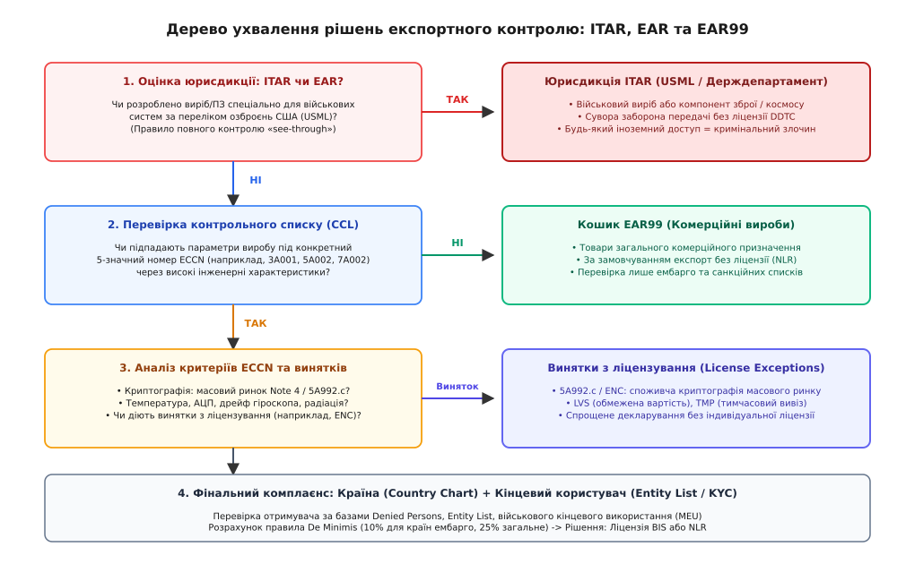
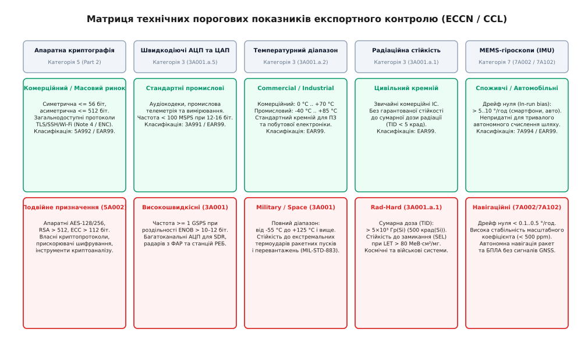

# Експортний контроль і подвійне призначення

<preknowlist>
- [Декларація відповідності й технічний файл](root:sys-notary/deklaratsiia-vidpovidnosti-i-tekhnichnyi-fail) — формування пакета технічної та дозвільної документації на апаратний виріб.
- [SBOM: перелік складників образу](root:sys-notary/sbom-perelik-skladnykiv-obrazu-i-navishcho-ioho) — аудит сторонніх програмних компонентів та ланцюга постачання.
- [Нормативні вимоги до безпеки коду](root:sys-notary/normatyvni-vymohy-do-bezpeky-kodu) — регуляторні стандарти розробки безпечного низькорівневого програмного забезпечення.
- [Речовини й утилізація: RoHS, REACH, WEEE](root:sys-notary/rechovyny-i-utylizatsiia) — обмеження на фізичний та хімічний склад компонентів виробу.
</preknowlist>

Команда інженерів розробляє нову ревізію обчислювального блоку для системи моніторингу цивільної інфраструктури: встановлює мікроконтролер із вбудованим апаратним криптографічним прискорювачем AES-256, 16-розрядний АЦП із частотою дискретизації 250 MSPS для швидкісної обробки сигналів датчиків, прецизійний MEMS-гіроскоп із дрейфом нульового сигналу 0.2 °/год та мікросхему пам'яті в керамічному корпусі з розширеним температурним діапазоном від -55 °C до +125 °C. Під час відвантаження дослідної партії за кордон або завантаження вихідного коду драйверів на закордонний хмарний сервер митна служба та контрольні органи блокують операцію, виставляючи претензію щодо нелегального експорту технологій подвійного призначення без ліцензії. Штрафи за порушення експортного законодавства можуть перевищувати сотні тисяч доларів, спричиняти блокування банківських рахунків, а в разі умисного приховування характеристик — призводити до кримінальної відповідальності інженерів строком до 20 років ув'язнення та внесення компанії до санкційних чорних списків.

Будь-який технічний виріб із високими характеристиками розглядається державами крізь призму оборонної безпеки. Навіть якщо пристрій спроєктовано для суто мирних цілей — агромоніторингу, геолокації шахтних вагонеток чи захищеного банківського зв'язку, — перевищення визначених фізичних і схемотехнічних порогів автоматично переводить прилад або прошивку до категорії товарів подвійного призначення (dual-use goods), накладаючи суворий режим міжнародного контролю.

## Міжнародний правовий базис: Вассенаар, ITAR та EAR

Сучасна система регулювання експорту високотехнологічних виробів спирається на три взаємопов'язані регуляторні конструкції:

1. **Вассенаарські домовленості (Wassenaar Arrangement):** Багатостороння угода 42 держав, укладена 1996 року в місті Вассенаар (Нідерланди) як правонаступник координаційного комітету CoCom часів Холодної війни. Угода затверджує узгоджені контрольні списки у двох основних частинах: Список звичайних озброєнь (*Munitions List*) та Список товарів і технологій подвійного використання (*Dual-Use Goods and Technologies List*). Вассенаарські домовленості не є прямодіючим міжнародним законом, проте кожна держава-учасниця зобов'язана імплементувати ці контрольні списки у власне національне законодавство (наприклад, Регламент ЄС 2021/821 або Правила експортного контролю України).

2. **Правила міжнародного обігу зброї (ITAR — International Traffic in Arms Regulations):** Американський режим контролю під юрисдикцією Державного департаменту США (Directorate of Defense Trade Controls, DDTC). ITAR регулює вироби, послуги та технічні дані, перелічені у Списку озброєнь США (*United States Munitions List*, USML). Характерною рисою ITAR є абсолютне «правило проникнення» (*see-through rule*): якщо цивільний прилад містить хоча б один гвинт, транзистор, драйвер або фрагмент вихідного коду, кваліфікований за ITAR, увесь кінцевий виріб автоматично підпадає під дію ITAR. Передача креслень, вихідних текстів чи навіть усні консультації іноземним громадянам без спеціальної індивідуальної ліцензії кваліфікуються як тяжке правопорушення.

3. **Правила експортного регулювання (EAR — Export Administration Regulations):** Режим під юрисдикцією Бюро промисловості та безпеки Міністерства торгівлі США (Bureau of Industry and Security, BIS). EAR регулює товари комерційного та подвійного призначення, зафіксовані у Списку контролю торгівлі (*Commerce Control List*, CCL). На відміну від безкомпромісного ITAR, регламент EAR оперує диференційованою системою ліцензійних винятків, правилом частки американського вмісту (*de minimis*) та чіткими числовими порогами інженерних характеристик.



*Дерево ухвалення рішень експортного контролю: від визначення військової юрисдикції (ITAR/USML) до класифікації товарів подвійного призначення (EAR/CCL) та кошика EAR99.*

## Структура номера ECCN та кошик EAR99

Основним інструментом технічної ідентифікації товарів у системі EAR є п'ятизначний буквено-цифровий класифікаційний код ECCN (*Export Control Classification Number*). Структура цього коду суворо формалізована:

- **Перший символ (Категорія, 0–9):**
  - `0`: Ядерні матеріали, установки та обладнання.
  - `1`: Спеціальні матеріали, хімікати, мікроорганізми й токсини.
  - `2`: Обробка матеріалів (верстати, преси, підшипники).
  - `3`: Електроніка (мікросхеми, АЦП, транзистори, підкладки).
  - `4`: Обчислювальна техніка (процесори, суперкомп'ютери, кластери).
  - `5`: Телекомунікації та інформаційна безпека (криптографія).
  - `6`: Датчики та лазери (оптика, радари, гідроакустика).
  - `7`: Навігація та авіоніка (гіроскопи, акселерометри, автопілоти).
  - `8`: Морська техніка (підводні апарати, рушії).
  - `9`: Аерокосмічні системи та двигуни (БПЛА, турбіни, ракети).

- **Другий символ (Група продукції, A–E):**
  - `A`: Готові вироби, складальні вузли та компоненти.
  - `B`: Випробувальне, контрольне та виробниче обладнання.
  - `C`: Спеціальні матеріали та сировина.
  - `D`: Програмне забезпечення (вихідний код, прошивки, компілятори).
  - `E`: Технології (креслення, технологічні карти, схемотехнічні моделі).

- **Третій символ (Причина контролю, 0–9):**
  - `0`: Національна безпека (National Security, NS) — узгоджено з Вассенаарськими списками.
  - `1`: Ракетні технології (Missile Technology, MT).
  - `2`: Ядерне нерозповсюдження (Nuclear Proliferation, NP).
  - `3`: Хімічна та біологічна зброя (CB).
  - `9`: Антитерористичний контроль (Anti-Terrorism, AT) та унілатеральні обмеження.

- **Четвертий і п'ятий символи (Порядковий індекс підпункту):** Визначають конкретний технічний опис у межах підгрупи (наприклад, `01`, `02`, `92`).

Приклади типових кодів: `3A001` (електронні компоненти з контролем за національною безпекою), `5A002` (апаратне забезпечення інформаційної безпеки та криптографії), `7A002` (гіроскопи високої точності).

Якщо комерційний виріб підпадає під юрисдикцію EAR, але його технічні характеристики не досягають контрольних порогів жодної зі специфічних позицій списку CCL, він класифікується як **EAR99**. Вироби класу EAR99 становлять переважну більшість масової споживчої електроніки і можуть вільно експортуватися до більшості країн світу за процедурою NLR (*No License Required*), за винятком держав під ембарго чи заблокованих контрагентів.

## Фізичні та схемотехнічні пороги подвійного призначення

Перехід виробу зі статусу безпечного комерційного пристрою (EAR99 або 5A992) до категорії суворо контрольованого товару подвійного призначення визначається перевищенням кількісних інженерних параметрів.



*Матриця технічних порогових показників: розподіл категорій ECCN за критеріями радіаційної стійкості, дрейфу гіроскопів, частоти АЦП, діапазону температур та довжини криптографічних ключів.*

### 1. Апаратне шифрування та інформаційна безпека (Категорія 5, Частина 2)

Використання криптографічних алгоритмів є одним із найпоширеніших джерел експортних ризиків у вбудованих системах:

- **Порогові обмеження (5A002):** Під контроль підпадають апаратні модулі та програмні бібліотеки, що використовують симетричні алгоритми з довжиною ключа понад `56 біт` (наприклад, DES з повним ключем, 3DES, AES-128/192/256, ChaCha20), асиметричні алгоритми з довжиною ключа на базі факторизації цілих чисел чи дискретного логарифма понад `512 біт` (RSA-1024/2048/4096), або алгоритми на еліптичних кривих понад `112 біт` (ECDSA, Curve25519).
- **Криптографічна примітка (Note 4 / Cryptography Note) та виняток масового ринку (Mass Market):** Щоб не блокувати світову торгівлю смартфонами, роутерами та браузерами, регламент встановлює виняток: товари, що використовують криптографію виключно для стандартної автентифікації, захисту авторських прав, цифрового підпису прошивки або загальнодоступного шифрування каналів зв'язку (TLS, HTTPS, SSH, WPA3), і водночас вільно продаються населенню без обмежень, перекласифікуються з жорсткої позиції `5A002` у спрощену позицію `5A992.c` або використовують ліцензійний виняток `ENC`.
- **Власні криптопротоколи:** Якщо інженери розробляють власний нестандартний алгоритм шифрування, модифікують криптографічне ядро чи впроваджують механізми квантового розподілу ключів, такий продукт не може скористатися винятком масового ринку і підлягає обов'язковому ліцензуванню за кодом `5A002`.

### 2. Швидкодіючі та прецизійні АЦП і ЦАП (Категорія 3A001.a.5)

Аналого-цифрові перетворювачі є критичною ланкою в радіолокації, системах радіоелектронної боротьби (РЕБ), комплексах радіотехнічної розвідки (РТР) та головках самонаведення ракет:

- **Контрольні пороги:** Контролюються мікросхеми АЦП із роздільною здатністю 8 або більше розрядів при частоті перетворення понад `1 GSPS` (гігасемпл на секунду), мікросхеми з роздільною здатністю 10–12 розрядів при швидкості від `500 MSPS`, або 16-розрядні АЦП із частотою понад `100 MSPS`.
- **Ефективна розрядність (ENOB) та вибіркова смуга:** Оцінюється комбінований показник ефективної розрядності (*Effective Number of Bits*, ENOB) та інтермодуляційних спотворень без гармонік (SFDR). Якщо високошвидкісний АЦП інтегровано безпосередньо в мікроконтролер чи систему на кристалі (SoC), увесь мікроконтролер може отримати обмеження за категорією 3A001 замість стандартної споживчої класифікації.

### 3. Робочий температурний діапазон (Категорія 3A001.a.2 / 3A001.a.11)

Кремнієві кристали для комерційного та споживчого ринків тестуються в межах стандартного температурного діапазону:

- **Комерційний діапазон (Commercial):** від `0 °C` до `+70 °C`.
- **Промисловий діапазон (Industrial):** від `-40 °C` до `+85 °C` (або розширений промисловий до `+105 °C`).
- **Військовий та аерокосмічний діапазон (Military / Extended):** від `-55 °C` до `+125 °C` (або до `+150 °C`).

Інтегральні мікросхеми, керамічні корпуси та пасивні елементи, які гарантовано зберігають працездатність за температур нижче `-55 °C` або вище `+125 °C` відповідно до стандартів типу MIL-STD-883, класифікуються за пунктами `3A001` або `3A991`. Причина контролю полягає в тому, що здатність функціонувати при -55 °C необхідна для роботи у верхніх шарах атмосфери та стратосфері під час польоту крилатих і балістичних ракет без додаткового підігріву.

### 4. Радіаційна стійкість (Rad-Hard, Категорія 3A001.a.1)

Мікроелектроніка космічного та спеціального призначення піддається бомбардуванню важкими іонами та гамма-випромінюванням:

- **Сумарна доза іонізаційного випромінювання (TID — Total Ionizing Dose):** Інтегральні схеми, розраховані на сумарну поглинену дозу радіації `≥ 5 × 10³ Гр(Si)` (що еквівалентно `500 крад(Si)`), автоматично кваліфікуються за статтею `3A001.a.1`.
- **Потужність дози радіаційного зриву:** Показник стійкості до імпульсного випромінювання понад `5 × 10⁸ Гр(Si)/с` (захист від наслідків ядерного вибуху).
- **Поодинокі радіаційні ефекти (SEE / SEL):** Стійкість до тиристорного замикання кристала (*Single Event Latchup*, SEL) при лінійній передачі енергії (LET) понад `80 МеВ·см²/мг`.

### 5. Точність інерційних MEMS-гіроскопів (Категорія 7A002 / 7A102)

Мікроелектромеханічні датчики кутової швидкості лежать в основі систем просторової орієнтації:

- **Споживчі датчики (7A994 / EAR99):** Дрейф нуля у сталому режимі (*In-run bias stability*) становить від `10 °/год` до `100 °/год` (смартфони, ігрові маніпулятори, побутові квадрокоптери). Такі датчики накопичують величезну похибку координат уже за кілька хвилин автономного польоту без сигналу GNSS (GPS/Galileo).
- **Тактичні та навігаційні датчики (7A002 / 7A102):** Гіроскопи з дрейфом нульового сигналу `≤ 0.5 °/год` (або `≤ 0.1 °/год` для вищого навігаційного класу), повторюваністю масштабного коефіцієнта `< 500 ppm` та кутовим випадковим блуканням (*Angular Random Walk*, ARW) `< 0.01 °/√год` підпадають під контроль Вассенаара за категорією `7A002` та режим контролю ракетних технологій (MTCR). Низький дрейф дає змогу реалізувати автономне счислення координат (*Dead Reckoning*) крилатої ракети чи ударного безпілотника в умовах повного придушення супутникової навігації засобами РЕБ.

## Аудит ланцюга постачання, De Minimis та юридична відповідальність

Розробник вбудованої системи несе пряму відповідальність за відповідність кінцевого продукту експортним нормам протягом усього життєвого циклу.

### Правило De Minimis (частка американських компонентів)

Якщо неамериканська компанія виробляє апаратний блок в Україні або країнах ЄС, проте використовує в конструкції мікросхеми, ліцензійні IP-ядра або програмні модулі походженням із США, кінцевий виріб може підпадати під юрисдикцію EAR за правилом *De Minimis*:

```
De_Minimis_% = (Вартість контрольованих компонентів зі США / Справедлива ринкова вартість кінцевого виробу) × 100%
```

- **Загальний ліміт (25%):** Якщо частка американського вмісту перевищує 25% від вартості кінцевого пристрою, виріб підпорядковується вимогам EAR при реекспорті в будь-яку точку світу.
- **Посилений ліміт для ембарго (10%):** При постачанні до країн із підвищеним рівнем санкційного ризику поріг знижується до 10%.
- **Нульовий ліміт (0% для ITAR):** Якщо виріб містить будь-який компонент за стандартом ITAR, правило De Minimis не діє взагалі — пристрій контролюється на 100%.

### Уявний експорт (Deemed Export)

Експортом з точки зору законодавства США та ЄС є не лише фізичне переміщення вантажу через державний кордон. Передача технічної документації, архітектурних креслень, вихідного коду прошивки або схемотехнічних файлів іноземному громадянину (наприклад, закордонному інженеру-підряднику, що працює в офісі компанії або має доступ до приватного сховища Git) юридично вважається експортом у країну громадянства цієї особи.

### Перевірка кінцевого користувача (KYC / End-User Screening)

Перед укладанням контракту та відвантаженням обладнання виробник зобов'язаний провести обов'язковий комплаєнс-аудит контрагента за офіційними реєстрами:
- **Denied Persons List (DPL):** Список фізичних та юридичних осіб, позбавлених права на експортні операції.
- **Entity List (EL):** Список організацій, щодо яких діють спеціальні ліцензійні обмеження (підприємства ВПК, дослідні інститути підсанкційних держав).
- **Military End-User (MEU) List:** Перелік компаній, діяльність яких пов'язана зі збройними силами.
- **Сертифікат кінцевого використання (End-User Statement / BIS-711):** Письмове юридичне зобов'язання покупця із зазначенням конкретного мирного застосування пристрою та гарантією заборони реекспорту третім особам.

## Програмно-апаратний верифікатор сертифікаційних меж у прошивці

Щоб гарантувати, що вбудоване програмне забезпечення не активує заблоковані або несертифіковані для комерційного ринку режими (наприклад, частоту вибірки АЦП понад 1 GSPS, вихідну потужність радіомодуля вище дозволеної або спеціальні режими шифрування), конфігурація апаратних лімітів жорстко зашивається у захищений сертифікаційний профіль пристрою:

:::tabs
:::code eksportnyi-kontrol-i-podviine-pryznachennia-d/c/main.c
:::code eksportnyi-kontrol-i-podviine-pryznachennia-d/cpp/main.cpp
:::

Повна програмна реалізація багаторівневого дерева класифікації, розрахунку частки американських складників за правилом De Minimis та валідації країни призначення представлена у [проєкті модульного рушія класифікації ECCN](root:sys-notary/eksportnyi-kontrol-i-podviine-pryznachennia/proj-eccn-classifier-engine.md).
