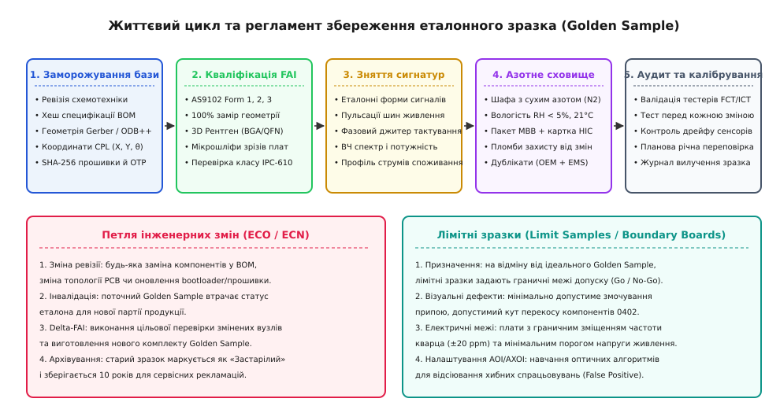
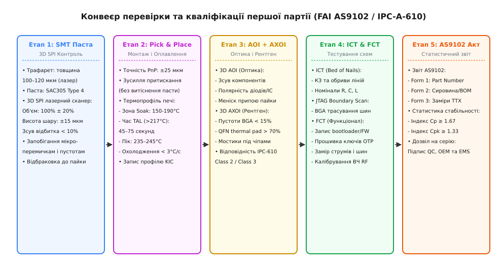

# Еталонний зразок і перше виробниче

<preknowlist>
- [Декларація відповідності й технічний файл](root:sys-notary/deklaratsiia-vidpovidnosti-i-tekhnichnyi-fail) — інженерне досьє виробу, оцінка ризиків та процедури фіксації змін (ECO).
- [SBOM: перелік складників образу](root:sys-notary/sbom-perelik-skladnykiv-obrazu-i-navishcho-ioho) — криптографічна фіксація артефактів програмного забезпечення та ланцюга постачання.
- [Речовини й утилізація: RoHS, REACH, WEEE](root:sys-notary/rechovyny-i-utylizatsiia) — матеріальні обмеження компонентної бази (BOM) та сертифікація за EN IEC 63000.
- [Модульна сертифікація: FCC, CE та EMC-випроби](root:sys-notary/emc-certification) — презумпція відповідності та межі радіочастотних параметрів.
- [Вхідний контроль і підробні компоненти](root:sys-notary/vkhidnyi-kontrol-i-pidrobni-komponenty) — перевірка автентичності та вхідна верифікація пасивних і напівпровідникових компонентів.
</preknowlist>

Команда розробників збирає в лабораторії десять дослідних зразків промислового IoT-шлюзу: плати вручну запаюють під мікроскопом, прошивають налагоджувальним програматором, ретельно тестують на столі й отримують стовідсоткову працездатність. Окрилена успіхом компанія укладає контракт із контрактним виробником електроніки (*Contract Electronics Manufacturer*, CEM) на запуск першої серійної партії з 500 одиниць, передає архів із файлами Gerber і таблицею специфікації матеріалів та оплачує підготовку лінії поверхневого монтажу (*Surface Mount Technology*, SMT). 

Коли партія сходить із конвеєра, виявляється, що 18% виробів не проходять фінальне тестування: частина контролерів не стартує через мікроскопічні перемички припою під корпусами мікросхем QFN із кроком виводів 0.4 мм, на двадцяти платах пасивні конденсатори типорозміру 0402 стали вертикально на один вивід через ефект надгробного каменя (*tombstoning*), а тактовий генератор на частині плат має температурне відхилення частоти, через що радіоканал не входить у синхронізацію. 

Фабрика заявляє, що розводка контактних майданчиків у файлах замовника порушує технологічні зазори автоматичного нанесення пасти, а розробники звинувачують завод у некоректному налаштуванні температурного профілю печі оплавлення та заміні діелектрика керамічних конденсаторів. Партія заблокована, фінансові збитки сягають десятків тисяч доларів, а терміни виходу продукту на ринок зірвані на місяці.

Ця криза є класичним наслідком спроби перестрибнути через фундаментальну інженерну прірву між штучним лабораторним прототипом і повторюваним серійним виробництвом. У лабораторії інженер несвідомо компенсує недоліки схемотехніки: вручну центрує мікросхеми пінцетом, підбирає флюс під час пайки паяльною станцією, гріє плату феном із суб'єктивною швидкістю та індивідуально підлаштовує калібрувальні коефіцієнти в коді під конкретний екземпляр кристала. 

На заводському конвеєрі людський фактор витісняється високошвидкісними автоматами: автомат установлення компонентів (*Pick-and-Place*) позиціонує до 40 000 компонентів на годину з механічним допуском у частки міліметра, конвеєрна піч оплавлення щохвилини проганяє десятки плат через фіксовані температурні зони, а параметри компонентів плавають у межах розкиду виробничих партій постачальників. 

Єдиним надійним інструментом, що гарантує перенесення лабораторної працездатності на автоматизований конвеєр без втрати якості та ризику фінансового колапсу, є формалізована інженерна процедура кваліфікації першої виробничої партії (*First Article Inspection*, FAI) за стандартами AS9102 та IPC, створення непорушного еталонного золотого зразка (*Golden Sample*) і статистичний контроль стійкості технологічних процесів.

### Прірва між прототипом і серією: анатомія технологічної дисперсії

Лабораторний зразок завжди існує в одиничному екземплярі або мікросерії, де всі випадкові фактори компенсуються індивідуальною увагою розробника. Серійне виробництво — це статистичний процес, у якому кожен фізичний параметр вузла підпорядковується закону розподілу й має неминучу дисперсію.

Виробнича дисперсія на конвеєрі електроніки формується із чотирьох незалежних джерел:

1. **Технологічні допуски друкованої плати (PCB Fabrication Tolerance):** товщина мідної фольги зовнішніх шарів плаває в межах ±10%, ширина провідників диференційних ліній імпедансу (наприклад, USB 90 Ом або RF 50 Ом) варіюється на ±15–20 мкм через нерівномірність травлення міді за площею групової заготовки (*panel*), а діелектрична проникність препрегу `epsilon[r]` змінюється від партії до партії склотекстоліту FR-4. Це спричиняє розкид хвильового опору ВЧ-ліній і спотворення фронтів сигналів гігагерцових інтерфейсів.
2. **Розкид параметрів електронних компонентів (Component Parameter Variance):** пасивні компоненти мають фабричний допуск (для резисторів типово ±1%, для керамічних конденсаторів MLCC діелектрика X7R/X5R — ±10% або ±20%). Напруга зміщення операційних підсилювачів, порогова напруга відкриття польових транзисторів `V[th]`, еквівалентний послідовний опір конденсаторів (*ESR*) та індуктивність дроселів імпульсних перетворювачів змінюються залежно від партії кристалів і температури навколишнього середовища.
3. **Механічна та теплова нестабільність SMT-лінії (Assembly Process Window):** об'єм припойної пасти, нанесеної трафаретним принтером на контактні майданчики, плаває в межах ±15–25% через знос ракеля, зміну в'язкості пасти від кімнатної температури та забивання апертур трафарету. Точність позиціонування автомата встановлення компонентів має динамічну похибку ±25–35 мкм, а теплова маса великих роз'ємів чи екранів зміщує локальну температуру пайки на платі відносно дрібних чипів 0201.
4. **Програмно-апаратна конфігурація та дрейф напівпровідникових структур (Silicon Drift & Firmware Baseline):** внутрішні джерела опорної напруги мікроконтролерів (Bandgap Reference) мають початкову похибку до ±2%, параметри внутрішніх RC-генераторів дрейфують від напруги живлення, а конфігураційні біти одноразово програмованої пам'яті (*OTP/eFuse*) вимагають чіткої послідовності часових діаграм напруги програмування, порушення яких призводить до «напівпрошитих» бітів, що деградують з часом.

Якщо проект розрахований без урахування найгіршого збігу допусків (*Worst-Case Circuit Analysis*, WCCA), прилад, який бездоганно працював у лабораторії за кімнатної температури 22°C на вибірці з п'яти плат, під час випуску тисячної партії демонструватиме випадкові збої в 10–20% виробів. 

Мета запуску першого виробничого випуску — не просто скласти фізичні пристрої, а експериментально верифікувати технологічне вікно виробництва, довести статистичну стабільність лінії та зафіксувати непорушний зразок порівняння.

### Заморожування технічного базису: BOM, Gerber, CPL і прошивка

Першим обов'язковим кроком перед передачею документації на завод є повне та безповоротне заморожування технічного базису (*Design Baseline Freeze*). Будь-яка модифікація хоча б одного резистора в схемі або зміна версії компілятора прошивки після старту виробництва перетворює серійну партію на некерований експеримент.


*Життєвий цикл та регламент збереження еталонного зразка (Golden Sample). Вгорі — послідовні фази від первинного заморожування артефактів проекту, проходження процедури FAI та калібрування сигнатур до довготривалого консервування в азотній шафі та щоденного аудиту виробничої лінії. Внизу — замкнений контур внесення інженерних змін (ECO) з обов'язковою інвалідацією старого еталона та функціонал лімітних зразків для налаштування порогових меж оптичного контролю.*

Пакет замороженої інженерної документації складається з чотирьох взаємопов'язаних шарів артефактів, кожен із яких підписується криптографічним хешем SHA-256:

1. **Специфікація матеріалів (Bill of Materials, BOM):**
   - Таблиця BOM повинна містити точний номер деталі виробника (*Manufacturer Part Number*, MPN), найменування виробника, тип корпусу, номінал, допуск, температурний коефіцієнт і температурний діапазон.
   - Список схвалених альтернативних постачальників (*Approved Vendor List*, AVL): для кожного критичного пасивного або активного компонента обов'язково зазначаються 2–3 строго валідовані альтернативні MPN (Second Source). 
   - Забороняються неконкретні описи на зразок «конденсатор 10 мкФ 0805»: обов'язково фіксується точний артикул із типом діелектрика (X7R, робоча напруга не менше 25 В, виробник Murata або TDK). Підміна діелектрика на дешевший Y5V або X5R призводить до падіння реальної ємності на 70% під дією постійної напруги зміщення (*DC Bias Effect*), що зриває генерацію імпульсного стабілізатора живлення.
2. **Топологічний пакет друкованої плати (PCB Fabrication Data):**
   - Векторні фотоплотерні шари у форматі **Gerber RS-274X** або структурованому машиночитному форматі **IPC-2581 / ODB++**.
   - Файли свердління (*NC Drill / Excellon*) із зазначенням типу отворів (металізовані PTH / неметалізовані NPTH) та їхніх допусків.
   - Специфікація структури шарів (*Layer Stackup*): точна товщина діелектричних прошарків ядра (*Core*) та препрегів, тип фольги, маска пайки (*Solder Mask*), тип фінішного покриття міді (ENIG — хімічне золото по підшару нікелю для плоских майданчиків BGA/QFN або HASL lead-free) та клас захисту перехідних отворів за IPC-4761 (заповнення епоксидною смолою та закриття міддю *Type VII / VIPPO* під контактними майданчиками BGA).
3. **Дані автоматичного монтажу (SMT Assembly Files):**
   - Координати розміщення компонентів (*Centroid File / Component Placement List*, CPL): файл, що містить позиційне позначення (*Designator*), шар (Top/Bottom), точні координати центру компонента `X` та `Y` в міліметрах відносно технологічного нуля плати, а також кут повороту `theta` (0–360°).
   - Креслення апертур трафарету паяльної пасти (*Solder Paste Stencil Gerber*): товщина фольги трафарету (зазвичай 100 або 120 мкм) та коефіцієнти редукції апертур для термомайданчиків мікросхем QFN (решітчасте нанесення типу «віконна рама» з площею покриття 60–70% для запобігання спливанню чипа на надлишках припою).
4. **Програмний базис і криптографічна фіксація (Firmware & Configuration Baseline):**
   - Незмінний бінарний образ первинного завантажувача (*First-Stage Bootloader*) та основної робочої прошивки з фіксованим хешем SHA-256.
   - Карта конфігураційних регістрів апаратного захисту (*Hardware Option Bytes / eFuses*): фіксація ключів шифрування безпечного завантаження (*Secure Boot*), відключення інтерфейсів налагодження JTAG/SWD на рівні кремнію (RDP Level 2 для STM32 або Secure JTAG Disable для ESP32/NXP) та захист від зчитування пам'яті.
   - Версія інструментів збірки: фіксація точної ревізії компілятора (наприклад, `arm-none-eabi-gcc 12.3.rel1`), прапорців оптимізації та компонувальника, оскільки зміна оптимізації може змінити часові затримки в драйверах шин bit-banging або критичних секціях RTOS.

> 🔧 **Навіщо це.** Запобігання підміні версій: Фабрика часто має власний склад пасивних компонентів і прагне оптимізувати витрати, підставляючи локальні аналоги резисторів чи конденсаторів. Фіксація хешу BOM та обов'язковий аудит вхідних компонентів за списком AVL унеможливлюють встановлення неперевірених деталей без письмового погодження інженерів розробника.

### Процедура First Article Inspection (FAI) за стандартом AS9102

Після налаштування технологічної лінії та виготовлення першої партії продукції завод не має права переходити до масового виробництва без проходження формалізованої процедури інспекції першого виробу (**First Article Inspection**, FAI). 

У світовій промисловості золотим стандартом цієї процедури є аерокосмічний та оборонний регламент **AS9102** (діючий стандарт *SAE AS9102 Rev C*), принципи якого сьогодні де-факто застосовуються у високотоковому приладобудуванні, автомобільній електроніці (як частина процесу PPAP) та медичній техніці. В електроніці правила інспекції якості пайки та монтажу спираються на гармонізовані стандарти асоціації IPC (**IPC-A-610** «Acceptability of Electronic Assemblies» та **IPC J-STD-001** «Requirements for Soldered Electrical and Electronic Assemblies»).


*Конвеєр перевірки та кваліфікації першої партії за стандартом AS9102 та IPC-A-610. Покроковий рух плати через п'ять технологічних етапів: від лазерного контролю об'єму нанесеної пасти (3D SPI) та оптимізації термопрофілю пайки до оптичного й рентгенівського аналізу прихованих дефектів, електричного тестування схем і фінального формування статистичних актів кваліфікації.*

Звіт FAI за стандартом AS9102 є юридично зобов'язуючим документом, що складається з трьох обов'язкових форм:

```
+-------------------------------------------------------------------------+
|                  СТРУКТУРА ЗВІТУ FAI ЗА СТАНДАРТОМ AS9102               |
+-------------------------------------------------------------------------+
|  ФОРМА 1: Ідентифікація збірки та відповідальність за виріб             |
|  (Part Number Accountability)                                           |
|  - Номер та назва кінцевого виробу, серійний номер першого зразка       |
|  - Номер інженерної ревізії схемотехніки (Hardware Revision)            |
|  - Перелік усіх підвузлів, друкованих плат, корпусних елементів         |
|  - Організація, що проводила складання (CEM), дата та підписи сторін    |
+-------------------------------------------------------------------------+
|  ФОРМА 2: Звіт про сировину, спеціальні процеси та тестування           |
|  (Product Accountability: Raw Materials, Special Processes, Testing)    |
|  - Сертифікати якості на текстоліт PCB (Tg, CTI, сертифікат горючості)  |
|  - Паспорт паяльної пасти та припою (сплав SAC305, тип флюсу ROL0)      |
|  - Спеціальні процеси: нанесення захисного лаку (Conformal Coating),    |
|    ультразвукове очищення, заливка компаундом (Potting)                 |
|  - Протоколи верифікації сертифікатів відповідності RoHS/REACH          |
+-------------------------------------------------------------------------+
|  ФОРМА 3: Звіт про верифікацію конструктивних характеристик            |
|  (Characteristic Accountability, Verification and Compatibility Eval.)   |
|  - 100% геометричних розмірів друкованої плати та розташування роз'ємів |
|  - Електричні параметри кожної контрольної точки (Test Points, TP)     |
|  - Результати тестування напруг, шумів, струмів споживання              |
|  - Повна таблиця вимірювань номіналів, допусків та фактичних значень    |
|  - Відсоток пустот під BGA та QFN за даними 3D-рентгенографії           |
+-------------------------------------------------------------------------+
```

Для програмної автоматизації збору, аналізу та валідації всіх вимірюваних параметрів Форми 3 використовується спеціалізований [генератор та валідатор звітів FAI](root:sys-notary/etalonnyi-zrazok-i-pershe-vyrobnyche/proj-fai-report-generator.md), який зіставляє масив знятих телеметричних даних із проектними межами допусків і розраховує статистичну стабільність вибірки.

#### Рівні інспекції під час FAI

Перевірка першого виробу виконується на кількох взаємодоповнюючих інженерних рівнях:

1. **Контроль нанесення паяльної пасти (3D Solder Paste Inspection, SPI):**
   - Безпосередньо після трафаретного друку автоматична оптико-лазерна установка сканує 100% контактних майданчиків.
   - Вимірюються три параметри: об'єм нанесеної пасти (допустимий діапазон: 80–120% від теоретичного об'єму апертури), висота подушки пасти (зазвичай 100–130 мкм) та площа зміщення відбитка відносно мідного майданчика (зміщення не більше 10%).
   - Порушення на етапі SPI є причиною понад 60% усіх майбутніх дефектів пайки. Виявлення дефекту на цьому етапі дозволяє просто змити пасту з плати в спиртовій ванні без втрати дорогих компонентів.
2. **Автоматична оптична інспекція після оплавлення (Post-Reflow 3D AOI):**
   - Камери надвисокої роздільної здатності з багатоколірною кільцевою підсвіткою сканують плату після виходу з печі.
   - Алгоритми штучного інтелекту та комп'ютерного зору перевіряють: наявність компонента, правильність маркування (OCR), полярність електролітичних конденсаторів, діодів і мікросхем (pin 1), кутове та лінійне зміщення, підняття виводів над майданчиком (*Coplanarity*) та наявність кульок припою (*Solder Balls*).
   - Класифікація якості здійснюється строго за критеріями **IPC-A-610**:
     - *Class 1 (General Electronic Products):* загальна побутова електроніка (допускаються помітні візуальні дефекти, якщо функціонал збережено).
     - *Class 2 (Dedicated Service Electronic Products):* промислове, телекомунікаційне та комерційне обладнання (вимагається висока надійність і тривалий термін служби, обмежені візуальні відхилення).
     - *Class 3 (High Performance/Harsh Environment):* аерокосмічна, військова, критична медична та автомобільна техніка (неприпустимі будь-які відхилення, безперервна працездатність у критичних умовах).
3. **Автоматична 3D-рентгенівська інспекція (Automated X-ray Inspection, AXI / AXOI):**
   - Оптичний мікроскоп не здатний заглянути під корпуса мікросхем BGA (*Ball Grid Array*), QFN (*Quad Flat No-leads*) та силові транзистори DFN/PowerPad.
   - Рентгенівська томографія вимірює діаметр та округлість кульок BGA, виявляє мікроперемички (*Bridging*), обриви контакту (*Head-in-Pillow*, коли вивід торкається пасти, але не сплавляється з нею) та відсоток газових пустот (*Voiding*).
   - За вимогами стандарту IPC-7095 та IPC-A-610 Class 3, загальна площа пустот у кульці BGA не повинна перевищувати 15% від площі проєкції контакту. Для силових тепловідвідних майданчиків QFN площа змочування припоєм повинна становити не менше 70–75%.
4. **Внутрішньосхемне тестування (In-Circuit Testing, ICT / Bed of Nails):**
   - Плата встановлюється на адаптер із масивом пружинних позолочених голок (*pogo pins*), які торкаються спеціально розведених тестових точок (*Test Points*, діаметром 0.8–1.0 мм) на нижньому шарі плати.
   - Тестер виконує вимірювання за частки секунди: перевіряє відсутність коротких замикань між шинами живлення та землею, вимірює реальні номінали резисторів, ємності конденсаторів, пряме падіння напруги на діодах і захисних TVS-збірках до моменту подачі основного живлення на процесор.
5. **Периферійне сканування (JTAG Boundary Scan / IEEE 1149.1):**
   - Якщо на платі встановлені складні цифрові мікросхеми (FPGA, SoC, DDR-пам'ять) у корпусах BGA з тисячами виводів, фізичний доступ голками ICT до внутрішніх ліній неможливий.
   - Через чотиридротовий інтерфейс JTAG (TCK, TMS, TDI, TDO) спеціалізовані зсувні регістри всередині мікросхем встановлюють логічні рівні на виводах і зчитують стан сусідніх чипів, миттєво локалізуючи обрив будь-якої адресної лінії шини оперативної пам'яті без фізичного контакту з доріжкою.
6. **Функціональне тестування (Functional Circuit Testing, FCT):**
   - Подача номінальних та граничних напруг живлення, прошивка фінального програмного забезпечення, генерація тестових сигналів, вимірювання струмів споживання в режимах глибокого сну (*Deep Sleep*) та максимального навантаження, калібрування вихідної потужності радіотракту за допомогою спектроаналізатора та запис унікального серійного номера, MAC-адреси й калібрувальних коефіцієнтів у захищену пам'ять EEPROM або OTP eFuse.

### Еталонний золотий зразок (Golden Sample): створення, кваліфікація та регламент збереження

За результатами всебічного аналізу першої виробничої партії інженери відбирають екземпляр (або комплект з 2–3 екземплярів), параметри якого найближче розташовані до математичного центру всіх інженерних допусків проекту. Цей екземпляр отримує статус **Еталонного золотого зразка** (*Golden Sample*).

Golden Sample — це фізичний матеріальний еталон найвищого пріоритету, відносно якого оцінюється вся наступна серійна продукція компанії протягом усього життєвого циклу моделі.

Golden Sample виконує три життєво важливі виробничі функції:

1. **Калібрування та щоденна валідація заводських тестових стендів:**
   - Перед початком кожної робочої зміни оператор тестової станції зобов'язаний встановити Golden Sample у стенд FCT і провести повний цикл автоматичного тестування.
   - Якщо виміряні стендом параметри еталона збігаються з його паспортом у межах приладової похибки тестера, стенд вважається верифікованим і отримує дозвіл на тестування серійних плат. Це виключає ситуацію, коли знос голчастих контактів, перешкоди в кабелях або збій калібрування АЦП вимірювального приладу починають масово бракувати справні плати.
2. **Арбітраж у разі виникнення рекламацій та спірних ситуацій:**
   - Якщо партія виробів демонструє дефекти або замовник пред'являє претензію щодо відхилення характеристик, з сейфа вилучається Golden Sample.
   - Проводяться паралельні порівняльні вимірювання еталона та дефектного зразка на одному й тому ж обладнанні за однакових зовнішніх умов, що дозволяє однозначно розмежувати брак компонентів заводу, помилку прошивки або некоректні умови експлуатації кінцевим клієнтом.
3. **Еталон електричних сигнатур та форми сигналів:**
   - Для складних аналогових, силових та радіочастотних вузлів створюється цифрова сигнатура еталона: осцилограми перехідних процесів запуску джерел живлення, рівень пульсацій (*Ripple & Noise*), фазовий джитер тактових генераторів, діаграма випромінювання антени та спектральна маска передавача.

#### Золоті зразки проти лімітних зразків (Limit Samples)

В інженерній практиці розрізняють два принципово різні типи еталонів:

- **Golden Sample (Ідеальний еталон):** фізичний зразок, характеристики якого максимально наближені до номінальних розрахункових значень (`mu = Nominal`). Використовується для налаштування базових робочих режимів та перевірки функціоналу.
- **Limit Samples / Boundary Boards (Лімітні або граничні зразки):** спеціально відібрані або штучно модифіковані зразки, параметри яких розташовані точно на межах дозволеного поля допуску (на верхній межі допуску *Upper Specification Limit*, USL, та нижній межі *Lower Specification Limit*, LSL). 
  - Наприклад: лімітний зразок із мінімально допустимим за стандартом IPC-A-610 меніском припою або плата з кварцовим резонатором, частота якого штучно зсунута на максимальні +20 ppm.
  - Лімітні зразки використовуються для калібрування систем AOI та тестерів, перевіряючи, що система відбраковує вироби за межами допуску (No-Go), але не бракує вироби на границі норми (Go).

#### Регламент збереження та поводження з Golden Sample

Golden Sample є юридичним артефактом підприємства. Втрата або деградація еталона позбавляє компанію доказової бази у виробничих спорах. Тому стандарти ISO 9001 та AS9100 встановлюють суворий регламент його збереження:

1. **Дублювання (Twin Golden Samples):** створюється мінімум два ідентичні комплекти. Комплект №1 (*Master Golden Sample*) опломбовується і зберігається в інженерній лабораторії компанії-розробника (OEM). Комплект №2 (*Working Golden Sample*) передається під розписку головному технологу з якості контрактного заводу (CEM).
2. **Захист від деградації навколишнього середовища:**
   - Еталонні плати повинні зберігатися в спеціалізованих шафах із постійною продувкою сухим азотом (*Nitrogen Dry Storage Cabinet*) з підтриманням відносної вологості повітря `RH < 5%` та стабільної температури 20–22°C.
   - За відсутності азотної шафи плати упаковуються у вологозахисні металізовані пакети (*Moisture Barrier Bag*, MBB) з силікагелем-осушувачем (*Desiccant*) та обов'язковою карткою-індикатором вологості (*Humidity Indicator Card*, HIC), після чого вакуумуються.
3. **ESD та фізичний захист:**
   - Зберігання тільки в антистатичній тарі з матеріалів, що розсіюють заряд (*Dissipative ESD foam/trays*).
   - Заборона торкатися відкритими руками (робота тільки в антистатичних рукавичках та із заземленим браслетом).
4. **Контроль доступу та журнал аудитів:**
   - Плата маркується незмивною металізованою наклейкою з унікальним QR-кодом, серійним номером та написом «GOLDEN SAMPLE — DO NOT MODIFY / DO NOT SCRAP».
   - Будь-яке вилучення зразка фіксується в журналі із зазначенням мети, тривалості робіт і підпису інженера. Раз на 6 або 12 місяців проводиться планова метрологічна переповірка характеристик еталона.

### Калібрування технологічного вікна SMT-лінії

Якість серійної пайки безпосередньо залежить від точного потрапляння параметрів конвеєра у так зване **технологічне вікно процесу** (*Process Window*). Це діапазон температур, швидкостей і зусиль, всередині якого фізико-хімічні реакції флюсування та кристалізації припою проходять ідеально.

Основним інструментом калібрування є побудова та вимірювання **термічного профілю оплавлення** (*Reflow Thermal Profiling*). Для цього береться тестова плата першої партії, на яку в критичних точках за допомогою високотемпературного припою або термоклею монтуються тонкі термопари K-типу (зазвичай 4–8 каналів):
- Термопара №1: під центральним масивом кульок найбільшої мікросхеми BGA (найхолодніша точка з максимальною тепловою масою);
- Термопара №2: на виводі силового роз'єму живлення;
- Термопара №3: на контактному майданчику дрібного резистора 0201 (найгарячіша точка з мінімальною тепловою масою);
- Термопара №4: на пластиковому корпусі електролітичного конденсатора або роз'єму (контроль неперевищення критичної температури руйнування пластику).

Термопари підключаються до термопрофілера (автономного реєстратора даних у термозахисному кожусі, наприклад *KIC* або *ECD M.O.L.E.*), який проходить через конвеєрну багатозонну піч разом із платою.

Для стандартного безсвинцевого припою **SAC305** (сплав 96.5% Sn, 3.0% Ag, 0.5% Cu з точкою плавлення 217°C) класичний чотиризонний термопрофіль повинен відповідати наступним параметрам:

1. **Зона попереднього нагріву (Preheat Zone, 25°C → 150°C):**
   - Швидкість наростання температури: **1.0–2.5 °C/с** (максимум 3.0 °C/с).
   - Занадто швидкий нагрів спричиняє закипання летких розчинників флюсу, утворення мікрокульок припою (*Solder Splatter*) та термічний удар керамічних конденсаторів, що викликає внутрішні мікротріщини.
2. **Зона витримки та активації флюсу (Soak Zone, 150°C → 190–200°C):**
   - Тривалість: **60–120 секунд**.
   - Температурний градієнт між найлегшими та найважчими компонентами плати вирівнюється. Хімічні активатори флюсу розчиняють оксидні плівки на міді та виводах компонентів. 
   - Якщо час витримки занадто малий — виникає дефект непропаю важких BGA; якщо занадто великий — флюс повністю вигорає до моменту плавлення припою, викликаючи окислення та погане змочування (*De-wetting*).
3. **Зона оплавлення та піку (Reflow Peak Zone):**
   - Час над ліквідусом (*Time Above Liquidus*, TAL, температура вище 217°C): **45–75 секунд**.
   - Пікова температура оплавлення (*Peak Temperature*): **235–245 °C** (для дрібних деталей максимум 250°C, але не більше 260°C).
   - Забезпечує повноцінне формування інтерметалідного шару між міддю та оловом (`Cu[6]Sn[5]` товщиною 0.5–1.5 мкм).
4. **Зона охолодження (Cooling Zone):**
   - Швидкість охолодження: **2.0–4.0 °C/с** (не більше 4.0 °C/с).
   - Швидке контрольоване охолодження формує дрібнозернисту структуру кристалічної решітки припою, що гарантує максимальну механічну міцність і стійкість паяного з'єднання до вібрацій. Занадто повільне охолодження призводить до утворення крихких крупнозернистих інтерметалідів.

### Статистичний контроль процесів (SPC) та індекси придатності Cp і Cpk

Для того щоб довести замовнику та органам сертифікації, що якість першої партії не є випадковим успіхом, а лінія здатна стабільно випускати тисячі виробів без браку, застосовується математичний апарат **статистичного контролю процесів** (*Statistical Process Control*, SPC).

Будь-який вимірюваний неперервний параметр виробу (наприклад, вихідна напруга перетворювача живлення 3.3 В, частота тактового генератора або струм споживання модуля) у стабільному виробничому процесі підпорядковується нормальному розподілу Гауса.

Центральна гранична теорема стверджує, що сума великої кількості незалежних випадкових виробничих факторів дає розподіл із середнім значенням `mu` та стандартним відхиленням `sigma`:

```
          1                  -(x - μ)² / (2σ²)
f(x) = ───────── · exp ───────────────────────────
       σ · √(2π)                   1
```

де:
- `mu` — генеральне середнє значення параметра (математичне сподівання);
- `sigma` — генеральне стандартне відхилення (міра розсіювання технологічного процесу);
- `LSL` (*Lower Specification Limit*) — нижня інженерна межа допуску за специфікацією;
- `USL` (*Upper Specification Limit*) — верхня інженерна межа допуску за специфікацією.

Для числової оцінки якості технологічного процесу використовуються два фундаментальні індекси придатності: `Cp` та `Cpk`.

#### Індекс потенційної придатності процесу (Cp)

Індекс `Cp` (*Process Capability*) оцінює, наскільки ширина інженерного поля допуску `USL - LSL` ширша за природне статистичне розсіювання процесу `6·sigma` (яке охоплює 99.73% усіх можливих значень). 

Індекс `Cp` не враховує, де саме розташований центр розподілу — він показує виключно потенційну здатність лінії виробляти якісну продукцію за умови ідеального центрування:

```
     USL - LSL
Cp = ─────────
      6 · σ
```

#### Індекс фактичної придатності процесу з урахуванням центрованості (Cpk)

У реальному виробництві середнє значення `mu` майже завжди зміщене відносно середини поля допуску в бік верхньої або нижньої межі (через систематичну похибку налаштування, температурний дрейф обладнання чи знос інструменту).

Індекс `Cpk` (*Process Capability Index*) розраховується як мінімум із двох односторонніх індексів придатності щодо верхньої (`Cpu`) та нижньої (`Cpl`) меж:

```
       USL - μ
Cpu = ─────────
        3 · σ

       μ - LSL
Cpl = ─────────
        3 · σ

Cpk = min(Cpu, Cpl)
```

Математичний зв'язок між `Cp` та `Cpk` виражається через коефіцієнт нецентрованості процесу `k`:

```
            |USL + LSL - 2μ|
k = ──────────────────────────────────
                USL - LSL

Cpk = (1 - k) · Cp
```

#### Інженерна інтерпретація значень Cpk

У світовій інженерній практиці встановлені суворі критерії оцінки індексу `Cpk` для серійного виробництва:

| Значення `Cpk` | Стан процесу | Очікуваний рівень дефектів (DPMO) | Інженерне рішення для виробництва |
|---|---|---|---|
| `Cpk < 1.0` | **Непридатний** (*Incapable*) | > 2700 дефектів на мільйон | **Заборона серії.** 100% сортування продукції, аварійна зупинка лінії, повна ревізія налаштувань. |
| `1.0 ≤ Cpk < 1.33` | **Критичний** (*Marginally Capable*) | 63–2700 дефектів на мільйон | Умовно дозволено для прототипів. Вимагає обов'язкового 100% вихідного тестування (Screening). |
| `1.33 ≤ Cpk < 1.67` | **Придатний** (*Capable*) | 0.5–63 дефектів на мільйон | **Мінімальний стандарт для серії (4-Sigma).** Дозволено перехід до вибіркового контролю партій. |
| `1.67 ≤ Cpk < 2.0` | **Високонадійний** (*High Quality*) | < 0.5 дефектів на мільйон | Стандарт для автомобільної (IATF 16949) та медичної техніки (5-Sigma). |
| `Cpk ≥ 2.0` | **Світовий клас** (*World Class*) | ≤ 0.003 дефектів (3.4 ppb) | Стандарт **Six Sigma (6-Sigma)**. Бездефектне виробництво в аерокосмічній галузі (AS9100). |

#### Приклад покрокового розрахунку Cpk для шини живлення 3.3 В

Розглянемо практичний інженерний приклад: під час приймання першої виробничої партії FAI на 50 платах вимірюється вихідна напруга внутрішнього стабілізатора живлення процесора.

Технічні умови проекту:
- Номінальна напруга: `3.30 В`
- Допустимі межі: `3.30 В ± 5%`
- Нижня межа: `LSL = 3.30 - 0.165 = 3.135 В`
- Верхня межа: `USL = 3.30 + 0.165 = 3.465 В`

За результатами вимірювань вибірки з 50 плат обчислено:
- Вибіркове середнє: `x̄ = 3.340 В` (процес зміщений вгору на +40 мВ)
- Вибіркове стандартне відхилення: `s = 0.025 В`

Виконуємо покроковий розрахунок індексів:

```
Поле допуску (Specification Width):
USL - LSL = 3.465 - 3.135 = 0.330 В

Потенційна придатність процесу (Cp):
     USL - LSL
Cp = ─────────
       6 · s
   = 0.330 / (6 · 0.025)
   = 0.330 / 0.150
   = 2.20

Одностороння придатність до верхньої межі (Cpu):
       USL - x̄
Cpu = ─────────
        3 · s
    = (3.465 - 3.340) / (3 · 0.025)
    = 0.125 / 0.075
    = 1.667

Одностороння придатність до нижньої межі (Cpl):
       x̄ - LSL
Cpl = ─────────
        3 · s
    = (3.340 - 3.135) / (3 · 0.025)
    = 0.205 / 0.075
    = 2.733

Підсумковий індекс придатності процесу (Cpk):
Cpk = min(Cpu, Cpl)
    = min(1.667, 2.733)
    = 1.667
```

**Інженерний висновок:** 
Індекс `Cp = 2.20` показує, що розсіювання параметрів технологічної лінії надзвичайно мале (потенціал Six Sigma). Проте через зміщення середнього значення вгору на 40 мВ фактичний індекс `Cpk = 1.67`. Процес є повністю придатним для серійного виробництва високої надійності, але інженерам рекомендовано підлаштувати подільник зворотного зв'язку мікросхеми DC-DC, щоб відцентрувати `x̄` до 3.300 В і підняти `Cpk` до 2.20.

### Реалізація статистичного ядра моніторингу виробництва на C99 та C++20

Для обчислення параметрів статистичного контролю у складі тестових стендів FCT критично важливо використовувати алгоритми, стійкі до втрати точності під час обчислення суми квадратів чисел із плаваючою комою. Наївне обчислення дисперсії через `sum(x^2) - (sum(x))^2 / N` на великих вибірках призводить до катастрофічного скасування значущих розрядів (*Catastrophic Cancellation*).

У наведеному нижче прикладі реалізовано онлайн-алгоритм Велфорда (*Welford's Algorithm*), який за один прохід обчислює вибіркове середнє та дисперсію з максимальною чисельною стійкістю, після чого проводить верифікацію відносно Golden Sample, розраховує `Cp`, `Cpk` та аналізує статистичну придатність процесу.

:::tabs
```c
/* spc_engine.h / spc_engine.c - C99 */
#include <stdio.h>
#include <stdbool.h>
#include <math.h>

typedef struct {
    const char* param_name;
    double golden_nominal;
    double lsl;
    double usl;
} spc_spec_t;

typedef struct {
    size_t count;
    double mean;
    double m2;      /* Накопичена сума квадратів відхилень за Велфордом */
    double min_val;
    double max_val;
} spc_accumulator_t;

typedef struct {
    double mean;
    double std_dev;
    double cp;
    double cpu;
    double cpl;
    double cpk;
    double mean_drift_from_golden;
    bool is_capable;          /* Cpk >= 1.33 */
    bool is_high_quality;     /* Cpk >= 1.67 */
} spc_result_t;

void spc_acc_init(spc_accumulator_t* acc) {
    acc->count = 0;
    acc->mean = 0.0;
    acc->m2 = 0.0;
    acc->min_val = 1e30;
    acc->max_val = -1e30;
}

/* Онлайн-додавання виміру за алгоритмом Велфорда */
void spc_acc_update(spc_accumulator_t* acc, double x) {
    acc->count++;
    double delta = x - acc->mean;
    acc->mean += delta / (double)acc->count;
    double delta2 = x - acc->mean;
    acc->m2 += delta * delta2;

    if (x < acc->min_val) acc->min_val = x;
    if (x > acc->max_val) acc->max_val = x;
}

bool spc_evaluate(const spc_accumulator_t* acc, const spc_spec_t* spec, spc_result_t* res) {
    if (acc->count < 3 || spec->usl <= spec->lsl) {
        return false;
    }

    double variance = acc->m2 / (double)(acc->count - 1);
    double std_dev = sqrt(variance);
    if (std_dev < 1e-12) {
        /* Нульова дисперсія - вироджений випадок */
        std_dev = 1e-12;
    }

    double spec_width = spec->usl - spec->lsl;
    double cp = spec_width / (6.0 * std_dev);
    double cpu = (spec->usl - acc->mean) / (3.0 * std_dev);
    double cpl = (acc->mean - spec->lsl) / (3.0 * std_dev);
    double cpk = (cpu < cpl) ? cpu : cpl;

    res->mean = acc->mean;
    res->std_dev = std_dev;
    res->cp = cp;
    res->cpu = cpu;
    res->cpl = cpl;
    res->cpk = cpk;
    res->mean_drift_from_golden = acc->mean - spec->golden_nominal;
    res->is_capable = (cpk >= 1.33);
    res->is_high_quality = (cpk >= 1.67);

    return true;
}

void spc_print_report(const spc_spec_t* spec, const spc_result_t* res, size_t sample_size) {
    printf("=== SPC АНАЛІЗ ПАРАМЕТРА: %s (Вибірка N = %zu) ===\n", spec->param_name, sample_size);
    printf("  Номінал Golden Sample: %8.4f\n", spec->golden_nominal);
    printf("  Межі специфікації     : [%8.4f ... %8.4f]\n", spec->lsl, spec->usl);
    printf("  Фактичне середнє (μ)  : %8.4f (Дрейф від еталона: %+8.4f)\n", 
           res->mean, res->mean_drift_from_golden);
    printf("  Стандартне відхил. (σ): %8.4f\n", res->std_dev);
    printf("  Індекс придатності Cp : %8.4f\n", res->cp);
    printf("  Індекс придатності Cpk: %8.4f (Cpu: %.3f, Cpl: %.3f)\n", 
           res->cpk, res->cpu, res->cpl);
    printf("  Вердикт придатності   : %s\n\n", 
           res->is_high_quality ? "ВІДПОВІДАЄ СЕРІЇ 5-SIGMA (Висока надійність)" :
           res->is_capable      ? "ПРИДАТНО ДЛЯ МАСОВОГО ВИРОБНИЦТВА (Cpk >= 1.33)" :
                                  "НЕПРИДАТНО / КРИТИЧНИЙ ДРЕЙФ (Потрібне 100% сортування)");
}
```
```cpp
// spc_engine.hpp / spc_engine.cpp - C++20
#include <iostream>
#include <string_view>
#include <vector>
#include <span>
#include <cmath>
#include <expected>
#include <format>
#include <algorithm>

namespace spc {

enum class EvaluationError {
    InsufficientSamples,
    InvalidSpecificationLimits,
    NumericalInstability
};

struct ParameterSpec {
    std::string_view name;
    double golden_nominal;
    double lsl;
    double usl;

    [[nodiscard]] constexpr bool is_valid() const noexcept {
        return usl > lsl;
    }
};

struct CapabilityMetrics {
    double mean;
    double std_dev;
    double cp;
    double cpu;
    double cpl;
    double cpk;
    double golden_drift;
    bool is_capable;          // Cpk >= 1.33
    bool is_high_quality;     // Cpk >= 1.67
};

class StreamingAccumulator {
public:
    constexpr StreamingAccumulator() noexcept = default;

    void update(double x) noexcept {
        ++count_;
        double delta = x - mean_;
        mean_ += delta / static_cast<double>(count_);
        double delta2 = x - mean_;
        m2_ += delta * delta2;
        min_val_ = std::min(min_val_, x);
        max_val_ = std::max(max_val_, x);
    }

    template <typename Range>
    void update_batch(const Range& values) noexcept {
        for (double val : values) {
            update(val);
        }
    }

    [[nodiscard]] size_t count() const noexcept { return count_; }
    [[nodiscard]] double mean() const noexcept { return mean_; }
    [[nodiscard]] double min_value() const noexcept { return min_val_; }
    [[nodiscard]] double max_value() const noexcept { return max_val_; }

    [[nodiscard]] std::expected<double, EvaluationError> variance() const noexcept {
        if (count_ < 2) {
            return std::unexpected(EvaluationError::InsufficientSamples);
        }
        return m2_ / static_cast<double>(count_ - 1);
    }

private:
    size_t count_{0};
    double mean_{0.0};
    double m2_{0.0};
    double min_val_{std::numeric_limits<double>::infinity()};
    double max_val_{-std::numeric_limits<double>::infinity()};
};

[[nodiscard]] std::expected<CapabilityMetrics, EvaluationError>
analyze_capability(const StreamingAccumulator& acc, const ParameterSpec& spec) noexcept {
    if (acc.count() < 3) {
        return std::unexpected(EvaluationError::InsufficientSamples);
    }
    if (!spec.is_valid()) {
        return std::unexpected(EvaluationError::InvalidSpecificationLimits);
    }

    auto var_res = acc.variance();
    if (!var_res) {
        return std::unexpected(var_res.error());
    }

    double std_dev = std::sqrt(*var_res);
    if (std_dev < 1e-12) {
        std_dev = 1e-12;
    }

    double spec_width = spec.usl - spec.lsl;
    double cp = spec_width / (6.0 * std_dev);
    double cpu = (spec.usl - acc.mean()) / (3.0 * std_dev);
    double cpl = (acc.mean() - spec.lsl) / (3.0 * std_dev);
    double cpk = std::min(cpu, cpl);

    return CapabilityMetrics{
        .mean = acc.mean(),
        .std_dev = std_dev,
        .cp = cp,
        .cpu = cpu,
        .cpl = cpl,
        .cpk = cpk,
        .golden_drift = acc.mean() - spec.golden_nominal,
        .is_capable = (cpk >= 1.33),
        .is_high_quality = (cpk >= 1.67)
    };
}

void print_spc_report(const ParameterSpec& spec, const CapabilityMetrics& m, size_t sample_size) {
    std::cout << std::format("=== SPC АНАЛІЗ ПАРАМЕТРА: {} (N = {}) ===\n", spec.name, sample_size);
    std::cout << std::format("  Номінал Golden Sample: {:8.4f}\n", spec.golden_nominal);
    std::cout << std::format("  Межі специфікації     : [{:8.4f} ... {:8.4f}]\n", spec.lsl, spec.usl);
    std::cout << std::format("  Фактичне середнє (μ)  : {:8.4f} (Дрейф: {:+8.4f})\n", m.mean, m.golden_drift);
    std::cout << std::format("  Стандартне відхил. (σ): {:8.4f}\n", m.std_dev);
    std::cout << std::format("  Індекс придатності Cp : {:8.4f}\n", m.cp);
    std::cout << std::format("  Індекс придатності Cpk: {:8.4f} (Cpu: {:.3f}, Cpl: {:.3f})\n", m.cpk, m.cpu, m.cpl);
    
    std::string_view verdict = m.is_high_quality ? "ВІДПОВІДАЄ СЕРІЇ 5-SIGMA (Висока надійність)" :
                               m.is_capable      ? "ПРИДАТНО ДЛЯ МАСОВОГО ВИРОБНИЦТВА (Cpk >= 1.33)" :
                                                   "НЕПРИДАТНО / КРИТИЧНИЙ ДРЕЙФ (Потрібне 100% сортування)";
    std::cout << std::format("  Вердикт придатності   : {}\n\n", verdict);
}

} // namespace spc
```
:::

### Регламент інженерних змін (ECO) та процедура Delta-FAI

Жодне серійне виробництво не залишається абсолютно статичним: зняття компонентів із виробництва постачальниками (*End-of-Life*, EOL), редизайн друкованої плати для оптимізації вартості або виправлення знайдених програмних помилок у завантажувачі вимагають внесення змін у серійний виріб.

Внесення змін регулюється строгою процедурою **Повідомлення про інженерну зміну** (**Engineering Change Order**, ECO / ECN).

Головне правило серійного контролю якості стверджує: **будь-яка модифікація апаратного забезпечення, зміна версії прошивки чи заміна ключового постачальника автоматично інвалідує чинний звіт FAI та поточний Golden Sample**.

У разі випуску ECO запускається регламент повторної кваліфікації — **Delta-FAI**:

1. **Оцінка впливу змін (Impact Analysis):**
   - Технічна комісія визначає рівень критичності зміни:
     - *Незначна зміна (Minor ECO):* заміна пасивного підтягуючого резистора на повний функціональний аналог із переліку AVL. Вимагає лише перевірки номіналу на етапі ICT.
     - *Суттєва зміна (Major ECO):* заміна мікроконтролера на іншу ревізію кремнію, зміна топології силових шарів PCB, оновлення коду безпечного завантажувача або зміна постачальника друкованих плат.
2. **Проведення Delta-FAI:**
   - Повний цикл випробувань AS9102 проводиться не для всього виробу з нуля, а цільовим чином для вузлів, на які вплинула зміна (наприклад, повторне зняття термопрофілю для нової мікросхеми, вимірювання електромагнітних завад EMC або рентгенографія нового корпусу BGA).
3. **Випуск нового Golden Sample:**
   - Виготовляється новий комплект еталонних зразків нової ревізії (наприклад, Rev B), який проходить повне калібрування.
   - Попередній Golden Sample (Rev A) переводиться в статус «Архівний / Застарілий» (*Superseded*), маркується відповідним ярликом і консервується на строк не менше 10 років для забезпечення сервісного обслуговування раніше випущених виробів та юридичного захисту від рекламацій.
