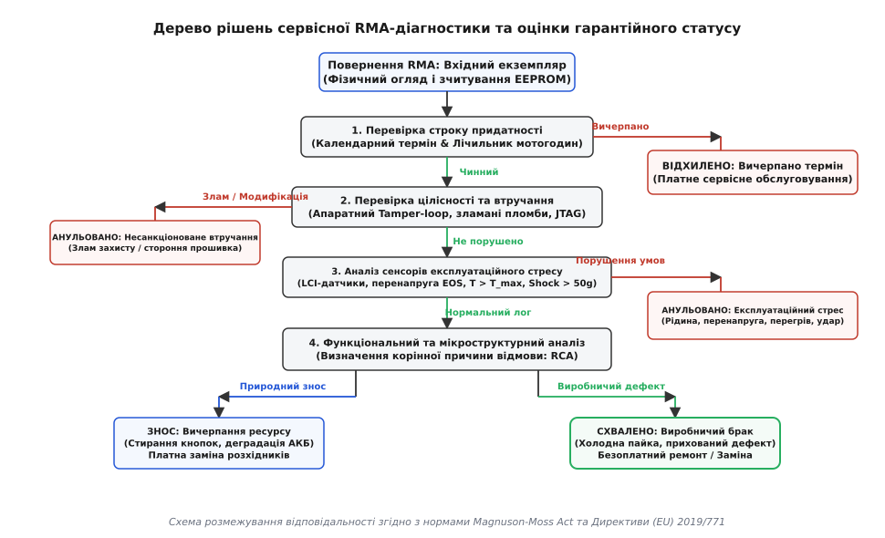
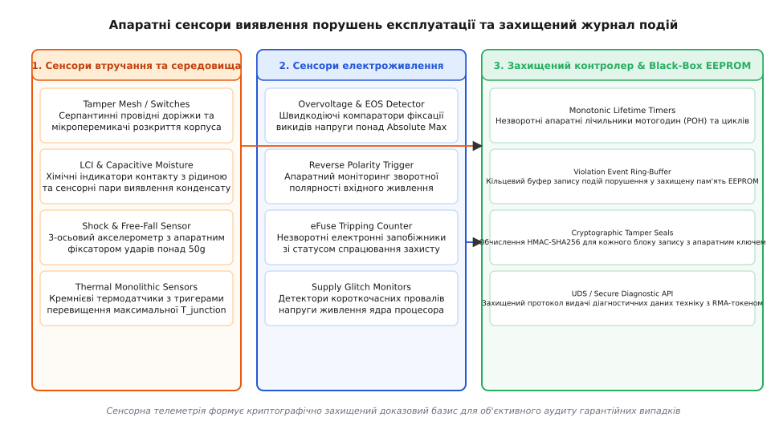

# Гарантія: що обіцяно, на скільки і що її анулює

<preknowlist>
- [Захист і BMS](root:hw-power/bms) — багаторівневий захист хімічних джерел струму від перевантаження, короткого замикання та термічного розгону.
- [Декларація відповідності й технічний файл](root:sys-notary/deklaratsiia-vidpovidnosti-i-tekhnichnyi-fail) — формування пакета технічної документації та сертифікація відповідності безпеки.
- [Ремонт, право власника й межа замикання виробу](root:sys-notary/remont-pravo-vlasnyka-i-mezha-zamykannia-vyrobu) — межі автономного ремонту, криптографічна прив'язка вузлів та регуляторні вимоги до запчастин.
- [Нормативні вимоги до безпеки коду: CRA, RED 3.3](root:sys-notary/normatyvni-vymohy-do-bezpeky-kodu) — регуляторні стандарти кібербезпеки та захисту інтерфейсів радіообладнання.
- [Речовини й утилізація: RoHS, REACH, WEEE](root:sys-notary/rechovyny-i-utylizatsiia) — екологічні нормативи подовження життєвого циклу техніки та вторинної переробки.
</preknowlist>

Сервісний центр приймає промисловий контролер автоматизації вартістю чотири тисячі євро, який раптово вимкнувся на об'єкті замовника через вісімнадцять місяців після введення в експлуатацію. Власник вимагає негайної безоплатної заміни за гарантією, посилаючись на європейську директиву про захист прав споживачів та дворічний гарантійний термін. Під час первинної візуальної діагностики технік не виявляє зовнішніх механічних пошкоджень корпусу, проте після зняття захисного кожуха мікроскоп показує обвуглений кристал синхронного понижувального перетворювача живлення шини 24 В та зруйнований захисний супресор (TVS-діод).

На цьому етапі виникає класичний інженерно-правовий конфлікт: замовник наполягає на прихованому виробничому дефекті кремнію (англ. *latent manufacturing defect*) або втомному руйнуванні паяного з'єднання, тоді як виробник підозрює подачу високовольтної напруги 380 В у слабкострумову лінію живлення або комутаційний викид індуктивного навантаження, що виходить далеко за межі допустимих умов експлуатації (англ. *Absolute Maximum Ratings*). Без об'єктивних апаратних доказів розгляд рекламації перетворюється на бездоказову суперечку, де тягар фінансових втрат лягає на того, хто не зміг зафіксувати фізичний стан приладу в момент аварії.

Сучасний електронний виріб розв'язує цю невизначеність за допомогою вбудованої системи діагностики та захищеного чорного ящика: автономних сенсорів перенапруги, хімічних та ємнісних індикаторів зволоження, моніторів термічного профілю та незворотного енергонезалежного журналу порушень (англ. *tamper and violation log*). Гарантійні зобов'язання — це не просто юридичний текст на останній сторінці інструкції, а суворий інженерний контракт, у якому кожна обіцянка спирається на розрахунок надійності компонентів, а кожна умова анулювання підтверджується фізичними мітками та криптографічно підписаними апаратними подіями.

```
+───────────────────────────────────────────────────────────────────────────+
| СТРУКТУРА ГАРАНТІЙНОГО КОНТРАКТУ ТА АПАРАТНОЇ ВАЛІДАЦІЇ                   |
|                                                                           |
|   ЮРИДИЧНИЙ РІВЕНЬ:                                                       |
|   ├── Законна гарантія відповідності (EU 2019/771, 24 міс., тягар доказу) |
|   └── Комерційна гарантія виробника (Magnuson-Moss Act, чіткі винятки)    |
|                                                                           |
|   ФІЗИЧНИЙ РІВЕНЬ ВІДМОВ:                                                 |
|   ├── Виробничий брак: Холодна пайка, дефекти кристала, TDDB діелектрика  |
|   ├── Нормальний знос: Деградація ємності АКБ, стирання реле, вичерпання  |
|   └── Експлуатаційне насильство: Попадання рідини, EOS/ESD, перегрів      |
|                                                                           |
|   АПАРАТНІ МАРКЕРИ АНУЛЮВАННЯ:                                            |
|   ├── Датчики середовища: LCI-стікери, PCB-сенсори, шок-акселерометри     |
|   ├── Захист живлення: TVS-клемпи, eFuse-тригери, детектори зворотної фази|
|   └── Secure Log: Монотонні лічильники POH, EEPROM Ring-Buffer з HMAC     |
+───────────────────────────────────────────────────────────────────────────+
```

## Юридичні рамки: що саме обіцяно та які обмеження накладає закон

У світовій практиці поняття «гарантія» охоплює два принципово різних правових інструменти, які часто плутають інженери-розробники: законну гарантію відповідності товару (англ. *statutory warranty of conformity*) та добровільну комерційну гарантію виробника (англ. *commercial warranty* або *express warranty*).

### Законодавство США: Magnuson-Moss Warranty Act

У Сполучених Штатах базовим нормативним актом є федеральний закон Магнусона-Мосса (англ. *Magnuson-Moss Warranty Act*, 15 U.S.C. § 2301 et seq.), ухвалений у 1975 році. Закон регулює письмові гарантії на споживчі товари вартістю понад 15 доларів і встановлює суворі вимоги до прозорості умов:

1. **Розмежування Full та Limited Warranty:**
   - **Повна гарантія (Full Warranty):** Зобов'язує виробника безоплатно усунути дефект або замінити прилад у розумний строк без виставлення додаткових умов покупцеві (наприклад, без вимоги оплатити зворотну доставку несправного виробу на завод або заповнити реєстраційну картку). Якщо після розумної кількості спроб ремонт не увінчався успіхом, споживач має безумовне право на повне повернення сплачених коштів (англ. *refund*) або заміну пристрою на новий без доплат.
   - **Обмежена гарантія (Limited Warranty):** Дозволяє виробнику законно обмежити строк чинності неявних гарантій придатності (англ. *implied warranties of merchantability*), покласти вартість транспортування несправного вузла на покупця, виключити відповідальність за непрямі збитки (англ. *consequential and incidental damages*) та обмежити перелік компонентів, що підлягають безоплатній заміні (наприклад, гарантія на електроніку — 2 роки, а на акумуляторну батарею чи рухомі підшипники — 6 місяців).

2. **Заборона нав'язування супутніх товарів і послуг (Anti-Tying Provision, 15 U.S.C. § 2302(c)):**
   Виробнику прямо заборонено обумовлювати чинність гарантії обов'язковим використанням фірмових витратних матеріалів, запчастин або авторизованого сервісу, якщо тільки ці запчастини та роботи не надаються покупцеві абсолютно безоплатно:

```
[Заборонена умова] = "Гарантія дійсна лише за умови встановлення оригінальних кабелів ACME"
[Дозволена умова]  = "Гарантія не покриває пошкодження, спричинені несумісним кабелем"
```

3. **Недійсність захисних наліпок «Warranty Void If Removed»:**
   Федеральна торгова комісія США (Federal Trade Commission, FTC) у численних роз'ясненнях та правозастосовчих діях підтвердила, що наліпки-пломби на гвинтах корпусу, які стверджують про автоматичне анулювання гарантії в разі розкриття пристрою або виконання ремонту стороннім майстром, є незаконними та вводять покупця в оману. Анулювання гарантії допускається лише тоді, коли виробник технічно доведе, що поломка стала прямим наслідком некваліфікованого втручання або пошкодження компонентів сторонньою особою.

4. **Правило допродажного інформування (Pre-Sale Availability Rule, 16 CFR Part 702):**
   Виробник зобов'язаний надати повний текст гарантійного документа покупцеві до моменту оформлення покупки, включаючи чітке визначення того, які вузли покриваються гарантією, хто має право пред'являти претензії (перший покупець чи будь-який наступний власник протягом гарантійного строку), які витрати бере на себе виробник та яку процедуру повинен виконати споживач для отримання сервісу.

### Директиви Європейського Союзу: 1999/44/EC та (EU) 2019/771

У європейському праві діє суворіша система захисту споживачів, суттєво оновлена Директивою (EU) 2019/771 про договори купівлі-продажу товарів (яка замінила історичну Директиву 1999/44/EC):

- **Законна гарантія відповідності (Legal Guarantee of Conformity):** Діє щонайменше **24 місяці** з моменту передачі товару споживачеві. Продавець несе пряму відповідальність за будь-яку невідповідність товару специфікації, що існувала на момент поставки, навіть якщо вона виявилася через тривалий час (прихований дефект).
- **Зсув тягаря доказування (Reversal of the Burden of Proof):**
  - За Директивою 1999/44/EC діяла презумпція: будь-який дефект, що виявився протягом перших **6 місяців**, вважався таким, що існував спочатку, і продавець мусив доводити зворотне.
  - Директива (EU) 2019/771 збільшила цей термін до **12 місяців** (і надала країнам-членам право розширити його до 24 місяців). Якщо контролер виходить із ладу на 11-му місяці, виробник зобов'язаний провести експертизу за власний рахунок і надати вичерпні технічні докази порушення правил експлуатації, інакше випадок автоматично визнається гарантійним.
- **Ієрархія засобів правового захисту (Hierarchy of Remedies):** Споживач має право в першу чергу вимагати безоплатного приведення товару у відповідність шляхом ремонту або заміни. Якщо ремонт чи заміна є неможливими або вимагають непропорційних витрат, покупець має право вимагати пропорційного зниження ціни або повного розірвання договору купівлі-продажу з поверненням коштів.
- **Обов'язкові оновлення вбудованого програмного забезпечення:** Директива (EU) 2019/771 прямо зобов'язує виробника надавати виправлення безпеки та оновлення мікропрограмного коду протягом усього розумного строку служби виробу. Непрацездатність приладу через відсутність критичного патча визнається порушенням законної гарантії відповідності.

### Законодавство України: Закон «Про захист прав споживачів»

В українському законодавстві базові норми визначені статтею 7 Закону України «Про захист прав споживачів». Виробник забезпечує належну роботу виробу протягом установленого гарантійного строку. У разі виявлення істотного недоліку, який виник з вини виробника (недолік, який робить неможливим використання товару за призначенням і не може бути усунутий або його усунення потребує понад 14 календарних днів чи значних витрат), споживач має право на розірвання договору або заміну товару на аналогічний. При цьому виконання гарантійного ремонту продовжує гарантійний строк пристрою на час перебування його в сервісному центрі з моменту звернення споживача.

```
+───────────────────────────────────────────────────────────────────────────+
| ПОРІВНЯННЯ НОРМАТИВНИХ ГАРАНТІЙНИХ РЕЖИМІВ                                |
|                                                                           |
| Характеристика          | США (Magnuson-Moss)     | ЄС (Директива 2019/771) |
|─────────────────────────┼─────────────────────────┼─────────────────────────|
| Базовий строк           | Встановлює виробник     | Мінімум 24 місяці       |
| Презумпція вини вендора | Відсутня (цивільний суд)| 12-24 місяці            |
| Статус пломб розкриття  | Заборонені для відмови  | Не є безумовною відмовою|
| Обов'язок оновлень ПЗ   | Не врегульовано суворо  | Обов'язково на весь час |
| Заборона прив'язки СЦ   | Пряма норма § 2302(c)   | Захищено нормами Ecodesign|
+───────────────────────────────────────────────────────────────────────────+
```

## Розмежування: виробничий дефект, нормальний знос та експлуатаційний стрес

Інженерний аналіз надійності базується на розрахунку інтенсивності відмов λ(t), яка в класичній теорії надійності описується U-подібною або так званою «ванною кривою» (англ. *bathtub curve*). Життєвий цикл пристрою ділиться на три виражені фази, кожна з яких має свою фізичну природу пошкоджень:

```
  Інтенсивність
  відмов λ(t)
     ▲
     │  \                                         /
     │   \   Фаза 1:               Фаза 2:       /   Фаза 3:
     │    \  Ранні відмови      Корисний термін /    Знос і старіння
     │     \ (Infant Mortality) (Корисна робота)     (Wear-out Period)
     │      \                 λ(t) ≈ const     /
     │       `────────────────────────────────'
     └─────────────────────────────────────────────────────► Час t
```

### 1. Фаза 1: Ранні виробничі дефекти (Infant Mortality)

Виникають у перші десятки або сотні годин роботи через приховані аномалії технологічного процесу виготовлення кремнію або монтажу друкованих плат:

- **Мікропустоти та інтерметалічні дефекти паяних з'єднань:** У масивах BGA (Ball Grid Array) через порушення термопрофілю паяння оплавленням або недостатню активність флюсу виникають газові каверни (англ. *voids*). Під дією циклічного нагрівання та охолодження на межі розділу припою SAC305 та мідної контактної площадки надмірно розростаються крихкі інтерметалічні фази Cu6Sn5 та Cu3Sn, що призводить до мікротріщин та обриву електричного контакту.
- **Пробій підзатворного діелектрика (Time-Dependent Dielectric Breakdown, TDDB):** У польових транзисторах (MOSFET / FinFET) наявність мікродефектів або сторонніх іонів у шарі діоксиду кремнію SiO2 чи high-k діелектрика (HfO2) викликає поступове накопичення пасток заряду під дією робочої напруги. У певний момент виникає локальний тепловий пробій, який закорочує затвор на витік.
- **Гарячі носії та негативна зміщена температурна нестабільність (HCI та NBTI):** Інжекція високоенергетичних гарячих електронів у підзатворний оксид (Hot Carrier Injection) поступово зміщує порогову напругу транзистора V_th, сповільнюючи логічні вентилі до моменту порушення таймінгів тактування.
- **Механічні мікротріщини в кремнієвих кристалах:** Виникають внаслідок залишкових механічних напружень під час алмазного різання напівпровідникової пластини або термомеханічного стиснення компаунду під час корпусування мікросхеми.

Всі перелічені дефекти є беззаперечним **виробничим браком**, що підлягає безоплатному усуненню виробником у межах гарантійних зобов'язань.

### 2. Фаза 2: Корисний термін експлуатації (Normal Operating Life)

Характеризується низькою та стабільною інтенсивністю випадкових відмов λ(t) ≈ const, викликаних стохастичними зовнішніми подіями (космічне випромінювання, поодинокі стрибки напруги в мережі в межах специфікації). У цей період відмови покриваються гарантією, якщо прилад експлуатувався у межах номінальних параметрів.

### 3. Фаза 3: Природний знос та вичерпання ресурсу (Wear-Out)

Фізичні процеси незворотної деградації матеріалів, закладені в фізичну природу компонентів:

- **Електроміграція (Electromigration):** Спрямований перенос атомів металу (алюмінію чи міді) у провідниках мікросхем під дією «електронного вітру» при високій густині струму (J > 10⁵ А/см²). Призводить до утворення порожнин (обривів) з одного боку провідника та виникнення ниткоподібних горбків (коротких замикань) з іншого.
- **Деградація літій-іонних акумуляторів:** Незворотне потовщення шару твердого електролітного інтерфейсу (Solid Electrolyte Interphase, SEI) на графітовому аноді, розтріскування частинок катодного матеріалу (NMC / LFP) та втрата активного літію внаслідок циклів заряду-розряду.
- **Висихання рідкого електроліту в алюмінієвих конденсаторах:** Поступова дифузія молекул органічного розчинника електроліту крізь гумовий ущільнювач. За правилом Арреніуса кожні 10 °C підвищення температури скорочують строк служби конденсатора вдвічі:

```
L_actual = L_base * 2^((T_max - T_actual) / 10)       [закон подвоєння строку служби]
```

Якщо конденсатор із номіналом 2000 годин при 105 °C експлуатується при 65 °C, його очікуваний ресурс складає:

```
T_diff   = (105 - 65) / 10 = 4                        [кількість 10-градусних інтервалів]
Factor   = 2^4 = 16                                   [коефіцієнт продовження ресурсу]
L_actual = 2000 * 16 = 32000 годин                    [фактичний ресурс ~3.65 років]
```

Знос компонентів із визначеним ресурсом **не є виробничим дефектом** і не підпадає під дію гарантії, якщо строк служби чи кількість циклів досягли заявлених у технічній документації меж.

### Математичні моделі прискореного старіння та деградації

Для оцінки того, чи є відмова наслідком виробничого дефекту, чи результатом теплового перевантаження з боку користувача, сервісні інженери застосовують модель прискореного старіння Арреніуса (Arrhenius model):

```
AF = exp[(E_a / k_B) * (1 / T_use - 1 / T_stress)]   [коефіцієнт прискорення деградації]
```

де:
- AF — коефіцієнт теплового прискорення старіння (Acceleration Factor);
- E_a — енергія активації домінуючого механізму відмови (зазвичай 0.6–0.9 еВ для кремнієвих напівпровідників та 0.4 еВ для паяних з'єднань);
- k_B — стала Больцмана (8.617 × 10⁻⁵ еВ/К);
- T_use — номінальна робоча абсолютна температура вузла у кельвінах;
- T_stress — фактична зафіксована температура перегріву під час експлуатації.

```
T_use_K    = 25 + 273.15 = 298.15 K                   [номінальна температура 25 °C]
T_stress_K = 85 + 273.15 = 358.15 K                   [температура перегріву 85 °C]
E_a        = 0.7 eV                                   [типова енергія активації дефекту]
k_B        = 0.00008617 eV/K                          [стала Больцмана]
Inv_Diff   = (1 / 298.15) - (1 / 358.15) ≈ 0.0005603  [різниця обернених температур]
Exponent   = (0.7 / 0.00008617) * 0.0005603 ≈ 4.551  [показник експоненти]
AF         = exp(4.551) ≈ 94.7                        [прискорення старіння у ~95 разів]
```

Якщо прилад експлуатувався у закритій шафі без вентиляції за температури кристала 85 °C замість проєктних 25 °C, кожні 100 годин роботи еквівалентні майже 9500 годинам нормального зносу (понад рік безперервної служби). У таких випадках відмова компонента є прямим наслідком порушення теплового режиму, що звільняє виробника від гарантійної відповідальності за умови наявності апаратного запису цього перегріву.

Для оцінки надійності паяних з'єднань при циклічних коливаннях температури використовується співвідношення Коффіна-Менсона (Coffin-Manson relationship):

```
N_cycles = C * (ΔT)^(-q)                              [кількість циклів до руйнування припою]
```

де ΔT — розмах коливань температури циклу, q — емпіричний показник втоми матеріалу (для безсвинцевих припоїв SAC305 q ≈ 1.9–2.5), а C — константа матеріалу. Збільшення амплітуди температурних коливань утричі скорочує термін служби пайки майже на порядок.


*Дерево рішень інженерної діагностики RMA для розмежування виробничих дефектів, нормального зносу та анулювання гарантії через експлуатаційні порушення.*

## Умови анулювання гарантії: апаратні сенсори та сліди пошкоджень

Анулювання гарантійних зобов'язань (англ. *voiding of warranty*) — це юридично обґрунтована відмова виробника від безоплатного ремонту на підставі виявлення прямих доказів несанкціонованого фізичного, хімічного або електричного впливу, що виходить за межі паспорта виробу.

### 1. Потрапляння рідини та індикатори LCI

Рідина всередині корпусу електронного приладу спричиняє комплексні руйнівні процеси: гальванічну та електрохімічну корозію провідників друкованої плати, дендритний ріст олова (англ. *electrochemical migration / tin whiskers*) між доріжками живлення під напругою, коротке замикання слабкострумових аналогових кіл та електроліз електроліту.

Для фіксації факту затоплення застосовують два рівні моніторингу:

- **Хімічні індикатори контакту з рідиною (Liquid Contact Indicator, LCI):** Являють собою багатошарові стікери з паперової чи синтетичної целюлозної матриці, просоченої незворотним водорозчинним барвником (зазвичай сульфованим азобарвником, наприклад Brilliant Red або Fast Red). У сухому стані індикатор білий або світло-рожевий. При прямому контакті з водою чи спиртом відбувається капілярне розмивання захисного шару, і барвник незворотно забарвлює верхню поверхню в насичений яскраво-червоний колір.
- **Проблема хибних спрацьовувань LCI:** Якщо прилад тривалий час перебував у середовищі з відносною вологістю понад 90% RH без прямого контакту з рідкою водою, LCI може зберегти білий колір або дати слабку розмиту пляму. Якісні LCI (наприклад, 3M 5557) мають захисну мікропористу гідрофобну мембрану, яка пропускає водяну пару, але блокує спрацьовування доти, доки не виникне прямий тиск рідкої фази води.
- **Ємнісні та резистивні PCB-сенсори вологи:** На плату поруч із вхідними роз'ємами розводяться гребінчасті інтердигітальні мікропровідники (англ. *interdigital PCB electrode pairs*). При виникненні мікрокрапель конденсату діелектрична проникність між гребінками різко зростає (ε_r повітря ≈ 1, води ≈ 80), а електричний опір падає від гігаомів до кілоомів, що негайно детектується аналого-цифровим перетворювачем (АЦП) контролера та фіксується у логу подій.

### 2. Електричне перевантаження (EOS) та електростатичний розряд (ESD)

Електричний стрес є найбільш поширеною причиною відмови напівпровідникових вузлів:

- **Електростатичний розряд (Electrostatic Discharge, ESD):** Високовольтний імпульс (2–15 кВ) надзвичайно малої тривалості (1–100 нс) з відносно малою енергією (мікроджоулі). ESD спричиняє пробій підзатворного оксиду кремнію у польових транзисторах (діелектричний прокол розміром у частки мікрометра). Зазвичай пошкоджує вхідні порти GPIO або інтерфейсні трансивери без помітного макроскопічного обвуглення плати.
- **Електричне перенапруження (Electrical Overstress, EOS):** Вплив надлишкової напруги чи струму тривалістю від мікросекунд до десятків секунд. Енергія імпульсу досягає джоулів чи кілоджоулів. EOS викликає тепловий вибух кремнієвого кристала, випаровування золотих чи мідних зварювальних дротів (англ. *bond wires*), розплавлення металізації на кристалі та карбонізацію епоксидного компаунда мікросхеми.

Для фіксації EOS у схемотехніку інтегрують:
1. **Супресорні матриці (TVS-діоди):** При перевищенні напруги пробою V_BR лавинний діод обмежує напругу на рівні клемпування V_clamp. Якщо енергія імпульсу перевищує гранично допустиму P_pk, TVS-діод деградує в стан короткого замикання (англ. *fail-short mode*), надійно фіксуючи факт катастрофічного перенапруження на вході.
2. **Електронні запобіжники (eFuse):** Інтегральні силові ключі з вимірювальним шунтом та внутрішнім компаратором, які вимикають лінію за частки мікросекунди при струмовому перевантаженні або зворотній полярності. Статус відсічки записується в регістр стану та передається головному мікроконтролеру.
3. **Схеми детектування зворотної полярності:** Застосування компараторів на базі польових транзисторів із тригерними засувками (англ. *latch circuits*), які спрацьовують при від'ємному потенціалі на шині живлення та незворотно виставляють прапорець анулювання гарантії в енергонезалежній пам'яті.

### 3. Механічний удар та падіння

Для мобільних та промислових пристроїв критичним фактором є механічне прискорення. На плату монтується 3-осьовий MEMS-акселерометр з низьким енергоспоживанням (наприклад, Bosch BMA400 або STMicroelectronics LIS3DH), налаштований на детектування ударних піків понад 30–50 g або тривалого вільного падіння (Free-Fall detection). Подія удару разом із вектором прискорення миттєво зберігається в пам'яті контролера.

### 4. Несанкціоноване втручання та модифікація ПЗ

Злам апаратного захисту пристрою включає:
- Спроби підключення до зневаджувальних портів JTAG/SWD для зчитування внутрішньої Flash-пам'яті або зняття апаратних блокувань.
- Запис непідписаного або модифікованого образу прошивки в обхід механізмів Secure Boot.
- Фізичне розкриття корпусу, яке детектується замкненими серпантинними провідниками (англ. *tamper mesh*) на внутрішній стороні кришки або мікроперемикачами, підключеними до автономного RTC-домену живлення із резервною батареєю. При розриві ланцюга RTC-контролер миттєво фіксує мітку часу та переводить пристрій у режим блокування.


*Архітектура апаратних сенсорів виявлення стороннього втручання, рідкого контакту, перенапруги та незворотного логування в захищеному EEPROM.*

## Архітектура захищеного EEPROM-журналу порушень

Для того щоб дані сенсорів мали юридичну та технічну силу під час рекламаційної експертизи, вони повинні зберігатися у сховищі, захищеному від випадкового стирання, програмних збоїв чи цілеспрямованої фальсифікації користувачем.

### Структура розміщення даних у пам'яті (Memory Layout)

Журнал формується у виділеній захищеній області EEPROM або енергонезалежної пам'яті FRAM (Ferroelectric RAM). Сегмент журналу складається з фіксованого заголовка, монотонних лічильників життєвого циклу та кільцевого буфера записів подій:

```
+───────────────────────────────────────────────────────────────────────────+
| СТРУКТУРА БЛОКУ EEPROM-ЖУРНАЛУ (WARRANTY AUDIT LOG)                       |
|                                                                           |
| 0x0000 ┌────────────────────────────────────────────────────────────────┐ |
|        │ Magic Header [4B: 0x57, 0x41, 0x52, 0x52] ("WARR")             │ |
|        │ Schema Version [2B]  | Log Header Length [2B]                  │ |
|        │ Hardware Revision [4B] | Serial Number UUID [16B]              │ |
| 0x001C ├────────────────────────────────────────────────────────────────┤ |
|        │ Monotonic Power-On Hours (POH) [4B: лічильник мотогодин]       │ |
|        │ Boot Counter [4B]    | Thermal Cycles Counter [4B]             │ |
|        │ Global Violation Bitmask [4B: активні тригери порушень]        │ |
| 0x002C ├────────────────────────────────────────────────────────────────┤ |
|        │ High-Watermark: Peak Junction Temp [2B: °C * 10]               │ |
|        │ High-Watermark: Peak Bus Voltage [2B: мВ]                      │ |
|        │ High-Watermark: Peak Shock Acceleration [2B: g * 10]           │ |
| 0x0032 ├────────────────────────────────────────────────────────────────┤ |
|        │ Header CRC32 / HMAC-SHA256 Auth Tag [4B/32B]                   │ |
| 0x0052 ├────────────────────────────────────────────────────────────────┤ |
|        │ Ring Buffer: Record 0 .. Record N-1 (по 32 байти кожен)        │ |
|        │  ├── Timestamp (Unix Epoch або POH Секунди) [4B]               │ |
|        │  ├── Event Category & Event Code [2B]                          │ |
|        │  ├── Sensor Raw Telemetry Payload [16B]                        │ |
|        │  ├── Security Context / State [2B]                             │ |
|        │  └── Record Checksum CRC32 [4B]                                │ |
|        └────────────────────────────────────────────────────────────────┘ |
+───────────────────────────────────────────────────────────────────────────+
```

### Захист від маніпуляцій та цілісність

1. **Апаратний пін Write-Protect (WP):** У звичайному робочому режимі мікроконтролер подає високий логічний рівень на вхід `WP` мікросхеми EEPROM, дозволяючи запис лише під час короткочасних транзакцій у захищеному коді драйвера за перериванням від аварійних компараторів.
2. **Монотонні eFuse лічильники:** У процесорах із вбудованими eFuse (наприклад, ESP32, STM32MP1, NXP i.MX) факт порушення безпеки (прошивка без підпису, спроба розкриття корпусу) записується шляхом незворотного перепалювання кремнієвих перемичок (англ. *blowing eFuses*), які фізично неможливо повернути у початковий стан жодною програмою.
3. **Криптографічний підпис подій (HMAC-SHA256):** Кожен запис журналу містить криптографічний хеш-код автентифікації повідомлення, обчислений за допомогою закритого фабричного ключа K_audit, збереженого в апаратному модулі безпеки (Secure Element):

```
Record_HMAC = HMAC_SHA256(K_audit, Record_Data || POH_Counter || Device_UUID)
```

Спроба підмінити вміст EEPROM за допомогою зовнішнього програматора призведе до невідповідності HMAC під час автоматизованої перевірки на стенді RMA, що автоматично кваліфікується як несанкціоноване втручання.

## Інженерна реалізація: структури даних та аналізатор порушень

Нижче наведено повну реалізацію низькорівневого модуля аудиту гарантійного стану мовами C99 та C++20. Код реалізує парсинг бінарного образу EEPROM, перевірку цілісності заголовка, аналіз бітових прапорців порушень та формування підсумкового вердикту для сервісного інженера.

:::tabs
@tab C (C99)
:::code harantiia-d/c/main.c
@tab C++ (C++20)
:::code harantiia-d/cpp/main.cpp
:::

Детальний аналізатор подій датчиків та алгоритм багатофакторної валідації гарантійних рекламацій винесено в окремий практичний модуль [Валідатор гарантійних умов та апаратного журналу подій](root:sys-notary/harantiia/proj-warranty-validator.md).

## Організація процесу рекламацій (RMA Pipeline)

Процес розгляду повернень матеріальних цінностей (Return Merchandise Authorization, RMA) на підприємстві вимагає стандартизованої інженерної процедури, що виключає суб'єктивні оцінки технічного персоналу. Типовий маршрут пристрою в сервісному центрі складається з п'яти обов'язкових етапів:

1. **Ідентифікація та вхідний візуальний скринінг (Intake & Triage):**
   - Звірення серійного номера, MAC-адреси та електронного ідентифікатора безпеки з базою даних відвантаження.
   - Огляд роз'ємів на предмет механічних деформацій, сторонніх предметів та слідів горіння контактів.
   - Перевірка оптичного стану індикаторів LCI без розкриття виробу (через спеціальні технологічні оглядові віконця) та стану захисних механічних пломб.

2. **Зчитування телеметрії чорного ящика (Black-Box Extraction):**
   - Підключення діагностичного адаптера до захищеного інтерфейсу (сервісний UART, CAN-шина з протоколом UDS або службовий USB-ендпоінт).
   - Автентифікація техніка за допомогою криптографічного токена доступу (Security Access Service `$27` стандарту ISO 14229-1).
   - Вивантаження бінарного образу EEPROM-журналу та верифікація цифрового підпису блоку подій.

3. **Стендові функціональні випробування (Automated Test Equipment, ATE):**
   - Автоматизоване тестування споживання струму в режимах Standby, Idle та Full Load.
   - Перевірка параметрів радіочастотного тракту (потужність передавача, чутливість приймача, рівень паразитних гармонік).
   - Локалізація несправного функціонального блоку (Power Management, MCU, I/O Driver, Sensor Array).

4. **Мікроструктурний аналіз першопричини (Root Cause Analysis, RCA):**
   - Застосовується для спірних випадків, масових відмов або розслідування інцидентів високої вартості.
   - Рентгенографічний контроль (X-Ray Inspection) прихованих паяних з'єднань BGA-мікросхем на наявність мікропорожнин чи мостиків припою.
   - Оптична мікроскопія високої роздільної здатності або сканувальна електронна мікроскопія (SEM) для аналізу слідів електричного пробою кристала.

5. **Формування резолюції RMA та маршрутизація виробу:**

```
+───────────────────────────────────────────────────────────────────────────+
| МАТРИЦЯ РІШЕНЬ RMA ТА МАРШРУТИЗАЦІЯ ПРИСТРОЇВ                             |
|                                                                           |
| Статус діагностики       | Категорія витрат   | Дія з пристроєм           |
|──────────────────────────┼────────────────────┼───────────────────────────|
| Виробничий дефект (DOA)  | Гарантійний бюджет | Негайна заміна на новий   |
| Виробничий дефект (DIF)  | Гарантійний бюджет | Модульний ремонт / Заміна |
| Експлуатаційний знос     | Рахунок клієнта    | Платна заміна розхідників |
| Експлуатаційний стрес    | Рахунок клієнта    | Платний ремонт / Анульовано|
| Дефекту не виявлено (NTF)| Сервісний збір     | Повернення з протоколом   |
+───────────────────────────────────────────────────────────────────────────+
```

## Діагностичні стандарти та інтерфейси зв'язку (UDS / ISO 14229)

У сучасних розподілених системах (автомобільна електроніка, робототехніка, телекомунікації) зчитування гарантійної телеметрії уніфіковане на базі стандарту ISO 14229-1 (Unified Diagnostic Services, UDS):

- **Сервіс `$19` (Read DTC Information):** Дозволяє зчитувати діагностичні коди несправностей (Diagnostic Trouble Codes, DTC), розширений статус (активний дефект, збережений в історії, підтверджений дефект) та моментальний знімок параметрів системи в момент виникнення аварії (Freeze Frame Data: напруга живлення, температура, струм, оберти двигуна).
- **Сервіс `$22` (Read Data By Identifier):** Використовується для прямого вивантаження структурованих ідентифікаторів DID (Data Identifier), таких як загальний час напрацювання (`DID 0xF1A0`), пікова зафіксована температура (`DID 0xF1A5`) та бітова маска порушень безпеки (`DID 0xF1B0`).
- **Сервіс `$27` (Security Access):** Забезпечує захищений доступ до службових функцій через протокол виклику-відповіді (Challenge-Response) з використанням асиметричної криптографії, що запобігає модифікації гарантійного журналу зловмисниками чи сторонніми сервісними станціями.

### Інженерна дисципліна гарантійного контракту

Інженерна строгість гарантійного механізму перетворює взаємовідносини між виробником та користувачем із суб'єктивного конфлікту на прозору процедуру апаратного аудиту, де законний захист споживача гармонійно поєднується з надійним захистом бізнесу від недобросовісних рекламацій. Гарантійні зобов'язання починаються задовго до продажу виробу — на етапі розрахунку теплових запасів напівпровідників, вибору якісних пасивних компонентів та проєктування схем захисту від перенапруги. Якщо схемотехніка побудована без компромісів, а внутрішній журнал подій фіксує кожен відхилений параметр, будь-яка рекламація розглядається швидко, справедливо та з повною юридичною бездоганністю.
