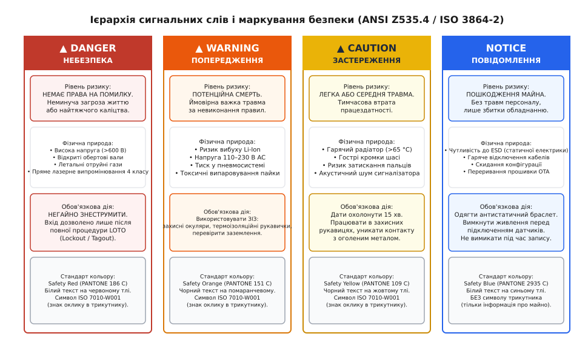
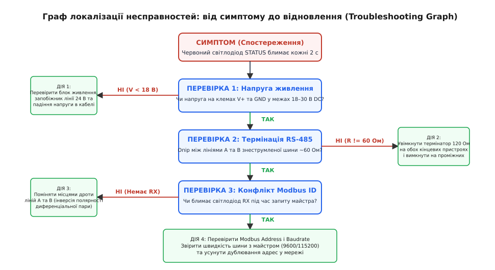

# Інструкція, яку читають після поламки, а не до

<preknowlist>
- [Декларація відповідності й технічний файл](root:sys-notary/deklaratsiia-vidpovidnosti-i-tekhnichnyi-fail) — склад технічного досьє, інженерні докази безпеки та вимоги до супровідної документації виробу.
- [Гарантія: що обіцяно, на скільки і що її анулює](root:sys-notary/harantiia) — юридичні межі відповідальності виробника, умови збереження гарантійних зобов'язань та кваліфікація експлуатаційних помилок.
- [Сервісний режим і діагностика в руках техніка](root:sys-notary/servisnyi-rezhym-i-diahnostyka-v-rukakh-tekhnika) — апаратні інтерфейси налагодження, зчитування журналів аварій та інструменти локалізації несправностей.
- [Повернення, ремонт і «дефекту не виявлено»](root:sys-notary/povernennia-remont-i-defektu-ne-vyiavleno) — аналіз рекламацій, вартість хибних повернень справного обладнання та зниження потоку необґрунтованих звернень.
</preknowlist>

Коли на автоматизованій лінії фасування зупиняється головний конвеєр продуктивністю 3600 упаковок на годину, а на промисловому контролері телеметрії гасне зелений індикатор зв'язку й спалахує червоний світлодіод тривоги, черговий інженер КВПіА не відкриває сторінкову інструкцію користувача від першої сторінки. У нього немає часу вивчати розділ «Загальний опис системи» чи читати звернення генерального директора компанії. Завод зазнає збитків у сотні доларів за кожну хвилину простою, тому 120-сторінковий зброшурований буклет розривають просто посередині або викидають у смітник, шукаючи очима єдине: таблицю симптомів, призначення світлодіодів і порядок аварійного відновлення. Якщо документація виробу побудована за академічним лінійним принципом «від теорії до практики», прилад відправляють на гарантійний ремонт із позначкою «несправний», де сервісний центр витрачає два тижні на з'ясування, що монтажник просто забув увімкнути кінцевий резистор 120 Ом на шині RS-485.

Невідповідність між тим, як інженери пишуть документацію, і тим, як люди її читають, породжує масовий потік хибних рекламацій. Інструкція з експлуатації — це не підручник з будови приладу, а аварійний інтерфейс взаємодії між розробником і користувачем у момент критичного збою. Щоб технічна документація захищала виробника від необґрунтованих судових позовів, запобігала травмам персоналу та скорочувала час ремонту, її структурують за суворими ергономічними та міжнародними нормативними стандартами.

## Психологія читання та когнітивна ергономіка в умовах аварії

У когнітивній ергономіці фундаментальна модель поведінки інженера та оператора описується «парадоксом активного користувача» (англ. *The Paradox of the Active User*), сформульованим Джоном Кероллом (John Carroll) та Мері Бет Россон (Mary Beth Rosson) у дослідженнях IBM Watson Research Center. Його суть полягає в тому, що люди орієнтовані на негайну дію (англ. *action-oriented*): вони купують контролер, датчик або польотний контролер, щоб виконати виробниче завдання, а не заради читання інструкції. Користувачі досліджують інтерфейс методом спроб і помилок («learning by doing») і відкривають документацію виключно тоді, коли пристрій перестає відповідати або видає критичну помилку.

```
┌────────────────────────────────────────────────────────────────────────┐
│             ПАРАДОКС АКТИВНОГО КОРИСТУВАЧА ТА КОГНІТИВНЕ ТУНЕЛЮВАННЯ   │
├────────────────────────────────────────────────────────────────────────┤
│ 1. Нормальний запуск (Normal Setup):                                   │
│    Користувач ігнорує 90% тексту → підключає кабелі «за інтуїцією»     │
│    → Вимога: Архітектура Quick Start Guide (безпека за 3 кроки).       │
├────────────────────────────────────────────────────────────────────────┤
│ 2. Критична відмова (Fault / Incident):                                │
│    Стрес, шум цеху, пульс 120 уд/хв → Когнітивне тунелювання           │
│    → Зниження робочої пам'яті → Пошук візуальних таблиць і схем.       │
├────────────────────────────────────────────────────────────────────────┤
│ 3. Відкриття інструкції після поламки:                                 │
│    Академічний текст (20 сторінок теорії) → Відмова від читання → RMA  │
│    Мінімалістський блок (Симптом → Перевірка → Дія) → Швидкий ремонт   │
└────────────────────────────────────────────────────────────────────────┘
```

У момент виникнення відмови оператор опиняється у стані гострого когнітивного тунелювання (англ. *cognitive tunneling*). Під впливом стресу, шуму цеху та тиску відповідальності поле зорової уваги звужується, а ємність оперативної пам'яті різко падає. Людина стає фізично нездатною сприймати довгі складнопідрядні речення, перехресні посилання на далекі розділи чи абстрактні схеми зв'язків. Уся увага фокусується на пошуку візуальних контрастних сигнатур: кольорових плашок попереджень, таблиць симптомів, діагностичних блок-схем та призначень світлодіодних індикаторів.

Звідси випливає концепція мінімалістського інструктажу (англ. *Minimalist Instruction*), яка встановлює чотири базові інженерні принципи побудови посібників:
- **Орієнтація на завдання (Task Orientation):** текст структурується за діями користувача («Як підключити живлення 24 В», «Як усунути втрату зв'язку»), а не за компонентами схеми («Опис мікросхеми драйвера трансивера»);
- **Негайне занурення в роботу:** усунення вступних філософських передмов, оглядів ринку та надмірної теорії. Перша ж сторінка повинна містити схему фізичного підключення;
- **Підтримка обробки помилок (Error Support):** розділ діагностики та усунення несправностей має становити до 40% загального обсягу інструкції, оскільки саме він визначає успішність експлуатації;
- **Модульна автономність:** кожна інструкція з усунення відмови має бути вичерпною в межах однієї сторінки, не вимагаючи одночасного читання інших глав.

## Архітектура швидкого старту (Quick Start Guide): безпека першого ввімкнення

Щоб запобігти фатальним помилкам монтажу ще до того, як оператор зіткнеться з необхідністю читати розділ несправностей, комплект документації зобов'язаний містити окремий аркуш швидкого старту (англ. *Quick Start Guide*, QSG). Його задача — гарантувати безпечний запуск виробу за три однозначні кроки.

```
┌────────────────────────────────────────────────────────────────────────┐
│             МОДЕЛЬ БЕЗПЕЧНОГО ЗАПУСКУ ЗА 3 КРОКИ (QUICK START)         │
├───────────────────┬──────────────────────────┬─────────────────────────┤
│ КРОК 1: МОНТАЖ    │ КРОК 2: ПІДКЛЮЧЕННЯ     │ КРОК 3: ЖИВЛЕННЯ І POST │
├───────────────────┼──────────────────────────┼─────────────────────────┤
│ • Механічна       │ • Зачищення проводів     │ • Подача напруги 24 В DC│
│   фіксація на DIN-│   на 7 мм                │ • Спостереження за      │
│   рейку 35 мм     │ • Підключення клем V+,   │   світлодіодами POST    │
│ • Підключення шини│   GND, RS-485 (A/B)      │ • Зелений STATUS = ГОТОВ│
│   захисного       │ • Перевірка термінації   │ • Червоний STATUS =     │
│   заземлення PE   │   120 Ом на шині         │   Дивись код несправності│
└───────────────────┴──────────────────────────┴─────────────────────────┘
```

Порушення на будь-якому з цих трьох етапів призводить до апаратного пошкодження (наприклад, подача напруги 230 В на клеми дискретних входів 24 В) або зависання системи. Архітектура QSG виключає довгі текстові абзаци: інформація подається у вигляді інфографіки, схем розпіновки клемників та акцентних рамок із допустимими електричними параметрами.

## Стандарти маркування небезпеки: ANSI Z535.4 та ISO 3864

Юридична відповідальність виробника за травми оператора або пошкодження обладнання регулюється стандартами безпеки технічних посібників та табличок на устаткуванні. У міжнародній практиці діють два ключові стандарти:
- **ANSI Z535.4 (США / глобальний ринок):** «Product Safety Signs and Labels» — стандарт, що встановлює чітку ієрархію сигнальних слів, кольорів та структури попереджень про небезпеку;
- **ISO 3864-1 / ISO 3864-2 (Європейський Союз / ISO):** «Graphical symbols — Safety colours and safety signs» — визначає графічні символи (піктограми ISO 7010) та фотометричні вимоги до знаків безпеки.

Поширена помилка технічних авторів — хаотичне використання слів «Увага!», «Небезпечно!» чи «Важливо!» як синонімів. У судовому процесі щодо відшкодування збитків за виробничу травму кожне сигнальне слово має суворе нормативне визначення залежно від **ймовірності настання події** та **важкості потенційних наслідків**.


*Ієрархія сигнальних слів і колірного кодування за ANSI Z535.4 та ISO 3864-2: розділення рівнів критичності за ступенем загрози життю та обладнанню.*

Стандарт встановлює чотири рівні сигнальних слів:
1. **DANGER (НЕБЕЗПЕКА):**
   - *Колір:* Білий жирний шрифт на фоні кольору Safety Red (PANTONE 186 C);
   - *Символ:* Знак оклику в трикутнику безпеки (ISO 7010-W001);
   - *Критерій:* Вказує на безпосередню, неминучу небезпечну ситуацію, яка, якщо її не уникнути, **призведе до смерті або важкого незворотного каліцтва** (ураження струмом напругою понад 600 В, прямий доступ до обертових промислових шпинделів, вибухонебезпечна газова суміш).
2. **WARNING (ПОПЕРЕДЖЕННЯ):**
   - *Колір:* Чорний або білий шрифт на фоні кольору Safety Orange (PANTONE 151 C);
   - *Символ:* Знак оклику в трикутнику безпеки (ISO 7010-W001);
   - *Критерій:* Вказує на потенційно небезпечну ситуацію, яка, якщо її не уникнути, **може призвести до смерті або тяжкої травми** (напруга мережі 110–230 В, небезпека вибуху літій-іонного акумулятора під час перезаряду, лазерне випромінювання класу 3B/4).
3. **CAUTION (ЗАСТЕРЕЖЕННЯ):**
   - *Колір:* Чорний шрифт на фоні кольору Safety Yellow (PANTONE 109 C);
   - *Символ:* Знак оклику в трикутнику безпеки (ISO 7010-W001);
   - *Критерій:* Вказує на потенційно небезпечну ситуацію, яка **може призвести до легкої або середньої травми** (гарячі радіатори силових ключів із температурою понад 65 °C, гострі кромки металевого шасі, ризик затискання пальців рухомими кришками).
4. **NOTICE (ПОВІДОМЛЕННЯ):**
   - *Колір:* Білий шрифт на фоні кольору Safety Blue (PANTONE 2935 C) або чорний шрифт на білому фоні;
   - *Символ:* **Заборонено використовувати трикутник безпеки**, оскільки повідомлення не стосується фізичних травм людей;
   - *Критерій:* Вказує на ризик **пошкодження майна, обладнання або втрати даних** (чутливість до електростатичного розряду ESD, неприпустимість вимикання живлення під час запису прошивки у Flash, пошкодження клемника надмірним моментом затягування).

### Анатомія трикомпонентного попередження

Будь-яке нормативне попередження про небезпеку в тексті інструкції або на наклейці приладу зобов'язане містити три обов'язкові складові частини:
1. **Природа та джерело небезпеки:** що саме становить загрозу («Висока напруга на відкритих контактах конденсаторного модуля»);
2. **Наслідки ігнорування:** що конкретно відбудеться («Ураження електричним струмом призведе до зупинки серця або важких опіків»);
3. **Конкретна дія для уникнення:** алгоритм захисту («Перед зняттям кришки знеструмте прилад і зачекайте 10 хвилин до повного розряду ємностей. Перевірте відсутність напруги вольтметром»).

Порушення цієї тріади (наприклад, фраза «Обережно, висока напруга!» без вказівки часу розряду конденсаторів) кваліфікується експертами з безпеки як неналежне інформування користувача (англ. *Failure to Warn*), що позбавляє виробника судового захисту.

## Проєктування розділів пошуку несправностей (Troubleshooting)

Розділ діагностики — це ядро експлуатаційної документації. Щоб він працював в умовах аварії, інформацію організовують у вигляді чотириланкової діагностичної матриці або дерева пошуку несправностей (англ. *Fault Tree*).

```
┌────────────────────────────────────────────────────────────────────────┐
│             ЧОТИРИЛАНКОВА СТРУКТУРА ДІАГНОСТИЧНОГО ЗАПИСУ              │
├────────────────────────────────────────────────────────────────────────┤
│ 1. СИМПТОМ (Symptom):                                                  │
│    Що спостерігач бачить або чує без спецприладів                      │
│    «Червоний світлодіод STATUS блимає двічі, реле клацає кожні 2 с»   │
├────────────────────────────────────────────────────────────────────────┤
│ 2. ЙМОВІРНА ПРИЧИНА (Probable Cause):                                  │
│    Фізичний дефект або помилка конфігурації                            │
│    «Спрацював захист від перевантаження за струмом виходу 24 В»        │
├────────────────────────────────────────────────────────────────────────┤
│ 3. ШВИДКА ПЕРЕВІРКА (Verification Test):                               │
│    Тест без демонтажу виробу                                           │
│    «Від'єднати клемник навантаження та виміряти опір лінії мультиметром»│
├────────────────────────────────────────────────────────────────────────┤
│ 4. ВИПРАВЛЕННЯ (Corrective Action):                                    │
│    Однозначна дія з відновлення працездатності                         │
│    «Усунути коротке замикання в кабелі датчика та перезавантажити блок»│
└────────────────────────────────────────────────────────────────────────┘
```

Для складних несправностей, де один симптом може мати кілька незалежних причин (наприклад, збій живлення, відсутність термінації або конфлікт мережевих адрес), застосовують деревоподібні графи діагностики.


*Граф діагностичного пошуку: перехід від поверхневих симптомів до апаратних і програмних тестів та фінальних дій із відновлення працездатності.*

Побудова та формальна перевірка відсутності логічних дефектів у таких діагностичних графах детально розглядаються у практичній вставці [Побудова та валідація матриці пошуку несправностей](root:sys-notary/instruktsiia-iaku-chytaiut-pislia-polamky/proj-troubleshooting-matrix-builder.md).

## Апаратна самодіагностика та світлодіодне кодування (POST)

Первинний діагностичний інтерфейс фізичного приладу без дисплея — це світлодіодна індикація (англ. *LED Blink Codes*). Якщо мікроконтролер виявляє збій на етапі початкового тестування під час увімкнення (Power-On Self-Test, POST), він не може відправити повідомлення в мережу. Єдиний спосіб повідомити причину аварії — світлодіодний шаблон.

Для надійної індикації використовуються такі патерни:
- **Heartbeat (Пульс працездатності):** Одиночний зелений спалах 1 Гц (100 мс увімкнено, 900 мс вимкнено). Свідчить про те, що операційна система реального часу або головний цикл виконується штатно.
- **Blink Codes (Імпульсні серії помилок):** Серія коротких червоних спалахів (200 мс), що відповідає номеру коду помилки, з довгою паузою (1500 мс) між повторами.
- **RGB State Encoding:**
  - *Зелений повільний:* Нормальна робота;
  - *Жовтий строб:* Очікування підключення / з'єднання з мережею;
  - *Червоний постійний:* Критична апаратна відмова (несправність джерела опорної напруги, дефект внутрішньої Flash);
  - *Червоний серійний:* Помилка зовнішніх інтерфейсів (обрив датчика, коротке замикання шини).

Всі зафіксовані помилки POST записуються в енергонезалежний кільцевий журнал аварій (англ. *Fault Log / Black Box*) у пам'ять FRAM або EEPROM з фіксацією лічильника включень та напруги живлення.

## Інженерна реалізація підсистеми POST та діагностики на C99 та C++20

Нижче наведено повну реалізацію модуля самодіагностики, формування кодів несправностей та генератора звітів для польового інженера.

:::tabs
@tab C99
```c
#include <stdio.h>
#include <stdint.h>
#include <stdbool.h>
#include <string.h>

typedef enum {
    FAULT_NONE = 0,
    FAULT_SUPPLY_UNDERVOLTAGE = 1,  /* 1 спалах: Напруга живлення < 18 В */
    FAULT_RS485_NO_TERMINATION = 2, /* 2 спалахи: Відсутня термінація шини */
    FAULT_SENSOR_OPEN_CIRCUIT  = 3, /* 3 спалахи: Обрив лінії вимірювального моста */
    FAULT_CONFIG_CRC_MISMATCH  = 4  /* 4 спалахи: Пошкоджено конфігурацію в EEPROM */
} FaultCode;

typedef struct {
    FaultCode code;
    const char *symptom;
    const char *probable_cause;
    const char *corrective_action;
} FaultDescriptor;

static const FaultDescriptor FAULT_TABLE[] = {
    {
        FAULT_SUPPLY_UNDERVOLTAGE,
        "STATUS LED блимає 1 раз кожні 2 секунди",
        "Напруга живлення впала нижче 18 В під навантаженням",
        "Перевірити перетин кабелю живлення та вихідну напругу блока 24 В DC"
    },
    {
        FAULT_RS485_NO_TERMINATION,
        "STATUS LED блимає 2 рази кожні 2 секунди",
        "Опір знеструмленої лінії RS-485 відрізняється від 60 Ом (немає термінатора)",
        "Увімкнути DIP-перемикач TERM 120R на першому та останньому вузлах шини"
    },
    {
        FAULT_SENSOR_OPEN_CIRCUIT,
        "STATUS LED блимає 3 рази кожні 2 секунди",
        "Струм у петлі 4-20 мА становить 0.0 мА (обрив сигнального кабелю)",
        "Перевірити цілісність лінії від клемника SENSOR+ до первинного перетворювача"
    },
    {
        FAULT_CONFIG_CRC_MISMATCH,
        "STATUS LED блимає 4 рази кожні 2 секунди",
        "Контрольна сума CRC32 налаштувань у пам'яті FRAM не збігається",
        "Скинути прилад до заводських налаштувань утримуванням кнопки RESET 10 с"
    }
};

#define FAULT_TABLE_SIZE (sizeof(FAULT_TABLE) / sizeof(FAULT_TABLE[0]))

const FaultDescriptor* get_fault_descriptor(FaultCode code) {
    for (size_t i = 0; i < FAULT_TABLE_SIZE; ++i) {
        if (FAULT_TABLE[i].code == code) {
            return &FAULT_TABLE[i];
        }
    }
    return NULL;
}

FaultCode run_post_diagnostics(float v_supply, float bus_resistance_ohms, bool sensor_connected, bool crc_valid) {
    if (v_supply < 18.0f) {
        return FAULT_SUPPLY_UNDERVOLTAGE;
    }
    if (bus_resistance_ohms < 45.0f || bus_resistance_ohms > 75.0f) {
        return FAULT_RS485_NO_TERMINATION;
    }
    if (!sensor_connected) {
        return FAULT_SENSOR_OPEN_CIRCUIT;
    }
    if (!crc_valid) {
        return FAULT_CONFIG_CRC_MISMATCH;
    }
    return FAULT_NONE;
}

void print_troubleshooting_guide(FaultCode code) {
    const FaultDescriptor *desc = get_fault_descriptor(code);
    if (!desc) {
        printf("[ДІАГНОСТИКА]: Система працює в штатному режимі (OK).\n");
        return;
    }

    printf("\n=======================================================\n");
    printf("АВАРІЙНИЙ ПРОТОКОЛ ЛОКАЛІЗАЦІЇ НЕСПРАВНОСТІ (КОД #%d)\n", desc->code);
    printf("=======================================================\n");
    printf("[СИМПТОМ]     : %s\n", desc->symptom);
    printf("[ПРИЧИНА]     : %s\n", desc->probable_cause);
    printf("[ІНСТРУКЦІЯ]  : %s\n", desc->corrective_action);
    printf("=======================================================\n");
}

int main(void) {
    printf("Ініціалізація системи та виконання процедури POST...\n");

    /* Симуляція відмови: просідання напруги до 16.2 В */
    FaultCode active_fault = run_post_diagnostics(16.2f, 60.0f, true, true);
    print_troubleshooting_guide(active_fault);

    return 0;
}
```
@tab C++20
```cpp
#include <iostream>
#include <string_view>
#include <array>
#include <optional>
#include <format>

enum class FaultCode : uint8_t {
    None = 0,
    SupplyUndervoltage = 1,
    Rs485NoTermination = 2,
    SensorOpenCircuit  = 3,
    ConfigCrcMismatch  = 4
};

struct FaultDescriptor {
    FaultCode code;
    std::string_view blink_pattern;
    std::string_view symptom;
    std::string_view probable_cause;
    std::string_view corrective_action;
};

class DiagnosticsManager {
public:
    static constexpr std::array<FaultDescriptor, 4> FaultRegistry{{
        {
            FaultCode::SupplyUndervoltage,
            "* _ _ _ _ (1 спалах, пауза 1.5 с)",
            "STATUS LED блимає 1 раз кожні 2 секунди",
            "Напруга живлення впала нижче 18 В під навантаженням",
            "Перевірити перетин кабелю живлення та вихідну напругу блока 24 В DC"
        },
        {
            FaultCode::Rs485NoTermination,
            "* * _ _ _ (2 спалахи, пауза 1.5 с)",
            "STATUS LED блимає 2 рази кожні 2 секунди",
            "Опір знеструмленої лінії RS-485 відрізняється від 60 Ом (немає термінатора)",
            "Увімкнути DIP-перемикач TERM 120R на першому та останньому вузлах шини"
        },
        {
            FaultCode::SensorOpenCircuit,
            "* * * _ _ (3 спалахи, пауза 1.5 с)",
            "STATUS LED блимає 3 рази кожні 2 секунди",
            "Струм у петлі 4-20 мА становить 0.0 мА (обрив сигнального кабелю)",
            "Перевірити цілісність лінії від клемника SENSOR+ до первинного перетворювача"
        },
        {
            FaultCode::ConfigCrcMismatch,
            "* * * * _ (4 спалахи, пауза 1.5 с)",
            "STATUS LED блимає 4 рази кожні 2 секунди",
            "Контрольна сума CRC32 налаштувань у пам'яті FRAM не збігається",
            "Скинути прилад до заводських налаштувань утримуванням кнопки RESET 10 с"
        }
    }};

    [[nodiscard]] static constexpr std::optional<FaultDescriptor> lookup(FaultCode code) noexcept {
        for (const auto& item : FaultRegistry) {
            if (item.code == code) {
                return item;
            }
        }
        return std::nullopt;
    }

    [[nodiscard]] static FaultCode evaluate_hardware(float v_supply, float bus_res_ohms,
                                                     bool sensor_ok, bool crc_ok) noexcept {
        if (v_supply < 18.0f) return FaultCode::SupplyUndervoltage;
        if (bus_res_ohms < 45.0f || bus_res_ohms > 75.0f) return FaultCode::Rs485NoTermination;
        if (!sensor_ok) return FaultCode::SensorOpenCircuit;
        if (!crc_ok) return FaultCode::ConfigCrcMismatch;
        return FaultCode::None;
    }

    static void emit_service_report(FaultCode code) {
        auto fault = lookup(code);
        if (!fault) {
            std::cout << "[СИСТЕМА]: Самодіагностика POST завершена без зауважень.\n";
            return;
        }

        std::cout << "\n=======================================================\n";
        std::cout << "АВАРІЙНИЙ ПРОТОКОЛ ЛОКАЛІЗАЦІЇ ВІДМОВИ (C++20 Engine)\n";
        std::cout << "=======================================================\n";
        std::cout << std::format("[КОД ПОМИЛКИ] : #{}\n", static_cast<uint32_t>(fault->code));
        std::cout << std::format("[СВІТЛОДІОД]   : {}\n", fault->blink_pattern);
        std::cout << std::format("[СИМПТОМ]     : {}\n", fault->symptom);
        std::cout << std::format("[ПРИЧИНА]     : {}\n", fault->probable_cause);
        std::cout << std::format("[ІНСТРУКЦІЯ]  : {}\n", fault->corrective_action);
        std::cout << "=======================================================\n";
    }
};

int main() {
    std::cout << "Запуск Power-On Self-Test промислового контролера...\n";

    // Симуляція відмови термінації шини (опір 120 Ом замість еквівалентних 60 Ом)
    auto fault = DiagnosticsManager::evaluate_hardware(24.0f, 120.0f, true, true);
    DiagnosticsManager::emit_service_report(fault);

    return 0;
}
```
:::

## Ергономіка розміщення інформації на фізичному корпусі приладу

Найкраща інструкція — це та, яку неможливо загубити, тому що вона нанесена безпосередньо на корпус виробу. У промисловому та авіаційному обладнанні діє правило «нульової паперової залежності»:
1. **Шовкодрук та лазерне гравіювання:** на бічну поверхню або внутрішню сторону клемної кришки наносять схему розпіновки, діапазон живильних напруг та таблицю розшифровки світлодіодних спалахів POST. Навіть через десять років експлуатації технік у полі має прямий доступ до базових перевірок без наявності зв'язку чи паперового посібника.
2. **Динамічні QR-коди сервісу:** нанесення лазерного DataMatrix або QR-коду з посиланням на офіційну сторінку діагностики. У пристроях із дисплеєм або BLE-інтерфейсом формується динамічний QR-код, що містить поточний числовий код аварії, версію прошивки та серійний номер, відкриваючи в смартфоні техніка точну покрокову інструкцію для даного випадку.
3. **Механічне кодування та захист від дурня (Poka-Yoke):** форма роз'ємів, колірні мітки та ключі на рознімах повинні фізично унеможливлювати неправильне підключення живлення чи датчиків, захищаючи виріб ще до виникнення першого симптому.

Дотримання цих інженерних принципів перетворює технічну інструкцію з формального юридичного додатку на надійний інструмент підтримки життєвого циклу продукту, зменшуючи витрати на гарантійне обслуговування та підвищуючи довіру замовників.
