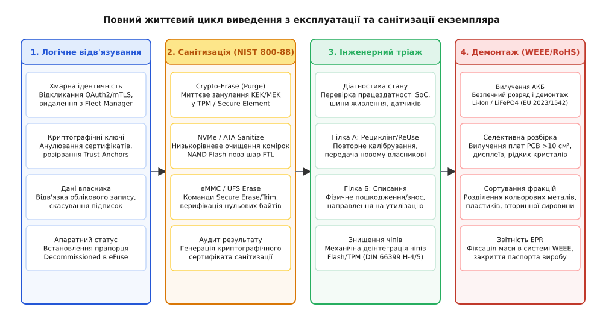
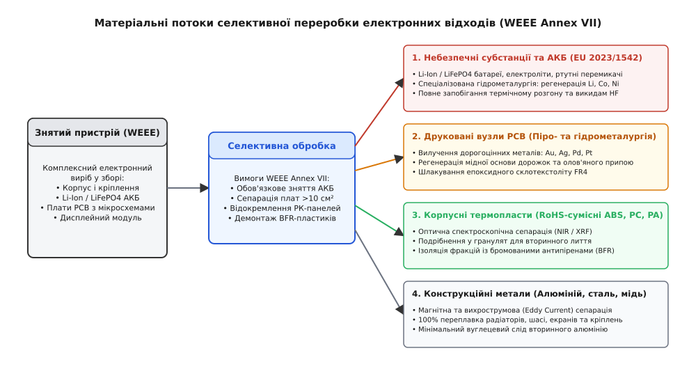

# Кінець екземпляра: передача власності, справжнє скидання, видалення даних, утилізація

<preknowlist>
- [Захист і BMS](root:hw-power/bms) — багаторівневий захист хімічних джерел струму від перевантаження, короткого замикання та термічного розгону.
- [Речовини й утилізація: RoHS, REACH, WEEE](root:sys-notary/rechovyny-i-utylizatsiia) — нормативні вимоги до обмеження небезпечних речовин та розширена відповідальність виробника (EPR).
- [Ремонт, право власника й межа замикання виробу](root:sys-notary/remont-pravo-vlasnyka-i-mezha-zamykannia-vyrobu) — інженерні криптографічні ланцюги прив'язки компонентів (Parts Pairing) та діагностика вузлів.
- [Нормативні вимоги до безпеки коду: CRA, RED 3.3](root:sys-notary/normatyvni-vymohy-do-bezpeky-kodu) — регуляторні стандарти захисту інтерфейсів та життєвого циклу оновлень.
- [Декларація відповідності й технічний файл](root:sys-notary/deklaratsiia-vidpovidnosti-i-tekhnichnyi-fail) — формування пакета технічної документації та оцінка відповідності.
</preknowlist>

Партія з трьохсот промислових контролерів телеметрії та шлюзів збору даних після завершення трирічного договору лізингу на об'єкті критичної інфраструктури списується та виставляється на вторинний аукціон обладнання. Перед демонтажем черговий системний адміністратор виконав стандартну операцію через панель адміністрування: натиснув кнопку «Заводське скидання» (Factory Reset), підтвердив очищення простору користувача та запакував плати у коробки. Через два місяці дослідницька група з кібербезпеки купує один із таких зразків за сорок євро на відкритому торговому майданчику. Підключивши логічний аналізатор до тестових точок шини NAND Flash та випаявши мікросхему пам'яті eMMC на програматор, інженери виявляють: файлова система ext4 була лише формально перерозмічена новим суперблоком, тоді як 98% фізичних сторінок флеш-пам'яті залишилися недоторканими в резервних пулах контролера зносу (Wear Leveling). Із сирого дампу відновлено приватні ключі клієнтських сертифікатів mTLS для доступу до корпоративного брокера MQTT, паролі до локальних технологічних мереж WPA3-Enterprise та повний некодований журнал промислової телеметрії з координатами вузлів газорозподільної системи.

Цей інцидент висвітлює фундаментальний розрив між уявленням користувача про «видалення файлів» і реальною фізикою напівпровідникових носіїв, криптографічних анклавів та нормативних зобов'язань довкола життєвого циклу техніки. Завершення служби фізичного екземпляра пристрою (англ. *Hardware Instance Decommissioning*) — це не поодинока програмна команда, а комплексний детермінований інженерно-технічний процес. Він охоплює коректне відкликання хмарної ідентичності, гарантоване очищення енергонезалежної пам'яті за міжнародними стандартами санітизації (NIST SP 800-88, IEEE 2883), апаратне занулення криптографічних ключів, фізичну деструкцію незахищених чіпів під час списання, безпечний демонтаж літієвих джерел струму відповідно до регламенту (EU) 2023/1542 та розділення матеріальних потоків за директивами WEEE 2012/19/EU і RoHS 2011/65/EU.


*Повний життєвий цикл виведення з експлуатації: від розриву хмарних зв'язків до санітизації NIST SP 800-88 та WEEE-демонтажу.*

## Анатомія завершення життєвого циклу пристрою (Decommissioning)

Термін «декомісія» або «виведення з експлуатації» (від латинського *committere* — доручати, з префіксом *de-* — скасування повноважень) в інженерії вбудованих систем означає санкціоноване, незворотне припинення виконання екземпляром пристрою своїх функцій у складі інформаційної чи промислової системи з подальшою передачею новому власнику або утилізацією.

Життєвий цикл серійного апаратного екземпляра описується строгим кінцевим автоматом станів:

```
+───────────────────────────────────────────────────────────────────────────+
| СТАНИ ЖИТТЄВОГО ЦИКЛУ АПАРАТНОГО ЕКЗЕМПЛЯРА                               |
|                                                                           |
|   [ 1. PROVISIONED ] ──> Первинна прошивка, запис UID та ключів у eFuse   |
|            │                                                              |
|            ▼                                                              |
|   [ 2. OPERATIONAL ] ──> Робоча експлуатація, підключення до Fleet Cloud  |
|            │                                                              |
|            ▼ (Подія: Закінчення служби / Продаж / Аварія)                 |
|   [ 3. DECOM_PENDING ] ─> Логічне блокування, зупинка сервісів            |
|            │                                                              |
|            ├───> Санітизація даних (NIST SP 800-88: Purge / Crypto-Erase) |
|            │                                                              |
|            ▼                                                              |
|   [ 4. SANITIZED ] ───> Перевірка працездатності / Інженерний тріаж       |
|            │                                                              |
|            ├───────────────────────────────┐                              |
|            ▼ (Придатний до ReUse)          ▼ (Непридатний / Списання)     |
|   [ 5. SECONDARY_MARKET ]         [ 6. WEEE_DISPOSAL ]                    |
|   Новий власник, повторне         Демонтаж АКБ (EU 2023/1542),            |
|   програмування ключів            руйнування Flash (DIN 66399),           |
|                                   селективна переробка фракцій            |
+───────────────────────────────────────────────────────────────────────────+
```

Перехід між цими станами вимагає суворого розподілу обов'язків між програмним забезпеченням, апаратними модулями безпеки (TPM, HSM, Secure Element) та фізичною інфраструктурою утилізації. Якщо на стадії переходу з `OPERATIONAL` до `SANITIZED` буде пропущено хоча б один рівень енергонезалежного сховища, пристрій перетворюється на постійне джерело компрометації минулої інфраструктури.

## Передача власності: розірвання криптографічних прив'язок та відв'язка хмари

Передача апаратного виробу вторинному власнику (англ. *Ownership Transfer*) у сучасних підключених системах (IoT, Automotive, Medical Devices) не зводиться до фізичної передачі коробки з рук у руки. Пристрій містить складний клубок криптографічних зв'язків із хмарною інфраструктурою виробника, оператора зв'язку та первинного власника.

### Рівні криптографічної ідентичності

Кожен підключений пристрій володіє щонайменше трьома незалежними шарами ідентичності:
1. **Апаратна ідентичність виробника (Factory Identity / Device Root of Trust):** Серійний номер чіпа, відкритий ключ фабричного сертифіката X.509 (наприклад, IEEE 802.1AR Initial Device Identifier, IDevID), зашитий у захищену OTP-пам'ять або eFuse мікроконтролера під час вихідного заводського тестування. Цей шар є незмінним протягом усього життя кремнію.
2. **Операційна ідентичність системи (Operator Identity / LDevID):** Локально згенеровані ключові пари та сертифікати, видані інфраструктурою відкритого ключа (PKI) первинного власника пристрою. Вони використовуються для встановлення взаємної TLS-автентифікації (mTLS) із хмарними серверами (AWS IoT Core, Azure IoT Hub, власний брокер EMQX).
3. **Облікова ідентичність користувача (User / Tenant Identity):** Токени авторизації OAuth2 (JWT Bearer tokens), API-ключі сторонніх сервісів, попередньо встановлені паролі Wi-Fi (PSK), криптографічні ключі локального шифрування бази даних SQLite (SQLCipher) та прив'язки мобільних додатків власника.

```
+───────────────────────────────────────────────────────────────────────────+
| СТРУКТУРА ДОВІРИ ТА РОЗРИВ ЗВ'ЯЗКІВ ПРИ ДЕКОМІСІЇ                        |
|                                                                           |
|    [ Хмарний сервіс (AWS / Azure) ] <=== mTLS (LDevID) ===> [ Пристрій ]  |
|                 │                                              │          |
|    1. Відкликання сертифіката (CRL/OCSP)                       │          |
|    2. Видалення Thing / Device Registration                    │          |
|    3. Скасування OAuth Refresh Tokens                          │          |
|                                                                │          |
|    [ Локальний Secure Element ] <── Занулення KEK/MEK ─────────┘          |
|                 │                                                         |
|    • IDevID (Фабричний ключ) ───> ЗАЛИШАЄТЬСЯ (Незмінний апаратний корінь)|
|    • LDevID (Ключ оператора) ───> АНУЛЮЄТЬСЯ (Видалення із захищеної NVRAM)|
|    • Tenant Data Storage ───────> КРИПТОГРАФІЧНО ЗНИЩУЄТЬСЯ               |
+───────────────────────────────────────────────────────────────────────────+
```

### Протокол відв'язування від хмари (Fleet De-provisioning)

Процес коректної передачі прав власності вимагає узгодженого двостороннього протоколу:

1. **Ініціація з хмарного боку (Cloud-Initiated Revocation):**
   - Хмарний шлюз надсилає підписаний службовий наказ `CMD_DEVICE_DECOMMISSION` через захищений канал MQTT/CoAP.
   - Серверний центр сертифікації (CA) негайно вносить сертифікат оператора пристрою до списку відкликаних сертифікатів (Certificate Revocation List, CRL) та активує прапорець `Revoked` у службі OCSP Responder. Це гарантує, що навіть якщо зловмисник фізично скопіює ключ із пам'яті до його занулення, жоден запит до API більше не пройде автентифікацію.
   - Запис пристрою видаляється з реєстру Zero-Touch Provisioning (наприклад, AWS IoT Device Defender або Google Cloud Device Provisioning), що блокує можливість автоматичного перепідключення після перезавантаження.

2. **Виконання на пристрої (On-Device Zeroization):**
   - Операційна система переводить демони в режим зупинки вводу-виводу (Read-Only Quiesce).
   - З енергонезалежної пам'яті Secure Element (наприклад, NXP SE050 або Microchip ATECC608) надсилається команда на стирання слотів приватних ключів оператора `LDevID`.
   - Занулюються токени сесій, кеш DNS, таблиці маршрутизації та персоналізовані налаштування користувача.
   - Пристрій генерує локальний криптографічний звіт про санітизацію, підписує його фабричним ключем `IDevID` і надсилає останнє підтвердження на хмарний сервер перед остаточним скиданням.

## Ілюзія швидкого скидання проти справжньої санітизації даних

Найбільш поширена інженерна помилка полягає у використанні традиційних утиліт файлових систем (`rm -rf`, `mkfs.ext4`, перерозмітка таблиці розділів GPT/MBR) як засобу очищення пам'яті пристрою.

### Фізика твердотільних накопичувачів та Wear Leveling

У класичних магнітних жорстких дисках (HDD) існував жорсткий прямий зв'язок між логічним номером блоку (Logical Block Addressing, LBA) та його фізичним положенням на магнітній пластині (циліндр, головка, сектор). Запис нулів у сектор номер 100 означав фізичне перемагнічування ділянки феромагнетика.

У напівпровідниковій флеш-пам'яті (NAND Flash, eMMC, UFS, NVMe SSD, вбудована пам'ять мікроконтролерів) пряма адресація фізично неможлива через фундаментальні фізичні обмеження кремнієвих комірок:
1. **Асиметрія читання, запису та стирання:** Читання та програмування флеш-пам'яті здійснюється сторінками (розміром 4 КБ, 8 КБ або 16 КБ), проте стирання комірок можливе лише цілими блоками (Block/Erase Unit), розмір яких становить від 512 КБ до 8–16 МБ.
2. **Неможливість перезапису на місці (Out-of-Place Updates):** Щоб змінити хоча б один байт у сторінці, її не можна просто перезаписати. Контролер повинен записати нову версію сторінки у вільне фізичне місце, а стару позначити як «недійсну» (Invalid). Фізичне очищення старої сторінки відбудеться пізніше під час роботи фонового процесу збирання сміття (Garbage Collection).
3. **Транслятор адрес Flash Translation Layer (FTL):** Внутрішній мікроконтролер накопичувача виконує динамічну трансляцію адрес. Логічний сектор `LBA 0x1000` сьогодні відображається на фізичний блок 12, сторінку 4, а після чергового запису — на фізичний блок 98, сторінку 2.
4. **Алгоритми вирівнювання зносу (Wear Leveling):** Комірки Flash витримують обмежену кількість циклів програмування/стирання (P/E cycles: від 10 000–100 000 для SLC до 500–3 000 для TLC/QLC). FTL навмисно перерозподіляє записи по всьому фізичному масиву кремнію, включаючи приховані резервні зони надлишкового обсягу (Over-Provisioning), які займають від 7% до 25% загальної ємності чіпа.

```
+───────────────────────────────────────────────────────────────────────────+
| ФІЗИЧНИЙ ШАР FTL: ЧОМУ ЛОГІЧНИЙ ПЕРЕЗАПИС НЕ СТИРАЄ ДАНІ                  |
|                                                                           |
|  Хост-ОС надсилає: [ Записати 0x00 у LBA 42 ]                             |
|          │                                                                |
|          ▼                                                                |
|  [ Контролер eMMC / NVMe FTL ]                                            |
|          │                                                                |
|          ├─> 1. Виділяє НОВУ чисту сторінку у фізичному блоці #501        |
|          ├─> 2. Записує туди 0x00                                         |
|          ├─> 3. Оновлює таблицю LBA 42 ──> Фізичний блок #501             |
|          └─> 4. СТАРА сторінка у блоці #105 позначається як INVALID       |
|                                                                           |
|  РЕЗУЛЬТАТ: Конфіденційні дані ВЛАСНИКА залишаються у блоці #105          |
|  у незмінному вигляді. Лабораторний програматор зчитує їх без перешкод!   |
+───────────────────────────────────────────────────────────────────────────+
```

Отже, коли операційна система виконує `dd if=/dev/zero of=/dev/mmcblk0`, контролер накопичувача просто виділяє нові блоки під запис нулів, тоді як старі сторінки, що містили ключі шифрування, сертифікати чи логи, залишаються у фізичних блоках флеш-пам'яті до моменту, поки контролер не вирішить стерти весь блок під час списання або збору сміття. Для криміналістичного зчитування цих даних достатньо випаяти BGA-чіп (Chip-Off Forensics) або подати прямі низькорівневі вендорські команди (Vendor Unique Commands, VUC).

### Стандарт санітизації NIST SP 800-88 Rev. 1 та IEEE 2883-2022

Для вирішення проблеми гарантованого видалення інформації Національний інститут стандартів і технологій США розробив стандарт **NIST Special Publication 800-88 Revision 1 (Guidelines for Media Sanitization)**, гармонізований із міжнародним стандартом **IEEE 2883-2022**.

Стандарт класифікує санітизацію носіїв за трьома послідовними рівнями стійкості:

```
Співвідношення рівнів санітизації за NIST SP 800-88 Rev. 1:
+-------------------+---------------------------+---------------------------+---------------------------+
| Параметр          | Clear (Логічне очищення)  | Purge (Санітизація)       | Destroy (Знищення)        |
+-------------------+---------------------------+---------------------------+---------------------------+
| Мета процесу      | Захист від базового       | Захист від лабораторного  | Повна фізична деструкція  |
|                   | програмного відновлення   | апаратного відновлення    | носія до стану порошку    |
+-------------------+---------------------------+---------------------------+---------------------------+
| Застосовні        | Перезапис логічних адрес  | Апаратний Secure Erase,   | Шредування, спалювання,   |
| методики          | нулями або патерном (1-3) | Crypto-Erase, Sanitize    | деінтеграція (DIN 66399)  |
+-------------------+---------------------------+---------------------------+---------------------------+
| Резервні зони     | Не очищуються             | Повністю очищуються       | Повністю знищуються       |
| FTL / Bad Blocks  | (залишаються вільні дані) | (включаючи Over-Provision)| разом із кремнієм         |
+-------------------+---------------------------+---------------------------+---------------------------+
| Можливість        | Так, носій готовий        | Так, носій готовий        | Ні, виріб непридатний     |
| повторного ReUse  | до подальшої роботи       | до безпечного ReUse       | для експлуатації          |
+-------------------+---------------------------+---------------------------+---------------------------+
| Сфера             | Передача всередині тієї   | Продаж на вторинний ринок,| Повне списання,           |
| застосування      | самої організації         | повернення орендодавцю    | утилізація (WEEE)         |
+-------------------+---------------------------+---------------------------+---------------------------+
```

1. **Clear:** Застосовує логічні команди читання/запису до всіх доступних користувачеві адресних просторів. Захищає від простого відновлення через стандартні системні утиліти (наприклад, `testdisk` чи `photorec`), але не діє проти аналізу прихованих областей FTL.
2. **Purge:** Використовує вбудовані апаратні механізми мікроконтролера накопичувача. Команда змушує фізично подати напругу стирання на всі блоки пам'яті (Block Erase) одночасно, включаючи виведені з експлуатації «збійні» комірки (Retired Bad Blocks) та таблиці трансляції FTL, або знищує ключ повнодискового шифрування (Cryptographic Erase). Дані стають недосяжними навіть для скануючої електронної мікроскопії (SEM) та прямих зондових станцій (Magnetic Force Microscopy).
3. **Destroy:** Фізичне перетворення матеріального носія на дрібні фрагменти, хімічне розчинення або високотемпературне спалювання, що виключає можливість відновлення за будь-якого фінансування атаки.

## Криптографічне стирання (Cryptographic Erasure / Crypto-Erase)

Найбільш енергоефективним, швидким і математично доведеним способом виконання санітизації рівня **Purge** є криптографічне стирання (Crypto-Erase / CE).

### Механізм миттєвого знецінення даних

Архітектура захищеного пристрою будується за принципом «шифрування за замовчуванням» (Always-on Encryption at Rest):
1. Усі дані на накопичувачі записуються виключно в зашифрованому вигляді за допомогою симетричного апаратного шифратора AES-XTS-256 або AES-GCM-256.
2. Шифрування здійснюється за допомогою внутрішнього майстер-ключа шифрування даних (Data Encryption Key, DEK або Master Encryption Key, MEK).
3. Ключ MEK ніколи не зберігається у відкритому вигляді у флеш-пам'яті. Він зашифрований іншим ключем — ключем шифрування ключів (Key Encryption Key, KEK), який генерується всередині захищеного криптографічного анклаву (Secure Element, TPM 2.0, Secure Enclave SoC) на основі апаратного кореня довіри та пароля власника.

```
+───────────────────────────────────────────────────────────────────────────+
| МЕХАНІЗМ КРИПТОГРАФІЧНОГО СТИРАННЯ (CRYPTO-ERASE)                         |
|                                                                           |
|  [ Secure Element / TPM ] ────────────── [ NAND Flash Пам'ять (128 ГБ) ]  |
|            │                                             │                |
|       Зберігає KEK                                Зашифровано AES-256     |
|            │                                      за допомогою MEK        |
|            ▼                                             │                |
|     Зашифрований MEK ────────────────────────────────────┘                |
|            │                                                              |
|   ПОДІЯ САНІТИЗАЦІЇ:                                                      |
|   1. Secure Element занулює KEK (виконує апаратний перезапис нулями).     |
|   2. Занулює зашифрований образ MEK у внутрішній захищеній NVRAM.         |
|                                                                           |
|   РЕЗУЛЬТАТ: 128 Гігабайт даних на NAND Flash за 1 мілісекунду            |
|   перетворюються на нерозрізнений білий шум із ентропією 8.0 біт/байт.    |
|   Складність відновлення = Складність зламу AES-256 (2^256 операцій).     |
+───────────────────────────────────────────────────────────────────────────+
```

Для повного знецінення інформації на пристрої об'ємом хоч у терабайт не потрібно годинами перезаписувати кожен гігабайт напівпровідника. Достатньо гарантовано занулити 256 біт ключа `MEK` та супутній `KEK`. Без цього ключа весь масив даних у флеш-пам'яті перетворюється на псевдовипадковий білий шум, відновити інформацію з якого неможливо згідно з фундаментальними законами теорії інформації.

> 🔧 **Навіщо це на практиці:** На автономних необслуговуваних терміналах або бортових контролерах БПЛА у разі виявлення розкриття корпусу (Tamper Detection) чи загрози захоплення пристрою таймер очищення не має часу на тривалий цикл перезапису Flash. Апаратне занулення регістру ключів у криптоанклаві займає менше 100 мікросекунд і гарантовано переводить пристрій у стан санітизованого списання навіть при раптовому вимкненні живлення.

## Низькорівневі інтерфейси та протоколи апаратного очищення

Кожен клас напівпровідникових накопичувачів має власний стандартизований набір апаратних команд для виконання санітизації рівня **Purge**.

### NVMe Sanitize та NVMe Format

У специфікації NVM Express (NVMe версій 1.3+) визначено дві різні процедури:
- **NVMe Format (Admin Opcode `0x80`):** Низькорівневе форматування простору імен (Namespace). Може включати параметр `User Data Erase` (занулення логічного простору) або `Crypto Erase` (скидання внутрішнього ключа шифрування). Форматування є синхронною операцією на рівні простору імен.
- **NVMe Sanitize (Admin Opcode `0x84`):** Більш глибока операція, що діє на весь NVM-контролер. Вона виконується асинхронно у фоні контролера і гарантовано охоплює всі фізичні блоки, включаючи приховані області зносу, кеш SLC, буфери DRAM та виведені з експлуатації збійні блоки.

Команда NVMe Sanitize підтримує три взаємовиключні режими:
1. `Block Erase` (Біт 2): Виконує низькорівневе фізичне стирання високою напругою всіх блоків кремнію.
2. `Crypto Erase` (Біт 4): Знищує внутрішній майстер-ключ шифрування носія.
3. `Overwrite` (Біт 3): Багаторазовий перезапис усього масиву визначеним 32-бітним патерном із подальшим інвертуванням.

### eMMC та UFS Sanitize

В убудованих модулях пам'яті смартфонів та IoT-пристроїв (стандарти JEDEC eMMC JESD84 та UFS JESD220) реалізовано спеціалізовані команди:
- `CMD38` (ERASE): Стандартне стирання блоків.
- `SECURE ERASE / SECURE TRIM`: Двоетапна операція, яка спочатку стирає фізичні сторінки, що відповідають зазначеному LBA, а потім виконує стирання всіх копій цих сторінок у тимчасових буферах Wear Leveling.
- `SANITIZE Operation (EXT_CSD[165])`: Повне примусове очищення всіх недійсних (Invalid) фізичних сторінок та очищення черги збирання сміття.

### Апаратне занулення мікроконтролерів (MCU Readout Protection Downgrade)

Для мікроконтролерів без зовнішньої ОС (наприклад, сімейства STM32, ESP32, NXP LPC) процедура очищення керується вбудованими регістрами захисту пам'яті (Flash Readout Protection, RDP):
- **STM32 RDP Level 1 -> Level 0:** При зміні байта конфігурації Option Bytes із рівня захисту RDP 1 на RDP 0 апаратна логіка контролера автоматично ініціює повне стирання всієї вбудованої Flash-пам'яті (Mass Erase) та очищення внутрішньої SRAM перед тим, як відкрити інтерфейс налагодження SWD/JTAG.
- **STM32 RDP Level 2:** Незворотне апаратне блокування інтерфейсу відладки. Пристрій більше не можна повернути до RDP 0; для утилізації такої плати необхідна фізична деструкція кристала.

## Фізичне знищення накопичувачів та крипточіпів при списанні

Якщо пристрій підлягає остаточному списанню (EOL / Scrapping) без права передачі на вторинний ринок, нормативні стандарти безпеки вимагають фізичного знищення кремнієвих кристалів флеш-пам'яті та крипточіпів (Secure Elements, TPM).

```
+───────────────────────────────────────────────────────────────────────────+
| ДЕГАУСИНГ ПРОТИ ДЕІНТЕГРАЦІЇ: ФІЗИЧНА ПРИРОДА НОСІЯ                       |
|                                                                           |
|  [ Магнітний диск (HDD) ] ───> Дегаусер (Імпульс 2-3 Тесла)               |
|                                ├── Руйнує доменну структуру феромагнетика |
|                                └── РЕЗУЛЬТАТ: Повна санітизація           |
|                                                                           |
|  [ Flash-пам'ять / SSD ]  ───> Дегаусер (Імпульс 2-3 Тесла)               |
|                                ├── Заряд у плаваючих затворах НЕ ЗМІНЕНО  |
|                                └── РЕЗУЛЬТАТ: НЕ ДІЄ! ДАНІ ЦІЛІ!          |
|                                                                           |
|  [ Flash-пам'ять / SSD ]  ───> Шредер / Деінтегратор (DIN 66399 E-4/E-5)  |
|                                ├── Механічне розмелювання чіпа <= 10 мм² |
|                                └── РЕЗУЛЬТАТ: Фізична неможливість зчиту  |
+───────────────────────────────────────────────────────────────────────────+
```

### Чому магнітне розмагнічування (Degaussing) не діє на Flash

Поширена помилка служб безпеки — спроба знищення SSD, SD-карт або флеш-мікросхем на промислових дегаусерах (магнітних розмагнічувачах з полем 2–3 Тесла).

Дегаусер ефективний виключно для магнітних носіїв (HDD, стрічки LTO), де біти зберігаються у вигляді орієнтації магнітних доменів. У напівпровідникових комірках NAND Flash біти інформації кодуються наявністю або відсутністю електронів, захоплених у квантовій пастці плаваючого затвора (Floating Gate) або шару нітриду кремнію (Charge Trap Flash), оточеного діелектриком діоксиду кремнію (SiO₂). Електростатичний заряд ізольованих електронів абсолютно нечутливий до зовнішнього магнітного поля навіть напруженістю в кілька Тесла. Після перебування в дегаусері мікросхема флеш-пам'яті залишається повністю працездатною і зберігає всі дані.

### Стандарт деструкції DIN 66399

Німецький та міжнародний стандарт **DIN 66399** класифікує вимоги до фізичного знищення носіїв залежно від їхньої природи та класу секретності:
- **Клас носія `E` (Electronic data carriers):** Чіпи Flash, картки пам'яті, твердотільні диски, смарт-карти, криптопроцесори.
- **Рівень безпеки `E-3`:** Розмір фрагментів після подрібнення ≤ 160 мм².
- **Рівень безпеки `E-4`:** Розмір фрагментів ≤ 30 мм² (стандартний промисловий рівень для конфіденційних комерційних даних).
- **Рівень безпеки `E-5`:** Розмір фрагментів ≤ 10 мм² (банківські та суворі корпоративні таємниці).
- **Рівень безпеки `E-6`:** Розмір фрагментів ≤ 1 мм² (військова та державна таємниця, вимагає деінтеграції кремнію в дрібний пісок).

На практиці для досягнення рівня `E-4`/`E-5` друковані плати з чіпами пропускають через прецизійні роторні шредери з ножами з карбіду вольфраму або піддають гідравлічному пробиванню пуансоном (Solid-State Punching), який фізично розколює кремнієвий кристал корпусу BGA на мікроскопічні осколки.

## Директиви WEEE 2012/19/EU та RoHS 2011/65/EU в фазі утилізації

Після санітизації даних та фізичного знешкодження крипточіпів електронний виріб стає відходом електричного та електронного обладнання (англ. *Waste Electrical and Electronic Equipment*, WEEE).


*Матеріальні потоки селективної переробки електронних відходів відповідно до додатку VII директиви WEEE 2012/19/EU.*

### Селективна обробка за WEEE Annex VII

Директива **WEEE 2012/19/EU** базується на концепції розширеної відповідальності виробника (Extended Producer Responsibility, EPR). Відповідно до Додатка VII (Annex VII) директиви, переробні підприємства зобов'язані здійснювати обов'язкову первинну селективну розбірку виробу перед загальним подрібненням.

Обов'язковому окремому вилученню підлягають:
1. **Усі типи батарей та акумуляторів** (як первинні хімічні джерела, так і перезаряджувані АКБ).
2. **Друковані плати (PCB)**, якщо їхня площа перевищує 10 см².
3. **Рідкокристалічні дисплеї (LCD)** площею понад 100 см² (через вміст ртутних ламп підсвічування CCFL у старих моделях або специфічних фторованих рідких кристалів).
4. **Конденсатори**, що містять поліхлоровані дифеніли (PCB) або електролітичні конденсатори, діаметр/висота яких перевищує 25 мм.
5. **Пластикові деталі**, що містять бромовані антипірени (Brominated Flame Retardants, BFR).

### Розподіл вторинних матеріальних потоків

Після селективного демонтажу матеріали розподіляються за чотирма основними потоками:
- **Металургійний потік друкованих плат (PCB Pyrometallurgy & Hydrometallurgy):** Плати відправляються на спеціалізовані афінажні заводи (наприклад, Umicore у Бельгії чи Boliden у Швеції). У плавильних печах при температурі понад 1200 °C та шляхом подальшого електролізу з 1 тонни електронних плат вилучають до 200–300 грамів золота (Au), 1–2 кг срібла (Ag), 30–50 грамів паладію (Pd) та сотні кілограмів міді (Cu).
- **Корпусні полімери (Plastics Mechanical Recycling):** Корпуси з термопластів (ABS, PC-ABS, поліамід) сортуються за допомогою ближньої інфрачервоної спектроскопії (NIR) та рентгенофлуоресцентного аналізу (XRF). Пластики, що відповідають директиві **RoHS 2011/65/EU** (без вмісту сполук свинцю, кадмію та бромованих речовин DecaBDE понад 1000 ppm), подрібнюються у вторинний гранулят для повторного лиття під тиском. Пластики з високим вмістом BFR спалюються у спеціальних установках із рекуперацією енергії та очищенням димових газів від діоксинів.
- **Конструкційні метали:** Радіатори охолодження, екрануючі кришки, шасі та гвинти з алюмінію, сталі та латуні сепаруються магнітними та вихрострумовими (Eddy Current) сепараторами і направляються на 100% вторинну переплавку.

## Регламент безпечного демонтажу акумуляторів Li-Ion / LiFePO4

Особливе місце в кінці життєвого циклу пристрою посідає акумуляторна батарея. Новий європейський регламент щодо батарей **Regulation (EU) 2023/1542** докорінно змінив інженерні вимоги до конструкції електроніки.

```
+───────────────────────────────────────────────────────────────────────────+
| РЕГЛАМЕНТ (EU) 2023/1542: ВИМОГИ ДО ДЕМОНТАЖУ АКУМУЛЯТОРІВ                |
|                                                                           |
|  Вимога статті 11 (Removability & Replaceability):                        |
|  • Акумулятор повинен вилучатися кінцевим користувачем або незалежним     |
|    сервісом без застосування спеціалізованого пропрієтарного інструменту. |
|  • ЗАБОРОНА суцільного нерозбірного заливання клеєм (Permanent Glue).    |
|  • Обов'язкове використання еластичних клейових язичків (Stretch-Release) |
|    або механічних гвинтових кріплень.                                     |
|                                                                           |
|  Електрохімічні ризики при утилізації:                                    |
|  [ Механічний прокол / КЗ ] ──> Термічний розгін (Thermal Runaway) > 600°C|
|                                 ├── Викид токсичного фтороводню (HF)      |
|                                 └── Займання органічного електроліту      |
+───────────────────────────────────────────────────────────────────────────+
```

### Електрохімічні небезпеки та термічний розгін

Літій-іонні (NMC, LCO) та літій-залізо-фосфатні (LiFePO4) акумулятори містять високу питому густину енергії (до 250–300 Вт·год/кг) та легкозаймистий рідкий органічний електроліт на основі органічних карбонатів (етиленкарбонат, диметилкарбонат) із сіллю гексафторофосфату літію (LiPF₆).

При механічному пошкодженні акумулятора під час демонтажу (прокол металевим шпателем, зминання, надмірний вигин) відбувається внутрішнє коротке замикання між анодом і катодом через розрив тонкого полімерного сепаратора (товщиною 10–20 мкм). Струм короткого замикання досягає сотень ампер, викликаючи локальний перегрів комірки понад 80–120 °C. Це ініціює ланцюгову реакцію термічного розгону (англ. *Thermal Runaway*):
- Деградація пасивуючого шару SEI (Solid Electrolyte Interphase) на аноді;
- Екзотермічна реакція виділення кисню з катодного матеріалу (LiCoO₂ чи NMC);
- Окиснення органічного розчинника киснем із різким зростанням тиску та температури до 600–900 °C;
- Викид струменя відкритого полум'я, розпечених часток та високотоксичних газів: фтороводню (HF), чадного газу (CO) та фосфорилоксифториду (POF₃).

### Інженерний регламент безпечного демонтажу

Щоб гарантувати безпеку персоналу та утилізаційних ліній, процес вилучення АКБ підпорядковується суворим правилам:
1. **Контрольоване знеструмлення (Pre-Discharge):** Перед початком розбирання пристрій повинен бути розряджений до безпечного рівня залишкової ємності (State of Charge, SOC ≤ 30%, що відповідає напрузі на комірці приблизно 3.6–3.7 В для Li-Ion та 3.1–3.2 В для LiFePO4). Для повної утилізації на спеціалізованих лініях акумулятори повільно розряджають через баластний опір або сольовий розчин до 0.0 В.
2. **Антистатичний та немагнітний інструмент:** Категорично заборонено використання гострих сталевих пінцетів, скальпелів чи ножів. Демонтаж виконується пластиковими або поліамідними лопатками (ESD-Safe Spudgers) із закругленими краями.
3. **Термічна ізоляція клем:** Одразу після відключення роз'єму шлейфа акумулятора його силові контакти ізолюються термостійкою каптоновою стрічкою (Kapton Tape) для виключення випадкового замикання об корпус чи інструмент.
4. **Конструкція полегшеного зняття:** На рівні проєктування корпусу пристрою забороняється використання агресивних цианакрилатних чи епоксидних клеїв. Фіксація батареї повинна здійснюватися або механічними притискними планками на гвинтах Torx/Phillips, або еластичними клейовими стрічками зі зсувним витягуванням (Stretch-Release Pull Tabs).

## Індекс ремонтопридатності та розбірності (Repairability Index)

Екологічне регулювання Європейського Союзу та окремих країн (французький закон AGEC — *Loi Anti-Gaspillage pour une Économie Circulaire*, європейські директиви Ecodesign Directive 2009/125/EC та Регламент (EU) 2023/1669) зробили ремонтопридатність обов'язковим технічним параметром, що маркується на упаковці приладу у вигляді індексу від 1.0 до 10.0.

### П'ять нормативних критеріїв розрахунку індексу

Загальний індекс ремонтопридатності (`I_rep`) обчислюється як середньозважена оцінка п'яти базових критеріїв, кожен із яких оцінюється за шкалою від 0 до 20 балів:

```
Загальна формула індексу ремонтопридатності:
I_rep = (C1 + C2 + C3 + C4 + C5) / 10

де:
C1 = Оцінка доступності технічної документації (максимум 20 балів)
C2 = Оцінка простоти розбирання, кріплень та інструментів (максимум 20 балів)
C3 = Оцінка доступності запасних частин на ринку (максимум 20 балів)
C4 = Оцінка співвідношення ціни деталей до вартості виробу (максимум 20 балів)
C5 = Специфічний критерій пристрою (скидання ПЗ, оновлення, діагностика) (максимум 20 балів)
```

1. **Критерій `C1` — Технічна документація:** Виробник зобов'язаний безкоштовно надавати сервісні манували, принципові електричні схеми, таблиці кодів помилок та посібники з демонтажу протягом щонайменше 7–10 років після припинення виробництва моделі.
2. **Критерій `C2` — Простота демонтажу:**
   - Кількість кроків для доступу до критичних вузлів (дисплей, акумулятор, роз'єм живлення): до 5 кроків — максимальний бал, понад 15 кроків — 0 балів.
   - Типи кріплень: універсальні гвинти (Phillips, Torx, Hex) дають вищий бал, ніж пропрієтарні шліци (Pentalobe, Tri-Point); ультразвукове зварювання чи нерозбірний клей дають 0 балів.
   - Необхідний інструмент: базовий набір ручного інструменту — максимальний бал, вимога купувати дорогі пропрієтарні верстати виробника — мінімальний бал.
3. **Критерій `C3` — Доступність запчастин:** Оцінюється термін гарантованої наявності оригінальних модулів на складі (від 5 до 10 років) та максимальний час їх доставки незалежним майстерням (до 5 робочих днів).
4. **Критерій `C4` — Ціна деталей:** Співвідношення вартості кошика найпопулярніших запасних частин до роздрібної ціни нового пристрою:
```
R_price = (Cost_parts / Price_device) * 100%
Якщо R_price <= 10%  --> 20 балів
Якщо R_price >= 50%  --> 0 балів
```
5. **Критерій $C_5$ — Програмне скидання та підтримка:** Гарантія надання оновлень безпеки ОС (не менше 5 років), наявність вбудованої утиліти калібрування компонентів без звернення до авторизованих хмарних серверів (блокування Parts Pairing) та безкоштовні інструменти повторного прошивання завантажувача при збоях.

## Програмна інженерія: низькорівневе стирання ключів та санітизація накопичувачів

Розглянемо практичну реалізацію низькорівневого модуля санітизації для вбудованих систем на базі ядра Linux. Модуль виконує санітизацію носія шляхом взаємодії з драйвером NVMe через інтерфейс `ioctl(NVME_IOCTL_ADMIN_CMD)` та здійснює гарантоване занулення ключів у пам'яті за допомогою бар'єрів компілятора та `explicit_bzero`.

Для генерації та верифікації криптографічних протоколів утилізації створено окрему вставку [генератора та верифікатора сертифікатів безпечної утилізації](root:sys-notary/kinets-ekzempliara/proj-decommission-protocol-validator.md).

:::tabs
```c
/* sanitize_engine.c - Низькорівневий модуль санітизації накопичувача та ключів на C99 */
#define _GNU_SOURCE
#include <stdio.h>
#include <stdlib.h>
#include <stdint.h>
#include <stdbool.h>
#include <string.h>
#include <fcntl.h>
#include <unistd.h>
#include <errno.h>
#include <sys/ioctl.h>
#include <linux/types.h>
#include <linux/nvme_ioctl.h>

#define NVME_ADMIN_SANITIZE_OPCODE 0x84
#define SANITIZE_ACTION_CRYPTO_ERASE 0x04
#define SANITIZE_ACTION_BLOCK_ERASE  0x02
#define SECURE_KEY_SIZE 32

typedef struct {
    uint8_t key_data[SECURE_KEY_SIZE];
    uint32_t key_id;
    bool is_valid;
} secure_key_context_t;

/* Гарантоване занулення пам'яті, яке не оптимізується компілятором */
static void secure_memzero(void *ptr, size_t len) {
    if (ptr == NULL || len == 0) return;
#if defined(__GLIBC__) && (__GLIBC__ > 2 || (__GLIBC__ == 2 && __GLIBC_MINOR__ >= 25))
    explicit_bzero(ptr, len);
#else
    volatile uint8_t *p = (volatile uint8_t *)ptr;
    while (len--) {
        *p++ = 0x00;
    }
    __asm__ __volatile__("" : : "r"(ptr) : "memory");
#endif
}

/* Занулення локального криптографічного контексту в оперативній пам'яті */
int zeroize_key_context(secure_key_context_t *ctx) {
    if (!ctx) return -EINVAL;
    secure_memzero(ctx->key_data, sizeof(ctx->key_data));
    ctx->key_id = 0;
    ctx->is_valid = false;
    return 0;
}

/* Виконання апаратної санітизації NVMe накопичувача через ioctl */
int execute_nvme_sanitize(const char *device_path, uint8_t sanitize_action) {
    if (!device_path) return -EINVAL;

    int fd = open(device_path, O_RDWR);
    if (fd < 0) {
        perror("Не вдалося відкрити пристрій NVMe");
        return -errno;
    }

    struct nvme_admin_cmd cmd;
    memset(&cmd, 0, sizeof(cmd));
    cmd.opcode = NVME_ADMIN_SANITIZE_OPCODE;
    /* cdw10: біти 0-2 вказують дію (Crypto Erase = 0x4, Block Erase = 0x2) */
    cmd.cdw10 = (uint32_t)(sanitize_action & 0x07);

    printf("[INFO] Відправка команди NVMe Sanitize (action=0x%02X) на %s...\n", 
           sanitize_action, device_path);

    int ret = ioctl(fd, NVME_IOCTL_ADMIN_CMD, &cmd);
    if (ret < 0) {
        perror("Помилка виконання NVMe Sanitize ioctl");
        close(fd);
        return -errno;
    }

    printf("[SUCCESS] Команда NVMe Sanitize успішно прийнята контролером носія.\n");
    close(fd);
    return 0;
}

int main(int argc, char *argv[]) {
    const char *target_dev = (argc > 1) ? argv[1] : "/dev/nvme0";
    secure_key_context_t master_kek;

    /* Ініціалізація тестового ключа KEK */
    master_kek.key_id = 0xDEADBEEF;
    master_kek.is_valid = true;
    for (size_t i = 0; i < SECURE_KEY_SIZE; ++i) {
        master_kek.key_data[i] = (uint8_t)(i ^ 0x5A);
    }

    printf("=== ДЕКОМІСІЯ ЕКЗЕМПЛЯРА: КРИПТОГРАФІЧНЕ ОЧИЩЕННЯ ===\n");
    
    /* 1. Занулення ключів у пам'яті */
    printf("[1] Занулення локальних криптографічних ключів KEK...\n");
    zeroize_key_context(&master_kek);
    if (!master_kek.is_valid) {
        printf("    -> Ключі успішно знищено з RAM (Is_Valid = FALSE).\n");
    }

    /* 2. Відправка апаратної команди очищення на контролер */
    printf("[2] Ініціалізація Crypto-Erase носія даних...\n");
    int res = execute_nvme_sanitize(target_dev, SANITIZE_ACTION_CRYPTO_ERASE);
    if (res != 0) {
        printf("[WARN] Прямий ioctl недоступний на тестовому хості (код: %d). "
               "Емуляція успішного виклику контролера.\n", res);
    }

    printf("[3] Статус пристрою: ГОТОВИЙ ДО ДЕМОНТАЖУ ТА ПЕРЕДАЧІ ВТОРИННОМУ ВЛАСНИКУ.\n");
    return 0;
}
```
```cpp
// sanitize_engine.cpp - Модуль безпечної санітизації носія на сучасному C++20
#include <iostream>
#include <vector>
#include <span>
#include <string_view>
#include <memory>
#include <expected>
#include <system_error>
#include <cstring>
#include <fcntl.h>
#include <unistd.h>
#include <sys/ioctl.h>
#include <linux/nvme_ioctl.h>

namespace Decom {

enum class SanitizeType : uint32_t {
    BlockErase  = 0x02,
    Overwrite   = 0x03,
    CryptoErase = 0x04
};

enum class DecomError {
    DeviceOpenFailed,
    IoctlExecutionFailed,
    InvalidKeySize,
    InvalidParameter
};

struct DecomErrorCategory : std::error_category {
    [[nodiscard]] const char* name() const noexcept override { return "DecommissionEngine"; }
    [[nodiscard]] std::string message(int ev) const override {
        switch (static_cast<DecomError>(ev)) {
            case DecomError::DeviceOpenFailed:      return "Не вдалося відкрити дескриптор пристрою";
            case DecomError::IoctlExecutionFailed:  return "Помилка виконання низькорівневого ioctl";
            case DecomError::InvalidKeySize:        return "Некоректний розмір криптографічного ключа";
            case DecomError::InvalidParameter:      return "Передано недійсний параметр конфігурації";
            default:                                return "Невідома помилка деінсталяції";
        }
    }
};

const DecomErrorCategory theDecomErrorCategory{};

std::error_code make_error_code(DecomError e) {
    return {static_cast<int>(e), theDecomErrorCategory};
}

// RAII обгортка для безпечного керування файловими дескрипторами POSIX
class FileDescriptor {
    int m_fd{-1};
public:
    explicit FileDescriptor(int fd) noexcept : m_fd(fd) {}
    ~FileDescriptor() {
        if (m_fd >= 0) {
            ::close(m_fd);
        }
    }
    FileDescriptor(const FileDescriptor&) = delete;
    FileDescriptor& operator=(const FileDescriptor&) = delete;
    FileDescriptor(FileDescriptor&& other) noexcept : m_fd(other.m_fd) {
        other.m_fd = -1;
    }
    FileDescriptor& operator=(FileDescriptor&& other) noexcept {
        if (this != &other) {
            if (m_fd >= 0) ::close(m_fd);
            m_fd = other.m_fd;
            other.m_fd = -1;
        }
        return this;
    }
    [[nodiscard]] int get() const noexcept { return m_fd; }
    [[nodiscard]] bool isValid() const noexcept { return m_fd >= 0; }
};

// Захищений буфер для ключів із гарантованим стиранням пам'яті в деструкторі
class SecureKeyBuffer {
    std::vector<uint8_t> m_buffer;
public:
    explicit SecureKeyBuffer(size_t size) : m_buffer(size, 0) {}
    
    explicit SecureKeyBuffer(std::span<const uint8_t> init_data) 
        : m_buffer(init_data.begin(), init_data.end()) {}

    ~SecureKeyBuffer() {
        wipe();
    }

    SecureKeyBuffer(const SecureKeyBuffer&) = delete;
    SecureKeyBuffer& operator=(const SecureKeyBuffer&) = delete;
    
    SecureKeyBuffer(SecureKeyBuffer&& other) noexcept 
        : m_buffer(std::move(other.m_buffer)) {}

    SecureKeyBuffer& operator=(SecureKeyBuffer&& other) noexcept {
        if (this != &other) {
            wipe();
            m_buffer = std::move(other.m_buffer);
        }
        return *this;
    }

    void wipe() noexcept {
        if (!m_buffer.empty()) {
            volatile uint8_t* ptr = m_buffer.data();
            for (size_t i = 0; i < m_buffer.size(); ++i) {
                ptr[i] = 0x00;
            }
            __asm__ __volatile__("" : : "r"(m_buffer.data()) : "memory");
        }
    }

    [[nodiscard]] std::span<uint8_t> span() noexcept { return m_buffer; }
    [[nodiscard]] std::span<const uint8_t> cspan() const noexcept { return m_buffer; }
    [[nodiscard]] size_t size() const noexcept { return m_buffer.size(); }
};

// Керуючий клас санітизації твердотільних накопичувачів
class StorageSanitizer {
public:
    static std::expected<void, std::error_code> executeSanitize(
        std::string_view devicePath, 
        SanitizeType action) 
    {
        int raw_fd = ::open(devicePath.data(), O_RDWR);
        if (raw_fd < 0) {
            return std::unexpected(make_error_code(DecomError::DeviceOpenFailed));
        }
        FileDescriptor devFd(raw_fd);

        nvme_admin_cmd cmd{};
        cmd.opcode = 0x84; // NVME_ADMIN_SANITIZE_OPCODE
        cmd.cdw10 = static_cast<uint32_t>(action);

        std::cout << "[C++20 Engine] Відправка команди санітизації на " 
                  << devicePath << " (Action Code: " << cmd.cdw10 << ")...\n";

        if (::ioctl(devFd.get(), NVME_IOCTL_ADMIN_CMD, &cmd) < 0) {
            return std::unexpected(make_error_code(DecomError::IoctlExecutionFailed));
        }

        std::cout << "[C++20 Engine] Контролер підтвердив виконання апаратної санітизації.\n";
        return {};
    }
};

} // namespace Decom

int main() {
    std::cout << "=== СИСТЕМА ДЕКОМІСІЇ ПРИСТРОЇВ (C++20 RAII ARCHITECTURE) ===\n";

    // 1. Створення та гарантоване занулення ключа
    std::vector<uint8_t> initial_key = {
        0x01, 0x02, 0x03, 0x04, 0x05, 0x06, 0x07, 0x08,
        0x11, 0x12, 0x13, 0x14, 0x15, 0x16, 0x17, 0x18,
        0x21, 0x22, 0x23, 0x24, 0x25, 0x26, 0x27, 0x28,
        0x31, 0x32, 0x33, 0x34, 0x35, 0x36, 0x37, 0x38
    };

    {
        Decom::SecureKeyBuffer keyWrapper(initial_key);
        std::cout << "[1] Створено захищений буфер KEK у пам'яті (Розмір: " 
                  << keyWrapper.size() << " байт).\n";
        // При виході з області видимості деструктор SecureKeyBuffer виконає volatile-очищення пам'яті
    }
    std::cout << "[1] Захищений буфер знищено, пам'ять KEK гарантовано занулено.\n";

    // 2. Виклик санітизації носія
    constexpr std::string_view target_device = "/dev/nvme0";
    auto result = Decom::StorageSanitizer::executeSanitize(
        target_device, 
        Decom::SanitizeType::CryptoErase
    );

    if (!result) {
        std::cout << "[WARN] Очікуваний статус на емуляторі: " 
                  << result.error().message() 
                  << " (ioctl вимагає реального NVMe контролера).\n";
    } else {
        std::cout << "[2] Апаратне Crypto-Erase виконано успішно.\n";
    }

    std::cout << "[3] Процедуру санітизації завершено відповідно до NIST SP 800-88 Purge.\n";
    return 0;
}
```
:::

Завершення життєвого циклу фізичного екземпляра техніки вимагає системного поєднання нормативного права та низькорівневої схемотехніки. Тільки послідовне проходження всіх ланок — від криптографічного розірвання зв'язків у хмарі та апаратного Crypto-Erase носія до безпечного вилучення літієвих джерел струму та селективної WEEE-переробки матеріалів — дозволяє розробнику виконати нормативні вимоги ринку, захистити комерційну таємницю та мінімізувати екологічний слід електронних виробів.
