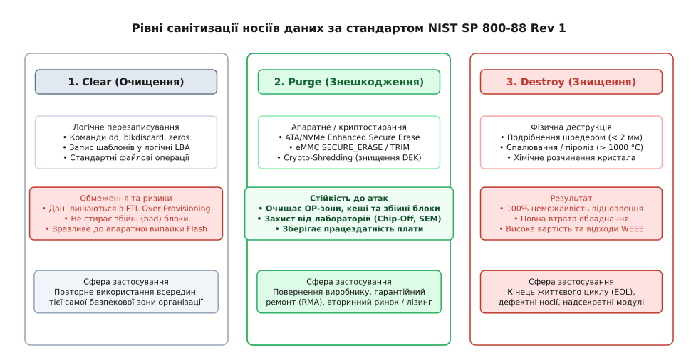
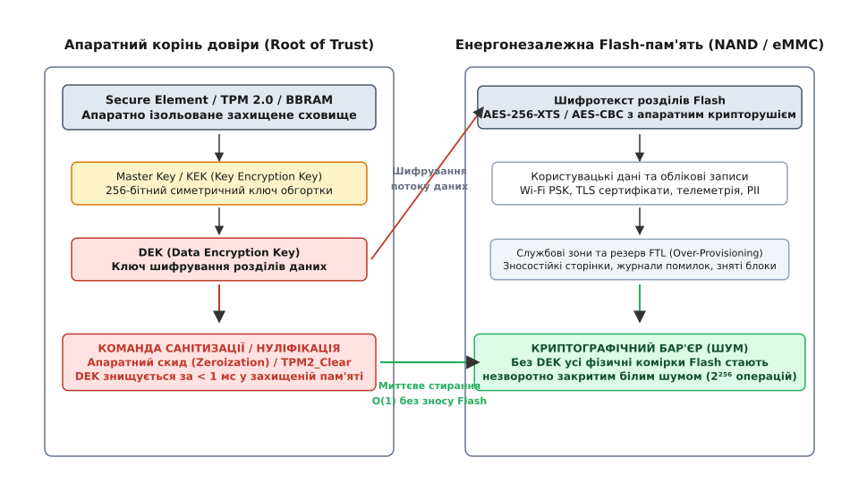

# Ключі й особисті дані в поверненому екземплярі

<preknowlist>
- [Умови користування й дані власника](root:sys-notary/umovy-korystuvannia-i-dani-vlasnyka) — межі збору телеметрії, персональних даних та зобов'язання з їхнього видалення.
- [Нормативні вимоги до безпеки коду: CRA, RED 3.3](root:sys-notary/normatyvni-vymohy-do-bezpeky-kodu) — регуляторні стандарти захисту мережевих інтерфейсів та контролю доступу.
- [Ремонт, право власника й межа замикання виробу](root:sys-notary/remont-pravo-vlasnyka-i-mezha-zamykannia-vyrobu) — архітектура апаратної прив'язки компонентів і криптографічної діагностики.
- [Повернення, ремонт і «дефекту не виявлено»](root:sys-notary/povernennia-remont-i-defektu-ne-vyiavleno) — юридичні та сервісні протоколи рекламацій, рекламаційних шлюзів і тестування вузлів.
- [Сервісний режим і діагностика в руках техніка](root:sys-notary/servisnyi-rezhym-i-diahnostyka-v-rukakh-tekhnika) — розмежування інженерних привілеїв, діагностичні порти та захист від несанкціонованого зчитування пам'яті.
</preknowlist>

Компанія з надання телекомунікаційних послуг списує партію з трьохсот промислових маршрутизаторів після завершення трирічного терміну операційного лізингу. Обладнання надходить на склад відновлення (англ. *refurbishment*), де штатний технік запускає штатну команду скидання до заводських налаштувань (англ. *factory reset*) через послідовний порт консолі UART, спостерігає повідомлення `Reset completed successfully` та відправляє маршрутизатори на відкритий аукціон вторинного ринку. Через два тижні інженер з кібербезпеки сторонньої дослідницької лабораторії викуповує один із цих екземплярів за сорок доларів. Він підключає програматор до мікросхеми енергонезалежної Flash-пам'яті NAND через тестові майданчики JTAG, зчитує сирий двійковий образ накопичувача і за допомогою простої утиліти синтаксичного аналізу витягує з незтертих фізичних секторів приватний X.509-сертифікат зв'язку з хмарним шлюзом AWS IoT Core, зашитий WPA3 Enterprise пароль із преспільним ключем корпоративної бездротової мережі, а також дамп бази даних SQLite з 14 000 текстових записів телеметрії та IP-адресами внутрішньої мережі клієнтів.

Інцидент стався не через злий умисел сервісного техніка, а через фундаментальний розрив між логічною моделлю файлової системи та фізичною фізикою напівпровідникових накопичувачів Flash. Команда `rm`, форматування файлової системи або поверхневий запис нулів у логічні сектори LBA жодним чином не гарантують фізичного знищення інформації в кремнії. Повернення обладнання — у межах гарантійної заміни (RMA, Return Merchandise Authorization), повернення з оренди чи лізингу (англ. *lease return*), обміну за програмою Trade-in або передачі на утилізацію — вимагає суворого інженерного протоколу санітизації (англ. *sanitization*, від лат. *sanitas* — здоров'я, чистота). Якщо цей протокол порушено, виробник та сервісна організація опиняються під ударом цивільних позовів, мільйонних штрафів GDPR та катастрофічного зламу довіреної інфраструктури.

```
+───────────────────────────────────────────────────────────────────────────+
| МАРШРУТ ПОВЕРНЕННЯ ОБЛАДНАННЯ ТА ТОЧКИ ВИТОКУ ДАНИХ                       |
|                                                                           |
|  [Клієнт / Експлуатація] ──(RMA / Trade-in / Лізинг)──> [Сервісний шлюз] |
|            │                                                     │        |
|     Flash містить:                                        Логічний Reset  |
|     - TLS X.509 ключі                                    (FTL зберігає    |
|     - Wi-Fi WPA3 PSK                                     приховані дані)  |
|     - Токени OAuth2                                              │        |
|     - Логи, PII, конфіги                                         ▼        |
|            │                                            [Вторинний ринок /|
|            │                                              Перепродаж /    |
|            │                                              Утилізатор]     |
|            │                                                     │        |
|            └─── Chip-Off / JTAG / FTL-дамп ──────────────────────┴─> ВИТОК|
+───────────────────────────────────────────────────────────────────────────+
```

Життєвий цикл будь-якого промислового або споживчого електронного виробу неминуче завершується фазою повернення або передачі. У цій точці стикаються два протилежні вектори: необхідність повторного використання дорогого апаратного забезпечення (принцип циклічної економіки та екологічні нормативи подовження служби техніки) і жорстка вимога повної конфіденційності даних попереднього власника. 

За час штатної експлуатації в енергонезалежній пам'яті виробу накопичується критичний масив конфіденційної інформації:
1. **Криптографічні ідентифікатори та сертифікати довіри:** Закриті ключі RSA (2048/4096 біт) та еліптичних кривих ECC (NIST P-256, Ed25519), завантажені клієнтом сертифікати X.509 для автентифікації на хмарних брокерах (AWS IoT Core, Microsoft Azure IoT Hub, Google Cloud IoT), клієнтські ключі VPN (IPsec IKEv2, WireGuard, OpenVPN) та симетричні ключі шифрування локальних сховищ.
2. **Мережеві облікові записи інфраструктури:** Преспільні паролі бездротових мереж Wi-Fi WPA2/WPA3 Personal, сертифікати корпоративної автентифікації WPA3 Enterprise (EAP-TLS), секрети протоколу RADIUS, облікові дані стільникового зв'язку (APN налаштування, PIN-коди eSIM).
3. **Токени доступу та персональні ідентифікатори користувачів:** Токени оновлення сесій (OAuth 2.0 Refresh Tokens), підписані JSON Web Tokens (JWT), локальні паролі адміністраторів у вигляді хешів `/etc/shadow`, персональні телефонні книги, історії викликів, журнал геолокаційних координат GPS/GNSS, фрагменти аудіозаписів голосових асистентів та знімки з камер спостереження.
4. **Інтелектуальна власність та пропрієтарні алгоритми:** Ваги оптимізованих нейромережевих моделей (TensorFlow Lite, ONNX), унікальні калібрувальні матриці датчиків, закриті конфігурації автоматизованих технологічних процесів.

Якщо цей масив потрапляє до рук сторонньої особи, виникає ланцюгова реакція: отримавши закритий ключ пристрою, зловмисник може клонувати його цифрову особистість, підключитися до корпоративного хмарного шлюзу підприємства, перехоплювати службовий трафік, інжектувати сфальсифіковані команди керування або розшифрувати архівні повідомлення.

## Фізика енергонезалежної Flash-пам'яті та ілюзія логічного видалення

Щоб усвідомити, чому традиційне стирання файлів не працює на твердотільних накопичувачах, необхідно простежити квантово-фізичну взаємодію між контролером накопичувача та напівпровідниковими комірками кремнію.

### Квантові структури комірок: плаваючий затвор проти пастки заряду

Енергонезалежна пам'ять NAND базується на польових транзисторах зі змінним порогом відкриття. Історично застосовувалися дві технології накопичення заряду:
1. **Плаваючий затвор (Floating Gate, FG):** Провідний острівець із полікремнію, повністю ізольований шаром діелектрика — діоксидом кремнію (SiO₂). Електрони інжектуються в плаваючий затвор за допомогою квантового тунелювання Фаулера-Нордгейма (Fowler-Nordheim Tunneling) під дією сильного електричного поля (понад 15–20 В).
2. **Пастка заряду (Charge Trap Flash, CTF):** Тонкий ізолюючий шар нітриду кремнію (Si₃N₄), який локалізує окремі електрони в потенціальних ямах. Застосовується в сучасній багатошаровій 3D NAND пам'яті завдяки меншій схильності до витоку заряду через мікродефекти діелектрика.

Кількість збереженого заряду визначає дискретні рівні логічних станів комірки:
- **SLC (Single-Level Cell):** 1 біт на комірку (2 рівні заряду: стертий `1` та запрограмований `0`). Вікно порогової напруги становить близько 3–4 В, а різниця заряду перевищує 1000–3000 електронів на плаваючому затворі.
- **MLC (Multi-Level Cell):** 2 біти на комірку (4 рівні напруги: `L₀, L₁, L₂, L₃`). Крок порогової напруги зменшується до 1.2 В, а кількість електронів на рівень становить близько 300–500.
- **TLC (Triple-Level Cell):** 3 біти на комірку (8 рівнів напруги: від `L₀` до `L₇`). Крок між сусідніми рівніми порогової напруги становить менше 0.5 В, а різниця станів визначається приблизно 80–150 електронами.
- **QLC (Quad-Level Cell):** 4 біти на комірку (16 рівнів напруги: від `L₀` до `L₁₅`). Стан комірки визначається різницею лише у 20–40 електронів.

Асиметрія операцій у NAND Flash має непереборну фізичну природу:
- **Зчитування** відбувається сторінками (розміром від 4 КБ до 16 КБ) шляхом подачі проміжної напруги на затвори сусідніх транзисторів.
- **Програмування** виконується тільки цілими сторінками шляхом інжекції електронів (переведення бітів з `1` у `0`).
- **Стирання** можливе лише великими блоками (від 128 до 512 сторінок, сумарно від 2 МБ до 16 МБ). Під час стирання до підкладки прикладається високий потенціал, який витягує електрони назад у канал транзистора, повертаючи всі комірки блоку в стан `1`.

### Деградація тонкого оксиду та механізми витоку SILC

Кожен цикл програмування та стирання (Program/Erase, P/E) супроводжується проходженням високоенергетичних електронів крізь надтонкий шар діоксиду кремнію SiO₂, товщина якого становить лише 7–9 нанометрів. Під впливом сильних електричних полів у структурі оксиду виникають точкові дефекти: розриви зв'язків Si-O, утворення ненасичених валентностей та пасток заряду (Interface and Bulk Oxide Traps).

Накопичення цих дефектів призводить до явища струму витоку, індукованого стресом (Stress-Induced Leakage Current, SILC):
1. **Перколяційні канали (Percolation Paths):** Коли щільність дефектів у діелектрику перевищує критичний поріг, виникають неперервні ланцюжки мікропасток, через які електрони з плаваючого затвора або шару нітриду можуть тунелювати при набагато нижчих напругах (Trap-Assisted Tunneling).
2. **Збурення зчитування (Read Disturb):** Під час читання окремої сторінки на затвори всіх інших транзисторів у ланцюжку NAND подається відкриваюча напруга `V_pass ≈ 4.5..6.0 В`. Багаторазове зчитування сусідніх адрес викликає слабку паразитну інжекцію електронів у незадіяні комірки, поступово зміщуючи їхню порогову напругу.
3. **Збурення програмування (Program Disturb):** Під час запису сторінки висока напруга програмування `V_pgm ≈ 18..20 В` прикладається до спільного керуючого затвора всього рядка (Wordline). Комірки, які повинні залишитися в стертому стані `1`, відчувають паразитичний електричний потенціал, що частково зміщує їхній заряд у бік стану `0`.

Усі ці фізичні ефекти означають, що аналоговий стан кожної комірки на кристалі не є чисто двійковим: він несе в собі фізичний відбиток усієї історії попередніх операцій читання, запису та стирання сусідніх блоків.

### Залишкова поляризація, температурний дрейф та апаратний Chip-Off аналіз

Коли комірка стирається, частина електронів залишається захопленою в мікротріщинах діелектрика SiO₂ (Trapped Charges). Якщо сторінка багатократно перезаписувалася одним і тим самим значенням (наприклад, незмінним приватним ключем або сертифікатом), діелектрик зазнає локальної деградації поляризації. 

Витік та утримання заряду описуються температурною моделлю Арреніуса (Arrhenius Data Retention Model):

```
t_retention = t₀ · exp(E_a / (k_B · T))      [термін утримання заряду в діелектрику]
```

Де `E_a` — енергія активації дефектів оксиду (близько 1.1 еВ), `k_B` — стала Больцмана, `T` — абсолютна температура в Кельвінах. Навіть при нагріванні комірок залишковий профіль деградації діелектрика зберігає інформацію про попередню історію записів.

У спеціалізованих лабораторіях для зчитування даних навіть після фізичного стирання блоків використовують:
1. **Зниження порогової напруги зчитування (`V_read` tuning):** Через спеціальні недокументовані заводські команди виробника (Vendor-Specific Commands, VSC) контролер перемикається в режим аналогового вимірювання порогової напруги відкриття каналу з роздільною здатністю в мілівольти. Різниця між «свіжостертою» коміркою, де раніше був `0`, та коміркою, де завжди був `1`, виявляється на рівні статистичного зсуву аналогового сигналу.
2. **Сканувальну зондову мікроскопію Кельвіна (Kelvin Probe Force Microscopy, KPFM):** Після хімічного депасивування кристала гарячою димлячою азотною кислотою (HNO₃ при 90 °C) мікрозонд сканує розподіл локального електростатичного потенціалу над затворами транзисторів, відновлюючи бітову карту даних безпосередньо з кремнію.
3. **Пряме підключення до шини ONFI / Toggle DDR:** Демонтована BGA-мікросхема підключається до зовнішнього аналізатора, який взаємодіє з лініями даних I/O і керуючими сигналами CLE, ALE, WE#, RE#, повністю ігноруючи блокування контролера накопичувача.

### Транслятор Flash (FTL) та розмноження копій даних

Мікроконтролер твердотільного накопичувача (SSD, eMMC, UFS) виконує мікропрограму FTL (Flash Translation Layer), яка приховує фізичну дискретність кремнію за абстрактним масивом секторів LBA (Logical Block Addressing).

```
+───────────────────────────────────────────────────────────────────────────+
| ВНУТРІШНЯ АРХІТЕКТУРА ТРАНСЛЯТОРА FLASH (FTL) ТА ПОТОКИ ДАНИХ             |
|                                                                           |
|  Хост-інтерфейс (LBA 0x0000 .. LBA 0xFFFF)                                |
|        │                                                                  |
|        ▼                                                                  |
|  [Таблиця відображення L2P (LBA-to-Physical RAM Cache)]                   |
|        │                                                                  |
|        ├─ Запис LBA 0x0042 ──> Виділити нову сторінку: Блок #10, Стор #2  |
|        └─ Стара прив'язка  ──> Блок #3, Стор #8 (Позначити як DIRTY)      |
|                                                                           |
|  Фізичний масив NAND Flash:                                               |
|  ┌─────────────────────────────────┐   ┌────────────────────────────────┐ |
|  │ БЛОК #3 (Містить старі ключі)   │   │ БЛОК #10 (Нові нулі від dd)    │ |
|  │ ├─ Стор #0..#7 : Дані інших LBA │   │ ├─ Стор #0..#1 : Інші дані     │ |
|  │ ├─ Стор #8     : СТАРИЙ КЛЮЧ    │   │ ├─ Стор #2     : Запис 0x00    │ |
|  │ └─ Стор #9..N  : Дані           │   │ └─ Стор #3..N  : Чисті сторінки│ |
|  └─────────────────────────────────┘   └────────────────────────────────┘ |
|                                                                           |
|  [Збирання сміття (Garbage Collection)] ──> Копіює валідні сторінки       |
|  [Динамічне вирівнювання зносу (Wear Leveling)] ──> Розмножує ключі       |
|  [Over-Provisioning (7..28%)] ──> Приховано від прямої адресації хоста    |
+───────────────────────────────────────────────────────────────────────────+
```

Коли операційна система виконує запис у сектор LBA `0x0042`:
1. FTL виділяє фізично чисту сторінку у відкритому блоці запису (наприклад, Блок #10, Сторінка #2).
2. Записує туди новий блок даних.
3. Оновлює таблицю прямої трансляції `L2P` (Logical-to-Physical), перенаправляючи LBA `0x0042` на нову адресу.
4. Попередня фізична сторінка (Блок #3, Сторінка #8), де зберігався старий відкритий ключ, позначається у внутрішній бітовій карті накопичувача як «брудна» (англ. *stale / dirty*). Фізичного стирання заряду не відбувається.

Коли прилад працює місяцями, підсистема динамічного та статичного вирівнювання зносу (Wear Leveling) регулярно переносить блоки: якщо блок містить «холодні» дані (незмінні конфігураційні файли, системні ключі), FTL періодично копіює його вміст у блок із більшою кількістю циклів P/E, щоб рівномірно зношувати кремній. У результаті один і той самий приватний ключ або пароль залишає за собою десятки «примарних» копій у різних фізичних блоках по всьому кристалу.

### Приховані зони Over-Provisioning та таблиця дефектних блоків

Жодна стандартна команда запису LBA не здатна покрити весь фізичний об'єм мікросхеми:
- **Зона Over-Provisioning (OP):** Накопичувачі виділяють від 7% (споживчі SSD/eMMC) до 28% (корпоративні накопичувачі) від загальної ємності NAND під службові потреби. Ці блоки використовуються як буфери злиття операцій запису, простір для дефрагментації сміття (Garbage Collection) та пул підміни блоків. Хост фізично не може звернутися до LBA з діапазону OP.
- **Таблиця дефектів (Bad Block Management, BBM):** Якщо під час роботи накопичувача блок видає перевищення кількості бітових помилок при корекції кодом Ріда-Соломона або LDPC (Low-Density Parity-Check), FTL позначає такий блок як збійний і виводить його з обігу. Проте помилка кількох бітів на сторінці не заважає зловмиснику в лабораторних умовах вичитати решту 99.9% сторінок цього блоку, де можуть міститися конфігураційні файли або сертифікати попереднього власника.

Якщо атакуючий демонтує мікросхему пам'яті (процедура Chip-Off), встановлює її у спеціалізований сокет програматора (наприклад, PC-3000 Flash або Rusolut Visual NAND) і зчитує сирий двійковий масив фізичних сторінок, усі структури FTL, застарілі копії секторів та приховані зони OP вичитуються повністю.

> 🔧 **Навіщо це в реальній розробці.**
> Розуміння квантової фізики комірок та архітектури FTL унеможливлює небезпечну інженерну оману про достатність утиліт на кшталт `shred` чи `dd`. У вбудованих пристроях будь-яка конфіденційна інформація повинна або записуватися виключно у зашифрованому вигляді через апаратний крипторушій, або стиратися за допомогою апаратних команд контролера, що генерують прямі високовольтні імпульси очищення всіх фізичних шин кристала.

## Нормативний стандарт санітизації NIST SP 800-88 Rev 1

Для впорядкування процедур очищення носіїв даних Національний інститут стандартів і технологій США розробив стандарт **NIST Special Publication 800-88 Revision 1: Guidelines for Media Sanitization**. Цей норматив є міжнародною основою для аудиту безпеки інформаційних систем (ISO/IEC 27001, SOC 2, HIPAA, PCI-DSS).

```
+───────────────────────────────────────────────────────────────────────────+
| КЛАСИФІКАЦІЯ РІВНІВ САНІТИЗАЦІЇ ЗА СТАНДАРТОМ NIST SP 800-88 REV 1        |
|                                                                           |
|  1. CLEAR (Логічне очищення)                                              |
|     ├── Метод: Перезапис простору LBA нулями або псевдовипадковими даними |
|     ├── Інструменти: Команди dd, blkdiscard, утиліти форматування ОС      |
|     ├── Модель загроз: Захист від базових утиліт відновлення файлів       |
|     └── Межа стійкості: Безсилий проти Chip-Off, FTL-дампу та JTAG        |
|                                                                           |
|  2. PURGE (Знешкодження / Апаратна санітизація)                           |
|     ├── Метод А: Апаратні команди Flash (ATA Enhanced Erase, NVMe Sanitize|
|     │            eMMC SECURE_ERASE / TRIM)                                |
|     ├── Метод Б: Криптографічне стирання (Crypto-Shredding знищенням DEK) |
|     ├── Модель загроз: Захист від інвазивного лабораторного аналізу       |
|     │                  (Chip-Off, зчитування FTL OP, електронна мікроскопія)|
|     └── Межа стійкості: Зберігає працездатність та ресурс обладнання      |
|                                                                           |
|  3. DESTROY (Фізичне знищення)                                            |
|     ├── Метод: Механічне подрібнення (шредер < 2 мм), піроліз (> 1000 °C) |
|     ├── Результат: Повна неможливість повторного використання носія       |
|     └── Застосування: Вихід з ладу, надсекретні модулі, утилізація WEEE   |
+───────────────────────────────────────────────────────────────────────────+
```


*Порівняння рівнів санітизації Clear, Purge та Destroy за стандартом NIST SP 800-88 Rev 1.*

### Порівняльний аналіз рівнів санітизації

Стандарт NIST розділяє методи санітизації на три рівні, формулюючи суворі критерії вибору залежно від моделі загроз та подальшого життєвого циклу носія:

1. **Clear (Логічне очищення):**
   - Застосовує логічні методи перезапису даних у всіх доступних для користувача адресах блоків LBA.
   - Мета — виключити можливість вилучення даних за допомогою стандартних інтерфейсів операційної системи (наприклад, утиліт відновлення видалених розділів TestDisk, PhotoRec або викликів блокового читання `/dev/sdX`).
   - Сфера застосування: Тільки внутрішня передача обладнання між користувачами **в межах одного закритого безпекового контуру підприємства**. Категорично заборонено для повернення за договорами лізингу, гарантійного ремонту (RMA) чи продажу на вторинному ринку.

2. **Purge (Знешкодження / Апаратне очищення):**
   - Застосовує фізичні та криптографічні методи, які роблять відновлення даних нездійсненним навіть у спеціалізованих лабораторіях з використанням інвазивного обладнання (Chip-Off зчитування депасивованих кристалів, прямий доступ до внутрішньої шини NAND через логічні аналізатори, налаштування зміщення порогових напруг `V_read`).
   - Реалізується двома шляхами:
     * Подання контролером електричного імпульсу стирання на всі фізичні комірки матриці NAND Flash (включно з прихованими зонами Over-Provisioning, буферами та блоками таблиці дефектів BBM).
     * Миттєве знищення ключів шифрування (Cryptographic Erase), за допомогою яких було зашифровано всі збережені дані.
   - Сфера застосування: Будь-яке виведення пристрою за межі організації: повернення виробнику, передача сторонньому сервісному центру, перепродаж або передача нового обладнання іншому замовнику.

3. **Destroy (Фізичне знищення):**
   - Механічна, хімічна або термічна деструкція накопичувача.
   - Для твердотільних накопичувачів стандарт NIST SP 800-88 спільно з директивами Агентства національної безпеки США (NSA/CSS Storage Device Declassification Manual) вимагає подрібнення друкованої плати та мікросхем на фрагменти розміром **не більше 2 міліметрів**. Звичайні офісні шредери для паперу та жорстких дисків створюють уламки розміром 10–15 мм, на яких неушкоджений кристал кремнію площею 10 × 12 мм залишається повністю придатним для зчитування.
   - Сфера застосування: Несправні накопичувачі, які не відповідають на команди `Purge`, або носії, що містили інформацію найвищого ступеня секретності.

### Застарілі військові нормативи проти сучасних стандартів

В інженерному середовищі досі зберігається хибна практика застосування застарілих військових стандартів очищення жорстких дисків, таких як американський норматив DoD 5220.22-M (National Industrial Security Program Operating Manual, NISPOM) або метод Пітера Гутмана (35 проходів перезапису псевдовипадковими послідовностями).

Стандарт DoD 5220.22-M вимагав виконання трьох послідовних проходів: запис фіксованого байта (наприклад, `0x00`), запис його двійкового доповнення (`0xFF`), а потім запис псевдовипадкової послідовності байтів із подальшою верифікацією. Цей метод розроблявся на початку 1990-х років для магнітних жорстких дисків з поздовжнім записом (Longitudinal Magnetic Recording, LMR), де через широкі доріжки та недосконалість позиціонування магнітних головок на краях доріжок залишалися залишки попередньої намагніченості (магнітні тіні), які можна було виявити магнітно-силовою мікроскопією (MFM).

Для сучасних носіїв Flash багаторазовий перезапис є абсолютно неефективним і шкідливим:
1. **Витрата ресурсу P/E циклів:** Три або сім проходів запису по всьому простору накопичувача вичерпують значну частку ресурсу зносостійкості Flash-комірок, зменшуючи залишковий термін служби виробу перед повторним випуском на ринок.
2. **Неможливість потрапляння в ті самі фізичні комірки:** Через роботу транслятора FTL кожен новий прохід перезапису записується в абсолютно нові фізичні сторінки, залишаючи попередні сторінки незмінними у стані «dirty» до моменту запуску Garbage Collection.
3. **Офіційна позиція NIST:** Починаючи з першої редакції NIST SP 800-88, авторитетно зафіксовано, що для сучасних накопичувачів високої щільності (як магнітних дисків з перпендикулярним записом PMR/SMR, так і напівпровідникової Flash-пам'яті) виконання одного коректного циклу апаратного очищення або криптографічного стирання повністю ліквідує будь-яку можливість зчитування інформації за допомогою магнітних або електронних мікроскопів.

```
+───────────────────────────────────────────────────────────────────────────+
| МАТРИЦЯ ВИБОРУ МЕТОДУ САНІТИЗАЦІЇ ЗА РІВНЕМ КРИТИЧНОСТІ ДАНИХ (FIPS 199)  |
|                                                                           |
|  Подальша доля пристрою        Низька (Low)   Середня (Moderate)  Висока  |
|  ───────────────────────────────────────────────────────────────────────  |
|  Повторне використання         Clear          Clear / Purge       Purge   |
|  всередині того самого відділу                                            |
|                                                                           |
|  Передача в інший підрозділ    Clear          Purge               Purge   |
|  або іншій юридичній особі                                                |
|                                                                           |
|  Повернення виробнику (RMA) /  Purge          Purge               Purge / |
|  Завершення лізингу / Trade-in                                    Destroy |
|                                                                           |
|  Списання на утилізацію (EOL)  Purge / Destroy Destroy            Destroy |
+───────────────────────────────────────────────────────────────────────────+
```

## Механізм криптографічного стирання (Crypto-Shredding)

Традиційне повне фізичне стирання накопичувача ємністю кілька терабайтів через послідовне очищення блоків вимагає десятків хвилин безперервної роботи під високим навантаженням та витрачає цінний ресурс циклів перезапису Flash. Для пристроїв з автономним живленням або аварійних сценаріїв повернення це неприйнятно.

Інженерним стандартом вирішення цієї проблеми є **криптографічне стирання (Crypto-Shredding або Cryptographic Erase)**.

```
+───────────────────────────────────────────────────────────────────────────+
| АРХІТЕКТУРА ДВОХРІВНЕВОГО КОНВЕРТНОГО ШИФРУВАННЯ (ENVELOPE ENCRYPTION)    |
|                                                                           |
|  [Апаратний корінь довіри (Root of Trust)]                                |
|  Secure Element (ATECC608) / TPM 2.0 / eFuse Master Secret                |
|            │                                                              |
|            ▼                                                              |
|   Master Key / KEK (256 біт) ──(NIST SP 800-38F Key Wrap)──┐              |
|                                                            │              |
|  [Енергонезалежна Flash-пам'ять]                           │              |
|   Загорнутий ключ (Wrapped DEK) у службовому секторі       │              |
|            │                                               │              |
|            ▼                                               ▼              |
|   Розгортання відкритого ключа ◄───────────────────────────┘              |
|   DEK (Data Encryption Key, 256 біт) у захищеній SRAM                     |
|            │                                                              |
|            ▼                                                              |
|   [Апаратний криптоприскорювач AES-XTS-256]                               |
|            │                                                              |
|            ├── Шифрування на льоту (Запис у Flash) ──> Шифротекст         |
|            └── Розшифрування на льоту (Читання) ───> Відкриті дані        |
|                                                                           |
|  КОМАНДА САНІТИЗАЦІЇ:                                                     |
|  Апаратна нуліфікація DEK у SRAM та KEK у Secure Element (< 1 мс)         |
|  Результат: Усі терабайти Flash стають нерозрізненним білим шумом         |
+───────────────────────────────────────────────────────────────────────────+
```


*Архітектура криптографічного стирання (Crypto-Shredding): знищення KEK та DEK робить шифротекст у Flash нерозрізненним від випадкового білого шуму.*

### Математична модель алгоритму XTS-AES-256

У режимі повнодискового шифрування (Full Disk Encryption) стандартом є алгоритм XTS-AES (IEEE 1619 / NIST SP 800-38E). Шифрування здійснюється блоками по 128 біт із використанням двох незалежних ключів:

```
Key = Key₁ || Key₂      (Загальна довжина 512 біт для XTS-AES-256)
```

Де:
- `Key₁` — ключ шифрування відкритого тексту.
- `Key₂` — ключ генерації вектора зміщення (Tweak).

Для кожного 128-бітного блоку даних з індексом `j` всередині сектора LBA з номером `i` обчислення виконується за схемою:

```
T = AES_Encrypt(Key₂, i) ⊗ αʲ     [обчислення унікального вектора зміщення]
C = AES_Encrypt(Key₁, P ⊕ T) ⊕ T  [шифрування блоку з подвійною маскою]
```

Де `⊗` позначає множення в полі Галуа `GF(2¹²⁸)` за модулем незвідного полінома:

```
f(x) = x¹²⁸ + x⁷ + x² + x + 1
```

Криптографічна властивість режиму XTS-AES гарантує захист від атак маніпуляції секторами (Ciphertext Manipulation) та забезпечує властивість індиферентності шифротексту від псевдовипадкового розподілу:

```
D_CPA(Ciphertext, Random_Noise) ≈ 0
```

Якщо ключ `Key₁ || Key₂` втрачено, математична складність відновлення відкритого тексту еквівалентна повному перебору простору ключів AES-256:

```
Складність_атаки = 2²⁵⁶ ≈ 1.1579 · 10⁷⁷ операцій AES
```

Навіть якщо використати обчислювальний кластер із продуктивністю `10¹⁸` операцій AES за секунду:

```
Час_перебору
= 2²⁵⁶ / 10¹⁸ сек                                         [ресурс обчислень]
≈ 1.1579 · 10⁵⁹ секунд
≈ 3.67 · 10⁵¹ років                                       [нездійсненно за час існування Всесвіту]
```

### Стандарт обгортки ключів NIST SP 800-38F (Key Wrapping)

Для безпечного зберігання `DEK` у службовому розділі Flash-пам'яті використовується алгоритм запечатування ключів (AES Key Wrap, KW). Алгоритм приймає 256-бітний відкритий `DEK` та 256-бітний ключ `KEK`, додаючи фіксований 64-бітний вектор цілісності:

```
A = 0xA6A6A6A6A6A6A6A6
```

Масив розбивається на півблоки довжиною 64 біти і піддається `6 × n` раундам перемішування Feistel-мережею з шифруванням AES. Якщо під час розгортання ключа вектор `A` не збігається з еталонним, мікроконтролер констатує пошкодження або спробу підробки ключа, блокуючи доступ до накопичувача без відкриття самого `DEK`.

### Ентропійний аналіз шифротексту

Для верифікації криптографічного стирання використовується оцінка інформаційної ентропії Шеннона по байтах випадкових вибірок секторів Flash-накопичувача:

```
H(X) = - ∑ P(xᵢ) · log₂ P(xᵢ)     [сума за всіма байтами від 0x00 до 0xFF]
```

Для відкритого тексту (конфігураційні файли, бінарні коди, файлові системи) ентропія зазвичай становить від 3.5 до 6.2 біт на байт через нерівномірний розподіл символів та повторення структурних заголовків.

Для криптографічно стертого накопичувача (де залишився тільки шифротекст без ключа розшифрування) розподіл значень байтів є рівномірним:

```
H_шифротексту(X) → 8.0000 біт/байт
```

Це дозволяє сервісному стенду за мілісекунди автоматично підтвердити, що на накопичувачі відсутні відкриті фрагменти даних.

Для побудови готового прикладного модуля стирання, інтегрованого з низькорівневими системними викликами та апаратним криптографічним ядром, використовується [Модуль апаратного криптографічного стирання пам'яті та скидання ключів](root:sys-notary/kliuchi-i-osobysti-dani-v-povernenomu-ekzempliari/proj-cryptographic-sanitizer.md).

## Апаратна нуліфікація (Zeroization) у Secure Element та TPM 2.0

Криптографічне стирання є надійним лише за умови, що сам ключ `DEK` або `Master Key` знищується безповоротно. Якщо ключ зберігається у звичайній пам'яті мікроконтролера, до нього застосовуються всі фізичні обмеження залишкового заряду Flash.

Тому інженерний дизайн вимагає розміщення кореневих ключів у спеціалізованих апаратних сховищах — Secure Elements (SE) або Trusted Platform Modules (TPM), що підтримують стандартизований механізм активної нуліфікації (Zeroization за стандартом FIPS 140-3).

```
+───────────────────────────────────────────────────────────────────────────+
| СХЕМОТЕХНІКА АКТИВНОГО ЗАХИСТУ SECURE ELEMENT (ATECC608 / SE050)          |
|                                                                           |
|  [Верхній металевий шар кристала: Активна захисна сітка (Tamper Mesh)]    |
|  ───────────────────────────────────────────────────────────────────────  |
|  [Сенсор світла LFI] [Датчик перепаду напруги] [Сенсор тактової частоти]  |
|                              │                                            |
|                              ▼                                            |
|              [ЛОГІЧНИЙ БЛОК АВТОНОМНОЇ ДЕСТРУКЦІЇ]                        |
|                              │                                            |
|                ┌─────────────┴─────────────┐                              |
|                ▼                           ▼                              |
|    [Енергозалежна BBRAM]        [Захищені слоти EEPROM]                   |
|    Транзистор швидкого розряду  Апаратне занулення 0x00                   |
|    (Crowbar Circuit)            Блокування Slot Lock Bit                  |
|    Стирання за < 100 нс         Спалювання eFuse блоку                    |
+───────────────────────────────────────────────────────────────────────────+
```

### Схемотехніка мікросхем Secure Element (Microchip ATECC608A/B)

Мікросхема ATECC608 інтегрує апаратні механізми захисту від інвазивного реверс-інжинірингу:
1. **Активна захисна сітка (Active Shield Mesh):** Верхній шар металізації мікросхеми вкритий топологічним лабіринтом провідників шириною в частки мікрометра. Будь-яка спроба дістатися кристала механічним фрезеруванням або фокусованим іонним пучком (FIB) розриває ланцюг, викликаючи негайний апаратний скид.
2. **Сенсори атаки:** Внутрішні компаратори напруги відстежують спроби глітч-атак (Voltage Glitching), оптичні сенсори фіксують засвічення кристала лазером (Laser Fault Injection), а внутрішній детектор частоти виявляє зупинку системного тактового генератора.
3. **Енергозалежна пам'ять BBRAM зі схемою швидкого розряду (Crowbar Circuit):** Ключ шифрування зберігається в спеціальному масиві статичної пам'яті. За сигналом тривоги або при надходженні команди нуліфікації затвор потужного польового транзистора відкривається, закорочуючи шину живлення пам'яті на землю. Електричний заряд розсіюється менш ніж за **100 наносекунд**.

### Захист від атак холодного перезавантаження (Cold Boot Attack)

Класична атака холодного перезавантаження (Cold Boot Attack) базується на фізичному явищі збереження залишкового заряду в комірках динамічної (DRAM) та статичної (SRAM) пам'яті після раптового зняття живлення. За кімнатної температури (+25 °C) біти пам'яті деградують протягом кількох секунд, проте якщо мікросхему пам'яті охолодити аерозольним холодоагентом (фреоновим спреєм) або рідким азотом до температури -50 °C .. -100 °C, час утримання бітів зростає до десятків хвилин. Зловмисник може вимкнути живлення, переставити модуль RAM в інший стенд або завантажити кастомне ядро та витягти відкриті ключі з оперативної пам'яті.

Secure Elements та криптографічні процесори TPM 2.0 запобігають цій атаці за допомогою спеціалізованої кремнієвої схемотехніки:
1. **Асиметричні саморозрядні інвертори (Asymmetric Discharge Cells):** Кожна комірка BBRAM спроєктована з геометричною асиметрією транзисторів. При зниженні напруги живлення нижче мінімального порогу утримання (`V_hold ≈ 0.6 В`) комірка гарантовано перекидається в занулений стан незалежно від температури кристала.
2. **Вбудовані термодатчики глибокого охолодження (Cryogenic Sensors):** Мікросхема містить аналоговий датчик температури на базі діода з пропорційною абсолютною температурою (PTAT). Якщо температура кремнію падає нижче -30 °C, чіп сприймає це як фізичну атаку та ініціює апаратну нуліфікацію до того, як атакуючий зможе зняти живлення.

Командна послідовність нуліфікації ATECC608 по шині I2C:
1. Хост генерує випадковий виклик `Nonce` (32 байти).
2. Викликається команда `GenKey` або `PrivWrite` з маскою занулення цільового слота.
3. Виконується команда блокування конфігурації `LockConfig / LockZone`, яка спалює внутрішній біт пам'яті (Lock Fuse), роблячи слот фізично незмінним.

### Процедура нуліфікації в модулях TPM 2.0

У промислових системах санітизація через TPM 2.0 реалізується скиданням захищених ієрархій за допомогою команди `TPM2_Clear`:

```
TPM2_Clear(
    authHandle = TPM_RH_PLATFORM,   // або TPM_RH_LOCKOUT
    authSession = PW / HMAC_Session
)
```

При отриманні цієї команди криптографічний процесор TPM виконує такі операції:
1. **Зміна первинного початкового числа (Storage Primary Seed, SPS):** TPM звертається до власного апаратного генератора випадкових чисел TRNG і генерує новий 256-бітний випадковий масив `SPS`. Оскільки всі ключі ієрархії зберігання (Storage Keys, що захищають `DEK` накопичувача) математично виводяться з `SPS` через функцію KDF (Key Derivation Function на базі HMAC-SHA-256), зміна `SPS` миттєво робить неможливим відновлення будь-якого попереднього ключа:

```
Derived_Key = KDF_HMAC_SHA256(SPS, Context_String)      [виведення ієрархії ключів]
```

2. **Очищення NVRAM простору:** Усі створені індекси енергонезалежної пам'яті з прапорцями `TPMA_NV_OWNERWRITE` та `TPMA_NV_AUTHWRITE` видаляються.
3. **Скидання лічильників блокування:** Скидається лічильник невдалих спроб введення паролів (Dictionary Attack Lockout Reset).

Після виконання `TPM2_Clear` навіть наявність повного двійкового дампу всієї пам'яті TPM не дозволяє відновити старі ключі, оскільки нове значення `SPS` згенерувалося з чистої теплової ентропії.

### Технологія електронних запобіжників eFuse

У сучасних мікропроцесорах SoC (наприклад, NXP i.MX8/i.MX9, STMicroelectronics STM32MP1, Texas Instruments Sitara AM6x, Espressif ESP32-S3) критичні системні ключі та біти конфігурації завантажувача зберігаються в масивах електронних запобіжників (eFuse).

Фізичний механізм eFuse базується на спрямованій електроміграції матеріалу провідника (полікремнієвої або металевої перемички мікронного розміру). У вихідному стані перемичка має низький опір (стан логічного нуля `0`). Для запису біта на кристал подається імпульс високої напруги програмування `V_PP` (зазвичай від 1.8 до 2.5 В). Сильний струм викликає локальний розігрів та міграцію атомів металу, фізично розриваючи перемичку і переводячи її опір у стан мегаом (стан логічної одиниці `1`).

Під час санітизації або виведення пристрою з експлуатації механізм eFuse застосовується для безповоротного відкликання ключів:
1. **Спалювання кореневих відкритих ключів (Root of Trust Key Revocation):** Процесор містить масив бітів відкликання (Key Revocation Fuses). Спалювання відповідного eFuse назавжди забороняє використання попереднього сертифіката центру сертифікації виробника, унеможливлюючи завантаження старих вразливих прошивок або запуск сервісних тестів минулого власника.
2. **Блокування інтерфейсів налагодження (JTAG / SWD Permanent Disable):** Спалювання бітів `JTAG_DISABLE_FUSE` фізично відключає мультиплексор тестових ліній процесора від кремнієвого ядра, виключаючи можливість підключення апаратних відлагоджувачів після виходу пристрою на вторинний ринок.

## Низькорівневі протоколи Flash Secure Erase та системні виклики

На стику операційної системи, системних викликів та апаратних інтерфейсів накопичувача реалізовано набір низькорівневих механізмів санітизації.

```
+───────────────────────────────────────────────────────────────────────────+
| НИЗЬКОРІВНЕВІ СТЕКИ КОМАНД САНІТИЗАЦІЇ В LINUX                             |
|                                                                           |
|  [Простір користувача (User-Space Sanitizer)]                             |
|  mlockall() + madvise(MADV_DONTDUMP) + secure_zero_memory()               |
|            │                                                              |
|            ├── NVMe ioctl(fd, NVME_IOCTL_ADMIN_CMD) ──> Sanitize (0x84)   |
|            ├── eMMC ioctl(fd, BLKSECDISCARD) ──> CMD38 MMC_SECURE_ERASE   |
|            └── ATA ioctl(fd, HDIO_DRIVE_CMD) ──> ATA Security Erase Unit  |
|                                                                           |
|  [Ядро Linux: Підсистема блокового вводу/виводу]                          |
|  drivers/block, drivers/nvme/host, drivers/mmc/core                       |
+───────────────────────────────────────────────────────────────────────────+
```

### Протокол eMMC (JESD84-B51) та виклики BLKSECDISCARD

У пам'яті eMMC (Embedded MultiMediaCard) асоціація JEDEC стандартизувала набір команд захищеного стирання в регістрі конфігурації `EXT_CSD`:
- Регістр `SEC_FEATURE_SUPPORT [байт 231]`:
  - Біт `0` (`SECURE_ERASE_EN`): Підтримка високовольтного фізичного стирання сторінок, прив'язаних до цільових LBA.
  - Біт `4` (`SECURE_PURGE_EN`): Підтримка повного циклу знешкодження, включно з очищенням прихованих областей FTL та буферів запису.

Коли простір користувача надсилає системний виклик `ioctl(fd, BLKSECDISCARD, &range)`, підсистема ядра `drivers/mmc/core/` транслює його у послідовність апаратних команд:
1. `CMD35` (`ERASE_GROUP_START`): Передача початкової адреси секторів.
2. `CMD36` (`ERASE_GROUP_END`): Передача кінцевої адреси секторів.
3. `CMD38` (`ERASE`): Виклик із параметром аргументу `0x80000000` (`SECURE_ERASE`) або `0x80008000` (`SECURE_PURGE`).

Внутрішній контролер eMMC зупиняє всі операції читання/запису і виконує стирання всіх фізичних блоків, де колись розміщувалися дані з цього діапазону LBA.

### Протокол NVMe Sanitize

Специфікація NVM Express Base Specification 2.0 визначає команду `Sanitize` (код операції `0x84`), яка підтримує три взаємовиключні дії через поле `SANACT`:
- `SANACT = 001b`: Завершення попереднього невдалого режиму санітизації.
- `SANACT = 010b` (Block Erase): Низькорівневе стирання електричного заряду всіх фізичних блоків NAND.
- `SANACT = 100b` (Crypto Erase): Миттєве видалення та регенерація внутрішнього ключа шифрування контролера (Media Encryption Key, MEK).

Стан виконання команди контролюється опитуванням журналу Sanitize Status Log (`Log Identifier 0x81`):
- Байти `0..1` (`SSTAT`): Бітова маска статусу (Sanitize Progress, Completed, Failed).
- Байти `2..3`: Відсоток виконання операції (від 0% до 100% з кроком 1/65535).
- Байти `4..7`: Розрахунковий час до завершення операції у секундах.

Команда Sanitize має унікальну властивість: вона не може бути скасована або перервана. Якщо посеред операції вимкнути живлення, після наступного старту накопичувач залишається в заблокованому стані (Sanitize In Progress) і відмовляється обробляти будь-які команди читання/запису доти, доки процедура не буде повністю завершена.

### Специфікація ATA / SATA Security Erase та пастка Security Frozen

У традиційних накопичувачах SATA команди санітизації реалізовані через розширення ATA Security Feature Set (стандарт ATA/ATAPI Command Set - 4, ACS-4):
1. `SECURITY ERASE PREPARE`: Команда ініціалізації сесії санітизації.
2. `SECURITY ERASE UNIT`: Виконання стирання з паролем доступу (User Password або Master Password).
   - У стандартному режимі (`Normal Security Erase`) контролер записує нулі у доступний простір LBA.
   - У розширеному режимі (`Enhanced Security Erase`) контролер застосовує апаратні алгоритми перезапису або апаратного скидання ключів у самозашифрованих накопичувачах (Self-Encrypting Drives, SED).

Головною інженерною перешкодою при виконанні ATA Security Erase є захисний стан `Security Frozen`:
- Під час завантаження комп'ютера системний BIOS/UEFI за замовчуванням надсилає накопичувачу команду `SECURITY FREEZE LOCK`.
- Ця команда блокує прийняття будь-яких команд зміни паролів та очищення безпеки до наступного апаратного перезавантаження живлення (Power Cycle). Це зроблено для захисту від шкідливого ПЗ, яке могло б без відома користувача стерти диск.
- Для виконання санітизації на працюючій системі інженери застосовують два методи:
  1. **Режим сну ACPI S3 (Suspend-to-RAM):** Система переводиться в режим сну, при якому живлення шини SATA тимчасово вимикається. Після пробудження ядро Linux відновлює роботу без повторного проходження коду BIOS, і накопичувач повертається в розблокований стан `Security Unfrozen`.
  2. **Гаряче перепідключення SATA (Hot-Plug):** Фізичне від'єднання та повторне підключення кабелю живлення накопичувача на працюючій системі.

### Захист оперативної пам'яті процесу від витоків

Під час виконання операцій санітизації програма-санітизатор тимчасово оперує відкритими ключами, паролями та дескрипторами безпеки. Для унеможливлення їхнього перехоплення через дамп пам'яті (Core Dump), вивантаження в розділ підкачки (Swap) або оптимізацію коду компілятором застосовується комплексний захист:

:::tabs
```c
#define _GNU_SOURCE
#include <sys/mman.h>
#include <sys/prctl.h>
#include <string.h>
#include <unistd.h>

/* Безпечний розподіл та блокування конфіденційного буфера в RAM */
void* allocate_secure_buffer(size_t size) {
    /* Виділення пам'яті безпосередньо через анонімний mmap */
    void *ptr = mmap(NULL, size, PROT_READ | PROT_WRITE, 
                     MAP_PRIVATE | MAP_ANONYMOUS, -1, 0);
    if (ptr == MAP_FAILED) return NULL;

    /* Блокування сторінки проти вивантаження в swap */
    if (mlock(ptr, size) != 0) {
        munmap(ptr, size);
        return NULL;
    }

    /* Заборона включення буфера в дамп пам'яті при аварійному завершенні */
    if (madvise(ptr, size, MADV_DONTDUMP) != 0) {
        munlock(ptr, size);
        munmap(ptr, size);
        return NULL;
    }

    /* Заборона трасування процесу через ptrace сторонніми процесами */
    prctl(PR_SET_DUMPABLE, 0);

    return ptr;
}

/* Гарантоване зачищення та звільнення пам'яті */
void free_secure_buffer(void *ptr, size_t size) {
    if (ptr == NULL || size == 0) return;

    /* Занулення з асемблерним бар'єром пам'яті проти Dead Store Elimination */
    volatile unsigned char *p = (volatile unsigned char *)ptr;
    for (size_t i = 0; i < size; ++i) {
        p[i] = 0;
    }
    __asm__ __volatile__("" : : "r"(ptr) : "memory");

    munlock(ptr, size);
    munmap(ptr, size);
}
```
```cpp
#include <sys/mman.h>
#include <sys/prctl.h>
#include <span>
#include <memory>
#include <system_error>
#include <concepts>

/* RAII-обгортка для криптографічно захищеного регіону RAM */
class SecureMemoryRegion {
public:
    explicit SecureMemoryRegion(std::size_t size) : size_(size), data_(nullptr) {
        if (size_ == 0) return;

        void* raw_ptr = ::mmap(nullptr, size_, PROT_READ | PROT_WRITE,
                               MAP_PRIVATE | MAP_ANONYMOUS, -1, 0);
        if (raw_ptr == MAP_FAILED) {
            throw std::system_error(errno, std::generic_category(), "mmap failed");
        }

        data_ = static_cast<std::byte*>(raw_ptr);

        if (::mlock(data_, size_) != 0) {
            ::munmap(data_, size_);
            throw std::system_error(errno, std::generic_category(), "mlock failed");
        }

        if (::madvise(data_, size_, MADV_DONTDUMP) != 0) {
            ::munlock(data_, size_);
            ::munmap(data_, size_);
            throw std::system_error(errno, std::generic_category(), "madvise MADV_DONTDUMP failed");
        }

        ::prctl(PR_SET_DUMPABLE, 0);
    }

    ~SecureMemoryRegion() noexcept {
        if (data_ && size_ > 0) {
            // Гарантоване занулення перед поверненням пам'яті системі
            volatile auto* p = reinterpret_cast<volatile std::byte*>(data_);
            for (std::size_t i = 0; i < size_; ++i) {
                p[i] = std::byte{0};
            }
            #if defined(__GNUC__) || defined(__clang__)
            asm volatile("" : : "r"(data_) : "memory");
            #endif

            ::munlock(data_, size_);
            ::munmap(data_, size_);
        }
    }

    [[nodiscard]] std::span<std::byte> span() noexcept {
        return {data_, size_};
    }

    SecureMemoryRegion(const SecureMemoryRegion&) = delete;
    SecureMemoryRegion& operator=(const SecureMemoryRegion&) = delete;
    SecureMemoryRegion(SecureMemoryRegion&& other) noexcept 
        : size_(other.size_), data_(other.data_) {
        other.size_ = 0;
        other.data_ = nullptr;
    }
    SecureMemoryRegion& operator=(SecureMemoryRegion&& other) noexcept {
        if (this != &other) {
            this->~SecureMemoryRegion();
            size_ = other.size_;
            data_ = other.data_;
            other.size_ = 0;
            other.data_ = nullptr;
        }
        return *this;
    }

private:
    std::size_t size_;
    std::byte* data_;
};
```
:::

### Підсистема dm-crypt, LUKS2 та деструкція ключів сховища

У системах на базі вбудованого Linux стандартом повнодискового шифрування розділів є модуль ядра `dm-crypt` у поєднанні з форматом метаданих LUKS2 (Linux Unified Key Setup v2).

Архітектура LUKS2 розділяє фізичний накопичувач на дві частини:
1. **Заголовок LUKS2 (Primary & Secondary Headers):** Займає перші 4–16 МБ розділу і містить криптографічні слоти ключів (Keyslots). У кожному слоті зберігається майстер-ключ `Master Key` (він же `DEK`), зашифрований за допомогою функції розтягування пароля Argon2id або запечатаний відкритим ключем TPM 2.0 (через механізм `systemd-cryptenroll --tpm2-device=auto`).
2. **Область шифрованих даних (Data Area):** Безпосередньо зашифровані блоки файлової системи (ext4, F2FS, XFS), до яких `dm-crypt` застосовує алгоритм XTS-AES-256.

Програмне криптографічне стирання розділу LUKS2 реалізується за допомогою команди:

```
cryptsetup erase /dev/mmcblk0p3
```

Під час виконання цієї команди утиліта:
- Записує псевдовипадковий білий шум в обидва заголовки LUKS2 (первинний та резервний вторинний заголовок).
- Стирає всі слоти ключів Keyslots, знищуючи загорнуті копії `DEK`.
- Якщо розділ було прив'язано до TPM 2.0, викликається деструкція відповідного дескриптора NVRAM у TPM.

Без збереженого заголовка LUKS2 відновлення структури розділів даних є математично неможливим, оскільки `dm-crypt` використовує пряме симетричне перетворення секторів без збереження сигнатур файлових систем.

## Формування цифрового сертифіката санітизації (Certificate of Sanitization)

У ланцюгах постачання критичної інфраструктури факт проведення санітизації повинен бути криптографічно доведений. Стандарт NIST SP 800-88 Rev 1 вимагає створення цифрового підтвердження — Сертифіката санітизації (Certificate of Sanitization, CoS).

```
+───────────────────────────────────────────────────────────────────────────+
| СТРУКТУРА ТА ЛАНЦЮЖОК ПІДПИСУ СЕРТИФІКАТА САНІТИЗАЦІЇ (CoS)                |
|                                                                           |
|  JSON / CBOR Документ Санітизації:                                        |
|  {                                                                        |
|    "device_uuid": "e3b0c442-98fc-1c14-9afb-f4c8996fb924",                 |
|    "timestamp_utc": 1756420800,                                          |
|    "sanitization_level": "NIST_SP_800_88_PURGE",                          |
|    "method": "CRYPTO_SHREDDING_AND_NVME_BLOCK_ERASE",                     |
|    "target_partitions": ["/dev/nvme0n1p1", "/dev/nvme0n1p2"],             |
|    "post_erase_sha256": "4a5e1e4baab89f3a32518a88c31bc87f618f7667...",   |
|    "entropy_estimate": 7.9998,                                            |
|    "tpm_clear_status": "SUCCESS",                                         |
|    "secure_element_zeroize": "SLOT_ZEROIZED_AND_LOCKED"                  |
|  }                                                                        |
|                              │                                            |
|                              ▼  SHA-256 Digest                            |
|             [Хеш документа сертифіката (32 байти)]                        |
|                              │                                            |
|                              ▼                                            |
|             [TPM2_Quote / Secure Element ECDSA Підпис]                    |
|             Підписано внутрішнім атестаційним ключем K_attest             |
|                              │                                            |
|                              ▼                                            |
|  Фінальний цифровий сертифікат CoS передається в сервісну базу вендора    |
+───────────────────────────────────────────────────────────────────────────+
```

Ланцюжок верифікації на сервісному шлюзі:
1. Повернений екземпляр запускає вбудовану мікропрограму санітизації в довіреному середовищі завантаження (Secure Boot / Recovery OS).
2. Виконується процедура `Crypto-Shredding` та апаратне стирання `Block Erase`.
3. Модуль верифікації зчитує вибіркові блоки накопичувача, обчислюючи контрольний хеш SHA-256 та оцінку ентропії.
4. Процесор формує JSON-документ сертифіката, що містить серійний номер, MAC-адреси, часову мітку та параметри стирання.
5. Secure Element або TPM 2.0 підписує хеш сертифіката апаратним закритим ключем атестації (Attestation Key), сертифікат якого завірено кореневим центром сертифікації виробника (OEM Root CA).
6. Згенерований сертифікат зберігається в енергонезалежному захищеному журналі або передається через діагностичний інтерфейс на сервер сервісного обліку.

### Формат документа Certificate of Sanitization

Структура сертифіката повинна містити повний набір атрибутів, необхідних для аудиту за стандартами NIST SP 800-88, ISO/IEC 27001 та BSI IT-Grundschutz:
- **Унікальні апаратні ідентифікатори:** Серійний номер шасі, серійний номер системної плати, UID мікросхеми Secure Element, хеш відкритого ключа завантажувача eFuse.
- **Специфікація виконаного протоколу:** Точна назва методу санітизації (`NIST_SP_800_88_PURGE_CRYPTO_SHREDDING`, `ATA_ENHANCED_SECURITY_ERASE`, `NVME_SANITIZE_BLOCK_ERASE`).
- **Хеші верифікації стану:** Контрольна сума SHA-256 після санітизації для кожного змонтованого накопичувача та розраховане значення інформаційної ентропії Шеннона.
- **Статус апаратних криптопроцесорів:** Підтвердження скидання ієрархій TPM 2.0 (`TPM2_Clear status = 0x0000`), статус спалювання слотів ATECC608 (`Slot Lock Fuse = 0x01`).
- **Криптографічний підпис атестації:** Цифровий підпис ECDSA на кривій secp256r1 або RSA-PSS-2048, згенерований апаратним криптопроцесором пристрою.

### Практичний регламент сервісного центру (RMA Inflow Workflow)

Для виключення людського фактора в сервісних центрах та хабах відновлення впроваджується автоматизований конвеєр приймання повернених екземплярів:

```
+───────────────────────────────────────────────────────────────────────────+
| КОНВЕЄР ОБРОБКИ ПОВЕРНЕНОГО ЕКЗЕМПЛЯРА В СЕРВІСНОМУ ЦЕНТРІ                |
|                                                                           |
|  [1. Приймання та реєстрація] ──> Сканування QR-коду / Серійного номера   |
|               │                                                           |
|               ▼                                                           |
|  [2. Ізольований тестовий стенд] ──> Завантаження через підписаний PXE    |
|               │                      (Мережевий сегмент без виходу в WWW) |
|               ▼                                                           |
|  [3. Виконання Sanitizer Engine] ──> Crypto-Shredding + NVMe Sanitize     |
|               │                      + Нуліфікація TPM/Secure Element     |
|               ▼                                                           |
|  [4. Генерація та підпис CoS] ──> Формування JSON + ECDSA підпис крипточіпа|
|               │                                                           |
|               ▼                                                           |
|  [5. Реєстрація в ERP / Хмарі] ──> Автоматичне анулювання попередніх      |
|               │                    сертифікатів клієнта в базі Cloud IoT  |
|               ▼                                                           |
|  [6. Перепрошивка базовим образом] ──> Дозвіл на вторинний продаж / RMA   |
+───────────────────────────────────────────────────────────────────────────+
```

Жоден пристрій не може бути переданий техніку для ремонту або спакований для продажу, якщо в системі ERP відсутній підписаний сертифікат CoS, підтверджений кореневим центром сертифікації.

## Юридичні ризики вторинного обігу та нормативний комплаєнс

Неналежне очищення поверненого обладнання створює пряму фінансову та кримінальну відповідальність для виробників, лізингодавців та сервісних організацій.

```
+───────────────────────────────────────────────────────────────────────────+
| РЕГУЛЯТОРНІ ШТРАФИ ТА ЮРИДИЧНА ВІДПОВІДАЛЬНІСТЬ У ЄС ТА США               |
|                                                                           |
|  Регламент ЄС 2016/679 (GDPR)     ──> Штрафи до 20 000 000 €              |
|                                       або до 4% світового річного обороту |
|                                       (Статті 17, 32, 33, 83)             |
|                                                                           |
|  Регламент ЄС 2024/2847 (CRA)     ──> Заборона обігу виробів без безпечної|
|  Cyber Resilience Act                 функції апаратного скиду даних      |
|                                                                           |
|  Стандарт банківської безпеки     ──> Вимога 9.8: Знищення даних платіжних|
|  PCI-DSS 4.0                          карток перед відправкою POS у сервіс|
|                                                                           |
|  Судовий прецедент                ──> 35 млн дол. штраф SEC + 60 млн дол. |
|  Morgan Stanley (2022)                виплат за позовами через продаж     |
|                                       нестертих списаних серверів         |
+───────────────────────────────────────────────────────────────────────────+
```

### Генеральний регламент захисту даних ЄС (GDPR)

Порушення правил санітизації підпадає під дію кількох статей регламенту:
- **Стаття 17 («Право на забуття» / Right to erasure):** Вимагає безповоротного видалення персональних даних на запит користувача. Повернення обладнання з лізингу або гарантії автоматично вважається припиненням підстав для зберігання персональних даних користувача на фізичному носії.
- **Стаття 32 (Безпека обробки):** Встановлює прямий обов'язок впровадження технічних заходів захисту, зокрема постійного шифрування та гарантованої санітизації.
- **Стаття 33/34 (Повідомлення про витік даних):** У разі виявлення факту потрапляння незачищеного обладнання на вторинний ринок організація зобов'язана повідомити національний регуляторний орган (Data Protection Authority, DPA) протягом 72 годин та сповістити всіх суб'єктів даних, чиї персональні дані перебували на пристрої.
- **Стаття 82 (Право на компенсацію та відповідальність):** Будь-яка особа, якій завдано матеріальної або нематеріальної шкоди внаслідок порушення регламенту, має право на отримання компенсації від контролера або оператора даних.
- **Стаття 83 (Адміністративні штрафи):** Порушення базових принципів обробки даних карається накладенням штрафу **до 20 мільйонів євро або до 4% загального річного світового обороту** компанії за попередній фінансовий рік.

### Закон про кіберстійкість ЄС (Cyber Resilience Act, CRA)

Регламент ЄС 2024/2847 встановлює обов'язкові інженерні вимоги до всіх виробів із цифровими елементами:
- Кожен пристрій зобов'язаний мати вбудовану функцію надійного скидання (Secure Reset Mechanism), що переводить апарат у стан первинної безпечної конфігурації без залишку користувацьких даних.
- Продаж або передача на вторинний ринок пристроїв, що не підтримують стандарти санітизації рівня не нижче `Purge` за стандартом NIST SP 800-88, тягне за собою відкликання сертифіката відповідності CE та примусове вилучення продукції з ринку Європейського Союзу.

### Банківський стандарт PCI-DSS 4.0

Стандарт безпеки індустрії платіжних карток (Payment Card Industry Data Security Standard, PCI-DSS) версії 4.0 у розділі Вимоги 9.8 безпосередньо регламентує поводження з носіями даних:
- Усі носії, що містять дані власників платіжних карток (Cardholder Data, CHD) або конфіденційні дані автентифікації (Sensitive Authentication Data, SAD), повинні бути безповоротно знищені перед списанням або передачею стороннім організаціям для ремонту.
- Для POS-терміналів, платіжних шлюзів та банкоматів стандарт вимагає застосування апаратного захищеного стирання з обов'язковим веденням аудиторського журналу санітизації та фіксацією серійних номерів замінених модулів безпеки.

### Судові прецеденти та уроки для розробників

Показовим уроком для індустрії став судовий процес проти інвестиційного банку Morgan Stanley. Під час модернізації двох дата-центрів банк списав кілька тисяч серверів, найнявши підрядника для їхнього фізичного знищення. Підрядник замість шредера перепродав сервери на аукціонах. Покупці виявили незашифровані бази даних з персональними даними мільйонів клієнтів.

Комісія з цінних паперів і бірж США (SEC) оштрафувала банк на 35 мільйонів доларів за відсутність внутрішнього криптографічного контролю санітизації, а виплати за колективними цивільними позовами склали понад 60 мільйонів доларів.

Цей прецедент остаточно закріпив у світовій інженерній практиці правило: **санітизація поверненого екземпляра повинна бути не адміністративним регламентом, а апаратно гарантованим криптографічним автоматом (Crypto-Shredding)**, вбудованим у схемотехніку виробу.
