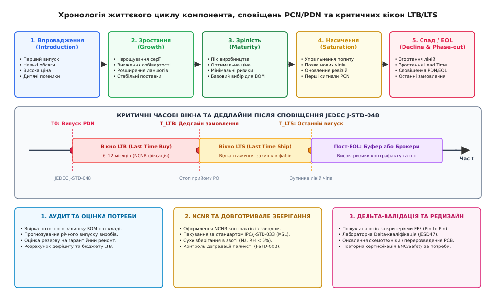
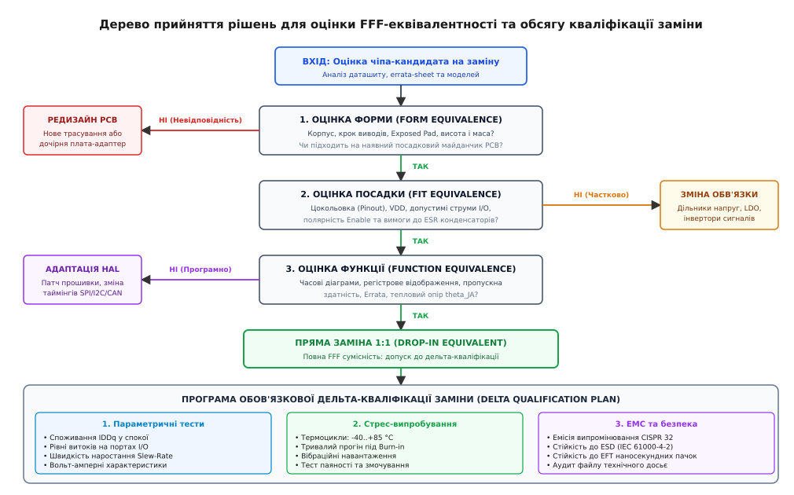

# Компонент знято з випуску: останнє замовлення й «сумісна» заміна

<preknowlist>
- [Вхідний контроль і підробні компоненти](root:sys-notary/vkhidnyi-kontrol-i-pidrobni-komponenty) — виявлення фальсифікату та брокерські ризики на вторинному ринку напівпровідників.
- [Еталонний зразок і перше виробниче](root:sys-notary/etalonnyi-zrazok-i-pershe-vyrobnyche) — фіксація базових параметрів та кваліфікація первинного виробу.
- [Декларація відповідності й технічний файл](root:sys-notary/deklaratsiia-vidpovidnosti-i-tekhnichnyi-fail) — оцінка впливу змін у переліку матеріалів (BOM) на доказовий пакет сертифікації.
- [Калькулятор прогнозування обсягу LTB та оцінки ризиків](root:sys-notary/komponent-zniato-z-vypusku/proj-ltb-forecasting-calc.md) — алгоритмічний розрахунок обсягу фінальної закупівлі з урахуванням деградації надійності.
</preknowlist>

Серійне виробництво промислового контролера систем протипожежного захисту з річним обсягом випуску двадцять тисяч одиниць зупиняється через офіційний лист напівпровідникового концерну: виробник оголошує про закриття фабрики з техпроцесом 180 нм і припинення випуску прецизійного ізольованого АЦП у корпусі TSSOP-28, на якому побудовано весь вимірювальний тракт виробу. Вікно останнього замовлення становить дев'ять місяців, а остаточне відвантаження завершиться через п'ятнадцять місяців. Відділ закупівель пропонує два варіанти: або заморозити півтора мільйона євро оборотних коштів у закупівлю складського запасу чіпів на сім років уперед, або встановити рекомендований постачальником «прямий аналог» від альтернативного азійського виробника. Через чотири місяці після монтажу партії так званого прямого аналога з'ясовується, що нова мікросхема має втричі вищу крутизну фронтів вихідного тактового сигналу, внаслідок чого рівень паразитних радіозавад у діапазоні 150–300 МГц перевищує норми CISPR 32 на 14 дБ, а вхідний струм витоку за температури +70 °C зростає у вісім разів, зміщуючи калібрування сенсорів. Усе сертифіковане обладнання підлягає зупинці поставок, а компанія зазнає колосальних витрат на екстрену дельта-кваліфікацію та схемотехнічний редизайн.

Ця ситуація демонструє неминучу технологічну розбіжність: життєвий цикл промислових, медичних, транспортних та енергетичних виробів становить від 10 до 25 років, тоді як життєвий цикл комерційних напівпровідникових компонентів рідко перевищує 3–7 років. Управління застаріванням (Obsolescence Management) — це системний інженерний та логістичний процес, який охоплює своєчасне опрацювання сповіщень про зняття з виробництва, точний математичний розрахунок обсягу останньої закупівлі (Last Time Buy, LTB), збереження кремнієвих кристалів в умовах бескисневого сухого середовища та сувору багаторівневу верифікацію Form-Fit-Function (FFF) еквівалентності перед допуском будь-якої заміни на серійний конвеєр.

## Анатомія сповіщень PCN, PDN та EOL: регуляторні рамки JEDEC

Зміна характеристик, перенесення виробничих майданчиків або повне припинення випуску електронного компонента не відбуваються хаотично: напівпровідникова індустрія підпорядкована суворим стандартам інформування клієнтів, головними з яких є специфікації комітету JEDEC — JESD46 та JESD48.

```
+───────────────────────────────────────────────────────────────────────────+
| ІЄРАРХІЯ ТА ВІДМІННОСТІ СПОВІЩЕНЬ ВИРОБНИКІВ НАПІВПРОВІДНИКІВ              |
|                                                                           |
|   1. PCN (Product Change Notification) — JEDEC JESD46                     |
|   ┌───────────────────────────────────────────────────────────────────┐   |
|   │ • Зміна кремнієвої фабрики (Wafer Fab transfer)                   │   |
|   │ • Заміна матеріалу вивідної рамки або компаунду (EMC)             │   |
|   │ • Оновлення маски кристала (Die shrink / Metal fix)               │   |
|   │ • Партномер залишається незмінним, змінюється ревізія             │   |
|   └───────────────────────────────────────────────────────────────────┘   |
|                                     │                                     |
|                                     ▼                                     |
|   2. PDN / PTN / EOL (Product Discontinuance) — JEDEC JESD48              |
|   ┌───────────────────────────────────────────────────────────────────┐   |
|   │ • Повна зупинка технологічної лінії або деактивація кристала      │   |
|   │ • Випуск списку номерів (Part Numbers), що знімаються             │   |
|   │ • Фіксація дедлайну останнього розміщення замовлень (LTB)         │   |
|   │ • Фіксація дати остаточного відвантаження продукції (LTS)         │   |
|   └───────────────────────────────────────────────────────────────────┘   |
+───────────────────────────────────────────────────────────────────────────+
```

### 1. Сповіщення про зміни: JEDEC JESD46 (PCN) та матриця ZVEI

Стандарт JEDEC JESD46 регламентує порядок випуску сповіщень про інженерні та технологічні зміни в активному компоненті. Згідно зі стандартом, виробник зобов'язаний опублікувати офіційний документ PCN (Product Change Notification) щонайменше за 90 календарних днів до першого відвантаження модифікованого виробу замовникам. 

Для систематизації змін європейська асоціація ZVEI (Zentralverband Elektrotechnik- und Elektronikindustrie) розробила Delta Qualification Matrix, яка класифікує зміни на категорії:
- **Зміна літографічних норм кристала (Die Shrink):** Перехід із техпроцесу 90 нм на 65 нм зі збереженням логіки схеми. Це зменшує ємність затворів і знижує енергоспоживання, але водночас різко зменшує тривалість фронтів сигналів (Rise/Fall Time), що може викликати резонансні явища у друкованих провідниках та неочікувані відбиття в лініях передачі.
- **Перенесення фабрики виготовлення пластин (Wafer Fab Transfer):** Зміна виробничого майданчика часто супроводжується зміною легуючих домішок, оксидної товщини підзатворного діелектрика або матеріалу мікроз'єднань (наприклад, перехід з алюмінієвої металізації на мідну), що змінює температурний коефіцієнт струмів витоку.
- **Зміна заводу розварки та пакування (Assembly/Test Site Transfer):** Перенесення корпусування мікросхем до іншого підрядника (OSAT). Це впливає на тип епоксидного компаунду, індуктивність вивідної рамки, форму фасок та копланарність контактів.
- **Заміна матеріалів розварювальних дротів:** Перехід із золотого дроту (Au) на мідний (Cu) або вкритий паладієм мідний дріт (PCC), що вимагає перегляду профілів термозвукового зварювання, параметрів стійкості до циклічних теплових деформацій та корозійної стійкості в умовах вологого середовища.

### 2. Сповіщення про зняття з випуску: JEDEC JESD48 (PDN / EOL)

Коли технологічна лінія стає економічно збитковою або кремнієві пластини відповідного діаметра (наприклад, 150 мм чи 200 мм) вилучаються з обігу, фабрика публікує PDN (Product Discontinuance Notification) або EOL (End-of-Life) повідомлення за стандартом JESD48. 

Стандарт JESD48 встановлює обов'язковий часовий графік для захисту виробників кінцевого обладнання:
- **Час на прийняття замовлень (LTB Window):** Фабрика зобов'язана надати клієнтам щонайменше 6 місяців (180 днів) з моменту публікації PDN для розміщення остаточних замовлень на купівлю (Last Time Buy Date).
- **Час на остаточне виготовлення та відвантаження (LTS Window):** Фабрика зобов'язана надати щонайменше 12 місяців (360 днів) з моменту публікації PDN до фінальної відправки замовлених партій (Last Time Ship Date).


*Хронологічна шкала життєвого циклу компонента, випуску сповіщень PCN/PDN та критичних часових вікон LTB/LTS.*

### 3. Структура документа PDN та юридичні обмеження

Офіційне сповіщення про зняття з випуску містить суворо структуровані розділи:
- **Discontinued Part Numbers:** Повний перелік партномерів з урахуванням температурних індексів, корпусів та варіантів фасування (тубуси, котушки Tape & Reel).
- **Replacement Part Numbers:** Рекомендовані заміни із зазначенням статусу: прямий сумісний за виводами (Pin-for-Pin), функціональний аналог з іншим корпусом, або позначка «заміна відсутня» (No direct replacement).
- **Key Deadlines:** Точні календарні дати `T_PDN`, `T_LTB` та `T_LTS`.
- **Умови NCNR (Non-Cancellable, Non-Returnable):** Усі замовлення, оформлені в межах LTB-вікна, отримують статус NCNR. Замовник юридично позбавляється права скасувати замовлення, змінити обсяг або повернути отримані компоненти, якщо вони відповідають заводській специфікації.

## Моніторинг застарівання та автоматизовані бази даних BOM

Сучасні інженерні команди не чекають на отримання офіційного листа PDN від постачальника, оскільки затримка реагування на 2–3 місяці суттєво скорочує вікно розміщення замовлень. Натомість застосовують проактивний моніторинг життєвого циклу переліку матеріалів (BOM Scrubbing) через спеціалізовані аналітичні платформи (IHS Markit, SiliconExpert, Z2Data, Partstat).

```
+───────────────────────────────────────────────────────────────────────────+
| ФАЗИ ЖИТТЄВОГО ЦИКЛУ КОМПОНЕНТА В БАЗАХ МОНІТОРИНГУ (SILICONEXPERT / IHS) |
|                                                                           |
|   1. Впровадження (Introduction)  ──► Низькі обсяги, високий ризик браку  |
|   2. Зростання (Growth)           ──► Нарощування обсягів, зниження ціни  |
|   3. Зрілість (Maturity)          ──► Оптимальна фаза для вибору в новий BOM|
|   4. Насичення (Saturation)       ──► Зниження темпів росту замовлень     |
|   5. Спад (Decline / Phase-out)   ──► Збільшення Lead Time (>30 тижнів)   |
|   6. Знято (EOL / Discontinued)   ──► Доступно лише через LTB або брокерів|
+───────────────────────────────────────────────────────────────────────────+
```

Бази даних моніторингу аналізують непрямі ознаки наближення EOL:
- **Зростання Lead Time (терміну поставки):** Якщо стандартний термін поставки мікросхеми збільшується з 12 до 36–52 тижнів, це свідчить про перерозподіл літографічних потужностей фабрики на новіші прибуткові чіпи.
- **Зменшення складських залишків у франчайзингових дистриб'юторів:** Падіння сумарного запасу чіпа в глобальних дистриб'юторів (Arrow, Avnet, DigiKey, Mouser) нижче критичного рівня 60-денного попиту є чітким сигналом швидкого випуску PDN.
- **Підвищення мінімальної норми замовлення (MOQ):** Фабрика збільшує MOQ з однієї котушки (2500 шт.) до обсягу цілої кремнієвої пластини (Wafer level MOQ, 25 000–50 000 шт.), щоб відсіяти дрібних замовників перед закриттям лінії.

## Математика й економіка Last Time Buy: оптимізація обсягу закупівлі

Розрахунок обсягу фінального замовлення `Q_LTB` — це класична оптимізаційна задача управління запасами в умовах невизначеності. Помилка в менший бік призводить до передчасної зупинки серійного виробництва, зриву контрактних зобов'язань та екстрених витрат на редизайн. Помилка в більший бік призводить до омертвіння капіталу, високих витрат на утримання складських запасів і списання залишків.

```
+───────────────────────────────────────────────────────────────────────────+
| СТРУКТУРА СУМАРНОГО ОБСЯГУ ОСТАННЬОГО ЗАМОВЛЕННЯ LTB                      |
|                                                                           |
|   Q_LTB = Q_production + Q_service + Q_scrap + Q_buffer                   |
|                                                                           |
|   1. Виробнича потреба (Q_production):                                    |
|      План випуску готових приладів до завершення їхнього EOL.             |
|                                                                           |
|   2. Гарантійний та сервісний резерв (Q_service):                         |
|      Запас для ремонту приладів, що перебувають в експлуатації.           |
|                                                                           |
|   3. Технологічний брак виробництва (Q_scrap):                            |
|      Втрати під час монтажу на SMT-лініях, налаштування та тестування.    |
|                                                                           |
|   4. Статистичний буфер невизначеності (Q_buffer):                        |
|      Захист від коливань ринкового попиту та продовження серії.           |
+───────────────────────────────────────────────────────────────────────────+
```

### 1. Математична модель прогнозування потреби

Сумарний необхідний обсяг компонентів `Q_LTB` на залишковий період життєвого циклу виробу `T_rem` розраховується за балансовою формулою:

```
Q_LTB = Q_production + Q_service + Q_buffer

де:
Q_production = ∑(D_t · (1 + S_scrap))                      [виробнича потреба на залишковий період T_rem]
Q_service    = N_active · λ_FIT · 10⁻⁹ · 8760 · T_warranty [гарантійний та сервісний резерв]
Q_buffer     = Z_α · σ_D · √T_rem                          [страховий запас під ринкову волатильність]
```

де складові мають наступний фізичний та статистичний зміст:

1. **Плановий виробничий попит (`Q_production`):** Сума планових потреб `D_t` за всі періоди залишкового виробництва з урахуванням коефіцієнта втрат `S_scrap` (типово 0.5–2% для автоматизованого SMT-монтажу корпусів QFN та BGA з малим кроком).
2. **Потреба гарантійного та післягарантійного сервісу (`Q_service`):** Визначається загальним парком виробів `N_active`, середньою інтенсивністю відмов чіпа `λ_FIT` (Failures In Time, кількість відмов на 10⁹ годин роботи), кількістю годин на рік (8760) та строком сервісних зобов'язань `T_warranty` (наприклад, 10 років для медичного чи енергетичного обладнання).
3. **Страховий буфер ринкової невизначеності (`Q_buffer`):** Квантиль нормального розподілу `Z_α` (наприклад `Z = 2.055` для 98% надійності непопадання в дефіцит), помножений на середньоквадратичне відхилення місячного попиту `σ_D` та корінь із тривалості періоду `√T_rem`.

Детальний практичний алгоритм прогнозування з імітаційним моделюванням методом Монте-Карло, розрахунком розподілу Вейбулла для відмов та оптимізацією вартості володіння реалізовано у вставці [Калькулятор прогнозування обсягу LTB та оцінки ризиків](root:sys-notary/komponent-zniato-z-vypusku/proj-ltb-forecasting-calc.md).

### 2. Економічна функція загальної вартості рішення

Вибір між здійсненням LTB або терміновим редизайном схеми базується на мінімізації функції сукупних очікуваних витрат `TEC` (Total Expected Cost):

```
TEC_LTB      = P_unit · Q_LTB + C_hold · Q_LTB · (T_rem / 2) + C_shortage · E[max(0, D - Q_LTB)] + C_scrap · E[max(0, Q_LTB - D)]
TEC_Redesign = C_NRE + C_qual + C_cert + (P_new - P_old) · ∑(D_t)
```

де:
- `P_unit` — вартість закупівлі однієї мікросхеми в межах LTB-контракту;
- `C_hold` — щорічна вартість зберігання одиниці запасу (складська оренда, страхування, кліматичний контроль, вартість замороженого капіталу WACC — типово 15–25% вартості компонента на рік);
- `C_NRE` — інженерна вартість проектування нової друкованої плати та адаптації вбудованого програмного забезпечення (Non-Recurring Engineering);
- `C_qual` — витрати на виготовлення дослідних прототипів та кліматичні випробування;
- `C_cert` — витрати на повторну сертифікацію виробу в акредитованих лабораторіях (EMC, Safety, FCC, CE, ATEX).

Якщо строк до завершення випуску виробу `T_rem` становить менше 2–3 років, варіант LTB майже завжди виявляється економічно вигіднішим за редизайн, оскільки вартість сертифікації `C_cert` та NRE перевищує витрати на зберігання чіпів. Якщо ж виріб має випускатися понад 5 років, вартість утримання запасу та ризик фізичної деградації компонентів перевищують вартість схемотехнічного редизайну.

## Фізика довготривалого зберігання напівпровідників: деградаційні процеси

Придбання компонентів у межах LTB на 5–10 років створює критичну проблему їхнього фізичного збереження. Напівпровідниковий прилад у пластиковому корпусі не є герметичним монолітом: із плином часу в ньому розвиваються фізико-хімічні процеси, здатні зробити всю партію непридатною до автоматизованого паяння або призвести до прихованих відмов у польових умовах.

```
+───────────────────────────────────────────────────────────────────────────+
| ФІЗИЧНІ МЕХАНІЗМИ ДЕГРАДАЦІЇ НАПІВПРОВІДНИКІВ ПРИ ДОВГОТРИВАЛОМУ ЗБЕРІГАННІ|
|                                                                           |
|   1. Окиснення виводів та ріст інтерметалідів (IMC)                       |
|   ┌───────────────────────────────────────────────────────────────────┐   |
|   │ Дифузія міді з вивідної рамки в олов'яне покриття (Cu6Sn5, Cu3Sn)  │   |
|   │ Втрата змочуваності припоєм під час SMT-паяння (J-STD-002)        │   |
|   │ Утворення порожнеч Кіркендалла на межі розділу металів            │   |
|   └───────────────────────────────────────────────────────────────────┘   |
|                                     │                                     |
|   2. Ріст ниткоподібних кристалів олова (Tin Whiskers)                    |
|   ┌───────────────────────────────────────────────────────────────────┐   |
|   │ Механічні напруження у безсвинцевому покритті (Pure Matte Sn)     │   |
|   │ Спонтанне проростання олов'яних «вусів» довжиною до 200–500 мкм   │   |
|   │ Ризик короткого замикання між сусідніми виводами мікросхеми       │   |
|   └───────────────────────────────────────────────────────────────────┘   |
|                                     │                                     |
|   3. Насичення вологою епоксидного компаунду (MSL / Popcorning)           |
|   ┌───────────────────────────────────────────────────────────────────┐   |
|   │ Дифузія пари крізь полімер за стандартом IPC/J-STD-033            │   |
|   │ Вибухове закипання поглиненої вологи під час оплавлення (+260 °C) │   |
|   │ Внутрішнє розшарування (Delamination) та обрив контактних дротів   │   |
|   └───────────────────────────────────────────────────────────────────┘   |
+───────────────────────────────────────────────────────────────────────────+
```

### 1. Деградація паяності, інтерметаліди та порожнечі Кіркендалла

Вивідні рамки (Leadframes) мікросхем виготовляються з мідних сплавів (наприклад, C19400) або сплаву Alloy 42 (залізо-нікель) і покриваються шаром чистого матового олова (Matte Tin) завтовшки 7–15 мкм для забезпечення паяності.

У процесі зберігання навіть за кімнатної температури (+20 °C) відбувається твердофазна дифузія атомів міді в шар олова. На межі розділу утворюються інтерметалічні сполуки (Intermetallic Compounds, IMC) — спочатку Cu₆Sn₅ (η-фаза), а згодом збагачена міддю сполука Cu₃Sn (ε-фаза). Інтерметаліди відрізняються крихкістю та надзвичайно низькою змочуваністю рідким флюсованим припоєм. Якщо шар чистого олова повністю перетворюється на IMC або на поверхні утворюється щільна плівка оксидів олова (SnO, SnO₂), контактний вивід перестає змочуватися припоєм на SMT-лінії (порушення стандарту J-STD-002), утворюючи масовий дефект «холодної пайки» або повне незмочування (Non-wetting).

Крім того, різна швидкість взаємної дифузії міді та олова породжує ефект Кіркендалла: у шарі міді безпосередньо під інтерметалідом Cu₃Sn накопичуються вакансії кристалічної ґратки, які коалесціюють у мікроскопічні порожнечі (Kirkendall Voids). Під час вібраційних навантажень або термоциклування ці порожнечі зливаються в макротріщини, спричиняючи механічний відрив паяного виводу від друкованої плати без видимих зовнішніх дефектів.

### 2. Утворення олов'яних «вусів» (Tin Whiskers)

Дифузійний потік атомів міді вздовж меж зерен олова генерує високі внутрішні механічні напруження стиснення всередині покриття виводів. Для релаксації цих напружень кристал олова починає спонтанно видавлювати тонкі ниткоподібні монокристали — олов'яні віскери (Whiskers) за стандартом JESD201. За кілька років зберігання довжина віскера може досягати 200–800 мкм при діаметрі 1–3 мкм. У мікросхемах із малим кроком виводів (0.5 мм у QFP або 0.65 мм у TSSOP) олов'яний вус перекриває проміжок між сусідніми виводами, спричиняючи коротке замикання з опором від часток ома до кількох кілоом.

### 3. Вологочутливість MSL та протокол довготривалого зберігання

Епоксидні прес-порошки (EMC), з яких відлито корпус мікросхеми, мають високу гігроскопічність. Згідно зі стандартом IPC/J-STD-033, компоненти класифікують за рівнями чутливості до вологи (Moisture Sensitivity Level, MSL від 1 до 6).

Для зберігання компонентів на строк понад два роки звичайного вакуумного пакування у пакети Moisture Barrier Bag (MBB) з силікагелем недостатньо, оскільки коефіцієнт проникності водяної пари крізь полімерні шви пакетів становить від 0.005 до 0.02 г/(м²·добу). 

Промисловий регламент довготривалого зберігання напівпровідникового запасу LTB вимагає:
1. **Шафи сухого зберігання з азотною продувкою (N₂ Dry Cabinets):** Підтримання відносної вологості середовища RH < 5% та заміщення атмосферного кисню сухим газоподібним азотом високої чистоти (99.99%). Відсутність кисню повністю зупиняє окиснення виводів, а наднизька вологість запобігає насиченню компаунду вологою без обмеження строку придатності (Floor Life).
2. **Контроль температури:** Підтримання стабільної температури в діапазоні +18 ... +22 °C. Підвищення температури прискорює дифузію інтерметалідів за законом Арреніуса:

```
K(T) = K_0 · exp(-E_a / (k_B · T))   [швидкість росту інтерметаліду за Арреніусом]
```

де енергія активації росту інтерметаліду Cu₆Sn₅ становить `E_a ≈ 0.75 еВ`. Зниження температури зберігання з +30 °C до +18 °C сповільнює ріст інтерметалічного шару майже у 3.5 раза.
3. **Періодичний моніторинг паяності:** Вибірковий контроль зразків кожні 24 місяці методом балансу змочування (Wetting Balance Test) за стандартом J-STD-002.

## Ієрархія валідації Form-Fit-Function (FFF) еквівалентності

Коли реалізація LTB неможлива або економічно недоцільна, інженерна група переходить до пошуку та кваліфікації альтернативного компонента. Оцінка сумісності базується на класичній тріаді FFF (Form, Fit, Function), до якої додається четвертий критичний фактор — надійність та якість (Quality/Reliability).

```
+───────────────────────────────────────────────────────────────────────────+
| ІЄРАРХІЯ КРИТЕРІЇВ ВАЛІДАЦІЇ СУМІСНИХ ЗАМІН (FORM - FIT - FUNCTION)       |
|                                                                           |
|   1. FORM (Геометрія та механіка)                                         |
|      • Тип корпусу (SOIC, QFP, QFN, BGA) та крок виводів (Pitch)          |
|      • Розміри та електричний потенціал теплового майданчика (Exposed Pad)|
|      • Висота над платою (Z-clearance) та маса компонента                 |
|                                                                           |
|   2. FIT (Електричні інтерфейси та цокольовка)                            |
|      • Повне співпадіння призначення всіх виводів (Pinout Pin-to-Pin)     |
|      • Діапазон напруг живлення VDD_min .. VDD_max                        |
|      • Логічні рівні VIH, VIL, VOH, VOL та сумісність за струмом (IOH/IOL)|
|                                                                           |
|   3. FUNCTION (Логіка, таймінги, протоколи, тепло)                        |
|      • Динамічні часові параметри (Setup/Hold times, Propagation delay)   |
|      • Протокольні особливості шин (I2C Fast Mode Plus, SPI Clock phase)  |
|      • Карта внутрішніх регістрів, дефолтні значення та Silicon Errata    |
|      • Тепловий опір кристал-корпус (theta_JC) та кристал-середовище (JA) |
+───────────────────────────────────────────────────────────────────────────+
```


*Дерево прийняття рішень для оцінки FFF-еквівалентності та обсягу кваліфікації заміни.*

### 1. Критерій Form: механічна та посадкова сумісність

Оцінка форми мікросхеми виходить далеко за межі збігу назви корпусу (наприклад, QFN-32):
- **Розміри та ізоляція Exposed Thermal Pad:** Різні виробники під назвою одного й того самого корпусу QFN-32 випускають чіпи з розміром центрального теплового майданчика від 3.1 × 3.1 мм до 3.6 × 3.6 мм. Збільшений майданчик на чіпі-заміні може спричинити коротке замикання на перехідні отвори (vias) або сигнальні провідники, розташовані під корпусом. Крім того, важливим є електричний потенціал майданчика: у деяких чіпів він внутрішньо з'єднаний із GND, в інших — із мінусовою шиною живлення або повинен залишатися електрично ізольованим (Floating).
- **Копланарність та висота виводів (Stand-off):** Для корпусів BGA критичним є діаметр кульок припою (Ball Diameter) та висота після оплавлення. Різниця у висоті посадки на 50 мкм змінює профіль теплопровідності та напруження в паяних з'єднаннях при термоциклуванні.

### 2. Критерій Fit: статичні електричні параметри та аналогові тракти

Співпадіння цокольовки виводів (Pinout) є необхідною, але недостатньою умовою:
- **Вхідні/вихідні логічні пороги:** Оригінальний мікроконтролер міг підтримувати входи типу Schmitt Trigger із порогом `V_IH = 0.7 · V_DD`, тоді як заміна має класичні рівні CMOS із порогом `V_IH = 0.5 · V_DD`. Це може призвести до хибних спрацьовувань за наявності шумів на довгих шлейфах.
- **Вимоги до стабільності живлення та ESR конденсаторів:** Класичні лінійні регулятори напруги (LDO) попередніх поколінь вимагали вихідних конденсаторів із певним еквівалентним послідовним опором (ESR від 0.2 до 1.0 Ом для танталових конденсаторів), оскільки нуль передавальної функції, утворений ESR, забезпечував стійкість петлі зворотного зв'язку. Встановлення сучасного прямого аналога LDO, оптимізованого під керамічні конденсатори MLCC з ультранизьким `ESR < 0.01 Ом`, призводить до самозбудження регулятора та високочастотної генерації з амплітудою в сотні мілівольт.
- **Дрейф аналогових зміщень та температурний коефіцієнт:** Для операційних підсилювачів та АЦП заміна може мати однакове початкове зміщення нуля за +25 °C (наприклад 1 мВ), але температурний дрейф напруги зміщення `dV_os/dT` у старого чіпа становив 2 мкВ/°C, а у дешевого аналога досягає 15 мкВ/°C, що спотворює результати вимірювань за температурних екстремумів (-40 °C або +85 °C).

### 3. Критерій Function: динаміка, кремнієві помилки (Errata) та протоколи

Функціональна сумісність приховує найглибші підводні камені схемотехніки:
- **Крутизна фронтів (Slew Rate) та електромагнітна емісія:** Сучасні напівпровідникові кристали виготовляються за тоншими нанометровими нормами, ніж мікросхеми двадцятирічної давнини. Їхні вихідні каскади мають значно нижчий внутрішній опір каналу `R_DS(on)` та надзвичайно швидкий час наростання (`t_r < 1 нс` замість `t_r ≈ 5 нс` у оригіналу). Висока швидкість зміни струму `di/dt` збуджує паразитні індуктивності провідників друкованої плати, створюючи потужне електромагнітне випромінювання та відбиття сигналів (Ringing), які здатні зірвати сертифікаційні випробування на ЕМС.
- **Відмінності в картах регістрів та кремнієвих помилках (Silicon Errata):** Периферійні мікросхеми інтерфейсів (Ethernet PHY, CAN-контролери, АЦП) від різних виробників часто мають специфічні недокументовані особливості поведінки при скиданні (Reset Sequence), різну тривалість стабілізації PLL після подачі тактового сигналу або специфічні біти конфігурації у службових регістрах.
- **Тепловий опір та безпечна робоча зона (SOA):** Для силових транзисторів MOSFET та IGBT заміна з ідентичним опором відкритого каналу `R_DS(on)` може мати значно гірший тепловий опір кристал-корпус `θ_JC` або меншу енергію лавинного пробою (Single Pulse Avalanche Energy, `E_AS`), що призводить до теплового пробою при комутації індуктивних навантажень.

## Програма дельта-кваліфікації та ресертифікація

Впровадження компонента-заміни вимагає проведення дельта-кваліфікації (Delta Qualification) — цільового комплексу випробувань, обсяг якого визначається ступенем відмінностей між оригіналом та заміною згідно зі стандартом AEC-Q100/Q101 або JEDEC JESD47.

```
+───────────────────────────────────────────────────────────────────────────+
| МАТРИЦЯ ОБСЯГУ ДЕЛЬТА-КВАЛІФІКАЦІЇ ЗАЛЕЖНО ВІД ТИПУ ЗАМІНИ               |
|                                                                           |
|   Тип 1: Прямий Drop-in аналог (однаковий кристал/ліцензія, новий завод)  |
|   ┌───────────────────────────────────────────────────────────────────┐   |
|   │ • Параметричний контроль (IDDq, зміщення нуля, Slew Rate)         │   |
|   │ • Термоцикли: 500 циклів (-40..+85 °C)                            │   |
|   │ • Спрощена перевірка кондуктивної емісії ЕМС                      │   |
|   └───────────────────────────────────────────────────────────────────┘   |
|                                                                           |
|   Тип 2: Сумісний за виводами функціональний аналог іншого вендора        |
|   ┌───────────────────────────────────────────────────────────────────┐   |
|   │ • Повний функціональний стрес-тест на межах напруг (VDD ±10%)      │   |
|   │ • Повна пересертифікація на ЕМС (CISPR 32/35, IEC 61000-4-2/4/5)  │   |
|   │ • Тестування стійкості до защіпки (Latch-Up) за JESD78            │   |
|   │ • Оновлення технічного файлу декларації CE / safety report        │   |
|   └───────────────────────────────────────────────────────────────────┘   |
|                                                                           |
|   Тип 3: Редизайн плати (новий корпус або інша архітектура чіпа)          |
|   ┌───────────────────────────────────────────────────────────────────┐   |
|   │ • Повна процедура первинної кваліфікації (First Article Approval)  │   |
|   │ • Повний цикл кліматичних, вібраційних та ЕМС сертифікацій        │   |
|   │ • Повна зміна ревізії виробу (ECO/ECN) та сертифікатів типу       │   |
|   └───────────────────────────────────────────────────────────────────┘   |
+───────────────────────────────────────────────────────────────────────────+
```

### 1. Електромагнітна сумісність (ЕМС) та безпека

Будь-яка заміна активного напівпровідникового компонента (мікроконтролера, імпульсного перетворювача, драйвера затворів, трансивера шини) безпосередньо впливає на спектр випромінюваних завад виробу:
- **Випробування на випромінювану емісію (Radiated Emissions за CISPR 32 / EN 55032):** Вимірювання напівбезлунній камері в діапазоні від 30 МГц до 6 ГГц. Навіть ідентичний трансивер RS-485 іншого виробника з крутішими фронтами може створити гармонійні піки на частотах 150–450 МГц, що виходять за граничні маски Class B.
- **Стійкість до електростатичних розрядів (ESD за IEC 61000-4-2):** Контактний розряд `±4 кВ` / повітряний `±8 кВ`. Необхідно переконатися, що вбудовані захисні діоди нового чіпа витримують імпульсний струм і не переходять у незворотний стан защіпки (Latch-Up).
- **Стійкість до наносекундних імпульсних пачок (EFT/Burst за IEC 61000-4-4):** Подача імпульсів амплітудою `1 ... 2 кВ` із частотою повторення 100 кГц на лінії живлення та інтерфейсів для виявлення збоїв синхронізації або зависань внутрішніх автоматів станів (FSM).

### 2. Вплив на регуляторний технічний файл (Technical File Impact)

Згідно з європейськими директивами (EMC Directive 2014/30/EU, Low Voltage Directive 2014/35/EU, Radio Equipment Directive 2014/53/EU), виробник зобов'язаний зберігати актуальний технічний файл (Technical Construction File) протягом 10 років після випуску останнього екземпляра приладу.

Зміна критичного компонента класифікується інженером з сертифікації:
- **Minor Change (Незначна зміна):** Заміна пасивного елемента або другого джерела постачання (Second Source) повністю ідентичного чіпа з однаковим звітом випробувань. Оформлюється протокол внутрішньої дельта-валідації без зміни сертифіката відповідності.
- **Major Change (Суттєва зміна):** Заміна мікросхеми живлення, ізоляційного бар'єра (оптопари чи цифрового ізолятора), процесорного вузла або радіомодуля. Вимагає офіційного випуску сповіщення про інженерну зміну (Engineering Change Order, ECO), проведення дельта-тестування в акредитованій лабораторії, внесення протоколів до технічного файлу та оновлення Декларації про відповідність (Declaration of Conformity, DoC).

## Схемотехнічні стратегії редизайну та програмна абстракція

Коли повний функціональний аналог відсутній, застосовують три основні інженерні стратегії інтеграції замін.

### 1. Комбіноване трасування друкованих плат (Combo Footprints)

На етапі початкової розробки або планового редизайну плати для критичних мікросхем (регуляторів живлення, інтерфейсних трансиверів, пам'яті Flash) проектують комбіновані посадочні майданчики, що поєднують топології двох різних корпусів: наприклад, зовнішні майданчики під SOIC-8 та внутрішні під компактний DFN-8 або два паралельних footprint під TSSOP-16 та QFN-16. Це дозволяє перемикати виробництво на альтернативний чіп простою зміною файлу розстановки компонентів (Pick & Place) без виготовлення нових друкованих плат.

### 2. Дочірні модулі-інтерпозери (Interposer Adapter Boards)

Для дорогого обладнання дрібносерійного випуску, де вартість переробки багатошарової материнської плати є надвисокою, розробляють мініатюрну багатошарову дочірню плату (Interposer). На верхній стороні адаптера монтується сучасний мікроконтролер або АЦП у корпусі QFN/BGA разом із необхідними дільниками та конденсаторами, а на нижній стороні розташовуються виводи або штирі, які точно повторюють конфігурацію та цокольовку застарілого корпусу (наприклад, PLCC-44 чи DIP-28).

### 3. Програмний рівень абстракції апаратного забезпечення (HAL)

При заміні периферійних мікросхем (наприклад, зміні постачальника зовнішнього АЦП або трансивера шини) вбудоване програмне забезпечення не повинно переписуватися повністю. Архітектура прошивки повинна спиратися на чітко розмежований рівень апаратних абстракцій.

Нижче наведено практичний приклад побудови модуля абстракції та дельта-валідації параметрів сенсорного АЦП для прошивки вбудованої системи, що підтримує динамічне підключення як оригінального застарілого чіпа, так і нового аналога-заміни з різними картами регістрів, розрядністю та таймінгами калібрування.

:::tabs
@tab C99 (Драйвер з підтримкою замін)
:::code komponent-zniato-z-vypusku-d/c/main.c

@tab C++20 (Типобезпечна компонентна абстракція)
:::code komponent-zniato-z-vypusku-d/cpp/main.cpp
:::

## Інженерні пастки при інтеграції замін

Практичний досвід серійного виробництва свідчить, що більшість катастрофічних відмов після заміни EOL-компонентів виникають не через грубі помилки в цокольовці, а внаслідок тонких фізичних ефектів другого порядку:

1. **Пастка навантажувальної ємності ліній зв'язку:** Заміна старого мікроконтролера новим чіпом із меншим вихідним струмом портів `I_OL / I_OH` призводить до завалу фронтів сигналів на довгих ємнісних лініях шини I2C або SPI. Якщо ємність монтажу становить 150 пФ, а новий вихід має обмеження 2 мА замість колишніх 8 мА, час наростання сигналу перевищує допустимий ліміт стандарту шини, спричиняючи спорадичні помилки контрольних сум CRC.
2. **Пастка поведінки ліній Reset та Brown-Out Reset (BOR):** Різні ревізії напівпровідникових кристалів мають відмінні часи реакції супервізора живлення. Заміна трансивера або контролера на аналог зі швидшим або повільнішим часом виходу з режиму Reset може порушити послідовність увімкнення (Power Sequencing) багатоканальних джерел живлення, викликаючи стан блокування (Latch-Up) через протікання струму крізь внутрішні захисні ESD-діоди.
3. **Пастка підтягувальних резисторів (Internal Pull-up Drift):** Номінал внутрішніх підтягувальних резисторів на виводах мікроконтролерів рідко має прецизійну точність: у старих чіпах він становив `20 ... 50 кОм`, тоді як у сучасних енергоефективних чіпах сягає `40 ... 100 кОм`. Якщо схема покладалася на внутрішню підтяжку для відкриття зовнішнього біполярного транзистора або оптопари, струму бази може виявитися недостатньо для введення транзистора в режим насичення за низьких температур.

Системний підхід до управління EOL вимагає від інженерної команди постійного ведення матриці ризиків BOM, підписки на автоматизовані бази даних сповіщень PCN/PDN (IHS Markit, SiliconExpert, Z2Data), своєчасного виконання розрахунків LTB та безумовного проходження повної матриці дельта-кваліфікації для будь-якого компонента, що претендує на статус «сумісної заміни».
