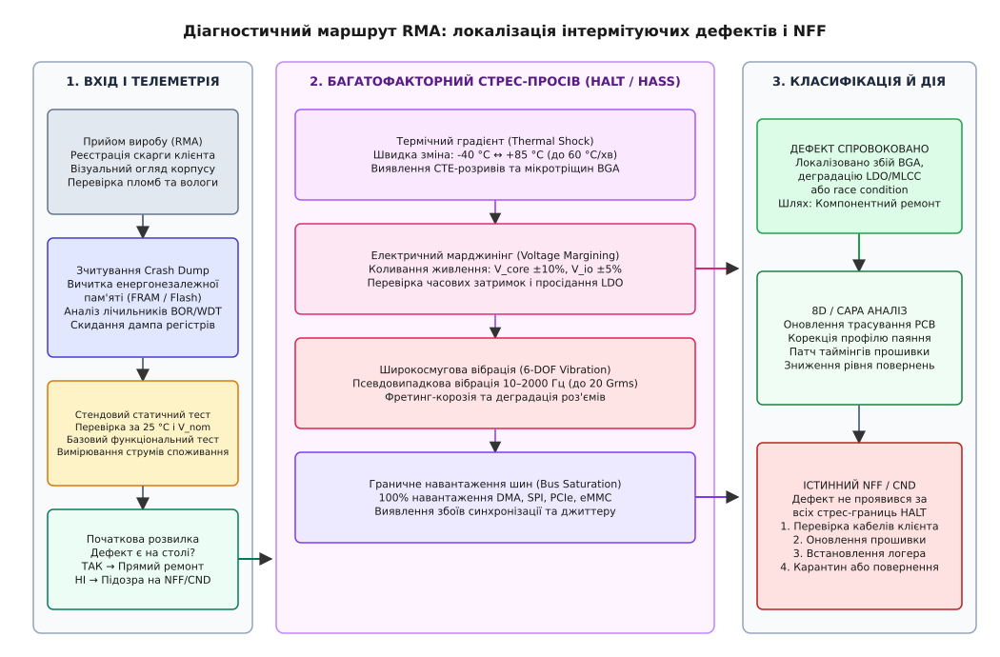
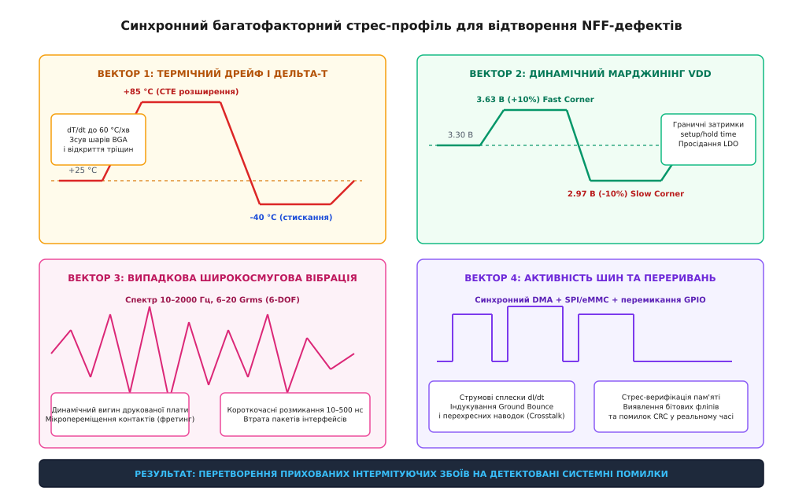

# Повернення, ремонт і «дефекту не виявлено»

<preknowlist>
- [Гарантія: що обіцяно, на скільки і що її анулює](root:sys-notary/harantiia) — регламент гарантійних зобов'язань виробника та критерії приймання рекламацій.
- [Інструкція, яку читають після поламки](root:sys-notary/instruktsiia-iaku-chytaiut-pislia-polamky) — методики первинної діагностики та фільтрація помилок експлуатації.
- [Ремонт, право власника й межа замикання виробу](root:sys-notary/remont-pravo-vlasnyka-i-mezha-zamykannia-vyrobu) — модульна та компонентна ремонтопридатність апаратних вузлів.
- [Вхідний контроль і підробні компоненти](root:sys-notary/vkhidnyi-kontrol-i-pidrobni-komponenty) — виявлення прихованої деградації та дефектів напівпровідникових кристалів.
</preknowlist>

Промисловий контролер автоматизації газорозподільної станції або польотний модуль агротехнічного безпілотника зазнає спонтанного апаратного скидання раз на три-чотири доби в момент запуску потужного сервоприводу за температури навколишнього середовища +38 °C. Експлуатаційна служба знімає блок із виробничої лінії, оформлює гарантійну рекламацію (*RMA, Return Merchandise Authorization*) і відправляє пристрій до сервісного центру виробника з описом «самовільне вимикання під навантаженням». Сервісний інженер встановлює модуль на лабораторний діагностичний стенд, підключає еталонне джерело живлення з пульсаціями менше ніж 5 мВ, вмикає пристрій за кімнатної температури +22 °C і запускає стандартний двадцятихвилинний функціональний тест. Усі тести проходять із зеленим індикатором успіху, споживання струму залишається в межах норми, шини зв'язку не фіксують жодної помилки. Модулю присвоюють статус NFF (*англ. No Fault Found* — дефекту не виявлено) і відправляють назад замовнику без виконання ремонту. Через сорок вісім годин після повернення на об'єкт контролер знову зависає під час технологічного циклу, спричиняючи аварійне спрацьовування запобіжних клапанів і збитки у десятки тисяч євро.

Класифікація повернення як «дефекту не виявлено» — це не свідчення справності пристрою, а прямий доказ неспроможності сервісного стенда відтворити точний вектор зовнішніх навантажень, за яких виникає збій. За статистикою аерокосмічної, автомобільної та телекомунікаційної галузей, від 25% до 50% усіх гарантійних повернень початково потрапляють у категорію NFF або CND (*англ. Can Not Duplicate* — не вдалося відтворити). У технічній практиці також вживають абревіатури NTF (*англ. No Trouble Found*) та RTOK (*англ. Retest OK*). Такі модулі формують небезпечний клас «блукаючих блоків» (*англ. rogue units / repeat returns*), які роками циркулюють між складом запасних частин, польовими установками та лабораторіями ремонту, генеруючи колосальні логістичні витрати, спотворюючи статистику надійності та підриваючи довіру до торгової марки. Подолання феномену NFF вимагає глибокого розуміння фізики інтермітуючих несправностей, впровадження багатофакторного стрес-тестування та проєктування енергонезалежних реєстраторів аварійного стану безпосередньо у вбудованому програмному забезпеченні.

## Фізико-хімічні першопричини інтермітуючих дефектів

Інтермітуюча несправність (*лат. intermittens* — переривчастий, той, що з'являється і зникає) — це нестабільна зміна електричних або часових параметрів системи, яка виникає лише під впливом специфічної комбінації зовнішніх або внутрішніх факторів (температури, механічної деформації, напруги живлення, електромагнітної завади) і самостійно зникає після нормалізації умов. На відміну від перманентної відмови (наприклад, пробитого силового MOSFET-транзистора чи згорілого резистора), інтермітуючий дефект неможливо виявити статичним продзвонюванням кіл за допомогою звичайного мультиметра.

```
+───────────────────────────────────────────────────────────────────────────+
| ФІЗИЧНІ ФАКТОРИ ВИНИКНЕННЯ ІНТЕРМІТУЮЧИХ НЕ СПРАВНОСТЕЙ                   |
|                                                                           |
|  1. Термомеханічний зсув (CTE mismatch):                                  |
|     Кремній (2.6 ppm/°C) ──> Припій SAC305 (22 ppm/°C) ──> FR-4 (16 ppm/°C)|
|     Термоцикли -> Зсувні напруження -> Розкриття мікротріщини BGA         |
|                                                                           |
|  2. Динамічний вигин PCB та вібрація:                                     |
|     Резонанс плати -> Фретинг-корозія контактів -> Мікропереривання 50 нс  |
|                                                                           |
|  3. Імпульсне просідання живлення (dI/dt transient):                      |
|     Деградація MLCC + ESR -> Падіння V_core нижче V_BOR -> Скидання MCU   |
|                                                                           |
|  4. Граничний зсув часових інтервалів (PVT Corner):                       |
|     Slow Corner (T_high + V_low) -> Зрив Setup Time шин пам'яті           |
|                                                                           |
|  5. Зрив генерації кварцового резонатора на холоді:                       |
|     Зростання ESR кварцу -> Зниження запасу негативного опору R_neg       |
+───────────────────────────────────────────────────────────────────────────+
```

### Термомеханічний дрейф і втома паяних з'єднань BGA

Головним джерелом інтермітуючих обривів у сучасній мікроелектроніці є різниця коефіцієнтів лінійного теплового розширення (*CTE, Coefficient of Thermal Expansion*) матеріалів, що утворюють електронний вузол. Кремнієвий кристал інтегральної мікросхеми має `CTE_Si ≈ 2.6 ppm/°C`, матеріал друкованої плати FR-4 у площині XY характеризується `CTE_FR4 ≈ 14–17 ppm/°C` (а по осі Z сягає `50–70 ppm/°C`), тоді як безсвинцевий олов'яно-срібно-мідний припій SAC305 (Sn96.5Ag3.0Cu0.5) володіє `CTE_solder ≈ 21–24 ppm/°C`.

Під час нагрівання друкована плата розширюється значно швидше, ніж кремнієвий чип. Кутові паяні кульки BGA-корпусу (*Ball Grid Array*), що знаходяться на найбільшій відстані від нейтральної осі симетрії компонента (*DNP, Distance to Neutral Point*), зазнають циклічної зсувної деформації:

```
γ = (ΔCTE · ΔT · L) / (2 · h)      [зсувна деформація паяної кульки BGA]
```
де `ΔCTE` — різниця коефіцієнтів розширення між платою та чипом, `ΔT` — перепад температури робочого циклу, `L` — діагональний розмір корпусу мікросхеми, `h` — висота встановленої паяної кульки.

Згідно з законом низькоциклової втоми Коффіна-Менсона (*Coffin-Manson low-cycle fatigue law*), кількість термоциклів `N_f` до утворення макроскопічної тріщини експоненційно залежить від амплітуди пластичної деформації:

```
N_f = C · (Δε_p)^(-m)             [закон утоми Коффіна-Менсона]
```
де `C` та `m` — матеріальні константи припою (`m ≈ 1.8–2.2` для безсвинцевих сплавів).

У процесі експлуатації в зоні контакту між кулькою припою та контактним майданчиком утворюється шар крихких інтерметалічних сполук (*IMC, Intermetallic Compounds*, `Cu6Sn5` або `Ni3Sn4`). З часом на межі IMC формуються мікропустоти Кіркендалла та мікротріщини. Виникає ефект «термокерованого перемикача»:
- За кімнатної температури (+20 °C) у матеріалі переважають залишкові сили стискання, береги тріщини щільно притиснуті один до одного, перехідний опір контакту становить менше ніж 0.05 Ом.
- При розігріві до +70...+85 °C або під час різкого температурного градієнта плата прогинається, мікротріщина розходиться, розриваючи контакт (опір стрибає до кількох мегаомів).
- Після охолодження геометрія відновлюється, контакт повертається, і вузол знову успішно проходить лабораторні тести на столі сервісного техніка.

### Чому заводський контроль пропускає мікротріщини BGA

Стандартні методи неруйнівного контролю на виробництві (внутрішньосхемне тестування *ICT*, автоматизований оптичний контроль *AOI* та двовимірна рентгеноскопія *AXI*) практично безсилі перед ранніми інтермітуючими мікротріщинами:
1. **Обмеження рентгенівського аналізу (2D/3D X-Ray):** Рентгенівське випромінювання фіксує щільність матеріалу за оптичною густиною. Олов'яно-срібна кулька припою SAC305 має велику атомну масу та майже повністю поглинає рентгенівські промені. Тріщина завширшки від 0.2 до 1.5 мкм, що проходить горизонтально вздовж контактного майданчика, не створює достатнього оптичного контрасту на знімку, якщо плата перебуває у недеформованому стані.
2. **Статичний характер In-Circuit Test (ICT):** Тестові голки ICT-матриці притискають контактні майданчики зверху з сумарним зусиллям у десятки ньютонів. Цей механічний притиск штучно змикає розкриті мікротріщини на час проходження тесту, маскуючи дефект.

Для виявлення субмікронних дефектів швидкісних ліній зв'язку застосовують рефлектометрію часової області (*TDR, Time Domain Reflectometry*). Швидкісний зонд подає у сигнальну лінію тестовий імпульс із часом наростання фронту `t_r < 25 пс`. За наявності мікротріщини у перехідному отворі або паяній кульці хвильовий опір лінії `Z_L` локально зростає, породжуючи відбитий сигнал:

```
Γ = (Z_L - Z_0) / (Z_L + Z_0)     [коефіцієнт відбиття TDR]
```
де `Z_0` — номінальний хвильовий опір друкованого провідника (зазвичай 50 Ом). Рефлектометр фіксує просторове положення аномалії з точністю до десятих часток міліметра.

### Деградація запуску кварцових резонаторів на холоді

Ще один поширений клас NFF-відмов — нездатність тактового генератора запуститися за мінусових температур. У схемі генератора Пірса умова стійкого збудження коливань кварцового резонатора визначається запасом від'ємного опору (*Negative Resistance Margin*):

```
R_neg = -g_m / (ω² · C_L1 · C_L2)     [від'ємний опір генератора Пірса]
Safety Margin = |R_neg| / ESR ≥ 5     [коефіцієнт запасу збудження]
```
де `g_m` — крутизна характеристики вбудованого інвертора мікроконтролера, `ω = 2 · π · f` — робоча кругова частота, `C_L1, C_L2` — ємності навантажувальних конденсаторів, `ESR` — еквівалентний послідовний опір кварцового резонатора.

За температури -30...-40 °C еквівалентний опір `ESR` резонатора зростає у 2–3 рази через застигання внутрішніх демпфуючих зв'язок та підвищення механічних втрат у кристалі кварцу. Одночасно крутизна `g_m` транзисторів інвертора зміщується. Якщо розробник встановив надмірно великі ємності `C_L` (наприклад, 27 пФ замість розрахункових 12 пФ), коефіцієнт запасу падає нижче `1.5–2.0`. Генератор повністю відмовляє в запуску на холоді. Коли виріб приносять у теплу кімнату лабораторії (+22 °C), `ESR` кварцу знижується, генератор знову бездоганно запускається, а інженер RMA робить хибний висновок про відсутність дефекту.

### Кратерування контактних майданчиків і фретинг-корозія

Під дією вібрації або механічного монтажного натягу виникає кратерування майданчиків (*pad cratering*) — розтріскування склотекстоліту безпосередньо під мідним п'ятаком BGA. Мідний майданчик відривається від епоксидної матриці разом зі шматочком смоли, утворюючи мікроскопічний плаваючий контакт.

У роз'ємних з'єднаннях (міжплатні конектори, роз'єми живлення, термінали автомобільних джгутів) діє механізм фретинг-корозії (*англ. fretting corrosion*). Низькоамплітудні вібрації (зсув 5–50 мкм) зривають захисне золоте чи олов'яне покриття з контактних ламелей. Оголений метал окиснюється на повітрі, а оксидний порошок забиває зону дотику. Під час статичного вимірювання опір виглядає нормальним, але під час руху транспортного засобу контакт переривається на 10–500 мікросекунд, викликаючи спотворення пакетів UART, SPI або CAN-шини.

### Імпульсні просідання живлення та тріщини MLCC-конденсаторів

Швидкі стрибки споживання струму цифровими мікросхемами (`dI/dt`) під час одночасного перемикання десятків ліній введення-виведення або запуску радіопередавача створюють імпульсні падіння напруги на паразитної індуктивності провідників плати:

```
ΔV = L_trace · (dI / dt)           [індуктивне просідання напруги на шині]
```

Для локальної компенсації `dI/dt` безпосередньо біля виводів живлення встановлюють керамічні блокувальні конденсатори (*MLCC, Multi-Layer Ceramic Capacitors*). Проте кераміка (титанат барію `BaTiO3`) є надзвичайно крихкою та володіє вираженими п'єзоелектричними властивостями. Під час розділення групових панелей друкованих плат (*depaneling*), затягування кріпильних гвинтів або термошоку під час паяння хвилею всередині MLCC утворюються внутрішні діагональні мікротріщини.

```
+───────────────────────────────────────────────────────────────────────────+
| МЕХАНІЗМ ПРИХОВАНОГО ПРОСІДАННЯ ЖИВЛЕННЯ ЧЕРЕЗ ДЕГРАДАЦІЮ ДЕКАПЛІНГУ      |
|                                                                           |
|   Нормальний стан:                                                        |
|   V_in ──[ LDO / DCDC ]──┬──[ Здоровий MLCC 10 uF ]──> V_core (3.30 В)    |
|                          │                                                |
|                          └──> MCU Core (працює стабільно)                 |
|                                                                           |
|   Дефект MLCC (тріщина під нагрівом):                                     |
|   V_in ──[ LDO / DCDC ]──┬──[ Втрата ємності до 0.1 uF ]──> V_core         |
|                          │                                                |
|                          └──> Сплеск dI/dt (TX mode) ──> Просідання 2.6 В │
|                                                          │                |
|                                                          ▼                |
|                                                  Спрацьовування BOR / PVD |
+───────────────────────────────────────────────────────────────────────────+
```

Тріснутий конденсатор може місяцями працювати без помітних відхилень, однак під впливом вологи або нагрівання його діелектричні втрати зростають, ємність падає в 10–50 разів, або виникає інтермітуючий струм витоку. Під час переходу радіомодуля в режим передачі або пікового завантаження ядер мікроконтролера напруга шини живлення просідає нижче критичного порогу детектора зниження напруги (*BOR, Brown-Out Reset* або *PVD, Programmable Voltage Detector*), що викликає аварійне скидання мікропроцесора. На діагностичному стенді сервісу радіомодуль не навантажують на повну потужність, тому дефект залишається невидимим.

### Граничні часові затримки та PVT-кути

Швидкість перемикання логічних вентилів у напівпровідникових структурах визначається комбінацією трьох факторів — технологічного розкиду кремнієвої пластини (*Process*), напруги живлення (*Voltage*) та температури кристала (*Temperature*).

Фундаментальна умова коректної роботи будь-якого синхронного цифрового автомата визначається двома нерівностями часових інтервалів:

```
T_clk ≥ T_cq + T_comb_max + T_setup + T_skew    [умова часу встановлення Setup]
T_cq + T_comb_min ≥ T_hold + T_skew             [умова часу утримання Hold]
```
де `T_cq` — час затримки поширення сигналу від тактового входу до виходу тригера, `T_comb_max` / `T_comb_min` — максимальна та мінімальна затримки комбінаційної логіки між тригерами, `T_setup` — мінімальний необхідний час випередження даних до фронту синхросигналу, `T_hold` — час стабільності даних після фронту, `T_skew` — часовий перекіс тактового дерева (*clock skew*).

Струм насичення польового транзистора `I_dsat`, від якого безпосередньо залежить швидкість перезаряду ємностей логічних затворів, описується формулою:

```
I_dsat = (μ · C_ox · W / (2 · L)) · (V_gs - V_th)^α    [струм насичення MOSFET]
```
де `μ` — рухливість носіїв заряду (падає зі зростанням температури `μ ∝ T^(-1.5)` через фононне розсіювання), `V_gs` — напруга живлення, `V_th` — порогова напруга.

1. **Slow Corner (Повільний кут):** Низька напруга живлення (`V_nom - 10%`), висока температура навколишнього середовища (+85...+125 °C), повільний кремній кристала. Рухливість носіїв падає, струм `I_dsat` зменшується, внаслідок чого затримка комбінаційної логіки `T_comb_max` зростає на 30–50%. Якщо розробник не заклав достатнього часового запасу (*timing margin*), час поширення сигналу перевищує період тактової частоти `T_clk`, порушуючи `T_setup`. Результат — спотворення даних шини пам'яті (DDR/QSPI) або зависання ядра.
2. **Fast Corner (Швидкий кут):** Висока напруга живлення (`V_nom + 10%`), низька температура (-40 °C), швидкий кремній. Транзистори перемикаються надзвичайно швидко, затримка `T_comb_min` зменшується. Якщо різниця довжин доріжок або перекіс тактового сигналу `T_skew` перевищують мінімальну затримку, сигнал надходить до наступного регістра занадто рано, руйнуючи `T_hold`. Це призводить до метастабільності тригерів, причому цей збій принципово неможливо усунути зниженням робочої частоти шини.

Пристрій, що працює в лабораторних умовах за номінальних 3.3 В та +25 °C (середня точка — *Typical Corner*), демонструє бездоганну роботу, але негайно відмовляє у польових екстремумах.

## Методологія виявлення: відбір повернень та HALT/HASS

Традиційний сервісний підхід «увімкнув — перевірив світлодіоди — запустив скрипт самодіагностики» гарантовано пропускає понад 90% інтермітуючих несправностей. Для надійного виявлення прихованих дефектів на лінії приймання повернень та рекламацій застосовують спеціалізовані регламенти стрес-просіювання, що базуються на промислових стандартах високоприскорених випробувань на надійність.



*Діагностичний маршрут RMA: послідовна сепарація звернень від вичитки чорної скриньки через багатофакторний стрес-комплекс HALT/HASS до кореневого аналізу та запобігання хибним вердиктам NFF.*

### HALT проти HASS: межі міцності та технологічний відсів

У сучасній надійності слід чітко розрізняти два споріднених інструменти:
1. **HALT (*Highly Accelerated Life Testing*):** Якісна методологія, що застосовується на етапі розробки прототипів (R&D). Її мета — не визначити строк служби, а виявити слабкі місця конструкції шляхом штучного перевищення паспортних характеристик аж до фізичного руйнування зразка. HALT визначає нижню та верхню робочі межі (*LOL/UOL, Lower/Upper Operating Limits*), а також межі руйнування (*LDL/UDL, Lower/Upper Destruct Limits*).
2. **HASS (*Highly Accelerated Stress Screening*):** Кількісна неруйнівна методологія, яка використовується у серійному виробництві та на RMA-ділянках ремонту. Профіль HASS розраховується на основі знайдених меж HALT і складається з двох етапів:
   - **Фаза преципітації (осадження дефекту):** Короткочасний жорсткий комбінований стрес (температурний шок + вібрація), що змушує приховану мікротріщину або слабкий паяний шов трансформуватися у відкритий електричний розрив.
   - **Фаза детектування:** М'якший режим навантаження з синхронним виконанням глибоких апаратних діагностичних тестів для локалізації несправного вузла.

```
Паспортний діапазон:  -20 °C ═══════════════════════════════ +60 °C
Робочі межі (HALT):   -45 °C ─────────────────────────────── +95 °C (LOL / UOL)
Межі руйнування (HALT): -60 °C ┄┄┄┄┄┄┄┄┄┄┄┄┄┄┄┄┄┄┄┄┄┄┄┄┄┄┄┄ +125 °C (LDL / UDL)
Профіль HASS (RMA):   -35 °C ━━━━━━━━━━━━━━━━━━━━━━━━━━━━━━━ +85 °C (Stress Screen)
```

### Багатофакторний стрес-комплекс відтворення дефектів

Для гарантованого відтворення польових відмов на сервісній ділянці зразок піддають синхронному впливу чотирьох взаємопов'язаних навантажень.



*Синхронний багатофакторний стрес-профіль: поєднання швидкого термічного градієнта, 6-осьової випадкової вібрації, динамічного марджинінгу живлення та граничного навантаження шин для провокації прихованих інтермітуючих збоїв.*

1. **Термічний градієнт (Thermal Shock):** Зміна температури від -40 °C до +85 °C у спеціалізованій кліматичній камері зі швидкістю зміни середовища від 30 °C/хв до 60 °C/хв із подачею рідкого азоту (`LN2`). Висока швидкість `dT/dt` створює максимальний градієнт внутрішніх напружень між різнорідними матеріалами.
2. **Широкосмугова псевдовипадкова вібрація (6-DOF Random Vibration):** Пневматичні ударні столи генерують некогерентні вібрації за шістьма ступенями вільності в діапазоні частот від 10 до 2000 Гц з інтегральним прискоренням від 6 до 20 Grms. Спектральна густина потужності (*PSD, Power Spectral Density*) налаштовується таким чином, щоб збуджувати власні резонансні моди компонентів та виявляти мікропереривання у роз'ємах і ніжках мікросхем.
3. **Динамічний марджинінг живлення (Voltage Margining):** Цифрове джерело живлення під керуванням тестового скрипта змінює напругу `V_core` та `V_io` з кроком 50 мВ у межах `±10%` від номіналу, а також генерує імпульсні провали напруги тривалістю 10–100 мкс.
4. **Стрес-навантаження цифрових шин і пам'яті:** Постійна передача псевдовипадкових послідовностей (PRBS-31, Walking 1s/0s) через контролери DMA по всіх інтерфейсах (SPI, I2C, PCIe, eMMC) на максимальній тактовій частоті.

### Локальна термолокалізація на столі сервісного техніка

Якщо автоматизована кліматична камера HALT відсутня або завантажена іншими виробами, сервісний інженер застосовує метод локального термоконтрасту:
- **Аерозольний охолоджувач (Freeze Spray):** Спрямований струмінь охолоджуючого газу (тетрафторетану `1,1,1,2-Tetrafluoroethane`) охолоджує окрему мікросхему або групу паяних контактів до -50 °C за 2–3 секунди без охолодження сусідніх зон плати.
- **Мікротермофен із насадкою 2 мм:** Точкове розігрівання конкретного корпусу BGA або конденсатора до +110 °C.

Почергове циклічне охолодження та нагрівання підозрілих вузлів під час безперервного циклічного зчитування шини пам'яті дозволяє локалізувати конкретний дефектний чип або паяний контакт за 3–5 хвилин.

## Архітектура вбудованої чорної скриньки (Black Box Flight Recorder)

Найефективніший спосіб перетворити повернення з категорії NFF на конкретний звіт про поламку — це фіксація стану системи в момент первинного збою безпосередньо у виробі під час польової експлуатації. Якщо пристрій сам запише свій передсмертний зліпок (*Crash Dump*), сервісному інженеру не доведеться вгадувати умови виникнення дефекту.

### Енергонезалежна пам'ять і перехоплення аварій по живленню

Звичайний запис у Flash-пам'ять мікроконтролера під час критичного збою часто виявляється неможливим: операція стирання сторінки триває 20–100 мс, а запису — сотні мікросекунд. Якщо система зазнає раптового знеструмлення або катастрофічного просідання шини, живлення зникає швидше, ніж завершиться запис у Flash, що призводить до пошкодження файлової системи або недописаних блоків.

Для побудови надійної чорної скриньки застосовують три технічні рішення:
1. **Виділена пам'ять із необмеженим ресурсом запису:** Сегнетоелектрична оперативна пам'ять (*FRAM, Ferroelectric RAM*) або магніторезистивна пам'ять (*MRAM*). Вона має час доступу на рівні десятків наносекунд, не потребує попереднього стирання блоків, зберігає дані при знеструмленні та витримує понад `10¹⁴` циклів перезапису.
2. **Апаратне раннє виявлення просідання (PVD / BOD):** Вбудований компаратор мікроконтролера налаштовують на поріг, що знаходиться на 200–300 мВ вище порогу аварійного скидання процесора (`V_PVD > V_BOR`). При падінні напруги негайно генерується невитримне переривання (*NMI, Non-Maskable Interrupt*) або високопріоритетне системне переривання.
3. **Акумулятор енергії у вигляді резервного конденсатора:** На платі встановлюють конденсатор достатньої ємності (зазвичай 100–470 мкФ на вході стабілізатора), розділений діодом Шотткі з рештою силової схеми. Це забезпечує системі від 3 до 10 мілісекунд автономної роботи на збереження аварійного зліпка після повного відключення зовнішнього джерела.

```
+───────────────────────────────────────────────────────────────────────────+
| АПАРАТНА СХЕМА РАННЬОГО ПЕРЕХОПЛЕННЯ ЗНЕСТРУМЛЕННЯ ТА ЗБЕРЕЖЕННЯ CRASH DUMP |
|                                                                           |
|  V_ext (24 В) ──[ Діод ]──┬──[ Конденсатор 470 uF ]──> [ LDO / DCDC ]     |
|                           │   (Запас енергії 5 мс)          │             |
|                           │                                 ▼             |
|                           └──[ Дільник R1/R2 ]         V_core (3.3 В)     |
|                                    │                        │             |
|                                    ▼                        ▼             |
|                           PVD / Компаратор ──(NMI)──> [ Cortex-M Core ]   |
|                                                             │ (DMA/SPI)   |
|                                                             ▼             |
|                                                       [ FRAM Пам'ять ]    |
+───────────────────────────────────────────────────────────────────────────+
```

### Структура та зміст аварійного зліпка (Crash Dump)

Зліпок стану повинен містити повну апаратну картину процесора та периферії на момент інциденту:
- **Мітка часу та лічильники життєвого циклу:** Загальний час роботи (*Uptime* у мілісекундах), кількість холодних запусків, кількість спрацьовувань сторожового таймера (*Watchdog*), кількість перезапусків за зниженням живлення (*BOR Counter*).
- **Причина останнього скидання (Reset Cause):** Зчитується безпосередньо з апаратного регістра скидання (наприклад, `RCC->CSR` в архітектурі STM32 або `RSTCAUSE` в Silicon Labs / NXP), що дозволяє розрізнити скидання за пін-ресетом, сторожовим таймером, програмним рестартом чи падінням живлення.
- **Регістри виняткових ситуацій (Fault Status Registers):** Для процесорів архітектури ARM Cortex-M знімаються значення регістрів:
  - `CFSR` (*Configurable Fault Status Register*), який об'єднує поля `MMFSR` (помилки керування пам'яттю), `BFSR` (помилки системної шини) та `UFSR` (помилки виконання інструкцій ядра).
  - `HFSR` (*HardFault Status Register*), що фіксує форсовані апаратні винятки (`FORCED`, `VECTTBL`).
  - `MMFAR` (*MemManage Fault Address Register*) та `BFAR` (*BusFault Address Register*), які містять точну фізичну адресу пам'яті або периферійного регістра, звернення до якої викликало збій.
- **Діагностика за бітами шинних помилок:**
  - Якщо в регістрі `BFSR` встановлено біт `PRECISERR` разом із `BFARVALID`, процесор точно вказує адресу в `BFAR`. Це свідчить про спробу зчитування з відсутнього периферійного блоку або фізичний обрив адресної лінії BGA-чипа.
  - Якщо встановлено біт `IMPRECISERR` (непрецизійна помилка шини), переривання виникло відкладено під час буферизованого запису. У цьому випадку `BFAR` не містить валідної адреси, а дефект, як правило, викликаний порушенням часових затримок шини або динамічним збоєм живлення контролера пам'яті.
- **Поточні фізичні параметри:** Напруга живлення цифрового та аналогового доменів, температура внутрішнього сенсора кристала, струм споживання.
- **Контрольна сума цілісності:** 32-бітна сума CRC32, що гарантує захист дампа від спотворення при збоях живлення.

## Інженерна реалізація діагностичного логера аварійного стану

Нижче наведено робочу реалізацію модуля енергонезалежного реєстратора аварійних подій та зліпків стану для вбудованих систем. Модуль фіксує апаратні прапорці скидання, обслуговує аварійне переривання детектора напруги PVD, формує діагностичний зліпок та перевіряє цілісність даних за допомогою алгоритму CRC32.

:::tabs
```c
/* flight_recorder.h - C99 реалізація реєстратора зліпків стану та NFF-діагностики */
#ifndef FLIGHT_RECORDER_H
#define FLIGHT_RECORDER_H

#include <stdint.h>
#include <stdbool.h>
#include <stddef.h>

#define CRASH_DUMP_MAGIC      0x444E4646U /* Магічне число "NFFD" */
#define CRASH_DUMP_VERSION    1U
#define FLIGHT_LOG_MAX_EVENTS 16U

/* Прапорці причин апаратного перезапуску */
typedef enum {
    RESET_CAUSE_UNKNOWN      = 0x00,
    RESET_CAUSE_POR_PDR      = 0x01, /* Вмикання / вимикання живлення */
    RESET_CAUSE_BOR          = 0x02, /* Просідання живлення (Brown-out) */
    RESET_CAUSE_PIN          = 0x04, /* Зовнішній сигнал скидання (NRST) */
    RESET_CAUSE_IWDG         = 0x08, /* Незалежний сторожовий таймер */
    RESET_CAUSE_WWDG         = 0x10, /* Віконний сторожовий таймер */
    RESET_CAUSE_SOFT         = 0x20, /* Програмне скидання ядра (NVIC_SystemReset) */
    RESET_CAUSE_LOW_POWER    = 0x40  /* Скидання при виході з глибокого сну */
} reset_cause_flags_t;

/* Структура зліпка аварійного стану (Crash Dump) */
typedef struct {
    uint32_t magic;               /* Магічне число валідації */
    uint32_t version;             /* Версія формату структури */
    uint64_t uptime_ms;           /* Час безперервної роботи від старту, мс */
    uint32_t boot_count;          /* Загальна кількість запусків пристрою */
    uint8_t  last_reset_flags;    /* Апаратні прапорці причини скидання */
    uint8_t  reserved[3];         /* Вирівнювання структури до 32-біт */
    
    /* Зріз апаратних регістрів винятків ARM Cortex-M */
    uint32_t cfsr;                /* Configurable Fault Status Register */
    uint32_t hfsr;                /* HardFault Status Register */
    uint32_t bfar;                /* BusFault Address Register */
    uint32_t lr;                  /* Link Register (повернення з винятку) */
    uint32_t pc;                  /* Program Counter (точка краху) */

    /* Телеметрія фізичного середовища на момент збою */
    uint16_t supply_mv;           /* Напруга живлення Vdd, мілівольти */
    int16_t  die_temp_c_x10;      /* Температура кристала (°C * 10) */
    uint32_t brownout_count;      /* Кількість зафіксованих подій PVD */
    uint32_t bus_error_count;     /* Лічильник інтермітуючих збоїв шин */

    uint32_t crc32;               /* Контрольна сума цілісності запису */
} __attribute__((packed)) crash_dump_t;

/* Публічний інтерфейс реєстратора */
void flight_recorder_init(uint32_t raw_rcc_csr, uint32_t total_boots);
void flight_recorder_log_pvd_event(uint16_t current_mv, int16_t current_temp);
void flight_recorder_record_hardfault(uint32_t cfsr, uint32_t hfsr, uint32_t bfar,
                                     uint32_t lr, uint32_t pc, uint16_t vdd_mv, int16_temp);
bool flight_recorder_read_dump(crash_dump_t *out_dump);
void flight_recorder_clear(void);
uint32_t flight_recorder_calc_crc32(const uint8_t *data, size_t length);

#endif /* FLIGHT_RECORDER_H */
```
```cpp
/* flight_recorder.hpp - C++20 типізована обгортка діагностичного реєстратора */
#pragma once

#include <cstdint>
#include <cstddef>
#include <span>
#include <expected>
#include <array>
#include <concepts>

namespace notary::diagnostics {

enum class ResetCause : uint8_t {
    Unknown   = 0x00,
    PowerOn   = 0x01,
    BrownOut  = 0x02,
    PinReset  = 0x04,
    Watchdog  = 0x08,
    Software  = 0x20
};

enum class DumpError {
    InvalidMagic,
    VersionMismatch,
    CrcMismatch,
    EmptyStorage
};

struct [[gnu::packed]] CrashDump {
    static constexpr uint32_t MagicIdentifier = 0x444E4646U; /* "NFFD" */
    static constexpr uint32_t CurrentVersion  = 1U;

    uint32_t magic{MagicIdentifier};
    uint32_t version{CurrentVersion};
    uint64_t uptime_ms{0};
    uint32_t boot_count{0};
    uint8_t  last_reset_flags{0};
    uint8_t  reserved[3]{0, 0, 0};

    uint32_t cfsr{0};
    uint32_t hfsr{0};
    uint32_t bfar{0};
    uint32_t lr{0};
    uint32_t pc{0};

    uint16_t supply_mv{0};
    int16_t  die_temp_c_x10{0};
    uint32_t brownout_count{0};
    uint32_t bus_error_count{0};

    uint32_t crc32{0};

    [[nodiscard]] constexpr bool has_brownout_flag() const noexcept {
        return (last_reset_flags & static_cast<uint8_t>(ResetCause::BrownOut)) != 0;
    }

    [[nodiscard]] constexpr bool has_bus_fault() const noexcept {
        return (cfsr & 0x0000BF00U) != 0; /* BusFault flags in CFSR */
    }
};

class FlightRecorder {
public:
    explicit FlightRecorder(std::span<uint8_t> nvm_storage) noexcept
        : storage_(nvm_storage) {}

    void initialize(uint32_t raw_reset_status, uint32_t boot_counter) noexcept;
    void log_power_drop(uint16_t vdd_mv, int16_t temp_c_x10) noexcept;
    void capture_hardfault(uint32_t cfsr, uint32_t hfsr, uint32_t bfar,
                          uint32_t lr, uint32_t pc, uint16_t vdd, int16_t temp) noexcept;

    [[nodiscard]] std::expected<CrashDump, DumpError> load_and_verify() const noexcept;
    void erase_log() noexcept;

    static uint32_t calculate_crc32(std::span<const uint8_t> data) noexcept;

private:
    std::span<uint8_t> storage_;
    uint32_t pvd_event_counter_{0};
    uint32_t bus_error_counter_{0};
};

} // namespace notary::diagnostics
```
:::

Нижче наведено реалізацію логіки обробки та розрахунку контрольної суми:

:::tabs
```c
/* flight_recorder.c - C99 логіка роботи з енергонезалежним буфером */
#include "flight_recorder.h"
#include <string.h>

/* Імітація виділеної енергонезалежної пам'яті FRAM або збереженого SRAM-домену */
static crash_dump_t g_nvm_crash_dump __attribute__((section(".noinit")));
static uint32_t g_pvd_counter = 0;
static uint32_t g_bus_errors = 0;

/* Таблиця або прямий розрахунок IEEE 802.3 CRC32 */
uint32_t flight_recorder_calc_crc32(const uint8_t *data, size_t length) {
    uint32_t crc = 0xFFFFFFFFU;
    for (size_t i = 0; i < length; ++i) {
        crc ^= (uint32_t)data[i];
        for (uint8_t bit = 0; bit < 8; ++bit) {
            if (crc & 1U) {
                crc = (crc >> 1U) ^ 0xEDB88320U;
            } else {
                crc = (crc >> 1U);
            }
        }
    }
    return ~crc;
}

void flight_recorder_init(uint32_t raw_rcc_csr, uint32_t total_boots) {
    uint8_t flags = RESET_CAUSE_UNKNOWN;

    /* Декодування апаратних бітів скидання (приклад для Cortex-M/STM32) */
    if (raw_rcc_csr & (1U << 31)) flags |= RESET_CAUSE_LOW_POWER;
    if (raw_rcc_csr & (1U << 29)) flags |= RESET_CAUSE_IWDG;
    if (raw_rcc_csr & (1U << 28)) flags |= RESET_CAUSE_WWDG;
    if (raw_rcc_csr & (1U << 27)) flags |= RESET_CAUSE_SOFT;
    if (raw_rcc_csr & (1U << 26)) flags |= RESET_CAUSE_PIN;
    if (raw_rcc_csr & (1U << 25)) flags |= RESET_CAUSE_BOR;
    if (raw_rcc_csr & (1U << 24)) flags |= RESET_CAUSE_POR_PDR;

    /* Оновлення лічильників поточного сеансу */
    g_nvm_crash_dump.boot_count = total_boots;
    g_nvm_crash_dump.last_reset_flags = flags;
}

void flight_recorder_log_pvd_event(uint16_t current_mv, int16_t current_temp) {
    g_pvd_counter++;
    g_nvm_crash_dump.supply_mv = current_mv;
    g_nvm_crash_dump.die_temp_c_x10 = current_temp;
    g_nvm_crash_dump.brownout_count = g_pvd_counter;
}

void flight_recorder_record_hardfault(uint32_t cfsr, uint32_t hfsr, uint32_t bfar,
                                     uint32_t lr, uint32_t pc, uint16_t vdd_mv, int16_t temp) {
    g_nvm_crash_dump.magic = CRASH_DUMP_MAGIC;
    g_nvm_crash_dump.version = CRASH_DUMP_VERSION;
    g_nvm_crash_dump.cfsr = cfsr;
    g_nvm_crash_dump.hfsr = hfsr;
    g_nvm_crash_dump.bfar = bfar;
    g_nvm_crash_dump.lr = lr;
    g_nvm_crash_dump.pc = pc;
    g_nvm_crash_dump.supply_mv = vdd_mv;
    g_nvm_crash_dump.die_temp_c_x10 = temp;
    g_nvm_crash_dump.brownout_count = g_pvd_counter;
    g_nvm_crash_dump.bus_error_count = g_bus_errors;

    /* Розрахунок CRC по всіх полях крім самого crc32 */
    const size_t payload_len = offsetof(crash_dump_t, crc32);
    g_nvm_crash_dump.crc32 = flight_recorder_calc_crc32((const uint8_t *)&g_nvm_crash_dump, payload_len);
}

bool flight_recorder_read_dump(crash_dump_t *out_dump) {
    if (!out_dump) return false;

    if (g_nvm_crash_dump.magic != CRASH_DUMP_MAGIC) return false;
    if (g_nvm_crash_dump.version != CRASH_DUMP_VERSION) return false;

    const size_t payload_len = offsetof(crash_dump_t, crc32);
    uint32_t expected_crc = flight_recorder_calc_crc32((const uint8_t *)&g_nvm_crash_dump, payload_len);

    if (g_nvm_crash_dump.crc32 != expected_crc) return false;

    memcpy(out_dump, &g_nvm_crash_dump, sizeof(crash_dump_t));
    return true;
}

void flight_recorder_clear(void) {
    memset(&g_nvm_crash_dump, 0, sizeof(crash_dump_t));
}
```
```cpp
/* flight_recorder.cpp - C++20 реалізація методів реєстратора */
#include "flight_recorder.hpp"
#include <cstring>

namespace notary::diagnostics {

uint32_t FlightRecorder::calculate_crc32(std::span<const uint8_t> data) noexcept {
    uint32_t crc = 0xFFFFFFFFU;
    for (uint8_t byte : data) {
        crc ^= static_cast<uint32_t>(byte);
        for (uint8_t bit = 0; bit < 8; ++bit) {
            if (crc & 1U) {
                crc = (crc >> 1U) ^ 0xEDB88320U;
            } else {
                crc = (crc >> 1U);
            }
        }
    }
    return ~crc;
}

void FlightRecorder::initialize(uint32_t raw_reset_status, uint32_t boot_counter) noexcept {
    if (storage_.size() < sizeof(CrashDump)) return;

    auto* dump = reinterpret_cast<CrashDump*>(storage_.data());
    uint8_t flags = static_cast<uint8_t>(ResetCause::Unknown);

    if (raw_reset_status & (1U << 25)) flags |= static_cast<uint8_t>(ResetCause::BrownOut);
    if (raw_reset_status & (1U << 26)) flags |= static_cast<uint8_t>(ResetCause::PinReset);
    if (raw_reset_status & (1U << 29)) flags |= static_cast<uint8_t>(ResetCause::Watchdog);
    if (raw_reset_status & (1U << 27)) flags |= static_cast<uint8_t>(ResetCause::Software);

    dump->boot_count = boot_counter;
    dump->last_reset_flags = flags;
}

void FlightRecorder::log_power_drop(uint16_t vdd_mv, int16_t temp_c_x10) noexcept {
    if (storage_.size() < sizeof(CrashDump)) return;

    pvd_event_counter_++;
    auto* dump = reinterpret_cast<CrashDump*>(storage_.data());
    dump->supply_mv = vdd_mv;
    dump->die_temp_c_x10 = temp_c_x10;
    dump->brownout_count = pvd_event_counter_;
}

void FlightRecorder::capture_hardfault(uint32_t cfsr, uint32_t hfsr, uint32_t bfar,
                                      uint32_t lr, uint32_t pc, uint16_t vdd, int16_t temp) noexcept {
    if (storage_.size() < sizeof(CrashDump)) return;

    auto* dump = reinterpret_cast<CrashDump*>(storage_.data());
    dump->magic = CrashDump::MagicIdentifier;
    dump->version = CrashDump::CurrentVersion;
    dump->cfsr = cfsr;
    dump->hfsr = hfsr;
    dump->bfar = bfar;
    dump->lr = lr;
    dump->pc = pc;
    dump->supply_mv = vdd;
    dump->die_temp_c_x10 = temp;
    dump->brownout_count = pvd_event_counter_;
    dump->bus_error_count = bus_error_counter_;

    constexpr size_t payload_len = offsetof(CrashDump, crc32);
    dump->crc32 = calculate_crc32(std::span<const uint8_t>(storage_.data(), payload_len));
}

std::expected<CrashDump, DumpError> FlightRecorder::load_and_verify() const noexcept {
    if (storage_.size() < sizeof(CrashDump)) {
        return std::unexpected(DumpError::EmptyStorage);
    }

    CrashDump dump;
    std::memcpy(&dump, storage_.data(), sizeof(CrashDump));

    if (dump.magic != CrashDump::MagicIdentifier) {
        return std::unexpected(DumpError::InvalidMagic);
    }
    if (dump.version != CrashDump::CurrentVersion) {
        return std::unexpected(DumpError::VersionMismatch);
    }

    constexpr size_t payload_len = offsetof(CrashDump, crc32);
    const uint32_t computed = calculate_crc32(std::span<const uint8_t>(storage_.data(), payload_len));

    if (dump.crc32 != computed) {
        return std::unexpected(DumpError::CrcMismatch);
    }

    return dump;
}

void FlightRecorder::erase_log() noexcept {
    if (!storage_.empty()) {
        std::fill(storage_.begin(), storage_.end(), 0);
    }
}

} // namespace notary::diagnostics
```
:::

Детальний приклад побудови повноцінного автоматизованого стенда для генерації комбінованих навантажень та верифікації цілісності даних наведено у практичній вставці [⚙️ комплекс стрес-тестування інтермітуючих несправностей](root:sys-notary/povernennia-remont-i-defektu-ne-vyiavleno/proj-nff-stress-test-suite.md).

## Управління блукаючими блоками та політика повторних повернень

Одне з найнебезпечніших явищ у системі технічного сервісу — це циркуляція повторних повернень (*Repeat Returns / Rogue Units*). Якщо модуль з інтермітуючим дефектом двічі повертається від замовника з вердиктом NFF, його подальша експлуатація загрожує системною аварією всього комплексу.

```
+───────────────────────────────────────────────────────────────────────────+
| АЛГОРИТМ УПРАВЛІННЯ БЛУКАЮЧИМИ БЛОКАМИ В СИСТЕМІ ОБЛІКУ RMA               |
|                                                                           |
|   Перше повернення:                                                       |
|   RMA Вхід ──> Тест ──> Дефект не виявлено (NFF-1)                        |
|                           │                                               |
|                           ▼                                               |
|               Присвоєння прапорця "Yellow Flag"                           |
|               Встановлення внутрішнього мікрологера подій                 |
|               Повернення клієнту з обов'язковим логуванням                |
|                                                                           |
|   Повторне повернення того самого серійного номера:                       |
|   RMA Вхід ──> Спрацьовування тригера "Rogue Unit Detection"              |
|                           │                                               |
|                           ▼                                               |
|               АБСОЛЮТНЕ БЛОКУВАННЯ ВІДПРАВКИ КЛІЄНТУ                      |
|               1. Негайна видача клієнту нового серійного модуля           |
|               2. Переведення підозрілого модуля в карантин R&D            |
|               3. Проведення руйнівного аналізу (шліфування, рентген)     |
+───────────────────────────────────────────────────────────────────────────+
```

Сучасний регламент RMA встановлює жорстке правило нульової толерантності до NFF (*Zero-Tolerance Repeat NFF Policy*):
1. **Індивідуальний цифровий паспорт виробу:** Кожен серійний номер має електронну історію в ERP/MES системі, де фіксуються дата виробництва, номер виробничої партії компонентів, конфігурація кабельних джгутів замовника та всі звернення по гарантії.
2. **Тригер другого повернення:** Якщо серійний номер потрапляє до сервісу вдруге з аналогічною скаргою, сервісний інженер позбавляється права ставити повторний вердикт NFF. Модуль автоматично списується як зразок для поглибленого фізичного аналізу, а клієнту відправляється новий пристрій із нової виробничої партії.
3. **Аналіз польового оточення:** Якщо лабораторні тести на стенді HALT не виявляють збою навіть під час другого циклу досліджень, інженерна група виїжджає на об'єкт експлуатації для аудиту зовнішніх факторів: вимірювання заземлення, рівня кондуктивних завад від частотних перетворювачів, опору кабельних трас та термографічного контролю силової шафи.

## Систематичне усунення причин NFF: CAPA та 8D-аналіз

Отримання статусу NFF під час сервісного обслуговування — це не привід закривати заявку, а сигнал тривоги для інженерної команди надійності (*Quality & Reliability Engineering*). Якщо повернутий модуль не вдалося перевірити на стандартному стенді, його направляють на розширений маршрут розслідування за методологією 8D (*Eight Disciplines Problem Solving*):

```
+───────────────────────────────────────────────────────────────────────────+
| МАРШРУТ РОЗСЛІДУВАННЯ 8D ДЛЯ УСУНЕННЯ СИСТЕМНИХ ПРИЧИН NFF                |
|                                                                           |
|  D1-D2: Формування команди та детальний опис проблеми (RMA, польовий лог) |
|   │                                                                       |
|   ▼                                                                       |
|  D3-D4: Локалізація першопричини (HALT/HASS преципітація, рентген BGA,    |
|         шліфування зрізу паяного з'єднання, вимірювання джиттеру)         |
|   │                                                                       |
|   ▼                                                                       |
|  D5-D6: Вибір та валідація коригувальних дій (CAPA):                      |
|         - Оптимізація термопрофілю оплавлення припою (Reflow Profile)     |
|         - Застосування заповнення під BGA компаундом (Underfill)          |
|         - Збільшення ємності та класу напруги блокувальних MLCC (X7R/X8R) |
|         - Програмне збільшення Setup Time на шинах у Slow PVT Corner      |
|   │                                                                       |
|   ▼                                                                       |
|  D7-D8: Запобігання рецидивам: модифікація DFM/DFT правил та оновлення     |
|         діагностичного скрипта на лінії фінального вихідного контролю     |
+───────────────────────────────────────────────────────────────────────────+
```

### Практичні інженерні заходи запобігання інтермітуючим відмовам

1. **Конструктивно-топологічні зміни плати (PCB Layout):**
   - Розміщення чутливих BGA-мікросхем подалі від точок кріплення гвинтами, кутів друкованої плати та зон підключення важких джгутів, де виникає максимальний механічний згинальний момент.
   - Використання технології каплеподібних контактних майданчиків (*Teardrops*) для запобігання обриву доріжок на переході до паяного п'ятака.
   - Застосування технології `Underfill` (заповнення простору під BGA епоксидним компаундом з високою адгезією), що розподіляє термомеханічні напруження по всій площі чипа і підвищує стійкість до термоциклів у 5–10 разів.
2. **Схемотехнічна стійкість:**
   - Заміна крихких MLCC-конденсаторів типорозмірів 1206/1210 у ланцюгах живлення на паралельні збірки менших компонентів типорозміру 0402/0603 або використання конденсаторів із м'якими полімерними терміналами (*Soft Termination / Flexiterm*), стійкими до вигину плати до 5 мм.
   - Обов'язкове апаратне налаштування супервізора живлення BOR з гістерезисом та мінімальним часом утримання сигналу скидання (Reset Pulse Width) не менше ніж 50 мс для гарантованого перезапуску всієї периферії.
3. **Програмно-апаратний імунітет:**
   - Впровадження контролю парності та кодування з виправленням помилок (*ECC, Error-Correcting Code*) для всієї внутрішньої та зовнішньої оперативної пам'яті (SRAM / SDRAM).
   - Обов'язкове застосування транзакційних механізмів оновлення налаштувань із подвійним буферизуванням та контролем CRC32 у незалежних секторах пам'яті.

Усунення ілюзії «дефекту не виявлено» перетворює гарантійну службу з витратного центру на ключовий канал отримання зворотного зв'язку, дозволяючи виявляти конструктивні та технологічні дефекти на ранніх етапах серійного випуску виробу.
