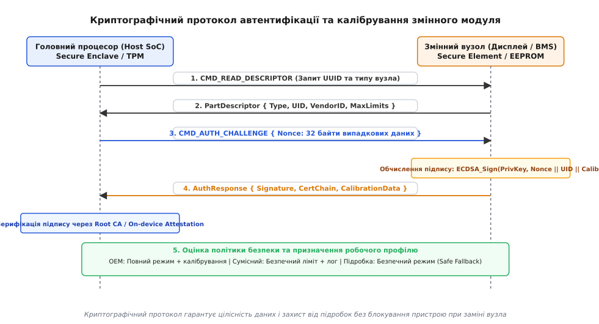
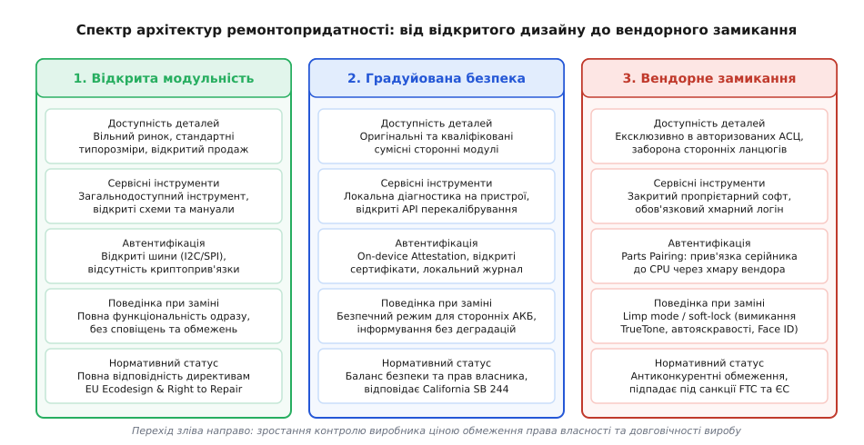

# Ремонт, право власника й межа замикання виробу

<preknowlist>
- [Захист і BMS](root:hw-power/bms) — багаторівневий захист хімічних джерел струму від перевантаження, короткого замикання та термічного розгону.
- [Декларація відповідності й технічний файл](root:sys-notary/deklaratsiia-vidpovidnosti-i-tekhnichnyi-fail) — формування пакета технічної документації та сертифікація відповідності безпеки.
- [GPLv3 проти підписаного завантажувача](root:sys-notary/gplv3-proty-pidpysanoho-zavantazhuvacha) — технічний контроль апаратного забезпечення проти прав користувача на модифікацію.
- [Нормативні вимоги до безпеки коду: CRA, RED 3.3](root:sys-notary/normatyvni-vymohy-do-bezpeky-kodu) — регуляторні стандарти кібербезпеки та захисту інтерфейсів радіообладнання.
- [Речовини й утилізація: RoHS, REACH, WEEE](root:sys-notary/rechovyny-i-utylizatsiia) — екологічні нормативи подовження життєвого циклу техніки та вторинної переробки.
</preknowlist>

Сервісний технік незалежної агромайстерні в розпал жнив замінює пошкоджений датчик тиску впорскування дизельного пального на комбайні вартістю пів мільйона доларів. Запчастина є абсолютно новою, оригінальною та виготовленою тим самим заводом Bosch, проте купленої не через ексклюзивного дилера техніки, а через дистриб'ютора запчастин загального призначення. Після фізичного підключення роз'єму та вмикання запалювання блок керування двигуном (Engine Control Unit, ECU) переходить у так званий аварійний режим (англ. *limp mode*): швидкість машини автоматично обмежується до 3 км/год, а привід молотильного барабана блокується. Двигун повністю справний, гідравлічні параметри перебувають в ідеальному діапазоні, але прилад відмовляється виконувати роботу доти, доки авторизований сервісний інженер не під'єднає службовий захищений ноутбук із хмарним цифровим сертифікатом та не виконає процедуру повторної криптографічної реєстрації серійного номера датчика в центральній базі даних виробника комбайна.

Аналогічний механізм блокування щодня спостерігають майстри з ремонту споживчої мікроелектроніки: після заміни розбитого дисплея або зношеного акумулятора на смартфон, навіть якщо донором виступає повністю оригінальний сусідній апарат того самого бренду, операційна система вимикає функцію автоматичного налаштування колірної температури TrueTone, блокує сенсори біометричної автентифікації Face ID або виводить незмивний банер «Невідома деталь» із забороною відображення залишкової ємності батареї. На стику схемотехніки, вбудованого програмного забезпечення та міжнародного права розгорнулася масштабна боротьба між правом власника розпоряджатися придбаною річчю — рухом за право на ремонт (англ. *Right to Repair*) — та інженерно-криптографічними засобами замикання виробів (англ. *Parts Pairing* або *serialized component lock*).

```
+───────────────────────────────────────────────────────────────────────────+
| ВЕНДОРНЕ ЗАМИКАННЯ ПРОТИ АВТОНОМНОГО РЕМОНТУ                              |
|                                                                           |
|    Виробник: Серійний номер дисплея X підписаний фабричним ключем K_oem  |
|                                                                           |
|    Заміна розбитого модуля на модуль Y з іншого оригінального смартфона:  |
|                                                                           |
|    [Материнська плата (SoC)] <=== I2C/SPI ===> [Дисплейний модуль Y]      |
|              │                                           │                |
|       Зчитує Serial(Y)                             Передає Serial(Y)      |
|              │                                                            |
|       Serial(Y) != Serial(X) в Secure Enclave                             |
|              │                                                            |
|       ПОТРІБЕН ДОСТУП ДО ХМАРИ ВЕНДОРА ДЛЯ ПЕРЕПІДПИСУ                    |
|       ├── Відхилено: Незалежна майстерня / Власник                        |
|       │     └──> Відключення TrueTone, автояскравості, виведення банера   |
|       └── Схвалено: Авторизований сервіс (AASP з корпоративним токеном)   |
|             └──> Відновлення заводського робочого профілю                 |
+───────────────────────────────────────────────────────────────────────────+
```

## Інженерна анатомія Parts Pairing: криптографічні ланцюги прив'язки

Прив'язка компонентів (англ. *Parts Pairing*, від лат. *par* — пара) — це архітектурна стратегія проєктування електронного виробу, за якої кожен змінний апаратний модуль пов'язується із центральним процесором унікальною криптографічною парою. Будь-яка фізична заміна вузла вимагає повторної авторизації через пропрієтарний софт виробника. З інженерної точки зору цей процес реалізується на трьох взаємопов'язаних рівнях: апаратному, протокольному та криптографічному.

### Апаратний рівень: ідентифікатори та мікросхеми захисту

Сучасний модуль (екран, батарея, камера, лідар, датчик тиску) перестав бути суто пасивним виконавчим вузлом. У конструкцію шлейфа чи друкованої плати модуля інтегрується спеціалізована мікроелектроніка:

1. **Одноразово програмована пам'ять (OTP / EEPROM):** На гнучкий друкований шлейф (FPC) модуля дисплея або блок камер монтується енергонезалежна мікросхема EEPROM (наприклад, сумісна з серією 24Cxx) або масив антиф'юзів (OTP ROM). Під час вихідного заводського тестування туди записується глобально унікальний серійний номер вузла (UID, довжиною 64 або 128 біт), дата виготовлення, код ревізії кремнію та індивідуальні калібрувальні коефіцієнти.
2. **Апаратні криптографічні автентифікатори (Secure Authenticator ICs):** У вузлах із підвищеними вимогами до безпеки (плати контролерів батарей BMS, модулі зчитування відбитків пальців) встановлюються спеціалізовані крипточипи (наприклад, серій Microchip ATECC608, NXP EdgeLock SE050, STMicroelectronics STSAFE-A110 або Analog Devices MAX368xx). Такий чіп містить:
   - Апаратно захищене сховище ключів із металевим екрануванням, сенсорами розкриття корпуса та захистом від перепадів напруги живлення (англ. *tamper detection*).
   - Вбудований апаратний генератор справді випадкових чисел (True Random Number Generator, TRNG), що базується на тепловому шумі p-n переходів.
   - Апаратні криптографічні акселератори для симетричного алгоритму SHA-256 (обчислення HMAC) та асиметричної криптографії на еліптичних кривих ECDSA (криві NIST P-256 / secp256r1 або Brainpool BP256).
3. **Захищений анклав центрального процесора (Secure Enclave / TPM / HSM):** Головний процесор пристрою (Application Processor SoC або мікроконтролер) має апаратно ізольований домен безпеки з власною захищеною оперативною пам'яттю (SRAM) та внутрішнім масковим ROM. У момент першого вмикання на складальному конвеєрі таблиця серійних номерів усіх підключених модулів підписується внутрішнім кореневим ключем пристрою і записується в масив енергонезалежних електронних запобіжників (eFuse).

### Фізичні шини зв'язку та низькорівневі протоколи обміну

Зв'язок між головним процесором і змінними модулями здійснюється через низькорівневі послідовні шини:
- **I2C / SMBus (System Management Bus):** Застосовується для дисплеїв, камер та датчиків оточення на швидкостях Standard Mode (100 кбіт/с), Fast Mode (400 кбіт/с) або Fast Mode Plus (1 Мбіт/с).
- **1-Wire / HDQ (Texas Instruments):** Однопровідні шини, що використовуються в знімних акумуляторних батареях (наприклад, у контролерах BMS на базі TI BQ27z561 чи Maxim MAX17201). Дозволяють опитувати стан комірок, температуру та ідентифікаційний чіп через єдиний сигнальний контакт роз'єму.
- **SPMI (MIPI System Power Management Interface):** Високошвидкісна двопровідна шина (до 26 МГц) для керування інтегральними мікросхемами живлення (PMIC), зарядними пристроями та датчиками живлення.

### Протокольний рівень: процедура Challenge-Response

Звичайне статичне зчитування серійного номера по шині легко підробляється. Зловмисник або незалежна майстерня можуть впаяти в розрив шини мікроконтролер-перехоплювач (англ. *interposer board* або *modchip*), який емулює відповідь оригінального серійника. Щоб унеможливити таку підміну, виробники застосовують протокол криптографічного виклику та відповіді (англ. *challenge-response authentication*):

1. **Генерація виклику хостом:** Після подачі живлення Secure Enclave головного процесора генерує псевдовипадковий виклик — `Nonce` (англ. *number used once*) довжиною 256 біт (32 байти), використовуючи власний апаратний TRNG.
2. **Передача виклику модулю:** Хост надсилає команду `CMD_AUTH_CHALLENGE` разом із блоком `Nonce` на адресу крипточіпа змінного модуля по шині I2C/SPI.
3. **Обчислення криптографічного відгуку:** Внутрішній криптографічний співпроцесор змінного модуля отримує `Nonce` і за допомогою закритого фабричного ключа `K_priv`, зашитого в захищеній пам'яті чіпа, обчислює цифровий підпис:

```
Digest = SHA256(Nonce || Part_UID || Calibration_Checksum)
Signature = ECDSA_Sign(K_priv, Digest)
```

4. **Відправка результату:** Модуль надсилає назад на хост сформований 64-байтний цифровий підпис `Signature` (пара чисел `r` та `s` по 32 байти кожне) та ланцюжок сертифікатів X.509, що пов'язує відкритий ключ модуля `K_pub` із кореневим центром сертифікації (Root CA) виробника.
5. **Верифікація на хості:** Secure Enclave перевіряє дійсність сертифіката модуля, після чого верифікує підпис:

```
Verify_Result = ECDSA_Verify(K_pub, Digest, Signature)
```

Якщо `Verify_Result` повертає помилку або серійний номер `Part_UID` не збігається з прив'язаним у пам'яті eFuse, апарат фіксує неавторизовану заміну вузла.


*Послідовність криптографічного рукостискання між головним процесором і змінним вузлом із локальною перевіркою підпису.*

## Апаратні атаки та спроби обходу прив'язки

Протистояння між виробниками та незалежними майстернями породило цілу індустрію апаратного реверс-інжинірингу та інструментів модифікації:

1. **Перепаювання оригінальних мікросхем (Chip Transplant):** Найпоширеніша практика в незалежних сервісних центрах полягає в тому, що майстер за допомогою прецизійної термоповітряної паяльної станції або мікрофрезера спилює фабричний чіп безпеки з розбитого оригінального екрана чи зношеної батареї та перепаює його на новий сторонній модуль. Головна плата бачить «рідний» серійний номер і не вмикає блокування, проте процедура вимагає ювелірної мікропайки під мікроскопом і несе ризик термічного пошкодження компонентів.
2. **Проміжні шлейфи-емулятори (Tag-on Flex & Interposer Boards):** Для акумуляторів розробляються проміжні плати, які підключаються між новим акумулятором і материнською платою. Емулятор перехоплює команди шини SMBus / HDQ, відповідаючи фабричними ідентифікаторами та скидаючи лічильник циклів заряду (Cycle Count) до нуля. Проте це не вирішує проблему безпеки: якщо сам літієвий пакет неякісний, скидання лічильника лише маскує деградацію, збільшуючи ризик займання.
3. **Атаки впровадження збоїв (Fault Injection & Glitch Attacks):** У дослідницьких лабораторіях для обходу перевірки підписів застосовують ін'єкцію короткочасних провалів напруги живлення (Voltage Glitching) або лазерні імпульси (Laser Fault Injection, LFI) в момент виконання інструкції порівняння `CMP` або перевірки статусу `BEQ/BNE` у завантажувальному ROM. Сучасні Secure Elements містять внутрішні компаратори напруги та схеми виявлення глітчів, що негайно ініціюють скидання мікроконтролера при виявленні аномалій живлення.

## Внутрішній стан батарейних контролерів (Fuel Gauge IC) та системна діагностика

Для глибокого розуміння механізмів автентифікації акумуляторів необхідно розглянути внутрішній устрій сучасних паливних контролерів (Fuel Gauge ICs, таких як Texas Instruments bq27z561 або Maxim MAX17201 / MAX17320):

- **Алгоритм відстеження імпедансу (Impedance Track):** Контролер не просто рахує віддані міліампер-години за методом кулонівського підрахунку (Coulomb Counting), а постійно вимірює внутрішній динамічний опір хімічної комірки:

```
R_cell = ΔV / ΔI      [визначення внутрішнього імпедансу комірки під навантаженням]
```

При старінні акумулятора внутрішній імпеданс зростає. На основі таблиць хімічного профілю (ChemID), збережених у захищеному образі Flash-пам'яті (`.dfi` образ), контролер оновлює параметри повної доступної ємності (Full Charge Capacity, FCC) та обчислює дійсний відсоток здоров'я:

```
SoH = (FCC_actual / Design_Capacity) · 100%      [розрахунок відсотка залишкової ємності]
```

- **Програмний шар ядра ОС (Linux / Android Subsystem):** Драйвер батареї (наприклад, драйвер ядра `drivers/power/supply/bq27xxx_battery.c`) транслює отримані по шині I2C дані у стандартну підсистему ядра `sysfs` за адресою `/sys/class/power_supply/battery/`:
  - `uevent` — системні події зміни статусу підключення та зарядки;
  - `health` — статус безпеки («Good», «Overheat», «Dead», «Over voltage», «Unspecified failure»);
  - `charge_type` — поточний режим («Fast», «Taper», «Trickle»);
  - `cycle_count` — кількість повних циклів перезаряду;
  - `capacity` — поточний відсоток заряду (State of Charge, SoC).

Якщо системна служба безпеки (наприклад, `android.hardware.health-service` або пропрієтарний сервісний демон) фіксує відсутність валідного криптографічного підпису чіпа BMS, вона записує в системний атрибут `health` значення `UNKNOWN` або `UNAUTHENTICATED`. Після цього інтерфейс користувача блокує графік деградації батареї, а контролер PMIC перемикається на аналоговий захисний профіль.

## Калібрувальні матриці як прихований важіль блокування

Окрім прямої перевірки серійного номера, ще потужнішим інженерним інструментом замикання стало управління індивідуальними калібрувальними даними.

Сучасні високотехнологічні кремнієві та оптичні компоненти мають значний розкид характеристик через фізичні допуски літографічного процесу:
- **OLED та MicroLED дисплеї:** Кожна виготовлена скляна панель має мікроскопічні коливання ефективності органічних люмінофорів. Для компенсації неоднорідності яскравості виробник генерує карту субпіксельної корекції (англ. *De-Mura calibration data*), а також розраховує індивідуальні матриці перетворення колірного простору для досягнення цільової точки білого D65.
- **CMOS-сенсори камер та оптична стабілізація (OIS):** Приводи звукових котушок (Voice Coil Motor, VCM) лінз мають нелінійну залежність зміщення від струму котушки та індивідуальний гістерезис. Сенсор камери потребує корекції затемнення по краях лінзи (Lens Shading Correction, LSC) та карти гарячих пікселів.
- **Модулі проєкції структурованого світла (Face ID / LiDAR):** Лазерні матриці вертикального випромінювання (VCSEL) вимагають точного геометричного узгодження з інфрачервоною камерою. Помилка позиціонування в кілька мікрометрів без програмної матриці компенсації кутів робить розпізнавання обличчя неможливим.

Виробник записує ці калібрувальні таблиці під час виробництва пристрою на спеціальних оптичних стендах, шифрує їх і прив'язує до `UID` материнської плати. При заміні розбитого екрана на оригінальний екран від іншого такого ж смартфона система відмовляється активувати функції TrueTone, Night Shift або автояскравість не тому, що екран несправний, а тому, що операційна система відмовляється завантажити чужу або непідписану калібрувальну матрицю без авторизованого перепідпису на сервері виробника.

```
+───────────────────────────────────────────────────────────────────────────+
| МАТРИЦЯ КАЛІБРУВАННЯ ТА БЕЗПЕКА ВУЗЛА                                     |
|                                                                           |
| [Оригінальний донорський модуль] ──> Передає: [Сирі калібрувальні дані]   |
|                                                     │                     |
|                                                     ▼                     |
| [Головна плата (SoC)] ─────────────> Перевірка цифрового підпису даних    |
|                                                     │                     |
|         ┌───────────────────────────────────────────┴──────────┐          |
|         ▼                                                      ▼          |
| [Підпис відсутній / Невірний]                       [Підпис підтверджено] |
|         │                                                      │          |
|         ▼                                                      ▼          |
| ВЕНДОРНИЙ LOCK-IN:                                  ВІДКРИТИЙ ДИЗАЙН:     |
| • Вимкнення TrueTone / Камери                       • Локальна адаптація  |
| • Штучний банер помилки                             • Застосування даних  |
| • Limp Mode (агротехніка)                           • Збереження функцій  |
+───────────────────────────────────────────────────────────────────────────+
```

## Спектр технічних обмежень: від інформування до окірпичування

За рівнем агресивності реакції вбудованого програмного забезпечення на неавторизовану заміну деталі виділяють чотири градації (див. графік спектра замикання):

1. **Інформаційне попередження (Advisory Notification):** Пристрій повністю зберігає функціональність, але в меню налаштувань виводиться постійне системне повідомлення: «Не вдалося перевірити автентичність деталі». Це повідомлення не заважає роботі, проте суттєво знижує ринкову вартість апарата при перепродажу на вторинному ринку.
2. **Функціональна деградація (Soft-Locking):** Базові операції залишаються доступними, але примусово вимикаються додаткові споживчі можливості:
   - Обмеження максимальної яскравості дисплея або примусове зниження частоти оновлення матриці з 120 Гц до 60 Гц.
   - Відключення алгоритмів постобробки фотографій (кінематографічний режим, портретна зйомка) при сторонній заміні камери.
   - Обмеження потужності швидкої зарядки акумулятора: контролер живлення (PMIC) примусово скидає струм до базових 5 Вт (5В / 1А), відключаючи протоколи USB-PD або фірмові високовольтні режими зарядки.
   - Заборона зчитування лічильника циклів заряду та розрахунку залишкового здоров'я акумулятора (State of Health, SoH).
3. **Критичне відключення підсистем (Subsystem Disabling):** Повне програмне знеструмлення вузла, наприклад блокування сканера відбитків пальців чи системи Face ID, навіть якщо фізично встановлений модуль є повністю робочим.
4. **Аварійне блокування або перетворення на цеглину (Hard-Lock / Bricking / Limp Mode):** Повна відмова пристрою виконувати основні задачі. В агротехніці комбайн чи трактор блокує хід; у медичній техніці діагностичний апарат УЗД відмовляється запускати зонд; у споживчій техніці смарт-годинник або планшет зависає на екрані відновлення з вимогою підключення до сервісного термінала.


*Спектр інженерних рішень ремонтопридатності: від вільної модульності до вендорного криптографічного замикання.*

## Межа між інженерною безпекою та комерційною монополізацією

Найважливіше інженерне та правове питання полягає в розмежуванні: де закінчується необхідний захист життя, здоров'я та конфіденційності користувача і де починається штучне антиконкурентне блокування незалежного ринку сервісних послуг?

### Обґрунтований захист безпеки

Існують критичні підсистеми, де автентифікація вузлів є безальтернативною вимогою безпеки:

1. **Літієві акумулятори високої енергетичної щільності:** Як детально розглянуто в інженерному огляді [🔋 сертифікація та небезпека батарей у виробі](root:sys-notary/batareia-u-vyrobi), сучасні літій-іонні комірки мають питому енергію до 280 Вт·год/кг та містять легкозаймистий органічний електроліт. Якщо некваліфікований ремонтник встановить контрафактну батарею без внутрішнього струмового запобіжника PTC, без захисного клапана тиску (Current Interrupt Device, CID) та з бракованим датчиком температури NTC, спроба зарядити такий елемент швидким струмом 4–6 А неминуче призведе до теплового розгону (англ. *thermal runaway*) з викидом полум'я температурою понад +800 °C. Переведення пристрою в консервативний режим повільної зарядки для неперевіреної батареї є повністю виправданим заходом захисту від пожежі.
2. **Біометричні модулі автентифікації:** Сенсори відбитків пальців та матриці Face ID мають прямий доступ до системного сховища паролів, ключів шифрування диска та банківських систем. Якщо зв'язок між сенсором і Secure Enclave не захищений взаємною криптографічною автентифікацією, зловмисник, викравши пристрій, може фізично зняти екран, під'єднати апаратний логічний аналізатор або емулятор шини та надіслати підроблений сигнал «Біометрію підтверджено», обійшовши захист апарата.
3. **Функціональна безпека транспорту та медичної техніки:** У системах електронного гальмування автомобіля (Brake-by-Wire), контролерах керма або апаратах гемодіалізу встановлення сторонніх датчиків без суворої верифікації метрологічних характеристик несе пряму загрозу життю людей.

### Штучне монопольне замикання (Vendor Lock-in)

Проте на практиці виробники часто зловживають криптографічними механізмами для створення штучної монополії:
- **Блокування пасивних компонентів:** Програмна прив'язка роз'ємів зарядки USB-C, механічних кнопок регулювання гучності, моторчиків вібровідгуку або задніх скляних панелей, які не містять мікроконтролерів і не впливають на цифрову безпеку системи.
- **Заборона донорського ремонту (Genuine-to-Genuine Lockout):** Блокування функцій при перестановці повністю оригінальних, справних деталей між двома новими пристроями одного виробника.
- **Хмарна прив'язка (Cloud Tethering):** Вимога обов'язкового зв'язку з хмарними серверами виробника через корпоративний обліковий запис сервісного центру для виконання будь-якої процедури калібрування. Якщо через 5–7 років вендор припиняє підтримку моделі та вимикає хмарний сервіс активації, повністю справний виріб позбавляється можливості ремонту і перетворюється на електронне сміття.

> 🔧 **Навіщо це в реальній розробці.**
> Архітектор вбудованої системи повинен знати вимоги законодавства про право на ремонт (EU Ecodesign, California SB 244). Замість жорсткого блокування пристрою при заміні вузла («Limp mode» або перетворення на цеглину) проєктують безпечний адаптивний режим (Graceful Fallback). Якщо модуль не пройшов атестацію, пристрій обмежує критичні параметри (наприклад, струм заряду до 1.5 А замість 4.5 А та моніторинг температури через прямий АЦП), зберігаючи базову працездатність та повідомляючи користувача без примусового вимкнення функцій.

## Правовий ландшафт: Директиви ЄС та закони США

Масове невдоволення споживачів, фермерів, незалежних ремонтних асоціацій та екологічних організацій призвело до ухвалення пакетів законів, які встановлюють суворі межі допустимого замикання техніки.

### Регуляторна база Європейського Союзу

Європейський Союз інтегрував вимоги ремонтопридатності в загальну екологічну політику циркулярної економіки та скорочення відходів електронного обладнання (WEEE):

1. **Регламент щодо батарей (EU Battery Regulation 2023/1542):** Імперативно зобов'язує виробників проєктувати всю споживчу електроніку так, щоб до 2027 року будь-який користувач міг самостійно демонтувати та замінити акумулятор за допомогою стандартних викруток (Torx, Phillips) без нагрівання корпусу промисловим феном чи розчинення клею агресивною хімією.
2. **Директива Ecodesign для смартфонів і планшетів (EU 2023/1670 та 2023/1669):**
   - Встановлює обов'язок постачати оригінальні запчастини (дисплеї, акумулятори, камери, роз'єми, динаміки) протягом щонайменше `7 років` після завершення продажів моделі на ринку ЄС.
   - Термін доставки запчастини незалежній майстерні не повинен перевищувати 5 робочих днів.
   - **Пряма заборона зловживання Parts Pairing:** Виробникам заборонено використовувати програмні чи криптографічні бар'єри, які дискримінують сторонні майстерні, блокують функції пристрою при встановленні якісних сумісних або донорських деталей чи примусово погіршують якість роботи екрана чи камери.
   - Обов'язкова публікація індексу ремонтопридатності (Repairability Index від 1 до 10) на упаковці товару.
3. **Директива Right to Repair (EU 2024/1799):** Зобов'язує виробників надавати публічний доступ до сервісних інструкцій, електричних принципових схем, діагностичного софту та оновлень мікропрограм за справедливими та недискримінаційними цінами.

### Законодавство Сполучених Штатів Америки

У США рух Right to Repair здобув перемогу як на рівні штатів, так і на рівні федеральних регуляторів:
- **Закон штату Каліфорнія (California Right to Repair Act, SB 244):** Найбільш прогресивний закон, що набув чинності у 2024 році. Він вимагає від виробників техніки вартістю понад 100 доларів надавати документацію, деталі та сервісні утиліти протягом 7 років, а також прямо забороняє виробникам деградувати функції пристрою за допомогою криптографічного спаровування деталей.
- **Закони штатів Міннесота та Нью-Йорк (Digital Fair Repair Act):** Зобов'язали OEM-виробників забезпечити публічний продаж спеціалізованих діагностичних інструментів та прошивок на тих самих умовах, що й для авторизованих дилерів.
- **Федеральна торгова комісія США (FTC) та звіт «Nixing the Fix»:** FTC посилила антимонопольне переслідування практик штучного нав'язування сервісу (англ. *tying arrangements*) за Законом про гарантії Магнусона-Мосса (англ. *Magnuson-Moss Warranty Act*). Наклейки «Гарантію анульовано у разі пошкодження пломби» (англ. *Warranty void if removed*) визнано незаконними та такими, що вводять споживача в оману.

Детальні вимоги до складання технічного файла та декларації відповідності для європейського та американського ринків описані у статті [📋 декларація відповідності й технічний файл](root:sys-notary/deklaratsiia-vidpovidnosti-i-tekhnichnyi-fail).

## Архітектура ремонтопридатної системи з градуйованою довірою

Для створення безпечного, але відкритого виробу інженер використовує чотири фундаментальні архітектурні принципи:

```
+───────────────────────────────────────────────────────────────────────────+
| ПРИНЦИПИ ПРОЄКТУВАННЯ РЕМОНТОПРИДАТНИХ БЕЗПЕЧНИХ СИСТЕМ                  |
|                                                                           |
| 1. Автономна локальна атестація (On-Device Local Attestation)             |
|    └── Верифікація через відкриті сертифікати без доступу до хмари вендора|
|                                                                           |
| 2. Градуйована політика довіри (Tiered Trust & Graceful Fallback)         |
|    ├── OEM модуль: Повний режим + високоточне калібрування                |
|    └── Generic сумісний: Безпечний лімітований режим + інформаційний лог  |
|                                                                           |
| 3. Відкриті діагностичні сервісні інтерфейси                              |
|    └── Вбудоване меню самокалібрування через відкритий API / UART / BLE   |
|                                                                           |
| 4. Локальний криптографічний журнал замін (Part Replacement Ledger)       |
|    └── Незмінний журнал у Flash для прозорої оцінки гарантії              |
+───────────────────────────────────────────────────────────────────────────+
```

1. **Автономна локальна атестація (On-Device Local Attestation):** Верифікація сертифікатів вузлів здійснюється локально головним процесором за допомогою відкритої структури сертифікатів X.509 без обов'язкового інтернет-з'єднання з хмарними серверами виробника.
2. **Градуйована безпека (Graceful Fallback State Machine):** Замість блокування пристрою при виявленні непідписаного або стороннього модуля система перемикається у безпечний захисний профіль:
   - Неавторизований акумулятор заряджається струмом 1.0–1.5 А замість 4.5 А під контролем зовнішнього терморезистора NTC.
   - Неавторизований дисплей працює на базовій частоті 60 Гц зі стандартною гамма-кривою sRGB.
3. **Локальний журнал життєвого циклу деталей (Part Replacement Ledger):** У виділеному секторі захищеної Flash-пам'яті ведеться журнал замін, захищений контрольною сумою та підписом. Кожен запис містить мітку часу, ідентифікатор типу вузла, його серійний номер та присвоєний рівень довіри. Це забезпечує прозору діагностику гарантійних випадків без штучного блокування виробу.
4. **Вбудовані процедури самостійного калібрування:** Надання користувачеві чи техніку можливості ініціювати процедуру повторного калібрування сенсорів (наприклад, оптичного вирівнювання чи калібрування нульового зміщення акселерометра) безпосередньо через екранне сервісне меню або відкритий локальний протокол (UART / USB / BLE).

## Економічні наслідки та повна вартість володіння (TCO)

Впровадження криптографічних замків безпосередньо впливає на сукупну вартість володіння пристроєм (Total Cost of Ownership, TCO) для кінцевого користувача та корпоративних парків техніки:
- **Штучна інфляція вартості сервісу:** Монополізація ринку запчастин підвищує середню вартість заміни екрана або батареї на 40–70% у порівнянні з конкурентним ринком відкритих компонентів.
- **Скорочення терміну корисної експлуатації:** Коли вартість офіційного ремонту перевищує 50% залишкової вартості вживаного пристрою, споживач відмовляється від відновлення, купуючи новий виріб. Це призводить до щорічного утворення понад 50 мільйонів тонн електронного сміття у світі.
- **Вимоги Digital Product Passport (DPP):** Згідно з новим регламентом ЄС про екодизайн для стійких продуктів (ESPR), кожен електронний виріб отримує цифровий паспорт продукту. Паспорт фіксує доступність запчастин, інструкції з розбирання та оцінку ремонтопридатності, роблячи компанії із закритими системами неконкурентоспроможними під час державних закупівель.

Повний інженерний розбір модуля автентифікації, перевірки підписів та журналу замін компонентів наведено у практичній вставці [⚙️ модуль автентифікації та калібрування змінних апаратних вузлів](root:sys-notary/remont-pravo-vlasnyka-i-mezha-zamykannia-vyrobu/proj-part-pairing-auth.md).

## Інженерний приклад: модуль перевірки та керування політикою довіри

Нижче наведено практичну реалізацію підсистеми управління довірою компонентів на мовах C99 та C++20. Код виконує верифікацію цифрового підпису модуля, оцінює рівень довіри, фіксує подію в енергонезалежному журналі та налаштовує безпечну політику живлення без аварійного блокування пристрою.

:::tabs
:::code remont-pravo-vlasnyka-i-mezha-zamykannia-vyrobu-d/c/main.c
:::code remont-pravo-vlasnyka-i-mezha-zamykannia-vyrobu-d/cpp/main.cpp
:::

Право власності на фізичний виріб передбачає невіддільне право на володіння, використання, дослідження та ремонт. Спроби перетворити апаратний пристрій на штучно замкнену підписну послугу через криптографічну прив'язку компонентів зазнають системного регуляторного та ринкового тиску. Проєктування надійних систем вимагає відмови від бінарної логіки «авторизований оригінал або цеглина» на користь модульної безпеки, локальної автономної атестації та збереження працездатності виробу в руках його законного власника.
