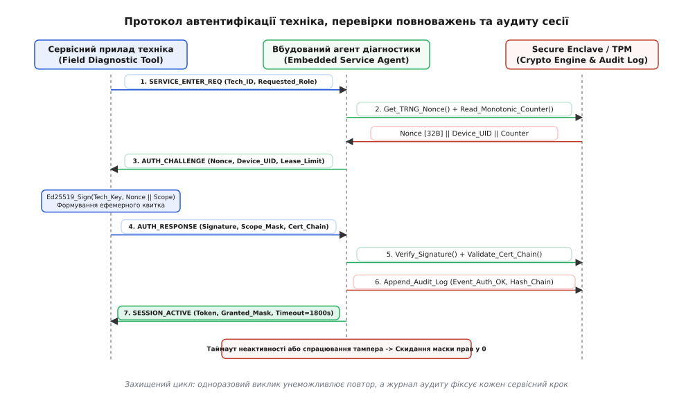
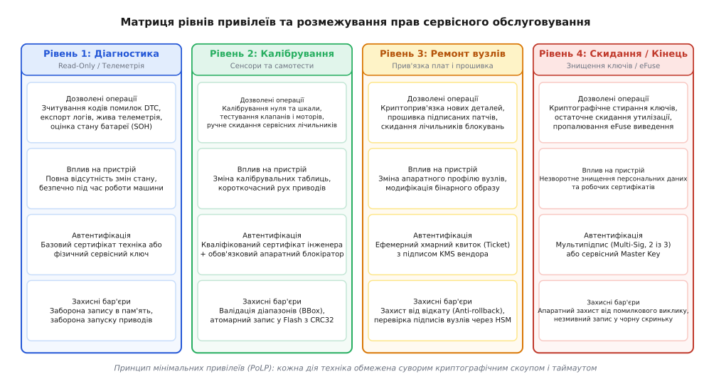

# Сервісний режим і діагностика в руках техніка

<preknowlist>
- [Ремонт, право власника й межа замикання виробу](root:sys-notary/remont-pravo-vlasnyka-i-mezha-zamykannia-vyrobu) — баланс безпеки, вендорного контролю та автономного ремонту обладнання.
- [Нормативні вимоги до безпеки коду: CRA, RED 3.3](root:sys-notary/normatyvni-vymohy-do-bezpeky-kodu) — вимоги до захисту інтерфейсів технічного обслуговування та криптографічного контролю.
- [Декларація відповідності й технічний файл](root:sys-notary/deklaratsiia-vidpovidnosti-i-tekhnichnyi-fail) — регламенти документації сервісних процедур та підтвердження безпеки експлуатації.
- [GPLv3 проти підписаного завантажувача](root:sys-notary/gplv3-proty-pidpysanoho-zavantazhuvacha) — межі апаратного контролю та захисту ключів під час модифікації коду.
- [Entitlements / feature-gating за планом](root:sys-notary/entitlements) — механізми динамічного розмежування повноважень та активації функцій.
</preknowlist>

Сервісний інженер прибуває на компресорну станцію магістрального газопроводу для планового калібрування триканального оптичного газоаналізатора та блоку керування електромагнітними клапанами аварійного скидання. Пристрій працює під керуванням двох мікроконтролерів класу ARM Cortex-M7 з дубльованою архітектурою 1oo2D (англ. *1 out of 2 with Diagnostics*), має сертифікат функціональної безпеки SIL 3 за стандартом IEC 61508 і безперервно передає поточні технологічні параметри в диспетчерську мережу через протокол Modbus TCP. Для підтвердження метрологічної точності сенсорів технік під'єднує захищений польовий планшет до технологічного роз'єму M12 на бічній панелі приладу. Інтерфейс користувача та звичайні SCADA-пакети дозволяють лише пасивно зчитувати концентрацію газу та статус працездатності, тоді як для введення нових нульових точок і коефіцієнтів підсилення АЦП прилад необхідно перевести у спеціальний стан — сервісний режим (англ. *Service Mode* або *Engineering Diagnostic Mode*).

Якщо цей режим реалізовано примітивно — через фіксований майстер-пароль, статичний PIN-код, відкритий діагностичний порт UART або залишений у прошивці інтерфейс налагодження JTAG/SWD — пристрій стає вразливим до повної компрометації. Зловмисник, отримавши фізичний доступ до роз'єму на кілька хвилин або витягнувши статичний пароль із бінарного образу оновлення, здатний підмінити калібрувальні константи, перепрошити модуль шкідливим кодом, зняти захисні блокування або викрасти закриті ключі шифрування зв'язку. Навпаки, надмірне замикання сервісного режиму з обов'язковою онлайн-автентифікацією через хмару виробника робить неможливим екстрений ремонт на віддалених об'єктах за відсутності стільникового покриття. Інженерія сервісного режиму вимагає суворого математичного та криптографічного балансу: надійного розмежування прав техніка на основі криптографії виклику-відповіді, захисту від повторного відтворення сесій, апаратної ізоляції секретів та незмінного аудиту кожної виконаної операції.

```
+───────────────────────────────────────────────────────────────────────────+
| АРХІТЕКТУРА БЕЗПЕЧНОГО СЕРВІСНОГО РЕЖИМУ ТА КРИПТОГРАФІЧНОГО АУДИТУ       |
|                                                                           |
|    [Польовий прилад техніка]                  [Цільовий контролер (MCU)]  |
|               │                                            │              |
|        1. Запит входу ──────── SERVICE_ENTER_REQ ─────────>│              |
|               │                                            │ (Генерація   |
|               │<────── AUTH_CHALLENGE (Nonce [32B]) ───────│  TRNG Nonce) |
|        (Підпис Nonce                  │                    │              |
|         ключем Ed25519)               │                    │              |
|               │                                            │              |
|        2. Відгук ───────────── AUTH_RESPONSE ─────────────>│              |
|           з квитком (Cert || Scope_Mask || Signature)      │ (Верифікація |
|               │                                            │  підпису)    |
|               │<────── SESSION_ACTIVE (Timeout=1800s) ─────│              |
|               │                                            │ (Старт таймера|
|        3. Калібрування ─────── CMD_CALIBRATE_ZERO ────────>│  та аудит)   |
|               │                                            │              |
|               │                                    [Secure Enclave]       |
|               │                                            │              |
|               │                                    Append_Audit_Log()     |
|               │                                    H_i = SHA256(H_prev||E)|
+───────────────────────────────────────────────────────────────────────────+
```

## Анатомія сервісного режиму: архітектура станів та інтерфейси зв'язку

Сервісний режим (від лат. *servitium* — служіння та *modus* — міра, спосіб) — це детермінований стан вбудованої системи, у якому штатні алгоритми управління технологічним процесом тимчасово переводяться в безпечну конфігурацію, а оператору з підтвердженими правами надається доступ до низькорівневих діагностичних функцій, конфігураційних регістрів, калібрувальних коефіцієнтів та процедур тестування виконавчих механізмів.

### Автомат станів сервісного режиму (FSM)

Переведення промислового або вбудованого контролера в сервісний стан не може бути миттєвим перемиканням прапорця в пам'яті. Це керований перехід кінцевого автомата (Finite State Machine, FSM), що вимагає перевірки комплексу умов безпеки (англ. *safety interlocks*):

1. **Штатний режим (Operational / Normal Mode):** Усі виконавчі приводи підпорядковані основному алгоритму керування. Сенсорні опитування відбуваються з фіксованою дискретністю за таймером, діють усі ліміти захисту та аварійного зупину. Діагностичний інтерфейс працює суто в пасивному режимі моніторингу: дозволено лише читання стандартних кодів несправностей (Diagnostic Trouble Codes, DTC) та поточної телеметрії.
2. **Перехідний стан узгодження (Pre-Service Standby):** Отримавши запит на вхід у сервісний режим, контролер перевіряє фізичні критерії готовності. Наприклад, для верстата з ЧПК чи безпілотного апарата це нульова швидкість обертання двигунів, відсутність тиску в гідравлічній магістралі, замкнений контакт фізичного кінцевого вимикача сервісних дверей або наявність апаратної перемички (англ. *service jumper*). Якщо хоча б один параметр безпеки порушено, запит блокується з генерацією помилки `ERR_SAFETY_INTERLOCK_ACTIVE`.
3. **Авторизований сервісний режим (Authenticated Service Mode):** Після успішного проходження криптографічної автентифікації контролер формує ефемерну сесію. Виконавчі контури переводяться у так званий безпечний стан за замовчуванням (англ. *fail-safe default state*): реле нагрівачів знеструмлюються, клапани високого тиску повертаються в положення закриття під дією зворотних пружин. Сервісному агенту дозволяється викликати специфічні обробники команд у межах наданої маски привілеїв.
4. **Режим прямого керування приводами (Actuator Override Test):** Окремий підрежим підвищеної небезпеки, у якому технік може вручну подавати імпульси на крокові двигуни, відкривати соленоїди або запускати вентилятори для перевірки реакції каналів. Цей стан захищається так званою «кнопкою пильності» або механізмом мертвої руки (англ. *dead-man's switch* / *keep-alive heartbeat*): якщо сервісний прилад не надсилає пінґ-пакет щосекунди, шим-генератори негайно вимикаються.
5. **Заблокований стан (Lockout / Tamper State):** Активується в разі виявлення трьох поспіль помилок автентифікації, спроби ін'єкції збоїв у живлення, невідповідності цифрового підпису або розриву ланцюга датчика розкриття корпусу. Контролер анулює активні ключі сесії, виставляє прапорець апаратного блокування в пам'яті eFuse і вимагає обов'язкового перезавантаження або авторизації майстер-ключем заводу-виробника.

```
       ┌─────────────────────────────────────────────────────────┐
       │                 ШТАТНИЙ РЕЖИМ (OPERATIONAL)             │
       │     - Читання DTC, пасивна телеметрія                   │
       │     - Повний захист безпеки, виконавчі контури активні  │
       └────────────────────────────┬────────────────────────────┘
                                    │ Запит на вхід (SERVICE_ENTER_REQ)
                                    ▼
       ┌─────────────────────────────────────────────────────────┐
       │             ПЕРЕХІДНИЙ СТАН (PRE-SERVICE STANDBY)        │
       │     - Перевірка нульової швидкості, тиску, інтерлоків   │
       │     - Безпечна зупинка технологічного процесу           │
       └────────────────────────────┬────────────────────────────┘
                                    │ Успішний Challenge-Response (Ed25519)
                                    ▼
       ┌─────────────────────────────────────────────────────────┐
       │           АВТОРИЗОВАНИЙ СЕРВІСНИЙ РЕЖИМ                 │
       │     - Ефемерний токен сесії, таймаут (1800 с)           │
       │     - Калібрування сенсорів, читання EEPROM, діагностика│
       └──────────────┬───────────────────────────┬──────────────┘
                      │                           │
  Команда тестування  │                           │ Закінчення таймауту /
  приводів (Override) │                           │ Помилка перевірки / Тампер
                      ▼                           ▼
       ┌──────────────────────────┐   ┌──────────────────────────┐
       │ РЕЖИМ ТЕСТУВАННЯ         │   │ ЗАБЛОКОВАНИЙ СТАН        │
       │ - Dead-man heartbeat     │   │ - Анулювання ключів      │
       │ - Ручний рух моторів     │   │ - eFuse / Скидання в нуль│
       └──────────────────────────┘   └──────────────────────────┘
```

### Фізичні інтерфейси та низькорівневі протоколи обміну

Транспортування сервісних команд вимагає надійного канального та мережевого рівнів, оптимізованих під конкретне апаратне середовище:

- **Послідовний інтерфейс UART / RS-485 із бінарним кодуванням COBS:** На польових датчиках та лінійних контролерах передача відкритим текстом (наприклад, текстовими AT-командами) неприпустима через високу чутливість до електромагнітних завад та низьку швидкість. Застосовується бінарне обрамлення Consistent Overhead Byte Stuffing (COBS). Алгоритм усуває нульові байти (`0x00`) з тіла повідомлення, залишаючи нуль виключно як унікальний маркер початку та кінця кадру. Завдяки цьому прийомний автомат контролера миттєво синхронізується навіть у разі підключення кабелю посеред сеансу передачі.
- **Шина CAN / CAN-FD та стандарт діагностики UDS (ISO 14229 / ISO 15765-2):** В автомобільній, авіаційній та важкій промисловій техніці сервісний доступ уніфіковано в рамках протоколу Unified Diagnostic Services (UDS). Процедура відкриття сервісного режиму використовує суворо регламентований ланцюжок сервісів:
  1. `DiagnosticSessionControl (0x10)` — переводить контролер у сесію розширеної діагностики (`sub-function 0x03`) або програмування (`sub-function 0x02`).
  2. `SecurityAccess (0x27)` — реалізує протокол Seed-Key: пристрій надсилає виклик `requestSeed (sub-function 0x01/0x03/0x05)`, а тестер повертає криптографічний відгук `sendKey (sub-function 0x02/0x04/0x06)`.
  3. `RoutineControl (0x31)` — запускає внутрішні алгоритми самодіагностики, тестування цілісності Flash або калібрувальні цикли.
  4. `WriteDataByIdentifier (0x2E)` — виконує запис нових калібрувальних коефіцієнтів та оновлених конфігураційних блоків за 16-бітним ідентифікатором DID (Data Identifier).
  5. `RequestDownload (0x34)` та `TransferData (0x36)` — організовують блокову передачу бінарних образів оновлення з контролем контрольних сум та підтвердженням закриття сеансу через `RequestTransferExit (0x37)`.
- **Діагностика через мережу Ethernet (DoIP, ISO 13400):** Для модулів високої складності (центральних обчислювальних шлюзів, польотних контролерів, радарів) передача ведеться через протокол Diagnostic over IP. DoIP працює поверх стека TCP/IP (порт 13400) і підтримує автоматичне виявлення пристроїв у підмережі через UDP-широкомовні пакети (Vehicle Announcement Message). Захист діагностичного трафіку забезпечується обов'язковим шифруванням каналу через протокол TLS 1.3 із взаємною автентифікацією сертифікатів (Mutual TLS, mTLS).
- **Бездротовий захищений профіль BLE (Bluetooth Low Energy):** У вибухозахищених приладах класу ATEX/IECEx або герметичних роторних вузлах розкриття клемного відсіку в полі заборонено через ризик займання газу. Сервісний обмін реалізується через кастомну службу GATT BLE. Зв'язок захищається протоколом LE Secure Connections на базі кривої ECDH P-256 з підтвердженням числовим кодом (Numeric Comparison) або позасмуговим спарюванням (Out-of-Band, OOB) за допомогою NFC-мітки на корпусі.

### Порівняльний аналіз архітектур сервісного доступу

Вибір діагностичного стека є компромісом між апаратними ресурсами мікроконтролера, вимогами до смуги пропускання та рівнем кібербезпеки:

| Параметр порівняння | UDS поверх CAN / CAN-FD | DoIP поверх Ethernet (TLS 1.3) | Вбудований агент COBS + Ed25519 |
| :--- | :--- | :--- | :--- |
| **Обсяг Flash / RAM** | 20–40 КБ Flash / 2–4 КБ RAM | 256–512 КБ Flash / 32–64 КБ RAM | 12–24 КБ Flash / 1.5–3 КБ RAM |
| **Пропускна здатність** | 500 кбіт/с (CAN) .. 5 Мбіт/с (CAN-FD) | 100 Мбіт/с .. 1 Гбіт/с | 115.2 кбіт/с .. 12 Мбіт/с (USB) |
| **Криптографічний захист** | Базовий Seed-Key або SecOC (AES-CMAC) | Повний TLS 1.3 (ChaCha20 / AES-GCM) | Асиметричний Ed25519 + SHA-256 HMAC |
| **Цільове призначення** | Автомобільні блоки ECU, авіоніка | Центральні шлюзи, телематичні сервери | Промислові сенсори, польові реле, BMS |

### Пастка статичних паролів: чому «інженерний PIN» неприпустимий

Історично вбудовані системи масово використовували статичні паролі сервісного доступу: комбінації клавіш, спеціальні послідовності байтів у UART-терміналі або універсальні PIN-коди техніка (наприклад, `1234`, `778899`, серійний номер приладу, оброблений алгоритмом XOR з фіксованою маскою `0x5A`). З точки зору сучасної інформаційної безпеки та міжнародних норм (таких як європейський регламент Cyber Resilience Act або стандарт промислової кібербезпеки IEC 62443-4-2) такий підхід є критичною вразливістю класу CWE-259 (*Use of Hard-coded Password*):

- **Абсолютна вразливість до реверс-інжинірингу:** Достатньо вивантажити Flash-пам'ять одного примірника пристрою через незаблокований інтерфейс SWD або декомпілювати файл оновлення прошивки, щоб виявити процедуру перевірки пароля `strcmp(input, "MasterServiceKey2026")`.
- **Втрата конфіденційності в сервісних мережах:** Один звільнений співробітник сервісного центру або публікація пароля на спеціалізованому форумі миттєво компрометує всю лінійку пристроїв у всьому світі, оскільки змінити зашитий пароль на автономних приладах без перепрошивки неможливо.
- **Атаки повторного відтворення (Replay Attacks):** Перехопивши сервісний пакет у відкритій шині CAN або RS-485 за допомогою звичайного логера, зловмисник може надіслати той самий байтовий рядок на інший аналогічний прилад і отримати повний контроль.

Єдиним надійним архітектурним рішенням є динамічна криптографічна автентифікація на основі протоколу виклику-відповіді з використанням асиметричних або симетричних ефемерних ключів.

## Криптографічна автентифікація техніка: протокол виклику-відповіді

Протокол виклику-відповіді (англ. *Challenge-Response Authentication*, від лат. *authenticus* — справжній) базується на простому принципі: пристрій, що перевіряє права (верифікатор / цільовий контролер), надсилає стороні, що доводить права (провер / сервісний інструмент техніка), випадковий одноразовий блок даних — виклик (англ. *Challenge* або *Nonce* — *number used once*). Технік за допомогою закритого криптографічного ключа генерує математичний доказ володіння секретом і повертає відгук (англ. *Response*).

```
+───────────────────────────────────────────────────────────────────────────+
| ФОРМУВАННЯ ВИКЛИКУ ТА ВІДГУКУ НА ОСНОВІ СИМЕТРИЧНОЇ ТА АСИМЕТРИЧНОЇ СХЕМ  |
|                                                                           |
| 1. Асиметрична схема (Ed25519 / NIST P-256):                              |
|                                                                           |
|    Цільовий MCU:   Nonce = TRNG_Bytes(32)                                 |
|                    Challenge = Nonce || Device_UID || Monotonic_Counter   |
|                                                                           |
|    Прилад техніка: Digest = SHA512(Challenge || Scope_Mask || Expiry)     |
|                    Signature = Ed25519_Sign(Tech_PrivKey, Digest)         |
|                    Response = Signature || Tech_Cert_Chain                |
|                                                                           |
|    Цільовий MCU:   Verify = Ed25519_Verify(Tech_PubKey, Digest, Signature)|
|                    (Публічний ключ перевіряється за кореневим CA)         |
|                                                                           |
| 2. Симетрична схема з диверсифікацією ключів (HMAC-SHA256):               |
|                                                                           |
|    Спільний майстер-ключ вендора K_master зберігається в безпечному HSM.  |
|    Унікальний ключ пристрою: K_dev = HKDF_Extract_Expand(K_master, UID)   |
|    Відгук: MAC = HMAC_SHA256(K_dev, Nonce || Scope_Mask || Session_ID)    |
+───────────────────────────────────────────────────────────────────────────+
```

### Асиметрична автентифікація: Ed25519 та ECDSA

Використання асиметричної криптографії (криві Edwards Ed25519 за RFC 8032 або Вейєрштрасса secp256r1 / NIST P-256) надає фундаментальну безпекову перевагу: цільовому контролеру для верифікації потрібен **виключно відкритий ключ** (Public Key) сервісного центру або кореневий сертифікат виробника (Root Certificate Authority, Root CA).

Якщо зловмисник повністю зчитає вміст Flash-пам'яті приладу, він отримає лише відкритий ключ `Tech_Root_PubKey`. Знаючи відкритий ключ, принципово неможливо підробити цифровий підпис Ed25519 або випустити дійсний сервісний відгук.

Математична послідовність кроків протоколу:

1. **Генерація виклику цільовим пристроєм:**
   Апаратний генератор справді випадкових чисел (True Random Number Generator, TRNG), вбудований у мікроконтролер, генерує 256-бітне випадкове число `Nonce` на основі теплового шуму кремнієвого кристала. Контролер фіксує поточне значення монотонного апаратного лічильника перезавантажень `Boot_Counter` та генерує локальний 32-бітний ідентифікатор сесії `Session_ID`:

```
Challenge_Payload = Nonce[32] || Device_UID[16] || Boot_Counter[4] || Session_ID[4]
```

2. **Підписання виклику сервісним інструментом:**
   Польовий інструмент техніка (захищений ноутбук із токеном FIDO2/YubiKey або апаратний криптомодуль) приймає `Challenge_Payload`, додає запитувану маску привілеїв `Requested_Scopes`, мітку часу завершення оренди прав `Valid_Until` та ідентифікатор техніка `Tech_ID`. Далі обчислюється криптографічний хеш і формується цифровий підпис закритою частиною ключа інженера `Tech_PrivKey`:

```
Digest = SHA512(Challenge_Payload || Requested_Scopes || Valid_Until || Tech_ID)
Signature = Ed25519_Sign(Tech_PrivKey, Digest)      [64 байти підпису (R || S)]
```

3. **Верифікація та відкриття сесії:**
   Діагностичний агент контролера перевіряє відповідність надісланого підпису, звіряє сертифікат інженера з попередньо зашитим у Flash відкритим ключем вендора `Root_CA_PubKey`, перевіряє, що `Nonce` збігається з виданим у пам'ять, а значення `Boot_Counter` відповідає поточному стану апарата. Якщо верифікація успішна, створюється структура активної сесії, а в енергонезалежний журнал записується подія входу техніка.


*Послідовність криптографічної автентифікації техніка за схемою виклику-відповіді, перевірки повноважень та автоматичного завершення сесії за таймаутом.*

### Симетрична автентифікація: HMAC-SHA256 та диверсифікація ключів за HKDF

Для ультра-малопотужних 8-бітних та 16-бітних контролерів або спеціалізованих датчиків, де обчислення асиметричного підпису на еліптичних кривих займає занадто багато процесорного часу або пам'яті (ROM/RAM), застосовується симетрична схема на базі коду автентифікації повідомлень HMAC-SHA256.

Головне правило симетричної схеми — **заборона використання єдиного спільного ключа (Shared Master Key) на всіх пристроях**. Якщо ключ зашитий в усі сервісні прилади однаково, вилучення ключа з одного датчика компрометує весь парк обладнання.

Виробники застосовують ієрархічну схему диверсифікації ключів на базі стандарту HKDF (HMAC-based Extract-and-Expand Key Derivation Function, RFC 5869):

```
Майстер-ключ вендора K_master надійно зберігається у фабричному HSM.

1. Генерація індивідуального ключа пристрою під час виготовлення:
   K_device = HKDF_Expand(HKDF_Extract(Salt, K_master), Device_UID || "SERVICE_AUTH_V1", 32)

2. Запис K_device у захищений сектор eFuse / Secure Element цільового пристрою.

3. Обчислення відгуку польовим інструментом техніка:
   - Інструмент техніка отримує Device_UID та Nonce від пристрою.
   - Планшет зв'язується з захищеним токеном або локальним захищеним модулем SAM (Secure Access Module).
   - Обчислюється K_device = KDF(K_master_technician, Device_UID).
   - Обчислюється відгук: Response = HMAC_SHA256(K_device, Nonce || Requested_Scopes || Session_ID).

4. Перевірка на цільовому пристрої:
   - Цільовий мікроконтролер обчислює власний HMAC_SHA256 від локального Nonce.
   - Виконується порівняння за сталий час (Constant-Time Memcmp), що виключає таймінг-атаки.
```

### Захист від повтору без годинника реального часу (RTC)

Багато промислових мікроконтролерів і вбудованих сенсорних вузлів не мають резервної батарейки та годинника реального часу (Real-Time Clock, RTC). Після знеструмлення внутрішній лічильник системного часу скидається в нуль. За таких умов виникає загроза атаки повторного використання квитка: зловмисник перехоплює дійсний відгук техніка й повторює його після перезавантаження плати.

Для усунення цієї вразливості застосовується трирівневий механізм захисту від повторів (англ. *anti-replay defense*):

- **Одноразовість через 256-бітний криптографічний Nonce:** Ймовірність збігу двох випадкових чисел довжиною 32 байти становить `2⁻²⁵⁶`, що виключає випадкове або навмисне підбирання. Nonce зберігається в захищеній SRAM пам'яті й негайно анулюється (перетирається нулями) після першої спроби верифікації, незалежно від її результату.
- **Монотонний лічильник сесій (Monotonic Flash Counter / eFuse):** При кожному старті сесії або перезавантаженні пристрій інкрементує лічильник в одноразово програваних комірках (OTP eFuse) або в спеціальному циклічному секторі Flash-пам'яті з мажоритарною перевіркою.
- **Ефемерні одноразові квитки з сервером авторизації (Offline Authorization Tokens):** Якщо технік працює у віддаленій зоні, він заздалегідь генерує в корпоративній ERP/KMS системі квиток на обслуговування приладу з фіксованим `Device_UID` та обмеженим часом дії. Квиток підписується ключем центрального сервера, перевіряється на приладі локально й дозволяє лише конкретний набір дій (наприклад, тільки калібрування каналу тиску).

## Матриця привілеїв техніка та принцип найменших повноважень

Надання повного безконтрольного доступу до всіх внутрішніх функцій системи після проходження автентифікації є серйозним архітектурним дефектом. Різні категорії персоналу мають різний рівень кваліфікації, різне призначення та різну міру юридичної відповідальності. У сучасних системах застосовується рольове розмежування доступу (Role-Based Access Control, RBAC) та принцип найменших повноважень (Principle of Least Privilege, PoLP).

Матриця прав розділяє всі сервісні можливості на чотири стандартизовані рівні доступу (Privilege Tiers):

| Рівень привілеїв | Роль / Призначення | Дозволені операції та функції | Необхідні криптографічні облікові дані |
| :--- | :--- | :--- | :--- |
| **Рівень 1 (Read-Only)** | Експлуатаційний технік / Оператор | Зчитування кодів помилок (DTC), експорт журналів подій, зняття поточної телеметрії сенсорів, моніторинг температури та напруг. | Базовий сертифікат техніка або фізичний сервисный ключ/ключ-карта. |
| **Рівень 2 (Calib & Test)** | Кваліфікований сервісний інженер | Калібрування нульової точки та коефіцієнтів підсилення, тестування соленоїдів і клапанів, скидання інтервалів ТО. | Персональний цифровий сертифікат інженера + апаратний блокіратор безпеки. |
| **Рівень 3 (Re-Pairing & Patch)** | Авторизований фахівець сервісного центру | Криптографічна прив'язка замінених вузлів, встановлення підписаних патчів безпеки, зміна мережевих сертифікатів. | Ефемерний хмарний квиток від KMS вендора з прив'язкою до `Device_UID`. |
| **Рівень 4 (Decommission)** | Заводський інженер / Офіцер безпеки | Повне криптографічне стирання (Zeroization), заводське скидання EEPROM, пропалювання фінальних захисних бітів eFuse. | Мультипідпис (Multi-Sig 2 із 3) або майстер-ключ виробника з записом у чорну скриньку. |

```
+───────────────────────────────────────────────────────────────────────────+
| СТРУКТУРА БІТОВОЇ МАСКИ СЕРВІСНИХ ПРИВІЛЕЇВ (CAPABILITY BITMASK - 32 BIT) |
|                                                                           |
| 31                                                  15   11    7   3   0  |
| ┌───┬───┬───┬───┬───┬───┬───┬───┬───┬───┬───┬───┬───┬───┬───┬───┬───┬───┐ |
| │RES│RES│RES│ZER│KEY│FWP│MOD│LOG│ACT│SEN│CLR│OFS│SPN│NVM│EXT│TEL│DTC│RAW│ |
| └───┴───┴───┴───┴───┴───┴───┴───┴───┴───┴───┴───┴───┴───┴───┴───┴───┴───┘ |
|                                                                           |
|  Біт 0:  CAP_READ_RAW_ADC      - Зчитування сирих кодів АЦП сенсорів      |
|  Біт 1:  CAP_READ_DTC          - Читання таблиці кодів несправностей      |
|  Біт 2:  CAP_READ_TELEMETRY    - Доступ до інженерного потоку телеметрії  |
|  Біт 3:  CAP_READ_EXT_LOGS     - Вивантаження глибинних журналів паніки   |
|  Біт 4:  CAP_WRITE_NVM_USER    - Запис призначених для користувача налашт.|
|  Біт 5:  CAP_CALIB_SPAN        - Калібрування коефіцієнта підсилення      |
|  Біт 6:  CAP_CALIB_ZERO_OFFSET - Калібрування зміщення нуля сенсора       |
|  Біт 7:  CAP_CLEAR_SERVICE_CNT - Скидання лічильника напрацювання годин   |
|  Біт 8:  CAP_SENSOR_SELF_TEST  - Запуск вбудованих тестів BIST сенсорів   |
|  Біт 9:  CAP_ACTUATOR_OVERRIDE - Пряме керування двигунами / реле         |
|  Біт 10: CAP_CLEAR_AUDIT_LOG   - [ЗАБОРОНЕНО] Прапорець заблокований      |
|  Біт 11: CAP_REPAIR_PAIRING    - Прив'язка нових серійних номерів вузлів  |
|  Біт 12: CAP_FIRMWARE_PATCH    - Прошивка підписаних оновлень компонентів |
|  Біт 13: CAP_ROTATE_ROOT_KEYS  - Ротація операційних ключів зв'язку       |
|  Біт 14: CAP_ZEROIZE_FACTORY   - Повне знищення конфіденційних даних      |
+───────────────────────────────────────────────────────────────────────────+
```


*Матриця привілеїв та розмежування доступу до сервісних функцій, калібрувальних процедур і системних журналів.*

### Ефемерні права та таймери оренди сесії (Capability Lease)

Привілеї, отримані техніком, діють виключно протягом обмеженого часу активної сесії (ефемерна оренда, англ. *Ephemeral Capability Lease*):

1. **Встановлення сторожового таймера сесії (Session Watchdog):** Стандартний час дії сесії становить від 900 до 1800 секунд (15–30 хвилин). Якщо таймер вичерпано, сервісний агент автоматично скидає маску привілеїв `active_privilege_mask = 0`, повертає контролер у штатний режим і блокує виконання будь-яких сервісних команд до повторної автентифікації.
2. **Контроль фізичної присутності (Keep-Alive Heartbeat):** Кожні 10–30 секунд польовий прилад зобов'язаний надсилати пінґ-пакет із поточним лічильником транзакцій. Якщо з'єднувальний кабель випадково висмикнуто або планшет завис, зв'язок розривається, і через 5 секунд відсутності пінґу всі сервісні прапорці скидаються.
3. **Механізм подвійного контролю (Four-Eyes Principle):** Для операцій найвищого ризику (скидання захисту eFuse, зміна калібрувальних таблиць критичних датчиків тиску котла, нуліфікація ключів) прилад вимагає наявності двох незалежних цифрових підписів у відгуку: підпису польового техніка та підпису начальника зміни чи віддаленого сервера безпеки.

## Методологія калібрування в польових умовах: відхилення, температурний дрейф та старіння

Фізичні сенсори в процесі тривалої промислової експлуатації зазнають незворотної механічної деградації, термічного старіння кристалів та дрейфу нульової лінії (англ. *Zero-Point Drift* або *Bias Instability*).

### Математичні моделі сенсорного дрейфу та старіння

Часова залежність дрейфу нуля описується логарифмічною або степеневою функцією напрацювання:

```
B(t) = B₀ + α · √(t) + β · ΔT_cycles
```

Де:
- `B₀` — початкове заводське зміщення нуля після виготовлення на конвеєрі.
- `α` — коефіцієнт довготривалого дифузійного старіння п'єзорезистивного або оптичного чутливого елемента.
- `β` — коефіцієнт деградації від кількості циклів термічного нагрівання/охолодження `ΔT_cycles`.

### Лінеаризація терморезистивних сенсорів (Steinhart-Hart Equation)

Для платинових датчиків температури (PT100/PT1000) та напівпровідникових терморезисторів NTC залежність опору від абсолютної температури `T` (у Кельвінах) розраховується за класичним рівнянням Стейнхарта-Харта:

```
1 / T = A + B · ln(R) + C · (ln(R))³
```

Під час польового калібрування технік вимірює опір сенсора `R` у трьох еталонних температурних точках (наприклад, точка танення льоду `0.0 °C`, кипіння води `100.0 °C` та проміжна точка `50.0 °C`). Діагностичний агент вирішує систему трьох лінійних рівнянь відносно коефіцієнтів `A, B, C` і перевіряє їх на відповідність нормативному діапазону для даного типу сплаву.

### Таблична кусково-лінійна апроксимація (Lookup Tables - LUT)

Для складних нелінійних датчиків (витратомірів зі звужувальними пристроями, оптичних густиномірів) аналітична формула є занадто громіздкою для обчислення у фіксованій комі мікроконтролера. Застосовується калібрувальна таблиця кусково-лінійної апроксимації (LUT) на `N` вузлових точок `(ADC[k], Phys[k])`:

```
V_phys = Phys[k] + (Raw_ADC − ADC[k]) · (Phys[k+1] − Phys[k]) / (ADC[k+1] − ADC[k])
```

Діагностичний агент під час коміту нової таблиці LUT проводить сувору геометричну верифікацію:
1. **Сувора монотонність аргументу:** `ADC[k+1] > ADC[k]` для всіх `k`.
2. **Сувора монотонність функції:** `Phys[k+1] > Phys[k]` (виключає появу від'ємної або нульової диференціальної чутливості).
3. **Обмеження максимальної похідної:** `ΔPhys / ΔADC ≤ Max_Permissible_Slope` (виключає катастрофічні розриви графіка).

## Безпечне калібрування сенсорів: валідація діапазонів та атомарний коміт

Калібрування сенсорів (від фр. *calibre* — діаметр, шаблон) — це процес встановлення відповідності між числовим значенням вихідного сигналу аналого-цифрового перетворювача (сирі відліки АЦП, англ. *Raw ADC Counts*) та фізичною величиною вимірюваного параметра (тиск у барах, температура в кельвінах або кутова швидкість у рад/с).

### Математичні моделі калібрування: двохточкове та поліноміальне

Для більшості первинних перетворювачів (п'єзорезистивних мостів тиску, термопар, тензодатчиків, магнітометрів) функція перетворення описується лінійною двохточковою моделлю:

```
V_phys = K_gain · (Raw_ADC − ADC_zero_offset)
```

Де:
- `ADC_zero_offset` — зміщення нуля (відліки АЦП за відсутності вимірюваного впливу, наприклад, при нульовому диференційному тиску або в стані спокою акселерометра).
- `K_gain` — коефіцієнт підсилення (масштабний множник фізичної шкали, наприклад, `0.00125` бар/відлік).

Для високоточних та нелінійних сенсорів (терморезисторів NTC, вимірювачів витрати газу) застосовується поліноміальна корекція другого чи третього порядку з урахуванням температури кристала:

```
V_corrected = c₀ + c₁·Raw + c₂·Raw² + c_temp·(T_sensor − T_ref)
```

```
Розрахунок калібрувальних коефіцієнтів за двома контрольними точками:

Точка 1 (Нуль):    Raw = ADC₁,  Фізичне значення = P₁ = 0.0
Точка 2 (Шкала):   Raw = ADC₂,  Фізичне значення = P₂ = P_ref

ADC_zero_offset = ADC₁
K_gain = P_ref / (ADC₂ − ADC₁)      [при умові ADC₂ > ADC₁]
```

### Багатовимірне калібрування інерційних сенсорів (IMU Ellipsoid Fitting)

Для просторових тривісних сенсорів (акселерометрів, гіроскопів, магнітометрів) калібрування ускладнюється наявністю взаємного перекосу осей (англ. *Cross-Axis Sensitivity* або *Non-Orthogonality*) та асиметрії чутливості за окремими каналами:

```
V_calibrated = M_gain_matrix · (V_raw − V_bias_vector)
```

Де `M_gain_matrix` — симетрична матриця `3×3`, елементи головної діагоналі якої відповідають масштабним коефіцієнтам за осями `X, Y, Z`, а позадіагональні елементи — поправкам на неортогональність установки кристала.

Обчислення цієї матриці виконується за алгоритмом апроксимації еліпсоїда методом найменших квадратів (Least Squares Ellipsoid Fitting). Сервісний інженер обертає прилад у просторі, фіксуючи масив експериментальних векторів. Сервісний агент верифікує визначник матриці `det(M_gain_matrix) ≈ 1.0` та перевіряє, що власні числа матриці лежать у межах допустимого технологічного допуску `[0.90 .. 1.10]`.

### Валідація фізичних діапазонів (Bounding Boxes)

Небезпека відкритого калібрувального інтерфейсу полягає в тому, що помилка оператора або шкідливий запит може встановити абсурдні або критично небезпечні константи (наприклад, нульовий коефіцієнт підсилення, через що датчик завжди повертатиме `0.0` бар навіть при аварійному тиску, або від'ємний масштабний коефіцієнт).

Діагностичний агент контролера зобов'язаний реалізовувати суворий контроль меж значень (англ. *Plausibility Bounding Box Check*):

```
Умови валідації калібрувальних параметрів датчика тиску (0..100 бар, 16-бітний АЦП):

1. Зміщення нуля:        ADC_OFFSET_MIN ≤ ADC_zero_offset ≤ ADC_OFFSET_MAX
                        [наприклад: 500 ≤ offset ≤ 3500 при 16-бітах (номінал 2048)]

2. Коефіцієнт підсилення: GAIN_MIN ≤ K_gain ≤ GAIN_MAX
                        [наприклад: 0.00100 ≤ K_gain ≤ 0.00200 бар/відлік]

3. Перевірка знаменника:  (ADC₂ − ADC₁) ≥ ΔADC_MIN
                        [виключає ділення на нуль і калібрування на шумі]
```

Якщо надіслані параметри виходять за межі допустимого коридору, контролер відхиляє запис, генерує код помилки `ERR_CALIB_OUT_OF_BOUNDS` і записує інцидент у журнал безпеки.

```
       ┌─────────────────────────────────────────────────────────┐
       │     ОТРИМАННЯ НОВИХ КАЛІБРУВАЛЬНИХ КОЕФІЦІЄНТІВ         │
       │     Zero_Offset, K_gain, Temp_Coeff, CRC32              │
       └────────────────────────────┬────────────────────────────┘
                                    │
                                    ▼
       ┌─────────────────────────────────────────────────────────┐
       │   1. ПЕРЕВІРКА ПРАВ: Чи активний біт CAP_CALIB_SPAN?    │
       └────────────────────────────┬────────────────────────────┘
                                    │ ТАК
                                    ▼
       ┌─────────────────────────────────────────────────────────┐
       │   2. PLAUSIBILITY CHECK: Чи значення в межах BBox?      │
       │      OFFSET_MIN <= Zero <= OFFSET_MAX                   │
       │      GAIN_MIN   <= Gain <= GAIN_MAX                     │
       └────────────────────────────┬────────────────────────────┘
                                    │ ТАК
                                    ▼
       ┌─────────────────────────────────────────────────────────┐
       │   3. АТОМАРНИЙ ПОДВІЙНИЙ ЗАПИС У FLASH (DOUBLE BUFFER)  │
       │      Slot_B.Header = Slot_A.Seq + 1                     │
       │      Slot_B.Payload = Нові коефіцієнти                  │
       │      Slot_B.CRC32 = Calc_CRC32(Slot_B)                  │
       │      Commit_Sector(Slot_B)                              │
       └────────────────────────────┬────────────────────────────┘
                                    │ ТАК
                                    ▼
       ┌─────────────────────────────────────────────────────────┐
       │   4. КРИПТОГРАФІЧНИЙ АУДИТ: Запис транзакції в лог      │
       │      H_new = SHA256(H_prev || Tech_ID || Slot_B.CRC32)  │
       └─────────────────────────────────────────────────────────┘
```

### Атомарний коміт параметрів (Double-Buffered Storage)

Запис нових калібрувальних коефіцієнтів в енергонезалежну пам'ять (NOR Flash або EEPROM) несе ризик збою живлення під час запису сектору (англ. *power-loss corruption*). Якщо прилад вимкнеться посеред запису структури, Flash залишиться в напівстертому стані, що призведе до неможливості старту пристрою (англ. *bricking*).

Для запобігання пошкодженню даних застосовується архітектура подвійної буферизації з контролем версій (Double-Buffered Storage):

1. **Два виділені сектори Flash:** Пам'ять розбивається на два незалежні слоти — `Slot_A` та `Slot_B`.
2. **Заголовок із монотонним лічильником поколінь (Sequence ID):** Кожен слот містить магічне число `0xCAFEBABE`, номер версії `Seq_Num` та контрольну суму CRC32/SHA-256 всього тіла слота.
3. **Алгоритм оновлення:**
   - Читається активний слот (той, у якого валідна CRC32 і більший `Seq_Num`).
   - Нові параметри записуються в сусідній (неактивний) слот зі значенням `Seq_Num_new = Seq_Num_old + 1`.
   - Обчислюється та записується контрольна сума нового слота.
   - Тільки після перевірки зчитаного нового сектору слот визнається чинним. Якщо під час прошивки зникло живлення, під час наступного завантаження контролер побачить невалідну CRC нового слота й автоматично продовжить роботу за неушкодженими даними старого слота.

## Відмовостійкість та відновлення після збоїв зв'язку під час калібрування

Раптовий обрив з'єднувального кабелю, розряд батареї сервісного планшета або електромагнітна завада від пускача двигуна під час виконання калібрувальної транзакції несуть критичну загрозу переведення обладнання в невизначений стан.

Для гарантування відмовостійкості (Fail-Safe Recovery) у системі діє чотирирівневий механізм захисту:

1. **Атомарний відкат тіньового буфера (RAM Shadow Rollback):** Усі обчислення коефіцієнтів проводяться у тимчасовому тіньовому буфері оперативної пам'яті `shadow_calib_ram`. Якщо сесія аварійно розривається до отримання фінального підписаного пакету `CMD_COMMIT_CALIB`, вміст тіньового буфера просто очищується. Основна Flash-пам'ять залишається абсолютно недоторканою, а аналоговий тракт продовжує функціонувати за попередньо валідованими заводськими константами.
2. **Аварійне роззброєння приводів (Actuator Fail-Safe Disarm):** Якщо було активовано режим прямого керування приводами (Override), і діагностичний агент фіксує пропуск двох поспіль пакетів `Keep-Alive Heartbeat` (інтервал очікування перевищує 1000 мс), процесор за апаратним перериванням таймера генерує сигнал примусового скидання драйверів MOSFET/IGBT ключів у пасивний стан `LOW`.
3. **Оповіщення технологічної мережі (SCADA Maintenance Flag):** Протягом усього часу перебування контролера в сервісному режимі у вихідних телеметричних кадрах шини Modbus TCP / Profinet активується спеціальний статусний біт `STATUS_UNDER_MAINTENANCE = 1`. Зовнішні системи автоматики (ПЛК верхнього рівня) автоматично ігнорують вимірювані значення даного вузла, перемикаючись на дублюючий сенсорний канал і запобігаючи помилковому спрацюванню загальностанційної аварійної сигналізації.

## Безпечне перепарювання компонентів (Component Re-Pairing) та ротація ключів

У процесі польового ремонту часто виникає потреба заміни відмовилих змінних вузлів: дисплейного модуля, вимірювального картриджа тиску, плати драйвера двигунів або акумуляторної батареї BMS. Якщо система використовує криптографічну прив'язку (Parts Pairing), пряме підключення справного донорського вузла блокує роботу виробу.

Процедура санкціонованого перепарювання (Re-Pairing) реалізується як окрема транзакція 3-го рівня привілеїв:

```
Послідовність криптографічного перепарювання змінного вузла:

1. Зчитування ідентифікаторів нового модуля:
   Новий вузол передає по внутрішній шині свій унікальний серійний номер Part_UID,
   фабричний сертифікат відкритого ключа X.509 та заводські калібрувальні матриці.

2. Формування запиту на перепарювання:
   Діагностичний агент формує пакет:
   Pair_Request = Device_UID || Old_Part_UID || New_Part_UID || Nonce || Timestamp

3. Підписання запиту сервісним інструментом:
   Польовий прилад техніка накладає цифровий підпис Ed25519 (або надсилає запит
   у хмарний KMS для отримання одноразового авторизаційного токена).

4. Оновлення маніфесту вузлів у Secure Enclave:
   Головний процесор перевіряє права, заносить New_Part_UID у таблицю валідних модулів,
   інкрементує лічильник замін у пам'яті eFuse та записує факт заміни в журнал аудиту.
```

Такий підхід виключає встановлення несертифікованих або контрафактних компонентів, гарантуючи повну прозорість історії заміни деталей для власника та контролюючих органів.

## Апаратні інтерлоки, ланцюги безпеки та діагностика функціональної безпеки

У системах підвищеної відповідальності (стандарти IEC 61508 SIL 3, ISO 26262 ASIL D, EN ISO 13849-1 PLe) активація сервісного режиму пов'язана з ризиком виникнення аварійних ситуацій через випадковий рух приводів.

### Фізичні апаратні блокіратори (Hardware Safety Interlocks)

Програмного контролю прапорця в пам'яті недостатньо для безпеки оператора. Застосовуються дубльовані апаратні ланцюги розриву:

- **Оптоізольовані петлі перевірки (Interlock Loop):** Сигнал дозволу переходу в сервісний режим формується лише тоді, коли через контакти фізичного замка сервісних дверей або перемички безпеки протікає струм контрольної петлі.
- **Динамічне тестування темними імпульсами (Dark Test Pulses):** Мікроконтролер періодично (кожні 100 мс) формує короткі мікросекундні імпульси вимкнення вихідних ключів, перевіряючи відсутність залипання реле та коротких замикань на лініях живлення, не викликаючи при цьому спрацювання повільних механічних соленоїдів.

### Вбудоване тестування BIST (Built-In Self-Test) перед сервісними операціями

Перед наданням доступу до зміни критичних калібрувальних таблиць діагностичний агент ініціює апаратне самотестування:

1. **Тестування оперативної пам'яті за алгоритмом March C-:** Перевіряє відсутність залипання бітів (Stuck-at Faults) та взаємного впливу сусідніх комірок (Coupling Faults) у статичній SRAM контролера.
2. **Сканування Flash-пам'яті:** Повний розрахунок CRC32 та SHA-256 бінарного образу програми для підтвердження відсутності деградації кремнію або бітових спотворень (Bit Rot).
3. **Контроль внутрішніх опорних джерел напруги (V_REFINT):** Вимірювання напруги живлення ядра через внутрішній канал АЦП для виключення похибок вимірювань через просідання живлення.

## Польова діагностика та аналіз аварійних відмов (Forensic Trace & Crash Dumps)

Під час критичних збоїв у польових умовах (HardFault, аварійне спрацювання сторожового таймера Watchdog, перегрів силового каскаду) пристрій генерує захищений діагностичний зліпок системи (Crash Dump):

```
Структура аварійного зліпка процесора (64 байти):

- Значення регістрів ядра: R0-R12, SP (Stack Pointer), LR (Link Register), PC (Program Counter), xPSR.
- Регістри статусу відмови ARM: CFSR (Configurable Fault Status), HFSR (HardFault Status), MMFAR (MemManage Address).
- Стек викликів глибиною 16 слів.
- Стан лічильників переривань та статус сторожового таймера.
```

Ці дані шифруються асиметричним відкритим ключем виробника `Vendor_Diagnostic_PubKey` (алгоритм ECIES або RSA-OAEP) безпосередньо в обробнику переривання HardFault і записуються в енергонезалежний сектор Flash. Завдяки шифруванню технік або сторонній сервіс може вивантажити дамп і передати його розробникам без ризику витоку конфіденційної інформації користувача, яка могла бути присутня в оперативній пам'яті.

## Таймінг-атаки, побічні канали витоку та захист від аналізу споживання

При безпосередньому фізичному підключенні до роз'ємів плати зловмисник може застосувати методи аналізу побічних каналів (Side-Channel Attacks):

- **Диференційний аналіз споживання потужності (DPA / CPA):** Вимірювання мікроколивань струму живлення ядра за допомогою прецизійного осцилографа під час виконання операцій модульного множення на еліптичній кривій Ed25519 дозволяє відновити біти закритого ключа. Для захисту криптографічний драйвер використовує техніку маскування скаляра (Scalar Blinding) та рандомізацію координат у проєктивному просторі.
- **Таймінг-атаки на порівняння хешів:** Класична функція `memcmp(a, b, len)` перериває виконання на першому неспівпалому байті. Вимірюючи час відповіді контролера з точністю до тактів таймера, атакуючий може побайтово підібрати валідний HMAC-відгук. Усі перевірки в сервісному режимі реалізуються виключно через порівняння за сталий час:

```
/* Функція порівняння пам'яті за константний час (Constant-Time) */
int crypto_memcmp_secure(const void *a, const void *b, size_t len) {
    const uint8_t *p1 = (const uint8_t *)a;
    const uint8_t *p2 = (const uint8_t *)b;
    uint8_t diff = 0;
    for (size_t i = 0; i < len; ++i) {
        diff |= (uint8_t)(p1[i] ^ p2[i]);
    }
    return (int)diff;      [повертає 0 лише при повному збігу всіх байтів]
}
```

## Алгоритми безпечного оновлення прошивки під час сервісного обслуговування

Оновлення бінарного образу мікроконтролера в польових умовах вимагає поєднання захищеного завантажувача (Secure Boot) та потокової верифікації цілісності (In-Service Streaming Verification):

1. **Двобанкова організація Flash (A/B Dual-Bank Partitioning):** Пам'ять ділиться на два однакові за розміром апаратні банки `Bank_A` та `Bank_B`. Поточна прошивка виконується з `Bank_A`, а новий образ поблоково записується в `Bank_B`.
2. **Потокова перевірка підпису:** Кожен блок розміром 4 КБ супроводжується проміжним хешем. Після завершення передачі обчислюється фінальний цифровий підпис Ed25519 всього образу за відкритим кореневим ключем `Root_CA_PubKey`.
3. **Випробувальний запуск (Trial Boot) зі сторожовим таймером:**
   - Після успішної верифікації підпису контролер змінює біт конфігурації завантаження в Flash на `Bank_B` та виконує скидання процесора.
   - Завантажувач активує апаратний сторожовий таймер Watchdog на 60 секунд.
   - Нова прошивка стартує, виконує базові тести самодіагностики BIST і, лише якщо всі параметри сенсорів валідні, записує магічне число `FIRMWARE_CONFIRMED = 0x5AA55AA5` в енергонезалежний регістр.
   - Якщо прошивка зависає, виникає збій зв'язку або датчики відмовляють, сторожовий таймер скидає контролер, і завантажувач автоматично повертає завантаження з резервного `Bank_A`.

## Захист пристрою від атак під час технічного обслуговування

Фізичний доступ техніка до апаратних вузлів пристрою несе специфічні загрози безпеці, які неможливо нейтралізувати суто мережевими засобами.

### Блокування апаратних портів налагодження (JTAG / SWD Lockdown)

Налагоджувальні інтерфейси JTAG та SWD (Serial Wire Debug) надають прямий доступ до системної шини процесора, регістрів ядра та всієї карти оперативної пам'яті через апаратний контролер налагодження (наприклад, ARM CoreSight). Залишений увімкненим порт SWD дозволяє зупинити процесор у точці виклику `verify_signature()` і примусово змінити регістр прапорців процесора `Z=1`, обійшовши будь-яку криптографію.

Захист портів налагодження реалізується на кремнієвому рівні:

- **Пропалювання захисних антиф'юзів (eFuse / Readout Protection - RDP):** На виробництві мікроконтролер переводиться в захищений режим (наприклад, STM32 RDP Level 2 або NXP CC-SECU-DBG-DISABLE). У цьому стані інтерфейси JTAG/SWD фізично відсікаються на рівні кремнієвої логіки.
- **Автентифіковане розблокування налагодження (Authenticated Debug Mailbox):** Сучасні захищені процесори (ARM Cortex-M33 з TrustZone, NXP LPC55S, STM32H5) підтримують протокол криптографічного відкриття порту через так звану скриньку налагодження (Debug Mailbox). Щоб відновити доступ до ліній SWD, сервісний інженер повинен надіслати через спеціальні регістри CoreSight цифровий сертифікат, підписаний кореневим ключем безпеки виробника обладнання. При розблокуванні процесор обов'язково виконує повне апаратне стирання всієї внутрішньої SRAM та користувацької Flash, унеможливлюючи викрадення секретів.

```
       ┌─────────────────────────────────────────────────────────┐
       │              ФІЗИЧНЕ ПІДКЛЮЧЕННЯ ДО ШИНИ SWD             │
       │                   SWDIO, SWCLK, nRESET                  │
       └────────────────────────────┬────────────────────────────┘
                                    │
                                    ▼
       ┌─────────────────────────────────────────────────────────┐
       │    СТАН КРЕМНІЄВИХ ЗАПОБІЖНИКІВ: Рівень захисту RDP     │
       └────────────────────────────┬────────────────────────────┘
                                    │
             ┌──────────────────────┴──────────────────────┐
             │ RDP Level 2                                 │ Secure Debug Mailbox
             ▼                                             ▼
  ┌──────────────────────────┐                  ┌──────────────────────────┐
  │ ПОВНЕ БЛОКУВАННЯ         │                  │ ЗАПИТ СЕРТИФІКАТА        │
  │ Лінії SWD апаратно       │                  │ Перевірка підпису RSA/ECC│
  │ відрізані, скидання      │                  │ виробника обладнання     │
  │ контролера при зондуванні│                  └────────────┬─────────────┘
  └──────────────────────────┘                               │ Схвалено
                                                             ▼
                                                ┌──────────────────────────┐
                                                │ АВТОМАТИЧНА НУЛІФІКАЦІЯ  │
                                                │ Апаратне очищення RAM/Flash│
                                                │ Відкриття доступу до ядра│
                                                └──────────────────────────┘
```

### Апаратна ізоляція пам'яті: TrustZone та MPU

Під час виконання діагностичного агента обробка сервісних команд не повинна мати прямого доступу до адресного простору захищеного ядра:

- **ARM TrustZone (Security Attribution Unit - SAU / IDAU):** Пам'ять мікроконтролера фізично ділиться на два ізольовані домени — Secure World (Безпечний світ) та Non-Secure World (Звичайний світ). Усі криптографічні операції (зберігання кореневих ключів, обчислення Ed25519, генерація Nonce через TRNG) виконуються виключно в Secure World. Діагностичний агент функціонує в Non-Secure World і звертається до криптографічного співпроцесора через спеціальні шлюзові інструкції `SG` (Secure Gateway) за фіксованими векторами виклику (Non-Secure Callable, NSC).
- **Блок захисту пам'яті (Memory Protection Unit, MPU):** MPU налаштовується так, щоб буфери прийому мережевих пакетів мали атрибут `Execute Never (XN)`. Це повністю виключає виконання довільного коду при спробах експлуатації вразливостей переповнення буфера в діагностичному парсері.

### Захист від відкату прошивки (Anti-Rollback Protection)

Типова атака під час сервісного обслуговування полягає у навмисному завантаженні старої, але оригінальної версії прошивки (Downgrade Attack). Стара прошивка містить легітимний цифровий підпис виробника, проте має відому вразливість (наприклад, переповнення буфера в парсері або статичний бекдор), яку зловмисник може використати для отримання повного контролю.

Механізм захисту від відкату базується на апаратному монотонному лічильнику версій у пам'яті eFuse:

```
Умова валідації версії бінарного образу:

Firmware_Security_Version ≥ Monotonic_eFuse_Version

1. Якщо Firmware_Security_Version > Monotonic_eFuse_Version:
   - Прошивка успішно валідується.
   - Безпечний завантажувач (Secure Boot) пропалює додаткові біти eFuse,
     піднімаючи Monotonic_eFuse_Version до нового рівня.
   - Відкат на будь-яку попередню версію стає фізично неможливим на апаратному рівні.

2. Якщо Firmware_Security_Version < Monotonic_eFuse_Version:
   - Процес прошивки негайно блокується з кодом ERR_FIRMWARE_ROLLBACK_DETECTED.
```

### Захист від ін'єкції збоїв (Fault Injection & Glitch Attacks)

Під час підключення до плати зловмисник може використати метод короткочасного провалу напруги живлення ядра (Voltage Glitching) або тактової частоти (Clock Glitching) тривалістю в кілька десятків наносекунд. Це провокує збій у роботі лічильника команд `PC` або пропуск інструкції умовного переходу:

```
; Вразливий код перевірки підпису на асемблері:
BL      Ed25519_Verify          ; Виклик функції верифікації (повертає 0 при успіху)
CMP     R0, #0                  ; Порівняння результату з нулем
BNE     Access_Denied           ; <--- ГЛІТЧ-ІМПУЛЬС: інструкція пропускається або замінюється на NOP!
BL      Grant_Full_Privileges   ; Несанкціонований доступ відкрито!
```

Для нейтралізації таких атак у критичних сервісних функціях застосовується захисне програмування (англ. *Defensive Hardening*):

1. **Подвійна незалежна перевірка (Dual-Check Branching):** Умова перевіряється двічі в різних місцях із затримкою та використанням різних регістрів.
2. **Багатозначне кодування статусів (Redundant State Encoding):** Замість булевих прапорців `0` та `1` використовуються 32-бітні константи з великою відстанню Геммінга, наприклад `AUTH_STATUS_GRANTED = 0x5AA55AA5` та `AUTH_STATUS_DENIED = 0xA55AA55A`.
3. **Твердотільні компаратори та сенсори розкриття (Tamper Switches):** Спеціальні виводи мікроконтролера (Tamper Pins) підключаються до захисної сітки корпусу. При відкритті сервісного люка без введення спеціальної команди деактивації прилад автоматично стирає криптографічні ключі з батарейної SRAM-пам'яті (Battery-Backed RAM Zeroization).

## Незмінний журнал аудиту дій техніка (Tamper-Resistant Audit Log)

Усі дії, що виконуються в сервісному режимі — від зчитування журналів аварій до зміни калібрувальних коефіцієнтів сенсорів — повинні протоколюватися в спеціальному незмінному журналі аудиту (Tamper-Resistant Audit Log, від лат. *auditus* — слухання). Цей журнал є фундаментом юридичної беззаперечності дій (англ. *Non-repudiation*) у разі виникнення аварії чи судового розслідування.

### Хеш-ланцюги (Hash Chaining) та властивість Forward Secrecy

Для забезпечення неможливості непомітного видалення, заміни чи вставки проміжних записів у журнал застосовується структура криптографічного хеш-ланцюга (англ. *Hash Chain*):

```
H₀ = SHA256(Genesis_Device_UID || Factory_Timestamp || Root_Public_Key)
Hᵢ = SHA256(Hᵢ₋₁ || Timestampᵢ || Tech_IDᵢ || Action_Codeᵢ || Target_Param_IDᵢ || Payload_Hashᵢ)
```

Де:
- `H₀` — початковий якірний хеш (Genesis Anchor), зашитий у захищений сектор пам'яті під час фінального заводського калібрування на конвеєрі.
- `Hᵢ₋₁` — криптографічний хеш попереднього запису журналу.
- `Hᵢ` — хеш поточного запису, який записується в заголовок блоку у Flash-пам'ять.

```
       ┌───────────────────┐     ┌───────────────────┐     ┌───────────────────┐
       │   Запис логу 0    │     │   Запис логу 1    │     │   Запис логу 2    │
       │ (Genesis Record)  │     │ (Auth Service)    │     │ (Calib Sensor 0)  │
       │                   │     │                   │     │                   │
       │ - Device UID      │     │ - Tech ID: #4092  │     │ - Param: Offset   │
       │ - Factory Date    │     │ - Role: Level 2   │     │ - Old: 2048       │
       │ - Root PubKey     │     │ - Lease: 1800s    │     │ - New: 2065       │
       │                   │     │                   │     │                   │
       │ Hash: H_0 ────────┼────>│ PrevHash: H_0     │     │ PrevHash: H_1     │
       │                   │     │ Hash: H_1 ────────┼────>│ Hash: H_2         │
       └───────────────────┘     └───────────────────┘     └───────────────────┘
```

Якщо зловмисник спробує модифікувати хоча б один байт у записі `Запис логу 1` (наприклад, змінити номер техніка чи час сесії), контрольний хеш `H_1` зміниться. Це автоматично зламає валідність усіх наступних зв'язків `H_2`, `H_3` ... `H_n`. При зовнішній верифікації аудиторська утиліта негайно зафіксує розрив цілісності ланцюга.

### Дерева Меркла (Merkle Trees) для пакетної верифікації

У приладах із високою частотою генерації аудит-подій (наприклад, реєстраторах польотних даних БПЛА чи реле захисту підстанцій) зберігання повного лінійного ланцюга вимагає тривалого часу на верифікацію. Застосовується бінарне дерево хешів (Merkle Tree):

1. Кожна група з `N` записів формує листки дерева `L₀, L₁, L₂, L₃`.
2. Попарним хешуванням обчислюються проміжні вузли: `N₀₁ = SHA256(L₀ || L₁)` та `N₂₃ = SHA256(L₂ || L₃)`.
3. Корінь дерева `Merkle_Root = SHA256(N₀₁ || N₂₃)` підписується закритим ключем пристрою і фіксується в енергонезалежному заголовку сесії.
4. Зовнішній аудитор може миттєво підтвердити присутність будь-якого окремого запису в журналі за логарифмічний час `O(log N)`, отримавши лише компактний доказ автентичності (Merkle Audit Proof). Для запису `Leaf_0` доказ містить сусідній хеш `Leaf_1` та хеш піддерева `Node_1`. Аудитор обчислює локальний хеш `H_leaf = SHA256(Leaf_0)`, згортає його вгору `H_parent = SHA256(H_leaf || Leaf_1)` і порівнює `SHA256(H_parent || Node_1)` із підписаним коренем `Merkle_Root`. Це виключає потребу зчитування гігабайтів сирих логів.

```
                      ┌────────────────────────┐
                      │      MERKLE ROOT       │
                      │ SHA256(Node_0 || Node_1)│
                      └───────────┬────────────┘
                                  │
                  ┌───────────────┴───────────────┐
                  ▼                               ▼
      ┌───────────────────────┐       ┌───────────────────────┐
      │        NODE 0         │       │        NODE 1         │
      │ SHA256(Leaf_0||Leaf_1)│       │ SHA256(Leaf_2||Leaf_3)│
      └───────────┬───────────┘       └───────────┬───────────┘
                  │                               │
          ┌───────┴───────┐               ┌───────┴───────┐
          ▼               ▼               ▼               ▼
    ┌───────────┐   ┌───────────┐   ┌───────────┐   ┌───────────┐
    │  LEAF 0   │   │  LEAF 1   │   │  LEAF 2   │   │  LEAF 3   │
    │  Запис #0 │   │  Запис #1 │   │  Запис #2 │   │  Запис #3 │
    └───────────┘   └───────────┘   └───────────┘   └───────────┘
```

### Процедура гарантованого стирання та виведення з експлуатації (NIST SP 800-88)

При списанні пристрою або передачі його сторонньому ремонтному підприємству активується 4-й рівень привілеїв для виконання гарантованого стирання (Sanitization / Zeroization):

1. **Cryptographic Erase (Криптографічне стирання):** Негайне апаратне знищення кореневих ключів шифрування (Device Root Key, MEK) у батарейній пам'яті SRAM та масиві eFuse шляхом подачі струму розряду. Без ключа розшифрування збережених образів стає неможливим навіть за використання електронного мікроскопа.
2. **Overwrite (Багатопрохідний перезапис Flash):** Усі блоки конфігурації та призначені для користувача сектори перезаписуються псевдовипадковими послідовностями байтів (0xAA, 0x55, 0x00) із подальшим стиранням блоків високою напругою (Sector Erase).
3. **Фіксація стану Decommissioned у чорній скриньці:** Остання транзакція в журналі аудиту містить криптографічний сертифікат ліквідації, після чого пропалюється фінальний антиф'юз `eFuse_PERMANENT_LOCK`, що фізично блокує подальше завантаження ядра в нормальному режимі.

## Архітектурна реалізація ядра сервісного режиму на C99 та C++20

Нижче наведено модульну архітектурну реалізацію ядра сервісного діагностичного агента, механізму верифікації виклику-відповіді, захисного валідатора калібрувальних діапазонів та генератора криптографічного ланцюга аудиту.

:::tabs
:::code servisnyi-rezhym-i-diahnostyka-v-rukakh-tekhnika-d/c/main.c
:::code servisnyi-rezhym-i-diahnostyka-v-rukakh-tekhnika-d/cpp/main.cpp
:::

Повний приклад автономного діагностичного агента із диспетчером команд, розбором протокольних пакетів COBS, криптографічною верифікацією та роботою з Flash-пам'яттю наведено у [практичній реалізації вбудованого діагностичного агента](root:sys-notary/servisnyi-rezhym-i-diahnostyka-v-rukakh-tekhnika/proj-service-diagnostic-agent.md).

> 🔧 **Навіщо це.** Безпечно спроєктований сервісний режим дозволяє польовим інженерам виконувати оперативне обслуговування, перекалібрування та безпечну заміну відмовилих вузлів складного промислового чи вбудованого комплексу без ризику несанкціонованого доступу до технологічних таємниць, компрометації криптографічних ключів чи випадкового зняття критичних систем аварійного захисту. Незмінний журнал аудиту захищає інженера та експлуатанта від необґрунтованих звинувачень, фіксуючи точний стан параметрів системи до та після кожної регламентної процедури.
