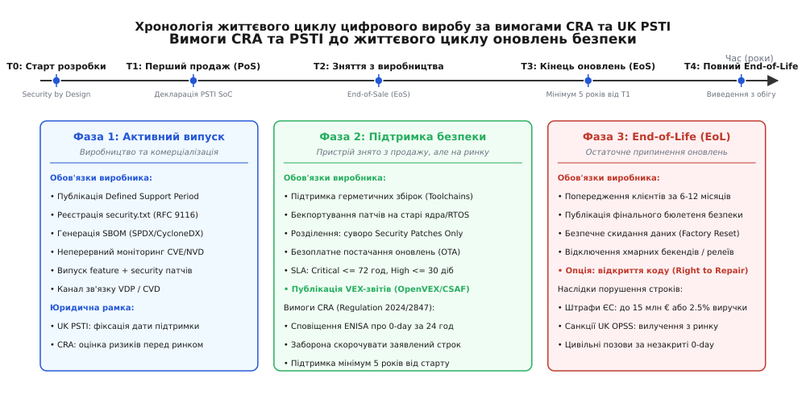
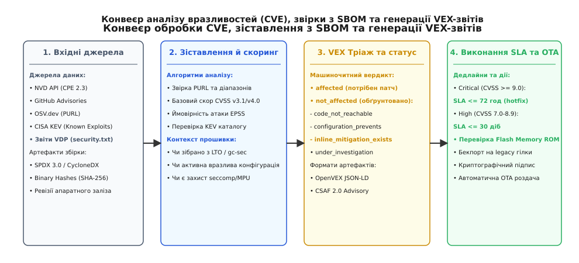

# Скільки років ти обіцяєш оновлення безпеки

<preknowlist>
- [Нормативні вимоги до безпеки коду: CRA, RED 3.3, EN 303 645](root:sys-notary/normatyvni-vymohy-do-bezpeky-kodu) — базові вимоги статей кібербезпеки, гармонізовані стандарти та обов'язки вендорів.
- [SBOM: перелік складників образу і навіщо його ведуть](root:sys-notary/sbom-perelik-skladnykiv-obrazu-i-navishcho-ioho) — графова модель залежностей, стандарти SPDX та CycloneDX, криптографічна атестація компонентів.
- [Декларація відповідності й технічний файл](root:sys-notary/deklaratsiia-vidpovidnosti-i-tekhnichnyi-fail) — структура технічного досьє, процедури оцінки відповідності та маркування CE.
- [Ліцензії відкритого коду](root:sys-notary/open-source-licenses) — моделі ліцензування, сумісність коду та дистрибуція бінарних пакунків.
</preknowlist>

У травні 2023 року німецький виробник промислових маршрутизаторів та шлюзів автоматизації отримав юридичну претензію від європейського оператора критичної інфраструктури: у прошивці 12 000 контролерів, встановлених на насосних станціях водоканалу у 2018 році, виявили критичну віддалену вразливість нульового дня в бібліотеці OpenSSL 1.0.2. Виробник заявив, що апаратна ревізія знята з продажу ще три роки тому, а життєвий цикл підтримки програмного забезпечення для даної моделі завершився. Однак згідно з підписаними сервісними контрактами та оновленими нормами європейського регламенту пристрої мали нормативний строк служби 10 років. Спроба інженерів терміново скомпілювати патч закінчилася провалом: складальний тулчейн десятирічної давності не запускався на сучасних CI-серверах через несумісність із версіями GLIBC, вихідний код драйвера Wi-Fi існував лише у вигляді закритого бінарного блоба під ядро Linux 3.14, а оновлена версія бібліотеки шифрування перевищила фізичний обсяг Flash-пам'яті мікроконтролера на 142 кілобайти.

Коли пристрій виходить із конвеєра, його апаратні компоненти — кремнієві кристали, пасивні елементи, друковані плати — мають визначений фізичний ресурс напрацювання на відмову (Mean Time Between Failures, MTBF), який для промислових і споживчих приладів зазвичай становить від 5 до 15 років. Проте програмне забезпечення, зашите у пам'ять цього виробу, починає старіти не внаслідок фізичного зносу, а через постійне відкриття нових векторів атак у глобальній мережі. Від моменту першого продажу вендор вступає у тривалий цикл правових та інженерних зобов'язань: він повинен безперервно моніторити бази вразливостей, розраховувати строк життя відкритих бібліотек, зберігати здатність перезбирати старі ревізії коду та своєчасно доставляти виправлення безпеки кінцевим користувачам.

## 1. Економічний розрив між продажем заліза та супроводом коду

У традиційній моделі виробництва електроніки прибуток формується в момент продажу фізичного товару: клієнт платить фіксовану суму за коробку, виробник фіксує маржу і перемикає увагу на проєктування наступного покоління плати. Програмне забезпечення в такій моделі розглядалося як статичний додаток до апаратури — зашите один раз на заводі й залишене без змін до утилізації приладу.

```
┌────────────────────────────────────────────────────────────────────────┐
│             ЕКОНОМІЧНИЙ ДИСБАЛАНС ОБСЛУГОВУВАННЯ ВБУДОВАНОГО ПЗ        │
├───────────────────────────────────┬────────────────────────────────────┤
│ Етап життєвого циклу пристрою     │ Фінансові та інженерні реалії      │
├───────────────────────────────────┼────────────────────────────────────┤
│ 1. Продаж заліза (Рік 0)          │ Одноразовий дохід (маржа з одиниці)│
│ 2. Активний продаж (Роки 1–3)     │ Дохід покриває витрати на CI/CD    │
│ 3. Зняття з продажу (Роки 4–5)    │ Дохід нульовий, витрати на CVE рос │
│ 4. Пост-гарантія (Роки 6–10)      │ Глибокий збиток: бекпорт на legacy │
└───────────────────────────────────┴────────────────────────────────────┘
```

Ця парадигма зруйнувалася внаслідок масового підключення вбудованих пристроїв до інтернету. Коли мільйони забутих вендорами IP-камер, домашніх маршрутизаторів та розумних лічильників були об'єднані ботнетами на кшталт Mirai у гігантські платформи для DDoS-атак, проблема кинутого коду вийшла за межі приватних відносин покупця і продавця, перетворившись на загрозу стабільності світової телекомунікаційної інфраструктури.

Інженерна вартість підтримки пристрою на п'ятому чи восьмому році його експлуатації виявляється на порядки вищою за витрати під час активної розробки:
- **Виснаження знань про кодову базу**: інженери, які писали початкові драйвери та архітектуру прошивки, переходять в інші проєкти або компанії, а супровід старих гілок лягає на нових розробників, які не знають неявних припущень та обмежень кодової бази.
- **Ерозія складальної інфраструктури**: оновлення операційних систем на робочих станціях і складальних серверах призводить до того, що старі крос-компілятори (GCC 4.x, 5.x) перестають запускатися через несумісність із новими версіями системних бібліотек хоста.
- **Розрив дерева залежностей**: відкриті бібліотеки, на яких базувався виріб, припиняють підтримку старих мажорних версій. Наприклад, коли утиліта `curl` або бібліотека `mbedTLS` випускає фікс для критичної вразливості у версії 8.x, вона не створює патч для застарілої версії 2.x, яка була заморожена у прошивці 2017 року. Виробник зобов'язаний аналізувати зміни власноруч і адаптувати (бекпортувати) код до своєї застарілої кодової бази.
- **Ризик осиротілих залежностей (Abandoned Dependencies)**: сторонній відкритий драйвер чи парсер, написаний індивідуальним розробником-волонтером, може бути закинутий або архівований на GitHub. Якщо в ньому виявляють переповнення буфера через 6 років після релізу, вендор змушений брати на себе повне мейнтейнерство стороннього репозиторію.
- **Фізичні межі мікроконтролерів**: пам'ять Flash і RAM на платі жорстко обмежена. Якщо через оновлення протоколів шифрування розмір бінарного файлу зростає на декілька десятків кілобайтів, прошивка перестає вміщатися в пам'ять пристрою, унеможливлюючи встановлення чергового патча без глибокого рефакторингу або примусового видалення функціональності.

Законодавці провідних економік світу усвідомили, що ринкові механізми не здатні самостійно змусити виробників інвестувати у безпеку проданих виробів. Це призвело до появи прямого імперативного регулювання, яке встановлює чіткі часові рамки обов'язкових оновлень безпеки та фінансові покарання за їх порушення.

## 2. Юридичні рамки обов'язкового строку підтримки: CRA та UK PSTI

Нормативний ландшафт останніх років здійснив тектонічний зсув: період підтримки безпеки цифрового продукту перестав бути добровільною маркетинговою обіцянкою і став обов'язковою юридичною умовою допуску виробу на ринок.


*Хронологія життєвого циклу цифрового виробу за вимогами CRA та UK PSTI: ключові фази комерціалізації, пост-гарантійної підтримки безпеки та процедури виведення з експлуатації.*

### Регламент ЄС про кіберстійкість (EU Cyber Resilience Act, CRA)

Регламент Європейського Парламенту та Ради (EU) 2024/2847, відомий як Cyber Resilience Act (CRA), є найжорсткішим і найвсеосяжнішим законодавчим актом у сфері кібербезпеки продуктів із цифровими елементами. Його дія поширюється на всі апаратні та програмні вироби, що прямо чи опосередковано підключаються до інших пристроїв або мереж.

Ключові вимоги CRA щодо строків підтримки безпеки зосереджені у Статтях 13, 14 та Додатку I:
1. **Обов'язкове визначення періоду підтримки (Support Period)**: виробник зобов'язаний явно визначити та зафіксувати строк, протягом якого для продукту гарантується усунення вразливостей. Цей строк має відповідати «очікуваному строку служби виробу» (*expected product lifetime*), враховуючи специфіку сфери застосування, очікування споживачів та доступність компонентів.
2. **П'ятирічний бенчмарк (5-Year Benchmark)**: якщо очікуваний строк служби продукту становить п'ять років або більше, період обов'язкової підтримки безпеки повинен становити **щонайменше 5 років** від моменту введення першої одиниці серії в обіг на ринку ЄС. Якщо виробник встановлює менший строк (наприклад, 2 чи 3 роки), він зобов'язаний надати в технічному файлі вичерпне інженерне та комерційне обґрунтування, чому специфіка продукту не передбачає довшої експлуатації.
3. **Класифікація продуктів та глибина оцінки відповідності**:
   - *Default (Звичайні продукти)*: побутовий IoT, розумні іграшки, фотокамери. Виробник застосовує процедуру внутрішнього контролю виробництва (Module A).
   - *Important Class I*: менеджери паролів, веб-браузери, мережеві інтерфейси, маршрутизатори для домашнього вжитку. Вимагають застосування гармонізованих стандартів або аудиту нотифікованого органу (Module B+C).
   - *Important Class II*: промислові фаєрволи, комутатори корпоративного рівня, мікроконтролери захищеного виконання (Tamper-Resistant Cryptographic Microprocessors). Обов'язкова незалежна сертифікація третьою стороною.
   - *Critical Products*: апаратні модулі безпеки (HSM), розумні лічильники електроенергії, компоненти критичної інфраструктури. Обов'язкова європейська сертифікація за схемами EUCC/EUCS.
4. **Безоплатність патчів безпеки**: виробникам категорично заборонено вимагати від клієнта оплату за security-оновлення або нав'язувати платні сервісні підписки для отримання критичних латок. Патчі безпеки повинні постачатися окремо від платних функціональних оновлень (*feature updates*), щоб користувач міг захистити свій пристрій без зміни бізнес-логіки системи.
5. **Прозоре маркування перед покупкою**: інформація про точну дату або період завершення оновлень безпеки повинна бути надана кінцевому покупцеві до моменту укладання угоди (на пакуванні продукту, у супровідній документації та на веб-сторінці товару в інтернет-магазині).
6. **Завчасне сповіщення про завершення підтримки**: виробник повинен сповістити користувачів про настання дати End-of-Support щонайменше за декілька місяців, чітко роз'яснивши ризики подальшого використання пристрою без оновлень.

Порушення положень CRA тягне за собою адміністративні штрафи до **15 мільйонів євро або до 2.5% від загального світового річного обороту компанії** за попередній фінансовий рік, а також примусове вилучення продукції з усього ринку Європейського Союзу.

### Британський акт UK PSTI (Product Security and Telecommunications Infrastructure Act 2022)

Велика Британія ввела в дію законодавство про безпеку споживчих підключених пристроїв через акт UK PSTI Act 2022 та відповідні правила PSTI Regulations 2023, які набули обов'язкової чинності у квітні 2024 року.

Закон базується на трьох фундаментальних стовпах стандарту ETSI EN 303 645:
- Заборона універсальних стандартних паролів (Unique Passwords).
- Наявність публічної політики розкриття вразливостей (Vulnerability Disclosure Policy).
- **Обов'язкове декларування визначеного строку підтримки (Defined Support Period)**.

```
┌────────────────────────────────────────────────────────────────────────┐
│            ПОРІВНЯННЯ ВИМОГ ДО СТРОКІВ ПІДТРИМКИ: CRA ТА UK PSTI       │
├─────────────────────────┬──────────────────────┬───────────────────────┤
│ Юридичний аспект        │ EU CRA (2024/2847)   │ UK PSTI Act (2022)    │
├─────────────────────────┼──────────────────────┼───────────────────────┤
│ Охоплення продуктів     │ Усі цифрові вироби   │ Споживчий IoT         │
│ Мінімальний бенчмарк    │ 5 років (за дефолтом)│ Встановлює виробник   │
│ Фіксація у продажу      │ Обов'язкова (PoS)    │ Обов'язкова (PoS/SoC) │
│ Документ відповідності  │ EU Declaration (DoC) │ Statement of Compl.   │
│ Зміна строку підтримки  │ Лише продовження     │ Лише продовження      │
│ Фінансові санкції       │ До 15 млн € / 2.5%   │ До £10 млн / 4%       │
└─────────────────────────┴──────────────────────┴───────────────────────┘
```

Головна вимога UK PSTI полягає в тому, що виробник зобов'язаний опублікувати так звану «Заяву про відповідність» (*Statement of Compliance*, SoC), у якій зазначена точна дата (день, місяць, рік) або мінімальний проміжок часу, до якого пристрій отримуватиме оновлення безпеки. Згідно зі Списком 4 PSTI Regulations 2023, документ SoC повинен містити:
- Найменування та юридичну адресу виробника або його авторизованого представника у Великій Британії.
- Точну ідентифікацію виробу (модель, номер партії, апаратну ревізію, назву продукту).
- Твердження про відповідність вимогам безпеки Списку 1 (паролі, VDP, строк підтримки).
- Поле *Defined Support Period*: точну календарну дату у форматі `DD/MM/YYYY` (наприклад, «at least until 31 December 2030») або чітко розрахований часовий період.
- Прізвище, посаду та особистий підпис уповноваженої особи.

Формулювання на кшталт «ми підтримуємо пристрій, поки він комерційно активний» є прямим порушенням закону: споживач повинен бачити однозначну календарну дату ще до здійснення покупки. Більше того, законодавство прямо забороняє дистриб'юторам та імпортерам ввозити або продавати продукцію на території Великої Британії без наявності валідної декларації SoC.

За дотриманням вимог UK PSTI стежить Офіс безпеки продукції та стандартів (Office for Product Safety and Standards, OPSS), який має повноваження накладати штрафи до **10 мільйонів фунтів стерлінгів або 4% світового обороту**.

Практична реалізація системи аудиту та автоматичного контролю за дотриманням дедлайнів CRA та PSTI детально розібрана у проєктній вставці [Менеджер життєвого циклу вразливостей, аудиту SBOM та розрахунку строків патчів](root:sys-notary/skilky-rokiv-ty-obitsiaiesh-onovlennia-bezpeky/proj-cve-vdp-manager.md).

## 3. Низькорівневий фундамент: життєвий цикл ядр Linux, RTOS та сторонніх стеків

Щоб виконати законодавче зобов'язання підтримувати пристрій протягом 5–10 років, системний інженер повинен узгодити строк життя власної прошивки з життєвими циклами низькорівневих компонентів: ядра операційної системи, системної бібліотеки (C standard library), мережевого стека та сторонніх криптографічних модулів.

### Linux Kernel LTS та ініціатива CIP Super Long Term Support

Головним ядром сучасних вбудованих пристроїв середнього та вищого класу (шлюзи, роутери, камери, промислові панелі) є Linux. Протягом тривалого часу спільнота ядра під керівництвом Грега Кроа-Хартмана (*Greg Kroah-Hartman*) підтримувала окремі вибрані релізи ядра зі статусом Long Term Support (LTS) протягом 6 років. 

Однак у 2023 році мейнтейнери ядра офіційно оголосили про **скорочення терміну підтримки нових LTS-релізів до 2 років**. Причиною цього стало колосальне навантаження на волонтерів та інженерів ядра: підтримка старого ядра вимагає бекпортування тисяч комітів щорічно, тестування на десятках застарілих архітектур та вирішення складних конфліктів у коді підсистем пам'яті та мережі.

```
┌────────────────────────────────────────────────────────────────────────┐
│              РОЗРИВ ЖИТТЄВИХ ЦИКЛІВ ЯДРА LINUX ТА ВИРОБУ               │
├────────────────────────────────────────────────────────────────────────┤
│ Ванільне ядро LTS:    [ 2 роки активного супроводу kernel.org ]        │
│ Вимога CRA / PSTI:    [ ═══════════════ 5–7 років підтримки ═════════] │
│ Промисловий контролер:[ ═══════════════════════════ 10–15 років ═════] │
├────────────────────────────────────────────────────────────────────────┤
│ РІШЕННЯ: Консорціум CIP SLTS (Civil Infrastructure Platform)          │
│ CIP SLTS ядро:        [ ═══════════════════════════ 10–25 років ═════] │
└────────────────────────────────────────────────────────────────────────┘
```

Це рішення створило критичний розрив для виробників комерційного заліза: закон вимагає 5+ років підтримки, тоді як апстрім ядра закриває гілку через 2 роки. Якщо компанія залишається сам на сам із ядром, після завершення офіційного LTS вона змушена самостійно аналізувати кожен щотижневий реліз ванільного ядра, відбирати коміти з мітками `Fixes:` та `Cc: stable@vger.kernel.org` і вручну інтегрувати їх у свою застарілу версію.

Для розв'язання цієї проблеми Linux Foundation створила консорціум **Civil Infrastructure Platform (CIP)**. Проєкт CIP фокусується на підтримці вибраних ядер зі статусом **Super Long Term Support (SLTS)** протягом **10–25 років**. До таких ядер належать версії Linux 4.19-cip, 5.10-cip та 6.1-cip. Учасники консорціуму (Siemens, Renesas, Toshiba, Hitachi та ін.) спільно фінансують команду професійних мейнтейнерів, які тестують та бекпортують виправлення безпеки у гілки SLTS на промисловому тестовому стенді CIP BBD (Board at Desk).

Більше того, для систем жорсткого реального часу проєкт CIP підтримує гілки **PREEMPT_RT SLTS**, що гарантує збереження детерміністичних часових характеристик переривань та планувальника задач при регулярному накатуванні патчів безпеки.

### Життєвий цикл RTOS у мікроконтролерах

Для мікроконтролерів без блоку керування пам'яттю (MMU), де застосовуються операційні системи реального часу (RTOS), ландшафт підтримки має власну специфіку:

1. **Zephyr RTOS LTS**:
   Проєкт Zephyr під егідою Linux Foundation кожні два роки випускає версію зі статусом Long Term Support (наприклад, Zephyr 2.7 LTS, Zephyr 3.7 LTS). Термін гарантованої підтримки LTS-релізу становить **2.5 роки**. Протягом цього вікна проєкт випускає мінорні оновлення безпеки, що не порушують API/ABI сумісності. Для медичних та авіаційних систем консорціум розвиває окрему сертифіковану гілку Zephyr Safety, яка проходить незалежний аудит за стандартами IEC 61508 та ISO 26262.
2. **FreeRTOS LTS**:
   Компанія Amazon Web Services (AWS), яка курує розвиток FreeRTOS, надає для версій FreeRTOS LTS дворічну гарантію підтримки від моменту релізу. Вона включає безкоштовні виправлення критичних багів та безпекових дефектів у ядрі операційної системи та офіційних бібліотеках (FreeRTOS-Plus-TCP, coreMQTT, corePKCS11). Після завершення 2 років користувачам доступна платна програма *FreeRTOS Extended Maintenance Plan (EMP)*, яка продовжує випуск патчів для вибраної версії ще на 10 років без необхідності оновлення всієї кодової бази.

При проєктуванні архітектури на RTOS критично важливо враховувати апаратне розташування пам'яті мікроконтролера. Застосування швидкої пам'яті Tightly-Coupled Memory (TCM/ITCM/DTCM) та внутрішнього SRAM для критичних до часу обробників переривань вимагає, щоб будь-який бекпортований патч безпеки не збільшував розмір коду функції понад виділений апаратний сектор TCM. Якщо після патча функція витісняється у повільнішу зовнішню пам'ять Flash з інтерфейсом QSPI/XIP, час реакції на зовнішнє переривання зростає в рази, що призводить до порушення таймінгів керування виконавчими механізмами.

### Android Security Bulletins та залежність від чипсетних вендорів (BSP)

У складних мультимедійних пристроях на базі Android/AOSP виробник стикається з концепцією **Security Patch Level (SPL)**. Google щомісяця публікує бюлетені безпеки (*Android Security Bulletin*), які містять виправлення для власного коду Android та ядра Linux. Зрізи маркуються датами, наприклад `2025-03-01` (патчі фреймворку) та `2025-03-05` (патчі драйверів ядра).

Головним «вузьким місцем» тут виступає постачальник системи на кристалі (SoC Vendor BSP — Board Support Package). Якщо виробники процесорів (Qualcomm, MediaTek, NXP) припиняють випуск оновлених бінарних бібліотек апаратного прискорення графіки, мультимедійних кодеків або стеків модему через 3 роки після випуску чипа, виробник кінцевого пристрою фізично не може оновити версію Android чи ядра Linux до новішого мажорного релізу. Будь-яка спроба оновлення ламає пропрієтарний HAL (Hardware Abstraction Layer). Тому довгострокові контракти на постачання компонентів повинні обов'язково містити пункт про гарантію надання вендорських патчів безпеки BSP (*Silicon Vendor Long-Term Support Agreement*) на весь запланований строк служби пристрою.

## 4. Моніторинг ланцюга постачання: SBOM, CVE, EPSS та VEX

Неможливо забезпечити оновлення безпеки для того, про існування чого ти не знаєш. Якщо прошивка складається з 80 відкритих бібліотек, якихось сторонніх драйверів та власного прикладного коду, поява чергової критичної CVE у світових реєстрах вимагає миттєвої відповіді на запитання: «Чи використовується цей компонент у нашій прошивці, і чи доступний вразливий код для атаки?».


*Конвеєр обробки CVE, автоматичного зіставлення з SBOM та генерації VEX-звітів: від прийому вхідних потоків NVD/OSV до оцінки SLA та доставки OTA-патчів.*

### Від маніфесту SBOM до потоку вразливостей

Основою автоматизованого моніторингу виступає маніфест **Software Bill of Materials (SBOM)**, згенерований у стандартизованому форматі SPDX 3.0 або CycloneDX 1.6 під час складання образу.

Кожен компонент в SBOM ідентифікується за двома ключовими схемами:
1. **Package URL (PURL)**: стандартизований RFC-ідентифікатор, що однозначно визначає джерело та версію пакета (наприклад, `pkg:generic/mbedtls@3.4.0?arch=armv7m`).
2. **Common Platform Enumeration (CPE 2.3)**: словниковий формат NIST, за яким ведеться облік вразливостей у базі National Vulnerability Database (наприклад, `cpe:2.3:a:arm:mbed_tls:3.4.0:*:*:*:*:*:*:*`).

Автоматизовані сканери (Trivy, Grype, Dependency-Track) безперервно зіставляють згенеровані SBOM-файли із загальносвітовими базами даних вразливостей:
- **NVD (National Vulnerability Database)**: офіційна база уряду США, яка ведеться інститутом NIST.
- **GitHub Advisory Database**: база даних вразливостей екосистем відкритого коду.
- **OSV.dev (Open Source Vulnerabilities)**: відкрита розподілена база даних від Google та OpenSSF, що використовує точні діапазони Git-комітів замість приблизних версій.
- **CISA KEV (Known Exploited Vulnerabilities Catalog)**: каталог вразливостей, які реально експлуатуються зловмисниками в активних кібератаках.

### Скоринг ризиків: еволюція від CVSS v3.1 до CVSS v4.0 та зв'язка з EPSS

Традиційно важкість вразливостей оцінюється за шкалою **CVSS (Common Vulnerability Scoring System)**. У версії CVSS v3.1 базова оцінка базується на метриках вектора атаки (AV), складності атаки (AC), необхідних привілеїв (PR), взаємодії з користувачем (UI), масштабу впливу (S) та тріаді конфіденційності, цілісності й доступності (C/I/A).

Новітній стандарт **CVSS v4.0** суттєво розширив контекст оцінки, додавши мікро- та макро-вектори:
- **Attack Requirements (AT)**: розрізняє вразливості, які можна експлуатувати без особливих передумов (`AT:N`), від тих, де потрібні специфічні стан гонки чи налаштування середовища (`AT:P`).
- **Safety Impact (S:N / S:P / S:N)**: пряма оцінка фізичної безпеки людей (Physical Safety), що має критичне значення для медичних приладів, автомобілів та промислової автоматики.
- **Supplemental Metrics**: автоматизовані позначки про наявність заходів пом'якшення на рівні платформи.

Однак у реальній експлуатації понад 90% вразливостей із високим CVSS-рейтингом ніколи не використовуються зловмисниками через відсутність публічних надійних експлойтів чи занадто специфічні умови атаки. Якщо команда інженерів кидатиметься виправляти кожну CVE з рейтингом 8.0+, вона миттєво спалить усі ресурси підтримки.

Тому сучасний комплаєнс-пайплайн поєднує CVSS із метрикою **EPSS (Exploit Prediction Scoring System)** від організації FIRST. EPSS — це щоденна ймовірнісна оцінка (від 0.00000 до 1.00000 / 0%–100%), яка за допомогою машинного навчання розраховує ймовірність того, що конкретна CVE буде промасово експлуатуватися зловмисниками в дикій природі протягом наступних 30 днів.

```
Формула розрахунку пріоритету реагування:
Пріоритет = f(CVSS_Base, EPSS_Score, KEV_Flag, Reachability)
```

Якщо вразливість має CVSS 9.8, але EPSS 0.001 і не фігурує в CISA KEV, її виправлення можна запланувати в регулярний плановий реліз. Але якщо вразливість має CVSS 7.2, EPSS 0.85 (85% ймовірність атаки) і додана в каталог CISA KEV, вона автоматично набуває статусу критичної аварії з вимогою негайного випуску позачергового hotfix-патча.

### VEX: ліквідація шуму хибних тривог

У типовому звіті сканера безпеки для вбудованої прошивки з'являються сотні тривог. Проте абсолютна більшість із них є хибними спрацьовуваннями (*false positives*): бібліотека в образі є, але вразлива функція або вимкнена конфігураційними прапорцями препроцесора під час компіляції, або видалена лінкером через оптимізацію `--gc-sections`, або заблокована зовнішнім брандмауером.

Щоб офіційно та машиночитно задекларувати реальний стан захищеності продукту, застосовується стандарт **Vulnerability Exploitability eXchange (VEX)**, реалізований у діалектах OpenVEX, CSAF 2.0 та CycloneDX VEX.

```
┌────────────────────────────────────────────────────────────────────────┐
│                     СТАНДАРТНІ СТАТУСИ VEX-ДЕКЛАРАЦІЇ                  │
├─────────────────────┬──────────────────────────────────────────────────┤
│ VEX Статус          │ Інженерний зміст та юридичні наслідки            │
├─────────────────────┼──────────────────────────────────────────────────┤
│ not_affected        │ Продукт НЕ вразливий. Вимагає обґрунтування:     │
│                     │  • code_not_reachable (код видалено компілятором)│
│                     │  • requires_configuration (інша конфігурація)    │
│                     │  • inline_mitigations_exist (захист seccomp/MPU) │
│ affected            │ Продукт вразливий. Потрібен випуск патча в SLA   │
│ fixed               │ Вразливість усунута в поточній версії прошивки   │
│ under_investigation │ Триває інженерний аналіз (тимчасовий статус)     │
└─────────────────────┴──────────────────────────────────────────────────┘
```

Коли регулятор або замовник сканує пристрій, наявність підписаного файлу VEX дозволяє автоматично відкинути неактуальні тривоги зі статусом `not_affected`, підтверджуючи високий рівень зрілості процесів безпеки розробника.

## 5. Політика розкриття вразливостей (VDP), CVD та жорсткі дедлайни

Навіть найдосконаліший внутрішній аудит не гарантує відсутності помилок у коді. Більшість критичних проблем у виробах виявляють зовнішні дослідники кібербезпеки (*ethical hackers / white hats*). Щоб дослідник мав легальний та безпечний канал передачі інформації виробнику, компанія повинна впровадити політику **Coordinated Vulnerability Disclosure (CVD)** відповідно до міжнародних стандартів ISO/IEC 29147 (розкриття вразливостей) та ISO/IEC 30111 (процеси обробки вразливостей).

### Публічний файл `security.txt` (RFC 9116)

Основним стандартом зв'язку між дослідниками та компанією є файл `security.txt`, який розміщується за фіксованою адресою `https://example.com/.well-known/security.txt`. Цей файл є машиночитним текстовим маніфестом, що містить контактні дані офіцерів безпеки компанії, публічні PGP-ключі для шифрування звітів та посилання на офіційну політику винагород (*Bug Bounty*).

Типовий зміст `security.txt` відповідно до RFC 9116:

```http
Contact: mailto:security@acme-embedded.com
Contact: https://acme-embedded.com/security/report
Encryption: https://acme-embedded.com/pgp-key.asc
Expires: 2027-01-01T00:00:00.000Z
Preferred-Languages: en, uk, de
Policy: https://acme-embedded.com/security/vdp-policy
Canonical: https://acme-embedded.com/.well-known/security.txt
```

Поле `Expires` є обов'язковим: стандарт вимагає періодичного оновлення файлу, що гарантує актуальність зазначених адрес і ключів.

### Safe Harbor: правова безпека дослідників

Критично важливим елементом політики VDP є положення про **Safe Harbor (безпечну гавань)**. Якщо етичний дослідник аналізує прошивку пристрою, реверс-інжинірить бінарний код або перевіряє інтерфейси зв'язку, його дії формально можуть підпадати під кримінальні статті про несанкціонований доступ до комп'ютерної інформації чи порушення умов користувацької угоди (EULA/DMCA).

Декларація Safe Harbor фіксує зобов'язання компанії:
- Не ініціювати судові позови та не звертатися до правоохоронних органів проти дослідника, якщо дослідження проводилося добросовісно.
- Не вимагати компенсації збитків за умови відсутності деструктивних дій (збереження цілісності даних користувачів, ненадання доступу третім особам).
- Забезпечити скоординований графік публічного розкриття інформації (зазвичай 90 днів від моменту отримання звіту до публікації бюлетеня та патча).

### Жорсткі регуляторні дедлайни звітування під CRA

Cyber Resilience Act докорінно змінив темп реагування на безпекові інциденти, встановивши обов'язкове інформування Агентства ЄС з кібербезпеки (**ENISA**) та національних груп реагування на комп'ютерні інциденти (**CSIRTs**):

```
┌────────────────────────────────────────────────────────────────────────┐
│            ХРОНОМЕТРАЖ СПОВІЩЕННЯ РЕГУЛЯТОРІВ ЗА ВИМОГАМИ CRA          │
├───────────────────┬────────────────────────────────────────────────────┤
│ Часовий ліміт     │ Обов'язкова дія виробника                          │
├───────────────────┼────────────────────────────────────────────────────┤
│ 24 години         │ Раннє попередження (Early Warning Notification)    │
│                   │ про активно експлуатовану вразливість або 0-day    │
│ 72 години         │ Офіційне повідомлення про вразливість (Incident    │
│                   │ Notification) з аналізом ризиків та пом'якшеннями │
│ 14 днів           │ Фінальний звіт (Final Report) після усунення       │
│                   │ дефекту або випуску повноцінного патча             │
└───────────────────┴────────────────────────────────────────────────────┘
```

Якщо компанія виявила або отримала звіт про вразливість нульового дня, яка вже експлуатується в мережі, вона має рівно **24 години** на відправку первинного сповіщення через єдину платформу ENISA. Порушення цього терміну карається тими самими багатомільйонними штрафами, що й відсутність сертифікації CE.

## 6. Інженерна практика бекпортування та фізичні обмеження старого заліза

Коли вразливість верифікована, VEX-статус оновлено, а регулятори попереджені, настає етап інженерного створення та доставки патча. Для пристроїв, випущених декілька років тому, це найскладніший інженерний виклик.

### Механіка бекпортування та збереження ABI/API

Бекпортування (*backporting*) — це перенесення виправлення безпеки з новітньої версії кодової бази в застарілу версію, яка вже не підтримується апстрімом.

Типовий робочий процес базується на утиліті Git:
1. Ідентифікація точного коміту з виправленням в основній гілці розробки або апстрім-репозиторії.
2. Виконання команди `git cherry-pick -x <commit_sha>`, яка зберігає посилання на оригінальний коміт в історії.
3. Ручне вирішення конфліктів компонування, викликаних зміною контексту коду за минулі роки.

```
┌────────────────────────────────────────────────────────────────────────┐
│             ЗАХИСТ ВІД ПОРУШЕННЯ СТАБІЛЬНОСТІ ABI ПРИ БЕКПОРТІ         │
├────────────────────────────────────────────────────────────────────────┤
│ 1. Оригінальна структура v1.0:     │ 2. ПОМИЛКОВИЙ патч (злам ABI):    │
│    struct ssl_ctx {                │    struct ssl_ctx {               │
│        uint32_t flags;             │        uint32_t flags;            │
│        char *hostname;             │        uint32_t new_security_val; │◄── Зсув
│    };                              │        char *hostname;            │
│                                    │    };                             │
│ ───────────────────────────────────┼───────────────────────────────────┤
│ Наслідок: зміщення зміщення полів  │ Всі старі бінарники падають з     │
│ (offset) для hostname у пам'яті   │ segmentation fault при зверненні! │
└────────────────────────────────────┴───────────────────────────────────┘
```

Найнебезпечніша пастка при бекпортуванні у скомпільованих мовах C та C++ — порушення **двійкового інтерфейсу додатків (Application Binary Interface, ABI)**. Якщо патч додає нове поле всередину відкритої структури даних або змінює порядок віртуальних методів у C++ класі, розмір структури в пам'яті та зміщення її полів змінюються. Якщо динамічна бібліотека оновлюється через OTA, а основна скомпільована програма залишається старою, звернення програми до полів структури призведе до фатального пошкодження пам'яті (*memory corruption*) або аварійного завершення процесу (*SIGSEGV*).

Для запобігання зламу ABI у промислових релізах використовують інструменти статичного аналізу бінарників:
- **`libabigail` (`abidiff`)**: аналізує відмінності в налагоджувальній інформації DWARF між двома скомпільованими версіями ELF-файлів і миттєво сигналізує про зміну сигнатур функцій чи зміщень у структурах.
- **`abi-compliance-checker`**: генерує автоматичні звіти про зворотну двійкову сумісність бібліотек.

Крім того, у спільних бібліотеках C/C++ застосовують директиву версіонування символів препроцесора та компонувальника:

:::tabs
```c
/* Версіонування символів у libcrypto.so для захисту динамічного лінкування */
__asm__(".symver legacy_crypto_decrypt_v1, crypto_decrypt@LIBCRYPTO_1.0");
__asm__(".symver secure_crypto_decrypt_v2, crypto_decrypt@@LIBCRYPTO_2.0");
```
```cpp
/* Версіонування експортованих C++ символів для запобігання зламу ABI */
extern "C" {
    __asm__(".symver legacy_crypto_decrypt_v1, crypto_decrypt@LIBCRYPTO_1.0");
    __asm__(".symver secure_crypto_decrypt_v2, crypto_decrypt@@LIBCRYPTO_2.0");
}
```
:::

Це дозволяє одночасно підтримувати старі бінарники, скомпільовані під версію `LIBCRYPTO_1.0`, та нові модулі, які використовують безпечну сигнатуру `LIBCRYPTO_2.0`.

### Ротація сертифікатів та криптографічне старіння коренів довіри

У пристроях із десятирічним строком служби виникає проблема **криптографічного старіння (Cryptographic Expiration)**. Якщо пристрій був випущений у 2020 році з кореневим сертифікатом Root CA, чинним до 2028 року, у 2028 році прилад втратить можливість встановлювати захищені TLS-з'єднання з сервером оновлень через завершення строку дії сертифіката.

Для запобігання паралічу оновлень архітектура прошивки повинна підтримувати:
- **Подвійне якірне підтвердження (Dual Root Anchoring)**: збереження у пам'яті двох незалежних кореневих сертифікатів із різними датами експірації.
- **Крос-підпис маніфестів оновлення (Cross-Signing)**: підпис пакетів прошивки як старим, так і новим ключем релізу.
- **Оновлення сховища довіри (Trust Store Update)**: можливість автономного оновлення системних X.509 сертифікатів окремим криптографічно підписаним пакетом без повної перепрошивки всієї операційної системи.

### Герметичні складальні середовища (Hermetic Toolchains)

Неможливо гарантувати випуск надійного патча для прошивки 2018 року, якщо вихідний код компілюється на сучасному дистрибутиві Ubuntu 2026 року з компілятором GCC 15. Новий компілятор згенерує інший машинний код, може оптимізувати перевірки безпеки, які раніше вважалися допустимими (*undefined behavior optimization*), або відмовитися збирати застарілий код через посилені попередження `-Werror`.

Тому компанія зобов'язана зберігати **герметичні складальні контейнери (Hermetic Docker/Podman Images)** для кожної випущеної версії прошивки. Складальний образ повинен фіксувати:
- Точну версію крос-компілятора (наприклад, `arm-none-eabi-gcc 7.3.1 20180622`).
- Точну версію системних утиліт збірки (Make, CMake, Python 2.7/3.6, Ninja).
- Фіксовані версії хостових бібліотек та заголовків.
- Криптографічні хеші всіх вихідних сирців та сторонніх пакунків.

Ці образи зберігаються у захищеному корпоративному реєстрі контейнерів під версійними замками і регулярно перевіряються на працездатність у межах автоматизованих нічних тестів.

### Захист від відкату (Anti-Rollback Protection) та апаратні eFuses

Випуск виправлення безпеки втрачає сенс, якщо зловмисник може фізично або віддалено перепрошити пристрій попередньою версією прошивки, де вразливість ще присутня. Для запобігання таким атакам застосовується апаратний **захист від відкату (Anti-Rollback Protection)**.

Механізм базується на одноразово програмованих ф'юзах (eFuses) або захищеній пам'яті криптографічного чипа (TPM/Secure Element):
1. Кожен реліз прошивки містить монотонно зростаючий лічильник версії безпеки — **Security Version Number (SVN)**.
2. При верифікації оновлення Secure Boot завантажувач порівнює SVN образу зі значенням, записаним в апаратних eFuses процесора.
3. Якщо `SVN_image < SVN_hardware`, оновлення миттєво відхиляється.
4. Після успішного встановлення нового патча завантажувач апаратно «випалює» додатковий біт у банку eFuses, піднімаючи апаратний поріг.

```
┌────────────────────────────────────────────────────────────────────────┐
│             МЕХАНІЗМ ЗАХИСТУ ВІД ВІДКОТУ ПРОШИВКИ (ANTI-ROLLBACK)      │
├────────────────────────────────────────────────────────────────────────┤
│ 1. Стан eFuses у процесорі: [ 1 │ 1 │ 1 │ 0 │ 0 │ 0 │ 0 │ 0 ] → SVN=3 │
│ 2. Спроба прошити образ:    SVN = 2 (Стара вразлива версія)           │
│    Перевірка завантажувача: SVN(2) < Hardware_SVN(3) → ВІДХИЛЕНО!      │
│ 3. Встановлення патча:      SVN = 4 (Нова захищена версія)             │
│    Перевірка завантажувача: SVN(4) >= Hardware_SVN(3) → УСПІХ!         │
│ 4. Фіксація в eFuses:       [ 1 │ 1 │ 1 │ 1 │ 0 │ 0 │ 0 │ 0 ] → SVN=4 │
└────────────────────────────────────────────────────────────────────────┘
```

Це накладає найсуворішу відповідальність на процес тестування: після випалювання ф'юза повернутися на стару версію неможливо навіть у заводських умовах.

### Архітектура безвідмовного оновлення A/B Dual-Bank та апаратний Watchdog

Оновлення безпеки у польових умовах несуть небезпеку переривання процесу живлення або помилок завантаження після запису патча. Щоб уникнути перетворення десятків тисяч віддалених пристроїв на непрацездатні «цеглини» (*bricking*), у сучасних прошивках застосовується архітектура **A/B Dual-Bank Partitioning**.

```
┌────────────────────────────────────────────────────────────────────────┐
│             СТРУКТУРА ПАМ'ЯТІ ТА СТАНОВИЙ АВТОМАТ A/B ОНОВЛЕННЯ        │
├────────────────────────────────────────────────────────────────────────┤
│ ┌───────────────┐ ┌───────────────┐ ┌───────────────┐ ┌──────────────┐ │
│ │  Bootloader   │ │   Slot A      │ │   Slot B      │ │ Environment/ │ │
│ │  (ROM/Secure) │ │ (Active, OS)  │ │ (Target Bank) │ │ State Flags  │ │
│ └───────────────┘ └───────────────┘ └───────────────┘ └──────────────┘ │
├────────────────────────────────────────────────────────────────────────┤
│ Переходи станового автомата оновлення:                                 │
│ 1. STATE_ACTIVE_A    → Запис патча у Slot B                            │
│ 2. STATE_TESTING_B   → Завантажувач ставить таймер Watchdog на 120 с   │
│ 3. STATE_CONFIRMED_B → Демон успішно стартував і скинув лічильник спроб│
│    (Якщо паніка/зависання → Watchdog перезавантажує у Slot A)          │
└────────────────────────────────────────────────────────────────────────┘
```

Робота механізму виглядає наступним чином:
1. Поточна активна система виконується з розділу Slot A у режимі «лише читання».
2. Демон оновлення приймає підписаний криптографічний пакет оновлення по мережі, перевіряє цифровий підпис через ECDSA/Ed25519 та записує розпаковані байти у пасивний розділ Slot B.
3. Завантажувачу передається команда одноразового завантаження зі Slot B (*one-shot trial boot*), а апаратний сторожовий таймер (*hardware watchdog timer*) налаштовується на фіксований ліміт часу (наприклад, 120 секунд).
4. Якщо оновлена прошивка завантажилася успішно, мережеві служби піднялися і системний демон пройшов внутрішнє самотестування (*self-test*), демон відправляє запит завантажувачу для остаточної фіксації прапорця `boot_successful=1` і перемикання дефолтного слота на B.
5. Якщо ж оновлене ядро впало в `Kernel Panic`, зациклилося або не змогло ініціалізувати мережевий стек, сторожовий таймер обнуляє живлення мікропроцесора. Завантажувач фіксує невдалу спробу запуску, скидає вказівник активного слота назад на перевірений Slot A та відновлює штатну роботу пристрою без втрати зв'язку.

### Фізичний ліміт Flash-пам'яті: інженерія міліметрового масштабу

У процесі багаторічного супроводу вбудованої системи виникає феномен **інфляції розміру коду (Code Footprint Inflation)**. Кожне нове виправлення безпеки у стеках TLS або парсерах протоколів додає перевірки меж буферів, додаткові криптографічні перевірки сертифікатів та обробку виняткових ситуацій.

У результаті скомпільований бінарний файл невпинно зростає:

```
Зростання образу прошивки за 5 років патчів:
Рік 0 (Реліз):       1 850 КБ  (Вільна Flash: 198 КБ)  [ОК]
Рік 2 (Патчі TLS):   1 920 КБ  (Вільна Flash: 128 КБ)  [ОК]
Рік 4 (Патчі SSH):   1 990 КБ  (Вільна Flash:  58 КБ)  [УВАГА]
Рік 5 (Чергова CVE): 2 060 КБ  (Переповнення: +12 КБ)  [КРАХ: Flash = 2048 КБ]
```

Якщо пристрій використовує схему безпечного оновлення A/B Dual-Bank, розмір кожного слота фіксований у кремнії (наприклад, рівно 2048 КБ). Якщо бінарний файл перевищує розмір розділу хоча б на 1 байт, завантажувач відхилить образ, а спроба примусового прошивання призведе до перетворення пристрою на «цеглину» (*bricking*).

Для розв'язання цієї проблеми інженери застосовують комплекс агресивних заходів з оптимізації розміру:
1. **Агресивні прапорці оптимізації розміру**: компіляція з прапорцем `-Os` (Optimize for Size) або `-Oz` у Clang, обов'язкове використання Link-Time Optimization (`-flto`), що дозволяє компілятору видаляти мертвий код на рівні всієї програми.
2. **Збирання сміття компонувальником**: прапорці компілятора `-ffunction-sections -fdata-sections` у парі з прапорцем лінкера `-Wl,--gc-sections`, які гарантують видалення кожної невикликаної функції з фінального ELF.
3. **Хірургічний тримінг криптографічних конфігурацій**: модифікація конфігураційних заголовків криптографічних бібліотек (`mbedtls_config.h`, `user_settings.h` у wolfSSL). Інженери примусово вимикають застарілі та важкі алгоритми, які не використовуються пристроєм (застарілі криві еліптичної криптографії, алгоритм RSA з ключами 4096 біт на користь компактного ECDSA, протоколи TLS 1.0/1.1, шифри 3DES та ARCFOUR).
4. **Вибірковий функціональний бекпорт**: замість оновлення всієї бібліотеки до нової мінорної версії інженери переносять виключно декілька рядків коду, які виправляють конкретне переповнення буфера, уникаючи затягування нового допоміжного коду.

## 7. Процедура завершення життєвого циклу (End-of-Life) та Право на ремонт

Навіть найдовший заявлений строк підтримки рано чи пізно добігає кінця. Завершення періоду підтримки (End-of-Support / End-of-Life) не повинно перетворюватися на раптове вимкнення пристроїв користувачів або перетворення обладнання на електронне сміття.

Регламенти CRA та європейські директиви щодо «Права на ремонт» (*Right to Repair Directive (EU) 2024/1799*) встановлюють цивілізовану процедуру виведення пристрою з експлуатації:
1. **Завчасне сповіщення**: публікація офіційного повідомлення про припинення оновлень не менше ніж за 6 місяців до настання дати EoL.
2. **Фінальний стабільний реліз**: випуск останнього підписаного пакета прошивки, у якому закриті всі відомі вразливості, вимкнені застарілі хмарні телеметричні сервіси вендора та активовані максимальні локальні заходи ізоляції (локальний веб-інтерфейс керування без обов'язкової прив'язки до серверів компанії).
3. **Відкриття завантажувача (Bootloader Unlock)**: якщо виробник більше не має економічної можливості випускати оновлення безпеки, регулятори рекомендують надати користувачам криптографічну можливість завантаження альтернативних відкритих прошивок (OpenWrt, Linux-based дистрибутиви, Zephyr). Це дозволяє продовжити фізичний строк служби заліза завдяки підтримці ентузіастів та відкритих спільнот без створення загроз кібербезпеці.
4. **Безпечне очищення персональних даних**: гарантія наявності апаратної функції Factory Reset, яка криптографічно стирає всі ключі автентифікації, персональні сертифікати та логи з флеш-пам'яті перед вторинним продажем чи утилізацією приладу.

## 8. Архітектура та програмна модель: реалізація на C99 та C++20

Щоб забезпечити автоматизований контроль за строками оновлень, відповідністю вимогам CRA/PSTI та лімітами Flash-пам'яті апаратних ревізій, інженерна інфраструктура потребує надійних програмних інструментів.

Розглянемо повнофункціональну архітектуру модуля аналізу вразливостей, розрахунку регуляторних строків підтримки та верифікації бюджету Flash-пам'яті мовами C99 та C++20.

:::tabs
:::code skilky-rokiv-ty-obitsiaiesh-onovlennia-bezpeky-d/c/main.c
:::code skilky-rokiv-ty-obitsiaiesh-onovlennia-bezpeky-d/cpp/main.cpp
:::

## Підсумковий синтез: архітектурна зрілість як єдиний захист від мільйонних штрафів

Обіцянка оновлень безпеки — це не маркетинговий слоган на пакуванні пристрою, а довгостроковий інженерний та фінансовий контракт між виробником, суспільством та регуляторними органами. Епоха, коли виробник міг безкарно покинути скомпільований код після підписання акту приймання-передачі заліза, безповоротно завершилася.

Сучасна компанія, яка розробляє програмно-апаратні комплекси, зобов'язана з першого дня проєктування закладати фундамент десятирічної підтримки:
1. **Апаратний запас ресурсів**: проєктування мікросхем Flash та RAM із щонайменше 30-відсотковим запасом під майбутню інфляцію розміру коду та підтримку механізму безвідмовного A/B оновлення.
2. **Вибір відкритих платформ із довгостроковим супроводом**: опора на консорціумні ініціативи на кшталт Linux Foundation CIP SLTS та Zephyr LTS замість непрозорих короткоживучих форків.
3. **Автоматизований ланцюг постачання**: обов'язкова генерація машиночитних маніфестів SBOM, їхній щоденний моніторинг проти баз вразливостей, автоматична фільтрація шуму через декларації VEX та чітке дотримання дедлайнів сповіщення регуляторів (24/72 години).
4. **Герметичність збіркового середовища**: збереження контейнеризованих тулчейнів для кожної випущеної ревізії плати, що дозволяє безпечно бекпортувати патчі без порушення бінарного інтерфейсу ABI.

Тільки системна комбінація юридичної дисципліни, прозорої політики розкриття вразливостей та суворої інженерної культури збірки дозволяє підприємству впевнено виконувати взяті зобов'язання і захистити бізнес від катастрофічних регуляторних санкцій.
