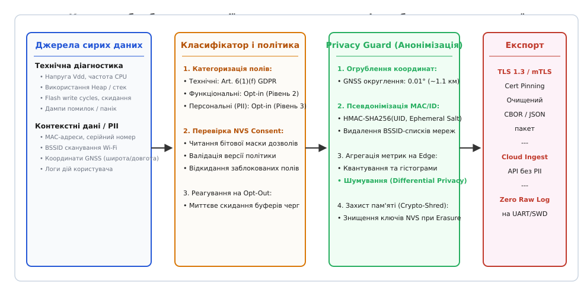
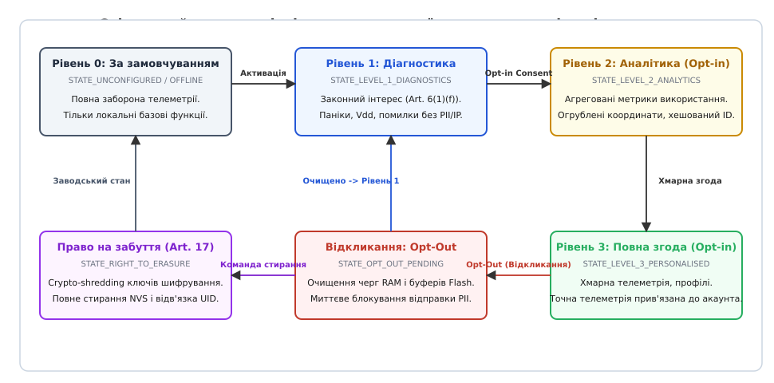

# Умови користування й дані власника: що збираємо, навіщо, як відмовитися

<preknowlist>
- [Нормативні вимоги до безпеки коду](root:sys-notary/normatyvni-vymohy-do-bezpeky-kodu) — вимоги CRA, RED 3.3(e), EN 303 645 до приватності та захисту персональних даних в IoT.
- [Декларація відповідності й технічний файл](root:sys-notary/deklaratsiia-vidpovidnosti-i-tekhnichnyi-fail) — оцінка відповідності, маркування CE та технічна документація виробу.
- [Аудит та журнали безпеки](root:sf-security/audit-logging) — захист журналів подій, незмінність записів та криптографічні ланцюжки.
- [Автентифіковане шифрування](root:sf-security/authenticated-encryption) — захист каналів передачі та цілісність пакетів телеметрії.
- [Ремонт, право власника й межа замикання виробу](root:sys-notary/remont-pravo-vlasnyka-i-mezha-zamykannia-vyrobu) — межі контролю пристрою власником та доступ до локальних інтерфейсів.
</preknowlist>

Коли вбудований бездротовий контролер, промисловий шлюз або розумний лічильник уперше запускається на об'єкті, підключається до локальної мережі й починає транслювати через протокол MQTT або HTTPS пакети стану на хмарний сервер, кожен такий пакет містить у собі суміш суто апаратних параметрів і контекстних ідентифікаторів. Якщо серед цих полів передаються статична IP-адреса, MAC-адреса Wi-Fi адаптера, серійний номер мікросхеми, список видимих точок доступу BSSID або точні супутникові координати GNSS, такий потік даних негайно потрапляє під регулювання Загального регламенту захисту даних ЄС (General Data Protection Regulation, GDPR 2016/679) та Каліфорнійського закону про захист приватності споживачів (CCPA/CPRA). Збір зазначених параметрів без чітко визначеної правової підстави (стаття 6 GDPR), без прямої інформованої згоди користувача (стаття 7) та без апаратних засобів локального відкликання дозволів і повного видалення накопичених записів (стаття 17) перетворює звичайну інженерну діагностику на тяжке правопорушення. Наслідком є накладення штрафів у розмірі до 20 мільйонів євро або до 4% річного світового обороту підприємства, а також судова заборона на продаж обладнання та скасування декларації відповідності CE за статтею 3.3(e) Директиви про радіообладнання (RED 2014/53/EU).

У промисловості та вбудованій розробці тривалий час побутувала хибна думка, ніби телеметрія мікроконтролерів є «знеособленою технічною інформацією», оскільки вона не містить імені чи прізвища людини. Проте європейські та світові регулятори розглядають приватність через призму ідентифікованості: будь-який унікальний набір непрямих ознак, який дозволяє однозначно виокремити фізичну особу, її житло чи робоче місце або зіставити поведінкові патерни з базою облікових записів, юридично класифікується як персональні дані (англ. *Personally Identifiable Information*, PII). Якщо пристрій реєструє моменти вмикання реле бойлера, споживання електроенергії побутовими приладами чи рівень освітленості кімнати, ці показники дозволяють із мілісекундною точністю відтворити розпорядок дня мешканців, їхню присутність удома або стан здоров'я. Тому проєктування вбудованої системи вимагає строгого архітектурного розмежування діагностичних і персональних даних, детермінованого конвеєра фільтрації безпосередньо на кристалі пристрою та криптографічного забезпечення права на забуття.


*Конвеєр обробки телеметрії на кристалі пристрою: від джерел сирих сигналів і класифікації за правовими підставами до фільтрації, анонімізації та криптографічного знищення.*

---

## Юридично-технічна межа: технічна діагностика проти персональних даних

Щоб забезпечити відповідність законодавству, архітектор прошивки зобов'язаний класифікувати кожен байт телеметричного корисного навантаження за двома взаємовиключними категоріями: суто технічна діагностика (*technical operational data*) та персональні й контекстні дані (*personal data*).

```
Телеметричний потік IoT
= Суто технічна діагностика (Art. 6(1)(f) GDPR — Законний інтерес)
+ Персональні та контекстні дані (Art. 6(1)(a) GDPR — Opt-in згода)
```

### Суто технічна діагностика (Technical Operational Data)

До суто технічної діагностики належать параметри фізичного стану обладнання, деградації компонентів та стабільності системного ядра, які за своєю природою не можуть бути прив'язані до конкретної фізичної особи чи її поведінки за умови відсутності глобальних унікальних ідентифікаторів:
- **Електричні та температурні параметри:** напруга живлення шини Vdd, джиттер частоти тактового генератора PLL, внутрішня температура кристала мікроконтролера, опір контактів акумуляторної батареї.
- **Стан пам'яті та обчислювальних ресурсів:** використання оперативної пам'яті (RAM Heap usage), глибина заповнення стека задач RTOS, рівень фрагментації динамічного пулу пам'яті, коефіцієнт завантаження процесорних ядер (CPU load).
- **Знос енергонезалежної пам'яті:** кількість циклів стирання секторів Flash-пам'яті (Flash wear-leveling counts), кількість виправлених апаратним блоком ECC помилок у блоках NAND/NOR, стан файлової системи LittleFS/SPIFFS.
- **Діагностика програмних збоїв:** коди помилок підсистем, лічильники переповнення черг повідомлень, анонімізовані адреси стек-трейсів паніки ядра (HardFault Program Counter), якщо вони не містять дампів адрес користувацького адресного простору чи буферів вводу.

**Правова основа збору:** Стаття 6(1)(f) GDPR («законний інтерес виробника» — англ. *legitimate interest*) або Стаття 6(1)(b) («виконання договору на надання послуги»). Виробник має законне право збирати технічні показники надійності для виявлення дефектів партій компонентів, виправлення критичних багів прошивки та запобігання аварійним ситуаціям. На цей базовий рівень згоди користувача не вимагається, проте виробник зобов'язаний документально зафіксувати це в технічному файлі та політиці конфіденційності.

### Персональні та ідентифіковні дані (PII в IoT)

До персональних даних вбудованих пристроїв належать будь-які відомості, що прямо чи опосередковано пов'язують фізичний пристрій із користувачем або його середовищем:
- **Глобальні мережеві та апаратні ідентифікатори:** заводський MAC-адрес мережевого інтерфейсу, унікальний 96-бітний ідентифікатор мікросхеми (MCU UID), міжнародний ідентифікатор мобільного обладнання (IMEI), серійний номер плати.
- **Просторово-географічні дані:** координати супутникових систем GNSS (GPS/Galileo/GLONASS), список ідентифікаторів навколишніх стільникових веж (Cell ID + LAC/TAC), список BSSID (MAC-адрес роутерів) та RSSI знайдених Wi-Fi мереж. Сучасні геоінформаційні сервіси виконують триангуляцію за списком BSSID із точністю до 3–5 метрів, що розкриває точну адресу приміщення.
- **Поведінкова та сенсорна активність:** фіксація спрацювання інфрачервоних датчиків руху (PIR), акустичні рівні шуму, графіки споживання струму розумними розетками, логи відкривання дверей, історія натискань фізичних кнопок чи взаємодії з вебінтерфейсом.
- **Автентифікаційні та адресні дані:** внутрішні IP-адреси локальної мережі користувача, імена SSID домашнього Wi-Fi, токени авторизації, прив'язані до облікового запису в хмарі.

**Правова основа збору:** Стаття 6(1)(a) GDPR (явна, добровільна інформована згода — англ. *explicit consent*). Без попередньої прямої згоди користувача передача цих параметрів за межі локального периметра пристрою суворо заборонена.

### Псевдонімізація проти анонімізації: інженерні наслідки

Часто розробники намагаються замінити пряму передачу ідентифікатора (наприклад, MAC-адреси `00:1A:2B:3C:4D:5E`) його криптографічним гешем `SHA-256(MAC)`, вважаючи, що дані стали анонімними. Це груба юридична й технічна помилка.

Пункт 26 Преамбули GDPR чітко розрізняє два стани даних:
1. **Псевдонімізація (Pseudonymisation, Art. 4(5) GDPR):** заміна ідентифікатора умовним кодом або гешем, яка за наявності додаткової інформації (наприклад, перебору адресного простору MAC-адрес або знання секретного ключа) дозволяє повторно ідентифікувати суб'єкта. Простір можливих MAC-адрес конкретного вендора обмежений 24-бітним префіксом OUI і становить лише 16.7 мільйона комбінацій. Зловмисник або аналітик може згенерувати повну таблицю гешів (*rainbow table*) за кілька секунд. Псевдонімізовані дані **залишаються персональними даними** і в повному обсязі підпадають під вимоги GDPR.
2. **Анонімізація (Anonymisation):** безповоротне знищення зв'язку між даними та фізичною особою за допомогою таких методів, що повторна ідентифікація стає технічно неможливою з огляду на всі розумно доступні засоби обчислення. Лише анонімізовані дані повністю виводяться з-під дії GDPR.

Для досягнення справжньої анонімізації на мікроконтролері застосовують агрегацію на рівні джерела (*edge aggregation*), зниження просторової роздільної здатності (*coarsening*) та додавання диференційного шуму (*differential privacy*).

---

## Архітектура інформованої згоди на вбудованому пристрої (Consent Management)

Згідно зі Статтею 7 GDPR та регуляціями CCPA, згода користувача на збір і обробку даних є дійсною лише тоді, коли вона відповідає чотирьом непорушним критеріям:
1. **Вільна (Freely given):** користувачеві не можна відмовляти в базовому функціоналі пристрою, якщо він відмовляється надавати розширену телеметрію (заборона так званих «consent walls»). Термостат повинен підтримувати температуру навіть за повної відмови від передачі аналітики в хмару.
2. **Конкретна (Specific):** згода не може надаватися «на все одразу». Дозволи повинні бути розбиті на гранулярні категорії (окремо діагностика збоїв, окремо аналітика використання функцій, окремо геопозиціонування).
3. **Поінформована (Informed):** користувач повинен точно знати, які саме параметри збираються, для якої мети, хто є розпорядником даних і який строк їхнього зберігання.
4. **Однозначна (Unambiguous):** згода повинна бути результатом активної усвідомленої дії (англ. *affirmative action*). Попередньо встановлені галочки (*pre-ticked checkboxes*) або згода за замовчуванням (*implicit consent*) прямо заборонені законом і визнаються недійсними.

### Рівні телеметрії (Telemetry Tiers)

Для вбудованої системи рекомендовано реалізувати чотирирівневу ієрархічну модель згоди:

| Рівень згоди | Назва | Правова основа | Які дані дозволено передавати |
|---|---|---|---|
| **Рівень 0** | *Offline / Zero Telemetry* | Автономний режим | Жодних вихідних пакетів телеметрії. Дозволені лише локальні запити оновлення прошивки OTA без передачі контекстних даних. |
| **Рівень 1** | *Essential Diagnostics* | Art. 6(1)(f) (Законний інтерес) | Напруга живлення, лічильники перезапусків, адреси паніки ядра, коди помилок апаратних блоків. Повна заборона IP, MAC, UID, GNSS. |
| **Рівень 2** | *Functional Analytics* | Art. 6(1)(a) (Opt-in згода) | Агреговані лічильники використання функцій, тривалість сесій, огрублені до 0.01° координати GNSS, псевдонімізований із сіллю ID сесії. |
| **Рівень 3** | *Personalised / Cloud Sync* | Art. 6(1)(a) (Повна Opt-in згода) | Синхронізація профілю користувача, високочастотні логи сенсорів, прямий зв'язок з акаунтом мобільного застосунку, точна телеметрія. |


*Скінченний автомат керування згодою на рівні мікроконтролера: переходи станів, обробка подій opt-in/opt-out та процедура стирання NVS.*

### Зберігання стану згоди та захист цілісності в NVS

Стан згоди користувача є юридично значущим записом. Відповідно до Статті 7(1) GDPR, тягар доведення факту надання згоди покладається на виробника (*accountability principle*). Якщо контролюючі органи проводять аудит, виробник зобов'язаний надати доказ того, коли саме, якою версією інтерфейсу та для яких категорій користувач увімкнув відповідний перемикач.

Для забезпечення цього на вбудованому пристрої створюється структура запису згоди (*Consent Receipt*), яка зберігається в ізольованому секторі енергонезалежної пам'яті (NVS / EEPROM) і підписується криптографічним кодом автентифікації повідомлень (HMAC-SHA256) з використанням апаратного ключа пристрою.

```
Структура квитанції згоди (Consent Receipt)
= Версія структури (Schema Version: 8 біт)
+ Версія умов користування (Terms Version: 16 біт)
+ Бітова маска дозволених категорій (Consent Bitmask: 32 біти)
+ Мітка часу Unix UTC (Timestamp: 64 біти)
+ Джерело надання згоди (Source: Local Button / Web UI / BLE GATT / Cloud API)
+ Контрольний підпис цілісності (HMAC-SHA256: 256 біт)
```

Кожна зміна згоди записується як новий вузол у незмінний журнал подій (хеш-ланцюжок / *hash-chain*), де кожен новий запис містить геш-попередника `PrevHash = SHA256(Record[N-1])`. Це унеможливлює підробку історії надання чи відкликання згоди заднім числом.

---

## Механіка відкликання (Opt-Out) та скінченний автомат

Стаття 7(3) GDPR встановлює категоричну норму: відкликати згоду повинно бути так само легко, як і надати її (*withdrawing consent shall be as easy as to give it*). Процедура відмови не повинна вимагати складних дій, введення паролів чи звернення до служби підтримки.

### Технічні інтерфейси зміни згоди на пристрої

Вбудований виріб повинен підтримувати щонайменше два незалежних канали керування приватністю:
1. **Локальний фізичний інтерфейс:** утримання фізичної сервісної кнопки (наприклад, натискання кнопки `User/Config` протягом 5 секунд) скидає всі розширені дозволи до Рівня 0 або Рівня 1, супроводжуючись оптичною індикацією LED.
2. **Локальний цифровий інтерфейс:** якщо пристрій має власний вебінтерфейс (Captive Portal під час налаштування) або підтримує зв'язок через Bluetooth Low Energy (BLE), виділяється спеціальний GATT-сервіс приватності (`Privacy Control Service`), у якому характеристика `Consent_Bitmask` доступна для запису з мобільного застосунку в один дотик.

### Реакція внутрішнього конвеєра на подію Opt-Out

Коли користувач відкликає згоду або знижує рівень телеметрії з Рівня 3 до Рівня 1, мікроконтролер зобов'язаний негайно виконати низку атомарних операцій:

1. **Блокування формування нових пакетів:** прапорці дозволів у глобальному контексті безпеки `g_privacy_ctx.active_consent_mask` атомарно оновлюються. Будь-які фонові задачі збору метрик при наступній спробі серіалізації отримують відмову в доступі.
2. **Миттєве очищення черг у RAM:** усі повідомлення, які вже були згенеровані та очікували відправлення в чергах FreeRTOS/Zephyr `k_msgq` або буферах сокета lwIP, негайно видаляються та затираються нулями за допомогою `explicit_bzero()`, щоб запобігти їхньому випадковому виходу в мережу.
3. **Очищення буферів Flash/NVS:** якщо пристрій підтримує офлайн-накопичення логів (ring buffer у Flash для збереження телеметрії за відсутності зв'язку), сектори з персональними логами інвалідуються та перезаписуються.
4. **Скидання сесійних токенів зв'язку:** поточна сесія MQTT/TLS розривається, сесійні ключі знищуються, а повторне підключення ініціюється з новими анонімними параметрами підключення.

### Запобігання гонитвам станів (Race Conditions) при зміні згоди

У багатозадачних операційних системах реального часу (FreeRTOS, Zephyr RTOS, RT-Thread) виникає критична небезпека стану гонитви: задача мережевого зв'язку може перебувати в процесі формування кадру DMA або виклику `send()` у момент, коли задача інтерфейсу користувача чи обробник переривання BLE фіксує подію відкликання згоди.

Якщо не вжити спеціальних заходів синхронізації, пакет із повними персональними даними Рівня 3 буде передано в ефір уже після того, як у системі юридично зафіксовано статус Opt-Out. Це є прямим порушенням вимог регулятора.

Для виключення гонитви застосовують двоетапну схему підтвердження:
1. **Атомарний бар'єр згоди:** змінна маски згоди оновлюється з використанням атомарних примітивів (наприклад, `atomic_set()` у Zephyr або критична секція FreeRTOS).
2. **Анулювання буферів DMA:** якщо контролер DMA вже отримав дескриптор пакета, обробник відкликання викликає функцію негайної зупинки каналу DMA (`HAL_DMA_Abort`), скидає лічильник переданих байтів і заповнює передавальний буфер нулями перед звільненням ресурсу.
3. **Перевірка згоди на точці виходу:** функція відправлення сокета безпосередньо перед записом у стек TCP/IP перевіряє актуальність маски згоди. Якщо маску було скинуто під час підготовки пакета, пакет негайно відкидається (*drop on exit*).

---

## Реалізація «Права на забуття» (Right to Erasure, Art. 17) на Flash-пам'яті

Стаття 17 GDPR зобов'язує розпорядника даних на вимогу користувача без невиправданих затримок видалити всі його персональні дані. У хмарних базах даних це зводиться до виконання SQL-запиту `DELETE` або анонімізації рядків. Проте на вбудованих пристроях із Flash-пам'яттю фізичне видалення стикається з фундаментальними апаратними обмеженнями кремнієвих накопичувачів.

### Проблема алгоритмів вирівнювання зносу (Wear Leveling)

Flash-пам'ять (як паралельна/послідовна NOR, так і NAND) має фізичну властивість: запис можливий побайтно або постірінково (переведення бітів з `1` в `0`), але стирання (переведення бітів назад у `1`) здійснюється виключно великими апаратними блоками (наприклад, 4 КБ для NOR-Flash чи 128–256 КБ для NAND-Flash). Кількість циклів стирання обмежена (зазвичай від 10 000 до 100 000 циклів).

Щоб запобігти передчасному виходу мікросхеми з ладу, драйвери Flash-пам'яті та файлові системи (LittleFS, SPIFFS, UBIFS, YAFFS) використовують алгоритми вирівнювання зносу (*wear leveling*). Коли прошивка видаляє файл або записує оновлений сектор, драйвер не стирає старий фізичний блок одразу. Він лише маркує старі сторінки як «застарілі» (*stale/invalid*) і записує нові дані у свіжий фізичний сектор. Реальне стирання фізичного блока відбувається значно пізніше — під час процедури збирання сміття (*Garbage Collection*).

**Наслідок для безпеки:** Якщо пристрій зберігав координати GNSS, паролі Wi-Fi чи історію дій користувача у відкритому вигляді, програмне «видалення» файлу залишає фізичні сторінки пам'яті повністю неушкодженими. Зловмисник або новий власник, випаявши мікросхему Flash чи підключившись через інтерфейс JTAG/SWD, може легко зчитати всі нібито «видалені» персональні дані.

```
Спрощене програмне видалення:
[Логічний запис: ВИДАЛЕНО] ──> Фізичний блок Flash [КООРДИНАТИ ТА IP ЗБЕРЕЖЕНО] (Діра безпеки!)

Криптографічне знищення (Crypto-Shredding):
1. Шифрування розділу NVS ключем AES-256 (KEK у захищеній пам'яті)
2. Команда Right-to-Erasure ──> Миттєве затирання ключа KEK нулями
3. Зашифрований масив перетворюється на незворотний білий шум
4. Фізичний Erase Sector для відновлення Flash
```

### Механізм криптографічного знищення (Crypto-Shredding)

Єдиним надійним і швидким способом гарантувати повне виконання Права на забуття на вбудованому пристрої є метод **криптографічного подрібнення (Crypto-Shredding)**:

1. Усі сектори NVS та файлові розділи, де можуть з'являтися персональні логи, шифруються на льоту симетричним алгоритмом AES-XTS або AES-CTR з використанням унікального випадкового ключа зберігання (*Storage Key Encryption Key, KEK*).
2. Сам ключ KEK генерується апаратним генератором випадкових чисел (TRNG) під час первинного налаштування і зберігається в спеціальному виділеному захищеному секторі пам'яті або в апаратному модулі безпеки (Secure Element / eFuse / TrustZone Crypto RAM).
3. Коли надходить команда видалення даних (Right to Erasure / Factory Reset), мікроконтролер виконує гарантоване затирання ключа KEK: записує в регістри нулі, викликає апаратний блок скидання і перевіряє факт очищення.
4. Після знищення KEK весь масив Flash-пам'яті, хоч і залишається фізично записаним до наступного циклу очищення, миттєво перетворюється на математично нерозшифровний шум з ентропією 256 біт. Відновити персональні дані стає неможливо навіть за прямого аналізу кристала під електронним мікроскопом.
5. Фінальним етапом контролер запускає команду повного апаратного стирання всіх блоків розділу користувача (`flash_erase_chip` або `flash_erase_range`).

### Апаратна ізоляція ключів: ARM TrustZone та Secure Enclave

Для виключення можливості несанкціонованого доступу до ключа KEK у сучасних мікроконтролерах архітектур ARM Cortex-M23/M33/M55 застосовують технологію апаратної ізоляції **ARM TrustZone**.

Пам'ять і периферія діляться на два ізольовані домени:
- **Захищений світ (Secure World):** виконує код криптографічного ядра (наприклад, TF-M — Trusted Firmware-M). Тут розміщуються драйвер апаратного TRNG, ключ KEK та алгоритми автентифікації квитанцій згоди. Небезпечний код не може прочитати пам'ять Secure World навіть за наявності прав суперкористувача.
- **Звичайний світ (Non-Secure World):** виконує операційну систему RTOS, мережеві протоколи та прикладні задачі. Доступ до операцій шифрування здійснюється виключно через формалізовані шлюзи викликів PSA Crypto API (`psa_cipher_encrypt`, `psa_destroy_key`).

Під час процедури Right to Erasure прикладний код надсилає системний виклик `psa_destroy_key()`. Secure World виконує затирання ключа в захищеній пам'яті та блокує всі подальші операції читання розділу до моменту генерації нового ключа.

Детальна програмна архітектура та вихідний код модуля фільтрації, анонімізації та криптографічного затирання пам'яті наведено у практичній вставці [Фільтр та анонімізатор телеметрії з перевіркою дозволів](root:sys-notary/umovy-korystuvannia-i-dani-vlasnyka/proj-telemetry-privacy-guard.md).

---

## Мінімізація даних та Edge-обробка (Data Minimization)

Стаття 5(1)(c) GDPR закріплює принцип мінімізації даних: персональні дані повинні бути адекватними, відповідними й обмеженими тим, що необхідно для цілей, заради яких вони обробляються (*data minimisation principle*).

Якщо хмарному сервісу для прогнозування погодних умов чи енергоспоживання достатньо знати температуру в приміщенні з точністю до одного градуса щогодини, відправка сирого масиву з вимірюваннями 100 разів на секунду разом із мітками часу мілісекундної точності є прямим порушенням принципу мінімізації.

### 1. Агрегація метрик на рівні мікроконтролера (Edge Aggregation)

Замість потокового передавання кожної виміряної точки контролер накопичує статистику в локальному кільцевому буфері RAM і формує агрегований звіт за інтервал часу `T`:

```
Агрегований звіт
= Середнє значення (Mean)
+ Мінімальне та максимальне значення (Min, Max)
+ Дисперсія / середньоквадратичне відхилення (Variance)
+ Кількість подій виходу за межі діапазону (Out-of-bounds count)
```

Такий підхід повністю усуває можливість реконструкції мікроподій (наприклад, точного моменту, коли людина відчинила двері чи підійшла до датчика), одночасно скорочуючи трафік на 95–99% та зменшуючи енергоспоживання радіомодуля.

### 2. Просторове огрублення координат (Spatial Coarsening)

Якщо пристрій обладнано приймачем GNSS і користувач надав дозвіл Рівня 2 (загальна географічна зона без точного стеження), прошивка зобов'язана виконувати квантування координат перед їхньою серіалізацією:

```
Оригінальні координати (GNSS fix, точність ~1 м):
Широта:   50.450138°
Довгота:  30.524179°

Квантовані координати (Рівень 2, крок 0.01° ≈ 1.11 км):
Широта:   50.45°  [відкинуто 4 молодші знаки]
Довгота:  30.52°  [відкинуто 4 молодші знаки]
```

Округлення координат до двох знаків після коми перетворює точну точку на мапі (конкретний під'їзд або приватний будинок) на квадрат площею приблизно 1.2 квадратних кілометри. Цього абсолютно достатньо для регіональної діагностики зв'язку чи визначення часового поясу, але унеможливлює стеження за пересуванням особи.

### 3. Диференційна приватність на мікроконтролері (Differential Privacy)

Для збору загальної аналітики помилок (наприклад, скільки разів спрацював захист від перевантаження в усьому парку пристроїв) без розкриття факту спрацювання на конкретному екземплярі застосовують механізм додавання шуму Лапласа:

```
Передане значення
= Справжнє значення лічильника + Lap(0, b)
де b = Δf / ε — масштаб шуму за параметром приватності ε
```

Мікроконтролер за допомогою апаратного генератора випадкових чисел TRNG генерує випадкову величину з розподілом Лапласа та додає її до локального лічильника. Хмарний сервер, збираючи тисячі таких зашумлених звітів, отримує точну середньостатистичну картину по всьому парку пристроїв, тоді як дані будь-якого окремого екземпляра залишаються математично неідентифіковними.

---

## Захищений конвеєр передачі даних та архітектура протоколів

Будь-які заходи щодо анонімізації та фільтрації на кристалі втрачають сенс, якщо сформований пакет передається через незахищений радіоефір або відкритий інтернет-канал. Стаття 32 GDPR вимагає застосування відповідних технічних та організаційних заходів для забезпечення належного рівня безпеки, включаючи шифрування.

### 1. Криптографічні вимоги до транспортного рівня (TLS 1.3 / mTLS)
1. **Протокол передачі:** обов'язкове використання протоколу TLS версії 1.3 (RFC 8446) або DTLS 1.3 для UDP/CoAP. Використання застарілих версій TLS 1.0, 1.1 та незахищеного HTTP/TCP категорично заборонено.
2. **Автентифікація сторін (Mutual TLS / mTLS):** пристрій зобов'язаний не лише перевіряти сертифікат хмарного сервера за допомогою зашитого кореневого сертифіката CA (*Certificate Pinning*), а й автентифікувати себе власним унікальним клієнтським сертифікатом X.509, закритий ключ якого згенеровано всередині захищеного елемента (Secure Element ATECC608 / OPTIGA Trust M) без можливості вилучення.
3. **Безпека налагоджувальних портів:** за жодних умов сирі телеметричні пакети, що містять координати чи PII, не повинні дублюватися у відкритому текстовому вигляді через інтерфейси UART, SWD чи RTT у релізній збірці прошивки. Перед випуском на фабриці всі налагоджувальні порти переводяться в заблокований стан (*Secure Boot & JTAG Lock*).

### 2. Ієрархія топіків MQTT та контроль доступу (ACL)

На рівні протоколу MQTT потік телеметрії обов'язково розділяється на різні гілки топіків відповідно до рівнів згоди:

```
Гілка 1 (Рівень 1):  devices/v1/{device_id}/telemetry/essential
Гілка 2 (Рівень 2):  devices/v1/{device_id}/telemetry/analytics
Гілка 3 (Рівень 3):  devices/v1/{device_id}/telemetry/personal
```

Хмарний брокер повідомлень (наприклад, EMQX, HiveMQ чи AWS IoT Core) налаштовується з перевіркою списків контролю доступу (ACL). Коли пристрій підключається, брокер перевіряє claims у сертифікаті або JWT-токені. Якщо користувач не надав згоди Рівня 3, спроба публікації в топік `telemetry/personal` негайно блокується брокером, запобігаючи несанкціонованому витоку даних на рівні хмарної інфраструктури.

### 3. Бінарна серіалізація CBOR для обмежених мереж

У каналах із низькою пропускною здатністю (LoRaWAN, NB-IoT, BLE) передача текстового JSON створює значний надлишковий оверхед (до 70–80% обсягу займають назви ключів у лапках).

Замість JSON застосовують бінарний формат **CBOR (Concise Binary Object Representation, RFC 8949)** з цілочисельними числовими тегами:

```
JSON (82 байти):
{"v":3.28,"h":40960,"c":0,"lat":50.45,"lon":30.52,"id":"A1F98B20"}

CBOR з числовими ключами (24 байти):
A6 01 F9 40 8E 02 19 A0 00 03 00 04 F9 52 48 05 F9 4F A8 06 44 A1 F9 8B 20
[Скорочення обсягу на 70.7%, нульовий оверхед текстових парсерів]
```

---

## Інженерна реалізація: структури даних, фільтрація та перевірка згоди

Нижче наведено базовий інженерний каркас підсистеми керування приватністю та фільтрації телеметрії. Програма демонструє бітові маски дозволів, структури телеметричного пакета та детерміновану обробку полів залежно від стану згоди.

:::tabs
```c
#include <stdint.h>
#include <stdbool.h>
#include <string.h>

/* Бітові маски категорій згоди згідно з GDPR/CCPA */
#define PRIVACY_CONSENT_NONE              (0U)
#define PRIVACY_CONSENT_DIAGNOSTICS_BASIC (1U << 0) /* Рівень 1: напруга, heap, збої */
#define PRIVACY_CONSENT_ANALYTICS_USAGE   (1U << 1) /* Рівень 2: лічильники функцій */
#define PRIVACY_CONSENT_LOCATION_COARSE   (1U << 2) /* Рівень 2: огрублені координати */
#define PRIVACY_CONSENT_LOCATION_PRECISE  (1U << 3) /* Рівень 3: точний GNSS */
#define PRIVACY_CONSENT_NETWORK_TOPOLOGY  (1U << 4) /* Рівень 3: Wi-Fi BSSID / IP */
#define PRIVACY_CONSENT_USER_PROFILE      (1U << 5) /* Рівень 3: персональні дані */

/* Максимальні розміри буферів */
#define PRIVACY_MAX_ID_LEN       (32U)
#define PRIVACY_MAX_PAYLOAD_LEN  (256U)

/* Сирі телеметричні дані сенсорів та системи */
typedef struct {
    uint32_t timestamp_utc;
    float    battery_voltage;
    uint32_t free_heap_bytes;
    uint16_t crash_count;
    uint32_t button_press_count;
    double   gnss_latitude;
    double   gnss_longitude;
    char     device_serial[PRIVACY_MAX_ID_LEN];
    char     wifi_bssid[18];
} RawTelemetryData;

/* Відфільтрований пакет, готовий до відправки в хмару */
typedef struct {
    uint32_t timestamp_utc;
    float    battery_voltage;
    uint32_t free_heap_bytes;
    uint16_t crash_count;
    uint32_t button_press_count;
    double   sanitized_latitude;
    double   sanitized_longitude;
    char     anonymized_id[PRIVACY_MAX_ID_LEN];
    bool     has_location;
    bool     has_analytics;
} FilteredTelemetryPayload;

/* Контекст стану приватності пристрою */
typedef struct {
    uint32_t active_consent_mask;
    uint16_t terms_version;
    bool     opt_out_pending;
} PrivacyContext;

/* Огрублення координати: округлення до 0.01 градуса (~1.1 км) */
static double coarsen_coordinate(double raw_coord) {
    int32_t scaled = (int32_t)(raw_coord * 100.0 + (raw_coord >= 0 ? 0.5 : -0.5));
    return (double)scaled / 100.0;
}

/* Фільтрація телеметрії відповідно до маски дозволів */
bool privacy_filter_telemetry(const PrivacyContext* ctx,
                             const RawTelemetryData* in_raw,
                             FilteredTelemetryPayload* out_payload) {
    if (ctx == NULL || in_raw == NULL || out_payload == NULL) {
        return false;
    }

    /* Якщо активний прапорець повного Opt-Out — забороняємо вихідні дані */
    if (ctx->opt_out_pending || ctx->active_consent_mask == PRIVACY_CONSENT_NONE) {
        memset(out_payload, 0, sizeof(*out_payload));
        return false;
    }

    memset(out_payload, 0, sizeof(*out_payload));

    /* Базова технічна діагностика (Рівень 1 — Законний інтерес) */
    if (ctx->active_consent_mask & PRIVACY_CONSENT_DIAGNOSTICS_BASIC) {
        out_payload->timestamp_utc = in_raw->timestamp_utc;
        out_payload->battery_voltage = in_raw->battery_voltage;
        out_payload->free_heap_bytes = in_raw->free_heap_bytes;
        out_payload->crash_count = in_raw->crash_count;
    }

    /* Функціональна аналітика використання (Рівень 2 — Opt-in) */
    if (ctx->active_consent_mask & PRIVACY_CONSENT_ANALYTICS_USAGE) {
        out_payload->button_press_count = in_raw->button_press_count;
        out_payload->has_analytics = true;
    }

    /* Обробка геоданих залежно від рівня згоди */
    if (ctx->active_consent_mask & PRIVACY_CONSENT_LOCATION_PRECISE) {
        /* Точні координати (Рівень 3) */
        out_payload->sanitized_latitude = in_raw->gnss_latitude;
        out_payload->sanitized_longitude = in_raw->gnss_longitude;
        out_payload->has_location = true;
    } else if (ctx->active_consent_mask & PRIVACY_CONSENT_LOCATION_COARSE) {
        /* Огрублені координати (Рівень 2) */
        out_payload->sanitized_latitude = coarsen_coordinate(in_raw->gnss_latitude);
        out_payload->sanitized_longitude = coarsen_coordinate(in_raw->gnss_longitude);
        out_payload->has_location = true;
    }

    /* Псевдонімізація або повне вилучення серійного номера */
    if (ctx->active_consent_mask & PRIVACY_CONSENT_USER_PROFILE) {
        /* Дозволено повний серійний номер */
        strncpy(out_payload->anonymized_id, in_raw->device_serial, PRIVACY_MAX_ID_LEN - 1);
    } else {
        /* Анонімний клієнт: ідентифікатор не передається взагалі */
        out_payload->anonymized_id[0] = '\0';
    }

    return true;
}

/* Обробка запиту на негайне відкликання згоди (Opt-Out) */
void privacy_handle_opt_out(PrivacyContext* ctx) {
    if (ctx != NULL) {
        ctx->active_consent_mask = PRIVACY_CONSENT_NONE;
        ctx->opt_out_pending = true;
        /* Тут викликається скидання та затирання черг повідомлень у RAM */
    }
}
```
```cpp
#include <cstdint>
#include <string_view>
#include <span>
#include <optional>
#include <array>
#include <cmath>
#include <cstring>
#include <algorithm>

namespace sys_notary {

/* Типізована бітова маска дозволів згідно з GDPR/CCPA */
enum class ConsentFlags : uint32_t {
    None             = 0,
    DiagnosticsBasic = 1U << 0, // Рівень 1: напруга, heap, збої
    AnalyticsUsage   = 1U << 1, // Рівень 2: лічильники функцій
    LocationCoarse   = 1U << 2, // Рівень 2: огрублені координати (~1.1 км)
    LocationPrecise  = 1U << 3, // Рівень 3: точний GNSS
    NetworkTopology  = 1U << 4, // Рівень 3: Wi-Fi BSSID / IP
    UserProfile      = 1U << 5  // Рівень 3: персональні дані
};

constexpr ConsentFlags operator|(ConsentFlags a, ConsentFlags b) noexcept {
    return static_cast<ConsentFlags>(static_cast<uint32_t>(a) | static_cast<uint32_t>(b));
}

constexpr ConsentFlags operator&(ConsentFlags a, ConsentFlags b) noexcept {
    return static_cast<ConsentFlags>(static_cast<uint32_t>(a) & static_cast<uint32_t>(b));
}

constexpr bool has_flag(ConsentFlags mask, ConsentFlags flag) noexcept {
    return (mask & flag) == flag;
}

/* Сирі телеметричні дані датчиків та мікроконтролера */
struct RawTelemetryData {
    uint32_t         timestamp_utc{0};
    float            battery_voltage{0.0f};
    uint32_t         free_heap_bytes{0};
    uint16_t         crash_count{0};
    uint32_t         button_press_count{0};
    double           gnss_latitude{0.0};
    double           gnss_longitude{0.0};
    std::string_view device_serial{};
    std::string_view wifi_bssid{};
};

/* Відфільтроване та анонімізоване корисне навантаження */
struct FilteredTelemetryPayload {
    uint32_t                      timestamp_utc{0};
    float                         battery_voltage{0.0f};
    uint32_t                      free_heap_bytes{0};
    uint16_t                      crash_count{0};
    std::optional<uint32_t>       button_press_count{std::nullopt};
    std::optional<std::pair<double, double>> coordinates{std::nullopt};
    std::array<char, 32>          anonymized_id{};
};

/* Клас керування політикою приватності на пристрої */
class PrivacyGuard {
public:
    constexpr PrivacyGuard() noexcept = default;

    void set_consent(ConsentFlags flags, uint16_t terms_version) noexcept {
        consent_mask_ = flags;
        terms_version_ = terms_version;
        opt_out_pending_ = false;
    }

    void trigger_opt_out() noexcept {
        consent_mask_ = ConsentFlags::None;
        opt_out_pending_ = true;
    }

    [[nodiscard]] bool is_opt_out_active() const noexcept {
        return opt_out_pending_ || consent_mask_ == ConsentFlags::None;
    }

    [[nodiscard]] std::optional<FilteredTelemetryPayload> filter(const RawTelemetryData& raw) const noexcept {
        if (is_opt_out_active()) {
            return std::nullopt;
        }

        FilteredTelemetryPayload payload{};

        // Базова технічна діагностика (Рівень 1)
        if (has_flag(consent_mask_, ConsentFlags::DiagnosticsBasic)) {
            payload.timestamp_utc = raw.timestamp_utc;
            payload.battery_voltage = raw.battery_voltage;
            payload.free_heap_bytes = raw.free_heap_bytes;
            payload.crash_count = raw.crash_count;
        }

        // Функціональна аналітика (Рівень 2)
        if (has_flag(consent_mask_, ConsentFlags::AnalyticsUsage)) {
            payload.button_press_count = raw.button_press_count;
        }

        // Обробка координат із захистом приватності
        if (has_flag(consent_mask_, ConsentFlags::LocationPrecise)) {
            payload.coordinates = std::make_pair(raw.gnss_latitude, raw.gnss_longitude);
        } else if (has_flag(consent_mask_, ConsentFlags::LocationCoarse)) {
            payload.coordinates = std::make_pair(
                coarsen(raw.gnss_latitude),
                coarsen(raw.gnss_longitude)
            );
        }

        // Обробка ідентифікатора
        if (has_flag(consent_mask_, ConsentFlags::UserProfile) && !raw.device_serial.empty()) {
            const auto len = std::min(raw.device_serial.size(), payload.anonymized_id.size() - 1);
            std::memcpy(payload.anonymized_id.data(), raw.device_serial.data(), len);
            payload.anonymized_id[len] = '\0';
        } else {
            payload.anonymized_id[0] = '\0';
        }

        return payload;
    }

private:
    static constexpr double coarsen(double coord) noexcept {
        const double scaled = std::round(coord * 100.0);
        return scaled / 100.0;
    }

    ConsentFlags consent_mask_{ConsentFlags::None};
    uint16_t     terms_version_{1};
    bool         opt_out_pending_{false};
};

} // namespace sys_notary
```
:::

---

## Інженерний чеклист розгортання приватності у вбудованому виробі

Перед передачею серійної прошивки у виробництво та підписанням Декларації відповідності CE розробник зобов'язаний перевірити відповідність пристрою наступним інженерним критеріям:

1. **Фабричні налаштування за замовчуванням (Privacy by Default):**
   - Усі додаткові категорії телеметрії (Рівні 2 та 3) вимкнені у первинній конфігурації.
   - Пристрій виконує свої автономні локальні функції без обов'язкового виходу в інтернет.
2. **Ізоляція технічної діагностики:**
   - Жоден дамп паніки чи лог помилок не містить MAC-адрес, імен Wi-Fi мереж, IP-адрес чи серійних номерів користувача.
3. **Надійність процедури Opt-Out:**
   - Перевірено факт негайного скидання та затирання оперативних черг повідомлень під час отримання сигналу відкликання згоди.
4. **Гарантія Права на забуття (Crypto-Shredding):**
   - Реалізовано апаратне або криптографічне затирання ключів NVS під час скидання до заводських налаштувань.
   - Підтверджено неможливість вилучення старих логів з фізичних блоків Flash-пам'яті після процедури Factory Reset.
5. **Захист транспортного рівня:**
   - Активовано TLS 1.3 з автентифікацією сервера через закріплення сертифікатів (Certificate Pinning) та використанням апаратного закритого ключа клієнта.
