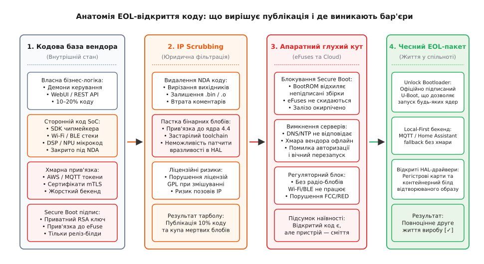
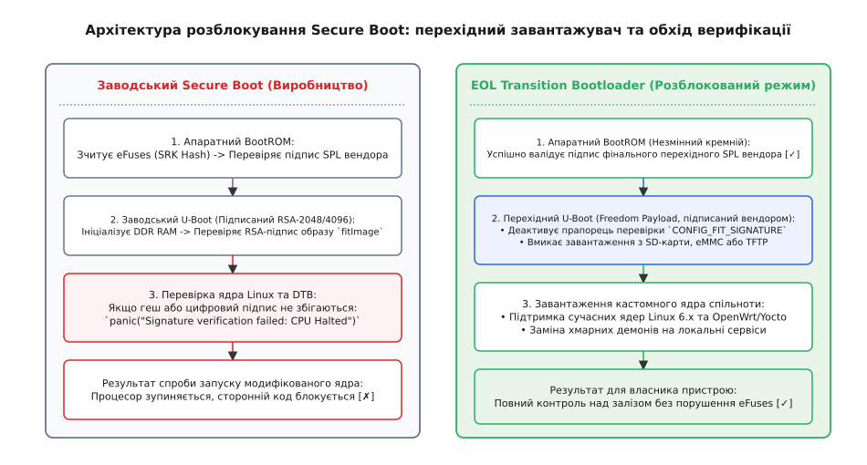

# Відкрити джерела наприкінці життя: що це вирішує і чого не вирішує

<preknowlist>
- [Ліцензії відкритого коду](root:sys-notary/open-source-licenses) — дозвільні, копілефт, межі похідних творів та принцип взаємності.
- [GPLv3 проти підписаного завантажувача](root:sys-notary/gplv3-proty-pidpysanoho-zavantazhuvacha) — антитайвоізація, вимоги до Installation Information та апаратні обмеження.
- [Право на ремонт і межа замикання](root:sys-notary/remont-pravo-vlasnyka-i-mezha-zamykannia-vyrobu) — криптографічна прив'язка компонентів, діагностичні інтерфейси та межі контролю.
- [SBOM: перелік складників образу](root:sys-notary/sbom-perelik-skladnykiv-obrazu-i-navishcho-ioho) — ідентифікація сторонніх компонентів, ліцензійна чистота та граф вразливостей.
- [Безпечне завантаження прошивки](root:sf-security/firmware-secure-boot) — ланцюг довіри від BootROM через eFuses до ядра.
- [Пастка LGPL](root:sys-notary/pastka-lgpl) — статичне та динамічне зв'язування, вимоги до релінковки пропрієтарних модулів.
</preknowlist>

Коли виробник комерційного шлюзу автоматизації, мережевого роутера або цифрового медіаплеєра через п'ять років після випуску оголошує про завершення життєвого циклу продукту (англ. *End-of-Life, EOL*), хмарна інфраструктура підтримки вимикається: сервери автентифікації повертають помилку `HTTP 503`, протокол синхронізації телеметрії припиняє роботу, а мобільний застосунок втрачає зв'язок із пристроєм. Намагаючись пом'якшити репутаційні втрати та виконати вимоги екологічного регулювання щодо запобігання утворенню електронного сміття (англ. *e-waste*), компанія публікує на GitHub архів вихідного коду прошивки під дозвільною ліцензією з повідомленням про «передачу проєкту спільноті». Проте спроба ентузіастів зібрати образ та запустити його на реальному обладнанні завершується зупинкою процесора на етапі ініціалізації: апаратний завантажувач BootROM відхиляє непідписаний образ ядра, радіомодуль Wi-Fi не запускається через відсутність закритих калібрувальних блобів чипмейкера, а прикладний демон вимагає сертифікатів недоступного хмарного бекенду.

Цей сценарій викриває принципову різницю між юридичним фактом публікації вихідного коду та інженерною здатністю пристрою функціонувати під керуванням незалежного програмного забезпечення. Відкриття джерел на етапі EOL усуває лише один із чотирьох бар'єрів життєздатності системи — доступність тексту бізнес-логіки. Інші три складові — апаратні криптографічні замки, закриті бінарні стеки постачальників кремнію та архітектурна прив'язка до хмари — залишаються нерозв'язаними без цілеспрямованої інженерної програми передачі пристрою у вільний обіг.

## Анатомія комерційної прошивки: міф про єдиний репозиторій

Поширена ілюзія серед користувачів і частини менеджменту полягає в уявленні, що вбудоване програмне забезпечення сучасного IoT-пристрою є цілісним монолітом, створеним однією командою інженерів. У реальності прошивка сучасного мікропроцесорного пристрою на базі архітектури ARM Cortex-A або MIPS є складною багатошаровою конструкцією, де виробнику кінцевого виробу належить лише незначна частка інтелектуальної власності:

1. **Масковий BootROM (0% володіння вендора):** незмінний первинний завантажувач, зашитий у кремній на заводі виробника системи на кристалі (англ. *System-on-Chip, SoC* — Qualcomm, MediaTek, NXP, Rockchip, Allwinner). Алгоритми його роботи зафіксовані у фотомасці кремнієвої пластини.
2. **Низькорівневий стек ініціалізації DDR та живлення (0–5% володіння):** пропрієтарний вторинний завантажувач (наприклад, TF-A/BL2, Rockchip `miniloader` або Allwinner `boot0`), що постачається чипмейкером виключно у скомпільованому двійковому вигляді.
3. **Радіостеки та мікрокод DSP/NPU (0% володіння):** скомпільований мікрокод для контролерів Wi-Fi, Bluetooth, стільникових модемів LTE/5G та сигнальних процесорів обробки звуку чи відео. Цей код захищений суворими угодами про нерозголошення (англ. *Non-Disclosure Agreement, NDA*) і ніколи не передається замовнику у вихідних текстах.
4. **Рівень абстракції обладнання (HAL) та драйвери ядра (10–30% володіння):** модифіковане ядро Linux застарілої LTS-версії з пропрієтарними драйверами (англ. *out-of-tree drivers*), прив'язаними до бінарних інтерфейсів конкретного вендорного BSP (англ. *Board Support Package*).
5. **Прикладна бізнес-логіка та сервіси (100% володіння вендора):** демони керування датчиками, вебінтерфейс конфігурації, алгоритми локальної автоматизації та клієнти взаємодії з хмарою.

```
┌─────────────────────────────────────────────────────────────────────────┐
│              АНАТОМІЯ ВОЛОДІННЯ КОДОМ У СУЧАСНІЙ ПРОШИВЦІ               │
├──────────────────────────┬──────────────────────────────────────────────┤
│ Шар системи              │ Статус інтелектуальної власності (IP)        │
├──────────────────────────┼──────────────────────────────────────────────┤
│ Прикладні демони / WebUI │ 100% власність вендора (можна відкрити)      │
│ Клієнт хмарної синхронізації │ 100% власність вендора (не працює без хмари) │
│ Драйвери периферії ядра  │ Змішаний код (GPLv2 + закриті обгортки HAL)  │
│ Стеки Wi-Fi / Bluetooth  │ 0% власність вендора (закриті блоби чипмейкера) │
│ Ініціалізація RAM (SPL)  │ 0% власність вендора (бінарний блоб під NDA) │
│ BootROM / eFuses         │ 0% власність вендора (фізичний кремній SoC)  │
└─────────────────────────────────────────────────────────────────────────┘
```

Коли компанія ухвалює рішення «відкрити код», юридичний відділ виявляє, що вендор має законне право опублікувати лише верхній шар — прикладної логіки. Спроба викласти вихідні коди низькорівневих драйверів, отриманих від постачальника чипів під NDA, тягне за собою багатомільйонні судові позови за порушення комерційної таємниці та авторських прав на кремнієвий IP.

## Бар'єр 1: Юридичне очищення (IP Scrubbing) та пастка бінарних блобів

Процедура підготовки репозиторію до відкритої публікації називається юридичним очищенням (англ. *IP Scrubbing*, від лат. *sanitas* — чистота, здоров'я). Юристи та аудитори вилучають із кодової бази всі фрагменти, на які компанія не має прямих авторських прав або дозволу на субліцензування:

- Видаляються вихідні файли пропрієтарних модулів ядра, замість яких залишаються скомпільовані об'єктні файли (`.o`), що лінкуються з ядром під час фінальної збірки;
- Видаляються таблиці калібрування радіочастотних трактів або поміщаються у двійкові контейнери без опису структури полів;
- Вичищаються внутрішні коментарі розробників, що описують недокументовані регістри процесора та апаратні помилки кремнію (англ. *silicon errata*).


*Анатомія EOL-відкриття коду: що вирішує публікація і де виникають бар'єри.*

У результаті юридичного очищення спільнота отримує так званий «напіввідкритий франкенштейн»: код формально збирається, але жорстко прив'язаний до двійкових блобів. Це породжує фундаментальні технічні глухі кути:

1. **Заморожування версії ядра Linux (Kernel ABI Lock):** двійкові драйвери скомпільовані під конкретну версію внутрішнього ABI ядра (наприклад, Linux 3.18.20 або 4.4.19). Оскільки ядро Linux принципово не гарантує стабільності внутрішнього бінарного інтерфейсу між версіями, перенести такий пристрій на сучасне безпечне ядро (наприклад, Linux 6.6 LTS) неможливо без повного зворотного інжинірингу драйверів.
2. **Неможливість виправлення критичних вразливостей:** якщо у двійковому блобі драйвера Wi-Fi (наприклад, Broadcom `wl.ko` чи Realtek `r8188eu`) виявлено переповнення буфера при обробці кадрів Beacon, спільнота не може внести правку до вихідного тексту і змушена експлуатувати пристрій із відомою вразливістю нульового дня.
3. **Застарілий інструментарій компіляції (Toolchain Obsoletion):** збірка образу часто вимагає застарілих версій компілятора GCC (наприклад, GCC 4.8 з бібліотекою uClibc 0.9.33), які не підтримують сучасні стандарти безпеки (ASLR, SSP, Fortify Source) та не збираються на сучасних дистрибутивах Linux без використання старих віртуальних машин або ізольованих контейнерів.

## Бар'єр 2: Криптографічний замок Secure Boot та eFuses

Найбільш нездоланним бар'єром для незалежної підтримки пристроїв після EOL є апаратна криптографія безпечного завантаження (англ. *Secure Boot*). 

Під час заводського калібрування в процесорі одноразово перепалюються електричні мікроперемички (англ. *OTP eFuses*), куди записується 256-бітний криптографічний геш публічного кореневого ключа виробника (`SRK_HASH`). Після встановлення захисного біта `SEC_CONFIG` BootROM процесора виконує апаратну перевірку цифрового підпису кожного етапу завантаження:

```
BootROM (ROM) ──► SPL (eFuse SRK Check) ──► U-Boot (RSA Verify) ──► Kernel (FIT Sig Check)
```

Якщо користувач завантажує вихідний код із відкритого репозиторію вендора, модифікує хоча б один рядок у драйвері та компілює власний образ `uImage` або `zImage`, цифровий підпис файлу втрачає чинність. BootROM фіксує невідповідність підпису, блокує контролер оперативної пам'яті DDR та апаратно утримує лінію скидання процесора. Пристрій перетворюється на неробочий брусок кремнію та пластику.


*Архітектура розблокування Secure Boot: перехідний завантажувач та обхід верифікації.*

Проблема полягає в тому, що приватний ключ RSA-2048 або ECDSA P-256, яким підписуються образи, є суворо конфіденційним активом компанії. Виробник не може просто опублікувати свій приватний ключ у відкритому доступі, оскільки цей самий ключ або спільний кореневий сертифікат CA часто використовується для підпису інших продуктів лінійки, які все ще перебувають у комерційній експлуатації.

### Інженерні шляхи розв'язання проблеми eFuses при EOL

Для подолання апаратного глухого кута виробник повинен реалізувати один із трьох перехідних механізмів:

1. **Випуск перехідного відкритого завантажувача (Freedom Payload / Transition Bootloader):** компанія створює спеціальну фінальну збірку завантажувача U-Boot, підписує її своїм офіційним приватним ключем на серверах релізу та розповсюджує як останнє офіційне OTA-оновлення. Цей завантажувач успішно проходить апаратну перевірку BootROM, але деактивує прапорець `CONFIG_FIT_SIGNATURE`, вмикає виконання коду з довільних носіїв (SD-карта, eMMC, USB) і завантажує будь-яке стороннє ядро Linux без перевірки цифрового підпису.
2. **Активація відлагоджувального сервісного сертифіката (Debug Unlock Token):** деякі сучасні SoC (наприклад, NXP i.MX8 або TI Sitara AM6x) підтримують протокол авторизованого відмикання безпеки. Вендор може надати утиліту, що генерує одноразовий криптографічний токен для конкретного серійного номера процесора (`UID`), який переводить чип у відкритий режим розробки.
3. **Локальний сервіс підписання (Local Signing Oracle):** компанія надає автономну утиліту або відкритий контейнеризований бекенд, який підписує користувацькі образи спеціальним EOL-сертифікатом, якщо в архітектурі SoC передбачено слот для вторинного ключа відновлення.

## Бар'єр 3: Радіочастотна сертифікація та регуляторні обмеження

Для бездротових пристроїв (Wi-Fi роутери, BLE-маяки, Zigbee/Matter шлюзи, дрони, радіомодеми) критичною перешкодою є вимоги регуляторних органів у сфері використання радіочастотного спектра — Федеральної комісії зі зв'язку США (англ. *FCC*) та Директиви ЄС щодо радіообладнання (англ. *Radio Equipment Directive, RED, 2014/53/EU*).

Регулятори вимагають від виробників гарантувати, що користувач не зможе програмним шляхом модифікувати параметри радіотракту так, щоб пристрій порушував норми випромінювання:
- Збільшувати вихідну потужність передавача (англ. *Tx Power*) понад дозволені ліміти питомого поглинання (англ. *SAR*);
- Активувати роботу на заборонених національних частотах або вимикати алгоритми динамічного вибору частоти (англ. *Dynamic Frequency Selection, DFS*) на каналах радарів метеослужб;
- Змінювати межі робочих діапазонів ISM та частотні сітки.

Аби отримати сертифікат FCC/CE, виробники чипів блокують доступ до радіорегістрів і ховають таблиці підсилення та частотних масок у закриті бінарні мікропрограми. Коли вендор відкриває вихідний код пристрою на EOL, він не має права відкривати исходники радіодрайвера без втрати чинності сертифікатів відповідності. Без переходу на стандартні відкриті підсистеми ядра Linux (`mac80211` та `cfg80211`) пристрій залишається заручником закритого радіоблоба.

## Бар'єр 4: Хмарна прив'язка (Cloud Tethering) та автономність

Більшість споживчих пристроїв епохи Інтернету речей спроєктовані за архітектурою «тонкого клієнта»: локальна прошивка містить мінімум логіки та виконує роль шлюзу передачі даних на сервери постачальника. 

Наслідки вимкнення серверів вендора:
- **Помилки синхронізації часу та DNS:** пристрій намагається синхронізувати годинник через жорстко прописаний NTP-сервер вендора `ntp.vendor-cloud.internal`. Оскільки сервер не відповідає, системний годинник скидається на 1970 рік, що призводить до помилок валідації будь-яких сертифікатів TLS.
- **Жорстке закріплення сертифікатів (Certificate Pinning):** прикладна програма перевіряє публічний ключ сервера за вбудованим кореневим сертифікатом вендора. Перенаправити трафік на локальний брокер MQTT (наприклад, Mosquitto або Home Assistant) через DNS-спуфінг неможливо, оскільки локальний сервер не має валідного вендорного сертифіката.
- **Відсутність збереження локального стану:** розклад увімкнення, конфігурація сценаріїв та прив'язка датчиків зберігалися в реляційній базі даних у хмарі, а прошивка не має механізму локального енергонезалежного зберігання правил.

Справжній інженерний перехід на EOL вимагає модифікації вихідного коду перед відкриттям: реалізації режиму автономної роботи (англ. *Local-First Fallback*), вбудованого локального вебінтерфейсу для конфігурації без реєстрації облікового запису та можливості заміни довірених кореневих сертифікатів CA через меню налаштувань.

## Програмна реалізація: контролер переходу завантаження на C99 та C++20

Нижче наведено модуль перехідного завантажувача (Boot Mode Transition Engine), який реалізує безпечний перехід пристрою від закритого режиму Secure Boot до відкритого завантаження коду спільноти на етапі EOL. Модуль перевіряє статус апаратних eFuses, обробляє авторизований токен розблокування вендора та конфігурує параметри завантаження ядра.

:::tabs
```c
#include <stdio.h>
#include <stdint.h>
#include <stdbool.h>
#include <string.h>

#define HW_EFUSE_SECURE_BOOT_MASK   (1U << 0)
#define HW_EFUSE_JTAG_DISABLE_MASK  (1U << 1)
#define EOL_UNLOCK_MAGIC            0x554E4C4BU /* 'UNLK' */

typedef enum {
    BOOT_MODE_FACTORY_LOCKED,
    BOOT_MODE_COMMUNITY_UNLOCKED,
    BOOT_MODE_AUTH_FAILURE
} boot_mode_t;

typedef struct {
    uint32_t magic;
    uint32_t device_uid[4];
    uint8_t  signature_token[64];
    uint32_t flags;
} eol_unlock_token_t;

typedef struct {
    uint32_t efuse_register_val;
    uint32_t device_uid[4];
    bool     fit_signature_enforce;
    bool     allow_external_storage_boot;
} boot_controller_t;

static bool verify_token_authenticity(const eol_unlock_token_t *token, const uint32_t expected_uid[4]) {
    if (token->magic != EOL_UNLOCK_MAGIC) {
        return false;
    }
    for (int i = 0; i < 4; ++i) {
        if (token->device_uid[i] != expected_uid[i]) {
            return false;
        }
    }
    /* Імітація криптографічної перевірки підпису RSA-2048/ECDSA через апаратний криптомодуль */
    return (token->signature_token[0] != 0x00);
}

void boot_controller_init(boot_controller_t *ctrl, uint32_t efuse_val, const uint32_t uid[4]) {
    ctrl->efuse_register_val = efuse_val;
    for (int i = 0; i < 4; ++i) {
        ctrl->device_uid[i] = uid[i];
    }
    ctrl->fit_signature_enforce = (efuse_val & HW_EFUSE_SECURE_BOOT_MASK) != 0;
    ctrl->allow_external_storage_boot = !ctrl->fit_signature_enforce;
}

boot_mode_t boot_controller_process_eol(boot_controller_t *ctrl, const eol_unlock_token_t *token) {
    if (!(ctrl->efuse_register_val & HW_EFUSE_SECURE_BOOT_MASK)) {
        /* Пристрій не був заблокований на заводі */
        ctrl->fit_signature_enforce = false;
        ctrl->allow_external_storage_boot = true;
        return BOOT_MODE_COMMUNITY_UNLOCKED;
    }

    if (token != NULL && verify_token_authenticity(token, ctrl->device_uid)) {
        /* Отримано валідний офіційний токен розблокування EOL */
        ctrl->fit_signature_enforce = false;
        ctrl->allow_external_storage_boot = true;
        printf("[BOOT] Авторизоване розблокування EOL успішне. Захист FIT деактивовано.\n");
        return BOOT_MODE_COMMUNITY_UNLOCKED;
    }

    printf("[BOOT] Апаратний Secure Boot активний. Потрібен дійсний підпис вендора.\n");
    return BOOT_MODE_FACTORY_LOCKED;
}
```
```cpp
#include <iostream>
#include <array>
#include <span>
#include <string_view>
#include <cstdint>
#include <algorithm>

namespace eol::boot {

enum class BootMode {
    FactoryLocked,
    CommunityUnlocked,
    AuthFailure
};

struct UnlockToken {
    static constexpr uint32_t MAGIC = 0x554E4C4B; // 'UNLK'

    uint32_t magic{0};
    std::array<uint32_t, 4> device_uid{};
    std::array<uint8_t, 64> signature_token{};
    uint32_t flags{0};

    [[nodiscard]] bool is_valid_for(std::span<const uint32_t, 4> expected_uid) const noexcept {
        if (magic != MAGIC) {
            return false;
        }
        if (!std::equal(device_uid.begin(), device_uid.end(), expected_uid.begin())) {
            return false;
        }
        return signature_token[0] != 0x00;
    }
};

class BootController {
public:
    static constexpr uint32_t HW_EFUSE_SECURE_BOOT_MASK = (1U << 0);
    static constexpr uint32_t HW_EFUSE_JTAG_DISABLE_MASK = (1U << 1);

    explicit BootController(uint32_t efuse_val, std::span<const uint32_t, 4> uid)
        : efuse_val_(efuse_val),
          fit_signature_enforce_((efuse_val & HW_EFUSE_SECURE_BOOT_MASK) != 0),
          allow_external_boot_(!fit_signature_enforce_) {
        std::copy(uid.begin(), uid.end(), device_uid_.begin());
    }

    [[nodiscard]] BootMode process_eol_transition(const UnlockToken* token = nullptr) noexcept {
        if ((efuse_val_ & HW_EFUSE_SECURE_BOOT_MASK) == 0) {
            fit_signature_enforce_ = false;
            allow_external_boot_ = true;
            return BootMode::CommunityUnlocked;
        }

        if (token != nullptr && token->is_valid_for(device_uid_)) {
            fit_signature_enforce_ = false;
            allow_external_boot_ = true;
            std::cout << "[BOOT] Авторизоване розблокування EOL успішне. Захист FIT деактивовано.\n";
            return BootMode::CommunityUnlocked;
        }

        std::cout << "[BOOT] Апаратний Secure Boot активний. Потрібен дійсний підпис вендора.\n";
        return BootMode::FactoryLocked;
    }

    [[nodiscard]] bool is_fit_signature_enforced() const noexcept { return fit_signature_enforce_; }
    [[nodiscard]] bool is_external_boot_allowed() const noexcept { return allow_external_boot_; }

private:
    uint32_t efuse_val_{0};
    std::array<uint32_t, 4> device_uid_{};
    bool fit_signature_enforce_{true};
    bool allow_external_boot_{false};
};

} // namespace eol::boot
```
:::

## Матриця готовності до EOL: що саме вирішує відкриття

Для систематизації наслідків публікації коду інженерна команда повинна розрізняти сфери відповідальності:

```
┌─────────────────────────────────────────────────────────────────────────┐
│               МАТРИЦЯ ГОТОВНОСТІ ВИРОБУ ДО ПЕРЕДАЧІ ПРИ EOL             │
├──────────────────────────┬──────────────────────┬───────────────────────┤
│ Проблема виробу          │ Вирішує відкриття?   │ Необхідна дія         │
├──────────────────────────┼──────────────────────┼───────────────────────┤
│ Локальні баги у WebUI    │ ТАК, повністю        │ Публікація репозиторію│
│ Додавання нових фіч      │ ТАК, на рівні демонів│ Відкритий SDK         │
│ Заблокований завантажувач│ НІ, блокує eFuses    │ Підписаний U-Boot EOL │
│ Падіння драйвера Wi-Fi   │ НІ, закритий блоб    │ Відкриття регістрів   │
│ Вимкнення хмари вендора  │ ЧАСТКОВО             │ Режим Local-First     │
│ Оновлення ядра до 6.x    │ НІ, ABI блобів       │ Рефакторинг під Linux │
└─────────────────────────────────────────────────────────────────────────┘
```

> 🔧 **Навіщо це.** Справжня передача пристрою спільноті на етапі EOL — це не разова викладка архіву коду на хостинг репозиторіїв, а інженерний процес відмикання апаратного контролю. Якщо компанія планує життєвий цикл виробу з урахуванням сучасних стандартів циркулярної економіки та права на ремонт, архітектура прошивки повинна з самого початку проєктуватися за принципом «Local-First», а підсистема безпечного завантаження — містити штатний протокол переведення кристала у відкритий стан для спільноти після закінчення строку комерційної підтримки.

Для аудиту кодової бази та автоматичного виявлення прихованих закритих блобів чи секретів перед публікацією використовується спеціалізований інструмент [Валідатор кодової бази перед EOL-публікацією](root:sys-notary/vidkryty-dzherela-naprykintsi-zhyttia/proj-blob-sanitizer.md).
