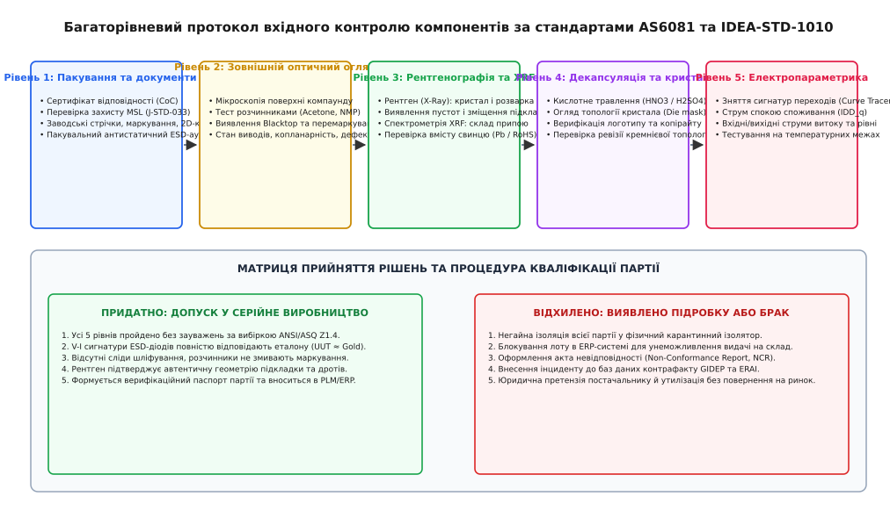
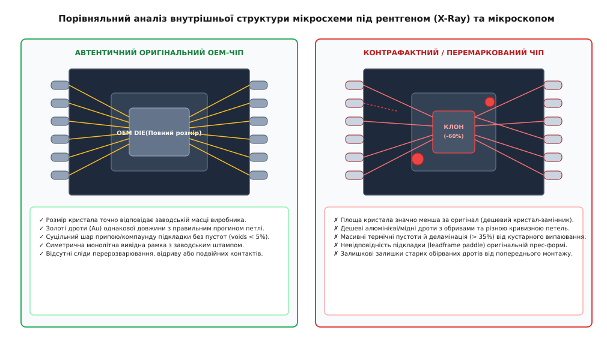

# Вхідний контроль і підробні компоненти

<preknowlist>
- [Еталонний зразок і перше виробниче](root:sys-notary/etalonnyi-zrazok-i-pershe-vyrobnyche) — фіксація еталонних фізико-хімічних та електричних параметрів компонентів.
- [Декларація відповідності й технічний файл](root:sys-notary/deklaratsiia-vidpovidnosti-i-tekhnichnyi-fail) — формування доказового пакета технічної документації виробу.
- [Речовини й утилізація: RoHS, REACH, WEEE](root:sys-notary/rechovyny-i-utylizatsiia) — хімічні обмеження на вміст свинцю та важких металів у виводах компонентів.
- [Компонент знято з випуску](root:sys-notary/komponent-zniato-z-vypusku) — управління ланцюгами постачання в умовах дефіциту та переходу на брокерські ринки.
- [Аналізатор сигнатур напівпровідникових переходів](root:sys-notary/vkhidnyi-kontrol-i-pidrobni-komponenty/proj-component-authenticity-checker.md) — програмно-апаратна реалізація системи неруйнівного вольт-амперного тестування.
</preknowlist>

Партія з трьохсот високовольтних блоків керування тяговими електроприводами проходить фінальні сорокагодинні стендові випробування перед відвантаженням замовнику. Через сорок хвилин після виходу на номінальне навантаження сорок вісім модулів одночасно виходять з ладу: силові польові транзистори пробиваються з вибухом корпусів, а центральні 32-бітні обчислювачі зависають без відповіді на лініях інтерфейсу CAN. Розслідування інциденту розкриває катастрофічну картину: силові MOSFET у корпусах TO-247 з оригінальним лазерним гравіюванням відомого виробника містили всередині дешеві відбраковані кристали зі зниженою втричі площею кремнію, а замість промислових мікроконтролерів з індустріальним температурним діапазоном від -40 до +85 °C у схему було встановлено перемарковані комерційні чіпи з робочим діапазоном від 0 до +70 °C, випаяні з відходів побутової електроніки. Збитки підприємства від зупинки конвеєра, відкликання блоків та юридичних штрафів перевищують чотириста тисяч євро.

Глобалізація ланцюгів постачання електронних компонентів, періодичні кризи дефіциту напівпровідникових пластин та зняття критичних мікросхем із серійного виробництва змушують розробників купувати комплектуючі не лише у сертифікованих франчайзингових дистриб'юторів, але й на відкритому брокерському ринку (Open Market). Будь-який неавторизований ланцюг постачання несе ризик отримання фальсифікату. Без розгортання суворого, багатоступеневого протоколу вхідного контролю (Incoming Quality Control, IQC), що поєднує неруйнівний оптичний, спектральний, рентгенівський і сигнатурний аналіз із вибірковою хімічною декапсуляцією, виробництво ризикує перетворитися на сортувальний цех для контрафакту.

## Анатомія та фізичні механізми контрафакту

Контрафактні електронні компоненти (Counterfeit Electronic Parts) — це вироби, чия ідентичність, маркування, походження, внутрішня структура або технічні характеристики були навмисно викривлені з метою введення споживача в оману. Напівпровідниковий фальсифікат поділяється на кілька технологічних категорій, кожна з яких має специфічні фізичні маркери:

```
+───────────────────────────────────────────────────────────────────────────+
| ОСНОВНІ КАТЕГОРІЇ ТА МЕТОДИ СТВОРЕННЯ КОНТРАФАКТНИХ ЕЛЕКТРОННИХ КОМПОНЕНТІВ|
|                                                                           |
|   1. Шліфування та Blacktopping      2. Перемаркування градацій (Binning) |
|   ┌───────────────────────────────┐  ┌─────────────────────────────────┐  |
|   │ Зрізання старого маркування   │  │ Комерційний чіп (0..+70 °C)     │  |
|   │ Нанесення епоксидного шару    │──┼─► Маркування як індустріальний  │  |
|   │ Гравіювання фальшивого бренду │  │ або військовий (-55..+125 °C)   │  |
|   └───────────────────────────────┘  └─────────────────────────────────┘  |
|                                                                           |
|   3. Демонтаж із брухту (E-waste)    4. Клонування та чужі кристали       |
|   ┌───────────────────────────────┐  ┌─────────────────────────────────┐  |
|   │ Випалювання на пальниках      │  │ Монтаж дешевого кристала-клона  │  |
|   │ Механічне виправлення ніжок   │──┼─► Зменшена площа кремнію (-60%) │  |
|   │ Кустарне перелуджування виводів  │ Відсутність захисних блоків     │  |
|   └───────────────────────────────┘  └─────────────────────────────────┘  |
+───────────────────────────────────────────────────────────────────────────+
```

### 1. Механічне шліфування та маскувальне покриття (Sanding & Blacktopping)

Найпоширеніший метод створення фальсифікату полягає у фізичному видаленні оригінального лазерного або фарбового маркування з поверхні епоксидного компаунду. Чіпи встановлюють на шліфувальні верстати (lapping machines) і знімають шар пластмаси завтовшки від 50 до 150 мкм.

Оскільки після механічної абразивної обробки поверхня компаунду покривається характерними паралельними подряпинами та втрачає заводську матову текстуру прес-форми, шахраї наносять маскувальне полімерне покриття — так званий блектопінг (англ. *blacktopping*). Блектопінг являє собою суміш рідкої епоксидної смоли, фенолформальдегідних лаків або поліуретану з додаванням пігменту технічного вуглецю (сажі). Після термозатвердіння шару на нову поверхню лазером наноситься фальшиве маркування з логотипом преміального бренду, бажаним партномером, свіжим датакодом (Date Code) та номером партії (Lot Code).

Фізичні вади цього методу:
- **Ефект примарного маркування (Ghost Marking):** Якщо первинне заводське лазерне маркування проникло на глибину 120 мкм, а шліфувальний верстат зняв лише 80 мкм, залишки оригінальних літер лишаються під шаром блектопінгу і проявляються при косому освітленні або після змочування розчинником.
- **Зрізання орієнтаційних міток (Pin 1 Dimple Degradation):** Оригінальний корпус має запресовану конічну або сферичну виїмку для позначення першого виводу (Pin 1 Indicator), сформовану безпосередньо сталевою прес-формою. Після шліфування заводська виїмка стає неприродно мілкою, або шахраї висвердлюють її фрезою наново, залишаючи сліди радіального різання та гострі необроблені краї.
- **Порушення площинності та товщини:** Товщина корпусу мікросхеми зменшується на 5–15% відносно креслення даташиту, а ребра корпусу втрачають технологічні фаски.

### 2. Перемаркування температурних і швидкісних градацій (Re-binning Fraud)

Виробники напівпровідників після виготовлення кремнієвої пластини проводять параметричне сортування чіпів (Binning): екземпляри з мінімальними струмами витоку та високою швидкодією маркуються як військові (Military Grade, -55..+125 °C) або аерокосмічні; чіпи із середніми параметрами — як промислові (Industrial Grade, -40..+85 °C); а чіпи з високим тепловим дрейфом — як комерційні (Commercial Grade, 0..+70 °C).

Різниця в ціні між комерційною та військовою версією одного й того самого мікроконтролера або FPGA може досягати 10–50 разів. Шахраї купують найдешевші комерційні чіпи, стирають суфікси маркування (наприклад, змінюють індекс комерційного чіпа на військовий індекс) і продають їх за ціною компонентів високої надійності. При встановленні в апаратуру такий компонент безвідмовно працює за кімнатної температури в лабораторії, але необоротно виходить з ладу або зависає при охолодженні до -30 °C або нагріванні вище +65 °C.

### 3. Демонтаж із відходів та рециклінг (E-waste Salvaged Components)

Мільйони тонн відпрацьованої електроніки щодоби надходять на нелегальні центри утилізації. Плати нагрівають над вугільними жаровнями, газовими пальниками або занурюють у відкриті ванни з розплавленим свинцевим припоєм, після чого струшуванням вибивають мікросхеми з отворів та контактних майданчиків.

Демонтовані мікросхеми зазнають колосальних руйнівних факторів:
- **Термічний шок і внутрішнє розшарування (Delamination):** Нагрівання пластмасового корпусу вище +300 °C без дотримання температурного профілю J-STD-020 призводить до скипання поглиненої вологи всередині епоксиду (ефект «попкорну»). Всередині виникають мікротріщини, відрив кристала від мідного тепловідводу та руйнування внутрішніх контактних дротів.
- **Окиснення та деформація виводів:** Виводи очищають від старого припою кислотними флюсами, вирівнюють плоскогубцями та вручну наносять шар олова (Re-tinning) або відновлюють BGA-кульки (Re-balling). На виводах залишаються мікроподряпини, каверни припою, залишки агресивних хлоридних флюсів та нерівномірна товщина покриття.

### 4. Неавторизовані кристали-клони (Die Swapping & Unauthorized Fabs)

Найбільш витончений вид контрафакту, за якого корпус виготовляється на неавторизованій фабриці з використанням дешевого стороннього кристала-аналога. Наприклад, замість оригінального 32-бітного мікроконтролера відомої марки в корпус упаковують сумісний за виводами, але спрощений кристал від стороннього неавторизованого виробника. Такі кристали часто мають занижений обсяг пам'яті SRAM, нестабільні внутрішні генератори RC, відсутність апаратних блоків шифрування або вразливі до напруги захисні діоди.

## Фізико-хімія епоксидних компаундів та спектроскопія FTIR

Пластикові корпуси інтегральних схем виготовляються методом трансферного пресування з термореактивних епоксидних прес-порошків (Epoxy Molding Compounds, EMC). Типовий промисловий компаунд містить:
1. **Полімерна основа (15–25% за масою):** епоксидно-новолачні смоли (Epoxy Cresol Novolac, ECN) або смоли на базі дициклопентадієну (DCPD) із високою температурою склування `T_g > 150 °C`.
2. **Затверджувач (5–10%):** фенолформальдегідні новолачні олігомери, що утворюють щільну тривимірну зшиту просторову сітку при температурі спікання +175 °C.
3. **Мінеральний наповнювач (70–85% за масою):** плавлений діоксид кремнію (`SiO2`) у вигляді сферичних або подрібнених мікрочастинок розміром 5–30 мкм. Наповнювач необхідний для зниження коефіцієнта теплового розширення (КТР) компаунду до величини `10–15 ppm/°C`, що узгоджує його з КТР кремнієвого кристала (`3 ppm/°C`) та мідної вивідної рамки (`17 ppm/°C`), запобігаючи руйнуванню кристала при термоциклуванні.
4. **Антипірени та барвники (1–3%):** гідроксид алюмінію, оксид сурми `Sb2O3` або екологічні фосфорорганічні добавки разом із тонкодисперсним вуглецем (сажею).

```
+───────────────────────────────────────────────────────────────────────────+
| ПОРІВНЯННЯ ІНФРАЧЕРВОНИХ СПЕКТРІВ FTIR ОРИГІНАЛУ ТА BLACKTOPPING-ШАРУ     |
|                                                                           |
|   Пропускання T, %                                                        |
|   100 ┌─────────────────────────────────────────────────────────────────┐ |
|       │                                                                 │ |
|       │     [Оригінальний компаунд EMC]       Пік C-O-C                 │ |
|    80 │     ─ ─ ─ ─ ─ ─ ─ ─ ─ ─ ─ ─ ─ ─ ─ ─ ─ ─ ─ ─ ─ ─ ─ ─ ─ ─ ─ ─ ─ ─│ |
|       │           Пік епоксиду (830 см⁻¹)    (1240 см⁻¹)                │ |
|    60 │                \                        /                       │ |
|       │                 ▼                      ▼                        │ |
|    40 │     ─────────────────╭───╮────────────╭───╮───────────────────   │ |
|       │                      │   │            │   │                     │ |
|    20 │                      ╰───╯            ╰───╯                     │ |
|       │      [Блектопінг на поліуретані]  Пік C=O естеру (1725 см⁻¹)    │ |
|       │                                       |                         │ |
|     0 │                                       ▼ ╭───╮                   │ |
|       │     ════════════════════════════════════│   │════════════════   │ |
|       │                                         ╰───╯                   │ |
|       └─────┬───────────────┬────────────────┬────────────────┬─────────┘ |
|            4000            3000             2000             1000  см⁻¹   |
|                               Хвильове число ν                            |
+───────────────────────────────────────────────────────────────────────────+
```

Коли шахраї шліфують корпус і наносять поверхневий шар блектопінгу, вони використовують дешеві епоксидні або поліуретанові лаки холодного затвердіння без додавання мікросфер діоксиду кремнію `SiO2`. Це створює два очевидні фізико-хімічні маркери:

1. **Інфрачервона спектроскопія з перетворенням Фур'є (FTIR):**
   - Метод порушеного повного внутрішнього відбиття (Attenuated Total Reflection, ATR-FTIR) дозволяє за лічені секунди отримати спектр поверхневого шару чіпа на глибині 1–2 мкм без пошкодження зразка.
   - Оригінальний промисловий компаунд EMC демонструє виражені характеристичні піки поглинання ароматичних кілець при `1508 см⁻¹`, ефірних зв'язків C-O-C при `1240 см⁻¹` та деформаційних коливань епоксидного кільця при `830 см⁻¹`.
   - Шар блектопінгу на основі поліуретану чи алкідних смол демонструє потужний пік поглинання карбонільної групи `C=O` при `1725 см⁻¹`, який повністю відсутній у термореактивних компаундах заводського пресування.
2. **Конфокальна лазерна сканувальна мікроскопія (CLSM):**
   - Під коаксіальним лазерним підсвічуванням оригінальний корпус має матовий рельєф із рівномірним розподілом зерен прес-форми (шорсткість `Ra = 0.8–1.5 мкм`).
   - Шліфований корпус із блектопінгом демонструє неприродно дзеркальну глянцеву поверхню (`Ra < 0.2 мкм`) або локальні хвилеподібні напливи лаку біля фасок і виводів.

## Оптичний аналіз дефектів за каталогом IDEA-STD-1010

Стандарт IDEA-STD-1010 містить деталізовану класифікацію візуальних аномалій корпусу, що оцінюються під стереомікроскопом:

1. **Аналіз слідів виштовхувачів прес-форми (Mold Ejector Pin Marks):**
   - Після затвердіння компаунду в сталевій прес-формі гідравлічні штовхачі виштовхують вивідну рамку з матриці. Сліди штовхачів являють собою круглі заглиблення діаметром 1.0–2.5 мм на нижній поверхні корпусу.
   - В оригінальних компонентів усі сліди мають однакову глибину (типово 50–100 мкм), гладке дно з концентричними мікроборозенками металообробки штампа та повну відсутність задирок (flash).
   - У фальсифікованих чіпах сліди штовхачів часто виявляються заповненими залишками блектопінгу, мають різну глибину або частково зрізані при нерівномірному шліфуванні.
2. **Мікроструктура лазерного маркування (Laser Ablation Kerning & Morphology):**
   - Заводське маркування виконується імпульсними волоконними або Nd:YAG лазерами, які прецизійно випаровують шар епоксиду, оголюючи білі сферичні частинки діоксиду кремнію `SiO2`. Літери мають рівний молочно-білий або світло-сірий відтінок і чіткі прямокутні краї.
   - Фальшиве маркування часто наноситься дешевими `CO2`-лазерами з довжиною хвилі 10.6 мкм, що викликає оплавлення та обвуглювання полімеру (чорно-коричневі обпалені краї з нагаром) або наноситься тамподруком нестійкою фарбою.
3. **Стандартизований скотч-тест адгезії фарби за ASTM D3359:**
   - На маркування наклеюють поліефірну стрічку 3M 600 із нормованим зусиллям притискання. Стрічку зривають під кутом 180° швидким рухом. Якщо на стрічці залишається понад 5% площі фарбового маркування, компонент бракується.

## Фальсифікація пасивних компонентів та силових модулів

Контрафакт не обмежується лише цифровими мікросхемами. Масовому фальшуванню піддаються пасивні та силові компоненти:

### 1. Багатошарові керамічні конденсатори (MLCC): підміна діелектриків

Найпоширенішою аферою у сфері пасивних компонентів є перемаркування дешевих керамічних конденсаторів на сегнетоелектричній кераміці з високою проникністю (клас 2 та 3: діелектрики Y5V, Z5U) під виглядом термостабільних конденсаторів класу 1 (NP0/C0G) або класу 2 (X7R, X8R).

Фізичний ефект зміщення постійною напругою (DC Bias Voltage Effect):
- Конденсатор діелектрика Y5V номіналом 10 мкФ на напругу 16 В за нульової напруги демонструє ємність 10 мкФ. Проте при подачі робочої постійної напруги 12 В сильне внутрішнє електричне поле насичує сегнетоелектричні домени титанату барію `BaTiO3`. Внаслідок цього ефективна ємність падає на **80–90%**, зменшуючись до мізерних `1.0–1.5 мкФ`.
- Встановлення такого конденсатора у вихідний фільтр імпульсного DC-DC перетворювача викликає зрив зворотного зв'язку, гігантські пульсації напруги амплітудою в кілька вольт та тепловий пробій живленого процесора.
- Вхідний контроль конденсаторів обов'язково включає вимірювання ємності при одночасній подачі номінальної постійної напруги зміщення (DC Bias Fixture) на прецизійному LCR-метрі на частотах 1 кГц та 100 кГц.

### 2. Силові IGBT-модулі та збірки MOSFET

У високовольтних силових інверторах використовуються модулі в корпусах типів EasyPACK, EconoPACK або PrimePACK. Шахраї беруть старі згорілі корпуси, видаляють силіконовий гель, встановлюють замість оригінальних кристалів 200 А / 1200 В крихітні кристали 50 А / 600 В від дешевих дискретних транзисторів і заливають їх свіжим компаундом.

Під час вхідного контролю модулів виконується вимірювання теплового опору «кристал-корпус» (Thermal Transient Resistance, `R_th_jc`) методом коротких імпульсів струму. Якщо тепловий опір перевищує норму в 3–4 рази — у модулі встановлено чужий кристал меншої площі або використано неякісну термопасту.

### 3. Фальсифікація трансиверів RS-485 та CAN-шин

Інтерфейсні мікросхеми промислових шин (MAX485, SN65HVD230) є критичними вузлами автоматики. Підробні мікросхеми виготовляються за спрощеними технологічними нормами без кіл захисту від перенапруг. В оригінальних трансиверів діапазон допустимої синфазної напруги становить від -7 В до +12 В, а виходи витримують пряме замикання на шину 24 В без пошкодження. Клони не мають блоків обмеження струму (Fault Protection) і виходять з ладу при першому ж стрибку потенціалу землі між шафами керування.

### 4. Фальсифікація Flash-пам'яті та EEPROM (SPI / I2C)

У мікросхемах флеш-пам'яті (W25Q128) шахраї монтують дешеві кристали обсягом 4 Мбіт замість 128 Мбіт, застосовуючи циклічне маскування адрес (Address Aliasing). Запис перших кілобайт даних проходить успішно, але при спробі запису образу прошивки розміром 2 МБ дані перезаписують самі себе з нульової адреси, руйнуючи завантажувач. Вхідний контроль Flash-пам'яті вимагає обов'язкового суцільного запису псевдовипадкової послідовності (PRBS) на повний адресний простір.

### 5. Фальсифікація кварцових резонаторів та генераторів

Кварцові резонатори та термокомпенсовані генератори (TCXO) є опорною основою синхронізації цифрових протоколів. Шахраї перемарковують дешеві резонатори загального призначення зі стабільністю ±50 ppm під прецизійні вироби зі стабільністю ±0.5 ppm. Під час вхідного контролю на прецизійному вимірювачі імпедансу контролюється динамічний опір резонансу (Motional Resistance `R_1`). У відновлених резонаторах `R_1` зростає вище 100 Ом (при нормі 25–40 Ом), що призводить до зриву генерації при від'ємних температурах.

## Фізика деградації затворного діелектрика MOSFET (TDDB)

У силових польових транзисторах і мікросхемах керування після некваліфікованого демонтажу з відпрацьованих плат тонкий шар затворного оксиду `SiO2` (товщина 20–40 нм) зазнає прихованої електротермічної деградації, відомої як часозалежний пробій діелектрика (Time-Dependent Dielectric Breakdown, TDDB).

Фізичний механізм явища:
1. **Інжекція гарячих носіїв та тунелювання Фаулера-Нордгейма:** При нагріванні вище +280 °C та залишкових потенціалах статичного заряду носії заряду долають енергетичний бар'єр на межі кремній-оксид (3.15 еВ), утворюючи об'ємні нейтральні та заряджені електронні пастки у структурі `SiO2`.
2. **Перколяційна кластеризація пасток:** Зі збільшенням щільності дефектів до критичного значення `N_trap ≈ 10¹⁹ см⁻³` між затвором та каналом утворюється безперервний провідний перколяційний ланцюжок.
3. **Параметричні наслідки:** Струм витоку затвора `I_GSS` у свіжого заводського MOSFET становить менше `10 нА` за напруги 20 В. У деградованого відновленого чіпа `I_GSS` зростає до `10–100 мкА`, а порогова напруга відкривання `V_GS(th)` зазнає дрейфу на 0.5–1.5 В. При першому ж перехідному процесі комутації індуктивного навантаження такий затвор зазнає катастрофічного теплового пробою.

## Чотирипровідний контроль перехідного опору виводів (Kelvin 4-Wire)

У відновлених мікросхемах із кустарно нанесеним оловом (Re-tinning) або чіпах тривалого неналежного зберігання поверхня виводів покривається товстим шаром оксидів `SnO` / `SnO2` та залишками хлоридних флюсів.

Для виявлення деградації контактів застосовується чотирипровідне вимірювання за схемою Кельвіна (Kelvin Sensing за стандартом EIA-364-23):
- Струмові зонди `Force` подають тестовий калібрований струм `I = 100 мА`, а високоомні вимірювальні зонди `Sense` реєструють падіння напруги безпосередньо в точці контакту виводу.
- Перехідний опір виводу оригінального компонента не перевищує `10–15 мОм`.
- У відновлених чіпах перехідний опір сягає `150–500 мОм`. Під час роботи мікросхеми цей паразитна опір викликає просідання живлячих напруг при динамічних кидках струму ядра (Core Current Transients), провокуючи спонтанні перезавантаження обчислювача.

## Інспекція BGA-компонентів та ознаки кустарного реболінгу

Мікросхеми у корпусах масивів кулькових виводів (Ball Grid Array, BGA) є однією з найдорожчих категорій напівпровідників. Шахраї масово випаюють BGA-процесори та FPGA з відпрацьованих серверних материнських плат, очищають контактні площадки мідною опліткою та наносять нові кульки припою через трафарети (процес Reballing).

Вхідний контроль BGA-компонентів виявляє такі характерні фізичні маркери відновлення:

1. **Термодеградація органічної підкладки BT (Bismaleimide Triazine):**
   - Підкладка оригінального BGA-чіпа має світло-зелений або золотисто-жовтий колір паяльної маски з ідеально рівною поверхнею.
   - Відновлений чіп після подвійного нагрівання газовим пальником або інфрачервоною паяльною станцією демонструє потемніння маски до темно-коричневого кольору, локальне розшарування шарів склотекстоліту (Blistering) та розрив внутрішніх перехідних отворів (Microvia Cracking).
2. **Геометрія та копланарність кульок припою:**
   - Заводські BGA-кульки формуються автоматизованими дозаторами в середовищі захисного азоту. Вони мають суворо сферичну форму, однаковий діаметр (допуск ±0.015 мм) та копланарність масиву не гірше 0.08 мм за JEDEC Design Guide 95.
   - Кустарно встановлені кульки демонструють розкид діаметрів до ±0.06 мм, зсув відносно центру контактних площадок, наявність слідів окисленого флюсу в підкристальному просторі (Underfill Cavity) та матову нерівномірну поверхню.
3. **Рентгенографічний аналіз пустот у кульках (BGA Voiding за IPC-7095):**
   - Знімок під кутом 45° (Oblique X-Ray) показує внутрішні газові пори в товщі припою. За стандартом IPC-7095 Class 3 площа одиночної пори не повинна перевищувати 15% проекційної площі кульки. У відновлених кульках через використання неякісних флюс-паст пустоти досягають 35–50%, що викликає втомні тріщини при першому ж термоциклі.

## Радіаційно-стійкі компоненти (Rad-Hard) проти комерційних COTS

Найнебезпечнішим видом шахрайства для космічної та авіаційної галузі є перемаркування звичайних комерційних компонентів (Commercial Off-The-Shelf, COTS) під виглядом радіаційно-стійких виробів військового та космічного класу (MIL-PRF-38535 Class V / Space Grade).

Різниця між COTS та справжнім Rad-Hard компонентом полягає у фундаментальній фізиці кремнієвих структур:
1. **Накопичена доза іонізуючого випромінювання (Total Ionizing Dose, TID):**
   - При опроміненні гамма-квантами в товстому діелектрику оксиду кремнію `SiO2` накопичується позитивний об'ємний заряд за рахунок захоплення дірок на радіаційних дефектах ґратки.
   - У звичайному комерційному чіпі при дозі всього `5–10 крад(Si)` цей заряд створює паразитний інверсійний канал під польовим оксидом, викликаючи лавиноподібне зростання струму споживання `IDD` на кілька порядків та повну втрату працездатності.
   - Справжній Rad-Hard чіп виготовляється на базі надтонких затворних оксидів або за технологією «кремній на сапфірі / ізоляторі» (Silicon-on-Insulator, SOI) і витримує дози понад `100–1000 крад(Si)` без зміни параметрів.
2. **Одиничні радіаційні ефекти (Single Event Latch-up, SEL):**
   - Попадання важкого високоенергетичного іона в чотиришарову паразитну структуру p-n-p-n КМОН-чіпа викликає її відмикання (тиристорний ефект). Утворюється коротке замикання між шинами VDD та GND зі струмом у кілька ампер, що призводить до фізичного вигорання чіпа.
   - Rad-Hard компоненти мають повну апаратну захищеність від тиристорного защіпання (SEL Immunity) до лінійних втрат енергії понад `100 МеВ·см²/мг` завдяки ізоляції кожного транзистора діелектричними ровами (Trench Isolation).
   - Встановлення фальшивого чіпа з перемаркованим суфіксом `RH` на супутник або ракетний блок призводить до повної втрати апарату під час першого ж проходження радіаційного поясу Ван Аллена.

## Нормативний базис: AS6081, AS5553, IDEA-STD-1010 та MIL-STD-883

Для системної боротьби з контрафактом світова аерокосмічна, оборонна та автомобільна індустрія розробила комплекс стандартизованих протоколів, що регламентують процеси аудиту постачальників, методики неруйнівного контролю та порядок ізоляції дефектних партій:

```
+───────────────────────────────────────────────────────────────────────────+
| МІЖНАРОДНА НОРМАТИВНА БАЗА ПРОТИДІЇ КОНТРАФАКТНИМ КОМПОНЕНТАМ             |
|                                                                           |
|   SAE AS5553                      SAE AS6081                              |
|   ┌────────────────────────────┐  ┌────────────────────────────────────┐  |
|   │ Стандарт для виробників та │  │ Стандарт для незалежних            │  |
|   │ інтеграторів систем (OEM)  │  │ дистриб'юторів і брокерів          │  |
|   │ Оцінка ризиків ланцюгів    │  │ Обов'язкові протоколи контролю     │  |
|   │ План запобігання підробкам │  │ Вибірка за ANSI/ASQ Z1.4           │  |
|   └────────────────────────────┘  └────────────────────────────────────┘  |
|                                                                           |
|   IDEA-STD-1010                   MIL-STD-883                             |
|   ┌────────────────────────────┐  ┌────────────────────────────────────┐  |
|   │ Візуальний каталог дефектів│  │ Військовий стандарт методів тестів │  |
|   │ Критерії бракування корпусу│  │ Method 2009: Зовнішній огляд       │  |
|   │ Оптика, маркування, виводи │  │ Method 2012: Рентгенографія X-Ray  │  |
|   └────────────────────────────┘  └────────────────────────────────────┘  |
+───────────────────────────────────────────────────────────────────────────+
```

### 1. SAE AS5553 (Counterfeit Electronic Parts; Avoidance, Detection, Mitigation, and Disposition)

Головний системний стандарт аерокосмічної та оборонної галузі, розроблений Товариством автомобільних інженерів (SAE International). Стандарт встановлює вимоги до всього життєвого циклу придбання компонентів:
- **Вимога переважних джерел (Authorized Sources):** Закупівля компонентів дозволяється виключно у первинних виробників (Original Component Manufacturer, OCM) або їхніх авторизованих франчайзингових дистриб'юторів.
- **Оцінка ризиків відкритого ринку (Risk Assessment):** Якщо компонент знято з виробництва (End of Life, EOL) і закупівля можлива лише через брокерів, розробник зобов'язаний розробити індивідуальний план верифікації з підвищеним рівнем вибірки.
- **Повна простежуваність (Supply Chain Traceability):** Вимога наявності неперервного ланцюга документів від OCM до кінцевого пакувального листа.
- **Обов'язкова ізоляція та конфіскація (Quarantine & Containment):** Заборона повернення виявленого контрафакту постачальнику, щоб унеможливити його повторний продаж іншим споживачам.

### 2. SAE AS6081 (Fraudulent/Counterfeit Electronic Parts: Avoidance, Detection, Mitigation, and Disposition – Distributors)

Спеціалізований стандарт для незалежних дистриб'юторів, що встановлює суворі методики лабораторної перевірки партій. Стандарт визначає стандартизовані випробувальні протоколи, обов'язкові до виконання:
- Перевірка документації та первинної упаковки;
- Зовнішній візуальний огляд (External Visual Inspection, EVI);
- Тестування стійкості маркування та компаунду до хімічних розчинників;
- Рентгенографічний аналіз (Radiological Inspection / X-Ray);
- Рентгенофлуоресцентний спектральний аналіз покриття виводів (XRF Spectroscopy);
- Руйнівний аналіз: кислотна декапсуляція та аналіз топології кристала (Decapsulation & Die Analysis);
- Електропараметричне тестування на граничних температурах.

### 3. IDEA-STD-1010 (Acceptability of Electronic Components Distributed in the Open Market)

Практичний стандарт Асоціації дистриб'юторів електроніки (Independent Distributors of Electronics Association, IDEA). Він є візуальною біблією інженера вхідного контролю: містить деталізований атлас мікрофотографій із сотнями типів дефектів шліфування, слідів лазерного перемаркування, викривлення геометрії прес-форм, корозії виводів та дефектів упаковки.

### 4. MIL-STD-883 (Test Method Standard: Microcircuits)

Базовий військовий стандарт Міністерства оборони США, методи якого використовуються як інструментальний фундамент для AS6081 та AS5553:
- **Method 2009.11 (External Visual):** правила оптичного огляду мікросхем під збільшенням від 10x до 100x;
- **Method 2012.9 (Radiography):** регламент рентгенівського просвічування для оцінки цілісності кристала, підкладки та контактних дротів;
- **Method 2015.14 (Resistance to Solvents):** випробування стійкості маркування до розчинників;
- **Method 2019.9 (Die Shear Strength):** випробування зусилля зсуву кристала з підкладки для виявлення деградації клею/припою.

## Багаторівневий протокол неруйнівного вхідного контролю

Повний процес перевірки партії компонентів за стандартом AS6081 розбитий на послідовні рівні. Кожен наступний рівень вимагає глибшого апаратного аналізу:



*Послідовність процедур кваліфікації електронних компонентів: від перевірки пакування та неруйнівних оптичних тестів до рентгенографії, хімічної декапсуляції та електропараметричного аналізу сигнатур.*

### Рівень 1: Аудит пакування та первинної документації

Будь-який контроль розпочинається до відкриття антистатичного пакета:
1. **Перевірка сертифіката відповідності (Certificate of Conformance, CoC):** Документ має містити назву виробника, точний партномер, номер партії (Lot/Batch Number), дату виробництва (Date Code), підпис уповноваженого офіцера з якості та пряме посилання на завод-виготовлювач. Фальшиві CoC часто містять розмиті логотипи, невідповідні шрифти, граматичні помилки або вигадані назви підрозділів.
2. **Аудит захисту від вологи (Moisture Sensitivity Level, MSL за J-STD-033):** Компоненти з рівнем чутливості до вологи MSL 2–6 повинні постачатися у герметичних вакуумних вологозахисних пакетах (Moisture Barrier Bags, MBB) разом із пакетиками силікагелю (Desiccant) та стандартизованою карткою-індикатором вологості (Humidity Indicator Card, HIC). Якщо колір 10% кружечка на картці змінився з синього на рожевий, компоненти вбирали вологу й потребують обов'язкового відпалювання (Baking) у термошафі за температури +125 °C протягом 24 годин перед паянням.
3. **Огляд заводських стрічок (Carrier Tape & Reel Inspection):** Оригінальні котушки мають чітке маркування виробника стрічки (наприклад, 3M, Advantek), рівномірне термічне склеювання покривної плівки (Cover Tape) без слідів повторного заклеювання скотчем, однакову орієнтацію всіх чіпів у кишенях та відсутність пилу або бруду на дні кишень.

### Рівень 2: Зовнішній оптичний огляд (EVI) та тести на розчинники

Зразки вибірки оглядаються під бінокулярним стереомікроскопом зі збільшенням від 10x до 100x у темному та світлому полі з використанням коаксіального та косого кільцевого освітлення:

1. **Аналіз текстури та блектопінгу:** Поверхня оригінального пластикового корпусу має рівномірну зернистість (заводську шорсткість прес-форми) без направлених рисок. Шліфований корпус під косим світлом показує паралельні сліди абразиву.
2. **Хімічні скреб-тести розчинниками (Acetone / Solvent Resistance Tests):**
   - **Тест ацетоном за MIL-STD-883 Method 2015:** Бавовняну паличку змочують у чистому ацетоні (чистота > 99.5%) і з зусиллям приблизно 2–3 Н протирають поверхню маркування чіпа протягом 30 секунд. Оригінальне лазерне гравіювання та епоксидна фарба OCM не розчиняються ацетоном. Якщо маркування тьмяніє, розмивається, або на паличці залишається чорний слід від розчиненого блектопінгу — деталь є стовідсотковим фальсифікатом.
   - **Агресивний хімічний тест розчинником 1-метил-2-піролідон (NMP) або Dynasolve 750:** Деякі сучасні блектопінги на базі епоксидних смол гарячого затвердіння стійкі до холодного ацетону. Зразок занурюють у підігрітий до температури +100 °C розчин NMP на 15–30 хвилин. Блектопінг згортається і відшаровується у вигляді тонкої плівки, оголюючи під собою сліди шліфування та оригінальне спиляне маркування іншого виробника.
3. **Аналіз виводів (Lead Integrity Inspection):**
   - **Ознаки демонтажу (E-waste pulls):** вигнуті виводи, сліди пінцетів або демонтажних затискачів, вдавлювання металу біля основи корпусу, наявність мікрокульок припою між виводами.
   - **Ознаки кустарного перелуджування (Re-tinning):** нерівномірна товщина припою на кінчиках ніжок, напливи, матові плями окиснення або сліди обпаленого епоксидного компаунду біля основи виводів від дотику паяльника.

### Рівень 3: Рентгенографічний аналіз (X-Ray & Computed Tomography)

Рентгенографія (X-Ray Inspection) є найпотужнішим неруйнівним методом, оскільки дозволяє побачити внутрішній напівпровідниковий кристал і розварювальні дроти крізь непрозорий пластик корпусу.

Фізичною основою рентгенівського аналізу є закон експоненційного поглинання фотонів Бугера-Ламберта-Бера:

```
I = I_0 · exp(-μ_m · ρ · x)      [закон поглинання рентгенівських променів]
```

де `I_0` — інтенсивність первинного пучка рентгенівської трубки, `x` — товщина матеріалу, `ρ` — густина речовини, а `μ_m` — масовий коефіцієнт ослаблення, який для фотоелектричного ефекту різко зростає пропорційно четвертому ступеню атомного номера елемента:

```
μ_m ≈ k · (Z⁴ / E³)      [залежність рентгенівського контрасту від атомного номера]
```

Саме тому золото (`Z = 79`) дає майже абсолютний чорний контраст на детекторах, мідь (`Z = 29`) має середню щільність тіні, а алюміній (`Z = 13`) є напівпрозорим на фоні кремнію (`Z = 14`).



*Внутрішня топологія оригінального та підробленого чіпа під рентгеном: автентичний компонент із повнорозмірним кристалом та симетричною розваркою золотими дротами проти підробки зі зменшеним кристалом, розривами дротів та термічними пустотами.*

Критичні параметри, що контролюються під рентгеном за стандартом MIL-STD-883 Method 2012:

1. **Розміри та положення кристала (Die Dimensions & Placement):** Розміри кристала по осях `X` та `Y` повинні точно відповідати еталонному зразку OCM з похибкою не більше ±5%. Зменшення площі кристала на 30–70% є беззаперечним доказом встановлення неавторизованого кристала-клона.
2. **Аналіз вивідної рамки (Leadframe Architecture):** Форма центральної площадки кріплення кристала (Die Paddle), кількість і форма фіксуючих технологічних перемичок (Tie Bars) та конфігурація внутрішніх пальців вивідної рамки повинні бути ідентичними в усіх зразках партії. Різні вивідні рамки в межах одного лоту вказують на змішану партію, скомплектовану з відходів різних фабрик.
3. **Розварювання виводів (Wire Bonding Inspection):**
   - **Матеріал дротів:** Якщо оригінальний чіп розварюється золотом, а тестований зразок має алюмінієву розварку — це підробка.
   - **Траєкторія та висота петель (Wire Loop Profile):** Дроти повинні йти паралельно, без перехрещень, провисань і надмірного натягу. Відірвані дроти, подвійні контактні кульки (Double Ball Bonds) або залишки старих дротів, що висять у компаунді, свідчать про кустарний монтаж або спробу повторного розварювання.
4. **Пустоти в монтажному шарі кристала (Die Attach Voiding):** Кристал кріпиться до мідної підкладки струмопровідним епоксидним клеєм або евтектичним припоєм Au-Si / Sn-Ag. За стандартом MIL-STD-883 сумарна площа газових пустот (voids) не повинна перевищувати `15–20%` від загальної площі кристала, а площа одиничної пустоти — не більше `10%`. У демонтованих з брухту чіпах площа розшарування та пустот через перегрів часто досягає `40–80%`, що призводить до локального перегріву та згорання кристала в процесі експлуатації.

## Металургія контактних з'єднань кристала та пори Кіркендалла

Внутрішні електричні контакти між контактними майданчиками кремнієвого кристала та пальцями мідної вивідної рамки формуються методом термозвукового мікророзварювання (Thermosonic Ball-Wedge Bonding). Тонкий золотий дріт діаметром 18–25 мкм розплавляється електричним мікророзрядом з утворенням сферичної кульки (Free Air Ball), яка під дією ультразвукових коливань частотою 60–120 кГц і температури монтажного столика +150..+220 °C приварюється до тонкого алюмінієвого шару контактного майданчика кристала (товщина шару Al близько 0.8–1.2 мкм).

У біметалевій системі «золото — алюміній» (Au-Al) при підвищеній температурі відбувається активна взаємна дифузія з утворенням п'яти послідовних інтерметалічних фаз:

```
Au + Al ──► AuAl₂ ("пурпурова чума") ──► AuAl ──► Au₂Al ──► Au₅Al₂ ("біла чума") ──► Au₄Al
```

Фізична небезпека полягає в асиметрії коефіцієнтів дифузії (ефект Кіркендалла): швидкість дифузії атомів алюмінію в золото перевищує швидкість зустрічної дифузії золота в алюміній приблизно в 3.5 раза:

```
D_Al(in Au) >> D_Au(in Al)      [нерівноважна дифузія Кіркендалла]
```

Внаслідок виходу атомів алюмінію з кристалічної ґратки на межі контакту залишаються нескомпенсовані вакансії, які коагулюють у ланцюжки мікропор — пори Кіркендалла (Kirkendall Voids):

```
+───────────────────────────────────────────────────────────────────────────+
| ДЕГРАДАЦІЯ ЗВАРНОГО З'ЄДНАННЯ Au-Al ВІДНОВЛЕНОГО ЧІПА (КИРКЕНДАЛЛ)        |
|                                                                           |
|   1. Заводське з'єднання (Нове)       2. Відновлений чіп (Після перегріву)|
|                                                                           |
|          Золота кулька Au                    Золота кулька Au             |
|          ╭───────────────╮                   ╭───────────────╮            |
|          │               │                   │   Інтерметалід│            |
|       ───┴───────────────┴───             ───┴───○○○○○○○○○○──┴───         |
|       Алюмінієвий шар Al (1 мкм)                 ▲ Пори Кіркендалла       |
|       ═══════════════════════             ═══════════════════════         |
|       Кремнієвий кристал Si               Кремнієвий кристал Si           |
|       (Міцність зсуву > 40 г)             (Міцність зсуву < 5 г / ОБРИВ)  |
+───────────────────────────────────────────────────────────────────────────+
```

Якщо чіп демонтувався з відпрацьованої плати за температури понад +300 °C, процес утворення інтерметалідів різко прискорюється. Утворюється ламка фаза «пурпурової чуми» `AuAl2` з високим питомим опором, а ланцюжок пор Кіркендалла повністю відокремлює золоту кульку від алюмінію. Механічна міцність контакту при випробуванні на зсув (Ball Shear Test за JEDEC JESD22-B116) падає з нормативних 40–50 грам-сил до мізерних 2–5 грам-сил, що призводить до спонтанного обриву контакту під час першої ж вібрації або термоудару.

### Рівень 4: Рентгенофлуоресцентний спектральний аналіз (XRF)

Рентгенофлуоресцентна спектрометрія (XRF Spectroscopy) дозволяє за 30 секунд визначити точний елементний склад металевого покриття виводів мікросхеми без пошкодження зразка:

```
+───────────────────────────────────────────────────────────────────────────+
| ФІЗИЧНИЙ ПРИНЦИП РЕНТГЕНОФЛУОРЕСЦЕНТНОГО СПЕКТРАЛЬНОГО АНАЛІЗУ (XRF)       |
|                                                                           |
|   Первинне рентгенівське              Вторинна характеристична            |
|   випромінювання (X-Ray Tube)         флуоресценція металу виводу         |
|             \                                   /                         |
|              \                                 /  Енергія E = h·ν         |
|               \                               /   (Унікальна для Pb, Sn)  |
|                ▼                             ▲                            |
|             ┌───────────────────────────────────┐                         |
|             │ Гальванічне покриття виводу       │                         |
|             │ (Sn 96.5% / Ag 3.0% / Cu 0.5%)    │                         |
|             └───────────────────────────────────┘                         |
+───────────────────────────────────────────────────────────────────────────+
```

Аналіз виявляє два критичні типи фальсифікату:
1. **Підробка безсвинцевого статусу (RoHS Compliance Fraud):** Якщо чіп маркований суфіксом `G` (Green / Lead-Free / RoHS Compliant), а спектрометр фіксує наявність свинцю `Pb > 3%` (наприклад, сплав Sn63/Pb37), це свідчить про кустарне перелуджування виводів свинцевим припоєм після випаювання з брухту. Встановлення такого чіпа на безсвинцеву лінію з температурою пайки +250 °C викликає розтріскування паяних з'єднань через утворення низькотемпературної евтектики Sn-Pb-Bi (температура плавлення всього +96 °C).
2. **Підробка військових компонентів (Sn-Pb Requirement):** У військових та космічних системах за стандартом заборонено використання чистого олова через ризик спонтанного виростання струмопровідних олов'яних ниток (Tin Whiskers), здатних замкнути сусідні виводи. Якщо компонент для військового блоку повинен мати покриття `Sn60/Pb40` або `Sn63/Pb37`, а спектрометр показує чисте олово `Sn > 99%`, деталь бракується.

## Металургія покриття виводів та фізика олов'яних віскерів (Tin Whiskers)

Олов'яні віскери (Tin Whiskers) — це спонтанно зростаючі голчасті монокристали чистого олова діаметром від 0.5 до 5 мкм і довжиною до кількох міліметрів, які самовільно виростають з гальванічного матового або блискучого олов'яного покриття. Віскери здатні проводити електричний струм силою до 30–50 мА і викликати короткі замикання між сусідніми виводами мікросхем із дрібним кроком (QFP, TSSOP з кроком 0.5 мм):

```
+───────────────────────────────────────────────────────────────────────────+
| ФІЗИЧНИЙ МЕХАНІЗМ РОСТУ ОЛОВ'ЯНИХ ВІСКЕРІВ З ПОКРИТТЯ ВИВОДУ             |
|                                                                           |
|                       Олов'яний віскер (Tin Whisker)                      |
|                                     ▲                                     |
|                                    ╱│                                     |
|                                   ╱ │ L = 0.5..3.0 мм                     |
|                                  ╱  │ (Спричиняє КЗ сусідніх пінів)       |
|                                 ╱   │                                     |
|     ───────────────────────────┴────┴───────────────────────────          |
|     Шар чистого матового олова (Matte Sn, товщина 10 мкм)                 |
|     ─ ─ ─ ─ ─ ─ ─ ─ ─ ─ ─ ─ ─ ─ ─ ─ ─ ─ ─ ─ ─ ─ ─ ─ ─ ─ ─ ─ ─ ─          |
|     Інтерметалідний шар Cu₆Sn₅ (Джерело стискальних напружень σ)          |
|     ════════════════════════════════════════════════════════════          |
|     Мідна основа вивідної рамки Leadframe (Cu)                            |
+───────────────────────────────────────────────────────────────────────────+
```

Рушійною силою росту віскерів є внутрішні механічні стискальні напруження (Compressive Stress, `σ_comp > 10–15 МПа`), що виникають на межі розділу між мідною основою вивідної рамки та шаром олова. При кімнатній температурі атоми міді дифундують у шар олова вздовж меж зерен набагато швидше, ніж олово в мідь, утворюючи інтерметалічну сполуку `Cu6Sn5`. Формування цієї фази супроводжується локальним збільшенням питомого об'єму на `+2.1%`, що створює колосальний тиск, який буквально виштовхує монокристал олова назовні.

Додавання до олова всього **3–5% свинцю (Pb)** кардинально змінює мікроструктуру: свинець концентрується на межах зерен, блокує нерівноважну дифузію міді та повністю знімає стискальні напруження, знижуючи ймовірність росту віскерів практично до нуля. Саме тому військові стандарти (MIL-PRF-38535) категорично забороняють чисте олово на виводах, вимагаючи вмісту свинцю не менше 3%.

## Підготовка та аналіз металографічних шліфів (Cross-Sectioning)

Для детальної оцінки товщини металургійних шарів, виявлення тріщин у кремнії та оцінки якості паяних з'єднань BGA-кульок виконується виготовлення металографічних шліфів (Microsectioning за ASTM E3 та IPC-TM-650 метод 2.1.1):

1. **Монтаж зразка в полімер (Mounting):** Компонент встановлюється у форму та заливається епоксидною смолою холодного затвердіння без екзотермічного нагріву, щоб уникнути штучного росту інтерметалідів під час полімеризації.
2. **Абразивне шліфування (Grinding):** Послідовна обробка на шліфувально-полірувальному верстаті карбід-кремнієвим папером із зернистістю P320, P600, P1200 та P2500 при постійному водяному охолодженні.
3. **Алмазне полірування (Polishing):** Фінішне полірування на оксамитових дисках алмазними суспензіями з розміром зерна 3 мкм, 1 мкм та 0.25 мкм.
4. **Хімічне травлення мікроструктури:** Зразок піддається короткочасному травленню (3–5 секунд) 2% розчином азотної кислоти в етанолі (Nital) або аміачним розчином перекису водню `NH4OH + H2O2` для чіткого проявлення меж зерен та інтерметалідних шарів `Cu6Sn5` (фаза `η`) та `Cu3Sn` (фаза `ε`).
5. **Оцінка товщини інтерметалідного шару (IMC Thickness):**
   - У свіжих компонентів товщина шару `Cu6Sn5` становить `0.4–0.8 мкм`.
   - У старих або перегрітих чіпах товщина шару перевищує `3.5–5.0 мкм`, а шар `Cu3Sn` стає видимим у вигляді темно-сірої смуги. Такі виводи мають критично низьку паяність і відшаровуються при монтажі.

### Рівень 5: Сканувальна акустична мікроскопія (C-SAM)

Акустична мікроскопія використовує високочастотний ультразвук (від 15 до 300 МГц), який фокусується у водному середовищі та проходить крізь товщу корпусу чіпа. На межах розділу середовищ із різним акустичним імпедансом (пластик—кремній, пластик—мідь) ультразвукова хвиля відбивається.

Режими акустичного сканування за стандартом J-STD-035:
- **A-Scan:** одновимірний імпульсний радіосигнал у вибраній точці координатної сітки, що показує амплітуду та полярність відбиття за глибиною.
- **B-Scan:** двовимірний вертикальний переріз (профіль глибини), що відображає товщину корпусу та вигин кристала.
- **C-Scan:** горизонтальний томографічний зріз на фіксованій глибині (наприклад, на межі «пластик — кремній»), що будує кольорову карту адгезії.
- **T-Scan (Through-Scan):** режим наскрізного пропускання з двома співвісними датчиками (випромінювач зверху, приймач знизу), що виявляє сумарне затінення ультразвуку внутрішніми порами та тріщинами.

Коефіцієнт акустичного відбиття на межі двох середовищ:

```
R_acoustic = (Z_2 - Z_1) / (Z_2 + Z_1)      [коефіцієнт відбиття акустичної хвилі]
```

де `Z = ρ · c` — питомий акустичний імпеданс матеріалу (`ρ` — густина, `c` — швидкість звуку). Для межі «епоксидний пластик — кремній» коефіцієнт відбиття становить близько `0.4–0.5`. Проте на межі «пластик — повітряний зазор тріщини» імпеданс повітря прямує до нуля, внаслідок чого `R_acoustic ≈ -1.0` (100% повне відбиття хвилі з інверсією фази на 180°).

C-SAM миттєво виявляє внутрішні розшарування (delamination), спричинені тепловим шоком демонтажу, які є абсолютно невидимими для оптичного мікроскопа та рентгена, оскільки товщина повітряного зазору в мікротріщині становить частки мікрона.

## Руйнівний фізичний аналіз: хімічна декапсуляція та аудит кристала

Якщо неруйнівні тести залишають сумніви або партія має критичний рівень відповідальності, виконується руйнівний аналіз (Destructive Physical Analysis, DPA) на вибірці з 1–3 зразків за стандартом MIL-STD-883 Method 2024.

### 1. Процес кислотної декапсуляції (Chemical Decapsulation)

Для відкриття кремнієвого кристала термореактивний епоксидний компаунд витравлюють агресивними гарячими неорганічними кислотами. Процес виконується у витяжних шафах або автоматизованих струминних декапсуляторах (Automated Jet Etchers):

```
+───────────────────────────────────────────────────────────────────────────+
| ХІМІЧНИЙ РЕГЛАМЕНТ СЕЛЕКТИВНОГО ТРАВЛЕННЯ ЕПОКСИДНОГО КОМПАУНДУ           |
|                                                                           |
|   1. Безводна димуча азотна кислота (Fuming HNO₃, 90–100%, густина 1.52)  |
|      Швидко окиснює та руйнує полімерну сітку епоксиду за T = +60..+90 °C |
|                                                                           |
|   2. Концентрована сірчана кислота (Fuming H₂SO₄, 96–98%, T = +120 °C)    |
|      Застосовується для важкорозчинних компаундів із високим вмістом SiO₂ |
|                                                                           |
|   3. Інгібування корозії алюмінієвої металізації:                         |
|      Травлення зупиняється промиванням в абсолютному ізопропіловому спирті|
|      (IPA > 99.8%) з наступним ультразвуковим очищенням в ацетоні         |
+───────────────────────────────────────────────────────────────────────────+
```

Правильно виконана декапсуляція розчиняє пластмасу над кристалом, залишаючи неушкодженими сам кристал, золоті контактні дроти та тонку алюмінієву металізацію пасивного шару.

### 2. Оптична та електронна мікроскопія топології кристала (Die Inspection)

Після відкриття кристала під оптичним мікроскопом високої роздільної здатності (100x–1000x) або растровим електронним мікроскопом (SEM) інженер перевіряє:
1. **Заводський логотип та авторські права OCM:** Оригінальні кристали містять витравлений у верхньому металевому шарі логотип виробника (наприклад, стилізовані літери TI, ST, ADI), рік розробки топології та знак копірайту `©`. У підроблених чіпах логотип або відсутній взагалі, або замінений на шифр сторонньої безіменної фабрики, або грубо зішкребений мікроіглою перед корпусванням.
2. **Внутрішній шифр маски кристала (Die Mask Part Number / Stepping):** На кристалі завжди присутній заводський код кремнієвої топології (Mask ID). Наприклад, кристал мікроконтролера `STM32F407` має топологічний код `411` або `413`. Якщо всередині корпусу виявлено кристал із кодом `410` (топологія менш потужного STM32F103) — це беззаперечний доказ шахрайства.
3. **Ревізія кремнієвого масштабу (Die Shrink Revisions):** Звіряється розташування функціональних вузлів (масив Flash, масив SRAM, ядро процесора, PLL, АЦП).

## Електропараметричний та сигнатурний аналіз

Останнім бар'єром перед передачею партії у виробництво є електропараметричне тестування:

1. **Зняття вольт-амперних сигнатур переходів (Analog Signature Analysis):**
   - Використовується метод аналізатора кривих (Curve Tracer). На знеструмлену мікросхему на кожен вивід відносно землі `GND` та живлення `VDD` подається низьковольтний змінний сигнал, знімаючи динамічну ВАХ захисних ESD-діодів кристала.
   - Повний математичний апарат, схемотехніка та алгоритми реалізації цього методу на C99 і C++20 детально викладені у практичному проекті [⚙️ аналізатор сигнатур напівпровідникових переходів](root:sys-notary/vkhidnyi-kontrol-i-pidrobni-komponenty/proj-component-authenticity-checker.md).
2. **Вимірювання струму спокою в режимі відключення (`IDD_q` / `ICC_q` Quiescent Current):**
   - Мікросхема підключається до прецизійного джерела живлення-вимірювача (Source Measure Unit, SMU). Вимірюється струм споживання в стані скидання або глибокого сну (Deep Sleep).
   - У відновлених, перегрітих або зношених чіпах струм спокою в 10–500 разів перевищує значення даташиту (наприклад, 45 мкА замість 0.8 мкА) через струми витоку деградованих затворних діелектриків.
3. **Граничні температурні випробування (-40 °C .. +85 °C):**
   - Партія тестується у кліматичній камері тепла й холоду при граничних значеннях напруги живлення `VDD_min` та `VDD_max`. Це виявляє 100% перемаркованих комерційних чіпів (Re-binning), які втрачають працездатність на морозі.
4. **Випробування на термоудар (Thermal Shock за MIL-STD-883 Method 1011):**
   - Зразки піддаються 100 циклам миттєвого перенесення між ваннами з фторвуглецевою рідиною за температур -55 °C та +125 °C. Відновлені чіпи з прихованими мікротріщинами після демонтажу остаточно руйнуються під час цього стрес-тесту.

## Статистичні плани вибіркового контролю за ANSI/ASQ Z1.4 та Squeglia C=0

Приймати партію мікросхем на підставі перевірки одного-двох зразків неприпустимо, оскільки недобросовісні постачальники часто використовують метод змішування (Mixed Lots): у котушку Tape & Reel на 5000 чіпів вкладають 4000 оригінальних мікросхем і 1000 дешевих клонів або перемаркованих зразків.

Для гарантованого виявлення підробок застосовують статистичні плани контролю:

1. **Класичні плани за стандартом ANSI/ASQ Z1.4 (MIL-STD-105E):**
   - Встановлюють рівень контролю General Inspection Level II. Для партії з 5000 штук обсяг вибірки становить `n = 200` зразків.
   - Проте стандартні таблиці AQL допускають певну кількість браку в партії (наприклад, план AQL 0.65 допускає прийняття партії при наявності 3 дефектних чіпів на 200 перевірених).
2. **Плани з нульовим браком за стандартом Squeglia (Zero Acceptance Number Sampling Plans, C = 0):**
   - В аерокосмічній та оборонній галузі за стандартом AS6081 діє суворе правило `C = 0`: **партія відхиляється, якщо у вибірці виявлено хоча б один підроблений або невідповідний компонент**.
   - Таблиця визначення обсягу вибірки для плану `C = 0` при рівні AQL 0.65%:
     - Партія 151–280 шт.: вибірка `n = 20` шт., бракувальне число `Re = 1`.
     - Партія 501–1200 шт.: вибірка `n = 42` шт., бракувальне число `Re = 1`.
     - Партія 3201–10 000 шт.: вибірка `n = 68` шт., бракувальне число `Re = 1`.

Ймовірність виявлення змішаного контрафакту описується гіпергеометричним розподілом ймовірностей:

```
P_detect = 1 - ( (N - D)! · (N - n)! ) / ( N! · (N - D - n)! )      [ймовірність детекції браку у вибірці]
```

де `N` — загальний розмір партії, `D` — реальна кількість підроблених компонентів у партії, а `n` — обсяг перевіреної вибірки. При наявності 10% фальсифікату (`D / N = 0.1`) вибірка `n = 68` компонентів гарантує виявлення підробки з ймовірністю `P_detect > 99.92%`.

## Аудит та кваліфікація постачальників відкритого ринку (Vendor Rating)

Згідно зі стандартом SAE AS6081, усі постачальники компонентів повинні проходити попередню атестацію та ранжуватися за рівнями надійності:

1. **Рівень 1 (Authorized / Franchised Sources):** Первинні виробники (OCM) та авторизовані франчайзингові дистриб'ютори (Arrow, Avnet, Mouser, DigiKey). Компоненти мають пряму гарантію виробника та заводський CoC. Рівень контролю: мінімальний (Level 1 — візуальний аудит цілісності упаковки).
2. **Рівень 2 (Qualified Independent Distributors):** Сертифіковані незалежні дистриб'ютори, які мають діючі сертифікати ISO 9001, AS9120 та власну акредитовану лабораторію AS6081. Рівень контролю: стандартний (Level 1–3: EVI, ацетон, X-Ray, XRF).
3. **Рівень 3 (Open Market Brokers):** Несертифіковані брокери, торгові інтернет-майданчики, стокові склади залишків. Рівень контролю: максимальний руйнівний (Level 1–5: 100% EVI, 100% ASA, вибірковий X-Ray, XRF, обов'язкова кислотна декапсуляція кристала та кліматичні випробування за планом `C = 0`).

## Простежуваність та цифровий паспорт партії (Traceability & MES)

Сучасний вхідний контроль інтегрується безпосередньо у виробничу систему керування (Manufacturing Execution System, MES). Кожна прийнята котушка або піддон з мікросхемами отримує внутрішній унікальний штрихкод 2D DataMatrix з прив'язкою до електронного досьє верифікації (Digital Inspection Passport).

У системі зберігаються:
- Фотографії первинного маркування та рентгенівські знімки вибірки;
- Елементний спектр XRF металізації виводів;
- Вектор вольт-амперних сигнатур ASA для ключових виводів;
- Прізвище та цифровий підпис інспектора, що проводив випробування.

Коли автоматичний складальний установник SMD монтує чіп на друковану плату, сканер установника зчитує 2D-код котушки. Якщо номер партії не має статусу `ACCEPTED_QUALITY_PASSED` у базі даних MES, лінія автоматично зупиняється з блокуванням живильника, виключаючи людський фактор випадкового монтажу неперевіреної серії.

## Вимоги до лабораторії контролю за стандартом ISO/IEC 17025

Щоб результати випробувань мали юридичну силу в міжнародних арбітражах та сертифікаційних органах (FAA, EASA, Держлікслужба), лабораторія вхідного контролю повинна відповідати вимогам стандарту ISO/IEC 17025 (Загальні вимоги до компетентності випробувальних та калібрувальних лабораторій):

1. **Контроль клімату та антистатики (ESD Protected Area, EPA):**
   - Робочі зони повинні відповідати стандарту ANSI/ESD S20.20: опір струмопровідної підлоги `10⁶–10⁹ Ом`, постійний моніторинг заземлення персоналу через індивідуальні подвійні браслети, відносна вологість повітря в діапазоні `30–60%` за температури `20–25 °C`.
   - Наявність іонізаторів повітря над робочими місцями мікроскопії та оптичного огляду для нейтралізації зарядів на діелектричних пластикових котушках.
2. **Метрологічна простежуваність (Metrological Traceability):**
   - Усі засоби вимірювальної техніки (осцилографи, спектрометри XRF, рентгенівські установки, мікроскопи CMM, Curve Tracers) повинні проходити щорічну повірку та калібрування з передачею розміру одиниці від національних метрологічних еталонів (NIST, PTB або Укрметртестстандарт).
3. **Атестація персоналу (IDEA-ICE-3000):**
   - Інженери лабораторії повинні мати сертифікати кваліфікації інспекторів електронних компонентів (Certified Component Inspector) відповідно до програми IDEA-ICE-3000 з регулярною переатестацією кожні два роки.

## Архітектура програмного комплексу вхідного контролю

Для автоматизації лабораторії вхідного контролю за стандартами AS6081 та IDEA-STD-1010 розробляється спеціалізоване програмне ядро. Модуль керує базою перевірених партій, накопичує результати 5 рівнів інспекції, розраховує інтегральний індекс ризику партії (Lot Counterfeit Risk Index, LCRI) та формує юридично завірений протокол невідповідності (Non-Conformance Report, NCR).

Нижче наведено повну інженерну реалізацію підсистеми верифікації на мовах C99 та C++20.

:::tabs
```c
#include <stdio.h>
#include <stdlib.h>
#include <stdint.h>
#include <stdbool.h>
#include <string.h>
#include <math.h>

#define MAX_INSPECTION_SAMPLES 64
#define MAX_DEFECT_ENTRIES     32

typedef enum {
    TEST_LEVEL_1_PACKAGING_DOCS = 1,
    TEST_LEVEL_2_OPTICAL_SOLVENT = 2,
    TEST_LEVEL_3_XRAY_XRF = 3,
    TEST_LEVEL_4_DECAP_DIE = 4,
    TEST_LEVEL_5_ELECTRICAL_ASA = 5
} InspectionLevel;

typedef enum {
    DEFECT_NONE = 0,
    DEFECT_BLACKTOPPING_DETECTED,
    DEFECT_SOLVENT_MARK_REMOVED,
    DEFECT_PIN1_INDENT_MODIFIED,
    DEFECT_XRAY_DIE_SIZE_MISMATCH,
    DEFECT_XRAY_BOND_WIRE_DEFECT,
    DEFECT_XRF_LEAD_ROHS_VIOLATION,
    DEFECT_DECAP_DIE_LOGO_ABSENT,
    DEFECT_DECAP_WRONG_MASK_ID,
    DEFECT_ASA_SIGNATURE_FAILED,
    DEFECT_QUIESCENT_CURRENT_HIGH
} CounterfeitDefectType;

typedef enum {
    DISPOSITION_ACCEPT = 0,
    DISPOSITION_SUSPECT_HOLD,
    DISPOSITION_QUARANTINE_REJECT
} LotDisposition;

typedef struct {
    uint32_t sample_id;
    InspectionLevel level;
    CounterfeitDefectType defect;
    float measured_metric; /* Відхилення в %, мкА, або товщина */
    char notes[64];
} SampleTestRecord;

typedef struct {
    char lot_number[32];
    char part_number[32];
    char manufacturer[32];
    uint32_t lot_size;
    uint32_t sample_size;
    uint32_t failed_samples_count;
    float calculated_risk_index; /* 0.0 .. 1.0 */
    LotDisposition final_disposition;
    SampleTestRecord records[MAX_DEFECT_ENTRIES];
    uint32_t records_count;
} LotInspectionDossier;

/* Розрахунок інтегрального індексу ризику партії */
float calculate_lot_risk_index(const LotInspectionDossier* dossier) {
    if (!dossier || dossier->sample_size == 0) return 1.0f;

    float weighted_defect_score = 0.0f;

    for (uint32_t i = 0; i < dossier->records_count; ++i) {
        switch (dossier->records[i].defect) {
            case DEFECT_DECAP_WRONG_MASK_ID:
            case DEFECT_DECAP_DIE_LOGO_ABSENT:
                weighted_defect_score += 1.0f; /* 100% фальсифікат */
                break;
            case DEFECT_BLACKTOPPING_DETECTED:
            case DEFECT_SOLVENT_MARK_REMOVED:
            case DEFECT_XRAY_DIE_SIZE_MISMATCH:
                weighted_defect_score += 0.8f;
                break;
            case DEFECT_ASA_SIGNATURE_FAILED:
            case DEFECT_XRF_LEAD_ROHS_VIOLATION:
                weighted_defect_score += 0.6f;
                break;
            case DEFECT_QUIESCENT_CURRENT_HIGH:
            case DEFECT_PIN1_INDENT_MODIFIED:
                weighted_defect_score += 0.4f;
                break;
            default:
                break;
        }
    }

    float risk = (weighted_defect_score / (float)dossier->sample_size);
    if (risk > 1.0f) risk = 1.0f;
    return risk;
}

/* Додавання виявленого дефекту у досьє партії */
bool add_inspection_defect(
    LotInspectionDossier* dossier,
    uint32_t sample_id,
    InspectionLevel level,
    CounterfeitDefectType defect,
    float metric,
    const char* notes
) {
    if (!dossier || dossier->records_count >= MAX_DEFECT_ENTRIES) return false;

    SampleTestRecord* rec = &dossier->records[dossier->records_count++];
    rec->sample_id = sample_id;
    rec->level = level;
    rec->defect = defect;
    rec->measured_metric = metric;
    snprintf(rec->notes, sizeof(rec->notes), "%s", notes ? notes : "");

    if (defect != DEFECT_NONE) {
        dossier->failed_samples_count++;
    }

    dossier->calculated_risk_index = calculate_lot_risk_index(dossier);

    /* Оновлення рішення за стандартом Zero-Defect (C = 0) */
    if (dossier->calculated_risk_index > 0.15f || dossier->failed_samples_count > 0) {
        dossier->final_disposition = DISPOSITION_QUARANTINE_REJECT;
    } else {
        dossier->final_disposition = DISPOSITION_ACCEPT;
    }

    return true;
}

/* Друк офіційного сертифікаційного протоколу вхідного контролю */
void print_lot_inspection_report(const LotInspectionDossier* d) {
    printf("====================================================================\n");
    printf(" ПРОТОКОЛ ВХІДНОГО КОНТРОЛЮ КОМПОНЕНТІВ (AS6081 / IDEA-STD-1010)   \n");
    printf("====================================================================\n");
    printf(" Партномер:       %s\n", d->part_number);
    printf(" Виробник (OCM):  %s\n", d->manufacturer);
    printf(" Номер партії:    %s\n", d->lot_number);
    printf(" Обсяг партії:    %u шт. (Вибірка: %u шт.)\n", d->lot_size, d->sample_size);
    printf(" Забраковано:     %u зразків\n", d->failed_samples_count);
    printf(" Індекс ризику:   %.2f / 1.00\n", d->calculated_risk_index);
    printf(" ВЕРДИКТ ПАРТІЇ:  %s\n",
           d->final_disposition == DISPOSITION_ACCEPT ? "[✓ ПРИДАТНО ДО ВИРОБНИЦТВА]" :
           d->final_disposition == DISPOSITION_SUSPECT_HOLD ? "[? ПРИЗУПИНЕНО / ПОВТОРНИЙ ТЕСТ]" :
           "[✗ КАРАНТИН / КОНТРАФАКТ]");
    printf("--------------------------------------------------------------------\n");
    printf(" Зразок | Рівень | Тип дефекту                  | Метрика | Примітка\n");
    printf("--------+--------+------------------------------+---------+---------\n");

    for (uint32_t i = 0; i < d->records_count; ++i) {
        const SampleTestRecord* r = &d->records[i];
        const char* def_name = "БЕЗ ДЕФЕКТІВ";
        switch (r->defect) {
            case DEFECT_BLACKTOPPING_DETECTED:  def_name = "Blacktopping (епоксид)"; break;
            case DEFECT_SOLVENT_MARK_REMOVED:   def_name = "Маркування змите ацетоном"; break;
            case DEFECT_PIN1_INDENT_MODIFIED:   def_name = "Фрезерована мітка Pin 1"; break;
            case DEFECT_XRAY_DIE_SIZE_MISMATCH: def_name = "Розмір кристала X-Ray"; break;
            case DEFECT_XRAY_BOND_WIRE_DEFECT:  def_name = "Дефект розварки дротів"; break;
            case DEFECT_XRF_LEAD_ROHS_VIOLATION:def_name = "Невідповідність RoHS XRF"; break;
            case DEFECT_DECAP_DIE_LOGO_ABSENT:  def_name = "Відсутній логотип кристала"; break;
            case DEFECT_DECAP_WRONG_MASK_ID:    def_name = "Чужий Mask ID кристала"; break;
            case DEFECT_ASA_SIGNATURE_FAILED:   def_name = "Збій сигнатури Curve Tracer"; break;
            case DEFECT_QUIESCENT_CURRENT_HIGH: def_name = "Струм спокою IDD_q > Max"; break;
            default: break;
        }

        printf(" #%-5u | Рівень %u | %-28s |  %5.1f  | %s\n",
               r->sample_id, (uint32_t)r->level, def_name, r->measured_metric, r->notes);
    }
    printf("====================================================================\n");
}
```
```cpp
#include <iostream>
#include <vector>
#include <string>
#include <string_view>
#include <span>
#include <memory>
#include <algorithm>
#include <iomanip>
#include <expected>

namespace SysNotary::CounterfeitMitigation {

enum class InspectionLevel {
    PackagingDocs = 1,
    OpticalSolvent = 2,
    XrayXrf = 3,
    DecapDie = 4,
    ElectricalAsa = 5
};

enum class CounterfeitDefectType {
    None = 0,
    BlacktoppingDetected,
    SolventMarkRemoved,
    Pin1IndentModified,
    XrayDieSizeMismatch,
    XrayBondWireDefect,
    XrfLeadRohsViolation,
    DecapDieLogoAbsent,
    DecapWrongMaskId,
    AsaSignatureFailed,
    QuiescentCurrentHigh
};

enum class LotDisposition {
    Accept,
    SuspectHold,
    QuarantineReject
};

struct SampleTestRecord {
    uint32_t sample_id{0};
    InspectionLevel level{InspectionLevel::PackagingDocs};
    CounterfeitDefectType defect{CounterfeitDefectType::None};
    float measured_metric{0.0f};
    std::string notes;
};

class LotInspectionDossier {
private:
    std::string lot_number_;
    std::string part_number_;
    std::string manufacturer_;
    uint32_t lot_size_{0};
    uint32_t sample_size_{0};
    std::vector<SampleTestRecord> records_;

public:
    LotInspectionDossier(
        std::string_view lot,
        std::string_view pn,
        std::string_view mfg,
        uint32_t lot_sz,
        uint32_t sample_sz
    ) : lot_number_(lot), part_number_(pn), manufacturer_(mfg),
        lot_size_(lot_sz), sample_size_(sample_sz) {}

    void addRecord(SampleTestRecord rec) {
        records_.push_back(std::move(rec));
    }

    [[nodiscard]] size_t failedSamplesCount() const noexcept {
        return std::count_if(records_.begin(), records_.end(), [](const auto& r) {
            return r.defect != CounterfeitDefectType::None;
        });
    }

    [[nodiscard]] float calculateRiskIndex() const noexcept {
        if (sample_size_ == 0) return 1.0f;

        float weighted_score = 0.0f;
        for (const auto& r : records_) {
            switch (r.defect) {
                case CounterfeitDefectType::DecapWrongMaskId:
                case CounterfeitDefectType::DecapDieLogoAbsent:
                    weighted_score += 1.0f;
                    break;
                case CounterfeitDefectType::BlacktoppingDetected:
                case CounterfeitDefectType::SolventMarkRemoved:
                case CounterfeitDefectType::XrayDieSizeMismatch:
                    weighted_score += 0.8f;
                    break;
                case CounterfeitDefectType::AsaSignatureFailed:
                case CounterfeitDefectType::XrfLeadRohsViolation:
                    weighted_score += 0.6f;
                    break;
                case CounterfeitDefectType::QuiescentCurrentHigh:
                case CounterfeitDefectType::Pin1IndentModified:
                    weighted_score += 0.4f;
                    break;
                default:
                    break;
            }
        }

        return std::min(1.0f, weighted_score / static_cast<float>(sample_size_));
    }

    [[nodiscard]] LotDisposition evaluateDisposition() const noexcept {
        if (calculateRiskIndex() > 0.15f || failedSamplesCount() > 0) {
            return LotDisposition::QuarantineReject;
        }
        return LotDisposition::Accept;
    }

    void printReport() const {
        std::cout << "====================================================================\n";
        std::cout << " ПРОТОКОЛ ВХІДНОГО КОНТРОЛЮ КОМПОНЕНТІВ (AS6081 / IDEA-STD-1010)   \n";
        std::cout << "====================================================================\n";
        std::cout << " Партномер:       " << part_number_ << "\n";
        std::cout << " Виробник (OCM):  " << manufacturer_ << "\n";
        std::cout << " Номер партії:    " << lot_number_ << "\n";
        std::cout << " Обсяг партії:    " << lot_size_ << " шт. (Вибірка: " << sample_size_ << " шт.)\n";
        std::cout << " Забраковано:     " << failedSamplesCount() << " зразків\n";
        std::cout << " Індекс ризику:   " << std::fixed << std::setprecision(2) << calculateRiskIndex() << " / 1.00\n";

        auto disp = evaluateDisposition();
        std::cout << " ВЕРДИКТ ПАРТІЇ:  "
                  << (disp == LotDisposition::Accept ? "[✓ ПРИДАТНО ДО ВИРОБНИЦТВА]" :
                      disp == LotDisposition::SuspectHold ? "[? ПРИЗУПИНЕНО / ПОВТОРНИЙ ТЕСТ]" :
                      "[✗ КАРАНТИН / КОНТРАФАКТ]") << "\n";
        std::cout << "--------------------------------------------------------------------\n";
        std::cout << " Зразок | Рівень | Тип дефекту                  | Метрика | Примітка\n";
        std::cout << "--------+--------+------------------------------+---------+---------\n";

        for (const auto& r : records_) {
            std::string_view def_name = "БЕЗ ДЕФЕКТІВ";
            switch (r.defect) {
                case CounterfeitDefectType::BlacktoppingDetected:  def_name = "Blacktopping (епоксид)"; break;
                case CounterfeitDefectType::SolventMarkRemoved:   def_name = "Маркування змите ацетоном"; break;
                case CounterfeitDefectType::Pin1IndentModified:   def_name = "Фрезерована мітка Pin 1"; break;
                case CounterfeitDefectType::XrayDieSizeMismatch: def_name = "Розмір кристала X-Ray"; break;
                case CounterfeitDefectType::XrayBondWireDefect:  def_name = "Дефект розварки дротів"; break;
                case CounterfeitDefectType::XrfLeadRohsViolation:def_name = "Невідповідність RoHS XRF"; break;
                case CounterfeitDefectType::DecapDieLogoAbsent:  def_name = "Відсутній логотип кристала"; break;
                case CounterfeitDefectType::DecapWrongMaskId:    def_name = "Чужий Mask ID кристала"; break;
                case CounterfeitDefectType::AsaSignatureFailed:   def_name = "Збій сигнатури Curve Tracer"; break;
                case CounterfeitDefectType::QuiescentCurrentHigh: def_name = "Струм спокою IDD_q > Max"; break;
                default: break;
            }

            std::cout << " #" << std::setw(5) << std::left << r.sample_id << " | "
                      << "Рівень " << static_cast<int>(r.level) << " | "
                      << std::setw(28) << std::left << def_name << " |  "
                      << std::setw(5) << std::right << std::fixed << std::setprecision(1) << r.measured_metric << "  | "
                      << r.notes << "\n";
        }
        std::cout << "====================================================================\n";
    }
};

} // namespace SysNotary::CounterfeitMitigation
```
:::

## Юридичні та регламентні процедури ізоляції контрафакту

Виявлення підробленого компонента запускає суворий юридичний і логістичний механізм, регламентований міжнародними стандартами AS5553 та вимогами національних регуляторів:

1. **Негайне блокування в ERP/PLM:** Програмне ядро вхідного контролю блокує номер партії у системі управління підприємством. Статус лоту змінюється на `BLOCKED_COUNTERFEIT_SUSPECT`, що фізично та програмно блокує автоматичні склади від видачі котушок операторам монтажних ліній.
2. **Фізичний карантинний сейф (Quarantine Safe Storage):** Уся партія вилучається із зони приймання та переміщується у спеціальний металевий сейф червоного маркування, доступ до якого має лише уповноважений офіцер із якості.
3. **Заборона повернення постачальнику (No-Return Policy for Counterfeits):** Відповідно до пункту 4.4 стандарту SAE AS5553 та вимог Defense Federal Acquisition Regulation Supplement (DFARS 252.246-7007), контрафактні електронні компоненти **категорично заборонено повертати брокеру чи постачальнику** навіть для оформлення повернення коштів. Повернення підробок призводить до того, що недобросовісний постачальник повторно виставляє їх на продаж іншим підприємствам. Партія утримується до завершення офіційного розслідування, після чого підлягає обов'язковій фізичній утилізації (знищенню пресом або спалюванню в присутності комісії).
4. **Оповіщення глобальних баз даних (GIDEP & ERAI Reporting):** Інформація про інцидент (назва постачальника, фотографії маркування, рентгенівські знімки, результати декапсуляції) вноситься до міжнародних баз даних Government-Industry Data Exchange Program (GIDEP) та Electronic Resellers Association International (ERAI). Це блокує можливість збуту цієї підробленої серії будь-яким іншим учасникам ринку по всьому світу.
5. **Юридична рекламація та звіт 8D (Eight Disciplines of Problem Solving):**
   - Відділ забезпечення якості формує офіційний звіт 8D із додатком доказової бази (FTIR-спектри, рентгенівські знімки, фотографії кристала після декапсуляції).
   - Якщо закупівля проводилася через безвідкличний акредитив (Escrow Account), банк блокує виплату коштів брокеру до завершення розслідування.
   - Законодавство більшості розвинених юрисдикцій (зокрема 18 U.S.C. § 2320 у США та кримінальні кодекси країн ЄС) кваліфікує умисний збут контрафактних компонентів для військової, медичної та критичної інфраструктури як тяжкий кримінальний злочин із конфіскацією майна та тривалими термінами ув'язнення.

Вхідний контроль електронних компонентів — це не формальна перевірка супровідних накладних, а глибока інженерна дисципліна фізико-хімічної та напівпровідникової верифікації. Поєднання оптичних тестів, рентгенографії, спектрометрії та аналогового сигнатурного аналізу гарантує, що жоден перемаркований чи деградований чіп не потрапить на складальну лінію, забезпечуючи безкомпромісну надійність кінцевого виробу.
