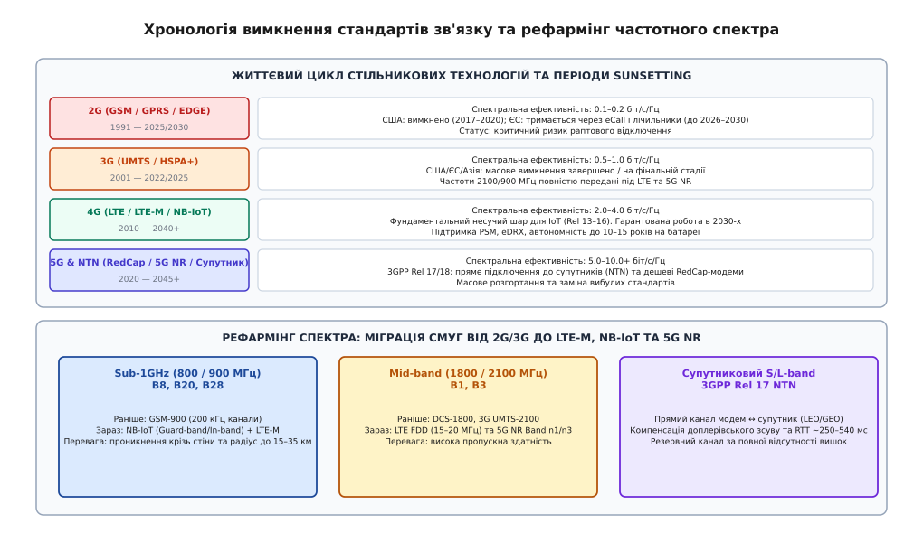
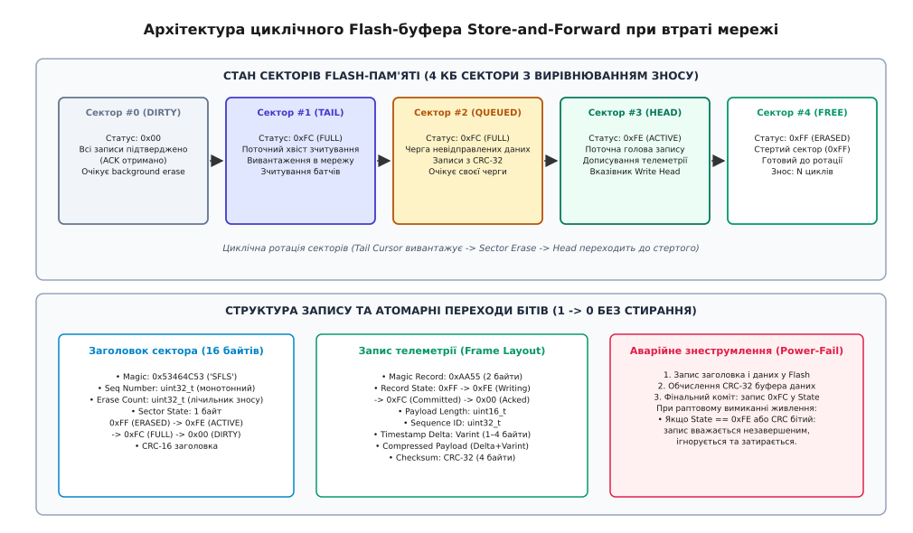

# Вимкнена мережа: 2G, 3G і те, що вимкнуть далі

<preknowlist>
- [Радіомодуль](root:sys-notary/rf-module) — інтеграція стільникових трансиверів, узгодження антен та інтерфейси керування AT-командами.
- [Модульна сертифікація: FCC, CE та EMC-випроби](root:sys-notary/emc-certification) — нормативи електромагнітної сумісності та дозволи на експлуатацію радіообладнання.
- [Батарея у виробі: UN 38.3, транспорт, пакування](root:sys-notary/batareia-u-vyrobi) — характеристики літієвих первинних джерел живлення, струми розряду та захист від просідання напруги.
- [Радіосертифікація: FCC, CE, SRRC](root:sys-notary/regulatory-radio-certification) — розподіл смуг частот, потужність передавачів та регіональні обмеження регуляторів.
</preknowlist>

Партія з двадцяти тисяч автономних промислових газових лічильників та датчиків катодного захисту магістральних трубопроводів, встановлених у підземних колодязях по всій Європі та Північній Америці, раптово припиняє передавати щотижневі звіти на диспетчерський сервер. Діагностика в польових умовах виявляє, що вбудовані літій-тіонілхлоридні (`Li-SOCl2`) батареї з номінальним терміном служби 10 років повністю розряджені за неповні три тижні, а вбудовані модеми перебувають у нескінченному циклі циклічного перезавантаження через апаратне падіння напруги живлення. Причиною масового виходу з ладу обладнання стала не деградація електронних компонентів і не помилка в прошивці вимірювального тракту: локальні оператори стільникового зв'язку остаточно вимкнули базові станції застарілих стандартів 2G GSM та 3G UMTS, передавши вивільнений частотний ресурс під діапазони 4G LTE та 5G New Radio. Прилади, спроєктовані з розрахунком на безперервну наявність сигналу та без адаптивного керування живленням радіотракту, опинилися в зоні штучного радіомовчання й у спробах знайти неіснуючу базову станцію спалили весь запас автономної енергії.

Процес планового виведення з експлуатації та вимкнення застарілих стільникових мереж (*cellular sunsetting*) є фундаментальною інженерно-економічною закономірністю розвитку бездротових комунікацій. Ефірний радіочастотний спектр є обмеженим фізичним ресурсом. Щойно нові стандарти модуляції та кодування забезпечують вищу пропускну здатність на кожен герц займаної смуги, регулятори та комерційні телеком-оператори починають процедуру рефармінгу (*spectrum refarming*) — вилучення частот у технологій минулих поколінь на користь сучасних високощільних протоколів. Для розробника вбудованих систем це створює жорстке технічне зобов'язання: будь-який довговічний автономний пристрій зобов'язаний мати запас гнучкості архітектури радіотракту, підтримувати багатомодові стандарти LPWAN, вміти захищати власні джерела живлення від аварійного пошуку мережі та реалізовувати надійне незалежне накопичення даних у незалежній Flash-пам'яті за принципом *Store-and-Forward*.



*Хронологія вимкнення стандартів 2G/3G, перерозподіл частотного спектра під 4G/5G та поява супутникового сегмента NTN.*

## Фізика та економіка спектра: чому мережі неминуче вимикають

Головним рушієм вимкнення будь-якого покоління зв'язку є спектральна ефективність, яка згідно з теоремою Шеннона-Гартлі визначає теоретичну межу швидкості передачі інформації C у каналі зі смугою пропускання B та відношенням потужності сигналу до потужності шуму S/N:

```
C = B * log2(1 + S/N)      [теоретична пропускна здатність каналу зв'язку]
```

У комерційних стільникових мережах спектральна ефективність вимірюється в бітах за секунду на один герц смуги пропускання (`біт/с/Гц`):

1. **2G (GSM / GPRS / EDGE):** Використовує часовий розподіл каналів (TDMA) та гаусову маніпуляцію з мінімальним зсувом (GMSK) або 8-PSK. Реальна спектральна ефективність становить лише `0.1–0.2 біт/с/Гц`. Смуга одного радіоканалу GSM фіксована на рівні 200 кГц і здатна передавати один голосовий потік зі швидкістю 13 кбіт/с або пакетні дані GPRS зі швидкістю до 40–80 кбіт/с.
2. **3G (UMTS / WCDMA / HSPA+):** Базується на кодовому розподілі каналів із прямим розширенням спектра (DSSS) у фіксованій смузі 5 МГц. Спектральна ефективність зросла до `0.5–1.0 біт/с/Гц`, забезпечуючи швидкості від 384 кбіт/с до 21–42 Мбіт/с у режимі DC-HSPA+.
3. **4G (LTE / LTE-Advanced):** Застосовує ортогональний частотний розподіл каналів із мультиплексуванням (OFDMA) для прямого каналу та SC-FDMA для зворотного зв'язку, підтримує адаптивну квадратурну амплітудну модуляцію 64-QAM / 256-QAM та просторове кодування MIMO. Спектральна ефективність сягає `2.0–4.0 біт/с/Гц`.
4. **5G (New Radio, NR):** Завдяки гнучкій сітці піднесучих, масивним антенним решіткам Massive MIMO, формуванню просторових променів (*beamforming*) та модуляції 1024-QAM спектральна ефективність перевищує `5.0–10.0+ біт/с/Гц`.

Якщо оператор утримує виділену ліцензійну смугу шириною 5 МГц у цінному низькочастотному діапазоні 900 МГц під застарілий стандарт 2G GSM, він може одночасно обслуговувати лише кілька десятків активних з'єднань із низькою якістю передачі голосу. Якщо ту саму смугу 5 МГц рефармити під стандарт 4G LTE або 5G NR з інтегрованими протоколами NB-IoT та LTE-M, оператор отримує можливість одночасно утримувати підключення понад 50 000 промислових пристроїв Інтернету речей або забезпечувати високошвидкісний широкосмуговий доступ сотням смартфонів із передачею потокового відео високої чіткості.

Окрім спектральної ефективності, критичну роль відіграє економіка обслуговування базових станцій. Обладнання 2G та 3G перших поколінь потребує окремих апаратних стійок, громіздких антенно-фідерних трактів з високими втратами та споживає від 3 до 5 кВт електричної потужності на один трисекторний сайт. Сучасне обладнання Single-RAN на базі програмно-керованого радіо (SDR) та віддалених радіоголівок (Remote Radio Head, RRH), розміщених безпосередньо на щоглі поруч з антенами, споживає менше 1 кВт і здатне програмно змінювати конфігурацію виділених несучих частот між 4G, 5G та вузькосмуговим IoT. Витрати на оренду місць на вишках, електроживлення та закупівлю запчастин для знятого з виробництва обладнання 2G/3G роблять підтримку старих базових станцій комерційно збитковою.

### Регіональні відмінності та парадокс eCall

Хронологія та порядок вимкнення мереж у світі суттєво відрізняються залежно від регуляторної політики та державних зобов'язань:

- **Північна Америка (США та Канада):** Оператори першими пішли шляхом радикального очищення спектра. Провідні оператори (AT&T, Verizon, T-Mobile) вимкнули мережі 2G GSM та CDMA ще у 2017–2022 роках, а до кінця 2022 року повністю завершили ліквідацію 3G UMTS/HSPA, перевівши весь трафік на 4G LTE та 5G. Прилади, розраховані виключно на 2G/3G, перестали реєструватися в північноамериканських мережах миттєво.
- **Європейський Союз:** У Європі виник специфічний регуляторний парадокс. Більшість європейських операторів (Vodafone, Deutsche Telekom, Orange, Telefonica) вимкнули 3G раніше за 2G (основна хвиля вимкнення 3G пройшла у 2021–2024 роках), передавши частоти 2100 МГц під LTE. При цьому мережі 2G GSM у багатьох країнах залишили працювати до 2025–2030 років. Причиною стали два фактори: обов'язкова загальноєвропейська система аварійного оповіщення про ДТП *eCall*, яка з 2018 року монтувалася в усі нові автомобілі та вимагала модем 2G/3G для передачі сигналу тривоги через внутрішньосмуговий модем *in-band modem*, а також мільйони встановлених "розумних" лічильників електроенергії зі строком служби до 15 років. Проте з 2025 року процес вимкнення 2G в ЄС стрімко прискорюється: оператори Швейцарії, Нідерландів, Швеції та Норвегії вже повністю відключили GSM, а решта країн перебуває на фінальній стадії згортання.
- **Азійсько-Тихоокеанський регіон:** Японія, Південна Корея, Австралія, Сінгапур та Тайвань повністю вимкнули як 2G, так і 3G мережі. Усі сертифіковані пристрої в цих юрисдикціях зобов'язані працювати виключно на протоколах 4G/5G.

Щодо самого стандарту 4G LTE, то за оцінками 3GPP та міжнародних асоціацій мобільних операторів (GSMA), він залишатиметься глобальним базовим шаром покриття щонайменше до 2040+ років. На відміну від 3G, який був проміжним етапом розвитку, 4G LTE спроєктовано на базі повністю пакетної архітектури ядра EPC (*Evolved Packet Core*), що дозволяє йому безшовно співіснувати з 5G Core у режимах Non-Standalone (NSA) та Standalone (SA).

## Багатомодові модеми LPWAN: LTE-M, NB-IoT та RedCap

Для заміни 2G та 3G у сфері Інтернету речей консорціум 3GPP у Релізах 13–16 стандартизував дві комплементарні технології класу LPWAN (*Low Power Wide Area Network*), оптимізовані під низьку вартість кінцевого вузла, високу енергоефективність та глибоке радіопокриття:

```
+─────────────────────────────────────────────────────────────────────────────+
| ХАРАКТЕРИСТИКИ СТАНДАРТІВ КЛАСУ LPWAN ТА REDCAP                             |
|                                                                             |
| Параметр              NB-IoT (Cat-NB1/NB2)   LTE-M (Cat-M1/M2)   5G RedCap  |
| ─────────────────────────────────────────────────────────────────────────── |
| Смуга RF-каналу       200 кГц (1 PRB)        1.4 МГц (6 PRB)     20 МГц     |
| Пікова швидкість DL   до 127 кбіт/с          до 1.1 Мбіт/с       до 150 Мб/с|
| Пікова швидкість UL   до 158 кбіт/с          до 1.1 Мбіт/с       до 50 Мб/с |
| Макс. втрати (MCL)    164 дБ (+20 дБ до 2G)  156 дБ (+10 дБ)     140–145 дБ |
| Мобільність / HandoverНемає (Cell reselect)  Повний безшовний    Повний     |
| Передача голосу       Ні                     Так (VoLTE)         Так (VoNR) |
| Роумінг між країнами  Фрагментований         Повноцінний         Повноцінний|
| Оптимальне завдання   Стаціонарні сенсори    Трекери, авто,      Відео,     |
|                       лічильники у підвалах  голосові термінали  телематика |
+─────────────────────────────────────────────────────────────────────────────+
```

### NB-IoT (Narrowband IoT / Cat-NB1, Cat-NB2)

NB-IoT займає мінімальну смугу шириною лише 200 кГц, що відповідає ширині одного фізичного ресурсного блоку (PRB) стандарту LTE. Завдяки цьому оператор може розгортати NB-IoT у трьох режимах:
- *In-band:* виділення одного ресурсного блоку всередині стандартної смуги LTE (наприклад, 10 або 20 МГц).
- *Guard-band:* розміщення в захисному частотному інтервалі між сусідніми смугами LTE без спотворення основного спектра.
- *Standalone:* використання окремого каналу 200 кГц у рефармленому діапазоні GSM-900.

Ключова перевага NB-IoT — безпрецедентний енергетичний запас лінії зв'язку: показник допустимих втрат на трасі поширення радіохвиль (Maximum Coupling Loss, MCL) становить 164 дБ. Це на 20 дБ перевищує показники стандартного GSM, що еквівалентно проходженню радіосигналу крізь кілька залізобетонних стін або глибоко під землю (шахти, колодязі водопостачання). Досягається це за рахунок спектральної концентрації потужності та багаторазових повторень передачі одного й того самого підкадру (до 128 або 2048 повторів).

Головні обмеження NB-IoT — відсутність апаратного безшовного хендоверу під час руху (якщо пристрій пересувається на швидкості понад 20–30 км/год між базовими станціями, з'єднання розривається і модем змушений виконувати повторний вибір соти *Cell Reselection*) та складна ситуація з міжнародним роумінгом. Багато закордонних операторів не мають між собою взаємних роумінгових угод з підтримки NB-IoT сигналізації, що робить цей стандарт ненадійним для транскордонних вантажних трекерів.

### LTE-M (Enhanced Machine Type Communication / eMTC / Cat-M1)

LTE-M використовує смугу 1.4 МГц (6 ресурсних блоків PRB) і забезпечує швидкість передачі даних до 1 Мбіт/с. На відміну від NB-IoT, стандарт підтримує повноцінний хендовер без обриву сесії, підтримує передачу голосу високої чіткості через протокол VoLTE та має розвинену глобальну мережу роумінгових угод, аналогічну звичайному 4G LTE. Це робить Cat-M1 ідеальним вибором для систем моніторингу транспорту, медичних сигналізаторів та охоронних систем.

### 5G RedCap (Reduced Capability / NR-Light)

Стандартизований у 3GPP Release 17 як технологія заповнення проміжку між ультрадешевим повільним LPWAN (LTE-M/NB-IoT) та надшвидким дорогим 5G eMBB. RedCap зменшує смугу пропускання до 20 МГц у діапазонах Sub-6GHz, використовує 1 або 2 приймальні антени замість 4, знижує складність дуплексерів та підсилювачів потужності, забезпечуючи швидкість до 150 Мбіт/с при вартості модема, сумірній із модулями LTE Cat-4.

### Багатомодові модулі та пастки конфігурації

Щоб уникнути ризику відключення зв'язку в перехідний період, виробники вбудованих рішень використовують комбіновані багатомодові трансивери (наприклад, серії Quectel BG95/BG96, Telit ME910, Nordic Semiconductor nRF9160, u-blox SARA-R5). Такі модулі містять універсальний SDR-базовий процесор і перемикаються між LTE-M, NB-IoT та резервним 2G GSM за допомогою AT-команд.

Однак наявність мультимодового трансивера на платі створює специфічні апаратні та програмні пастки:
1. **Низька ефективність антени на різних діапазонах:** Антена, розрахована на компактні розміри, не може мати стабільний коефіцієнт стоячої хвилі (КСХН / VSWR < 2.0) одночасно в низьких діапазонах NB-IoT (Band 8 — 900 МГц, Band 20 — 800 МГц, Band 28 — 700 МГц) та високих діапазонах LTE-M (Band 1 — 2100 МГц, Band 3 — 1800 МГц). Неузгодженість імпедансу призводить до того, що до 50–70% випромінюваної потужності відбивається назад у підсилювач, спричиняючи підвищене енергоспоживання та нагрівання.
2. **Пастки мульти-IMSI та eSIM профілів:** Використання комерційних віртуальних операторів (MVNO) з технологією eUICC (eSIM) часто маскує справжній статус мережі. Якщо профіль за замовчуванням налаштований на застарілий 2G-роумінг, а місцевий партнерський оператор вимкнув GSM-обладнання, модем може годинами надсилати запити авторизації, не отримуючи відповіді, перш ніж алгоритм eSIM перемкнеться на альтернативний профіль IMSI з підтримкою LTE-M.

## Енергоощадні режими 3GPP: PSM, eDRX та стани RRC

Головною відмінністю сучасних стільникових технологій IoT від класичних 2G/3G є відмова від парадигми "модем постійно слухає ефір". У 2G модуль споживав у режимі очікування пейджингу (*Paging Idle*) від 1.5 до 5 мА, що унеможливлювало роботу від невеликої батареї протягом кількох років. 3GPP запровадив два спеціальні механізми зниження струму споживання:

```
+─────────────────────────────────────────────────────────────────────────────+
| РЕЖИМИ СПОЖИВАННЯ ТА СТАНИ МОДЕМА 3GPP RELEASE 13/14                        |
|                                                                             |
| Стан модема           Опис стану та радіочастотна активність      Струм     |
| ─────────────────────────────────────────────────────────────────────────── |
| RRC_CONNECTED (Tx)    Передача даних у радіоканал (+23 dBm RF)    150–450 мА|
| RRC_CONNECTED (Rx)    Прийом відповідей, синхронізація соти       30–80 мА  |
| RRC_IDLE (Paging)     Очікування виклику мережі (DRX 1.28–2.56 с) 1.5–3.0 мА |
| eDRX (Paging Window)  Розширений інтервал сну (PTW + sleep cycle) 15–30 мкА |
| PSM (Power Saving)    Повний сон радіотракту (збереження IP/NAS)  2.5–5.0 мкА|
| Hardware Power-Cut    Повне апаратне знеструмлення через MOSFET   < 0.1 мкА  |
+─────────────────────────────────────────────────────────────────────────────+
```

### PSM (Power Saving Mode / Режим збереження енергії)

Стандартизований у 3GPP Release 12. Дозволяє модему після завершення сесії передачі даних повністю вимкнути прийомо-передавальний тракт, синтезатор частот та базовий цифровий процесор, перейшовши у стан глибокого сну зі струмом споживання `2.5–5 мкА`.

Поведінка модема в режимі PSM визначається двома таймерами, які узгоджуються з ядром операторської мережі (MME / AMF) під час процедури приєднання (*Attach*) або періодичного оновлення зони відстеження (*TAU — Tracking Area Update*):
1. **Активний таймер T3324 (Active Timer):** Визначає час, протягом якого модем залишається в режимі звичайного `RRC_IDLE` після переходу з активного стану. Протягом дії T3324 (зазвичай від 2 до 20 секунд) пристрій слухає пейджингові повідомлення з мережі та може негайно прийняти вхідний пакет.
2. **Таймер періодичного TAU T3412 (Periodic TAU Timer):** Визначає загальний інтервал між обов'язковими контрольними сесіями зв'язку з базовою станцією для підтвердження реєстрації. Значення T3412 може досягати 413 діб (у розширеному форматі 3GPP Rel 13 T3412-ext). Коли T3324 спливає, модем переходить у глибокий сон PSM на час, що залишився до завершення T3412.

Критична перевага PSM: при пробудженні за сигналом внутрішнього RTC або зовнішнього датчика модему **не потрібно заново проходити повну процедуру аутентифікації та реєстрації в мережі** (Attach), яка вимагає обміну десятками сигналізаційних пакетів і споживає багато енергії. Модем одразу виконує швидке відновлення з'єднання *RRC Connection Resume*, використовуючи збережений у пам'яті контекст безпеки та IP-адресу.

### eDRX (extended Discontinuous Reception / Розширений переривчастий прийом)

Якщо пристрій повинен мати можливість приймати вхідні команди керування від сервера (наприклад, відкриття клапана або запит телеметрії) без очікування кінця доби, використовується режим eDRX. Він розширює стандартні цикли сну між пейджинговими блоками:
- У стандартному LTE інтервал DRX становить лише `1.28–2.56 с`.
- У режимі eDRX для LTE-M інтервал сну може встановлюватися від `5.12 с` до `40.96 хв`.
- Для NB-IoT інтервал eDRX досягає `3 годин` (10 485.76 с).

Під час вікна пейджингу (Paging Time Window, PTW тривалістю від 2.56 до 40.96 с) модем короткочасно вмикає радіоприймач, перевіряє наявність адресованих йому пакетів, і якщо їх немає — знову засинає зі струмом кілька десятків мікроампер.

## Смертельна спіраль модема при втраті мережі та аварійне керування

Найбільш руйнівним явищем при вимкненні базових станцій є так звана **смертельна спіраль пошуку мережі** (*Cellular Search Death Spiral*). 

Коли базова станція, на якій пристрій успішно працював роками, раптово припиняє мовлення, модем фіксує втрату несучої частоти й запускає стандартний алгоритм відновлення зв'язку за специфікацією 3GPP TS 36.304:

```
+─────────────────────────────────────────────────────────────────────────────+
| СМЕРТЕЛЬНА СПІРАЛЬ ПОШУКУ МЕРЕЖІ ТА ДЕГРАДАЦІЯ БАТАРЕЇ                      |
|                                                                             |
|   1. Втрата сигналу базової станції (Sunsetting або аварія)                 |
|          │                                                                  |
|          ▼                                                                  |
|   2. Повний скан усіх радіотехнологій: 2G -> 3G -> LTE-M -> NB-IoT          |
|          │                                                                  |
|          ▼                                                                  |
|   3. Скан усіх діапазонів (B1..B28, до 40 смуг) на макс. потужності (+23 dBm)|
|          │                                                                  |
|          ▼                                                                  |
|   4. Струм 300–500 мА -> Просідання напруги батареї через пасивацію        |
|          │                                                                  |
|          ▼                                                                  |
|   5. Спрацювання Brownout Reset (BOR) MCU -> Перезавантаження пристрою      |
|          │                                                                  |
|          ▼                                                                  |
|   6. Повернення до кроку 1: нескінченний цикл -> Повний розряд АКБ за 48 год|
+─────────────────────────────────────────────────────────────────────────────+
```

### Електрохімічний колапс первинних літієвих елементів

Автономні лічильники та промислові сенсори переважно живляться від первинних хімічних джерел на основі літій-тіонілхлориду (`Li-SOCl2`, типовий представник — елементи типорозміру D ємністю 19 А·год, напруга 3.6 В) або літій-діоксиду марганцю (`Li-MnO2`, 3.0 В). 

Хімія `Li-SOCl2` має унікальну рису — у стані спокою на поверхні літієвого анода утворюється захисна плівка хлориду літію LiCl (явище пасивації), що знижує внутрішній саморозряд батареї до рівня `< 1% на рік` і теоретично забезпечує зберігання до 15–20 років. Проте пасиваційний шар різко підвищує внутрішній динамічний опір джерела (з одиниць ом до десятків і навіть сотень ом).

Коли модем, втративши мережу, починає безперервний повнодіапазонний пошук, він вмикає радіопередавач на повну потужність `+23 дБм` (200 мВт RF), намагаючись відправити преамбули випадкового доступу на каналі PRACH (*Physical Random Access Channel*). Імпульсний струм споживання при цьому сягає `300–500 мА`, а для модулів із підтримкою 2G GSM у момент випромінювання слота TDMA — до `1.5–2.0 А`.

За такої сили струму на внутрішньому опорі пасивованої батареї відбувається катастрофічне просідання вихідної напруги:

```
U_out = U_emf - I_peak * R_internal      [падіння напруги під навантаженням]
```

Напруга на шині живлення приладу падає з 3.6 В нижче критичного порогу `2.7–2.2 В`. Спрацьовує апаратна схема скидання мікроконтролера за зниженням напруги живлення (*Brownout Reset, BOR*). Після перезавантаження мікроконтролер знову ініціалізує модем, модем знову вмикає радіопередавач для пошуку ефіру, напруга знову падає — пристрій потрапляє у нескінченну петлю перезапусків і повністю вичерпує багаторічний ресурс дорогої батареї лише за кілька діб.

### Алгоритм порятунку живлення та обмеження пошуку

Щоб гарантувати живучість вузла навіть в умовах повного та безповоротного зникнення стільникового сигналу, системний мікроконтролер повинен реалізовувати жорсткий контролерний алгоритм керування радіотрактом:

1. **Фіксація дозволених діапазонів (Band Locking):** Замість сканування всіх можливих світових частот (яке триває до 3–5 хвилин на один прохід) через AT-команди в конфігурацію модема записується виключно мінімальний набір робочих смуг оператора в цьому регіоні (наприклад, для Європи: Band 8 і Band 20; для США: Band 2, 4, 12, 13). Це скорочує час сканування до 5–10 секунд.
2. **Пріоритет технологій доступу (RAT Search Order):** Забороняється довільний перебір. Пріоритет виставляється суворо: `LTE-M → NB-IoT → GSM` із жорстким таймаутом на кожен стандарт.
3. **Експоненційний відкат із випадковим тремтінням (Exponential Backoff with Jitter):** Якщо серія спроб реєстрації зазнала невдачі, період між повторними спробами подвоюється з додаванням випадкового зсуву для запобігання синхронному перевантаженню базової станції:

```
T_sleep = min(T_max, T_base * 2^attempt) + uniform(-J, +J)      [інтервал відкату]
```

Типова сітка інтервалів сну при відсутності мережі: `1 хв → 5 хв → 15 хв → 1 год → 6 год → 24 год`. Після 5 невдалих спроб система переходить у черговий режим із перевіркою ефіру не частіше одного разу на добу.
4. **Апаратне знеструмлення (Hardware Power-Cut):** При переході у тривалий сон за відсутності мережі неприпустимо залишати модем підключеним до шини живлення. Навіть у вимкненому стані струм витоку через внутрішні кола модема та стабілізатора може становити `15–50 мкА`. Живлення модема повинно повністю вимикатися силовим P-канальним MOSFET-ключем або мікросхемою *Load Switch* із наднизьким власним витоком (< 10 нА), а всі лінії інтерфейсу UART (TX, RX, RTS, CTS) та GPIO мають переводитися у високоімпедансний стан (Hi-Z) або притягуватися до землі, щоб уникнути паразитного живлення модема через вхідні захисні діоди ESD.

## Резервні канали зв'язку та топологічна стійкість

Залежність виробу від єдиної технології стільникового оператора є неприпустимим архітектурним ризиком для критичної інфраструктури. Сучасні відмовостійкі телеметричні комплекси використовують багаторівневу топологію з автоматичним перемиканням на резервні канали.

### Супутникові мережі 3GPP Rel 17 NTN (Non-Terrestrial Networks)

Найважливішим досягненням останніх стандартів мобільного зв'язку стала інтеграція супутникового сегмента безпосередньо в протокольний стек 3GPP під назвою NTN. Це дозволяє стандартному модему (наприклад, NB-IoT або LTE-M із підтримкою Rel 17) зв'язуватися безпосередньо з низькоорбітальними (LEO, висота 500–1200 км) або геостаціонарними (GEO, висота 36 000 км) супутниками зв'язку у виділених діапазонах S-band (2.1–2.2 ГГц) та L-band (1.5–1.6 ГГц), таких як супутникові сузір'я Skylo, Bullitt, Iridium або OQ Technology.

Фізичні виклики прямого супутникового зв'язку вирішуються на рівні базового процесора модема:
- **Компенсація доплерівського зсуву:** Оскільки супутник LEO рухається відносно наземного пристрою зі швидкістю близько 7.5 км/с, доплерівський зсув частоти на 2 ГГц досягає `±40–50 кГц` зі швидкістю зміни до `±500 Гц/с`. Модем Rel 17 NTN використовує власний GNSS-приймач для визначення своїх координат та завантажені ефемериди супутників (*TLE / Ephemeris*) для попередньої компенсації частоти та затримки сигналу під час передачі.
- **Великий час затримки (Large RTT):** Для геостаціонарних супутників час проходження сигналу туди й назад перевищує `540 мс`, що викликає тайм-аути у стандартних таймерах HARQ. Специфікація NTN вводить відключення процесів повторної передачі HARQ або підтримку до 32 паралельних процесів із подовженими інтервалами очікування підтвердження.

### LoRaWAN як локальний безліцензійний резерв

У регіонах, де стільникова мережа повністю згорнута або недоступна через рельєф місцевості, як паралельний канал використовується трансивер LoRaWAN у неліцензованих діапазонах ISM (868 МГц у Європі, 915 МГц у США, 433 МГц).

При встановленні зв'язку через LoRaWAN слід враховувати законодавчі обмеження, описані у вимогах до ефіру:
- **Обмеження шпаруватості (Duty Cycle):** У європейському діапазоні 868.0–868.6 МГц регламенти забороняють одному передавачу випромінювати в ефір сумарно більше ніж 1% часу (не більше 36 секунд на годину), або вимагають використання механізму *Listen Before Talk (LBT)*.
- **Розмір пакета:** Залежно від коефіцієнта розширення спектра (*Spreading Factor*, від SF7 до SF12) розмір корисного навантаження обмежений від 11 до 222 байтів. Це вимагає жорсткої упаковки та бінарної компресії даних перед передачею.

### Сигналізаційні повідомлення SMS over IMS / NAS

Коли базова станція працює на межі чутливості або перебуває у стані екстремального перевантаження (наприклад, під час стихійного лиха або масового вимкнення енергосистеми), встановлення повноцінної TCP/TLS-сесії стає неможливим через високий відсоток втрати пакетів і розрив сесій за тайм-аутом.

У такій ситуації передача життєво важливої телеметрії через SMS (Short Message Service) часто залишається єдиним дієвим засобом. SMS передається не через призначений для користувача потік даних (User Plane), а через захищені канали сигналізації мережі керування (Control Plane / Non-Access Stratum, NAS) або через сигналізаційні повідомлення SIP MESSAGE в протоколі IMS (*IP Multimedia Subsystem*). Сигналізаційний пакет розміром до 140 байтів уміщується в один кадр каналу радіокерування й гарантовано доставляється навіть за умов, коли втрати в каналі даних сягають 90%.

### Локальний бездротовий міст (Bluetooth LE Coded PHY / Wi-Fi)

Для пристроїв, повністю відрізаних від глобальної мережі через ліквідацію інфраструктури оператора, критично мати локальний інтерфейс вивантаження. Використання Bluetooth 5.0 у режимі *Coded PHY* (швидкість 125 кбіт/с із прямим виправленням помилок FEC) забезпечує дальність зв'язку до 100–300 метрів прямої видимості. 

Це дозволяє польовому техніку зі смартфоном або проїжджій машині муніципальної служби зі встановленим шлюзом (концепція *Drive-by Meter Reading*) автоматично зчитувати накопичені за місяці автономної роботи архіви телеметрії без розкриття опломбованих корпусів та підземних люків.

## Архітектура Store-and-Forward у Flash-пам'яті

Коли всі доступні канали бездротового зв'язку тимчасово або надовго втрачені, система переходить у режим локального автономного збереження з наступним вивантаженням (*Store-and-Forward*).



*Структура кільцевого буфера секторів Flash-пам'яті, формат кадру телеметрії та переходи стану бітів при відсутності стільникового зв'язку.*

Реалізація такого сховища на базі мікросхем енергонезалежної пам'яті SPI NOR Flash (наприклад, мікросхем серій W25Q, AT25, MX25) повинна суворо враховувати фізичні властивості напівпровідникових комірок із плаваючим затвором:

1. **Гранулярність стирання:** Flash-пам'ять не дозволяє перезаписати окремий байт. Запис можливий тільки як зміна бітів `1 → 0`. Перехід біта назад `0 → 1` можливий виключно через процедуру стирання цілого фізичного сектора (зазвичай 4096 байтів) або блока (32 чи 64 КБ).
2. **Обмежений ресурс зносу (Endurance):** Кожна фізична комірка витримує від 10 000 до 100 000 циклів стирання до настання деградації оксидного діелектрика та втрати здатності утримувати заряд. Запис вказівників буфера за фіксованими адресами Flash знищить сектор за лічені місяці.
3. **Небезпека знеструмлення під час запису (Power-Loss Inconsistency):** Батарея може остаточно сісти або відключитися захистом BMS прямо в момент програмування байта чи стирання сектора. Система зобов'язана відновлювати цілісність метаданих після перезавантаження без втрати раніше підтверджених записів.

Для вирішення цих завдань застосовується архітектура багатосекторного кільцевого лог-буфера з атомарними прапорцями стану та монотонними лічильниками послідовності. Повна інженерна реалізація драйвера такого сховища, компресії вимірювань та алгоритму автоматичного відновлення після відновлення мережі детально розібрана у практичній вставці [⚙️ циклічний буфер телеметрії у Flash-пам'яті](root:sys-notary/vymknena-merezha/proj-offline-telemetry-store.md).

## Програмна реалізація: контролер живлення та пошуку мережі

Нижче наведено закінчену реалізацію драйвера керування живленням стільникового модема, кінцевого автомата пошуку мережі, розрахунку експоненційного відкату та безпечного керування навантажувальним ключем живлення на мовах C99 та ідіоматичній C++20.

:::tabs

@tab c

:::code vymknena-merezha-d/c/main.c

@tab cpp

:::code vymknena-merezha-d/cpp/main.cpp

:::

Вимкнення застарілих поколінь стільникового зв'язку — це не форс-мажор, а прогнозований крок у життєвому циклі радіообладнання. Автономний виріб, розрахований на десятиліття експлуатації, досягає надійності не сподіванням на вічність поточної вишки оператора, а трьома системними рішеннями: багатомодовим апаратним радіотрактом з підтримкою стандартів LPWAN і NTN, суворим алгоритмічним захистом батареї від аварійного пошуку мережі та надійним кільцевим накопичувачем телеметрії у Flash-пам'яті.
