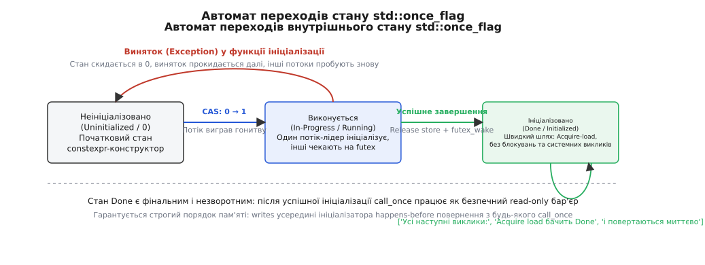
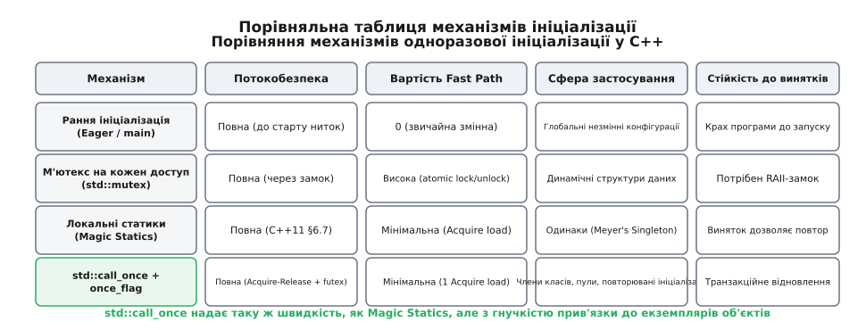

# call_once і once_flag: одноразова ініціалізація

<preknowlist>
- [М'ютекс і RAII-замки](root:sys-plang-cpp/mutex-and-raii-locks) — блокування критичних секцій, стан гонитви даних та бар'єри пам'яті.
- [Гарантії безпеки винятків](root:sys-plang-cpp/exception-safety-guarantees) — базова та сувора гарантії, розгортання стеку.
- [Категорії значень: lvalue, prvalue, xvalue](root:sys-plang-cpp/value-categories) — семантика переміщення та передача аргументів.
- [Лямбда-вирази й захоплення](root:sys-plang-cpp/lambdas-and-captures) — функціональні об'єкти як аргументи ініціалізації.
</preknowlist>

Коли сервер обробки фінансових транзакцій запускає 64 робочі потоки для обслуговування тисяч вхідних мережевих підключень, доступ до спільного ресурсу — криптографічного ключа сесії, з'єднання з реляційною базою даних або глобального журналу подій — потребує гарантовано одноразового налаштування. Якщо ініціалізацію виконати заздалегідь під час старту програми в головній функції `main()`, система витрачає сотні мілісекунд на ресурси, які можуть узагалі не знадобитися в конкретній конфігурації, або падає ще до того, як завантажаться мережеві конфігураційні файли.

Якщо ж перенести ініціалізацію в момент першого реального звернення (відкладена, або лінива ініціалізація) і захистити кожне читання звичайним м'ютексом, кожен із 64 потоків буде змушений захоплювати й відпускати замок при кожному запиті. Це створює накладні витрати у 15–20 наносекунд на кожен виклик і викликає постійну інвалідацію процесорних L1/L2-кешів (англ. *Cache Line Bouncing*), хоча після першого налаштування об'єкт залишається незмінним протягом багатьох діб роботи системи.

Спроби оптимізувати цей процес власноруч через наївні перевірки прапорців без захоплення замка призводять до невидимої гонитви за даними через апаратне перевпорядкування інструкцій сучасними процесорами. Для вирішення цієї фундаментальної проблеми стандарт C++11 ввів спеціалізований тандем синхронізації: структуру `std::once_flag` та шаблонну функцію `std::call_once`, які забезпечують суворо одноразове виконання коду з нульовими накладними витратами на швидкому шляху та повною безпекою винятків.

---

## 1. Проблема лінивої ініціалізації та крах наївних оптимізацій

Щоб зрозуміти внутрішню необхідність `std::call_once`, розглянемо типову еволюцію спроб реалізувати відкладене завантаження спільних даних у багатопотоковому коді.

Найпростіший і очевидний спосіб полягає у використанні звичайного м'ютекса, який блокує критичну секцію при кожному доступі до ресурсу:

:::tabs
:::code call-once-lazy-init-d/cpp/1-problema-linyvoi.cpp
:::code call-once-lazy-init-d/c/main.c
:::

Такий підхід є бездоганно коректним з точки зору синхронізації, але неприйнятним для високонавантажених систем. Коли сотні потоків щомиті викликають метод `get_configuration()`, вони конкурують за один і той самий м'ютекс. Навіть коли черги немає (Uncontended Lock), операція атомарного захоплення змінює стан кеш-лінії процесора з Shared (спільний) на Modified (модифікований) у когерентному протоколі MESI. Це змушує всі інші ядра скидати свої локальні L1/L2-кеші та перезавантажувати дані з повільної системної шини.

Прагнучи уникнути цього накладного замка, розробники часто намагалися застосувати патерн подвійної перевірки блокування (англ. *Double-Checked Locking Pattern*, DCLP): спершу перевірити покажчик без блокування, і лише якщо він порожній — захопити м'ютекс.

Проте в архітектурах із позачерговим виконанням команд (Out-of-Order Execution) звичайний запис покажчика на щойно створений об'єкт не гарантує, що поля цього об'єкта вже були збережені у фізичній пам'яті:

:::code call-once-lazy-init-d/cpp/1-problema-linyvoi-2.cpp

Інший потік міг побачити валідну ненульову адресу `config_`, оминути критичну секцію і почати читати поля, конструктор яких ще навіть не завершився. Детальний аналіз математичних причин цієї апаратної пастки та історичного шляху її вирішення викладено в [історії краху DCLP та виникнення call_once](root:sys-plang-cpp/call-once-lazy-init/hist-once-flag.md).

---

## 2. Стандартний контракт: std::once_flag та std::call_once

Стандартна бібліотека C++ вирішує проблему лінивої ініціалізації на рівні мовної специфікації, надаючи пару з об'єкта стану `std::once_flag` та шаблонної функції `std::call_once` з заголовного файлу `<mutex>`.

### Семантика прапорця `std::once_flag`
Об'єкт `std::once_flag` є компактним непрозорим дескриптором стану синхронізації (лат. *describere* — описувати). Він володіє такими фундаментальними властивостями:
- **Некопійовність та непереміщуваність**: конструктори копіювання та переміщення, а також відповідні оператори присвоєння явно видалені (`= delete`). Це гарантує, що прапорець не змінює своєї адреси в пам'яті під час роботи, що критично для атомарних операцій та системних черг очікування ядра операційної системи.
- **`constexpr`-ініціалізація за замовчуванням**: конструктор без параметрів позначений як `constexpr noexcept`. Це означає, що статичні або глобальні прапорці ініціалізуються нульовим станом ще на етапі статичної трансляції, повністю виключаючи проблему невизначеного порядку глобальної ініціалізації (Static Initialization Order Fiasco).

### Семантика функції `std::call_once`
Функція `std::call_once` має наступний шаблонний вигляд:

```cpp
template<class Callable, class... Args>
void call_once(std::once_flag& flag, Callable&& f, Args&&... args);
```

Коли один або кілька потоків одночасно викликають `std::call_once` з посиланням на один і той самий об'єкт `std::once_flag`, стандарт мови гарантує виконання наступного суворого контракту:
1. **Рівно один запуск**: рівно один потік (потік-лідер) отримує право виконати переданий функціональний об'єкт `f`.
2. **Блокування конкурентів**: усі інші потоки, які викликали `std::call_once` з цим самим прапорцем, переходять у стан пасивного очікування (сон) доти, доки потік-лідер не завершить виконання функції.
3. **Строгий зв'язок впорядкування пам'яті (Synchronizes-With)**: успішне завершення функції `f` встановлює відношення *Happens-Before* («сталося-раніше-ніж») відносно повернення з будь-якого іншого виклику `std::call_once` із цим самим прапорцем. Це означає, що всі модифікації пам'яті, здійснені всередині функції `f`, гарантовано стають повністю видимими для всіх інших ядер та потоків.

Повний перелік перевантажень, правил передачі аргументів за посиланням та сумісності з типами наведено у [повному довіднику API, сигнатур та контрактів std::call_once](root:sys-plang-cpp/call-once-lazy-init/api-call-once.md).

Погляньмо на лаконічне й безпечне використання `std::call_once` для лінивого завантаження конфігурації:

:::code call-once-lazy-init-d/cpp/semantyka-funktsii-std.cpp

У наведеному прикладі `std::once_flag` є звичайним нестатичним полем класу. Це означає, що кожен створений екземпляр `DatabaseService` матиме власну незалежну ліниву ініціалізацію: перший виклик `get_config()` на конкретному об'єкті налаштує його конфігурацію, а всі наступні звернення на цьому ж об'єкті виконуватимуться без блокувань.

---

## 3. Внутрішній автомат станів та архітектура швидкого шляху

Як `std::call_once` вдається бути абсолютно безпечним для сотень конкурентних потоків і водночас не витрачати ресурси процесора після завершення ініціалізації?

Відповідь полягає в оптимізації швидкого шляху (англ. *Fast Path*) на основі атомарних бітових масок та системних примітивів очікування в просторі користувача (Fast Userspace Mutex, або `futex` у Linux та `WaitOnAddress` у Windows).


*Скінченний автомат переходів внутрішнього стану `std::once_flag` при успішній ініціалізації, винятку та на швидкому шляху.*

Внутрішньо об'єкт `std::once_flag` містить машинне слово (32 або 64 біти), стан якого описується трьома основними фазами:

```
[00] Неініціалізовано (Uninitialized / Init)
 │
 │  Атомарний CAS (Compare-And-Swap): перехід 00 → 01
 ▼
[01] Виконується (In-Progress / Running) ──[ Виняток (throw) ]──► Повернення у стан [00]
 │
 │  Успішне завершення: Release store 01 → 10 + futex_wake(ALL)
 ▼
[10] Ініціалізовано (Done / Initialized)
```

### 1. Швидкий шлях (Fast Path — Read Only)
Коли будь-який потік викликає `std::call_once`, першою машинною операцією є атомарне зчитування стану прапорця з семантикою **Acquire** (`std::memory_order_acquire`):

```cpp
// Концептуальний псевдокод внутрішньої перевірки швидкого шляху
if (__atomic_load_n(&flag.__state, __ATOMIC_ACQUIRE) == STATE_DONE) {
    return; // Миттєве повернення! Жодних замків, системних викликів або записів у пам'ять
}
```

На процесорах архітектури x86-64 ця операція транслюється в одну звичайну апаратну інструкцію `mov` із бар'єром компілятора (оскільки апаратна модель пам'яті x86 є строгою і автоматично забезпечує Acquire-семантику для всіх інструкцій читання з пам'яті).

На процесорах із розслабленою моделлю пам'яті (ARM64, RISC-V) компілятор генерує інструкцію з апаратним бар'єром (наприклад, `LDAR` на ARM64). Оскільки запис у пам'ять не виконується, кеш-лінія залишається в спільному стані (Shared у протоколі MESI), дозволяючи сотням ядер одночасно читати прапорець без найменшої деградації продуктивності.

### 2. Повільний шлях (Slow Path — Конкуренція під час першого виклику)
Якщо перший атомарний перегляд показує, що прапорець ще не перебуває у стані `STATE_DONE`, потік переходить на повільний шлях:

1. **Гонитва за право ініціалізації**: потік виконує атомарну операцію `compare_and_swap` (CAS), намагаючись перевести стан із `00` (Uninitialized) у `01` (In-Progress).
2. **Переможець (Лідер)**: потік, для якого CAS завершився успіхом, виходить з атомарного циклу і безпосередньо запускає передану користувачем функцію `f()`.
3. **Очікувачі (Конкуренти)**: усі інші потоки, які програли гонитву CAS, бачать, що стан уже дорівнює `01`. Вони не крутяться у марному циклі очікування (Spinlock), спалюючи процесорний час, а викликають системний виклик ядра операційної системи (`sys_futex` у Linux з операцією `FUTEX_WAIT`, або `WaitOnAddress` у Win32), засинаючи до моменту пробудження.


*Розв'язання гонитви між трьома потоками: потік-лідер ініціалізує ресурс, конкурент спить у ядрі через futex, а наступні звернення проходять без блокувань.*

Коли потік-лідер успішно доходить до кінця функції `f()`, він виконує атомарний запис значення `STATE_DONE` із семантикою **Release** (`std::memory_order_release`). Одразу після цього викликається системна інструкція пробудження (`FUTEX_WAKE` для всіх сплячих ниток).

Усі пробуджені потоки роблять фінальне Acquire-зчитування, переконуються, що ресурс ініціалізовано, і виходять із `std::call_once`, не виконуючи функцію вдруге.

---

## 4. Виняткова безпека та транзакційне відновлення

Однією з найважливіших і найчастіше недооцінюваних переваг `std::call_once` є його глибока інтеграція з моделлю винятків C++.

У реальних розподілених системах ініціалізація ресурсів часто пов'язана з мережевими операціями, зверненнями до файлової системи або виділенням великих блоків оперативної пам'яті. Усі ці операції можуть завершитися аварійно (викиданням винятку, наприклад `std::runtime_error`, `std::bad_alloc` або мережевого таймауту).

### Поведінка `std::call_once` у разі винятку:
1. Якщо функція ініціалізації викидає виняток під час виконання, виконання критичної секції негайно переривається розгортанням стеку (Stack Unwinding).
2. Механізм `std::call_once` перехоплює факт виходу за винятком і **не фіксує стан прапорця як завершений (`Done`)**.
3. Внутрішній стан `std::once_flag` автоматично скидається назад у вихідне значення `00` (Uninitialized).
4. Усі сплячі на системному futex потоки пробуджуються.
5. Виняток прокидається назовні у потік-лідер, щоб той міг обробити аварійну ситуацію.
6. **Право на повторну спробу**: оскільки прапорець повернувся у відкритий стан, наступний потік, який звернеться до `std::call_once` (або один із щойно розбуджених потоків), автоматично візьме на себе роль нового лідера і спробує виконати ініціалізацію наново!


*Транзакційне відновлення при винятку: стан прапорця не фіксується як завершений, що дозволяє іншому потоку повторити спробу ініціалізації.*

Розглянемо практичний приклад, що демонструє стійкість до тимчасових мережевих збоїв:

:::code call-once-lazy-init-d/cpp/povedinka-std-call-once-u.cpp

Якби ми використовували власноруч написаний булевий прапорець `bool is_inited = true` без транзакційного відкату при розгортанні стеку, помилка під час першої спроби назавжди заблокувала б систему у «напівмертвому» стані: прапорець стояв би в `true`, а об'єкт залишався б порожнім або пошкодженим. `std::call_once` гарантує транзакційну атомарність: стан фіксується виключно після успішного повернення з функції без винятків.

Повну архітектуру виробничого пулу з'єднань із підтримкою відновлення розібрано у [проєктному розборі стійкого пулу ресурсів із відновленням](root:sys-plang-cpp/call-once-lazy-init/proj-lazy-registry.md).

---

## 5. Порівняльний аналіз: call_once чи Magic Statics?

Починаючи з C++11, мова отримала ще один фундаментальний механізм одноразової ініціалізації: потокобезпечні локальні статичні змінні (відомі як *Magic Statics*, закріплені в стандарті ISO/IEC 14882:2011 §6.7 [stmt.dcl]).

Згідно зі стандартом C++11, якщо керування вперше входить в оголошення локальної статичної змінної, її ініціалізація є строго потокобезпечною. Інші потоки блокуються до завершення ініціалізації. Це породило класичний патерн одинака Мейєрса (англ. *Meyer's Singleton*):

```cpp
class GlobalRegistry {
public:
    static GlobalRegistry& instance() {
        static GlobalRegistry instance; // Magic Static у C++11 — повністю потокобезпечно!
        return instance;
    }
private:
    GlobalRegistry() = default;
};
```

Виникає закономірне архітектурне питання: якщо компілятор уміє сам генерувати потокобезпечну ініціалізацію для статичних змінних, коли слід використовувати `std::call_once`?


*Порівняння властивостей ранньої ініціалізації, м'ютексів, Magic Statics та `std::call_once`.*

### Порівняльна характеристика підходів:

| Критерій | `std::call_once` + `std::once_flag` | Локальні статики (Magic Statics) |
| :--- | :--- | :--- |
| **Область видимості та час життя** | Довільна: член екземпляра класу, динамічний об'єкт на купі або статичний | Лише статична тривалість життя (Static Storage Duration) |
| **Передача параметрів** | Довільні динамічні аргументи в точці виклику (`call_once(flag, fn, a, b)`) | Лише фіксовані аргументи, доступні в точці оголошення |
| **Прив'язка до екземпляра класу** | **Так**: кожен об'єкт класу може мати власний незалежний `once_flag` | **Ні**: змінна єдина на всю програму для всіх екземплярів |
| **Кількість альтернативних дій** | Можна передавати різні функції/лямбди з одним прапорцем | Тільки один фіксований вираз конструктора |
| **Стійкість до винятків** | Повне відновлення: стан скидається, можлива повторна спроба | Повне відновлення: повторний вхід у блок пробує ініціалізувати знову |
| **Швидкість на гарячому шляху** | 1 атомарне зчитування з Acquire-семантикою | 1 атомарне зчитування з Acquire-семантикою (компіляторний guard-byte) |

### Коли обирати Magic Statics:
- Створення класичних глобальних синглтонів (наприклад, `Logger::instance()`, `HardwareManager::instance()`), час життя яких триває до завершення процесу.
- Ініціалізація константних таблиць перекодування або компільованих регулярних виразів у тілі конкретної функції.

### Коли обирати `std::call_once`:
- **Нестатична ініціалізація полів об'єкта**: коли кожен екземпляр класу `DatabaseClient` або `FileParser` повинен ліниво ініціалізувати свої внутрішні структури окремо від інших екземплярів.
- **Динамічна передача конфігурації**: коли параметри ініціалізації (хост, порт, рівень логування) не відомі наперед і формуються під час виконання запиту.
- **Координація декількох різних операцій**: коли залежно від умов перший потік має виконати або первинну ініціалізацію, або підключення до резервного вузла.

---

## 6. Типові пастки та інженерні антипатерни

Незважаючи на простоту інтерфейсу `std::call_once`, робота з ним вимагає розуміння специфічних підводних каменів C++.

### Пастка 1: Локальний прапорець на стеку (Втрата стану)
Найгрубіша помилка початківців — оголошення `std::once_flag` як звичайної локальної змінної на стеку:

```cpp
// ❌ ПОМИЛКА: прапорець створюється наново при кожному виклику функції!
void process_packet(const char* data) {
    std::once_flag local_flag; // Знищується при виході з функції!
    std::call_once(local_flag, []() {
        std::cout << "Цей рядок друкуватиметься при КОЖНОМУ виклику!\n";
    });
}
```

*Виправлення*: прапорець мусить жити стільки ж, скільки ресурс, який він захищає — або як статична змінна (`static std::once_flag flag;`), або як поле екземпляра класу.

### Пастка 2: Рекурсивний виклик (Deadlock / std::system_error)
Якщо функція ініціалізації прямо чи опосередковано знову викликає `std::call_once` з **тим самим** об'єктом `once_flag`, виникає циклічна залежність:

:::code call-once-lazy-init-d/cpp/pastka-2-rekursyvnyi.cpp

Згідно зі стандартом C++, рекурсивний виклик `std::call_once` для активного прапорця призводить до невизначеної поведінки або викидання винятку `std::system_error` з кодом `std::errc::resource_deadlock_would_occur`. Для незалежних етапів ініціалізації завжди слід використовувати окремі прапорці `std::once_flag`.

### Пастка 3: Передача аргументів за посиланням без `std::ref`
Оскільки `std::call_once` копіює передані аргументи за значенням (Decay-Copy) перед перенаправленням у цільову функцію, передача неконстантного посилання на змінну призведе або до помилки компіляції, або до того, що функція модифікуватиме локальну тимчасову копію замість оригінальної змінної.

:::code call-once-lazy-init-d/cpp/pastka-3-peredacha.cpp

### Пастка 4: Руйнування об'єкта під час виконання call_once
Якщо клас містить `std::once_flag`, а інший потік викликає деструктор цього класу, поки один із потоків ще перебуває всередині `std::call_once`, виникає невизначена поведінка (Use-After-Free стану прапорця або деструкція об'єкта під час конструювання). Життєвий цикл власника прапорця повинен гарантовано охоплювати тривалість усіх багатопотокових звернень.

> 🔧 **Навіщо це.**
> У реальних продуктових системах `std::call_once` та `std::once_flag` є стандартним інструментом для побудови швидких неблокувальних прошарків доступу до ресурсів: лінивої реєстрації динамічних бібліотек, одноразової ініціалізації пулів дескрипторів сокетів, парсингу незмінних схем конфігурацій та створення відкладених контекстів безпеки. Поєднання апаратної швидкості Acquire-load на швидкому шляху та математичних гарантій виняткової безпеки робить цей примітив фундаментальною складовою надійної архітектури на C++.
