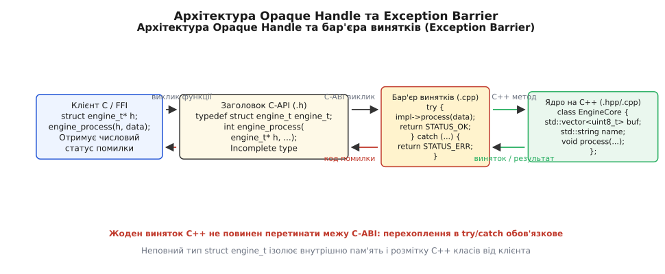
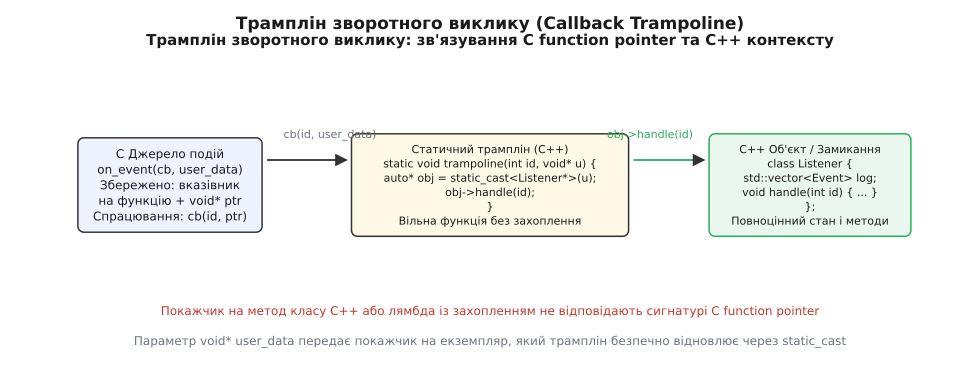

# ⚙️ Проектування стабільного C-API для бібліотеки на C++

Ця практична розробка демонструє повний інженерний цикл проектування двійково-стабільного інтерфейсу (C-API) для складної бібліотеки, написаної на сучасному C++ (із класами, динамічними контейнерами, RAII, багатопотоковістю та винятками), що дозволяє безшовно інтегрувати її в проекти на чистому C, Rust, Python, Go або сторонні C++ додатки без двійкових конфліктів ABI.

## Постановка задачі та інженерні обмеження

У системній інженерії часто виникає фундаментальний конфлікт між зручністю розробки внутрішньої бізнес-логіки та вимогами до двійкової сумісності публічного інтерфейсу. Мова C++ надає багатий набір засобів високого рівня: автоматичне управління пам'яттю через RAII, шаблони, контейнери стандартної бібліотеки (`std::vector`, `std::string`, `std::unordered_map`), винятки та поліморфізм. Проте прямий експорт C++ інтерфейсів у вигляді класів чи функцій із типами стандартної бібліотеки створює жорстку прив'язку до конкретної версії компілятора, стандартної бібліотеки (`libstdc++` vs `libc++` vs `MSVC STL`) та налаштувань прапорців компіляції (`-D_GLIBCXX_USE_CXX11_ABI`).

Розглянемо практичну задачу розробки високопродуктивного криптографічного модуля потокового перетворення даних. Внутрішнє ядро модуля реалізоване на C++20 і використовує класи, контейнери `std::vector<uint8_t>`, рядки `std::string` та винятки `std::runtime_error` для сигналізації про помилки конфігурації чи збої обробки.

До експортованого інтерфейсу висуваються суворі промислові вимоги:
1. **Повна двійкова стабільність (ABI Stability).** Зміна внутрішніх полів C++ класів, додавання нових приватних членів чи зміна версії компілятора не повинні вимагати перекомпіляції клієнтського коду, що викликає бібліотеку через динамічне зв'язування (`.so` або `.dll`).
2. **Ізоляція внутрішніх типів (патерн Opaque Handle).** Клієнт не повинен бачити заголовків C++ або внутрішніх структур даних: взаємодія відбувається виключно через непрозорі покажчики на неповні типи.
3. **Бар'єр винятків (Exception Barrier).** Жоден виняток C++ не повинен виходити за межі експортованої функції в клієнтський стек викликів C. Усі винятки мають перехоплюватися та транслюватися в числові статусні коди.
4. **Потокобезпечна діагностика помилок.** Надання механізму отримання детального текстового опису помилки для поточного потоку виконання за аналогією з функціями `strerror` або `GetLastError`.
5. **Гнучкий механізм зворотних викликів (Callbacks).** Підтримка реєстрації функцій сповіщення про прогрес із безпечною передачею довільного контексту користувача через покажчик `void* user_data`.
6. **Підтримка динамічного завантаження під час виконання (Dynamic Loading).** Можливість завантажувати бібліотеку функціями `dlopen`/`dlsym` у Linux або `LoadLibrary`/`GetProcAddress` у Windows без необхідності лінкування імпортної бібліотеки на етапі збирання.
7. **Сумісність із багатомовними біндінгами (Foreign Function Interface).** Інтерфейс повинен прямо відображатися в FFI інших популярних системних і прикладних мов: Rust (через `bindgen` та `unsafe extern "C"`), Python (через `ctypes` або CFFI), Go (через `cgo`).

## Архітектурне розбиття на рівні ізоляції

Щоб досягти повної двійкової ізоляції, архітектура бібліотеки розділяється на три взаємопов'язані шари:

1. **Публічний C-заголовок (`engine_api.h`).** Містить виключно типи мови C, неповні оголошення структур, переліки статусів і функції, оголошені зі специфікатором зв'язування `extern "C"`. Цей файл може бути включений у вихідний код будь-якої мови, що підтримує C-сумісні заголовки.
2. **Шар FFI-обгортки та бар'єра винятків (`engine_api.cpp`).** Компілюється компілятором C++. Тут визначається повна структура дескриптора, реалізуються функції життєвого циклу, відбувається приведення типів та огортання кожного виклику в блоки `try { ... } catch (...)`.
3. **Внутрішнє C++ ядро (`engine_core.hpp`).** Повноцінний об'єктно-орієнтований C++ код, який використовує всі можливості сучасної мови й нічого не знає про обмеження C-API.



*Архітектура шару експорту: неповний тип дескриптора struct engine_ctx_t та бар'єр перехоплення винятків ізолюють внутрішню структуру C++ ядра від двійкового інтерфейсу.*

## 1. Публічний заголовок C-API (engine_api.h)

Заголовок проектується за суворими правилами C-сумісності: макрос перевірки `__cplusplus`, фіксовані типи з `<stdint.h>` та макрос керування двійковим експортом символів `ENGINE_API`.

:::code proj-c-wrapper/c/1-publichnyi-zaholovok-c.h

## 2. Реалізація внутрішнього ядра та C-обгортки (engine_api.cpp)

У файлі реалізації визначено внутрішній клас `EngineCore`, деструктор якого коректно очищує всі виділені ресурси, включаючи закриття можливих дескрипторів або звільнення користувацького контексту зворотного виклику.

:::code proj-c-wrapper/cpp/2-realizatsiia.cpp

## 3. Механіка трампліна та керування контекстом

Найважливіший аспект проектування функцій зворотного виклику — передача стану. Сигнатура C-функції `void (*)(size_t, void*)` є звичайним 8-байтовим покажчиком на машинний код. Вона не може зберігати стан лямбда-виразу (наприклад, захоплені змінні `[&total, this]`) чи безпосередньо посилатися на метод класу C++.

Механізм трампліна розв'язує цю проблему через розділення коду і даних:
1. Клієнт передає статичну функцію-перехідник (трамплін), яка має сигнатуру C-функції.
2. Контекстні дані (екземпляр C++ об'єкта, структура або обгортка `std::function`) передаються через нетипізований покажчик `void* user_data`.
3. Усередині трампліна покажчик відновлюється за допомогою `static_cast<TargetType*>(user_data)` і викликає цільовий метод.



*Трамплін зворотного виклику: статична функція-перехідник відновлює C++ контекст із покажчика user_data без накладних витрат на віртуальну диспетчеризацію.*

Розглянемо, як це працює на рівні машинного коду: під час виклику функції зворотного виклику за стандартом System V AMD64 ABI значення `bytes_processed` передається в регістрі `%rdi`, а покажчик `user_data` — у регістрі `%rsi`. Статичний трамплін не виконує жодних динамічних алокацій чи пошуку у віртуальних таблицях: він просто перекладає покажчик контексту в регістр `%rdi` (неявний перший параметр `this` для виклику методу) і робить прямий безумовний стрибок `jmp` на цільовий машинний код. Накладні витрати такого містка дорівнюють одиницям тактів процесора.

## 4. Використання бібліотеки: клієнт на C та ідіоматичний клієнт на C++

Нижче наведено практичне порівняння двох підходів до використання скомпільованого C-API: прямого виклику з чистого C з ручною обробкою ресурсів та ідіоматичної C++ обгортки, яка надає сучасний інтерфейс на основі `std::span`, лямбда-функцій та розумного покажчика `std::unique_ptr` із власним делетером.

:::tabs
:::code proj-c-wrapper/c/4-vykorystannia-biblioteky.c
:::code proj-c-wrapper/cpp/4-vykorystannia-biblioteky.cpp
:::

## 5. Динамічне завантаження бібліотеки під час виконання (Explicit FFI Loading)

Однією з найсильніших переваг C-ABI є можливість завантажувати скомпільовану бібліотеку динамічно в процесі роботи програми (Dynamic Plugin Architecture). Клієнтський додаток не потребує лінкування з імпортною бібліотекою на етапі збирання: адреси функцій отримуються безпосередньо з таблиці експорту за їхніми текстовими C-іменами.

Нижче наведено приклад реалізації динамічного завантажувача з використанням системного API Unix (`dlopen` / `dlsym`):

:::tabs
:::code proj-c-wrapper/c/5-dynamichne.c
:::code proj-c-wrapper/cpp/5-dynamichne.cpp
:::

## 6. Багатомовна інтеграція: виклик із Rust та Python

Уніфікований C-ABI дозволяє використовувати розроблений модуль у будь-якому сторонньому середовищі без написання складних перехідників:

### Інтеграція в Rust
У мові Rust взаємодія базується на блоках `extern "C"`. Типізація повністю повторює публічний заголовок:

:::code proj-c-wrapper/rust/main.rs

### Інтеграція в Python через `ctypes`
У середовищі Python динамічна бібліотека завантажується за кілька рядків коду, а покажчик дескриптора зберігається як `c_void_p`:

:::code proj-c-wrapper/py/main.py

## 7. Конфігурація збирання CMake та версіонування символів

Для коректного формування динамічної бібліотеки в системі збирання CMake необхідно налаштувати правила експорту символів та приховати всі внутрішні реалізації C++.

:::code proj-c-wrapper/cmake/CMakeLists.txt

У середовищі Linux для захисту від випадкового підмішування однакових імен у спільний адресний простір додатково застосовують карту символів компонувача (Linker Version Script, наприклад `engine.map`):

```text
ENGINE_1.0 {
    global:
        engine_create;
        engine_destroy;
        engine_process;
        engine_set_progress_callback;
        engine_get_last_error;
    local:
        *;
};
```

Такий скрипт передається компонувальнику через прапорець `-Wl,--version-script=engine.map` і гарантує, що жодна внутрішня допоміжна функція чи спотворений символ класу `EngineCore` не потрапить до динамічної таблиці `.dynsym`.

## 8. Простеження життєвого циклу пам'яті та потокобезпека

Розглянемо фізичний стан оперативної пам'яті під час проходження всіх етапів роботи з дескриптором `engine_ctx_t`:

1. **Фаза створення (`engine_create`).** 
   - Виклик `std::make_unique<engine_ctx_t>()` виділяє блок розміром 8 байтів у купі під покажчик `std::unique_ptr<EngineCore>`.
   - Конструктор `EngineCore` виділяє пам'ять під об'єкт класу, динамічний буфер `std::string` (якщо довжина рядка перевищує Small String Optimization буфер, зазвичай 15 байтів) та викликає `reserve(8192)` для вектора, резервуючи 8 КіБ неперервної пам'яті. Усі структури вирівнюються за межами 8 або 16 байтів згідно з вимогами цільової архітектури.
   - Якщо на будь-якому з цих етапів виникає брак пам'яті (`std::bad_alloc`), розумні покажчики автоматично звільняють уже виділені блоки в зворотному порядку, а `*out_ctx` залишається рівним `nullptr`. Витік пам'яті виключений.
2. **Фаза обробки (`engine_process`).**
   - Функція не виконує жодних динамічних алокацій пам'яті, якщо вихідний буфер передано клієнтом. Робота відбувається безпосередньо над сирими масивами пам'яті, що забезпечує максимальну пропускну здатність шини пам'яті (Memory Bandwidth).
3. **Фаза знищення (`engine_destroy`).**
   - Створення тимчасового об'єкта `std::unique_ptr<engine_ctx_t> cleaner(ctx)` передає контроль деструктору `unique_ptr`.
   - Деструктор викликає `delete ctx`, що запускає деструктор `EngineCore`.
   - Звільняється буфер `std::vector`, рядок `algorithm_`, і, якщо була зареєстрована функція `cleanup_`, викликається очищення користувацького контексту `user_data_`.

Щодо моделі багатопотоковості (Concurrency Model):
- Сам дескриптор `engine_ctx_t` за замовчуванням є потоко-небезпечним для одночасного запису: два потоки не повинні одночасно викликати `engine_process` над одним і тим самим екземпляром дескриптора без зовнішнього м'ютекса.
- Проте різні потоки можуть абсолютно безпечно створювати й незалежно використовувати власні окремі дескриптори `engine_ctx_t` паралельно, оскільки стан `EngineCore` повністю інкапсульований і не використовує спільних глобальних змінних.
- Повідомлення про помилки зберігаються в `thread_local std::string`, тому виклик `engine_get_last_error()` повертає діагностику виключно того збою, що стався в поточному потоці виконання, не перетираючи повідомлення інших потоків.

## 9. Глибокий аналіз низькорівневого виконання, накладних витрат та бар'єра винятків

Щоб оцінити продуктивність запропонованого C-API, проаналізуємо накладні витрати (Overhead) у щасливому шляху (Happy Path) та під час виникнення помилок:

- **Витрати на виклик функції:** Прямий виклик `engine_process` через таблицю символів виконується через стандартну інструкцію процесора `call`. Він займає стільки ж тактів, скільки будь-яка звичайна функція мови C (близько 1–2 наносекунд).
- **Витрати на блок try/catch (Zero-Cost Exceptions):** У сучасних компіляторах за стандартом Itanium ABI реалізована безвитратна модель винятків за таблицями. Доки виняток не згенеровано, виконання блоку `try` не додає жодної додаткової інструкції перевірки в асемблерний потік. Таблиці `.eh_frame` розміщуються в окремих секціях пам'яті, які не завантажуються в кеш процесора під час нормального виконання коду.
- **Витрати на трамплін зворотного виклику:** Статична функція-трамплін виконує лише одне перекладання регістра `mov %rsi, %rdi` та прямий стрибок `jmp` на метод обробника. Це не викликає скидання конвеєра процесора чи промахів кешу команд, забезпечуючи практично нульову ціну абстракції.

Проте під час генерації винятку процесор переходить у режим важкої обробки:
1. Виконується функція `__cxa_throw`, яка зупиняє лінійне виконання і запускає двофазне розгортання стека (Search Phase та Cleanup Phase).
2. Підсистема `__gxx_personality_v0` покроково сканує дескриптори `.gcc_except_table` для кожного стекового кадру.
3. Знайшовши запис перехоплення у функції `engine_process`, середовище викликає деструктори локальних об'єктів C++ і передає керування на Landing Pad у гілку `catch`.
4. Текст повідомлення копіюється в `thread_local std::string`, а функція повертає числовий код через регістр `%eax`.

Оскільки винятки є винятковими подіями, така затримка (близько кількох мікросекунд) є цілком прийнятною і повністю захищає клієнтський додаток від падіння.

## 10. Пастки та критичні помилки на двійковій межі C/C++

Під час проектування й супроводу C-сумісних інтерфейсів розробники найчастіше стикаються з п'ятьма категоріями критичних дефектів:

### 1. Невідповідність алокаторів пам'яті (CRT Allocator Mismatch)
Якщо пам'ять для екземпляра виділяється всередині бібліотеки через C++ оператор `new` (або `std::make_unique`), а клієнтський додаток викликає стандартну функцію `free(ctx)` з бібліотеки `libc`, виникає фатальна аварія пам'яті. По-перше, не викликаються деструктори внутрішніх полів (`std::string`, `std::vector`, файлові дескриптори), що спричиняє витік системних ресурсів. По-друге, в операційних системах (зокрема Windows під час статичного лінкування C Runtime або при різних версіях `msvcrt.dll`) бібліотека та клієнтський додаток мають окремі незалежні пули купи (Heap). Спроба звільнити блок з однієї купи функцією з іншої призводить до негайного падіння з помилкою `Heap Corruption`. Звільнення ресурсів завжди повинно відбуватися виключно через експортовану функцію `engine_destroy`.

### 2. Вихід винятків у стек C-викликів
Якщо всередині C++ методу генерується виняток, а C-обгортка не перехоплює його через `catch (...)`, механізм розгортання стека починає шукати обробник у стекових кадрах клієнта на мові C. Оскільки код мовою C зазвичай компілюється без інформації про винятки (без таблиць DWARF `.eh_frame` у Linux або структурованих таблиць SEH у Windows), підсистема розгортання втрачає контекст і викликає аварійне завершення `std::terminate()`. Повний бар'єр винятків у кожній точці входу C-API є обов'язковою вимогою надійності.

### 3. Час життя та синхронізація покажчика `user_data`
У синхронних API час життя об'єкта, переданого у `user_data`, прив'язаний до тривалості виклику `engine_process`. Проте якщо обробка виконується асинхронно у фонових потоках бібліотеки, передача покажчика на локальну стекову змінну призводить до виникнення висячого покажчика (Dangling Pointer) і звернення до зруйнованого стеку. Для асинхронних API обов'язково впроваджується параметр `engine_cleanup_cb`: бібліотека бере на себе володіння контекстом і викликає функцію очищення під час власного знищення або завершення фонового завдання.

### 4. Порушення вирівнювання структур при передачі за значенням
Передача складних структур за значенням через C-API є джерелом прихованих помилок ABI. Якщо структура містить поля різних розмірів, різні компілятори або різні налаштування оптимізації можуть вставити різну кількість байтів заповнення (Padding). Щоб уникнути розбіжностей у зсувах полів, C-API повинен або передавати непрозорі покажчики, або суворо дотримуватися вимог Standard Layout із обов'язковою перевіркою `static_assert(sizeof(MyStruct) == EXPECTED_SIZE)` та `static_assert(offsetof(MyStruct, field) == EXPECTED_OFFSET)`.

### 5. Приховування внутрішніх символів (Symbol Stripping & Hidden Visibility)
Під час компіляції бібліотеки на C++ усі внутрішні допоміжні класи, методи та функції ядра можуть випадково потрапити до таблиці експортованих динамічних символів `.dynsym`, якщо компілятор працює з налаштуваннями видимості за замовчуванням (`-fvisibility=default`). Це не лише збільшує розмір двійкового файлу та час його завантаження динамічним лінкером, але й створює ризик колізій імен із іншими бібліотеками в адресному просторі процесу. Правильна інженерна практика полягає в компіляції всієї бібліотеки з прапорцем `-fvisibility=hidden` та явному експорті виключно функцій публічного C-API через макрос `ENGINE_API` (`__attribute__((visibility("default")))`).
