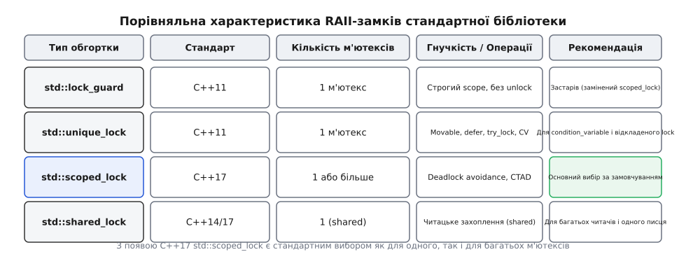

# 📋 Довідник об'єктів синхронізації та RAII-обгортки стандарту C++

Цей довідник містить систематизований опис усіх інтерфейсів, типів, гарантій безпеки, кодів помилок та прапорців стратегій для м'ютексів і RAII-замків у стандартній бібліотеці C++ (заголовні файли `<mutex>` та `<shared_mutex>`).


*Матриця типів RAII-обгорток та їхніх можливостей.*

## 1. Класи м'ютексів (Mutex Primitives)

Усі класи м'ютексів у C++ є некопійованими та непереміщуваними (`deleted copy/move constructors and assignment operators`). Вони задовольняють вимогам концепцій `BasicLockable` або `Lockable`. Конструктори за замовчуванням створюють м'ютекс у незахопленому стані.

### 1.1 `std::mutex` (C++11)
Основоположний ексклюзивний нерекурсивний м'ютекс. Забезпечує ефекти синхронізації пам'яті: успішний виклик `unlock()` на певному м'ютексі синхронізується з наступним успішним викликом `lock()` або `try_lock()` на тому самому м'ютексі (порядок Happens-Before).

:::code api-locks-reference/cpp/1-1-std-mutex-c-11.hpp

#### Детальний опис методів:
- **`void lock()`**: Блокує викликальну нитку доти, доки м'ютекс не буде успішно захоплено. 
  - *Винятки*: Може генерувати `std::system_error` із кодами помилок:
    - `std::errc::resource_deadlock_would_occur` — якщо виявлено спробу рекурсивного захоплення тією самою ниткою;
    - `std::errc::operation_not_permitted` — якщо нитка не має відповідних прав.
  - *Невизначена поведінка*: Якщо викликальна нитка вже утримує цей `std::mutex`, повторний виклик `lock()` є невизначеною поведінкою (UB).
- **`bool try_lock()`**: Спробує захопити м'ютекс без блокування викликальної нитки. 
  - *Повертане значення*: `true`, якщо м'ютекс успішно захоплено; `false`, якщо м'ютекс уже утримується іншою ниткою.
  - *Псевдонерозпізнавання (Spurious Failure)*: Стандарт дозволяє `try_lock()` повертати `false` навіть тоді, коли м'ютекс є вільним (наприклад, через особливості атомарних інструкцій процесора).
- **`void unlock()`**: Звільняє м'ютекс.
  - *Вимоги*: Виклик повинен здійснюватися **виключно тією ниткою**, яка раніше успішно захопила цей м'ютекс.
  - *Невизначена поведінка*: Звільнення незахопленого м'ютекса або виклик `unlock()` з іншої нитки є UB.
- **`native_handle_type native_handle()`**: Повертає системний дескриптор підкладного примітива операційної системи (наприклад, `pthread_mutex_t*` під POSIX або `SRWLOCK*` під Windows API).

---

### 1.2 `std::recursive_mutex` (C++11)
Рекурсивний ексклюзивний м'ютекс, який дозволяє одній і тій самій нитці виконання захоплювати його повторно багаторазово без виникнення дедлоку.

:::code api-locks-reference/cpp/1-2-std-recursive-mutex-c.hpp

#### Детальний опис специфіки:
- **Лічильник замикань**: Об'єкт підтримує внутрішній лічильник рівнів замикання для нитки-власника. Кожен успішний виклик `lock()` або `try_lock()` збільшує лічильник на 1.
- **Звільнення**: Кожен виклик `unlock()` зменшує лічильник на 1. М'ютекс стає повністю вільним і доступним для інших ниток лише тоді, коли лічильник дорівнює нулю.
- **Винятки**: `lock()` може кинути `std::system_error` із кодом `std::errc::device_or_resource_busy`, якщо досягнуто максимуму рекурсивних замикань.

---

### 1.3 `std::timed_mutex` та `std::recursive_timed_mutex` (C++11)
Розширюють інтерфейс базових м'ютексів підтримкою методів очікування з часовими лімітами (таймаутами).

:::code api-locks-reference/cpp/1-3-std-timed-mutex-ta-std.hpp

#### Детальний опис методик очікування:
- **`try_lock_for(duration)`**: Блокує нитку до успішного захоплення м'ютекса або до закінчення відносного проміжку часу `timeout_duration`. Повертає `true`, якщо замок здобуто, і `false`, якщо вичерпано час очікування.
- **`try_lock_until(time_point)`**: Блокує нитку до настання абсолютного моменту часу `timeout_time` за годинником `Clock`.

---

### 1.4 `std::shared_mutex` (C++17) та `std::shared_timed_mutex` (C++14)
Підтримують два роздільні рівні володіння: ексклюзивне (для ниток-писців) та спільне (для ниток-читачів). Задовольняють вимогам концепції `SharedLockable`.

:::code api-locks-reference/cpp/1-4-std-shared-mutex-c-17.hpp

#### Детальний опис рівнів доступу:
- **`lock_shared()`**: Захоплює м'ютекс у спільному режимі. Декілька ниток можуть одночасно утримувати спільний замок. Якщо інша нитка утримує м'ютекс в ексклюзивному режимі, викликальна нитка блокується.
- **`unlock_shared()`**: Звільняє спільне володіння. Викликається тільки ниткою, яка утримує shared-замок.
- **`lock()`**: Захоплює м'ютекс в ексклюзивному режимі. Блокує нитку доти, доки всі читачі не звільнять `shared`-замок і доки не завершить роботу попередній писець.

---

## 2. Маркерні прапорці стратегії захоплення (Lock Tag Constants)

Під час створення RAII-обгортки додатковий аргумент типу маркерного тегу визначає стратегію поведінки конструктора щодо м'ютекса.

```cpp
namespace std {
    struct defer_lock_t { explicit defer_lock_t() = default; };
    struct try_to_lock_t { explicit try_to_lock_t() = default; };
    struct adopt_lock_t { explicit adopt_lock_t() = default; };

    inline constexpr defer_lock_t defer_lock{};
    inline constexpr try_to_lock_t try_to_lock{};
    inline constexpr adopt_lock_t adopt_lock{};
}
```

| Прапорець | Опис стратегії | Сигнатура конструктора |
| :--- | :--- | :--- |
| **`std::defer_lock`** | Не викликати `lock()` у конструкторі. Обгортка прив'язується до м'ютекса, але лишається у незахопленому стані. | `unique_lock(mutex_type& m, std::defer_lock_t) noexcept` |
| **`std::try_to_lock`** | Спробувати захопити м'ютекс у конструкторі викликом `m.try_lock()` без блокування нитки. | `unique_lock(mutex_type& m, std::try_to_lock_t)` |
| **`std::adopt_lock`** | Вважати, що викликальна нитка **вже захопила** м'ютекс раніше. Конструктор не викликає `lock()`, а деструктор гарантовано викличе `unlock()`. | `lock_guard(mutex_type& m, std::adopt_lock_t)` |

---

## 3. RAII-обгортки управління м'ютексами

### 3.1 `std::lock_guard` (C++11)
Строго обмежена за області видимості (scope-based) RAII-обгортка над одним м'ютексом.

:::code api-locks-reference/cpp/3-1-std-lock-guard-c-11.hpp

#### Гарантії та обмеження:
- Конструктор `explicit lock_guard(m)` викликає `m.lock()`.
- Конструктор `lock_guard(m, std::adopt_lock)` бере під опіку вже захоплений м'ютекс.
- Деструктор `~lock_guard()` викликає `m.unlock()`.
- Об'єкт не можна копіювати, переміщувати або змінювати його м'ютекс.

---

### 3.2 `std::scoped_lock` (C++17)
Варіативна RAII-обгортка для атомарного захоплення від 0 до `N` м'ютексів із гарантованим уникненням взаємного блокування (Deadlock Avoidance).

:::code api-locks-reference/cpp/3-2-std-scoped-lock-c-17.hpp

#### Специфіка роботи:
- Для 1 м'ютекса: конструктор викликає `m.lock()`.
- Для кількох м'ютексів: конструктор викликає `std::lock(m1, m2, ...)`.
- Підтримує CTAD у C++17: написання `std::scoped_lock lock(m1, m2);` не вимагає явних типів шаблону.

---

### 3.3 `std::unique_lock` (C++11)
Гнучка RAII-обгортка із підтримкою переміщення володіння, відкладеного захоплення, таймаутів та ручного управління.

:::code api-locks-reference/cpp/3-3-std-unique-lock-c-11.hpp

#### Деталізація методів:
- **`owns_lock()` / `operator bool()`**: Повертає `true`, якщо об'єкт `unique_lock` наразі утримує м'ютекс.
- **`release()`**: Відключає м'ютекс від обгортки та повертає вказівник на нього. М'ютекс залишається у захопленому стані, а деструктор `unique_lock` більше не буде викликати `unlock()`.
- **`mutex()`**: Повертає вказівник на керований `mutex_type` (або `nullptr`).

---

### 3.4 `std::shared_lock` (C++14)
RAII-обгортка для поділюваного доступу на читання над об'єктами типу `std::shared_mutex`.

:::code api-locks-reference/cpp/3-4-std-shared-lock-c-14.hpp

---

## 4. Вільні функції та допоміжні примітиви

### 4.1 `std::lock` та `std::try_lock` (C++11)

```cpp
namespace std {
    template <class L1, class L2, class... L3>
    void lock(L1& l1, L2& l2, L3&... l3);

    template <class L1, class L2, class... L3>
    int try_lock(L1& l1, L2& l2, L3&... l3);
}
```

- **`std::lock`**: Атомарно захоплює всі передані об'єкти замків (`Lockable`), уникаючи взаємного блокування за допомогою внутрішнього алгоритму спроб та відкатів. Якщо під час захоплення одного з замків виникає виняток, усі вже захоплені у цьому виклику замки автоматично відпускаються.
- **`std::try_lock`**: Послідовно викликає `try_lock()` для кожного об'єкта. Повертає `-1` у разі успіху для всіх. Якщо якийсь замок повернув `false` або викинув виняток, усі попередньо захоплені замки відпускаються, а функція повертає 0-індексований порядковий номер замка, на якому стався збій.

---

### 4.2 Одноразова ініціалізація: `std::call_once` та `std::once_flag` (C++11)

:::code api-locks-reference/cpp/4-2-odnorazova.cpp

- **`std::call_once`**: Гарантує, що передана функція або об'єкт виклику `f` буде виконано **рівно один раз** на даному екземплярі `once_flag`, навіть якщо `call_once` одночасно викликають сотні паралельних ниток.
- **Гарантія безпеки винятків**: Якщо виклик `f` завершується винятком, прапорець `once_flag` **не вважається встановленим**. Наступна нитка, яка викликає `call_once` з цим прапорцем, знову спробує виконати `f`.

---

## 5. Зведений приклад використання типів замків (C та C++)

:::tabs
:::code api-locks-reference/c/main.c
:::code api-locks-reference/cpp/5-zvedenyi-pryklad.cpp
:::
