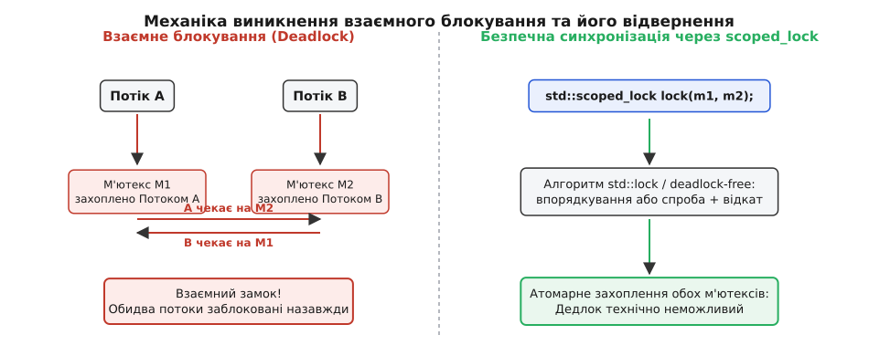

# ⚙️ Запобігання дедлокам: переказ коштів між рахунками та еволюція RAII-замків

Ця практична вставка детально розбирає класичну задачу багатонитвового програмування — транзакційний переказ коштів між двома банківськими рахунками. На цьому прикладі простежено еволюцію методів запобігання взаємному блокуванню (англ. *deadlock*) від наївного ручного захоплення замків до сучасного безпечного C++17 виклику `std::scoped_lock`.


*Схема виникнення перехресного дедлоку та його атомарне розв'язання.*

## 1. Постановка задачі та фізична сутність дедлоку

Уявімо банківську систему, де кожен рахунок представлений об'єктом класу `Account`. Клас містить числовий баланс та власний м'ютекс для захисту цього балансу від гонитви даних при одночасних операціях зняття та поповнення.

Необхідно реалізувати функцію `transfer(from, to, amount)`, яка атомарно зменшує баланс рахунку `from` на величину `amount` і збільшує баланс рахунку `to` на ту саму суму.

```
Потік 1: transfer(Account_A, Account_B, 100);
Потік 2: transfer(Account_B, Account_A, 50);
```

Розглянемо часову послідовність дій при наївному послідовному замиканні:
1. **Тайм-стіп t1**: Потік 1 викликає `transfer(A, B, 100)` і успішно захоплює м'ютекс `A.mtx`.
2. **Тайм-стіп t2**: Потік 2 паралельно викликає `transfer(B, A, 50)` і успішно захоплює м'ютекс `B.mtx`.
3. **Тайм-стіп t3**: Потік 1 намагається захопити м'ютекс `B.mtx`. Оскільки м'ютекс `B.mtx` уже утримується Потоком 2, операційна система переводить Потік 1 у стан сну (очікування).
4. **Тайм-стіп t4**: Потік 2 намагається захопити м'ютекс `A.mtx`. Оскільки м'ютекс `A.mtx` уже утримується Потоком 1, операційна система переводить Потік 2 у стан сну.

Виникає класичний **перехресний дедлок** (Cyclic Dependency / Deadlock). Потік 1 чекає на ресурс, який належить Потоку 2, а Потік 2 чекає на ресурс, який належить Потоку 1. Обидві нитки зависають назавжди, спалюючи системні ресурси та блокуючи подальшу роботу всієї програми.

---

## 2. Версія 1: Ручне впорядкування м'ютексів (C-style)

Найдавнішим способом уникнення дедлоку при роботі з кількома м meтексами є **глобальне впорядкування замків** (англ. *lock ordering*). Якщо всі нитки у програмі завжди захоплюють м'ютекси у строго однаковому порядку (наприклад, за зростанням їхніх числових адрес у пам'яті), циклічне очікування стає математично неможливим.

:::tabs
:::code proj-bank-transfer/c/main.c
:::code proj-bank-transfer/cpp/2-versiia-1-ruchne.cpp
:::

### Недоліки ручного впорядкування:
1. **Складність підтримки**: Програміст повинен вручну стежити за сортуванням м'ютексів у кожному місці програми.
2. **Втрата абстракції**: Якщо кількість м'ютексів зростає до 3–4, ручне сортування адрес перетворюється на громіздкий та схильний до помилок код із десятками порівнянь.
3. **Небезпека портативності**: Порівняння вказівників, які не належать до одного масиву, у строгому C++ є порівнянням із невизначеним результатом, якщо не застосовувати `std::less`.

---

## 3. Версія 2: Використання std::lock та std::adopt_lock (C++11)

Стандарт C++11 запропонував варіативний шаблон функції `std::lock(m1, m2, ...)`. Вона використовує спеціальний алгоритм запобігання дедлокам (Deadlock Avoidance Algorithm).

### Як працює алгоритм `std::lock` усередині:
1. Алгоритм намагається захопити перший м'ютекс через `.lock()`.
2. Для всіх наступних м'ютексів викликається `.try_lock()`.
3. Якщо виклик `.try_lock()` для одного з наступних м'ютексів повертає `false` (тобто м'ютекс зайнятий):
   - Алгоритм **негайно відпускає всі вже захоплені м'ютекси** у даному виклику;
   - Нитка поступається процесорним часом (`std::this_thread::yield()`);
   - Порядок спроби захоплення змінюється (першим блокуючим викликом стає той м'ютекс, який не вдалося захопити);
   - Цикл випробовування повторюється до повного успіху.

Для передачі вже захоплених м'ютексів під опіку RAII-обгортки використовується маркерний прапорець `std::adopt_lock`:

:::code proj-bank-transfer/cpp/iak-pratsiuie-alhorytm-std.cpp

### Тонкощі C++11 підходу:
Якщо між викликом `std::lock(...)` та створенням об'єктів `lock_guard` згенериться виняток (наприклад, при виділенні пам'яті для проміжного об'єкта), м'ютекси лишаться захопленими! Тому створення `lock_guard` мало йти негайно після `std::lock`.

---

## 4. Версія 3: Ідіоматичний C++17 підхід із std::scoped_lock

У C++17 з'явився `std::scoped_lock`, який повністю об'єднав можливості `std::lock(...)` та RAII. Завдяки механізму виведення аргументів шаблону класу (CTAD — Class Template Argument Deduction), розробникові більше не потрібно вказувати типи м'ютексів вручну.

:::tabs
:::code proj-bank-transfer/cpp/4-versiia-3-idiomatychnyi.cpp
:::

---

## 5. Захист від самоприсвоєння та крайові випадки

Найпоширенішою помилкою при розробці функцій транзакцій між двома об'єктами є ігнорування виклику `transfer(acc1, acc1, 100)`.

Якщо функцію `transfer` викликати з однаковими посиланнями (`&from == &to`), `std::scoped_lock` спробує передати один і той самий екземпляр `std::mutex` двічі в алгоритм захоплення.

Оскільки `std::mutex` у C++ є **нерекурсивним**, повторне захоплення м'ютекса тією самою ниткою призводить до **невизначеної поведінки** (Undefined Behavior — UB):
- На операційній системі Linux з `pthread_mutex`: нитка зависає у стані вічного блокування сама на собі.
- На операційній системі Windows: виклик може видати крах процесу або помилку `system_error`.

Тому перевірка `if (&from == &to) return false;` на самому початку функції є інваріантною умовою, яка захищає від руйнування внутрішнього стану м'ютекса.

---

## 6. Порівняльний аналіз продуктивності

Нижче наведено порівняльну таблицю накладних витрат та гарантій безпеки для різних методів реалізації транзакцій:

| Метод синхронізації | Продуктивність (uncontended) | Захист від дедлоку | Безпека винятків | Складність коду |
| :--- | :--- | :--- | :--- | :--- |
| Ручні `pthread_mutex_lock` | ~15–20 нс | Ні (вимагає ручного сортування) | Низька (потрібні goto/cleanup) | Висока |
| Ручне сортування адрес + `lock_guard` | ~20–25 нс | Так (ручне сортування адрес) | Висока (RAII) | Середня |
| `std::lock_guard` + `std::lock` | ~25–30 нс | Так (алгоритм std::lock) | Середня (ризик між викликами) | Середня |
| **`std::scoped_lock` (C++17)** | **~20–25 нс** | **Так (гарантовано стандартом)** | **Абсолютна (100% RAII)** | **Мінімальна (1 рядок)** |

Завдяки комбінації CTAD та витисненню непотрібних перевірок у сучасних компіляторах (GCC, Clang, MSVC), виклик `std::scoped_lock lock(m1, m2);` дає максимальну швидкодію без жодного компромісу з безпекою коду.
