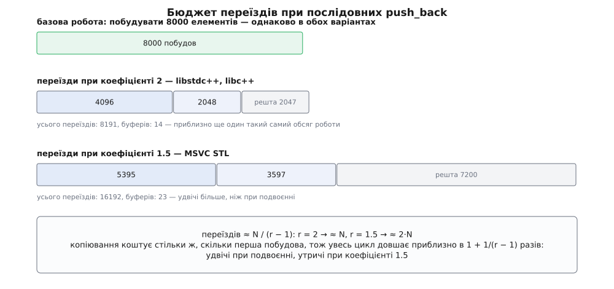

# ⚙️ Ціна одного слова: вимір зростання vector

Твердження «`noexcept` на конструкторі переміщення робить `std::vector` швидшим» легко повторити і важко відчути на вагу: наскільки швидшим, коли саме й чому саме стільки. Тут ми зберемо програму, яка не бере це на віру: вона рахує кожне копіювання й кожне переміщення нарізно, жене однаковий цикл двома варіантами одного типу — з обіцянкою й без неї — і кладе обидва числа поруч із часом.

## Задача: рахувати, а не тільки міряти

Секундомір скаже «повільніше в стільки-то разів», але не скаже **чому** саме стільки — а без цього число нема з чим порівняти й нема як перевірити. Тому головний прилад у цьому проєкті не годинник, а **лічильники операцій**: скільки разів викликано конструктор копіювання, скільки — конструктор переміщення, скільки — деструктор.

Лічильники цінні тим, що їхні свідчення **детерміновані**. Час залежить від машини, від того, що робить сусідній процес, від стану кешу; кількість копіювань не залежить ні від чого, крім стратегії зростання вашої реалізації. Тобто лічильники дають число, яке можна вирахувати на папері **до** запуску — і саме тому вимір із ними або підтверджує модель, або доводить, що модель хибна.

Тому працюємо в три кроки. Спершу будуємо тип, що відрізняється від себе самого рівно одним словом. Тоді дивимося на лічильники й звіряємо їх з арифметикою геометричної прогресії. І аж наприкінці переводимо кількість операцій у час — щоб побачити, чи справдилося передбачення.

## Ідея: один шаблон, дві обіцянки

Спокуса — написати два класи-близнюки й порівняти їх. Це погана ідея: два тіла легко розійдуться в чомусь, чого ви не помітите, і ви порівняєте не те, що збиралися. Надійніше зробити **один** шаблон з булевим параметром і сховати цей параметр рівно в одному місці — у специфікації.

```cpp
template <bool NX>
Payload(Payload&& o) noexcept(NX) : data_(std::move(o.data_)) { ++g.move; }
```

`noexcept(NX)` при `NX == false` — те саме, що не писати нічого. Тіло, поля, порядок ініціалізації, згенерований машинний код усередині — усе спільне. Різняться дві інстанціації буквально однією відповіддю на одне питання, і ця відповідь — єдине, за чим бібліотека може їх розрізнити.

Начинкою хай буде `std::vector<double>`: він володіє шматком купи, тож його копіювання коштує виділення пам'яті плюс переписування всіх чисел, а переміщення — трьох присвоєнь вказівників. Візьміть натомість щось без купи — масив фіксованого розміру, коротенький рядок — і копіювання з переміщенням коштуватимуть однаково, а різниця зникне геть. Це не спростування, а перша пастка, до якої ще повернемося.

## Код

Спершу лічильники й сам тип.

:::code proj-noexcept-vector-growth/cpp/growth.cpp

Два `static_assert` наприкінці — не оздоба, а перша перевірка: вони доводять, що обидві інстанціації справді вийшли різними. Риса `is_nothrow_move_constructible_v` — з тієї самої родини запитів до типу, що й решта відповідей «так/ні» про операції ([риси типів](root:sys-plang-cpp/type-traits): шаблони, які на етапі компіляції дають `bool` або тип, замість перевірок у час виконання).

Тепер сам вимір. Годинник беремо `steady_clock` — єдиний із трьох стандартних, який гарантовано не йде назад ([chrono](root:sys-plang-cpp/chrono): `system_clock` показує календарний час і може стрибнути від переведення годинника чи синхронізації з NTP, `high_resolution_clock` у багатьох реалізаціях — просто його псевдонім).

:::code proj-noexcept-vector-growth/cpp/kod.cpp

Чому `emplace_back(payload)`, а не `push_back(Payload<NX>(payload))`? Бо `emplace_back` будує елемент **просто в слоті** контейнера, і тоді кожне переміщення в лічильнику — це переїзд при перерозподілі, і нічого більше. `push_back` із тимчасовим об'єктом додав би рівно `n` зайвих переміщень (по одному на кожен виклик), які довелося б віднімати руками.

Чому `best_of` бере **мінімум**, а не середнє? Бо всі завади — витіснення з кешу, планувальник, чужий процес — додають час і ніколи його не віднімають. Мінімум із кількох пробігів — найчистіша оцінка «скільки це коштує, коли ніхто не заважає»; середнє змішує роботу з випадковими перешкодами. Це загальне правило вимірювання коротких відрізків коду, а не хитрість цього проєкту ([мікробенчмарк](root:sf-release/microbenchmarking): дисципліна виміру, у якій прогрів, кількість повторів і спосіб згортання результатів важать не менше за сам код).

Окремо — слід зростання. Він потрібен, щоб не гадати про коефіцієнт вашої реалізації, а прочитати його:

:::code proj-noexcept-vector-growth/cpp/kod-2.cpp

## Що надрукується — і чому саме стільки

Рядок місткостей на GCC і Clang виглядатиме так:

```
місткості: 1 2 4 8 16 32 64 128 256 512 1024 2048 4096 8192
```

Чотирнадцять буферів, кожен удвічі більший за попередній. На MSVC той самий рядок буде інший — двадцять три числа з кроком у півтора рази: `1 2 3 4 6 9 13 19 28 42 63 94 141 211 316 474 711 1066 1599 2398 3597 5395 8092`.

Ці послідовності не випадкові й не приховані. `libstdc++` бере нову місткість як `size() + max(size(), n)` — тобто подвоєння; `libc++` — як `max(2 * capacity(), new_size)`, те саме подвоєння; MSVC STL — як `capacity() + capacity() / 2`, а якщо цього замало, то рівно стільки, скільки потрібно просто зараз.

Тепер лічильники. Скільки елементів фізично переїде за `N` додатків? При кожному перерозподілі переїжджає стільки елементів, скільки їх було, тобто **стара місткість**. Отже сума переїздів — це сума всіх місткостей, крім останньої: `1 + 2 + 4 + … + 4096`. Для `N = 8000` при подвоєнні це рівно **8191**; при коефіцієнті 1.5 — **16192**.



*Уся вага — в останніх переїздах: при подвоєнні два останні дають три чверті всієї роботи перерозподілу, а дванадцять попередніх разом — лише чверть.*

Звідси й загальна формула. Місткості — геометрична прогресія зі знаменником `r`, а в такій прогресії сума всіх членів, крім останнього, приблизно дорівнює останньому, поділеному на `r − 1`:

```
переїздів ≈ N / (r − 1)

r = 2.0   →  ≈ 1·N      подвоєння: 8191 при N = 8000
r = 1.5   →  ≈ 2·N      півтора:  16192 при N = 8000
r = 1.25  →  ≈ 4·N      обережне зростання коштує вчетверо дорожче
```

Ось таблиця того, що надрукує програма на бібліотеці з подвоєнням. Ці числа не залежать від машини — вони випливають із самої стратегії:

| варіант | побудов | копій | переміщень | знищень |
|---|---|---|---|---|
| без `noexcept` | 8000 | 8191 | 0 | 8191 |
| з `noexcept` | 8000 | 0 | 8191 | 8191 |
| без `noexcept` + `reserve` | 8000 | 0 | 0 | 0 |
| з `noexcept` + `reserve` | 8000 | 0 | 0 | 0 |

Перевірити роздруківку на осудність легко: `побудов + копій + переміщень − знищень` мусить дорівнювати кількості живих елементів, тобто 8000. Якщо не дорівнює — десь у типі є операція без лічильника, і вимір не про те, що ви думаєте.

Найцікавіші в таблиці — третій і четвертий рядки. З `reserve` нулі стоять **в обох варіантах**: перерозподілу немає взагалі, тож `noexcept` тут ні на що не впливає. Обіцянка діє рівно там, де контейнер змушений переїжджати, — і ніде більше.

## Скільки це в часі

Тепер перекладімо операції в час. Обидва варіанти роблять однакову базову роботу: `N` разів побудувати елемент, тобто `N` виділень пам'яті плюс `N · P` записів чисел. Варіант без обіцянки додає до цього `R ≈ N/(r−1)` копіювань — кожне з них знову виділення плюс `P` записів — і стільки ж звільнень старих елементів.

Копія коштує приблизно стільки ж, скільки перша побудова: та сама пара «виділити й заповнити». Тому все зводиться до однієї дробі:

```
T_повільний / T_швидкий ≈ 1 + R/N ≈ 1 + 1/(r − 1)

r = 2.0   →  ≈ 2 рази
r = 1.5   →  ≈ 3 рази
```

Це передбачення, зроблене з лічильників **до** запуску годинника, — і саме його перевіряє останній рядок програми. Абсолютні мілісекунди залежать від машини й алокатора; відношення — майже ні, і воно має вийти близьким до двійки на GCC чи Clang і до трійки на MSVC.

Висновок звідси менш ефектний, ніж очікують: одне слово пришвидшує **приблизно вдвічі**, а не в сто разів. Причина в тому, що ряд переїздів обмежений — його сума порівнянна з базовою роботою, а не в рази більша за неї, і саме цю обмеженість гарантує геометричне зростання ([амортизований аналіз](root:computability/amortized-analysis): рідкісна дорога операція розмазується по дешевих сусідах так, що середня вартість додатка лишається сталою).

Двійка — це не «дрібниця, не варта уваги»: подвоєння часу на гарячому шляху дороге. Але й не привід очікувати дива від одного ключового слова: якщо ваш профіль показує, що вузьке місце деінде, `noexcept` його туди не перенесе.

## Тип, який не вміє копіюватися

Найцікавіший випадок — коли вибору в бібліотеки немає. Візьмімо тип із забороненим копіюванням і **без** обіцянки на переміщенні:

:::code proj-noexcept-vector-growth/cpp/typ-iakyi-ne-vmiie.cpp

Що зробить `vector`? Відповідь видно ще до запуску — прямо в типі, який поверне `std::move_if_noexcept`:

:::code proj-noexcept-vector-growth/cpp/typ-iakyi-ne-vmiie-2.cpp

Три рядки, жодного виконання — і механізм доведений. Прогнавши `MoveOnly` через той самий цикл, побачите лічильники, як у варіанта з `noexcept`: 8000 побудов, 0 копій, 8191 переміщення. Тобто **за швидкістю** тип без копіювання поводиться так само добре, як тип з обіцянкою.

А от за безпекою — ні, і це головне, що варто винести з цього розділу. Стандарт формулює вимогу так: якщо під час вставляння одного елемента в кінець кинуто виняток, **ефектів немає** за умови, що `T` є `Cpp17CopyInsertable` **або** `is_nothrow_move_constructible_v<T>` істинне. Для `MoveOnly` не істинне ні перше, ні друге. Тому сильна гарантія тут не діє: якщо переміщення кине посеред перерозподілу, вектор лишиться цілим і несуперечливим — але вміст його буде вже не той, що до операції. Це базова гарантія замість сильної ([гарантії безпеки винятків](root:sys-plang-cpp/exception-safety-guarantees): базова обіцяє лише живий об'єкт без витоків, сильна — стан, точно такий, як до невдалої операції).

Порада звідси не «уникайте типів без копіювання» — вони часто саме те, що треба. Порада така: **саме на них обіцянка потрібна найбільше**, бо тільки вона відрізняє «швидко й безпечно» від «швидко й без відкату». Для типу, що володіє тільки вказівником, ця обіцянка і безкоштовна, і чесна.

## Пастки

**`reserve` прибирає різницю цілком.** Це найчастіше джерело здивування «а в мене нічого не змінилося». Якщо кількість елементів відома наперед і ви її зарезервували, перерозподілу немає, `move_if_noexcept` ніхто не питає, обіцянка ні на що не впливає. Зверніть увагу й на зворотний бік: `reserve` б'є те саме вузьке місце й б'є сильніше — прибирає всі переїзди до одного, а не робить їх дешевшими. Тож `noexcept` рятує там, де розмір **не** відомий наперед, і саме такі місця варто шукати у своєму коді.

**Вимір без оптимізації нічого не вартий.** Уся механіка `vector` — шаблони в заголовку; без вбудовування вони лишаються справжніми викликами, і ви міряєте вартість викликів, а не вартість перерозподілу. У складанні MSVC «Debug» до цього додається `_ITERATOR_DEBUG_LEVEL=2`, а в GCC при `_GLIBCXX_DEBUG` — перевірки на кожній операції; вони дорожчі за все, що ви збиралися зміряти. Міряйте на `-O2` / `/O2`.

**Пастка з протилежного боку: оптимізатор може з'їсти сам вимір.** Класична поразка мікробенчмарка — цикл, результат якого нікому не потрібен, і компілятор його просто видаляє, а ви радієте нулю ([оптимізації компілятора](root:sf-lang/compiler-optimizations): усунення мертвого коду — одне з базових перетворень, і формально воно цілком законне, бо спостережної поведінки не змінює). Тут від цього рятують уже самі лічильники: `g` — глобальна змінна, її записи спостережні, тож цикл викинути не можна. `checksum` лишено як звичку, яку варто мати в кожному вимірі, де такого запобіжника немає.

**Різні реалізації дають різні числа — і це не шум.** Порівнювати абсолютні лічильники, зняті на MSVC, із чужими, знятими на Clang, безглуздо: коефіцієнт 1.5 проти 2 дає вдвічі більше переїздів і вдвічі глибший провал без обіцянки. Порівнювати треба два варіанти **на одній машині й одній бібліотеці**, а `capacity_trace` тримати в програмі саме для того, щоб знати, на чому ви міряєте.

**Тип без купи не покаже нічого.** Якщо всередині елемента лише числа або масив фіксованого розміру, переміщення й копіювання — та сама пересилка байтів, і різниці не буде за жодного коефіцієнта. Те саме з короткими рядками: `std::string` живе всередині самого об'єкта, доки не переросте власний буфер (десяток-другий символів — точна межа своя в кожній реалізації), і його «переміщення» — це те саме копіювання. Обіцянка окупається рівно там, де переміщення справді дешевше за копіювання, тобто там, де об'єкт володіє чимось за межами себе.

**Деякі реалізації переносять пам'ять блоком.** Для типів, які можна пересунути простим `memmove`, бібліотека має право не викликати ані конструктора переміщення, ані копіювання. Ваші лічильники тоді просто не спрацюють — і це не поламаний вимір, а інша, ще дешевша дорога. `Payload` під це не підпадає (у ньому власноруч написані конструктори й `std::vector` усередині), але якщо ви заміните його на щось простіше й побачите нулі всюди — причина, найпевніше, саме ця.

**Обіцянка на присвоєнні теж має значення, тільки в іншому місці.** Перерозподіл користується конструктором переміщення, тож усе вище — про нього. Але `insert` і `erase` в середину зсувають хвіст **присвоєннями**, а `std::sort` переставляє елементи ними ж. Позначати варто обидві операції: у наведеному типі це зроблено, і саме тому `noexcept(NX)` стоїть у двох місцях, а не в одному.
