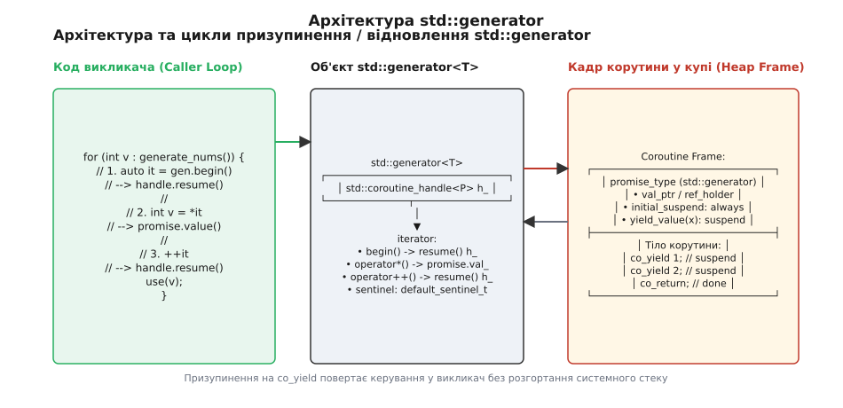
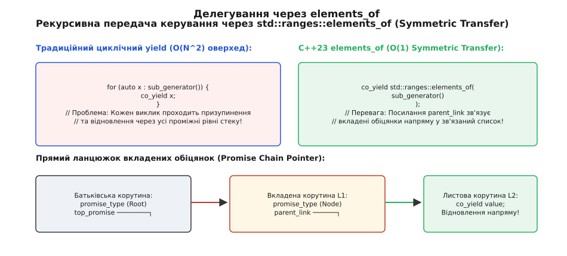

# Синхронний генератор послідовностей std::generator у C++23

<preknowlist>
- [Модель корутин C++20](root:sys-plang-cpp/coroutines) — механіка призупинення виконання (`co_yield`, `co_return`), ролі `promise_type` та `std::coroutine_handle`.
- [Конвеєри та діапазони Ranges](root:sys-plang-cpp/ranges-pipelines) — об'єкти `std::ranges::input_range`, ітератори, сентинели та лінива обробка послідовностей.
- [Семантика переміщення](root:sys-plang-cpp/move-semantics) — володіння ресурсами, rvalue-посилання `T&&` та заборона копіювання move-only типів.
</preknowlist>

Уявіть задачу обробки величезного лог-файла розміром 50 гігабайтів або генерацію нескінченної послідовності чисел Фібоначчі. Звичайний підхід імперативного програмування вимагає створення контейнера `std::vector<T>` і попереднього розрахунку всіх елементів. Для лог-файла це означає миттєве вичерпання оперативної пам'яті та крах програми через нестачу ресурсів (`OutOfMemory`), а для нескінченної послідовності — вічний цикл ще до того, як викликач дістане можливість прочитати хоча б перше число. 

Альтернативний шлях, відомий із мови C++98, полягає у ручному написанні класичного ітератора зі збереженням стану. Програміст оголошує клас, тримає всередині файловий дескриптор, поточну позицію буфера, прапорці помилок, перевизначає оператори `operator++`, `operator*` та реалізує складний скінченний автомат. Такий код швидко перетворюється на виснажливе рутинне завдання, де логіка генерації елементів розмазана між декількома методами й структурами, а ймовірність припуститися помилки у граничних умовах (edge cases) прямує до одиниці.

Стандарт C++23 остаточно закриває цю фундаментальну проблему, вводячи заголовок `<generator>` та шаблон класу `std::generator`. Він дозволяє писати ліниві синхронні послідовності у вигляді звичайних послідовних функцій із використанням оператора `co_yield`. Виконання корутини зупиняється на кожному `co_yield`, повертає обчислене значення у викликаючий цикл, а при наступній ітерації відновлюється рівно з того місця, де зупинилося, зберігаючи всі локальні змінні та стек виконання. Про довгий шлях комітету стандартизації WG21 від мовних примітивів C++20 до бібліотечного класу C++23 детальніше читайте у вставці ([історія стандартизації корутинних генераторів](root:sys-plang-cpp/std-generator/hist-coroutines-evolution.md)).

---

## 1. Проблема лінивих обчислень: Eager проти Lazy та ручні автомати стану

Щоб зрозуміти глибоку мотивацію створення `std::generator`, зіставимо три концептуальні підходи до генерації послідовностей у системному програмуванні.

### Жадібна генерація (Eager Evaluation)

При жадібній генерації функція повністю створює весь набір даних у пам'яті до моменту повернення результату.

:::code std-generator-d/cpp/zhadibna-heneratsiia-eager.cpp

Цей підхід має дві фундаментальні вади. По-перше, **просторова складність пам'яті дорівнює `O(N)`**. Якщо викликачу потрібні лише перші 3 елементи з мільйона, ресурси пам'яті на решту 999 997 елементів виділяються й марнуються даремно. По-друге, **часова затримка першого елемента (Latency) дорівнює `O(N)`**. Програма змушена чекати закінчення розрахунку всього масиву, перш ніж обробити хоча б один результат.

### Ручний ітератор-автомат (Manual State Machine)

Для усунення витрат пам'яті розробники змушені створювати класи-ітератори, які імітують лінивість.

:::code std-generator-d/cpp/ruchnyi-iterator-avtomat.cpp

Цей код забезпечує **`O(1)` пам'яті**, але ціна написання надзвичайно висока. Обчислювальний алгоритм (додавання двох чисел) розірвано на окремі фрагменти в `operator*` та `operator++`. Якщо алгоритм стає рекурсивним (наприклад, обхід графа або парсинг дерев'яного виразу), ручний автомат вимагає явного ведення власного стеку `std::vector<Node*>` у полях класу, що миттєво перетворює код на складний інженерний хаос.

### Лінива корутинна генерація через std::generator

З появою `std::generator` той самий алгоритм записується як прямий, природний, послідовний цикл:

:::code std-generator-d/cpp/linyva-korutynna.cpp

Код читається як простий нескінченний цикл. Оверхед пам'яті становить `O(1)` і зводиться до розміру одного кадру корутини (`coroutine frame`) у купі, а обчислення відбуваються строго за запитом споживача.

---

## 2. Анатомія шаблону std::generator<Ref, V, Alloc>

Шаблон `std::generator` оголошено у заголовку `<generator>` зі зваженою системою оболонкових типів:

```cpp
template<
    class Ref,
    class V = void,
    class Allocator = void
> class generator;
```

### Параметри шаблону та їхнє призначення

Для точного керування продуктивністю стандарт C++23 розділив поняття типу розіменовування ітератора та типу значення, яке зберігається у контейнері:

1. **`Ref` (Тип розіменовування / Reference type):** Визначає тип, який повертається під час виконання операції `*it` на ітераторі генератора. Це може бути посилання (`const std::string&`, `int&`), rvalue-посилання (`std::string&&`) або звичайне значення (`int`).
2. **`V` (Тип значення / Value type):** Визначає псевдонім `std::generator::value_type`. Якщо параметр `V` не вказано (передано `void`), компілятор автоматично виводить його як `std::remove_cvref_t<Ref>`. Наприклад, для `std::generator<const std::string&>` тип `Ref` дорівнює `const std::string&`, а тип `V` стає `std::string`.
3. **`Allocator` (Тип розподілювача пам'яті):** Вказує користувацький тип розподілювача (наприклад, `std::pmr::polymorphic_allocator<char>`). Якщо передано `void`, генератор використовує стандартне виділення кадру через `operator new`.

### Навіщо розділяти Ref та V?

Розглянемо випадок, коли генератор повертає великі важкі об'єкти (наприклад, структури `std::string` або `std::vector<double>`), які вже існують у внутрішньому стані корутини:

:::code std-generator-d/cpp/navishcho-rozdiliaty-ref.cpp

Завдяки специфікації `Ref = const std::string&`, оператор `co_yield record` зберігає у кадрі корутини лише вказівник на рядок всередині `cache_`. Під час розіменовування ітератора викликач отримує `const std::string&` без жодного тимчасового копіювання чи виділення пам'яті у купі.

Якщо ж генератор створює тимчасові значення прямо під час генерації, використовують передачу за значенням або rvalue-посилання:

```cpp
// Повернення тимчасових об'єктів за значенням
std::generator<std::string> generate_formatted_strings() {
    for (int i = 0; i < 100; ++i) {
        co_yield "Record #" + std::to_string(i); // Створюється тимчасовий рядок
    }
}
```

### Семантика володіння (Move-only Semantics)

Об'єкт `std::generator` володіє ресурсом кадру корутини через внутрішній дескриптор `std::coroutine_handle<promise_type>`. Копіювання об'єкта **жорстко заборонено**:

```cpp
std::generator<int> gen1 = generate_numbers();
// std::generator<int> gen2 = gen1; // ПОМИЛКА КОМПІЛЯЦІЇ: copy constructor is deleted

std::generator<int> gen2 = std::move(gen1); // ОК: володіння кадром переходить до gen2
```

Якби копіювання було дозволено, два об'єкти `std::generator` мали б копію того самого `coroutine_handle`. Знищення першого об'єкта викликало б деструктор кадру `handle.destroy()`, перетворюючи другий об'єкт на висячий дескриптор і викликаючи повторне вивільнення пам'яті (`double free`) при його знищенні. Докладний розбір типів, конструкторів та специфікацій дивіться у вставці ([довідник специфікації та інтерфейсу std::generator](root:sys-plang-cpp/std-generator/api-generator-ref.md)).

---

## 3. Механізм роботи co_yield та внутрішній протокол призупинення

Внутрішня робота `std::generator` базується на чіткій взаємодії між трикутником компонентів: **викликом у коді користувача**, **інтерфейсом ітератора** та **кадром корутини** у купі.


*Фізична взаємодія компонентів: викликаючий цикл повертається до кадру корутини через handle.resume(), а co_yield передає значення через обіцянку.*

### Покрокова розкадровка виконання

Розглянемо виконання наступного коду крок за кроком:

:::code std-generator-d/cpp/pokrokova-rozkadrovka.cpp

#### Крок 1: Виклик генераторної функції `count_to_three()`
При виклику корутинної функції компілятор здійснює наступні дії:
1. Виділяє кадр корутини (`coroutine frame`) у купі за допомогою `operator new`.
2. Конструює об'єкт `promise_type` всередині кадру.
3. Копіює або переміщує аргументи функції у кадр корутини.
4. Викликає `promise.get_return_object()`, який створює та повертає об'єкт `std::generator<int>`, загорнувши у нього `std::coroutine_handle<promise_type>::from_promise(promise)`.
5. Викликає `co_await promise.initial_suspend()`. Для `std::generator` цей метод повертає `std::suspend_always`. Це означає, що **тіло корутини НЕ виконується одразу** — корутина призупиняється на першій же інструкції й повертає керування у `main()`. Такий запуск називається **лінивим запуском (Lazy Initialization)**.

#### Крок 2: Перший виклик `gen.begin()` у циклі `for`
Цикл `for (int val : gen)` розгортається компілятором у виклик `auto it = gen.begin()`.
1. Метод `begin()` перевіряє, чи не є корутина вже завершеною.
2. `begin()` викликає `handle.resume()` на дескрипторі корутини.
3. Керування процесором переходить у тіло корутини. Вона починає виконуватися до першого оператора `co_yield 1;`.

#### Крок 3: Виконання `co_yield 1;`
1. Вираз `co_yield 1` компілятор трансляційно перетворює на `co_await promise.yield_value(1)`.
2. Метод `promise.yield_value(1)` бере адреси або значення числа `1` і зберігає його у внутрішньому полі кадру `value_ptr_`.
3. `yield_value` повертає об'єкт призупинення `std::suspend_always`.
4. Корутина запам'ятовує точку відновлення (інструкцію після `co_yield 1`), призупиняє виконання та повертає керування у метод `begin()`.
5. Метод `begin()` повертає об'єкт `iterator`, розіменовування якого `*it` читає збережене значення `1` з `promise.value_ptr_`.

#### Крок 4: Наступні ітерації та оператор `++it`
1. Виклик `++it` знову викликає `handle.resume()`.
2. Корутина відновлюється з точки зупинки, обчислює наступний вираз і доходить до `co_yield 2;`.
3. Процес повторюється до моменту, коли корутина доходить до `co_return;` або кінця функції.
4. При завершенні корутини викликається `promise.final_suspend()`, прапорець `handle.done()` стає `true`, а порівняння `it == gen.end()` повертає `true`, перериваючи цикл `for`.

---

## 4. Рекурсивна генерація та делегування: std::ranges::elements_of

Однією з найскладніших проблем при розробці корутин у C++20 була рекурсивна генерація елементів (наприклад, при обході дерева чи графа).

### Проблема традиційного циклічного yield

Припустимо, ми реалізуємо обхід бінарного дерева. У традиційному підході для обходу лівого та правого піддерев програміст змушений писати цикл `for`:

:::code std-generator-d/cpp/problema-tradytsiinoho.cpp

Чому цей код катастрофічно повільний? Для дерева глибиною `K` кожен виклик `co_yield val` на найнижчому рівні змушений призупиняти корутину `K` разів послідовно через увесь стек батьківських корутин! Відновлення `resume()` також пробігає `K` кадрів назад. Складність передачі кожного елемента стає `O(K)`, а загальний час обходу дерева з `N` елементів перетворюється з `O(N)` на `O(N · K)` або **`O(N²)` у найгіршому випадку**.

### Спеціалізація C++23: std::ranges::elements_of та Symmetric Transfer

Стандарт C++23 розв'язує цю проблему за допомогою обгортки `std::ranges::elements_of` та внутрішнього механізму **симетричного передавання керування (Symmetric Transfer)**.


*Симетричний перехід: вкладені обіцянки зв'язуються в однозв'язний список parent_link, дозволяючи відновлювати листову корутину напряму.*

Замість написання циклу `for`, розробник передає цілий генератор або діапазон через `co_yield std::ranges::elements_of(...)`:

:::code std-generator-d/cpp/spetsializatsiia-c-23-std.cpp

### Як це працює всередині?

Коли обіцянка `promise_type` бачить аргумент `elements_of<R>`, вона виконує спеціальне перевантаження `yield_value`:
1. Вона бере дескриптор вкладеної корутини й записує вказівник на поточну (батьківську) обіцянку у поле `parent_link` вкладеної обіцянки.
2. Створюється **ланцюжок обіцянок (Promise Chain)**.
3. Замість повернення керування у викликач верхнього рівня, корутина робить **симетричне перемикання контексту (`Symmetric Transfer`)** безпосередньо у вкладену корутину через повернення її `std::coroutine_handle` з методу `await_suspend`.
4. Викликач відновлює листову корутину **напряму за один крок `O(1)`**, повністю оминаючи всі проміжні шари стеку!

---

## 5. Інтеграція з C++20 Ranges Pipelines та Views

Оскільки `std::generator` повноцінно відповідає вимогам концепту `std::ranges::input_range`, його можна безпосередньо передавати у конвеєри адаптерів стандартної бібліотеки `<ranges>`.

:::code std-generator-d/cpp/5-intehratsiia-z-c-20.cpp

### Можливості адаптерів у конвеєрі

Завдяки сумісності з `ranges`, `std::generator` дозволяє будувати складові обробники даних без проміжних пам'ятних буферів:
- **`std::views::take(N)`:** Зупиняє ітерацію генератора після `N` елементів. Корутина просто припиняє відновлюватися і знищується деструктором генератора.
- **`std::views::drop(N)`:** Пропускає перші `N` елементів, викликаючи `operator++()` відповідну кількість разів без виконання логіки викликача.
- **`std::views::join`:** Об'єднує генератор, який повертає інші генератори чи контейнери, у плаский одновимірний потік.

Завдяки такій сумісності генератор виступає ідеальним джерелом даних (Source) для будь-яких конвеєрів obробки даних у сучасних архітектурах C++.

---

## 6. Продуктивність, оптимізація HALO та пастки часу життя

Незважаючи на високу виразність, використання корутин вимагає від системного програміста розуміння механізмів оптимізації компілятора та пасток керування пам'яттю.

### Оптимізація усунення виділення у купі (HALO — Heap Allocation Removal Optimization)

Основним аргументом критиків корутин є факт виділення кадру у купі (`heap allocation`) при кожному виклику корутинної функції. Однак сучасні компілятори (GCC, Clang, MSVC) застосовують оптимізацію **HALO**.

Якщо компілятор під час аналізу коду бачить, що:
1. Час життя об'єкта `std::generator` повністю обмежений контекстом викликаючої функції (наприклад, генератор створюється і повністю вичерпується всередині одного методу `main`).
2. Розмір кадру корутини є відомшим і фіксованим на етапі компіляції.

Компілятор **повнотою вилучає виклик `operator new`** і виділяє пам'ять під кадр корутини безпосередньо на системному стеку викликача! У цьому випадку продуктивність `std::generator` стає повністю еквівалентною написаному вручну ітераторному автомату.

### Небезпечні пастки часу життя (Lifetime Pitfalls)

Найпоширенішою помилкою при роботі з корутинними генераторами є передача аргументів за посиланням.

#### Пастка 1: Тимчасовий об'єкт та висяче посилання (Dangling Reference)

:::code std-generator-d/cpp/pastka-1-tymchasovyi.cpp

#### Як це виправити?

Перше правило безпеки корутин: **Завжди передавайте параметри у корутинний генератор ЗА ЗНАЧЕННЯМ**:

```cpp
// БЕЗПЕЧНО: параметр приймається за значенням і переміщується у кадр корутини
std::generator<char> print_letters_safe(std::string text) {
    for (char c : text) {
        co_yield c;
    }
}
```

При передачі за значенням рядок `text` переміщується безпосередньо у кадр корутини і належить йому. Він житиме стільки ж, скільки живе сам кадр корутини, повністю усуваючи ризик висячих посилань.

#### Пастка 2: Захоплення у лямбда-корутинах

При створенні генераторів через лямбда-вирази захоплення за посиланням `[&]` так само викликає UB, якщо лямбда-корутина переживає змінні з контексту створення. Використовуйте явне захоплення за значенням `[=]` або ініціалізуюче захоплення `[data = std::move(data)]`.

Практичну реалізацію потокового парсера лог-файлів та рекурсивного сканера каталогів дивіться у вставці ([практичний проєкт з побудови потокового конвеєра](root:sys-plang-cpp/std-generator/proj-lazy-pipeline.md)).

---

## 7. Підсумковий порівняльний аналіз

Для остаточного закріплення місця `std::generator` у системному дизайні C++ зіставимо його характеристики з іншими підходами:

| Критерій | `std::vector<T>` (Eager) | Ручний ітератор (State Machine) | `std::generator<T>` (C++23) |
| :--- | :--- | :--- | :--- |
| **Складність написання коду** | Тривіальна | Дуже висока (ручний стан) | Проста (послідовний код) |
| **Обсяг споживання пам'яті** | `O(N)` (весь масив) | `O(1)` | `O(1)` (один кадр корутини) |
| **Затримка першого елемента** | `O(N)` (чекає завершення) | `O(1)` (миттєва) | `O(1)` (миттєва) |
| **Підтримка нескінченних даних**| Ні (призводить до OOM) | Так | Так |
| **Рекурсивна генерація** | Проста (через `insert`) | Надскладна (потребує стеку) | Легка (`co_yield elements_of`) |
| **Сумісність із Ranges** | Повна (`std::vector`) | Потребує написання категорій | Повна (`std::ranges::input_range`) |
| **Оптимізація пам'яті (HALO)** | Відсутня (завжди heap) | Не потрібна (на стеку) | Автоматична (стек через HALO) |

Шаблон `std::generator` у C++23 є зрілим, високопродуктивним та інженерно завершеним інструментом. Він поєднує виразову простоту послідовного коду з максимальною продуктивністю та низьким споживанням ресурсів, роблячи ліниві обчислення природною частиною сучасної мови C++.
