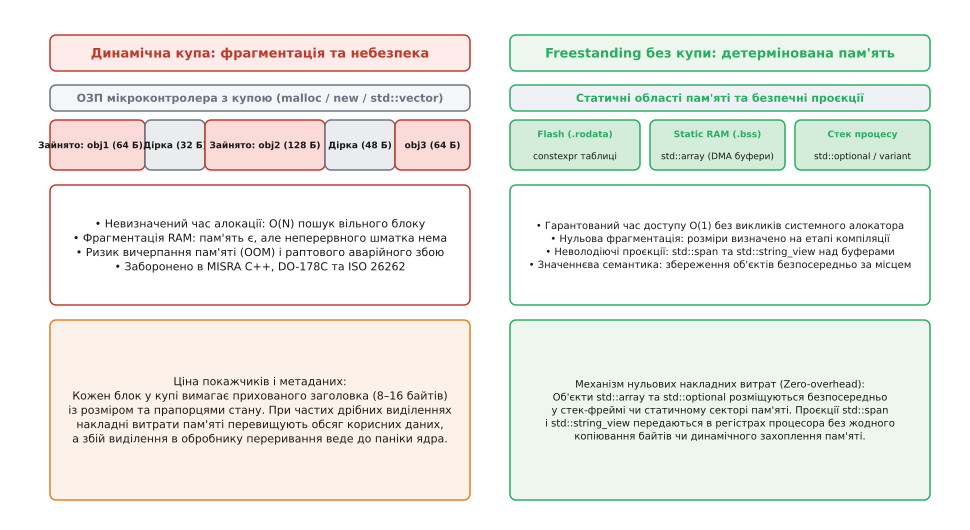
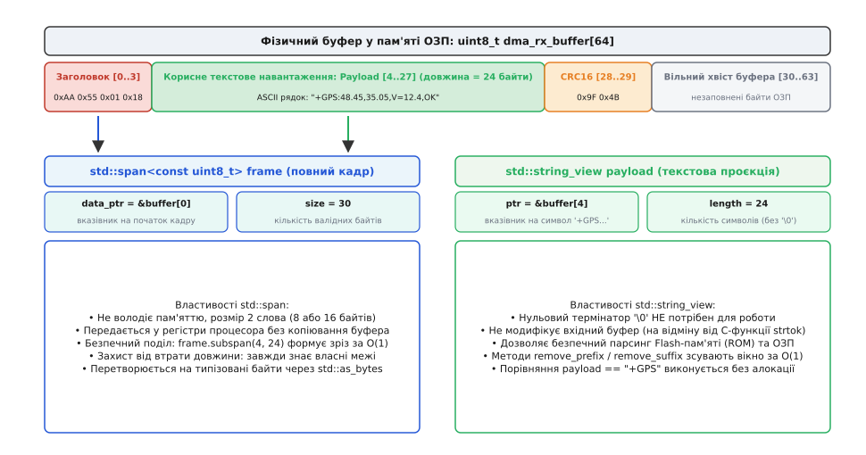
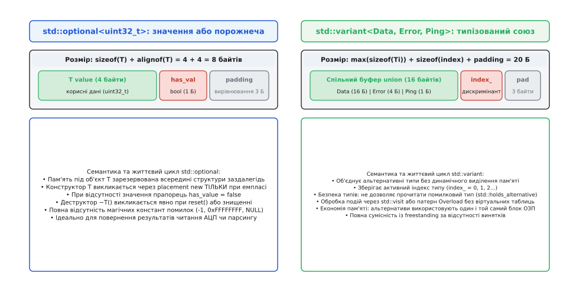

# std-типи без купи: array, span, string_view, optional

<preknowlist>
- [Адреси й покажчики](root:sf-lang/addresses-pointers) — байтова адресація пам'яті, адресна арифметика та розіменування вказівників.
- [Купа](root:sf-lang/heap-dynamic-memory) — механізм динамічного виділення пам'яті через системний алокатор та природа його накладних витрат.
- [Час життя об'єкта](root:sys-plang-cpp/object-lifetime) — межі існування об'єкта від завершення конструктора до початку деструктора.
- [Вирівнювання й розміщувальний new](root:sys-plang-cpp/alignment-placement-new) — природні межі адрес шини даних та конструювання об'єктів у сирому буфері.
- [Семантика володіння](root:sys-plang-cpp/ownership-semantics) — різниця між володінням ресурсом і тимчасовим доступом через неволодіючі проєкції.
- [Що з C++ не тягнуть у прошивку](root:sys-plang-cpp/shcho-z-c-ne-tiahnut-u-proshyvku) — обмеження автономного середовища (freestanding): робота без винятків, RTTI та динамічної купи.
</preknowlist>

Коли мікроконтролер керує силовими транзисторами інвертора електродвигуна, зчитує телеметрію через апаратну шину SPI або приймає пакети за прямим доступом до пам'яті (DMA), затримка в обробці переривання навіть на кілька мікросекунд призводить до апаратного збою або короткого замикання. У таких автономних системах без повноцінної операційної системи (англ. *freestanding environment*) класичний динамічний розподіл пам'яті через купу (англ. *heap*) за допомогою функцій `malloc` чи оператора `new` є неприпустимим. Мікроконтролери архітектур ARM Cortex-M, RISC-V або ESP32 здебільшого не мають модуля керування пам'яттю (MMU), що виключає використання віртуальної пам'яті та апаратного захисту сторінок. Уся фізична оперативна пам'ять (SRAM) обмежена кількома десятками або сотнями кілобайтів і ділиться між стеком процесу, сегментами статичних даних `.data` і `.bss` та динамічною купою.

У результаті багаторазового виділення та звільнення буферів різного розміру в купі виникає **фрагментація** (від лат. *fragmentum* — уламок, розбитий шматок) фізичної пам'яті: загальний обсяг вільної пам'яті формально залишається достатнім, але пам'ять розбита на безліч дрібних ізольованих ділянок, і жоден суцільний неперервний блок не може вмістити новий пакет даних. Програма отримує відмову виділення пам'яті (Out-Of-Memory, OOM), що в реальній прошивці викликає зависання системи або аварійний перезапуск пристрою. Крім того, час виконання алгоритмів виділення пам'яті (наприклад, списку вільних блоків у бібліотеці Newlib-nano) є недетермінованим: пошук вільного фрагмента залежить від історії попередніх алокацій і може тривати від кількох десятків тактів до тисяч, що руйнує детермінізм жорсткого реального часу. **Детермінізм** (від лат. *determinare* — визначати, обмежувати межами) у системному програмуванні означає гарантовану передбачуваність часу виконання та споживання пам'яті для будь-якої операції за будь-яких зовнішніх умов.

З цієї причини міжнародні стандарти функціональної безпеки для автомобільної, авіаційної та медичної промисловості (MISRA C++:2008 правило 18-4-1, MISRA C++:2023 правило 21.6.1, AUTOSAR C++14 правило A18-5-2, DO-178C рівень A) прямо забороняють використання динамічної купи після завершення фази початкової ініціалізації пристрою. Традиційний підхід мови C у цій ситуації полягає у використанні сирих статичних масивів `uint8_t buffer[N]`, сирих вказівників із передачею довжини окремим параметром `void process(uint8_t* ptr, size_t len)`, рядків із нульовим завершувачем `char*` та магічних числових констант помилок на зразок `-1` або `NULL`. Такий підхід породжує критичні вразливості: неявне перетворення масиву на вказівник із втратою розміру (англ. *array decay*), вихід за межі буфера через помилки адресної арифметики, мутацію незмінних рядків у Flash-пам'яті функціями розбору на кшталт `strtok` та аварійне розіменування нульових покажчиків.

Сучасний стандарт C++ в автономному середовищі (`-ffreestanding`) пропонує набір типів із нульовими накладними витратами (англ. *zero-overhead abstractions*), які гарантують безпеку пам'яті та строгу типізацію без жодного звернення до динамічної купи: `std::array`, `std::span`, `std::string_view`, `std::optional` та `std::variant`.


*Зліва: динамічна купа фрагментує RAM та створює ризик аварійної відмови OOM. Справа: архітектура freestanding використовує статичну пам'ять, стек і неволодіючі проєкції з гарантованим часом доступу O(1).*

## std::array: безпечний фіксований масив зі значеннєвою семантикою

У мові C звичайний масив `uint8_t raw_buffer[64]` не є повноцінним типом-значенням. Його неможливо скопіювати звичайним оператором присвоєння `=`, його не можна повернути з функції за значенням, а при передачі у будь-яку функцію він неявно деградує до вказівника на свій перший елемент `uint8_t*`. Компілятор втрачає будь-яку інформацію про розмір буфера, перекладаючи контроль меж виключно на уважність програміста.

Шаблон `std::array<T, N>` із заголовного файла `<array>` розв'язує цю проблему, огортаючи фіксований низькорівневий масив `T[N]` у структуру зі значеннєвою семантикою. Термін **масив** (від лат. *massa* — сукупність, згусток або фр. *massif*) позначає суцільну послідовність однакових елементів, розташованих у пам'яті безпосередньо один за одним.

### Внутрішнє розташування в пам'яті та нульові накладні витрати

Структурно `std::array<T, N>` є агрегатним типом, єдиним полем якого є сирий масив елементів `T elements_[N]`. У ньому немає жодних прихованих службових полів: ні збереженого розміру, ні динамічних вказівників, ні віртуальних таблиць методів:

:::code std-typy-bez-kupy-d/cpp/vnutrishnie-roztashuvannia.cpp

Це означає, що `sizeof(std::array<T, N>)` точно дорівнює `sizeof(T) * N`, а вирівнювання `alignof(std::array<T, N>)` ідентичне `alignof(T)`. Якщо `std::array` оголошено на стеку локальною змінною, він розташовується повністю всередині поточного стек-фрейму. Якщо він оголошений глобально або зі специфікатором `static`, він потрапляє у сегмент ініціалізованих даних `.data` або неініціалізованих даних `.bss`. Якщо ж масив оголошено як `constexpr`, компілятор розташовує його безпосередньо у захищеній від запису пам'яті програм Flash (`.rodata`), взагалі не витрачаючи дорогоцінну оперативну пам'ять (SRAM).

:::code std-typy-bez-kupy-d/cpp/vnutrishnie-roztashuvannia-2.cpp

Асемблерний код доступу до елемента `std::array<uint32_t, 16>` є повністю еквівалентним C-масиву: на архітектурі ARM Cortex-M вираз `arr[i]` транслюється в єдину інструкцію завантаження `LDR r0, [r1, r2, LSL #2]` без будь-яких накладних витрат на виклики підпрограм або непряму адресацію. Завдяки збереженню інформації про вирівнювання оптимізатор компілятора при увімкнених прапорцях `-O2`/`-O3` автоматично векторизує цикли обробки `std::array` за допомогою векторних SIMD-інструкцій (ARM NEON або RISC-V Vector).

### Обчислення таблиць на етапі компіляції (constexpr)

Однією з найважливіших переваг `std::array` у мікроконтролерних системах є можливість генерувати складні таблиці пошуку безпосередньо під час компіляції. Замість того, щоб зберігати готові таблиці у вигляді громіздких масивів чисел у коді або обчислювати їх під час запуску пристрою, алгоритм записується у вигляді `constexpr`-функції:

:::code std-typy-bez-kupy-d/cpp/obchyslennia-tablyts-na.cpp

Компілятор повністю обчислює всі 256 значень під час компіляції. Пристрій стартує миттєво, не витрачаючи такти процесора на ініціалізацію таблиць, а самі дані не займають жодного байта в оперативній пам'яті.

### Автоматичне виведення типів і структуроване зв'язування

У стандарті C++17 введено настанови виведення типів аргументів шаблонів (Class Template Argument Deduction, CTAD). Завдяки цьому масиви можна створювати без явного зазначення типу та кількості елементів: `std::array primes{2, 3, 5, 7, 11};` автоматично створює об'єкт типу `std::array<int, 5>`. Для перетворення сирих C-масивів та рядкових літералів у стандарті C++20 надано функцію `std::to_array`.

Крім того, `std::array` підтримує механізм структурованого зв'язування (англ. *structured bindings*, C++17), оскільки для нього спеціалізовано шаблони `std::tuple_size` та `std::tuple_element`:

```cpp
std::array<int, 3> get_accelerometer_axes();

void process_motion() {
    auto [x, y, z] = get_accelerometer_axes();
    // x, y, z — окремі іменовані змінні, що посилаються на елементи масиву
    (void)x; (void)y; (void)z;
}
```

Багатовимірні статичні структури даних будуються за допомогою композиції: конструкція `std::array<std::array<uint8_t, 32>, 16>` створює строго неперервний двовимірний блок пам'яті розміром 512 байтів із повним контролем обох розмірностей під час компіляції, усуваючи необхідність у масивах вказівників, характерних для динамічного виділення пам'яті.

> 🔧 **Навіщо це.**
> У драйверах мікроконтролерів буфери апаратних дескрипторів DMA вимагають строго фіксованого розміру в оперативній пам'яті. Використання `std::array` гарантує, що розмір буфера перевіряється на етапі компіляції, структура точно лягає у відведений сегмент пам'яті без виклику системного алокатора, а випадкова передача буфера у функцію обробки не призведе до втрати розміру чи несанкціонованого переповнення.

## std::span: неволодіючий зріз над неперервною пам'яттю

Фіксований розмір `std::array<T, N>` стає перешкодою, коли функція драйвера повинна приймати блоки даних довільної довжини: наприклад, передавати пакети розміром 12, 64 або 128 байтів через єдину функцію драйвера шини SPI або обчислювати контрольну суму CRC над довільним фрагментом пам'яті.

У мові C для цього передають пару параметрів `(const uint8_t* data, size_t length)`. Цей підхід є небезпечним: покажчик і довжина не пов'язані між собою структурно. Їх можна випадково переплутати місцями, передати неправильний розмір від іншого буфера або забути перевірити вказівник на `NULL`.

Стандарт C++20 увів у заголовному файлі `<span>` концепцію **спану** (від давньоангл. *spann* — проліт, мірка довжини між кінчиками розчепірених пальців руки). `std::span<T, Extent>` є неволодіючою проєкцією (англ. *non-owning view*) над довільною неперервною послідовністю об'єктів у пам'яті.

### Механізм динамічного та статичного екстенту

`std::span` може працювати у двох режимах залежно від параметра шаблону `Extent`:

1. **Динамічний екстент (`std::dynamic_extent` за замовчуванням):** Розмір послідовності стає відомим під час виконання програми. Структурно такий `std::span` складається з двох слів: вказівника на початок даних `T* data_` та лічильника елементів `std::size_t size_`. На 32-бітних процесорах ARM Cortex-M він займає рівно 8 байтів, а на 64-бітних платформах — 16 байтів. Згідно зі стандартними угодами про виклики функцій (ABI), такий об'єкт передається безпосередньо через регістри процесора (`r0`-`r1` на ARM AAPCS), не торкаючись стеку.
2. **Статичний екстент (`std::span<T, N>`):** Розмір масиву зафіксовано на етапі компіляції. Компілятор оптимізує внутрішню структуру, видаляючи поле `size_`. Такий спан містить **лише один вказівник** `T* data_` (4 або 8 байтів), а метод `.size()` повертає константу `N` безпосередньо з інформації про тип.

:::code std-typy-bez-kupy-d/cpp/mekhanizm-dynamichnoho-ta.cpp


*Фізичний DMA-буфер у пам'яті та проєкції std::span і std::string_view, що забезпечують безпечний безкопійний доступ до заголовків та корисного навантаження без модифікації пам'яті.*

### Безкопійний поділ буферів: методи subspan, first, last

Головна сила `std::span` у вбудованих системах — здатність ділити буфери на логічні частини за постійний час `O(1)` без жодного копіювання байтів або динамічного виділення пам'яті.

Якщо мережевий пакет або кадр телеметрії містить 4-байтний заголовок, 24 байти корисного навантаження та 2 байти контрольної суми, їх можна розділити на окремі строго типізовані спани:

:::code std-typy-bez-kupy-d/cpp/bezkopiinyi-podil-buferiv.cpp

Для роботи з сирою пам'яттю `std::span` надає стандартні утиліти `std::as_bytes` та `std::as_writable_bytes`, які перетворюють довільний спан `std::span<T>` на типізоване представлення байтів `std::span<const std::byte>`, усуваючи необхідність у небезпечних приведеннях покажчиків типу `reinterpret_cast<const char*>`.

Порівняємо реалізацію обробки DMA-буфера прийому повідомлень мовами C та C++:

:::tabs
:::code std-typy-bez-kupy-d/c/bezkopiinyi-podil-buferiv.c
:::code std-typy-bez-kupy-d/cpp/bezkopiinyi-podil-buferiv-2.cpp
:::

## std::string_view: робота з текстом без нульового байта та алокацій

Обробка текстових протоколів — таких як AT-команди стільникових модемів (SIMCom, Quectel), NMEA-повідомлення GPS-приймачів або команди інтерфейсу командного рядка (CLI) — у мові C традиційно будується навколо рядків із нульовим завершувачем (англ. *null-terminated string*, `const char*`).

Ця модель має фундаментальні дефекти:
1. **Обчислювальна складність O(N):** Будь-яке визначення довжини через `strlen()` вимагає лінійного сканування пам'яті до байта `\0`. Якщо функція приймає рядок і викликає кілька підпрограм, кожна з яких перевіряє довжину, процесор марно спалює сотні тактів на повторне сканування тих самих байтів.
2. **Руйнівний парсинг (In-place Mutation):** Функція `strtok` для розбиття рядка на токени записує нульовий байт `\0` безпосередньо у вхідний буфер. Якщо рядок розташовано у Flash-пам'яті (`.rodata`), запис спричиняє апаратне виключення `HardFault` чи `SIGSEGV`. Якщо ж буфер є спільним кільцевим буфером UART, запис `\0` спотворює дані, які ще обробляються перериванням.
3. **Непотрібні копіювання:** Створення підрядка у класичному C++ через `std::string::substr` викликає виділення пам'яті в купі (`malloc`).

У стандарті C++17 введено `std::string_view` (заголовок `<string_view>`). Термін **проєкція рядка** (від лат. *stringere* — стягувати, зв'язувати та лат. *videre* / англ. *view* — дивитися, спостереження) позначає неволодіючий інтерфейс спостереження над послідовністю символів.

### Структура та властивості std::string_view

Як і `std::span`, `std::string_view` складається з двох слів: вказівника на початковий символ `const char* data_` та довжини `std::size_t length_`.

Символи, на які посилається `std::string_view`, **не зобов'язані завершуватися нульовим байтом `\0`**. Це дозволяє створювати проєкції підрядків довільної глибини за час `O(1)` без виділення жодного байта пам'яті:

:::code std-typy-bez-kupy-d/cpp/struktura-ta-vlastyvosti.cpp

### Пастки часу життя та межі сумісності з C-API

Хоча `std::string_view` є надзвичайно ефективним, він вимагає суворого контролю часу життя (англ. *lifetime*):

1. **Висячі посилання (Dangling Views):** `std::string_view` ніколи не володіє пам'яттю. Якщо створити його з тимчасового об'єкта або локального буфера функції, після виходу з області видимості вказівник стане недійсним:
   ```cpp
   std::string_view bad_function() {
       char local_buf[32] = "TEMPORARY";
       return std::string_view(local_buf); // КРИТИЧНА ПОМИЛКА: локальний масив знищується
   }
   ```
2. **Передача у функції, що очікують `\0`:** Метод `sv.data()` повертає сирий вказівник, але за ним може не бути нульового завершувача. Пряма передача `sv.data()` у функції C-бібліотеки на зразок `atoi(sv.data())`, `printf("%s", sv.data())` або `fopen(sv.data(), "r")` призводить до виходу за межі пам'яті та аварійного завершення програми. Для безпечного числового парсингу в автономному режимі слід використовувати стандартні засоби `std::from_chars` із заголовного файла `<charconv>`.

Розглянемо безкопійний парсер відповідей модема (AT-команд) на базі `std::string_view` у порівнянні з C:

:::tabs
:::code std-typy-bez-kupy-d/c/pastky-chasu-zhyttia-ta.c
:::code std-typy-bez-kupy-d/cpp/pastky-chasu-zhyttia-ta.cpp
:::

## std::optional: детерміноване значення або відсутність без винятків

У вбудованих системах функції постійно повертають результати, які можуть бути відсутніми: зчитування байта з приймального регістра UART, значення температури з несправного I2C-датчика або спроба знайти параметр у таблиці конфігурації.

У мові C для сигналізації відсутності значення застосовують два підходи:
1. **Магічні константи:** Повернення `-1`, `0xFFFFFFFF` або `NULL`. Цей підхід руйнує простір значень: якщо діапазон вимірювання датчика тиску включає від'ємні числа, значення `-1` стає неоднозначним.
2. **Вихідні параметри:** Повернення прапорця статусу `bool read_adc(uint32_t* out_val)`. Такий підхід вимагає передачі покажчиків, розриває виразність коду і залишає змінну `out_val` у неініціалізованому стані при виникненні помилки.

Стандарт C++17 ввів у заголовному файлі `<optional>` шаблон `std::optional<T>`. Термін **опціонал** або факультативне значення (від лат. *optio* — право вибору, вільний розсуд) позначає тип-обгортку, що може або містити коректне значення типу `T`, або перебувати у стані порожнечі `std::nullopt`.


*Розташування полів у пам'яті для std::optional та std::variant: значення зберігаються in-place у вирівняному сховищі без виклику динамічного алокатора.*

### Внутрішня будова та керування часом життя об'єкта

`std::optional<T>` реалізує значеннєву семантику без виділення пам'яті в купі. Його внутрішній стан складається з буфера неініціалізованої сирої пам'яті, вирівняного під тип `T`, та булевого прапорця ініціалізації:

```cpp
template <typename T>
class optional {
    alignas(T) std::byte storage_[sizeof(T)];
    bool has_value_{false};
};
```

Розмір структури визначається формулою з урахуванням вирівнювання:

```
sizeof(std::optional<T>)
= sizeof(T) + alignof(T)  [з урахуванням вирівнювального заповнення padding]
```

Для 32-бітного типу `uint32_t` розмір `sizeof(std::optional<uint32_t>)` складає 8 байтів (4 байти значення + 1 байт булевого прапорця + 3 байти вирівнювання). Для 8-бітного `uint8_t` розмір складає 2 байти (1 байт значення + 1 байт прапорця).

Керування життєвим циклом об'єкта `T` всередині `std::optional` підпорядковується суворим правилам:
1. **Ініціалізація `std::nullopt`:** Пам'ять резервується, але конструктор `T` **не викликається**. Прапорець `has_value_` дорівнює `false`.
2. **Присвоєння значення (Emplace):** Конструктор об'єкта `T` викликається безпосередньо у внутрішньому буфері `storage_` за допомогою розміщувального new (`placement new`), після чого `has_value_` встановлюється в `true`.
3. **Знищення або очищення (`reset()`):** Якщо `has_value_ == true`, явно викликається деструктор `reinterpret_cast<T*>(storage_)->~T()`, і прапорець скидається в `false`. Динамічна купа не використовується на жодному з цих кроків.

:::code std-typy-bez-kupy-d/cpp/vnutrishnia-budova-ta.cpp

### Монадичні операції C++23 для конвеєрів обробки

У стандарті C++23 для `std::optional` стандартизовано методи функціональної композиції: `and_then()`, `transform()`, `or_else()`. Вони дозволяють будувати лінійні конвеєри обробки помилок без вкладених умовних розгалужень `if-else` та без винятків:

:::code std-typy-bez-kupy-d/cpp/monadychni-operatsii-c-23.cpp

Компілятор розгортає цей монадичний ланцюжок у пряму послідовність перевірок прапорця на рівні регістрів, повністю оптимізуючи проміжні структури.

## std::variant: типобезпечний союз без поліморфізму купи

Коли обробник черги повідомлень мікроконтролера повинен приймати події різної природи — наприклад, пакет даних телеметрії `TelemetryPacket`, код помилки шини `BusError` або повідомлення серцебиття `Heartbeat` — використання об'єктно-орієнтованого поліморфізму з віртуальними функціями (`virtual void handle()`) є неефективним і небезпечним. Віртуальні функції вимагають зберігання покажчиків на таблиці віртуальних методів (`vptr`), викликів через непряму адресацію та, зазвичай, виділення об'єктів у купі через покажчики базового класу `std::unique_ptr<Event>`.

Нетипізований `union` мови C також є небезпечним: він не зберігає інформацію про те, який саме тип наразі є активним, і читання неактивного поля є прямою невизначеною поведінкою (UB).

Шаблон `std::variant<Ts...>` із заголовного файла `<variant>` (C++17) забезпечує типобезпечний розмічений союз (англ. *discriminated union* / *tagged union*). Термін **варіант** (від лат. *variare* — видозмінювати, розрізнятися) позначає контейнер для одного значення зі строго визначеного фіксованого списку типів.

### Внутрішня структура та обробка через std::visit

`std::variant` містить єдиний буфер сирої пам'яті, розмір якого дорівнює максимальному розміру серед усіх можливих альтернативних типів, і цілочисельний дискримінант `std::size_t index_`, що фіксує активний тип:

```
sizeof(std::variant<T1, T2, T3>)
= max(sizeof(T1), sizeof(T2), sizeof(T3)) + sizeof(index_) + padding
```

Обробка подій здійснюється за допомогою функції `std::visit`, яка будує статичну таблицю переходів на етапі компіляції:

:::code std-typy-bez-kupy-d/cpp/vnutrishnia-struktura-ta.cpp

Порівняємо реалізацію обробки подій мовами C та C++:

:::tabs
:::code std-typy-bez-kupy-d/c/vnutrishnia-struktura-ta.c
:::code std-typy-bez-kupy-d/cpp/vnutrishnia-struktura-ta-2.cpp
:::

## Стандарти Freestanding C++ та компіляторні конфігурації

У класичному стандарті C++98/C++03 автономна бібліотека (Freestanding Implementation) була вкрай обмеженою: вона вимагала лише заголовки `<cstddef>`, `<cstdint>`, `<limits>`, `<typeinfo>` та `<cstdarg>`.

Починаючи зі стандарту C++20 та зусиллями робочої групи SG14 (Game Development and Low Latency) і SG16 за пропозиціями P0829, P1642, P2264 та P2833, статус автономних розширено. У C++23 та C++26 більшість утиліт із заголовків `<array>`, `<span>`, `<string_view>`, `<optional>`, `<variant>`, `<type_traits>`, `<bit>`, `<algorithm>` та `<utility>` офіційно отримали статус **freestanding**.

### Прапорці збирання для автономних вбудованих систем

Для гарантування повної відсутності залежностей від середовища виконання ОС та динамічної купи використовується наступна конфігурація компіляторів GCC та Clang для архітектур ARM Cortex-M / RISC-V:

```
arm-none-eabi-g++ -std=c++23 -mcpu=cortex-m4 -mthumb \
    -ffreestanding \
    -fno-exceptions \
    -fno-rtti \
    -fno-threadsafe-statics \
    -Wall -Wextra -Wpedantic \
    -O2 -flto \
    -specs=nano.specs -specs=nosys.specs
```

1. `-ffreestanding`: Повідомляє компілятору, що цільове середовище не має стандартного прологу `main`, стандартних дескрипторів вводу-виводу або операційної системи.
2. `-fno-exceptions`: Повністю відключає генерацію таблиць розгортання стеку (DWARF EH frames / ARM exception index `.ARM.exidx`), що заощаджує до 20–30% Flash-пам'яті та унеможливлює неявне виділення пам'яті в купі під об'єкти винятків.
3. `-fno-rtti`: Вимикає генерацію службових структур інформації про типи часу виконання (RTTI), прибираючи віртуальні таблиці `type_info`.
4. `-fno-threadsafe-statics`: Прибирає неявні блокування м'ютексами навколо локальних статичних змінних (Magic Statics), які у багатопотокових ОС спираються на POSIX threads.

Для глибшого практичного ознайомлення з повною архітектурою безкопійного драйвера зверніться до [практичного проекту безкопійного парсера](root:sys-plang-cpp/std-typy-bez-kupy/proj-zero-copy-parser.md), де продемонстровано сумісну роботу кільцевого буфера DMA з проєкціями `std::span` та `std::string_view`. Детальні сигнатури методів, таблиці накладних витрат пам'яті та часову складність операцій для кожного типу наведено у файлі [довідник інтерфейсу та характеристик типів](root:sys-plang-cpp/std-typy-bez-kupy/api-freestanding-types.md). Додаткові відомості про деталі внутрішнього вирівнювання та розміщувальний `new` описані в темі [Вирівнювання й розміщувальний new](root:sys-plang-cpp/alignment-placement-new).
