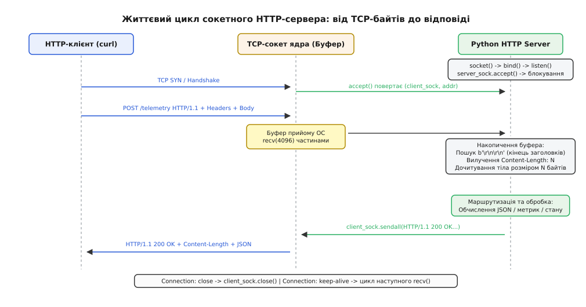
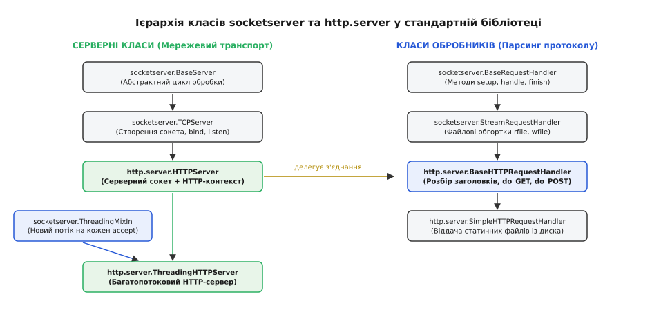
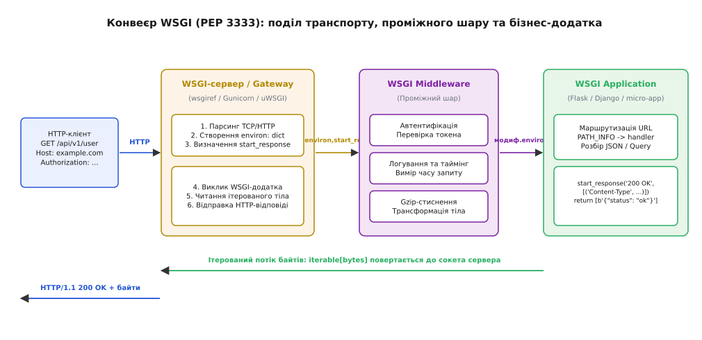

# Найпростіший HTTP-сервер

<preknowlist>
- [Модуль socket і TCP-з'єднання](root:sys-plang-python/socket-module) — низькорівневі системні виклики socket, bind, listen, accept та передача байтових потоків.
- [bytes, bytearray і memoryview](root:sys-plang-python/bytes-and-memoryview) — представлення сирих байтів, буферизація та маніпуляції з бінарними даними без копіювання.
- [Кодування, UTF-8 і помилки декодування](root:sys-plang-python/encodings-and-utf8) — перетворення між str та bytes за стандартами Unicode, UTF-8 та Latin-1.
- [Потоки в threading](root:sys-plang-python/threading-basics) — паралельне виконання задач у потоках ОС, поділ пам'яті та синхронізація через замки.
- [Протокол HTTP](root:com-protocol/http) — структура запитів і відповідей HTTP/1.1, стартовий рядок, заголовки та семантика методів.
</preknowlist>

Коли мікроконтролерний шлюз надсилає пакет телеметрії розміром 128 байтів через команду `curl -X POST http://127.0.0.1:8080/telemetry -d '{"temp": 23.5}'`, операційна система отримує не готовий об'єкт повідомлення, а неперервний двійковий потік TCP. Якщо сервер викликає `sock.recv(4096)` лише один раз і очікує отримати повний HTTP-запит, фрагментація пакетів на рівні IP або затримка передачі заголовків розриває корисне навантаження: сервер зчитує лише стартовий рядок, парсер виходить із ладу, а клієнт зависає в очікуванні відповіді до настання таймауту. Робота вебсервера починається з розмежування повідомлень у потоці байтів і перетворення сирого дескриптора сокета на структуровані запити та відповіді.

## 1. Низькорівневий сокетний HTTP-сервер на базі модуля socket

Мережевий стек операційної системи на транспортному рівні TCP надає прикладній програмі абстракцію надійного повнодуплексного байтового потоку (Byte Stream). На відміну від протоколу UDP, де одиницею передачі є дискретна датаграма із фіксованими межами, TCP нічого не знає про логічні межі вищих протоколів. Дані, записані клієнтом за допомогою трьох послідовних викликів `send()`, можуть бути об'єднані стеком ядра в один TCP-сегмент або, навпаки, розбиті на десятки дрібних пакетів через обмеження максимального розміру корисного навантаження (Maximum Segment Size, MSS).

Протокол HTTP/1.1 вирішує проблему структурування за допомогою текстового кадрування. Кожне повідомлення клієнта складається з трьох обов'язкових секцій:
1. **Стартовий рядок запиту (Request Line):** містить назву методу, шлях до ресурсу та версію протоколу, відокремлені одинарними пробілами та завершені послідовністю символів повернення каретки й переведення рядка `\r\n` (CRLF, коди `0x0D 0x0A`).
2. **Блок заголовків (Headers Block):** набір текстових рядків формату `Назва: Значення\r\n`, що визначають метадані запиту (хост, тип корисного навантаження, параметри автентифікації).
3. **Маркер кінця заголовків:** порожній рядок `\r\n`. Повна послідовність на стику заголовків і тіла утворює чотирибайтовий двійковий роздільник `\r\n\r\n` (`0x0D 0x0A 0x0D 0x0A`).
4. **Тіло повідомлення (Message Body):** довільний масив двійкових або текстових даних, довжина якого або прямо задається числовим заголовком `Content-Length`, або транслюється динамічними порціями за наявності заголовка `Transfer-Encoding: chunked`.


*Життєвий цикл сокетного HTTP-сервера: прийом з'єднання через accept(), накопичення буфера до появи CRLF CRLF, вичитування тіла фіксованої довжини та відправка відповіді.*

### Механіка буферизації та виявлення роздільника заголовків

Оскільки одиничний системний виклик `recv(chunk_size)` повертає довільну кількість байтів від 1 до `chunk_size` (залежно від того, скільки даних встиг передати мережевий адаптер у буфер сокета ядра `SO_RCVBUF`), сервер повинен організувати цикл накопичення. Якщо сервер наївно очікує, що всі заголовки надійдуть в одному першому виклику `recv()`, повільне з'єднання або передача заголовків частинами призведе до спроби розібрати неповний рядок і аварійного розриву зв'язку.

Правильний алгоритм полягає у зчитуванні байтів у змінний масив `bytearray` до моменту, поки метод пошуку підрядка `buffer.find(b"\r\n\r\n")` не поверне невід'ємний індекс:

:::code http-server-minimal-d/py/mekhanika-buferyzatsii-ta.py

Зверніть увагу на збереження залишку `rest_body`. Якщо розмір вхідного TCP-пакета перевищував сумарний розмір заголовків, виклик `recv(4096)` разом із заголовками вичитує перші байти корисного навантаження (тіла POST-запиту). Втрата цього залишку зруйнує цілісність вхідного файлу чи JSON-документа.

### Синтаксичний розбір стартового рядка та заголовків

Отриманий двійковий блок заголовків декодується в текст за стандартом Latin-1 (ISO-8859-1). Цей вибір кодування гарантує, що жоден байт у діапазоні `0x00`–`0xFF` не викличе винятку `UnicodeDecodeError`, оскільки кодування Latin-1 прямо відображає кожен байт у відповідний код-пойнт Unicode.

Перший рядок розбивається на три обов'язкові компоненти:
- `method`: текстова назва операції (`GET`, `POST`, `PUT`, `DELETE`, `HEAD`, `OPTIONS`);
- `path`: відносний уніфікований ідентифікатор ресурсу (URI) разом із необов'язковим рядком параметрів запиту;
- `version`: ідентифікатор версії протоколу, зазвичай `HTTP/1.1` або `HTTP/1.0`.

Усі подальші рядки містять заголовки. Згідно зі специфікацією RFC 7230, назви заголовків нечутливі до регістру символів (`Content-Type`, `content-type` та `CONTENT-TYPE` позначають один і той самий параметр). Тому сервер під час розбору обов'язково переводить назви ключів у нижній регістр:

:::code http-server-minimal-d/py/syntaksychnyi-rozbir.py

### Детерміноване вичитування тіла запиту

Якщо клієнт надіслав запит із корисним навантаженням (типово для методів `POST`, `PUT`, `PATCH`), він передає заголовок `content-length`, що містить точну кількість байтів тіла у вигляді десяткового числа. Читання тіла полягає у витягуванні рівно вказаної кількості байтів:

:::code http-server-minimal-d/py/determinovane.py

Спроба прочитати тіло викликом `client_sock.recv(4096)` без контролю лічильника `bytes_remaining` або виклик `client_sock.recv()` у нескінченному циклі до отримання порожнього рядка призведе до мертвого блокування (Deadlock). Клієнт, передавши всі байти свого JSON-пакета, тримає TCP-з'єднання відкритим і чекає на відповідь, а сервер чекає на EOF від клієнта, якого ніколи не надійде.

### Формування та відправка коректної HTTP-відповіді

Формування відповіді підпорядковується суворим інваріантам:
1. Стартовий рядок статусу: версія протоколу, тризначний десятковий код та нормативна фраза опису (`HTTP/1.1 200 OK\r\n` або `HTTP/1.1 404 Not Found\r\n`).
2. Заголовок `Content-Length`: обов'язковий заголовок, що вказує клієнту розмір тіла відповіді в байтах. Якщо його пропустити в режимі HTTP/1.1, клієнт не знатиме, де закінчується документ, і не зможе розірвати або повторно використати з'єднання.
3. Заголовок `Content-Type`: визначає MIME-тип та кодування даних (`application/json; charset=utf-8` або `text/html; charset=utf-8`).
4. Заголовок `Connection`: вказує політику керування з'єднанням. Значення `close` сповіщає клієнта, що після передачі цієї відповіді сервер негайно закриє TCP-дескриптор.
5. Відправка через `sendall()`: стандартний метод `socket.send()` не гарантує передачу всього буфера за один виклик ядра. Метод `sendall()` автоматично повторює системний виклик у циклі, доки всі байти не потраплять у вихідний буфер операційної системи `SO_SNDBUF`.

:::code http-server-minimal-d/py/formuvannia-ta-vidpravka.py

### Повний мінімальний сервер на чистих сокетах

Збираючи ці модулі в єдиний виконуваний каркас із конфігурацією сокета (`SO_REUSEADDR` для можливості миттєвого перезапуску на тому самому порту без очікування стану ядра `TIME_WAIT`), отримуємо повноцінний автономний сервер:

:::code http-server-minimal-d/py/povnyi-minimalnyi-server.py

## 2. Стандартна бібліотека: архітектура http.server та socketserver

Написання низькорівневого парсера вручну демонструє внутрішню фізику протоколу, однак створення надійного сервера вимагає обробки безлічі складних крайових випадків: складених багаторядкових заголовків (Obsolete Line Folding), підтримки постійних підключень (HTTP Keep-Alive), обробки помилок переповнення буферів і таймаутів сокета.

Стандартна бібліотека Python надає для цього ієрархію класів у модулях `socketserver` та `http.server`. Архітектурно система спирається на чітке розмежування двох сутностей: **мережевого сервера** (Server) та **обробника запитів** (Request Handler).


*Ієрархія класів socketserver та http.server: поєднання серверного сокета з потоковими обробниками запитів та міксінами багатопотоковості.*

### Серверний транспорт: BaseServer, TCPServer та HTTPServer

1. **`socketserver.BaseServer`:**
   Визначає базовий абстрактний інтерфейс життєвого циклу сервера. Містить головний цикл `serve_forever()`, механізм диспетчеризації запитів `process_request()` та метод безпечної зупинки `shutdown()`.

2. **`socketserver.TCPServer`:**
   Реалізує транспортний рівень поверх протоколу TCP (сімейство `AF_INET`, тип `SOCK_STREAM`). У конструкторі виконує системні виклики `socket()`, `bind()` та `listen()`, зберігаючи дескриптор слухаючого сокета в атрибуті `self.socket`. Метод `get_request()` виконує виклик `accept()`, повертаючи пару `(client_socket, client_address)`.

3. **`http.server.HTTPServer`:**
   Успадковує `TCPServer` і додає специфічний для протоколу HTTP контекст: зберігає ім'я хоста `server_name` та номер порту `server_port`, які використовуються обробниками для побудови абсолютних посилань і перенаправлень.

### Обробка протоколу: BaseRequestHandler, StreamRequestHandler та BaseHTTPRequestHandler

Для кожного прийнятого клієнтського підключення сервер інстанціює новий екземпляр призначеного класу-обробника.

1. **`socketserver.BaseRequestHandler`:**
   Визначає каркас життєвого циклу обробника:
   - `setup()`: підготовка структур даних та потоків перед початком роботи;
   - `handle()`: виконання основної бізнес-логіки обробки;
   - `finish()`: закриття дескрипторів та звільнення виділених ресурсів після завершення запиту.

2. **`socketserver.StreamRequestHandler`:**
   Перевизначає метод `setup()`, обгортаючи сирий дескриптор сокета `self.request` у два зручні буферизовані потоки модуля `io`:
   - `self.rfile`: об'єкт `io.BufferedReader`, що дозволяє викликати `self.rfile.readline()` та `self.rfile.read(n)`;
   - `self.wfile`: об'єкт `io.BufferedWriter`, що дозволяє записувати вихідні дані методом `self.wfile.write(data)`.

3. **`http.server.BaseHTTPRequestHandler`:**
   Містить повноцінний синтаксичний парсер протоколу HTTP. У методі `handle()` обробник запускає цикл читання `handle_one_request()`. Метод зчитує стартовий рядок, розбирає заголовки у внутрішній об'єкт `http.client.HTTPMessage` (доступний через поле `self.headers`) і формує ім'я методу-обробника:

:::code http-server-minimal-d/py/obrobka-protokolu.py

### Практична реалізація власного обробника

Для створення функціонального сервера розробник створює підклас `BaseHTTPRequestHandler`, де описує методи `do_GET`, `do_POST` тощо, використовуючи стандартні хелпери формування заголовків:

:::code http-server-minimal-d/py/praktychna-realizatsiia.py

Повний нормативний опис усіх полів обробника, правил роботи зі статусами `HTTPStatus` та механізмів обробки сокетних помилок наведено у довідковій вставці [Специфікація WSGI environ та API BaseHTTPRequestHandler](root:sys-plang-python/http-server-minimal/api-wsgi-environ.md).

### Проблема блокування та послідовного виконання

Базовий клас `http.server.HTTPServer` виконує весь цикл обробки строго синхронно в головному потоці процесу. Послідовність виглядає так:
1. `HTTPServer.serve_forever()` викликає блокувальний `accept()`;
2. Операційна система прокидає потік під час підключення клієнта A;
3. Екземпляр `DeviceMetricsHandler` починає вичитувати `self.rfile`;
4. Якщо клієнт A має повільне з'єднання (передає байти із затримкою в кілька секунд) або навмисно утримує з'єднання відкритим, головний потік сервера залишається заблокованим усередині виклику `rfile.read()`;
5. Клієнт B, який у цей самий час надсилає критичний запит `/healthz`, не може встановити з'єднання: його запит чекає у черзі TCP SYN Backlog ядра, а час очікування стрімко зростає.

## 3. Багатопотокова паралельність: socketserver.ThreadingMixIn

Для подолання проблеми однопотокового блокування стандартна бібліотека використовує архітектурний патерн Mixin, втілений у класі `socketserver.ThreadingMixIn`.

### Механіка ThreadingMixIn

Клас `ThreadingMixIn` змінює спосіб обробки прийнятого з'єднання. Замість безпосереднього виклику обробника в тому самому потоці, метод `process_request()` створює окремий потік операційної системи за допомогою модуля `threading.Thread`:

:::code http-server-minimal-d/py/mekhanika-threadingmixin.py

Починаючи з версії Python 3.7, розробникам більше не потрібно збирати клас вручну: до модуля `http.server` включено готовий клас `ThreadingHTTPServer`, що поєднує `ThreadingMixIn` та `HTTPServer`:

```python
from http.server import ThreadingHTTPServer

def run_threaded_server():
    server_address = ("0.0.0.0", 8080)
    httpd = ThreadingHTTPServer(server_address, DeviceMetricsHandler)
    httpd.serve_forever()
```

### Ефективність потоків Python для мережевого вводу-виводу та роль GIL

Поширена хибна думка полягає в тому, що глобальне блокування інтерпретатора (GIL) у CPython робить використання потоків неефективним. Це твердження справедливе виключно для завдань, обмежених швидкістю процесора (CPU-bound, наприклад, математичні розрахунки або стиснення відео).

Для мережевих серверів характерне навантаження, обмежене швидкістю введення-виведення (I/O-bound): більшу частину часу потік проводить в очікуванні надходження байтів із мережевого кабелю або скидання буфера в мережевий стек.

Усі мережеві системні виклики CPython (`accept`, `recv`, `sendall`, `select`, `poll`) реалізовані мовою C у модулі `Modules/socketmodule.c`. Перед виконанням блокувального виклику ядра інтерпретатор викликає макрос `Py_BEGIN_ALLOW_THREADS`, який **повністю відпускає GIL**.

Поки потік 1 заблокований ядром ОС в очікуванні даних від повільного датчика, інші потоки Python можуть вільно захоплювати GIL, виконувати маршрутизацію, парсити JSON або відправляти відповіді іншим клієнтам. Це забезпечує ефективну паралелізацію обробки тисяч одночасних запитів без значного процесорного оверхеду.

### Синхронізація спільного стану між потоками

Оскільки кожен запит обробляється у власному системному потоці, спільні структури даних програми (лічильники запитів, буфери останніх вимірювань датчиків, кеші в оперативній пам'яті) стають спільним ресурсом. Несинхронізований доступ до спільних змінних викликає стан гонитви (Race Condition):

:::code http-server-minimal-d/py/synkhronizatsiia-spilnoho.py

## 4. Специфікація WSGI (PEP 3333): універсальний інтерфейс вебзастосунків

Пряме використання класів `BaseHTTPRequestHandler` створює жорстку прив'язку бізнес-логіки до внутрішньої реалізації конкретного сервера зі стандартної бібліотеки. Якщо проєкту знадобиться перехід на виробничий багатопроцесний сервер (Gunicorn, uWSGI) або підключення готових бібліотек авторизації, весь код доведеться переписувати.

Для вирішення цієї проблеми було розроблено стандарт **WSGI (Web Server Gateway Interface, PEP 3333)** — єдиний універсальний протокол взаємодії між вебсерверами та вебзастосунками на мові Python. Історію виникнення цього стандарту та його еволюцію детально розглянуто у вставці [Історія веб-інтерфейсів у Python: від CGI до WSGI та ASGI](root:sys-plang-python/http-server-minimal/hist-wsgi-evolution.md).


*Конвеєр WSGI (PEP 3333): сервер створює словник environ та колбек start_response, передає їх через ланцюжок Middleware у застосунок, який повертає ітерований потік байтів.*

### Контракт WSGI-застосунку

Згідно зі стандартом PEP 3333, коректним WSGI-застосунком є будь-який об'єкт Python, що підтримує виклик (`Callable`), який приймає два позиційні аргументи:
1. `environ`: словник `dict`, що містить змінні запиту в стилі CGI та спеціальні змінні середовища з префіксом `wsgi.*`;
2. `start_response`: функція зворотного виклику, надана сервером, яка приймає статус відповіді та список заголовків.

Застосунок зобов'язаний повернути ітерований об'єкт, кожен елемент якого є двійковим масивом `bytes`:

:::code http-server-minimal-d/py/kontrakt-wsgi-zastosunku.py

### Синтаксичний розбір параметрів через environ

Словник `environ` містить усю інформацію про вхідний HTTP-запит:
- `environ['REQUEST_METHOD']`: назва методу (`"GET"`, `"POST"`);
- `environ['PATH_INFO']`: шлях до ресурсу всередині застосунку (наприклад, `"/api/v1/sensors"`);
- `environ['QUERY_STRING']`: рядок параметрів запиту після символу `?`;
- `environ['wsgi.input']`: бінарний файлоподібний потік читання, з якого вичитується тіло запиту за лімітом `CONTENT_LENGTH`.

Приклад диспетчеризації запитів та обробки вхідного JSON-навантаження:

:::code http-server-minimal-d/py/syntaksychnyi-rozbir-2.py

### Патерн WSGI Middleware (Проміжний шар)

Завдяки уніфікації інтерфейсу між сервером і застосунком можна вбудовувати довільну кількість проміжних обробників (Middleware). Проміжний шар виступає одночасно як застосунок для сервера і як сервер для кінцевого застосунку:

:::code http-server-minimal-d/py/patern-wsgi-middleware.py

### Запуск через вбудований модуль wsgiref

Для запуску WSGI-застосунку без сторонніх залежностей стандартна бібліотека надає модуль `wsgiref.simple_server`:

```python
from wsgiref.simple_server import make_server

if __name__ == "__main__":
    app_pipeline = RequestTimingMiddleware(router_wsgi_app)
    with make_server("127.0.0.1", 8080, app_pipeline) as httpd:
        print("WSGI сервер успішно запущено на порту 8080...")
        httpd.serve_forever()
```

## 5. Практична реалізація: автономний мікросервер телеметрії з JSON API

Нижче наведено повну реалізацію автономного виробничого мікросервера збору телеметрії. Сервер спроєктовано для роботи у вбудованих Linux-системах та IoT-шлюзах, він не має зовнішніх залежностей від сторонніх пакетів, підтримує потокобезпечне накопичення показників датчиків, захист від переповнення буферів, перевірку життєздатності (Liveness Probe) та коректне завершення роботи (Graceful Shutdown) при отриманні сигналів операційної системи `SIGINT` або `SIGTERM`.

### Архітектура та повний вихідний код мікросервера

:::code http-server-minimal-d/py/arkhitektura-ta-povnyi.py
