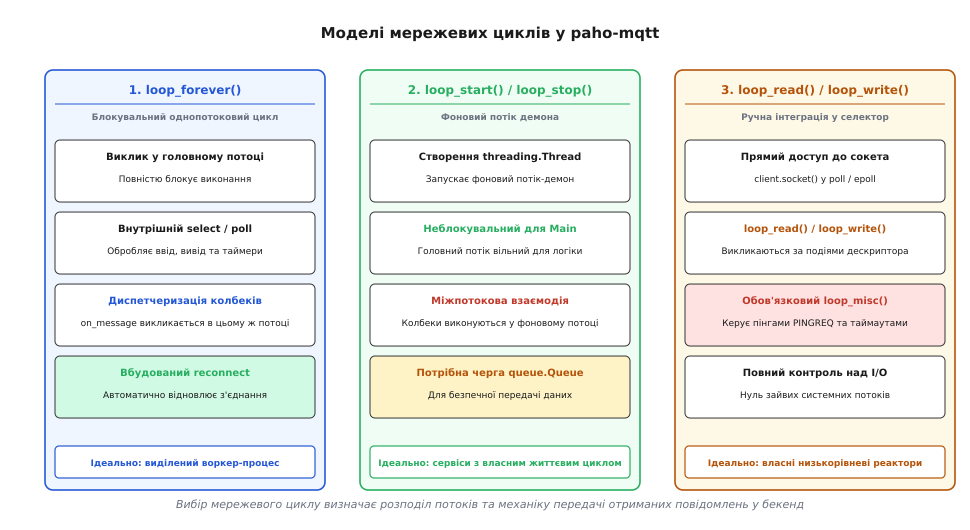
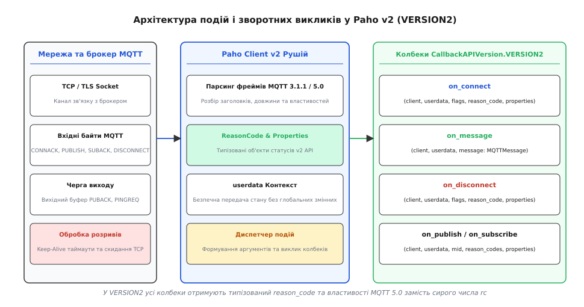
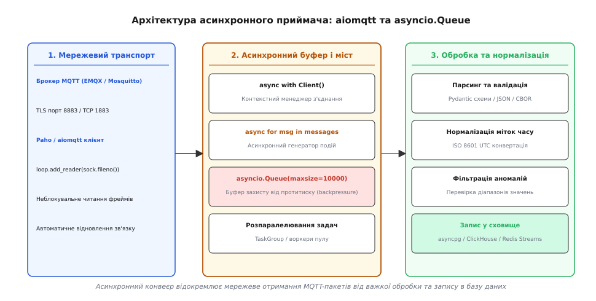

# Приймач MQTT на сервері

<preknowlist>
- [Протокол MQTT](root:com-protocol/mqtt) — концепція публікації та підписки, брокер, ієрархія топіків, рівні гарантій доставки QoS та збережені повідомлення.
- [Модуль socket і TCP-з'єднання](root:sys-plang-python/socket-module) — низькорівнева робота із сокетами TCP, системні буфери та взаємодія через дескриптори.
- [Цикл подій asyncio](root:sys-plang-python/asyncio-event-loop) — архітектура кооперативної багатозадачності, корутини та неблокувальний ввід-вивід.
- [Блокувальний виклик у циклі подій](root:sys-plang-python/blocking-in-async) — наслідки блокування системного потоку та механізми винесення синхронного I/O.
- [TLS і перевірка сертифікатів](root:sf-web/tls-certificates) — шифрування каналів зв'язку, верифікація сертифікатів CA та взаємна автентифікація mTLS.
</preknowlist>

Серверний бекенд Інтернету речей щосекунди приймає десятки тисяч повідомлень від давачів, лічильників, контролерів і трекерів. На відміну від класичної веб-архітектури, де клієнт робить короткий HTTP-запит «запит — відповідь» і закриває TCP-з'єднання, пристрої IoT утримують постійні відкриті сесії з брокером повідомлень. Щоб збирати цей потік даних, нормалізувати часові ряди та зберігати їх у базах даних, серверна служба сама виступає клієнтом MQTT, підписуючись на ієрархічні топіки пристроїв через бібліотеку `paho-mqtt`.

Спроба організувати прийом даних простим синхронним скриптом швидко стикається з відмовами: блокування потоку під час запису в базу призводить до пропуску пакетів `PINGREQ`, брокер розриває з'єднання за таймаутом Keep-Alive, вихідні буфери переповнюються, а раптовий обрив зв'язку призводить до втрати телеметрії. Для побудови відмовостійкого приймача необхідно розуміти внутрішній устрій клієнта `paho-mqtt`, механіку його мережевих циклів, правила міграції на сучасний інтерфейс `CallbackAPIVersion.VERSION2` та способи зв'язування бібліотеки з асинхронним циклом `asyncio`.

Детальний перелік усіх передумов виникнення протоколу та етапів його стандартизації винесено в [історичний нарис розвитку протоколу та бібліотеки](root:sys-plang-python/mqtt-paho/hist-paho-mqtt-evolution.md).

## 1. Внутрішня архітектура paho-mqtt та моделі мережевих циклів

Бібліотека `paho-mqtt` є синхронним клієнтом, ядром якого є клас `paho.mqtt.client.Client`. Екземпляр цього класу не є простою обгорткою над сокетом: він являє собою повноцінний автомат станів сесії, що керує буферизацією, чергами повторів, пакуванням бінарних фреймів та міжпотоковою взаємодією.

Внутрішня структура клієнта містить такі ключові компоненти:
- `_sock`: активний дескриптор мережевого сокета TCP (або об'єкт `ssl.SSLSocket` при увімкненому TLS).
- `_sockpairR` та `_sockpairW`: пара внутрішніх сокетів або каналів (Self-Pipe Trick), що використовуються для миттєвого переривання системного виклику `select()`/`poll()` з іншого потоку, коли додаток викликає `publish()`, `subscribe()` чи `disconnect()`.
- `_in_packet`: буфер збирання вхідного бінарного пакета. Протокол MQTT передає довжину пакета у змінній кількості байтів (Variable Byte Integer, від 1 до 4 байтів). Клієнт накопичує байти доти, доки не отримає повний фрейм фіксованого заголовка, змінного заголовка та корисного навантаження, після чого передає розпарсений пакет у диспетчер подій.
- `_out_packet`: черга сформованих байтових буферів, що очікують запису в сокет при готовності дескриптора.
- `_out_messages`: черга повідомлень QoS 1 та QoS 2, які були відправлені в мережу, але ще не отримали підтвердження від брокера (`PUBACK` або `PUBCOMP`).
- `_in_messages`: черга вхідних повідомлень QoS 2, що перебувають у стані чотиристороннього рукостискання.


*Архітектурне порівняння трьох моделей мережевих циклів клієнта paho-mqtt: однопотоковий блокувальний loop_forever, фоновий демон loop_start та ручна інтеграція дескрипторів.*

Клієнт повинен безперервно підтримувати три процеси: вичитувати вхідні байти з мережі, скидати вихідні буфери та відстежувати часові інтервали Keep-Alive. Для цього в бібліотеці реалізовано три моделі виконання.

### Блокувальний цикл: loop_forever()

Метод `loop_forever(timeout=1.0, retry_first_connection=False)` повністю бере під контроль поточний потік операційної системи. Всередині нього крутиться безкінечний цикл, який на кожній ітерації викликає `select()` над мережевим сокетом та парою `_sockpairR`.

:::code mqtt-paho-d/py/blokuvalnyi-tsykl-loop.py

Головна перевага `loop_forever()` полягає у простоті синхронізації: мережеві операції та користувацькі колбеки виконуються послідовно в одному системному потоці. Доступ до внутрішнього стану клієнта та переданих об'єктів не створює перегонів даних (Race Conditions) і не потребує замків (`threading.Lock`). Крім того, `loop_forever()` автоматично обробляє розриви з'єднання: при втраті TCP-каналу він переходить у стан очікування та повторно виконує підключення з наростаючою затримкою.

Проте ця модель має критичний недолік для серверних застосунків: будь-яка затримка у функції зворотного виклику блокує всю роботу клієнта. Якщо обробник `on_message` виконує блокувальний запис у реляційну базу даних тривалістю 3 секунди, клієнт на цей час повністю припиняє вичитувати мережевий сокет. Системний буфер TCP операційної системи швидко заповнюється, брокер перестає отримувати обов'язкові службові пакети `PINGREQ`, фіксує таймаут Keep-Alive і примусово закриває сесію.

### Фоновий демон: loop_start() та loop_stop()

Для звільнення головного потоку програми застосовується пара методів `loop_start()` та `loop_stop()`. Виклик `loop_start()` створює новий системний потік `threading.Thread` із прапорцем демона (`daemon=True`), всередині якого безперервно викликається метод `loop()`.

:::code mqtt-paho-d/py/fonovyi-demon-loop-start.py

У цій схемі фоновий потік гарантує своєчасну відповідь на пінги брокера та моментальне спорожнення системного буфера сокета навіть тоді, коли головний потік завантажений важкими обчисленнями. 

Проте тут виникає необхідність суворої міжпотокової дисципліни. Зворотні виклики `on_message`, `on_connect`, `on_disconnect` виконуються з контексту фонового потоку. Пряма модифікація списків, словників чи об'єктів стану без потокобезпечних структур даних (`queue.Queue`, м'ютексів `threading.Lock`) неминуче призведе до руйнування внутрішнього стану інтерпретатора CPython або логічних помилок стану.

### Ручна інтеграція дескрипторів: loop_read(), loop_write(), loop_misc()

Якщо архітектура бекенду вже містить власний реактор вводу-виводу на базі системного модуля `selectors` або стороннього фреймворку, `paho-mqtt` надає низькорівневий інтерфейс безпосереднього керування сокетом:

- `client.socket()`: повертає дескриптор відкритого сокета або об'єкт `socket.socket`.
- `client.loop_read()`: викликається, коли системний селектор повідомляє про появу вхідних даних для читання (`selectors.EVENT_READ`). Метод вичитує доступну порцію байтів і за необхідності запускає диспетчеризацію розпізнаних пакетів.
- `client.loop_write()`: викликається, коли сокет готовий приймати дані для запису (`selectors.EVENT_WRITE`), і скидає накопичені байти з черги `_out_packet`.
- `client.loop_misc()`: критично важливий метод фонового обслуговування. Він перевіряє інтервали Keep-Alive, ініціює надсилання `PINGREQ`, відстежує таймаути повторного відправлення непідтверджених пакетів QoS 1/2 та керує станом перепідключення. При ручному керуванні додаток зобов'язаний самостійно викликати `loop_misc()` з періодичністю не рідше ніж раз на секунду.
- `client.want_write()`: повертає булеве значення `True`, якщо у клієнта є дані для відправлення, дозволяючи динамічно підписувати дескриптор на події запису в селекторі.

### Протокольні відмінності: MQTT 3.1.1 проти MQTT 5.0

Параметр `protocol` під час ініціалізації клієнта визначає формат пакетів у мережевому потоці:

```python
# Стандартний клієнт MQTT 3.1.1
client_v3 = mqtt.Client(mqtt.CallbackAPIVersion.VERSION2, protocol=mqtt.MQTTv311)

# Сучасний клієнт стандарту MQTT 5.0
client_v5 = mqtt.Client(mqtt.CallbackAPIVersion.VERSION2, protocol=mqtt.MQTTv5)
```

MQTT 5.0 запроваджує важливі можливості для побудови серверних систем:
- **Властивості користувача (User Properties):** довільні пари ключ-значення у форматі рядків UTF-8, що передаються в метаданих пакетів. Вони виконують роль HTTP-заголовків і дозволяють передавати ідентифікатори розподіленого трасування (`trace-id`), мітки безпеки або інформацію про схему серіалізації без зміни структури корисного навантаження.
- **Типізовані коди результату (Reason Codes):** брокер повертає вичерпні коди причин відмови у відповідях `CONNACK`, `PUBACK`, `SUBACK` та `DISCONNECT`. Це дозволяє клієнту відрізнити помилку авторизації від перевищення ліміту квоти чи передачі невалідного топіка.
- **Спільні підписки (Shared Subscriptions):** формат топіка `$share/group_id/tenants/+/telemetry` дозволяє брокеру автоматично балансувати вхідний потік повідомлень між кількома незалежними інстансами серверного приймача за алгоритмом Round-Robin без використання зовнішніх балансувальників навантаження.
- **Інтервал життя повідомлення (Message Expiry Interval):** час у секундах, після якого застаріле повідомлення знищується брокером, якщо підписник тимчасово перебуває в офлайні.

Повний перелік параметрів та сигнатур конструктора наведено в [довіднику інтерфейсу клієнта](root:sys-plang-python/mqtt-paho/api-paho-v2.md).

## 2. Диспетчеризація подій та зворотні виклики у CallbackAPIVersion.VERSION2

У бібліотеці `paho-mqtt` версії 2.x розробники ліквідували старий технічний борг і ввели суворий розподіл версій інтерфейсу через перелік `CallbackAPIVersion`.


*Маршрутизація мережевих пакетів, розбір кодів результату ReasonCode та диспетчеризація типізованих зворотних викликів у CallbackAPIVersion.VERSION2.*

### Причини відмови від VERSION1

У застарілій версії `CallbackAPIVersion.VERSION1` статус виконання операцій передавався у вигляді цілого числа `rc` (Return Code). У специфікації MQTT 3.1.1 це число мало лише 6 можливих значень (від 0 до 5) для операції підключення `CONNACK`. 

Коли стандарт MQTT 5.0 розширив набір кодів до десятків значень і додав об'єкти властивостей `Properties`, стара сигнатура виявилася нежиттєздатною: спроба передати додаткові аргументи ламала існуючі функції зворотного виклику користувачів. У версії `CallbackAPIVersion.VERSION2` сигнатури всіх зворотних викликів уніфіковано: вони завжди приймають структуровані екземпляри `ReasonCode` та `Properties`.

### Обробник підключення: on_connect

Функція `on_connect` викликається в мережевому потоці після отримання підтвердження `CONNACK`:

:::code mqtt-paho-d/py/obrobnyk-pidkliuchennia-on.py

Властивість `reason_code.is_failure` повертає `True`, якщо брокер відхилив запит на підключення. Метод `str(reason_code)` виводить читабельне пояснення помилки (наприклад, `Not authorized` або `Bad user name or password`).

Поле `flags.session_present` вказує, чи збереглася попередня персистентна сесія клієнта на брокері. Якщо `flags.session_present == False` (наприклад, при першому запуску або при підключенні з `clean_session=True`), клієнт зобов'язаний оформити всі підписки заново. Розміщення викликів `client.subscribe()` всередині `on_connect` є обов'язковим архітектурним патерном: саме він забезпечує автоматичне відновлення підписок після відновлення мережевого зв'язку.

### Обробник вхідних повідомлень: on_message

Функція `on_message` викликається щоразу, коли клієнт отримує пакет `PUBLISH`:

:::code mqtt-paho-d/py/obrobnyk-vkhidnykh.py

Поле `message.payload` завжди є об'єктом байтів `bytes`. Серверний приймач не повинен робити припущень щодо кодування: текст слід явно декодувати за допомогою `.decode("utf-8", errors="replace")`.

### Обробник розриву з'єднання: on_disconnect

Функція викликається при втраті зв'язку або завершенні сесії:

:::code mqtt-paho-d/py/obrobnyk-rozryvu.py

### Маршрутизація через message_callback_add

Якщо сервер підписується на різноманітні класи топіків (телеметрія, події тривоги, відповіді на команди), складання єдиного монолітного `if-elif` дерева всередині `on_message` ускладнює код. Бібліотека надає механізм маршрутизації за шаблонами:

:::code mqtt-paho-d/py/marshrutyzatsiia-cherez.py

Клієнт автоматично зіставляє топік вхідного повідомлення зі зареєстрованими масками (включно з однорівневим підстановочним знаком `+` та багаторівневим `#`). Якщо жоден спеціалізований шаблон не збігся, керування передається загальному обробнику за замовчуванням `client.on_message`.

### Патерн userdata: уникнення глобального стану

Конструктор `Client(userdata=...)` та метод `client.user_data_set(obj)` дозволяють передати довільний об'єкт у контекст клієнта. Цей об'єкт гарантовано передається другим аргументом у кожен зареєстрований зворотний виклик. 

Це дозволяє створювати повністю ізольовані екземпляри служб без звернення до глобальних змінних:

:::code mqtt-paho-d/py/patern-userdata-unyknennia.py

## 3. Живучість з'єднання, перепідключення, буферизація та TLS/SSL

Серверний клієнт повинен гарантувати стабільну роботу в умовах нестабільної мережі, перезавантажень брокера та мережевих затримок.

### Автоматичне перепідключення та експоненційний відступ

При виникненні збою в мережевому каналі клієнт у режимах `loop_start()` та `loop_forever()` автоматично намагається відновити TCP-з'єднання. Для запобігання перевантаженню брокера тисячами одночасних запитів бібліотека використовує алгоритм експоненційного відступу (Exponential Backoff).

Параметри відступу задаються методом `reconnect_delay_set`:

```python
# Початкова пауза 1 секунда, максимальна пауза між спробами — 60 секунд
client.reconnect_delay_set(min_delay=1, max_delay=60)
```

При кожній невдалій спробі інтервал очікування подвоюється (1с → 2с → 4с → 8с → ... → 60с). Після успішного відновлення сесії лічильник автоматично скидається до початкового значення `min_delay`.

### Керування вихідними чергами при розриві з'єднання

Якщо з'єднання з брокером втрачено, виклик `client.publish(..., qos=1)` не завершується аварійною помилкою. Клієнт зберігає невідправлені пакети у внутрішній черзі оперативної пам'яті (Offline Outbox).

Розмір і поведінка цієї черги регулюються методами:

```python
# Обмеження кількості повідомлень QoS 1/2 в офлайн-буфері пам'яті
client.max_queued_messages_set(5000)

# Максимальна кількість повідомлень у процесі підтвердження в мережі (Inflight)
client.max_inflight_messages_set(50)
```

Якщо черга заповнюється до ліміту `max_queued_messages`, наступний виклик `publish()` повертає об'єкт `MQTTMessageInfo` з кодом помилки `MQTT_ERR_QUEUE_SIZE`, запобігаючи неконтрольованому вичерпанню оперативної пам'яті сервера.

### Налаштування безпечного каналу TLS/SSL

Передача телеметричних даних у відкритому вигляді є неприпустимою. З'єднання з брокером повинно захищатися шифруванням TLS на стандартному порту 8883.

Бібліотека надає два методи конфігурації TLS:

:::code mqtt-paho-d/py/nalashtuvannia-bezpechnoho.py

> [!CAUTION]
> Метод `client.tls_insecure_set(True)` вимикає верифікацію доменного імені брокера у сертифікаті. Це робить систему вразливою до перехоплення трафіку (Man-in-the-Middle) і категорично заборонено у виробничому середовищі.

### Автентифікація та Last Will and Testament (LWT)

Для авторизації клієнта та реєстрації сповіщення про аварійне падіння застосовуються методи:

:::code mqtt-paho-d/py/avtentyfikatsiia-ta-last.py

> 🔧 **Навіщо це.**
> Збережене повідомлення LWT (`retain=True`) дозволяє системі моніторингу та сусіднім сервісам миттєво дізнатися про падіння приймача: при оформленні підписки на `services/+/status` вони негайно отримують останній актуальний стан вузла.

## 4. Інтеграція Paho MQTT з асинхронним циклом asyncio

Сучасні бекенд-сервіси на Python проєктуються навколо асинхронної моделі вводу-виводу (`asyncio`, веб-фреймворки FastAPI/Aiohttp, асинхронні драйвери баз даних `asyncpg`, `aiochclient`). 

Спроба викликати синхронні методи `paho-mqtt` безпосередньо всередині асинхронної корутини паралізує весь додаток: синхронний системний виклик `select()` або `recv()` блокує системний потік, через що цикл подій `asyncio` не може передати керування іншим задачам.

```
Синхронний виклик paho-mqtt
  ──> Блокує системний потік інтерпретатора
        ──> Зупиняє цикл подій asyncio (Event Loop)
              ──> Заморожує всі таймери, фонові задачі та HTTP-запити!
```

### Архітектура асинхронної обгортки aiomqtt

Пакет `aiomqtt` (раніше відомий як `asyncio-mqtt`) розв'язує цю проблему без створення зайвих системних потоків операційної системи. 

Замість запуску фонового потоку `threading.Thread`, `aiomqtt` отримує файловий дескриптор сокета з клієнта Paho і реєструє його безпосередньо у селекторі поточного циклу подій за допомогою низькорівневих методів `loop.add_reader(sock.fileno(), ...)` та `loop.add_writer(sock.fileno(), ...)`. Коли в операційній системі з'являються байти для читання, цикл подій викликає внутрішній обробник `loop_read()`, пакує отримане повідомлення в об'єкт `aiomqtt.Message` і поміщає його в асинхронну чергу.


*Організація неблокувального конвеєра прийому та нормалізації IoT-телеметрії з відокремленням мережевого вводу від пулу обробників.*

### Асинхронний контекстний менеджер та ітератор

Використання `aiomqtt` забезпечує ідіоматичний асинхронний синтаксис:

:::code mqtt-paho-d/py/asynkhronnyi-kontekstnyi.py

Якщо під час ітерації відбувається розрив з'єднання, менеджер контексту перехоплює аварійний стан і викидає виняток `MqttError`, що дозволяє організувати надійне зовнішнє відновлення сесії в корутині верхнього рівня.

## 5. Проєктування повнофункціонального бекенд-сервісу прийому та нормалізації IoT

У високонавантажених системах серверний приймач організовується як багатоетапний конвеєр обробки даних за шаблоном «Виробник — Споживач» (Producer-Consumer).

### Структура конвеєра обробки даних

1. **Мережевий виробник (Ingestion Producer):**
   Корутина, що утримує асинхронний клієнт `aiomqtt.Client`, вичитує сирі повідомлення з брокера та поміщає їх у буферизовану чергу `asyncio.Queue(maxsize=10000)`. Якщо виникає тимчасова затримка запису в сховище, черга амортизує стрибки трафіку.

2. **Пул обробників (Worker Pool):**
   Група незалежних паралельних корутин-воркерів, які витягують повідомлення з черги, розбирають ієрархію топіка, валідують корисне навантаження та виконують нормалізацію.

3. **Валідація та нормалізація схеми:**
   Перевірка типів полів за допомогою Pydantic або Dataclasses. Якщо пристрій через збій датчика передав невалідні дані (наприклад, температуру 500°C або зіпсований JSON), обробник фіксує помилку у журналі відхилень (Dead Letter Queue) без аварійної зупинки воркера.

4. **Нормалізація часових рядів (Timestamp Normalization):**
   Давачі часто надсилають мітки часу в мілісекундах Unix Epoch або локальних часових поясах. Сервер нормалізує мітку до єдиного формату ISO 8601 у часовому поясі UTC та фіксує точний час прибуття пакета на сервер `ingested_at`.

5. **Пакетне скидання у сховище (Batch Flush):**
   Воркери накопичують валідовані записи в локальні масиви та виконують груповий запис (Batch Insert) у базу даних (TimescaleDB, ClickHouse, PostgreSQL) блоками по 100–1000 рядків або за таймаутом (наприклад, раз на секунду). Це знижує навантаження на підсистему транзакцій та дисковий ввід-вивід у десятки разів.

Повну практичну реалізацію такого конвеєра наведено у [практичній реалізації служби](root:sys-plang-python/mqtt-paho/proj-iot-ingestion-service.md).

```
Вхідний потік MQTT (tenants/+/devices/+/telemetry)
  │
  ▼
aiomqtt.Client (Неблокувальний сокет у циклі asyncio)
  │
  ▼
asyncio.Queue(maxsize=10000)  ◄── Захист від вичерпання пам'яті (Backpressure)
  │
  ├──► Воркер #1 ──► Валідація Pydantic ──► UTC-нормалізація ──┐
  ├──► Воркер #2 ──► Валідація Pydantic ──► UTC-нормалізація ──┼──► Батч-запис у DB
  └──► Воркер #3 ──► Валідація Pydantic ──► UTC-нормалізація ──┘
```

### Коректне штатне завершення (Graceful Shutdown)

При плановому оновленні сервісу або отриманні сигналів `SIGINT`/`SIGTERM` від операційної системи процес зобов'язаний коректно завершити всі незавершені операції:
1. Сигнальний обробник переводить прапорець `shutdown_event.set()`.
2. Мережевий слухач припиняє прийом нових повідомлень, відписується від топіків і закриває сесію клієнта `client.disconnect()`.
3. Воркери продовжують роботу доти, доки черга `asyncio.Queue` повністю не спорожніє (`queue.empty() == True`).
4. Накопичений залишок батчу примусово записується в базу даних через `await flush_batch()`.
5. Усі фонові задачі завершуються, і процес виходить із кодом повернення `0`.

Така архітектура гарантує надійність корпоративного рівня: нульову втрату прийнятих повідомлень при перезапусках, стабільну роботу в умовах нестабільної мережі та високу продуктивність завдяки розділенню мережевого вводу-виводу й аналітичної обробки.
