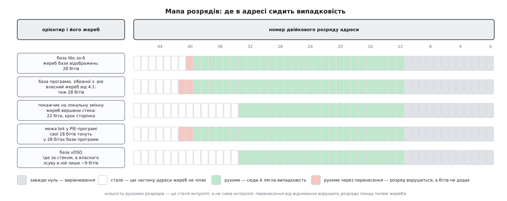

# ⚙️ Скільки бітів насправді: вимірюємо ентропію розкладки на своїй машині

Таблиці кажуть «28 бітів на базу відображень» — а це лабораторна робота на трьох невеликих програмах (C і оболонка), яка перевіряє, скільки їх дістає **ваша** програма на **вашому** ядрі, і показує, чому простий підрахунок рухомих розрядів дає число більше за правду.

## Що взагалі доступне спостерігачеві

Жереб ядра побачити не можна: число, кинуте всередині `execve`, ніде не зберігається як число. Видно тільки наслідок — адреси, за якими опинилися ділянки. Тож шлях один: запустити ту саму програму багато разів, зібрати вибірку адрес і по ній відновити, наскільки широко ці адреси розкидані.

Це вимірювання розподілу, а не читання константи, і саме тому воно повчальніше за таблицю. Дорогою випливають речі, яких у таблиці немає: що один орієнтир може нести на собі чужий жереб, що два жереби бувають зчеплені, і що розряд, який ворушиться, не обов'язково несе біт випадковості.

Орієнтирів беремо п'ять — по одному на кожен жереб, який нас цікавить:

| орієнтир | звідки береться | який жереб несе |
|---|---|---|
| база `libc.so.6` | ручка вже відображеної бібліотеки | база відображень |
| точка входу програми | `AT_ENTRY` з допоміжного вектора | база переміщуваного файлу |
| адреса локальної змінної | `&змінна` в тілі функції | вершина стека |
| поточна межа `brk` | сирий системний виклик `brk(0)` | початок купи |
| база vDSO | `AT_SYSINFO_EHDR` | розміщення vDSO |

Є ще шостий, службовий: база `ld-linux` з `AT_BASE`. Він знадобиться, коли перевірятимемо, які пари адрес зчеплені між собою.

Три з них процес дістає задарма — ядро поклало ці числа на стек ще під час запуску, у [допоміжний вектор](root:sys-unix/auxiliary-vector). Читати їх звідти чесніше, ніж вигадувати обхідні шляхи: це той самий канал, яким користується справжній [динамічний завантажувач](root:sys-unix/dynamic-loader).

Найважливіше правило вимірювання: **числа друкує сам досліджуваний процес**. Спокуса зазирнути в `/proc/<pid>/maps` [ззовні](root:sys-unix/proc-reading-process-and-kernel-state) виглядає простішою, але ламається одразу з двох боків. По-перше, процес треба зловити живим — коротка програма встигає завершитися раніше, ніж оболонка дійде до читання. По-друге, найпопулярніший варіант цієї помилки — цикл із `cat /proc/self/maps`: тут `self` означає `cat`, і ви кількасот разів виміряєте розкладку `cat`, а не своєї програми. Ще один спосіб зіпсувати дослід — запустити зонд під налагоджувачем: той перед запуском сам вимикає рандомізацію, щоб адреси не стрибали між сеансами, і ви чесно отримаєте нуль бітів.

## Зонд: шість чисел за один запуск

:::tabs
:::code proj-entropy-lab/c/probe.c
:::code proj-entropy-lab/cpp/probe.cpp
:::

Кожен рядок тут відповідає на своє «чому саме так».

`syscall(SYS_brk, 0)` стоїть першим оператором не з естетики. Межа купи — єдиний орієнтир, який програма здатна зрушити сама, і зрушити його вміє звичайний `malloc` ([звідки алокатор бере пам'ять](root:sys-unix/allocator-and-kernel)). Один `printf` до заміру — і в числі буде ваш власний буфер, а не жереб.

`dlopen` із `RTLD_NOLOAD` не завантажує нічого: він каже «дай ручку до `libc.so.6`, якщо вона вже тут». Далі `dlinfo` віддає структуру опису об'єкта, з якої беремо і зсув завантаження (`l_addr` — це і є база), і **точний шлях до файлу**, що відображений у цей процес. Шлях знадобиться в наступному розділі, і не для краси.

Прапорець `-v` друкує зсув `printf` у файлі. Це та сама арифметика, якою нападник із однієї витеклої адреси дістає базу — тільки поставлена з протилежного боку: ми знаємо базу й отримуємо зсув, він знає зсув і отримує базу.

## Пастка: адреса, схожа на libc, але не з libc

Найкоротший спосіб дістати «адресу функції з бібліотеки» виглядає так:

:::tabs
```c
unsigned long libc = (unsigned long) &printf;   /* так робити не можна */
```
```cpp
auto libc = reinterpret_cast<std::uintptr_t>(&printf); /* так робити не можна */
```
:::

Він працює приблизно на половині збірок і мовчки бреше на другій. Причина — у вимозі, щоб адреса функції була одна на всю програму: покажчики на `printf`, узяті в різних об'єктних файлах, мусять виявитися рівними при порівнянні. Цю єдину адресу називають **канонічною**, і хтось мусить її призначити. Коли виконуваний файл зібрано з `-no-pie`, взяття адреси стає константою часу лінкування, і компонувальник призначає її найпростішим способом: заводить у самому виконуваному файлі перехідник і оголошує адресою `printf` саме його ([PLT і GOT](root:sys-unix/plt-and-got)). Число, що потрапить у вашу змінну, лежить не в бібліотеці, а у вашому ж бінарнику.

Виглядає воно цілком правдоподібно, а міряти ви будете зовсім інший жереб — жереб бази виконуваного файлу. Із `-pie` тієї самої пастки немає: там адреса не є константою лінкування, її беруть із таблиці непрямості, і в змінну лягає справжня адреса в libc ([позиційно-незалежний код](root:sys-unix/position-independent-code)). Тобто одне й те саме джерело, зібране двома ключами, дає два різні за суттю числа — і без перевірки не видно, яке саме ви отримали.

`dlopen` + `dlsym` у зонді знімає питання: пошук іде в таблиці символів **конкретного об'єкта**, і повертається адреса його визначення, а не будь-який перехідник дорогою.

Звідси ж друга половина пастки. Зсуви символів, коли ви їх звіряєте, треба брати з того самого файлу, який справді відображений у процес — з того, що надрукував `-v`, а не з першого-ліпшого `/usr/lib/libc.so.6`. Розбіжність буває буденна: `LD_LIBRARY_PATH` підсунув іншу збірку, у контейнері свій образ, поруч лежить окремо зібрана бібліотека для налагодження. Тоді відніманням ви отримаєте число, яке не є базою нічого.

## Цикл прогонів: кількасот запусків у незмінному оточенні

:::code proj-entropy-lab/sh/run.sh

Тут одна змістовна деталь — `env -i`. Ядро складає на стеку рядки оточення й аргументи, і лише **під ними** починаються кадри функцій. Змінилося оточення на двадцять байтів — адреса локальної змінної поїхала на двадцять байтів, і це не рандомізація, а звичайна арифметика. Те саме робить довжина `argv[0]`: `./probe` і `/home/user/lab/probe` дають різні адреси стека при однаковому жеребі.

Усередині одного циклу оточення й так однакове, тож формально `env -i` зайвий. Він потрібен, коли ви порівнюєте **серії між собою** — зняту вчора з серією, знятою сьогодні в іншому терміналі, або звичайну з тією, що зроблена під обгорткою. Порожнє оточення робить серії співмірними безкоштовно.

Перед першим прогоном варто перевірити, що ви взагалі міряєте те, що думаєте:

```sh
readelf -h ./probe | grep Type      # Type: DYN — переміщуваний, EXEC — прибитий
cat /proc/sys/kernel/randomize_va_space
cat /proc/sys/vm/mmap_rnd_bits
```

Якщо в типі стоїть `EXEC`, дистрибутив зібрав програму без `-pie`, і жодного жереба на її базу не буде — це не поламаний дослід, а цілком законний результат, який просто слід знати заздалегідь.

## Лічильник: дві стелі замість однієї оцінки

Тепер найцікавіше — як із вибірки адрес зробити число бітів. Наївна відповідь «полічити розряди, у яких трапилися і нуль, і одиниця» дає завелике число, і нижче буде видно, наскільки. Тому лічильник рахує дві незалежні оцінки й дозволяє їм не збігтися.

Перша йде по розрядах. Для кожного розряду `i` беремо частку прогонів, у яких там була одиниця, і рахуємо двійкову [ентропію](root:math-information/shannon-entropy) цього розряду:

```
pᵢ = (кількість прогонів з одиницею в розряді i) / N
H(pᵢ) = −pᵢ·log₂ pᵢ − (1 − pᵢ)·log₂(1 − pᵢ)

стеля за розрядами:  H ≤ Σ H(pᵢ)
```

Це саме стеля, а не оцінка, і причина глибока: спільна ентропія набору розрядів ніколи не більша за суму окремих, а рівність буває тільки тоді, коли розряди незалежні. Будь-яка залежність між ними — і сума завищує.

Друга оцінка йде по розмаху. Жереби ядра влаштовані однаково: до сталої додається (або від неї віднімається) випадкове число, помножене на крок вирівнювання. Отже, крок можна відновити як найбільший спільний дільник різниць ([алгоритм Евкліда](root:math-number-theory/gcd-euclidean)), а кількість можливих місць — поділивши розмах на цей крок:

```
крок    = НСД(v₁ − min, v₂ − min, …, v_N − min)
місць   = (max − min)/крок + 1
поправка на вибірку = (N + 1)/(N − 1)

стеля за розмахом:  H ≤ log₂( місць · (N + 1)/(N − 1) )
```

Поправка потрібна, бо `N` зразків не дістають до країв діапазону: для рівномірного розподілу [очікуваний розмах](root:math-probability/order-statistics) вибірки становить `(N−1)/(N+1)` від справжнього, і множник просто повертає це назад. На п'ятистах прогонах він змінює відповідь на соті частки біта — груба цифра від довжини серії майже не залежить.

Обидві оцінки — стелі. Значить, правильне поводження з ними одне: **брати менше з двох і пам'ятати, що це стеля, а не істина**. А розбіжність між ними — не шум, а показання приладу: вона каже, де між розрядами є зв'язок.

:::tabs
:::code proj-entropy-lab/c/bits.c
:::code proj-entropy-lab/cpp/bits.cpp
:::

Формат вводу навмисно самоописовий — `ім'я=значення`. Зонд може додати сьомий орієнтир, лічильник підхопить його без жодної правки, і те саме працює для похідних величин, якщо ви колись схочете згодувати йому чужий лог.

## Що покаже перший прогін

```sh
cc -O2 -Wall -Wextra -fPIE -pie -o probe probe.c
cc -O2 -Wall -Wextra -o bits bits.c -lm

sh run.sh 500 ./probe > plain.txt
./bits < plain.txt
```

На типовій 64-бітній системі з типовими сисктлами чекайте приблизно такої картини (стовпчики «різних» і «маска» тут прибрано заради місця):

```
орієнтир    крок      рухомих   ΣH(p)   за розмахом
libc        0x1000       29       29.0      28.0
entry       0x1000       30       30.0      28.0
stack       0x1000       22       22.0      22.0
brk         0x1000       30       30.0      28.0
vdso        0x1000       22       21.x      22.0
```

Найпомітніше тут — розбіжність між стовпчиками, і кожен її випадок має ім'я.



*Нижні розряди мовчать через вирівнювання, верхні — бо туди жереб не дістає; ліворуч від поля жереба сидять розряди, які ворушаться від перенесення, а бітів не додають.*

**libc: 29 проти 28.** База відображень утворюється відніманням жереба від сталої вершини. Розмах виходить величезний: 28 бітів жереба, помножені на сторінку, дають діапазон завширшки 2⁴⁰ байтів — цілий терабайт. Коли з фіксованого числа віднімають величину такого розмаху, позика при відніманні добігає до розряду, що стоїть **над** полем жереба, і той починає ворушитися:

```
вершина                  ≈ 0x7FFFFF7FF000
максимальний жереб        = 0xFFFFFFF000   (28 бітів · 4096)
найнижча можлива база     = 0x7EFFFF800000

розряди 12…39 — поле жереба, 28 бітів
розряд 40      — ворушиться, бо друга шістнадцяткова цифра
                 бере то E, то F; власної випадковості в ньому нема
```

Тому підрахунок розрядів дає 29, а правда — 28, і правду каже саме розмах. Скільки розрядів «протече» вгору, залежить від того, де стоїть вершина відносно степеня двійки: у вас може бути нуль зайвих, а може бути два.

**entry: 30 проти 28.** Те саме, але з додаванням замість віднімання й від іншої основи. Переміщуваний виконуваний файл кладуть від сталої основи `ELF_ET_DYN_BASE` (на x86-64 це дві третини вікна адрес, ≈ `0x555555555000`) плюс той самий 28-бітний жереб. Верхня межа виходить ≈ `0x565555554000`: друга шістнадцяткова цифра гуляє між 5 і 6, а всередині цієї пари змінюються два двійкові розряди — знову без жодної випадковості.

**stack: 22 і 22 — а сюрприз тут не в числі.** Ядро тягне для стека жереб маскою `0x3fffff` — двадцять два біти, помножені на сторінку. Тому крок у звіті `0x1000`, рухомі розряди — з 12-го по 33-й, і вимірювання з таблицею збігається.

Сюрприз в іншому. На x86 є ще й підсторінковий зсув: `arch_align_stack` віднімає від вказівника випадкове число, менше за 8192, і заокруглює вниз до шістнадцяти байтів — це 512 варіантів, дев'ять бітів **під** сторінкою. Але умова, за якої ядро його додає, виглядає перевернутою — і такою стоїть роками:

```
підсторінковий зсув додається, коли
    PF_RANDOMIZE НЕ виставлено  ∧  randomize_va_space ≠ 0
```

Тобто у звичайному прогоні цих дев'яти бітів немає, зате вони з'являються там, де їх найменше чекають, — у прогоні з вимкненою рандомізацією. Нижче, у досліді з трьома режимами, це впаде вам просто у звіт.

**brk: 30 проти 28 — і жодного натяку на 18.** Найповчальніший рядок звіту. Купа PIE-програми починається за її ж сегментом даних, тобто **їде разом із базою програми**, і поверх цього ядро додає свій зсув у межах гігабайта — вісімнадцять бітів. Сума двох незалежних жеребів завширшки 2⁴⁰ і 2³⁰ байтів має розмах, який відрізняється від більшого доданка на тисячну частку: вісімнадцять бітів купи повністю тонуть у двадцяти восьми бітах бази програми.

Абсолютна адреса `brk` про жереб купи не каже нічого. Побачити його можна тільки в **різниці** `brk − entry` — а це вже другий стовпчик звіту.

**vdso: ≈ 22.** vDSO кладуть відносно вершини стека, з власним зсувом у межах двомегабайтної області. Тобто в абсолютній адресі сидить головно стеків жереб, а власний зсув vDSO — лише кілька бітів понад ним, до того ж розподілений нерівномірно: заокруглення до межі великої сторінки зміщує ймовірність до верхнього краю. Це той рідкісний випадок, коли `ΣH(p)` виявиться помітно меншою за кількість рухомих розрядів — бо частка одиниць у кількох розрядах вийде не 0.5, а щось на кшталт 0.3. Прилад показує перекіс розподілу, і показує його тільки тому, що прогонів кількасот.

## Коли крок libc виявився 0x200000

Може статися, що перший же прогін дасть у стовпчику `крок` для `libc` не `0x1000`, а `0x200000` — і, відповідно, не 28 бітів, а дев'ятнадцять. Це не помилка вимірювання. Це найкраща причина, заради якої взагалі варто міряти.

Арифметика проста: якщо база бібліотеки вирівняна не на сторінку, а на два мегабайти, дев'ять молодших розрядів поля жереба перестають існувати.

```
крок 4096 (2¹²):     28 бітів жереба
крок 2 МіБ (2²¹):    28 − 9 = 19 бітів жереба
              ціна:  512 разів дешевший перебір
```

Механізм зовсім не в рандомізації. Починаючи з ядра 5.18, підбір вільного місця для файлового відображення на поширених файлових системах (ext4, ext2, btrfs, xfs, fuse) іде через шлях, що вирівнює достатньо великі відображення на межу [великої сторінки](root:sys-unix/huge-pages-tlb-reach), — заради того, щоб ядро могло згодом обслуговувати їх однією великою сторінкою замість п'ятисот дрібних. Бібліотека C більша за два мегабайти, тож під правило потрапляє, а разом із нею — і будь-яка велика бібліотека. Оптимізація швидкодії мовчки зняла дев'ять бітів захисту; описали це в січні 2024-го, і на x86-64 наслідок пережив першу спробу виправлення.

Ось чому «скільки бітів» — питання не до документації. Жоден сисктл не змінився, `vm.mmap_rnd_bits` як показував 28, так і показує; змінився шлях виділення адрес у ядрі, а побачити це можна тільки з боку результату.

## Другий стовпчик: які жереби зчеплені

Таблиця відстаней відповідає на питання, заради якого ядро колись переробляли.

```
відстані між орієнтирами
  libc     − ldso       СТАЛА  0x…
  entry    − libc       рухома, розкид 0x…
  brk      − entry      рухома, розкид 0x3ffff000
  vdso     − stack      рухома, розкид 0x…
```

`libc − ldso` **стала** — і це не хиба, а прямий наслідок того, що обидві лягли від одного жереба: завантажувач розташовує їх поспіль від бази відображень у порядку, який для цього набору залежностей однаковий при кожному запуску. Витік будь-якої адреси з `ld-linux` віддає базу `libc` тим самим відніманням.

Якщо ж у вас тут «рухома з розкидом до `0x200000`» — це знову вирівнювання на велику сторінку: `libc` під нього підпадає, а вдесятеро менший `ld-linux` ні, тож між ними лягає прошарок змінної товщини. Дві бібліотеки все ще їдуть від одного жереба, просто відстань між ними тепер із зубцями. Для нападника це майже нічого не міняє: перебрати 512 варіантів прошарку дешевше, ніж вгадати базу.

`entry − libc` **рухома** — і ось це якраз результат історичної правки. До ядра 4.1 переміщуваний виконуваний файл клали впритул до області відображень, ця відстань була сталою, і витік адреси з коду самої програми віддавав базу бібліотеки C. Якщо ваш звіт показує тут `СТАЛА`, ви або на дуже старому ядрі, або міряєте не те, що думаєте.

`brk − entry` **рухома з розкидом близько гігабайта** — ось де ховалися вісімнадцять бітів купи, невидимі в абсолютній адресі. І ось де стане видно різницю режимів.

## Три режими

:::code proj-entropy-lab/sh/run-2.sh

У другому рядку варто затриматися: обгортка стоїть перед **оболонкою**, а не перед зондом. Так можна, бо прапорець особистості успадковується через `fork` і переживає `execve` — виставили один раз на весь цикл. Заразом це перевірка самого механізму успадкування: якби прапорець не переживав запуску нової програми, у файлі `off.txt` адреси б стрибали. Старіші версії обгортки вимагають назви архітектури першим аргументом (`setarch x86_64 -R …`).

Третій режим змінює глобальний стан машини. На час серії вся система працює зі слабшим захистом, тож робити це варто на одноразовій віртуалці, а не на робочій станції, і повертати попереднє значення обов'язково — саме тому воно спершу зберігається у змінну.

Чого чекати:

- **off** — нулі майже скрізь, `різних = 1`, усі відстані сталі. Виняток один, і він щоразу дивує: `stack` не зупиняється. Крок у нього стане `0x10`, а рухомих розрядів залишиться близько дев'яти — це той самий підсторінковий зсув, який ядро додає саме тоді, коли `PF_RANDOMIZE` не виставлено. Оточення тут ні до чого, його тримає `env -i`; зникне цей рух лише разом із нулем у `kernel.randomize_va_space`, бо умова вимагає ненульового сисктла.
- **va1** — `libc`, `entry`, `stack`, `vdso` рухаються, як і раніше. А от `brk − entry` у таблиці відстаней стане **СТАЛА**: жереб купи вимкнено. Абсолютна адреса `brk` при цьому й далі гуляє на 28 бітів — вона ж їде за базою програми. Без таблиці відстаней ви б цієї зміни просто не побачили й вирішили, що сисктл нічого не зробив.

Той самий дослід на не-PIE збірці (`cc -O2 -no-pie -fno-pie -o probe-nopie probe.c`) показує дзеркальну картину: `entry` стоїть як укопаний за будь-якого сисктла, `brk` рухається рівно на свої вісімнадцять бітів, а `libc` — на всі двадцять вісім. Один бінарник, зібраний двома способами, дає різні відповіді на те саме питання про «рівень рандомізації в системі».

## На чому тягнеться жереб: fork чи execve

Останній дослід — на десять рядків і одну думку.

:::tabs
:::code proj-entropy-lab/c/twins.c
:::code proj-entropy-lab/cpp/twins.cpp
:::

Перші два рядки виводу збігаються до останньої цифри, третій відрізняється в усіх трьох числах. [`fork`](root:sys-unix/fork-semantics) карти пам'яті не будує — він її копіює, разом з усіма адресами, бо інакше дитина не змогла б продовжити виконання з тієї самої точки. Карту будує [`execve`](root:sys-unix/exec-semantics), і жереб тягнеться саме там.

`/proc/self/exe` тут не хизування, а зручність: посилання завжди веде на власний виконуваний файл незалежно від поточної теки й від того, як програму запустили.

Практичний висновок цього десятка рядків більший за сам дослід. Сервер, який стартував один раз, а робітників породжує самим лише розгалуженням, роздає їм усім ту саму розкладку. Змоделюйте це — заберіть із `twins.c` виклик `execl` і хай дитина просто друкує та завершується, а батько повторює це п'ятсот разів, — і ваш лічильник покаже нуль бітів на всіх орієнтирах при цілком справній системній рандомізації.

## Скільки прогонів досить

Для самого числа бітів — на диво мало. І кількість рухомих розрядів, і оцінка за розмахом сходяться швидко: розряд, що справді рухається, покаже обидва значення вже після десятка прогонів, а поправка `(N+1)/(N−1)` на двадцяти зразках додає всього 0.14 біта.

Кількасот прогонів потрібні для іншого — для всього, що не є грубим числом.

По-перше, для перекосу. Розряд із часткою одиниць 0.3 несе 0.88 біта, а не повний; лічильник це врахує, але тільки якщо `p̂` можна вірити. Похибка частки спадає як `1/√N`:

```
похибка p̂ ≈ 0.5/√N

N =  25 → ±0.10   частку 0.30 від рівноваги надійно не відрізнити
N = 500 → ±0.022  перекіс видно впевнено
```

Тобто на коротких серіях кожен рухомий розряд зараховується як повний біт — і звіт виходить **завищений**, причому непомітно для вас ([довірчий інтервал](root:math-probability/confidence-interval)). Саме так перекіс у розміщенні vDSO лишився б непоміченим.

По-друге, для рідкісних станів. «Стала відстань» на двадцяти прогонах і «стала відстань» на п'ятистах — твердження різної ваги. Крайні випадки розміщення (заокруглення до межі великої сторінки, впирання в межу області) трапляються не щоразу, і саме вони найцікавіші.

По-третє, крок як НСД різниць теж потребує зразків: на трьох прогонах усі різниці можуть випадково поділитися на 8192 замість 4096, лічильник візьме вдвічі більший крок — і ви недорахуєте цілого біта.

П'ятсот прогонів короткої програми — це секунди: витрата на прогін це `fork` плюс `execve` плюс зв'язування бібліотек, десь одна-дві мілісекунди. Сам лічильник — `O(N · K · 64)` на розряди плюс `O(N log N)` на сортування в кожному стовпчику, тобто мілісекунди, і `O(N · K)` пам'яті. Ніщо тут не заважає взяти десять тисяч прогонів, якщо ви полюєте на рідкісний випадок.

## Що цей прилад не покаже

Він міряє розкид, а не якість. Якби ядро брало числа не з криптографічного генератора, а з лічильника тактів, розкид лишився б той самий, а передбачуваність зросла б до одиниці — і жоден зі стовпчиків звіту цього не помітив би. Перевірка джерела випадковості — окрема задача з іншими методами.

Він міряє одну машину, одне ядро, одну збірку — і в цьому вся суть. Ніякої «ентропії Linux» не існує; існує ентропія, яку дає ваша конфігурація вашому бінарнику. Число, отримане на робочому ноутбуці, не переносять на плату з 32-бітною збіркою чи на ядро дистрибутива з іншими сисктлами.

І він нічого не каже про те, чи є в системі витік адреси. Двадцять вісім бітів у звіті означають лише, що вгадувати доводиться серед 2²⁸ варіантів — доки хтось не надрукує один покажчик у лог. Прилад міряє висоту стіни, а не кількість відчинених вікон.
