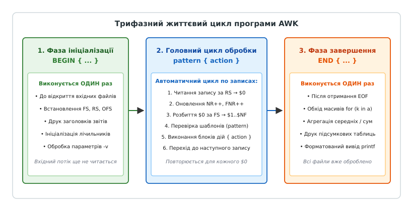
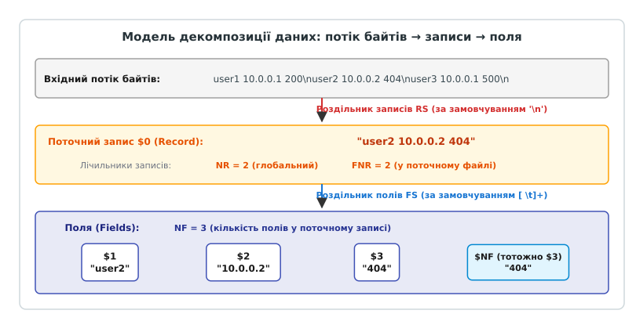
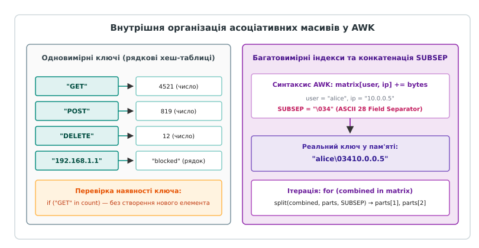

# awk: записи, поля й маленька мова

<preknowlist>
- [Конвеєр: композиція процесів](root:sys-unix/pipeline-composition) — об'єднання стандартних потоків вводу-виводу між суміжними процесами в оперативній пам'яті.
- [Стандартні потоки](root:sys-unix/standard-streams) — дескриптори stdin, stdout, stderr та буферизація вводу-виводу.
- [Текст як універсальний інтерфейс: рядок, роздільник, запис](root:sys-unix/text-as-interface) — структурування даних у текстових потоках Unix.
- [Філософія Unix: малі програми, що складаються](root:sys-unix/unix-philosophy) — спеціалізовані інструменти та їх комбінування.
</preknowlist>

Коли системний конвеєр Unix обробляє потік сирих даних, стандартний набір фільтрів швидко вичерпує свої можливості. Команда `grep` здатна відфільтрувати рядки за регулярним виразом, `sed` може замінити один текстовий фрагмент на інший, а `cut` дозволяє вирізати фіксовані діапазони байтів або стовпці за одним символом-роздільником. Проте щойно перед інженером постає задача, яка вимагає збереження стану між рядками, обчислення суми чисел у третьому стовпці для кожного унікального ідентифікатора з першого стовпця або порівняння значень між суміжними колонками, комбінації `grep | sed | cut` стає недостатньо.

Спроба вирішити подібну задачу засобами командної оболонки через цикл `while read -r line` призводить до катастрофічного падіння продуктивності: інтерпретатор оболонки вимушений на кожному рядку породжувати підпроцеси, розбирати змінні оточення та здійснювати посимвольний парсинг у просторі користувача. Обробка файлу на 1 000 000 рядків таким способом займає десятки хвилин. Написання окремої програми мовою C чи C++ вирішує проблему швидкодії, але вимагає десятків рядків шаблонного коду для відкриття дескрипторів, виділення динамічної пам'яті, парсингу роздільників функціями `strtok_r` або `std::istringstream` та ручної реалізації хеш-таблиць.

```awk
# Підсумовування трафіку за кожним клієнтом в один рядок AWK:
awk '{ bytes[$1] += $10 } END { for (ip in bytes) print ip, bytes[ip] }' /var/log/nginx/access.log
```

Мова AWK заповнює цей розрив. Вона є повноцінною Тюрінг-повною мовою програмування, спроектованою спеціально для потокової декомпозиції тексту на записи та поля. Інтерпретатор AWK бере на себе всю низькорівневу рутину: читання буферів введення, розбиття потоку на елементи, динамічне керування пам'яттю та перетворення типів «рядок-число». Інженер описує лише правила зіставлення зі зразком та дії над виділеними полями.

---

## Філософія та місце AWK в архітектурі Unix

Головна відмінність AWK від імперативних мов загального призначення полягає в її **декларативній природі, керованій даними** (data-driven programming). У класичній програмі на C, Python чи Go розробник зобов'язаний явно створити цикл читання файлу, перевіряти ознаку кінця потоку (`EOF`), виділяти буфери під рядки та контролювати вказівники на роздільники:

:::tabs
:::code awk-d/c/main.c
:::code awk-d/cpp/main.cpp
:::

Утиліта AWK зводить увесь цей обсяг системного коду до одного лаконічного виразу:

```awk
awk '{ total += $2 } END { printf "Total: %.2f\n", total }' input.txt
```

Програма на AWK не має явної точки входу `main()` і не містить інструкцій відкриття файлів. Замість цього інтерпретатор запускає внутрішній автоматичний цикл: він самостійно зчитує системний потік, виділяє черговий запис, розбиває його на масив полів і послідовно зіставляє отримані дані з кожним правилом, описаним у скрипті.

Детальний аналіз передумов створення цієї концепції у лабораторії Bell Labs, взаємодії авторів та еволюції стандарту викладено у матеріалі [📜 Історія появи AWK: Ахо, Вайнбергер, Керніган та революція звітів у Bell Labs](root:sys-unix/awk/hist-awk-origin.md).

---

## Модель виконання та життєвий цикл AWK

Структура будь-якої програми AWK є послідовністю блоків трьох типів:
1. **Блоки ініціалізації (`BEGIN`):** виконуються до того, як інтерпретатор відкриє перший вхідний файл або зчитає хоча б один байт зі стандартного вводу.
2. **Головний цикл обробки (`pattern { action }`):** набір правил, що застосовуються до кожного вхідного запису в порядку їхнього оголошення.
3. **Блоки фіналізації (`END`):** виконуються після того, як увесь вхідний потік повністю вичерпано (`EOF`).


*Трифазна модель виконання AWK: ініціалізація BEGIN, автоматичний цикл обробки записів за шаблонами та завершальний блок END.*

### 1. Фаза ініціалізації `BEGIN { ... }`
Блок `BEGIN` слугує для початкового налаштування середовища. Оскільки на момент його виконання вхідні дані ще не зчитувалися, системні змінні записів і полів (`$0`, `$1`, `NF`) є порожніми або невизначеними. У цьому блоці:
- Встановлюють власні роздільники полів та записів (`FS = ","`, `RS = "\n\n"`, `OFS = "\t"`, `ORS = "\r\n"`).
- Ініціалізують асоціативні масиви, константи та глобальні лічильники.
- Друкують шапки звітів і заголовки таблиць.
- Виконують обчислення, що взагалі не потребують вхідних файлів (наприклад, `awk 'BEGIN { print sqrt(65536) }'`).

Якщо програма містить кілька блоків `BEGIN`, інтерпретатор виконує їх послідовно зверху вниз у порядку оголошення.

### 2. Головний цикл обробки `pattern { action }`
Основне тіло програми складається з пар «шаблон — дія». Інтерпретатор послідовно читає потік запис за записом. Для кожного запису виконується такий алгоритм:
1. Зчитується черговий фрагмент байтів до роздільника `RS` і записується у `$0`.
2. Інкрементуються лічильники `NR` (глобальний) та `FNR` (у поточному файлі).
3. Рядок `$0` сканується і розбивається на окремі поля `$1..$NF` згідно з правилами `FS`, а змінній `NF` присвоюється кількість знайдених полів.
4. Послідовно перевіряється кожен шаблон `pattern` у тексті програми.
5. Якщо поточний запис задовольняє умову шаблону, інтерпретатор виконує відповідний блок дій `{ action }`. Якщо ні — переходить до наступного правила для того ж запису.

Керування потоком виконання всередині головного циклу здійснюється спеціальними операторами:
- **`next`**: негайно перериває обробку поточного запису, пропускає всі наступні правила `pattern { action }` для цього рядка і переходить до зчитування наступного запису з потоку (з інкрементом `NR` та `FNR`).
- **`nextfile`** *(POSIX.1-2008 / GNU AWK)*: негайно зупиняє читання поточного відкритого файлу, закриває його дескриптор і переходить до першого запису наступного файлу у списку `ARGV`.
- **`exit [code]`**: негайно зупиняє головний цикл читання записів і передає керування у блок `END`. Якщо `exit` викликано вже всередині `END`, виконання програми завершується негайно з передачею коду виходу операційній системі.

### 3. Фаза фіналізації `END { ... }`
Блок `END` гарантовано викликається після того, як інтерпретатор прочитав усі передані файли до останнього байта. Навіть якщо оброблялося кілька файлів у списку аргументів, `END` спрацьовує рівно один раз. Тут здійснюється:
- Агрегація та фінальний розрахунок середніх значень, дисперсій, максимумів і відсоткових часток.
- Обхід накопичених асоціативних масивів через цикли `for (key in array)`.
- Друк підсумкових рядків, роздільників та підвалів звітів.

---

## Механізм розбиття потоку на записи та поля

AWK сприймає будь-який вхідний потік як двовимірну структуру: потік ділиться на дискретні **записи** (records), а кожен запис розбивається на атомарні **поля** (fields).


*Декомпозиція вхідного потоку байтів: поділ на записи через RS та розбиття на окремі поля через FS з автоматичним підрахунком NF, NR та FNR.*

### 1. Роздільник записів `RS` та змінна `$0`
За замовчуванням роздільником записів є символ переходу на новий рядок (`RS = "\n"`). Інтерпретатор зчитує вхідні байти з дескриптора файлу до виявлення символу `\n`, поміщає весь отриманий фрагмент у спеціальну змінну **`$0`** і відтинає сам символ роздільника.

Значення `RS` можна конфігурувати під нестандартні формати:
- **`RS = ":"` або `RS = ";"`:** обробка потоків із нестандартними маркерами кінця запису (наприклад, файли конфігурацій чи мережеві дампи).
- **`RS = ""` (режим абзаців):** спеціальний режим POSIX. Записом вважається блок тексту, відокремлений одним або кількома послідовними порожніми рядками. При цьому внутрішні символи переходу рядка `\n` автоматично трактуються як роздільники полів на додаток до пробілів і табуляцій.
- **`RS = "\0"`:** обробка потоків, розділених нульовим байтом (NUL-byte). Незамінно для безпечної роботи з виводом `find -print0` або `xargs -0`, де імена файлів можуть містити пробіли та символи переходу рядка.
- **Регулярний вираз у `RS` (розширення GNU AWK):** `gawk` дозволяє задавати роздільник записів регулярним виразом, наприклад `RS = "---+|\n\n+"`. При цьому спеціальна змінна **`RT`** (Record Terminator) автоматично зберігає фактичну послідовність байтів, яка збіглася з `RS` для поточного запису.

### 2. Роздільник полів `FS` та позиційні змінні `$1..$NF`
Отримавши запис `$0`, інтерпретатор сканує його вміст і ділить на окремі поля згідно зі значенням системної змінної **`FS`** (Field Separator):

- **За замовчуванням (`FS = " "`):** один пробіл як значення `FS` має спеціальну системну семантику в AWK, що безпосередньо наслідує поведінку змінної `$IFS` (Internal Field Separator) у командних оболонках Unix. Роздільником вважається **будь-яка послідовність пробілів та знаків табуляції** (`[ \t]+`). Ведучі та кінцеві пробіли на початку й у кінці рядка автоматично відкидаються інтерпретатором, тому `$1` завжди містить перше непробільне слово, а не порожній рядок.
- **Одиночний непробільний символ (`FS = ","` або `FS = ":"`):** розбиття здійснюється строго за кожним окремим входженням символу. Два суміжних роздільники (наприклад, `alpha,,beta`) утворюють між собою порожнє поле `$2 = ""`. Пробіли навколо роздільника не видаляються, а входять до складу відповідних полів.
- **Одиночний строгий пробіл (`FS = "[ ]"`):** регулярний вираз з одного пробілу скасовує спеціальний режим «стискання пробілів». У цьому випадку кожен одиничний пробіл вважається роздільником, тому два пробіли поспіль утворюють порожнє поле, а початковий відступ рядка створює `$1 = ""`.
- **Регулярний вираз (`FS = "[,\t:]+"`):** поля відокремлюються будь-яким фрагментом, що відповідає вказаному шаблону.

#### Порівняння розбиття полів: AWK `FS` проти оболонки POSIX `$IFS`

| Конфігурація | Вхідний рядок `"  alpha   beta ,, gamma  "` | Результат розбиття на поля | Семантика обробки відступів та роздільників |
|---|---|---|---|
| **AWK `FS = " "`** | `$1="alpha"`, `$2="beta"`, `$3=",,"`, `$4="gamma"`, `NF=4` | Стискання пробілів і табуляцій, відтинання крайових відступів (ідентично дефолтному `$IFS` оболонки). |
| **AWK `FS = ","`** | `$1="  alpha   beta "`, `$2=""`, `$3=" gamma  "`, `NF=3` | Строгий поділ по кожній комі, збереження всіх пробілів у тілі полів, утворення порожнього `$2`. |
| **AWK `FS = "[ ]"`** | `$1=""`, `$2=""`, `$3="alpha"`, ..., `NF=9` | Кожен окремий пробіл є межею поля, ведучі пробіли утворюють порожні позиційні змінні. |
| **POSIX Shell `$IFS=" \t\n"`** | `w1="alpha"`, `w2="beta"`, `w3=",,"`, `w4="gamma"` | Розбиття слів (word splitting): пробільні символи `$IFS` зливаються, відтинаючи початкові та кінцеві відступи. |
| **POSIX Shell `$IFS=","`** | `w1="  alpha   beta "`, `w2=""`, `w3=" gamma  "` | Непробільні символи `$IFS` не зливаються: кожен символ створює окреме поле, суміжні коми генерують порожній елемент. |

Виділені поля стають доступними через позиційні змінні:
- **`$1`** — перше поле запису.
- **`$2`** — друге поле запису.
- **`$NF`** — останнє поле запису (оскільки змінна `NF` містить кількість полів, вираз `$NF` динамічно адресує поле з індексом `NF`).
- **`$(NF - 1)`** — передостаннє поле запису (дужки обов'язкові для правильного пріоритету обчислення індексу).
- **`$$1`** — непряма адресація (значення поля `$1` перетворюється на ціле число `k`, після чого вибирається поле `$k`).

### 3. Структурований парсинг у GNU AWK: `FIELDWIDTHS` та `FPAT`
Коли текстовий потік не містить явних символів-роздільників або містить поля зі складним екрануванням, стандартного механізму `FS` стає недостатньо. GNU AWK надає два потужні альтернативні механізми:

1. **Фіксована ширина стовпців (`FIELDWIDTHS`):**
   Використовується для розбору бінарно-текстових логів, звітів систем обліку чи виводу утиліт на кшталт `ps` та `vmstat`, де стовпці вирівняні за фіксованими позиціями:
   ```awk
   # Розбір рядка фіксованої ширини: 4 байти року, 2 місяця, 2 дня, 10 байтів ідентифікатора
   BEGIN { FIELDWIDTHS = "4 2 2 10" }
   {
       year  = $1
       month = $2
       day   = $3
       id    = $4
       print year "-" month "-" day, "ID:", id
   }
   ```
2. **Шаблон вмісту поля (`FPAT` — Field Pattern):**
   Замість опису того, що стоїть *між* полями (роздільник), `FPAT` задає регулярний вираз для того, що становить *саме поле*. Це ідеальне рішення для стандарту CSV (RFC 4180), де поля можуть містити коми всередині подвійних лапок:
   ```awk
   # Парсинг CSV з підтримкою лапок та ком усередині полів
   BEGIN { FPAT = "([^,]+)|(\"[^\"]+\")" }
   {
       # $1, $2 тощо містять значення полів навіть за наявності ком у лапках
       print "Колонка 1:", $1, "Колонка 2:", $2
   }
   ```

### 4. Вихідні роздільники `OFS`, `ORS` та життєвий цикл синхронізації `$0` і полів
- **`OFS` (Output Field Separator):** рядок, що вставляється між аргументами інструкції `print expr1, expr2` (за замовчуванням один пробіл `" "`).
- **`ORS` (Output Record Separator):** рядок, що автоматично дописується в кінці кожного виклику `print` (за замовчуванням перехід рядка `"\n"`).

Змінні полів `$i` та повний запис `$0` є двосторонньо зв'язаними через внутрішній механізм відстеження валідності буферів (dirty flags):

```
                        Зміна поля: $2 = "NEW" (або зміна NF)
             ┌─────────────────────────────────────────────────────────┐
             │ 1. Внутрішній буфер $0 позначається як брудний (dirty)  │
             │ 2. При наступному читанні $0 викликається rebuild:      │
             │    $0 = $1 OFS $2 OFS ... OFS $NF                       │
             └────────────────────────────┬────────────────────────────┘
                                          │
    Вхідний запис                         ▼                         Вихідний запис
    ┌──────────────────────┐   Синхронізація буферів    ┌──────────────────────┐
    │  alpha:beta:gamma    │ ◄────────────────────────► │  alpha,NEW,gamma     │
    └──────────────────────┘                            └──────────────────────┘
                                          ▲
             ┌────────────────────────────┴────────────────────────────┐
             │ 1. Усі вузли полів $1..$NF та кеш NF інвалідуються      │
             │ 2. Викликається повторне розбиття за поточним FS        │
             └─────────────────────────────────────────────────────────┘
                       Зміна запису: $0 = "x:y:z" (або gsub)
```

#### Покроковий алгоритм перебудови `$0` при модифікації полів
1. **Інвалідація буфера `$0`:**
   Коли скрипт виконує запис у будь-яке поле (наприклад, `$2 = "MODIFIED"`), інтерпретатор змінює структуру вузла другого поля і скидає внутрішній прапорець валідності `$0` (`field0_valid = 0` у термінології рушіїв).
2. **Лінива регенерація (`rebuild_record()` / `rebuild_line()`):**
   Інтерпретатор не конкатенує новий рядок негайно. Перебудова відкладається доти, доки значення `$0` не знадобиться в явному вигляді (виклик `print $0`, `length($0)`, передача `$0` у функцію чи зіставлення за замовчуванням `/regex/`). Під час регенерації:
   - Обчислюється сумарний необхідний розмір буфера: `Розмір = sum(length($i)) + (NF - 1) * length(OFS)`.
   - Виділяється або повторно використовується виділена ділянка пам'яті.
   - Поля послідовно копіюються у новий буфер через роздільник `OFS`, і прапорець валідності `$0` відновлюється.
3. **Пряме керування кількістю полів через `NF`:**
   - **Зменшення `NF` (`NF = 2`):** інвалідує всі поля з індексами `i > 2`. Під час наступного збирання `$0` залишаться лише `$1` та `$2`.
   - **Збільшення `NF` (`NF = 5` для 3-польного рядка):** створює додаткові вузли `$4 = ""` та `$5 = ""`. При регенерації `$0` в кінець рядка додадуться порожні сегменти через `OFS`.
4. **Зворотне розбиття при модифікації `$0`:**
   Якщо скрипт модифікує `$0` безпосередньо (присвоєння `$0 = expr`, виклик `sub()`, `gsub()` над `$0` без вказання третього аргументу або ідіома перепарсингу `$0 = $0`), інтерпретатор:
   - Звільняє або скидає всі наявні структури полів `$1..$NF`.
   - Встановлює лічильник `NF` у неініціалізований стан (`-1`).
   - Запускає сканер розбиття рядка за поточними правилами `FS`, створюючи нову послідовність полів.

---

## Внутрішні системні змінні та контекст середовища

Інтерпретатор AWK підтримує набір вбудованих змінних, які відображають системний стан та параметри виклику.

### 1. Лічильники записів: `NR` проти `FNR`

| Змінна | Повна назва | Семантика та область дії |
|---|---|---|
| **`NR`** | Number of Records | Глобальний порядковий номер запису від старту програми через **усі** файли у списку аргументів. |
| **`FNR`** | File Number of Records | Порядковий номер запису у **поточному відкритому файлі**. Автоматично скидається в `1` під час відкриття наступного файлу. |
| **`NF`** | Number of Fields | Кількість виділених полів у **поточному** записі `$0`. |

Ідіома **`NR == FNR`** є класичним шаблоном обробки двох файлів: перший файл зчитується повністю для заповнення словника відповідностей у пам'яті, а другий файл фільтрується або збагачується цими даними:

```awk
# Збагачення звіту про дисковий простір іменами користувачів із /etc/passwd
# Файл 1: /etc/passwd (FS=":")
# Файл 2: disk_usage.txt (FS=" ")
awk '
BEGIN {
    FS = ":"
}
NR == FNR {
    # Поки NR == FNR, ми читаємо перший файл (/etc/passwd)
    uid_to_user[$3] = $1
    next
}
FNR == 1 {
    # Перший рядок другого файлу: змінюємо роздільник полів
    FS = " "
}
{
    # Обробка другого файлу (disk_usage.txt)
    uid = $1
    usage_mb = $2
    username = (uid in uid_to_user) ? uid_to_user[uid] : "UNKNOWN"
    print username, uid, usage_mb "MB"
}
' /etc/passwd disk_usage.txt
```

### 2. Керування аргументами: `ARGC`, `ARGV` та `FILENAME`
- **`FILENAME`**: містить шлях до поточного вхідного файлу. У блоці `BEGIN` змінна містить порожній рядок `""`. Під час читання зі стандартного вводу містить `"-"` або `""`.
- **`ARGC`** та **`ARGV`**: масив аргументів командного рядка. `ARGC` зберігає кількість елементів, а `ARGV` індексується від `0` до `ARGC - 1`. `ARGV[0]` містить ім'я самої утиліти (наприклад `"awk"`).

Елементи `ARGV` можна динамічно модифікувати безпосередньо у блоці `BEGIN`:
- Очищення `ARGV[i] = ""` змушує інтерпретатор пропустити `i`-й файл.
- Додавання нових елементів `ARGV[ARGC++] = "another_file.txt"` динамічно розширює чергу обробки.

```awk
# Призначення змінних у списку ARGV:
# Значення присвоюються лише тоді, коли черга читання доходить до відповідної позиції
awk '{ print prefix, $0 }' prefix="[LOG1]" file1.log prefix="[LOG2]" file2.log
```

### 3. Системне оточення: масив `ENVIRON`
Асоціативний масив `ENVIRON` надає прямий доступ до змінних середовища операційної системи:

```awk
BEGIN {
    user = ENVIRON["USER"]
    home = ENVIRON["HOME"]
    print "Користувач:", user, "Домашня тека:", home
}
```

Повний реєстр спеціальних змінних із детальним описом типів наведено у [📋 Довіднику інтерфейсу AWK](root:sys-unix/awk/api-awk-builtins-and-variables.md).

---

## Патерни та умови вибору

Шаблони (patterns) визначають, до яких саме записів застосовуватиметься блок дій `{ action }`.

### 1. Регулярні вирази: статичні, динамічні та кешування компіляції

AWK підтримує розширені регулярні вирази (Extended Regular Expressions, ERE) стандарту POSIX. Зіставлення зі зразком реалізовано на рівні синтаксису мови:
- **`/pattern/`**: перевіряє наявність збігу у всьому поточному записі `$0` (еквівалентно `$0 ~ /pattern/`).
- **`$i ~ /pattern/`**: перевіряє відповідність конкретного позиційного поля або змінної регулярному виразу.
- **`$i !~ /pattern/`**: інверсія зіставлення (запис вибирається, якщо поле **не** задовольняє шаблон).

```awk
# Фільтрація логів Nginx: вибираємо лише запити POST до API
$6 ~ /"POST/ && $7 ~ /^\/api\/v[0-9]+/ {
    print "API POST запит від IP:", $1, "на URL:", $7
}
```

#### Статичні проти динамічних регулярних виразів

Регулярні вирази в AWK поділяються на два класи за моментом їх компіляції:
1. **Статичні літерали (`/regex/`):** обмежені прямими слешами. Вони фіксуються на етапі синтаксичного аналізу скрипта й компілюються інтерпретатором у детермінований скінченний автомат (DFA/NFA) один раз під час завантаження програми.
2. **Динамічні регулярні вирази (рядкові вирази):** правим операндом операторів `~` та `!~`, а також першим аргументом функцій `match()`, `sub()`, `gsub()` виступає рядкова змінна або результат конкатенації: `$0 ~ pattern_str` або `$0 ~ ("^" prefix "[0-9]+")`.

```awk
# Динамічне формування регулярного виразу на основі аргументу командного рядка
BEGIN {
    # target_service передається через awk -v target_service="auth"
    svc_pattern = "^(" target_service ")\\[[0-9]+\\]:"
}
$5 ~ svc_pattern {
    print "Повідомлення цільового сервісу:", $0
}
```

#### Дворівневе екранування у рядкових шаблонах

При використанні динамічних регулярних виразів виникає критична інженерна пастка: **подвійний синтаксичний аналіз екранованих послідовностей**:
- **Рівень 1 (Лексичний сканер рядків AWK):** коли інтерпретатор розбирає рядковий літерал у подвійних лапках `"..."`, він перетворює системні керівні послідовності (`\n` на символ нового рядка, `\t` на табуляцію, а `\\` на один зворотний слеш `\`).
- **Рівень 2 (Компілятор регулярних виразів POSIX ERE):** сформований текстовий буфер передається функції компіляції регулярного виразу (`re_compile_pattern`), яка інтерпретує вже залишені зворотні слеші як метасимволи шаблону.

Через це для збереження одного зворотного слеша у динамічному шаблоні його необхідно подвоювати:

| Мета регулярного виразу | Статичний літерал `/.../` | Динамічний рядок `"..."` | Пояснення перетворень |
|---|---|---|---|
| Зіставити цифру (`\d`) | `/[0-9]+/` або `/\d+/` | `"[0-9]+"` або `"\\d+"` | Сканер рядка перетворює `"\\d+"` на `\d+`, який рушій regex компілює як цифри. |
| Зіставити крапку як літерал | `/\./` або `/[.]/` | `"[.]"` або `"\\."` | Рядок `"[.]"` є безпечнішим, оскільки не вимагає екранування зворотними слешами. |
| Зіставити символ `\` | `/\\/` | `"\\\\"` | Сканер перетворює 4 слеші на 2 (`\\`), які компілятор регулярних виразів зводить до одного літерального слеша. |

#### Механізм кешування регулярних виразів та пастка Cache Thrashing

Сучасні інтерпретатори AWK оптимізують виконання динамічних регулярних виразів за допомогою внутрішнього кешування скомпільованих структур автомата (наприклад, `Regexp*` у `gawk`).

Коли виконується операція `$0 ~ str_var`:
1. Інтерпретатор перевіряє внутрішній вузол змінної `str_var`.
2. Якщо рядок містить покажчик на вже скомпільований автомат і текстовий вміст змінної не змінювався від попереднього кроку, інтерпретатор пропускає фазу компіляції та миттєво запускає готовий автомат над `$0`.

```awk
# ЕФЕКТИВНО: змінна svc_pattern не змінюється між записами
# Компіляція regex виконується лише один раз, автомат кешується
{
    if ($5 ~ svc_pattern) count++
}
```

Якщо ж динамічний шаблон генерується заново для кожного рядка на основі змінних потоку, внутрішній кеш скидається на кожному записі:

```awk
# КАТАСТРОФІЧНО ПОВІЛЬНО: Cache Thrashing
# На кожному рядку викликається re_compile_pattern() у просторі користувача
{
    dynamic_regex = "^" $1 "_[0-9]+"
    if ($2 ~ dynamic_regex) {   # 1 000 000 записів = 1 000 000 повних рекомпіляцій автомата
        matched++
    }
}
```

Утилізація процесора в такому разі зміщується від потокового читання пам'яті до постійного виділення пам'яті в купі (`malloc`) та побудови таблиць переходів автомата станів, що сповільнює швидкість обробки у 30–80 разів. Для уникнення рекомпіляцій слід використовувати точні порівняння `$2 ~ /^[0-9]+/ && index($2, $1) == 1` або функцію `substr()`.

### 2. Реляційні вирази та правила порівняння
AWK підтримує оператори порівняння `==`, `!=`, `<`, `>`, `<=`, `>=`. 

Семантика порівняння залежить від типів операндів:
- Якщо **обидва** операнди є числовими рядками або числами, виконується **чисельне** порівняння. Рядки `"100"` та `"20"` порівнюються як числа: вираз `"100" > "20"` є істинним (`true`).
- Якщо хоча б один операнд є суто текстовим рядком, виконується **лексикографічне** (посимвольне за ASCII/Unicode) порівняння. Вираз `"100" < "20a"` є істинним (`true`), оскільки символ `'1'` має менший числовий код за символ `'2'`.

```awk
# Чисельна фільтрація процесів з високим споживанням пам'яті
$4 > 15.5 {
    printf "Процес %s (PID %d) споживає %.1f%% RAM\n", $1, $2, $4
}
```

### 3. Комбіновані булеві вирази (`&&`, `||`, `!`)
Булеві оператори підтримують ліниве обчислення (short-circuit evaluation):
- `A && B`: якщо `A` хибне (`0` або `""`), `B` взагалі не обчислюється.
- `A || B`: якщо `A` істинне, `B` не обчислюється.

```awk
# Вибірка HTTP помилок 5xx, що тривали понад 1.5 секунди
$9 >= 500 && $9 < 600 && $NF > 1.500 {
    print "Критична затримка на збійному ендпоінті:", $7, "Час:", $NF
}
```

### 4. Діапазонні шаблони (`pattern1, pattern2`)
Діапазонний шаблон працює як тригер із пам'яттю (бістабільне реле). Дія починає виконуватися для запису, що задовольнив `pattern1`, продовжує виконуватися для всіх наступних проміжних записів і вимикається після запису, що задовольнив `pattern2`:

```awk
# Друк рядків між заголовком START та підвалом STOP включно
/START/, /STOP/ { print $0 }

# Друк рядків файлу з 50-го по 100-й
NR == 50, NR == 100 { print NR, $0 }
```

> ⚠️ **Крайовий випадок збігу на одному рядку:** Якщо `pattern1` та `pattern2` задовольняються на одному й тому самому записі, тригер вмикається, дія виконується для цього рядка, і тригер негайно вимикається на ньому ж.

### 5. Правила опущення шаблону або дії
- **Опущено шаблон (`{ action }`):** дія виконується безумовно для **кожного** вхідного запису.
- **Опущено дію (`pattern`):** за замовчуванням виконується дія `{ print $0 }` (друк усього запису). Наприклад, класична команда видалення порожніх рядків `awk 'NF'` є скороченням для `awk 'NF != 0 { print $0 }'`.

---

## Асоціативні масиви: організація пам'яті, індексація та агрегація

Асоціативні масиви в AWK є головною структурою даних для збереження стану між записами. Вони не вимагають попереднього оголошення розміру та індексуються довільними рядками.


*Асоціативні масиви AWK: рядкова хеш-таблиця, безпечна перевірка входження без створення порожніх ключів та конкатенація індексів через SUBSEP.*

### 1. Підрахунок частот та групова агрегація
Неініціалізовані змінні в чисельному контексті автоматично трактуються як `0`. Це дозволяє виконувати підрахунок унікальних подій та сум в одну інструкцію:

```awk
# Підрахунок кількості звернень та обсягу байтів за кожним HTTP-методом
{
    method = $6
    bytes = $10
    method_count[method]++
    method_bytes[method] += bytes
}
```

### 2. Пастка автоматичного створення ключів та оператор `in`
Критичною особливістю AWK є **автоматичне створення елемента під час будь-якого звернення за читанням**:

```awk
# НЕПРАВИЛЬНО: звернення створює ключ "10.0.0.1" у хеш-таблиці зі значенням ""
if (blocked_ips[$1] != "") {
    print "Заблоковано:", $1
}
```

Якщо вхідний потік містить мільйони унікальних адрес, пам'ять процесу швидко переповниться порожніми вузлами таблиці.

Правильний спосіб перевірки наявності ключа без модифікації хеш-таблиці — оператор **`in`**:

```awk
# ПРАВИЛЬНО: перевірка наявності ключа без створення нового запису
if ($1 in blocked_ips) {
    print "Заблоковано:", $1
}
```

### 3. Ітерація та видалення елементів
Обхід масиву здійснюється циклом `for (key in array)`. Порядок обходу ключів не гарантується і залежить від внутрішнього розподілу хеш-відер:

```awk
END {
    for (method in method_count) {
        printf "%-10s: %8d запитів (%10.2f KB)\n", method, method_count[method], method_bytes[method] / 1024
    }
}
```

Видалення елементів для звільнення оперативної пам'яті:
- `delete array[key]` — видаляє конкретний елемент із хеш-таблиці.
- `delete array` — повністю очищає весь асоціативний масив і звільняє виділені структури пам'яті.

### 4. Багатовимірні масиви: емуляція через `SUBSEP` проти справжніх вкладених масивів у GNU AWK

В екосистемі AWK існують два принципово різних підходи до організації багатовимірних даних: плоска емуляція через конкатенацію ключів у стандарті POSIX та справжні масиви масивів (масиви дерев) у GNU AWK.

#### 1. Стандарт POSIX: емуляція багатовимірності через `SUBSEP`
У класичному стандарті AWK усі хеш-таблиці є строго одновимірними. Синтаксис `matrix[row, col] = val` є синтаксичним цукром: під час звернення інтерпретатор не створює вкладеної таблиці, а обчислює один плоский строковий ключ шляхом склеювання індексів через системний невидимий символ **`SUBSEP`** (Subscript Separator, за замовчуванням `"\034"` — ASCII 28 File Separator): індекси поєднуються у формат `row SUBSEP col`.

```awk
# Плоска емуляція: збереження кількості байтів за комбінацією (IP-адреса, HTTP-метод)
{
    traffic[$1, $6] += $10
}

END {
    # Ітерація повертає складений ключ, склеєний через \034
    for (composite_key in traffic) {
        # Розбиття ключа на вихідні складові
        split(composite_key, indices, SUBSEP)
        ip     = indices[1]
        method = indices[2]
        printf "Клієнт: %-15s Метод: %-6s Трафік: %10d B\n", ip, method, traffic[composite_key]
    }
}
```

**Інженерні обмеження емуляції через `SUBSEP`:**
1. **Колізія даних:** якщо самі вхідні дані містять символ `\034`, ключ деградує, а функція `split()` поверне спотворені індекси.
2. **Неможливість часткового обходу:** не можна отримати список усіх методів лише для однієї конкретної IP-адреси без повного лінійного сканування всієї хеш-таблиці.
3. **Накладні витрати пам'яті та процесора:** кожен виклик `split()` у циклі `for` алокує тимчасові рядки та виконує посимвольний парсинг.

#### 2. Справжні багатовимірні масиви у GNU AWK (`gawk 4.0+`)
Починаючи з версії 4.0, `gawk` підтримує справжні нерегулярні масиви масивів (arrays of arrays). Кожен елемент масиву може містити або скалярне значення (число, рядок), або покажчик на незалежну дочірню хеш-таблицю.

Доступ до вкладених рівнів здійснюється через ланцюжок індексів `arr[i][j][k]`:

```awk
# Збереження ієрархічної статистики: traffic[vhost][ip][status_code]
{
    vhost  = $2
    client = $1
    status = $9
    bytes  = $10
    
    traffic[vhost][client][status]["count"]++
    traffic[vhost][client][status]["bytes"] += bytes
}

END {
    # Ієрархічний обхід без конкатенації рядків та без викликів split()
    for (v in traffic) {
        print "=== Віртуальний хост:", v, "==="
        for (c in traffic[v]) {
            for (st in traffic[v][c]) {
                printf "  Клієнт: %-15s HTTP %d: %5d запитів (%8.2f KB)\n", \
                    c, st, traffic[v][c][st]["count"], traffic[v][c][st]["bytes"] / 1024
            }
        }
    }
}
```

#### 3. Безпечна перевірка типів за допомогою `isarray()` та захист від фатальних помилок
В архітектурі AWK змінна не може одночасно бути скаляром і масивом. Спроба використати масив у скалярному контексті або навпаки призводить до негайної фатальної помилки часу виконання (`fatal: attempt to use array 'x' in a scalar context`).

Для безпечної роботи з довільними або рекурсивними структурами даних у `gawk` передбачено вбудовану функцію **`isarray(variable)`**, яка повертає `1`, якщо аргумент є масивом, та `0`, якщо це скаляр або неініціалізована змінна:

```awk
# Універсальний рекурсивний принтер довільних вкладених дерев (подібно до JSON/YAML)
function print_nested_tree(tree, indent,    key) {
    for (key in tree) {
        if (isarray(tree[key])) {
            print indent "[" key "]: (підмасив)"
            print_nested_tree(tree[key], indent "    ")
        } else {
            printf "%s%-15s = %s\n", indent, key, tree[key]
        }
    }
}
```

#### 4. Операції над гілками та керування сортуванням
- **Перевірка наявності гілки:** оператор `in` перевіряє ключі на кожному рівні: `if (client in traffic[vhost])`.
- **Видалення піддерева:** виклик `delete traffic[vhost]` рекурсивно звільняє всю дочірню хеш-таблицю хоста та всі її вкладені рівні в пам'яті.
- **Передача підмасиву у функцію:** підмасив передається за посиланням `process_client_metrics(traffic[vhost][client])`.
- **Керування порядком обходу через `PROCINFO["sorted_in"]`:**
  У `gawk` порядок обходу масивів у циклі `for (k in arr)` можна налаштовувати декларативно:
  ```awk
  # Сортування за значеннями у спадному порядку (від найбільшого трафіку до найменшого)
  PROCINFO["sorted_in"] = "@val_num_desc"
  for (ip in ip_bytes) {
      print ip, ip_bytes[ip]
  }
  ```
  Серед зумовлених режимів: `"@ind_str_asc"` (ключі як рядки за зростанням), `"@ind_num_desc"` (ключі як числа за спаданням), `"@val_num_desc"` (значення як числа за спаданням), або ім'я власної функції порівняння двох елементів `function cmp(idx1, val1, idx2, val2)`.

---

## Внутрішня будова середовища виконання та хеш-таблиць

Висока продуктивність інтерпретаторів AWK при обробці гігабайтних потоків ґрунтується на оптимізованих низькорівневих структурах даних мови C.

```
                   Внутрішня комірка значення AWK (NODE / CELL)
    ┌────────────────────────────────────────────────────────────────────────┐
    │ Прапорці стану: [ IS_STR | IS_NUM | IS_NUMSTR | IS_MALLOC | IS_FIELD ] │
    ├────────────────────────────────────┬───────────────────────────────────┤
    │ Числове кешоване поле:             │ Покажчик на рядок:                │
    │ double fval = 4521.000000;         │ char *sval -> "4521\0" (або зріз) │
    │ (кешує результат strtod())         │ size_t slen = 4;                  │
    └────────────────────────────────────┴───────────────────────────────────┘
```

### 1. Двоїсті комірки значень (`NODE` або `CELL`) та кешування типів
Кожна змінна, аргумент функції та позиційне поле в оперативній пам'яті представлені універсальною структурою C (у кодовій базі `gawk` це `struct NODE`, у `mawk` — `CELL`). Вона об'єднує:
- Бітові прапорці стану (`IS_STR`, `IS_NUM`, `IS_NUMSTR`, `IS_ARRAY`).
- Числове поле з подвійною точністю `double fval`.
- Покажчик на текстовий буфер `char *sval` та довжину рядка `size_t slen`.

Коли інтерпретатор зчитує запис із файлу, кожне виділене поле позначається прапорцем **`NUMSTR`** (числовий рядок). Якщо над полем виконується строкова операція (конкатенація, регулярний вираз), використовується покажчик `sval`. Щойно поле потрапляє в чисельний вираз (наприклад, `$10 += bytes`):
1. Інтерпретатор перевіряє наявність прапорця `IS_NUM`.
2. Якщо число ще не обчислювалося, викликається системна функція `strtod()` рівно один раз.
3. Отримане число `double` записується в `fval`, а в комірці встановлюється прапорець `IS_NUM`.
4. Усі наступні тисячі арифметичних операцій з цією змінною читають готове число `fval` безпосередньо з регістрів процесора без будь-якого повторного парсингу тексту.

### 2. Буферизація вводу та представлення полів: лінійний буфер проти вузлових масивів
Різні діалекти AWK використовують принципово відмінні моделі розподілу пам'яті для вхідних полів:

```
  mawk: In-place Zero-Copy зрізи в єдиному буфері (без виділення пам'яті в купі)
  ┌────────────────────────────────────────────────────────────────────────┐
  │ 192.168.1.1\0GET\0/api/v1\0200\04521\n                                 │
  └──────▲────────▲──────▲───────▲─────▲───────────────────────────────────┘
         │        │      │       │     └─ fields[5]: ptr & len (число 4521)
         │        │      │       └─────── fields[4]: ptr & len (статус 200)
         │        │      └─────────────── fields[3]: ptr & len (URI)
         │        └────────────────────── fields[2]: ptr & len (метод)
         └─────────────────────────────── fields[1]: ptr & len (IP)

  gawk: Ліниве розбиття (Lazy Splitting) з незалежними вузлами NODE*
  fields_arr[0] -> NODE($0)
  fields_arr[1] -> NODE($1) [Створюється лише при першому зверненні до $1]
  fields_arr[2] -> NODE($2) [Виділяється в динамічній пам'яті за потреби]
```

#### Підхід `mawk` (Zero-Copy лінійний буфер):
`mawk` орієнтований на максимальну швидкість обробки сирого тексту. Він зчитує потік блоками по 8–16 КБ за допомогою системного виклику `read()`. Змінні полів `fields[1..NF]` ініціалізуються як звичайні зрізи (пари `початок + довжина`), що вказують прямо всередину сирого системного буфера введення. Якщо скрипт не модифікує значення полів (а лише читає їх та агрегує суми), `mawk` не виконує **жодного** виклику `malloc()` для виділення рядків.

#### Підхід `bwk` (One True AWK):
Оригінальний рушій Кернігана підтримує монолітний буфер рядка `record` та динамічний масив покажчиків `fldtab`. Розбиття на поля замінює роздільники на нульові терминуючі байти `\0`.

#### Підхід `gawk` (Ліниве вузлове розбиття):
`gawk` використовує масив покажчиків на структури `NODE *fields_arr`. Він застосовує **ліниве розбиття (lazy field splitting)**: зчитування нового рядка у `$0` не запускає сканування та розбиття всіх полів від `$1` до `$NF`. Якщо правило перевіряє лише повний рядок (наприклад, `$0 ~ /ERROR/`), розбиття взагалі не виконується. Лише коли дія звертається до конкретного поля `$3`, інтерпретатор доходить до третього роздільника, створює вузол для `$3` та зупиняється.

### 3. Організація асоціативних хеш-таблиць
Асоціативні масиви AWK реалізовані як динамічні хеш-таблиці з прямим ланцюжком вирішення колізій (separate chaining):
1. **Хеш-функція:** для строкових ключів обчислюється хеш-код. У `gawk` використовується класичний алгоритм Пітера Вайнбергера PJW (побітовий зсув зі складанням та маскуванням старших бітів), у `mawk` — швидкий мультиплікативний хеш Бреннана.
2. **Масив відер (Buckets):** таблиця зберігає динамічний масив покажчиків на однозв'язні списки вузлів елементів.
3. **Автоматичне динамічне рехешування (Rehashing):**
   Інтерпретатор відстежує коефіцієнт завантаження (load factor, обчислюваний як відношення кількості елементів до поточної кількості відер). Коли середній розмір ланцюжка колізій перевищує поріг 1.5–2.0, інтерпретатор виділяє новий масив відер удвічі більшого розміру (наприклад, розширення з 1024 до 2048, далі до 4096 відер) і розподіляє всі наявні вузли за новими індексами. Це гарантує амортизовану швидкість пошуку та вставки елементів O(1) у часі.

---

## Вбудовані функції, перетворення типів та форматування

AWK має динамічну типізацію з двома базовими типами: 64-бітне число з плаваючою комою IEEE 754 (`double`) та текстовий рядок.

### 1. Правила неявного приведення типів
- В арифметичному контексті рядок перетворюється на число. Якщо рядок починається з нечислових символів, він стає `0`.
- У строковому контексті (конкатенація) число перетворюється на рядок згідно з шаблоном системної змінної **`CONVFMT`** (за замовчуванням `"%.6g"`). Формат виводу чисел інструкцією `print` задається змінною **`OFMT`** (за замовчуванням `"%.6g"`).

Ідіоматичні примусові перетворення:
```awk
num = str + 0   # Примусове приведення рядка до числа
str = num ""    # Примусове приведення числа до рядка через порожню конкатенацію
```

### 2. Рядкові функції та глибинний аналіз `match()`

Усі позиційні індекси в рядкових функціях AWK починаються з **1**:

- **`length([string])`**: повертає довжину рядка у символах (якщо аргумент опущено — довжину `$0`).
- **`substr(s, start [, length])`**: вирізає підрядок із позиції `start` довжиною `length`.
- **`index(s, substr)`**: повертає позицію першого входження підрядка `substr` у рядку `s` (або `0`, якщо не знайдено).
- **`split(s, array [, fs])`**: розбиває рядок `s` на елементи масиву `array[1]..array[N]` за роздільником `fs`. Повертає кількість створених елементів `N`.
- **`sub(regex, replacement [, target])`**: замінює **перше** входження регулярного виразу на `replacement`. За відсутності `target` модифікує `$0`. Повертає `1` у разі успішної заміни або `0`.
- **`gsub(regex, replacement [, target])`**: глобальна заміна **всіх** входжень регулярного виразу. Повертає кількість виконаних замін.
- **`sprintf(format, expr1, expr2, ...)`**: створює форматований рядок без виводу у потік за специфікаторами `printf(3)`.
- **`tolower(s)` / `toupper(s)`**: переведення символів у нижній або верхній регістр.

#### Глибинний розбір регулярних виразів: `match()`, `RSTART`, `RLENGTH` та масив підгруп

Функція **`match(s, regex [, array])`** здійснює пошук найлівішого найдовшого збігу регулярного виразу `regex` усередині рядка `s`.

Стандартна поведінка POSIX:
- Функція повертає 1-індексовану позицію початку збігу (або `0`, якщо збіг відсутній).
- Інтерпретатор автоматично встановлює дві глобальні системні змінні:
  - **`RSTART`**: початкова позиція знайденого фрагмента в рядку `s` (`0` у разі невдачі).
  - **`RLENGTH`**: довжина знайденого фрагмента в символах (`-1` у разі невдачі).

```awk
# Класичний POSIX-підхід вилучення фрагмента через RSTART та RLENGTH
if (match($0, /[0-9]+\.[0-9]+\.[0-9]+\.[0-9]+/)) {
    ip = substr($0, RSTART, RLENGTH)
    print "Знайдено IP:", ip, "на позиції:", RSTART
}
```

#### Вилучення груп захоплення у GNU AWK (третій аргумент `array`)

Починаючи зі стандарту POSIX.1-2008 та в реалізації GNU AWK, функція `match()` приймає необов'язковий третій аргумент — ім'я масиву `array`, у який автоматично розкладаються всі круглі дужки захоплення `(...)` регулярного виразу:

1. **`array[0]`**: містить повний текстовий збіг усього регулярного виразу (еквівалентно `substr(s, RSTART, RLENGTH)`).
2. **`array[1] .. array[N]`**: містять текстові фрагменти, захоплені відповідними групами `(1) .. (N)` зліва направо за порядком відкриваючих дужок.
3. **Двовимірні метадані позицій `array[i, "start"]` та `array[i, "length"]`**:
   Для кожної групи захоплення інтерпретатор створює спеціальні індекси зі стартовою позицією та довжиною підрядка:
   - `array[i, "start"]` — абсолютна позиція початку `i`-ї групи у вихідному рядку `s`.
   - `array[i, "length"]` — довжина `i`-ї групи у символах.

```awk
# Вилучення структурованих компонентів запиту однією операцією match()
{
    # Патерн розбирає: IP, метод, URL, код статусу, час обробки
    pattern = "^([0-9.]+) - - \\[([^]]+)\\] \"([A-Z]+) ([^ ]+) HTTP/[0-9.]+\" ([0-9]{3}) [0-9]+ ([0-9.]+)"
    
    if (match($0, pattern, m)) {
        client_ip = m[1]
        timestamp = m[2]
        method    = m[3]
        uri       = m[4]
        status    = m[5]
        latency   = m[6]
        
        printf "Клієнт %s викликав %s %s [HTTP %d] за %.3fs (URL стартує з позиції %d)\n", \
            client_ip, method, uri, status, latency, m[4, "start"]
    }
}
```

#### Поведінка необов'язкових груп, що не брали участі у збігу

Якщо регулярний вираз містить альтернативні або необов'язкові групи (наприклад, `"(ERROR|WARN)(: ([0-9]+))?"`), і необов'язкова група не збіглася з текстом:
- Текстове значення `m[3]` встановлюється у порожній рядок `""`.
- Початкова позиція `m[3, "start"]` встановлюється в `0`.
- Довжина `m[3, "length"]` встановлюється в `-1`.

Це дозволяє точно відрізнити групу, яка захопила порожній рядок нульової довжини (`start > 0`, `length == 0`), від групи, яка взагалі не брала участі у збігу (`start == 0`, `length == -1`).

### 3. Математичні функції
- **`int(x)`**: відтинає дробову частину числа, округлюючи до нуля (`int(4.9) = 4`, `int(-4.9) = -4`).
- **`sqrt(x)`**, **`exp(x)`**, **`log(x)`**: квадратний корінь, експонента та натуральний логарифм.
- **`sin(x)`**, **`cos(x)`**, **`atan2(y, x)`**: тригонометричні функції (кут у радіанах).
- **`rand()`**: повертає псевдовипадкове число з плаваючою комою в діапазоні `[0.0, 1.0)`.
- **`srand([seed])`**: ініціалізує генератор псевдовипадкових чисел. Без аргументів використовує поточний системний час.

### 4. Маніпуляція часом та датами у GNU AWK: `systime()`, `strftime()`, `mktime()`

Потоковий аналіз серверних журналів, вимірювання затримок та агрегація метрик у ковзних вікнах (time-windowed aggregation) вимагають перетворення текстових дат у монотонні цілочисельні мітки часу та зворотної генерації звітів. GNU AWK містить повноцінний набір функцій для роботи з часом епохи Unix (Unix Epoch).

#### 1. Системний час: `systime()`
Функція `systime()` повертає поточний системний час у вигляді цілого числа секунд, що минули з 1 січня 1970 року 00:00:00 UTC (системний виклик `time(2)`).

```awk
# Вимірювання часу виконання обробки потоку
BEGIN {
    start_ts = systime()
}
END {
    duration = systime() - start_ts
    printf "Оброблено %d записів за %d секунд (%.1f записів/с)\n", NR, duration, (duration > 0 ? NR / duration : NR)
}
```

#### 2. Перетворення дати в Epoch Timestamp: `mktime(datespec [, utcflag])`
Функція `mktime()` транслює текстовий рядок дати й часу у монотонний секундний timestamp епохи Unix.

Специфікація `datespec` вимагає суворого формату із шести (або семи) розділених пробілами цілих чисел:
```
"YYYY MM DD HH MM SS [DST]"
```
- `YYYY`: 4-значний рік (наприклад, `2026`).
- `MM`: номер місяця від `1` до `12`.
- `DD`: день місяця від `1` до `31`.
- `HH`: година від `0` до `23`.
- `MM`: хвилина від `0` до `59`.
- `SS`: секунда від `0` до `59`.
- `[DST]`: необов'язковий прапорець літнього часу (`1` — діє літній час, `0` — зимовий час, `-1` або опущено — визначити автоматично за системним часовим поясом).
- `utcflag`: якщо другий аргумент передано і він не дорівнює `0`, розбір виконується за часовим поясом UTC (GMT), інакше використовується локальний часовий пояс процесу (`tzset(3)`).

У разі передачі некоректного формату `mktime()` повертає `-1`.

##### Нормалізація дат та календарна арифметика без сторонніх бібліотек
Критичною інженерною властивістю `mktime()` є **автоматична нормалізація виходу за межі діапазонів**. Якщо вказати день `35` або годину `-2`, функція не генерує помилку, а коректно здійснює календарний зсув з урахуванням високосних років і змінної тривалості місяців:

```awk
# Обчислення часової мітки рівно за 14 днів і 3 години після події:
# Не потрібно перевіряти кінець місяця — mktime самостійно перейде на наступний місяць
event_ts = mktime("2026 02 25 14 30 00")
future_ts = mktime("2026 02 " (25 + 14) " " (14 + 3) " 30 00")
```

#### 3. Форматування часових міток: `strftime([format [, timestamp [, utcflag]]])`
Функція `strftime()` форматує секундний timestamp у довільний текстовий формат згідно зі специфікаторами стандартної функції C `strftime(3)`.

- `format`: рядок специфікації формату. Якщо аргумент опущено, використовується системний формат виводу утиліти `date`.
- `timestamp`: цілочисельна мітка часу. Якщо аргумент опущено, використовується поточний результат `systime()`.
- `utcflag`: при ненульовому значенні форматування здійснюється за шкалою UTC замість локального часу.

| Специфікатор | Значення | Приклад виводу |
|---|---|---|
| `%Y` | 4-значний рік | `2026` |
| `%m` | Номер місяця з ведучим нулем (`01`–`12`) | `08` |
| `%d` | Номер дня місяця з ведучим нулем (`01`–`31`) | `29` |
| `%H` / `%M` / `%S` | Години (00–23), хвилини (00–59), секунди (00–59) | `14 45 09` |
| `%F` | Еквівалент дати ISO 8601 (`%Y-%m-%d`) | `2026-08-29` |
| `%T` | Еквівалент 24-годинного часу (`%H:%M:%S`) | `14:45:09` |
| `%z` / `%Z` | Числовий зсув часового поясу або його буквений код | `+0300`, `EEST` |
| `%s` | Секунди епохи Unix (розширення glibc) | `1788000000` |
| `%u` / `%w` | День тижня (1=Пн..7=Нд / 0=Нд..6=Сб) | `6` (Субота) |

#### Практичний приклад: розрахунок ковзних 5-хвилинних вікон навантаження веб-сервера

Нижче наведено виробничий скрипт агрегації серверних логів із конвертацією рядкових дат Common Log Format (`[29/Aug/2026:14:23:05 +0300]`) в епоху, розбивкою по 5-хвилинних часових кошиках (time buckets) та розрахунком частоти помилок:

```awk
BEGIN {
    # Ініціалізація таблиці відповідності текстових назв місяців
    split("Jan Feb Mar Apr May Jun Jul Aug Sep Oct Nov Dec", m_names, " ")
    for (i = 1; i <= 12; i++) {
        month_map[m_names[i]] = sprintf("%02d", i)
    }
}

{
    # Вхідний рядок $4 містить: [29/Aug/2026:14:23:05
    # Виділяємо компоненти дати за допомогою match()
    if (match($4, /^\[([0-9]{2})\/([A-Za-z]{3})\/([0-9]{4}):([0-9]{2}):([0-9]{2}):([0-9]{2})/, d)) {
        day   = d[1]
        mon   = month_map[d[2]]
        year  = d[3]
        hour  = d[4]
        min   = d[5]
        sec   = d[6]
        
        # Формуємо datespec для mktime
        datespec = year " " mon " " day " " hour " " min " " sec
        ts = mktime(datespec)
        
        if (ts > 0) {
            # Округлення мітки часу до 5-хвилинного кошика (300 секунд)
            bucket_ts = int(ts / 300) * 300
            
            http_status = $9 + 0
            requests[bucket_ts]++
            bytes_total[bucket_ts] += $10
            
            if (http_status >= 500 && http_status < 600) {
                errors_5xx[bucket_ts]++
            }
        }
    }
}

END {
    # Друк агрегованого звіту по 5-хвилинних часових вікнах
    PROCINFO["sorted_in"] = "@ind_num_asc"
    printf "%-19s | %8s | %10s | %8s | %8s\n", "Часовий інтервал", "Запити", "Трафік MB", "5xx Збої", "RPS"
    print "--------------------+----------+------------+----------+---------"
    
    for (b_ts in requests) {
        time_str = strftime("%Y-%m-%d %H:%M:%S", b_ts)
        req_count = requests[b_ts]
        err_count = errors_5xx[b_ts] + 0
        mb_traffic = bytes_total[b_ts] / (1024 * 1024)
        rps = req_count / 300
        
        printf "%-19s | %8d | %10.2f | %8d | %8.2f\n", \
            time_str, req_count, mb_traffic, err_count, rps
    }
}
```

---

## Керування потоком введення-виведення та зовнішні інтерфейси

AWK здатний керувати складними конвеєрами вводу-виводу, не виходячи з контексту власної програми.

### 1. Передача змінних із командного рядка: `-v` проти аргументів `ARGV`
Існує два принципово різних способи передати значення з оболонки в AWK-скрипт:

```bash
# 1. Прапорець -v (доступний одразу всередині блоку BEGIN):
awk -v threshold=500 -v prefix="WARN" 'BEGIN { print prefix, threshold }'

# 2. Аргументи після тексту програми (присвоюються лише під час відкриття відповідних файлів):
awk '{ if ($1 > threshold) print $0 }' threshold=100 input1.txt threshold=200 input2.txt
```

Прапорець `-v` ініціалізує змінні до початку читання будь-яких вхідних даних. Присвоєння у списку аргументів виду `var=val` змінює значення змінної динамічно в той момент, коли черга читання доходить до відповідної позиції у списку файлів.

### 2. Пряме зчитування через `getline`
Інструкція `getline` дозволяє самостійно прочитати наступний запис, не чекаючи автоматичного переходу головного циклу:

```awk
# 1. Читання наступного рядка з поточного файлу у змінну:
if (getline next_line > 0) {
    print "Наступний рядок:", next_line
}

# 2. Читання конфігураційного файлу безпосередньо у блоці BEGIN:
BEGIN {
    while ((getline line < "/etc/hosts") > 0) {
        split(line, host_parts, " ")
        if (host_parts[1] !~ /^#/) {
            hosts[host_parts[2]] = host_parts[1]
        }
    }
    close("/etc/hosts")
}

# 3. Зчитування результату виконання системної команди:
BEGIN {
    "uname -r" | getline kernel_version
    close("uname -r")
    print "Версія ядра:", kernel_version
}
```

Детальна семантика всіх 6 форм виклику `getline`:

| Варіант виклику | Джерело даних | Куди потрапляє рядок | Зміна `NR` / `FNR` | Повертане значення |
|---|---|---|---|---|
| **`getline`** | Поточний вхідний потік | `$0`, поля `$1..$NF`, `NF` | Оновлюються (`NR++`, `FNR++`) | `1` — успіх; `0` — EOF; `-1` — системна помилка. |
| **`getline var`** | Поточний вхідний потік | Змінна `var` (`$0` не змінюється) | Оновлюються (`NR++`, `FNR++`) | `1` — успіх; `0` — EOF; `-1` — системна помилка. |
| **`getline < "file"`** | Зовнішній файл | `$0`, поля `$1..$NF`, `NF` | **Не** змінюються | `1` — успіх; `0` — EOF; `-1` — файл не відкрито. |
| **`getline var < "file"`** | Зовнішній файл | Змінна `var` | **Не** змінюються | `1` — успіх; `0` — EOF; `-1` — файл не відкрито. |
| **`"cmd" \| getline`** | Вивід команди `cmd` | `$0`, поля `$1..$NF`, `NF` | **Не** змінюються | `1` — успіх; `0` — EOF; `-1` — збій конвеєра. |
| **`"cmd" \| getline var`** | Вивід команди `cmd` | Змінна `var` | **Не** змінюються | `1` — успіх; `0` — EOF; `-1` — збій конвеєра. |

> ⚠️ **Обов'язкове закриття дескрипторів через `close()`:** AWK кешує відкриті файли та канали у внутрішній таблиці дескрипторів. Якщо прочитати файл або команду через `getline` до кінця (`EOF`), дескриптор залишається у відкритому стані з прапорцем вичерпання потоку. Наступний виклик `getline < "file"` миттєво поверне `0`, не читаючи файл з початку. Щоб перечитати файл, звільнити дескриптор ОС (запобігаючи перевищенню системного ліміту `RLIMIT_NOFILE`) або скинути буфери конвеєра, необхідно явно викликати `close("file")` або `close("cmd")`.

### 3. Перенаправлення виводу у файли та конвеєри
Вивід інструкцій `print` та `printf` можна скеровувати безпосередньо у файли або канали:
- `print $0 > "output.txt"` — відкриває файл на запис (файл очищається при першому зверненні, наступні виклики дописують у відкритий дескриптор).
- `print $0 >> "output.txt"` — відкриває файл у режимі дописування (`O_APPEND`).
- `print $1, $2 | "sort -k2,2nr"` — передає потік у системну утиліту сортування через однонаправлений міжпроцесний канал (pipe).
- `fflush(["filename" | "cmd"])` — примусово скидає буферизацію стандартної бібліотеки C для вказаного вихідного файлу чи конвеєра.

### 4. Двонаправлені конвеєри та взаємодія з копроцесами (`|&`)
У класичному Unix міжпроцесні канали є суворо однонаправленими: або запис у процес (`print | "cmd"`), або читання з процесу (`"cmd" | getline`). GNU AWK вводить оператор **двонаправленого зв'язку `|&`**, що дозволяє запускати зовнішню програму як інтерактивний копроцес (coprocess), передавати їй вхідні дані та синхронно зчитувати відповіді.

```awk
# Інтерактивна взаємодія з калькулятором довільної точності dc на чистому AWK
BEGIN {
    coproc = "dc"
    
    # 1. Відправляємо команду обчислення 2^64 у зворотній польській нотації
    print "2 64 ^ p" |& coproc
    
    # 2. Зчитуємо результат обчислення безпосередньо з виводу копроцесу
    if ((coproc |& getline result) > 0) {
        print "Результат 2^64 від dc:", result
    }
    
    # 3. Відправляємо наступне обчислення у той самий запущений процес
    print "16 4 ^ p" |& coproc
    coproc |& getline result2
    print "Результат 16^4 від dc:", result2
    
    # 4. Закриваємо двонаправлений канал
    close(coproc)
}
```

```
                     Двонаправлений копроцес у GNU AWK
    ┌───────────────────────┐                    ┌───────────────────────┐
    │                       │   print "expr" |&  │  Зовнішній процес     │
    │  Інтерпретатор GAWK   │ ─────────────────► │  (наприклад: dc,      │
    │                       │      (stdin)       │   openssl, custom-bin)│
    │                       │                    │                       │
    │                       │   |& getline var   │                       │
    │                       │ ◄───────────────── │                       │
    └───────────────────────┘      (stdout)      └───────────────────────┘
```

#### Інженерна пастка блокової буферизації та Deadlock
Найпоширенішою проблемою при роботі з копроцесами є **взаємне блокування (deadlock)**. Стандартна бібліотека C (`glibc`) автоматично перемикає буферизацію `stdout` у блоковий режим (4096 байтів), якщо вивід спрямовано у пайп, а не на справжній термінал (TTY). Якщо копроцес згенерував відповідь на 50 байтів, він не відправить її в канал до заповнення 4 КБ, а AWK-інструкція `getline` зависне в очікуванні назавжди.

**Методи усунення взаємного блокування в gawk:**
1. **Примусовий скид буфера AWK:** виклик `fflush(coproc)` одразу після інструкції `print ... |& coproc`.
2. **Двостороннє закриття каналу запису:**
   ```awk
   # Відправка EOF у stdin копроцесу зі збереженням відкритого каналу читання stdout:
   print "данні для обробки" |& "my_filter"
   close("my_filter", "to")   # Закриває лише канал запису
   while (("my_filter" |& getline line) > 0) {
       print "Отримано:", line
   }
   close("my_filter")         # Повне закриття процесу
   ```
3. **Емуляція псевдотермінала (PTY):**
   Встановлення `PROCINFO[coproc, "pty"] = 1` перед першим зверненням змушує операційну систему створити псевдотермінал для копроцесу. Програма вважає, що працює в інтерактивному терміналі, і перемикає свій вивід у порядно-буферизований режим (line-buffered).

### 5. Мережеві сокети TCP/IP та UDP у GNU AWK (`/inet/...`)
GNU AWK має вбудовану підтримку мережевого стека Berkeley Sockets без використання зовнішніх утиліт на кшталт `curl` чи `nc`. Робота із сокетами здійснюється через спеціальні псевдофайли уніфікованого формату: `/inet/{tcp|udp|raw}/local-port/remote-host/remote-port`.

- **`local-port`:** локальний порт клієнта (значення `0` вказує ядру ОС виділити довільний вільний ефемерний порт).
- **`remote-host`:** IP-адреса або доменне ім'я сервера.
- **`remote-port`:** цільовий TCP/UDP-порт (або назва сервісу з `/etc/services`, наприклад `"http"`).

#### 1. Клієнтський режим: повнофункціональний HTTP-запит
```awk
# Читання заголовків та JSON-відповіді через клієнтський TCP-сокет
BEGIN {
    socket = "/inet/tcp/0/httpbin.org/80"
    
    # Відправка HTTP GET запиту
    print "GET /get HTTP/1.1\r\nHost: httpbin.org\r\nConnection: close\r\n\r\n" |& socket
    
    # Читання відповіді по рядках
    while ((socket |& getline line) > 0) {
        print "HTTP Response:", line
    }
    
    close(socket)
}
```

#### 2. Серверний режим: повноцінний HTTP Health-Check сервер на AWK
Якщо у специфікаторі шляху віддалений хост і порт встановити в `0`, `gawk` переходить у режим прослуховування вхідних підключень (серверний сокет `listen()` / `accept()`):

```awk
# Легковажний HTTP мікросервіс на чистому AWK (слухає порт 8080)
BEGIN {
    server = "/inet/tcp/8080/0/0"
    print "AWK HTTP-сервер очікує з'єднань на http://127.0.0.1:8080..."
    
    while (1) {
        # Очікування вхідного TCP-з'єднання від клієнта
        if ((server |& getline req_line) <= 0) {
            close(server)
            continue
        }
        
        # Вичитування HTTP-заголовків до порожнього рядка
        while ((server |& getline header) > 0 && header !~ /^(\r|\n)*$/) {}
        
        # Формування тіла та заголовків HTTP-відповіді
        body = "{\"status\":\"UP\",\"timestamp\":" systime() ",\"engine\":\"gawk\"}\n"
        resp = "HTTP/1.1 200 OK\r\n" \
               "Content-Type: application/json\r\n" \
               "Content-Length: " length(body) "\r\n" \
               "Connection: close\r\n\r\n" body
        
        # Відправка відповіді клієнту та закриття сесії
        print resp |& server
        close(server)
    }
}
```

#### 3. Датаграми UDP та обробка тайм-аутів
- **Відправка метрик у StatsD/Syslog:** `print "api.requests:1|c" |& "/inet/udp/0/127.0.0.1/8125"`.
- **Керування мережевими тайм-аутами:**
  `PROCINFO[socket, "READ_TIMEOUT"] = 3000` задає ліміт очікування відповіді у мілісекундах. Якщо за 3 секунди сервер не відповів, `getline` повертає `-1`, а системна змінна `ERRNO` містить опис `"Connection timed out"`.

### 6. Динамічні розширення C API (`@load` та `extension()`)
Для задач, які вимагають взаємодії з апаратним забезпеченням, криптографічного хешування або прямих системних викликів ядра POSIX, GNU AWK надає механізм динамічного завантаження спільних бібліотек (Shared Objects `.so`).

Завантаження здійснюється за допомогою директиви **`@load`** (або застарілої функції `extension()`):

```awk
# Завантаження стандартного системного розширення POSIX часу та процесів
@load "time"
@load "filefuncs"

BEGIN {
    # Виклик функції stat() з C-розширення filefuncs
    if (stat("/etc/passwd", file_info) == 0) {
        print "Розмір файлу:", file_info["size"], "байт"
        print "Власник UID:", file_info["uid"]
        print "Права доступу:", sprintf("%o", file_info["mode"])
    }
}
```

#### Внутрішня архітектура C Extension API (`gawkapi.h`)
Створення власного бінарного плагіна не потребує модифікації сирцевого коду інтерпретатора. Розробник підключає системний заголовок `gawkapi.h` та реалізує експортовану точку входу `int dl_load(const gawk_api_t *const api_p, awk_ext_id_t id)`.

Процес взаємодії складається з трьох ключових ланок:
1. **Таблиця функцій середовища `gawk_api_t`:** інтерпретатор передає плагіну покажчик на структуру з системними функціями середовища (`add_ext_func`, `api_get_element`, `api_set_element`, `make_const_string` тощо). Плагін зберігає цей покажчик та ідентифікатор `ext_id` для подальших викликів.
2. **Реєстрація функцій через `api->add_ext_func()`:** плагін передає масив структур `awk_ext_func_t`, де вказує ім'я нової AWK-функції, покажчик на C-функцію обробника, мінімальну та максимальну кількість аргументів і прапорець заборони перекриття.
3. **Обмін значеннями через `awk_value_t`:** параметри та результати передаються через універсальну структуру `awk_value_t`. Вона підтримує скалярні типи (`AWK_NUMBER`, `AWK_STRING`, `AWK_REGEX`), роботу з недослідженими значеннями (`AWK_UNDEFINED`) та пряму адресацію вузлів хеш-таблиць AWK (`AWK_ARRAY`) через дескриптор `awk_array_t`.

Це дозволяє C-функціям напряму змінювати внутрішні асоціативні масиви AWK і повертати складні системні структури без витрат на серіалізацію в проміжний текст.

Практичний приклад побудови повноцінного виробничого аналізатора логів із конвеєрами сортування та статистичною агрегацією міститься у проекті [⚙️ Практичний аналізатор журналів доступу та генератор звітів на чистому AWK](root:sys-unix/awk/proj-log-analyzer-and-reporter.md).

---

## Функції користувача та область видимості змінних

AWK підтримує оголошення власних іменованих функцій за допомогою ключового слова `function`:

```awk
# Оголошення функції обчислення максимального з двох чисел
function max(a, b) {
    return (a > b) ? a : b
}

# Функція форматування розміру байтів у зручні одиниці виміру
function format_bytes(bytes,    units, idx) {
    split("B KB MB GB TB", units, " ")
    idx = 1
    while (bytes >= 1024 && idx < 5) {
        bytes /= 1024
        idx++
    }
    return sprintf("%.2f %s", bytes, units[idx])
}
```

### Семантика передачі параметрів та ідіома локальних змінних
В архітектурі AWK діють такі правила передачі даних у функції:
- **Скалярні значення (числа та рядки)** передаються **за значенням** (pass-by-value). Зміна аргументу всередині функції не впливає на вихідну змінну.
- **Асоціативні масиви** передаються **за посиланням** (pass-by-reference). Будь-яка модифікація елементів масиву всередині функції змінює вихідний масив у місці виклику.

Оскільки всі змінні в AWK за замовчуванням є **глобальними**, єдиним способом створити змінну з локальною областю видимості є оголошення її як формального параметра функції. Традиційна інженерна угода полягає у виділенні додаткових пробілів між справжніми вхідними аргументами та локальними змінними у заголовку функції:

```awk
function process_record(input_str, delimiter,    parts, count, i) {
    # input_str та delimiter — справжні вхідні аргументи
    # parts, count, i — локальні змінні, що не перезапишуть однойменні глобальні змінні
    count = split(input_str, parts, delimiter)
    for (i = 1; i <= count; i++) {
        # обробка
    }
}
```

---

## Архітектурні діалекти: від Bell Labs до сучасних рушіїв

Еволюція інтерпретаторів AWK сформувала кілька незалежних кодових баз із різними цілями оптимізації:

```
                          ┌─────────────────────────────┐
                          │    Сирцевий скрипт AWK      │
                          └──────────────┬──────────────┘
                                         │
                 ┌───────────────────────┴───────────────────────┐
                 ▼                                               ▼
   ┌───────────────────────────┐                   ┌───────────────────────────┐
   │    GNU AWK (gawk)         │                   │    Mike's AWK (mawk)      │
   ├───────────────────────────┤                   ├───────────────────────────┤
   │ 1. Парсинг у AST / байткод│                   │ 1. Компіляція в байт-код  │
   │ 2. Багата POSIX/GNU модель│                   │ 2. Стек-машина (VM)       │
   │ 3. Мережеві сокети, i18n  │                   │ 3. Хешування Бреннана     │
   │ 4. Динамічні C-плагіни    │                   │ 4. Максимальна швидкість  │
   └─────────────┬─────────────┘                   └─────────────┬─────────────┘
                 ▼                                               ▼
         Обробка потоку                                  Обробка потоку
         (~100-250 MB/c)                                 (~400-900 MB/c)
```

### 1. One True AWK (`bwk` або `nawk`)
Оригінальна версія New AWK від Bell Labs, яку продовжує підтримувати Браян Керніган. Є стандартним інтерпретатором у BSD-системах (FreeBSD, OpenBSD, NetBSD) та macOS. Відрізняється строгим мінімалізмом, точним дотриманням стандарту POSIX та низьким споживанням ресурсів. У 2022 році Керніган додав до One True AWK підтримку кодування UTF-8.

### 2. Mike's AWK (`mawk`)
Інтерпретатор Майка Бреннана, спроектований виключно для екстремальної продуктивності. Замість обходу абстрактного синтаксичного дерева `mawk` транслює вихідний код програми у компактний байт-код під час запуску і виконує його на швидкій віртуальній стек-машині.

`mawk` використовує оптимізований алокатор пам'яті та швидке мультиплікативне хешування. У задачах пакетної фільтрації та агрегації багатогігабайтних серверних логів `mawk` працює у 2.5–4 рази швидше за `gawk` і є стандартним системним інтерпретатором `/usr/bin/awk` у дистрибутивах Debian та Ubuntu.

### 3. GNU AWK (`gawk`): архітектура віртуальної машини, компіляція байт-коду та профілювання

GNU AWK є еталоном функціональної повноти в екосистемі Linux. Окрім багатого набору розширень (мережеві сокети `/inet/tcp`, підтримка CSV через `FPAT`, багатовимірні масиви, функції часу, арифметика довільної точності MPFR через `-M` та динамічні C-плагіни), сучасний `gawk` (починаючи з версії 4.0) базується на оптимізованій віртуальній машині байт-коду.

#### Конвеєр компіляції та віртуальна стек-машина

Історично ранні версії `gawk` (3.x) інтерпретували вихідний код шляхом прямого рекурсивного обходу синтаксичного дерева AST. Кожна операція над полем чи виразом вимагала виклику функції C `tree_eval()`, що створювало значні накладні витрати на системний стек викликів процесора та вимивало кеш інструкцій (L1i cache).

У сучасній архітектурі `gawk` конвеєр виконання розділено на два чітких етапи:

```
    Сирцевий код AWK
           │
           ▼
    [ Лексичний і синтаксичний аналіз (Flex / Bison) ] ──► Абстрактне синтаксичне дерево (AST)
                                                                 │
                                                                 ▼
    [ Генератор байт-коду (Node-to-Opcode Compiler) ] ──► Масив інструкцій INSTRUCTION*
                                                                 │
                                                                 ▼
    [ Віртуальна стек-машина (r_interpret() Loop) ]    ◄── Потік вхідних записів $0
```

1. **Генерація байт-коду:** компілятор обходить дерево AST і транслює вузли у плоский масив структур `INSTRUCTION`. Кожна інструкція містить код операції (`opcode`), покажчики на операнди, цільові адреси переходів та метадані позиції у вихідному файлі.
2. **Набір інструкцій стек-машини:**
   - **`Op_push_i`**: завантаження безпосередньої константи на стек операндів.
   - **`Op_push_var` / `Op_store_var`**: читання та запис значень змінних за прямим числовим індексом у таблиці символів (без хеш-пошуку під час виконання).
   - **`Op_field_spec`**: динамічне обчислення та отримання покажчика на позиційне поле `$i`.
   - **`Op_match_rec` / `Op_match`**: запуск кешованого автомата регулярного виразу над записом або значенням на вершині стека.
   - **`Op_jmp` / `Op_jmp_false`**: безумовні та умовні переходи за зміщеннями інструкцій.
   - **`Op_func_call` / `Op_return`**: створення та очищення фреймів локальних змінних у стеку викликів.
3. **Оптимізації компілятора:**
   - **Згортання констант (Constant Folding):** вирази над літералами (наприклад, `86400 * 30` або `"prefix_" "const"`) обчислюються один раз під час компіляції байт-коду.
   - **Усунення мертвого коду:** недосяжні інструкції після операторів `next`, `exit` або безумовних повернень не потрапляють у фінальний байт-код.

#### Профілювання коду за допомогою `gawk --profile` та аналіз `awkprof.out`

Для виявлення вузьких місць у складних скриптах обробки великих даних GNU AWK має вбудований профайлер. Він активується прапорцем командного рядка **`--profile[=output_file]`** (або коротким прапорцем **`-p`**).

Під час запуску з прапорцем `--profile`:
1. Компілятор байт-коду автоматично вбудовує 64-бітні лічильники виконання (hit counters) у кожне правило шаблону, блок дій, інструкцію розгалуження, тіло циклу та виклик функції.
2. Програма виконується у штатному режимі над реальними даними.
3. Під час виходу (`EOF` або `exit`) інтерпретатор декомпілює внутрішнє представлення програми у канонічний відформатований синтаксис AWK і записує його у файл `awkprof.out` (або вказаний файл) разом із точними лічильниками спрацьовувань кожного рядка.

##### Практичний приклад: профілювання та пошук вузького місця

Приклад профілювання програми фільтрації системних подій на потоці в 1 000 000 записів:

```bash
gawk --profile=awkprof.out -f filter_events.awk system_events.log
```

Вміст згенерованого звіту `awkprof.out`:

```awk
	# gawk profile, created Sat Aug 29 16:50:00 2026

	# Правило BEGIN виконано 1 раз
	BEGIN {
     1  	FS = " "
     1  	OFS = "\t"
     1  	error_threshold = 500
	}

	# Головний цикл: перевірено 1 000 000 записів
	# Шаблон $1 == "APP_LOG" спрацював 850 000 разів
850000	$1 == "APP_LOG" {
850000  	code = $3 + 0
850000  	if (code >= error_threshold) {
 12450  		errors_found++
 12450  		log_error_details($0, code)
		}
	}

	# Вузьке місце: повільне правило з динамічним regex, що спрацьовує на кожному рядку!
1000000	$0 ~ ("\\[" $2 "\\]") {
 45000  		matched_tags++
	}

	# Блок END виконано 1 раз
	END {
     1  	print "Всього помилок:", errors_found
     1  	print "Знайдено тегів:", matched_tags
	}

	# Статистика викликів функції користувача
	function log_error_details(record, code) {
 12450  	# Функцію викликано 12 450 разів
 12450  	error_summary[code]++
	}
```

##### Діагностичні висновки з `awkprof.out`:
1. **Ідентифікація «гарячих» шляхів:** правило перевірки `$1 == "APP_LOG"` відсікло 150 000 нерелевантних рядків, а гілка критичних помилок `code >= error_threshold` виконалася лише 12 450 разів (1.2% від загального потоку).
2. **Виявлення непотрібних перевірок:** правило `$0 ~ ("\\[" $2 "\\]")` виконувалося всі 1 000 000 разів. Оскільки динамічний шаблон залежить від `$2`, воно викликало 1 000 000 рекомпіляцій регулярного виразу в пам'яті. Заміна цього правила на перевірку через `index()` або точний збіг позиційного поля миттєво знижує час роботи скрипта з 18 секунд до 0.4 секунди.

| Характеристика | One True AWK (`bwk`) | GNU AWK (`gawk`) | Mike's AWK (`mawk`) | BusyBox awk |
|---|---|---|---|---|
| **Модель виконання** | Інтерпретація AST | **Байт-код віртуальної машини** | Байт-код стек-машини | AST мінімальний |
| **Пропускна здатність** | ~120–180 МБ/с | ~150–250 МБ/с | **~500–900 МБ/с** | ~80–120 МБ/с |
| **Споживання RAM** | Дуже низьке (~2 МБ) | Помірне (~10–40 МБ) | **Мінімальне (~4–14 МБ)** | Ультранизьке (<1 МБ) |
| **Вбудований профайлер** | Ні | **Так (`--profile`)** | Ні | Ні |
| **Мережеві сокети** | Ні | **Так (`/inet/tcp`)** | Ні | Ні |
| **Підтримка CSV (`FPAT`)** | Ні | **Так** | Ні | Ні |
| **Типове середовище** | macOS, FreeBSD, OpenBSD | RHEL, Fedora, Arch, SUSE | Debian, Ubuntu | Initramfs, Alpine, Embedded |

---

## Інженерні висновки: коли обирати AWK

AWK залишається незамінним інструментом системного інженера завдяки трьом фундаментальним властивостям:
1. **Нульова вартість розгортання:** AWK присутній у будь-якому образі Linux, системі відновлення initramfs чи мінімальному контейнері без необхідності встановлення пакетів Python чи Node.js.
2. **Потокова модель пам'яті:** AWK обробляє потік запис за записом, споживаючи константний обсяг RAM (кілька мегабайтів) незалежно від того, чи має вхідний файл розмір 100 КБ, чи 500 ГБ (за умови, що скрипт не накопичує весь потік у хеш-таблиці).
3. **Експресивність для табличних даних:** операції над стовпцями, які в загальних мовах програмування вимагають 30–50 рядків системного коду, в AWK записуються одним виразом.

Межа застосування AWK наступає тоді, коли структура вхідних даних перестає бути лінійно-табличною (складні багаторівневі ієрархії JSON, XML, Protobuf) або коли обсяг скрипту перевищує 300–500 рядків коду — у таких випадках проект доцільно переводити на мови загального призначення зі суворою модульністю та статичним аналізом типів.
