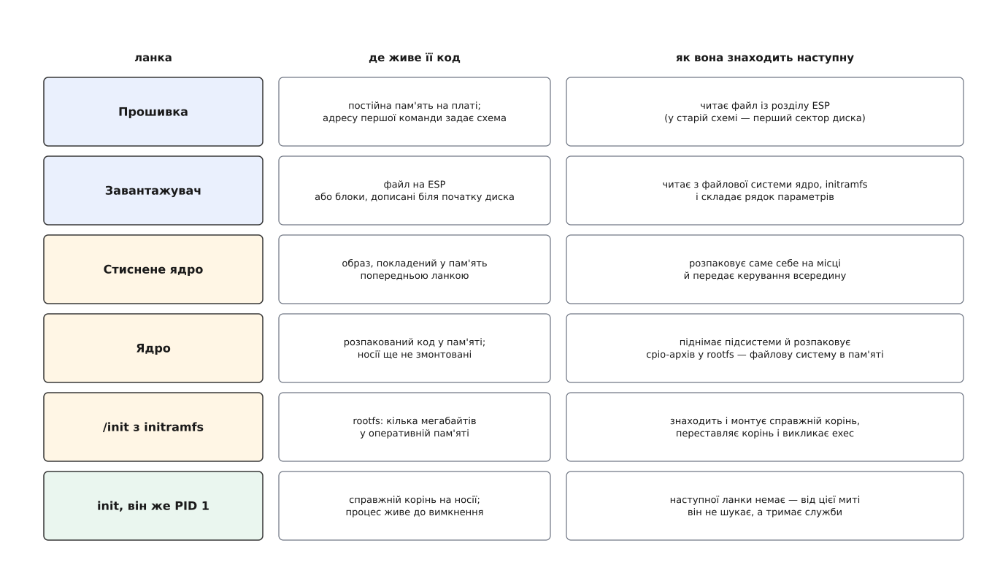
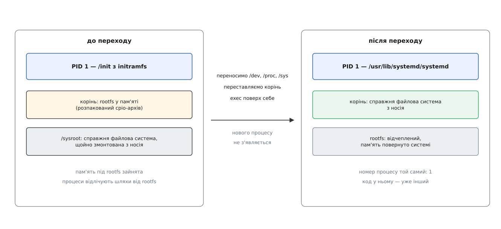
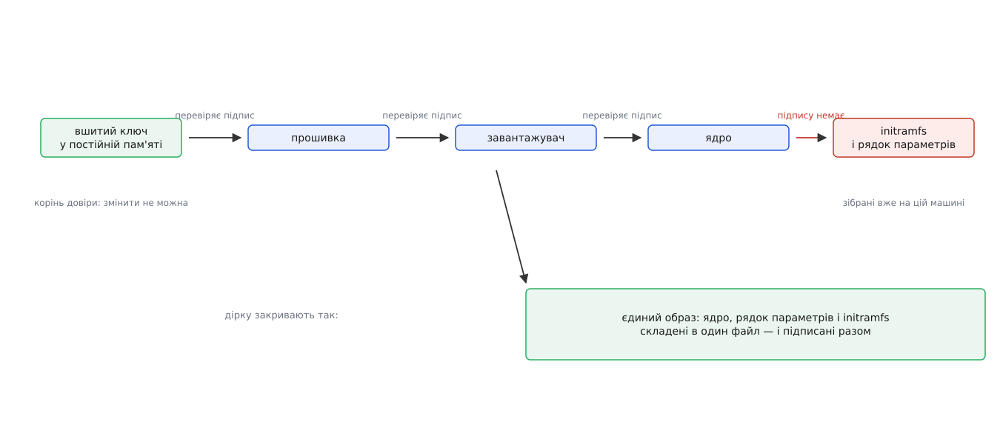

# Ланцюг завантаження: від прошивки до init

<preknowlist>
- [Ядро й простір користувача](root:sys-unix/kernel-and-userspace) — ядро і звичайні програми виконуються в різних режимах процесора, і межу між ними перетинають лише в чітко визначених місцях.
- [Процес: що це насправді](root:sys-unix/process-model) — процес є набором ресурсів ядра (адресний простір, таблиця дескрипторів, обліковий запис) з номером-ідентифікатором.
- [exec: заміна образу](root:sys-unix/exec-semantics) — виклик підміняє код і дані всередині вже наявного процесу, не створюючи нового: номер процесу лишається той самий.
- [PID і дерево процесів](root:sys-unix/pid-and-hierarchy) — процеси шикуються в дерево, а процес із номером 1 займає в ньому особливе становище.
- [Монтування й дерево монтувань](root:sys-unix/mount-model) — «корінь» є не каталогом, а вузлом окремого дерева монтувань, і цей вузол можна переставити.
- [Псевдо-ФС: procfs, sysfs, tmpfs, devtmpfs](root:sys-unix/pseudo-filesystems) — файлова система не зобов'язана лежати на носії: буває така, що цілком живе в пам'яті.
- [Модулі ядра](root:sys-unix/kernel-modules) — частина драйверів не вбудована в образ ядра, а лежить окремими файлами й довантажується вже під час роботи.
</preknowlist>

Натиснули кнопку живлення. За кілька десятків секунд на екрані з'являється графічне оточення або консольне запрошення до входу. Між цими двома подіями машина встигає кілька разів повністю змінити середовище власного виконання: код, який зараз керує процесором, живе спершу в мікросхемі постійної пам'яті на материнській платі, потім в оперативній пам'яті, потім на блоковому накопичувачі — і кожен наступний виконавець нічого не знав би про попереднього, якби той його не підготував і не передав йому стан апаратури.

Причина, чому це не один крок, лежить у фізичній природі процесора. Центральний процесор уміє лише одне: прочитати машинну інструкцію за адресою з регістру вказівника команд і виконати її. У мить, коли подали живлення (сигнал Power Good від блоку живлення скидає лінію RESET), в оперативній пам'яті нічого немає — динамічна пам'ять DRAM енергозалежна і втрачає вміст без струму. Більше того: інтегрований контролер пам'яті ще не налаштований під частоти, таймінги та топологію встановлених модулів, тому звертатися до шини оперативної пам'яті фізично неможливо.

Перша команда мусить прийти з постійного запам'ятовувального пристрою (ROM / SPI Flash), який не втрачає інформацію і схемотехнічно відображений на адресний простір процесора. На архітектурі x86 процесор після апаратного скидання опиняється в 16-бітному реальному режимі (Real Mode), а його регістр команд вказує на так званий вектор скидання (Reset Vector) за фізичною адресою `0xFFFFFFF0` — за 16 байтів до верхньої межі 4-гігабайтного 32-бітного адресного простору. За цією адресою лежить безумовний перехід на початковий код прошивки.

Код усередині цієї мікросхеми — **прошивка** (англ. *firmware*). Її постачає виробник плати, і вона єдина для конкретного заліза. Операційну систему на цю машину поставлять пізніше — будь-яку з десятків можливих дистрибутивів або версій ядер. Отже, прошивка мусить передати керування коду, якого в момент її проектування не існувало й існувати не могло.

Оце і є пружина всього ланцюга. Кожна його ланка — **домовленість між двома програмами, які нічого не знають одна про одну**: попередня ланка обіцяє знайти наступну в узгодженому місці, підготувати для неї середовище й передати структури даних зі станом платформи; наступна ланка обіцяє прийняти керування в цьому форматі, підняти наступний шар абстракцій і передати естафету далі.



*Кожен рядок дістає більше можливостей за попередній — і саме тому попередній не міг зробити його роботу сам. Останній рядок вибивається з ряду: він нікого не шукає.*

## Фаза 1. Прошивка й апаратна ініціалізація: від reset-вектора до образу в пам'яті

Перш ніж завантажувати операційну систему, прошивка мусить перетворити набір мікросхем на працездатний комп'ютер. Цей етап називають самотестуванням під час увімкнення (англ. *Power-On Self-Test*, POST).

Найперша проблема прошивки — відсутність оперативної пам'яті для організації стека викликів функцій мови C. Щоб обійтися без DRAM, ранній код прошивки налаштовує кеш-пам'ять процесора L2/L3 у спеціальний режим: кеш-лінії блокуються від скидання в шину пам'яті, перетворюючись на швидку тимчасову SRAM. Цю техніку називають *Cache-as-RAM* (CAR). Усередині кешу розгортається стек, і прошивка переходить від асемблерних інструкцій до виконання скомпільованого C-коду.

Маючи стек у кеші, прошивка опитує через шину SMBus мікросхеми SPD (англ. *Serial Presence Detect*) на планках DRAM, вичитує їхні профілі затримок (JEDEC/XMP), конфігурує фазове автопідстроювання частоти (PLL) контролера пам'яті, проводить калібрування сигнальних ліній та ініціалізує повноцінну оперативну пам'ять. Після цього кеш повертають у штатний режим, а стек переносять у DRAM. Далі прошивка сканує шину PCIe, виділяє діапазони адрес введення-виведення (MMIO/IO Ports) для контролерів дисків і графіки, будує таблиці конфігурації платформи [ACPI](root:sys-unix/uefi-firmware) (англ. *Advanced Configuration and Power Interface*) та переходить до пошуку завантажувача.

Історично спосіб пошуку та запуску наступної ланки реалізовано двома несумісними парадигмами: застарілою BIOS та сучасною UEFI.

### Legacy BIOS: обмеження першого сектора MBR

Архітектура BIOS (англ. *Basic Input/Output System*) спирається на секторну модель адресації накопичувачів. Прошивка BIOS нічого не знає про файли, каталоги чи файлові системи. Вона звертається до накопичувача через апаратні переривання дискового сервісу `INT 13h`, вичитує в оперативну пам'ять за фіксованою адресою `0x7C00` рівно один **нульовий сектор** диска — головний завантажувальний запис (англ. *Master Boot Record*, MBR) розміром 512 байтів — і перевіряє сигнатуру завантаження в останніх двох байтах: `0x55 0xAA`. Якщо сигнатура збігається, процесор виконує безумовний стрибок на адресу `0x0000:0x7C00`.

Розподіл простору всередині цих 512 байтів MBR жорстко обмежений:

```
512 байтів (загальний сектор LBA 0)
├── 446 байтів — машинний код первинного завантажувача (Stage 1)
├──  64 байти  — таблиця розділів (4 первинні записи по 16 байтів)
└──   2 байти  — сигнатура завантаження 0x55 0xAA
```

У 446 байтів машинного коду неможливо вмістити драйвер файлової системи (ext4, XFS чи btrfs) та логіку меню вибору ядер. Тому завантажувачі епохи BIOS (LILO, класичний GRUB) вимушено будували багаторівневі «милиці». Перший ступінь (Stage 1) у 446 байтах містив лише примітивний код, здатний завантажити кілька наступних секторів. У класичному GRUB проміжний ступінь (Stage 1.5) записували в нерозмічену щілину між сектором MBR (LBA 0) та початком першого розділу (традиційно LBA 2048, зсув 1 МіБ для вирівнювання сторінок SSD). Stage 1.5 містив спрощений драйвер диска і вже за назвою файлу вичитував з розділу `/boot` повноцінний образ завантажувача (Stage 2). Як ланцюг завантаження історично доростав до цієї триступеневої схеми й чому вона ламалася від найменшого руху блоків — [окрема розповідь про форму ланцюга](root:sys-unix/boot-chain/hist-chain-shape.md).

Крім крихкості секторної адресації, архітектура BIOS вперлася в технологічну стелю:
1. **Ліміт обсягу диска:** 32-бітне поле кількості секторів у таблиці MBR обмежує максимальний розмір диска значенням `2³² × 512 байтів = 2.19 ТБ` (2 ТіБ).
2. **Режим процесора:** виконання відбувається в 16-бітному реальному режимі з адресацією до 1 МіБ пам'яті через сегментні регістри, що вимагає постійних перемикань між реальним і захищеним режимами.

### UEFI: файлова система, таблиця GPT та виконувані файли PE/COFF

Сучасний стандарт [UEFI](root:sys-unix/uefi-firmware) (англ. *Unified Extensible Firmware Interface*) повністю позбувся секторного завантаження. Замість виконання неструктурованого машинного коду з першого сектора прошивка UEFI є модульною операційною мікросистемою, що працює в повноцінному 64-бітному довгому режимі (Long Mode) або 32-бітному захищеному режимі.

UEFI приносить три ключові компоненти:
1. **Таблиця розділів GPT (GUID Partition Table):** підтримує 64-бітну адресацію блоків LBA (ліміт ємності сягає `9.4 ЗБ`), тримає 128 записів розділів за замовчуванням і дублює заголовок таблиці в кінці диска (Backup GPT) для захисту від збоїв.
2. **Системний розділ EFI (ESP — EFI System Partition):** окремий розділ диска, відформатований у файлову систему FAT32 (рідше FAT16), що має спеціальний тип розділу GUID `c12a7328-f81f-11d2-ba4b-00a0c93ec93b`. Прошивка UEFI містить вбудований драйвер FAT, самостійно навігує деревом каталогів та вичитує файли.
3. **Виконуваний формат PE/COFF:** програми завантаження для UEFI є файлами формату PE32+ (Portable Executable, формат бінарників Windows) із розширенням `.efi`. Вони мають чіткі секції коду, даних, таблиці релокацій та заголовки метаданих.

Прошивка надає програмам завантаження два класи сервісів через таблицю системних вказівників `EFI_SYSTEM_TABLE`:
- **Boot Services (сервіси завантаження):** виділення сторінок пам'яті (`AllocatePages`), протоколи доступу до блокових пристроїв (`EFI_BLOCK_IO_PROTOCOL`), протоколи файлових систем (`EFI_SIMPLE_FILE_SYSTEM_PROTOCOL`), обробка подій і таймерів. Ці сервіси доступні **лише до старту ОС**. Коли ядро Linux готове перебрати монопольне керування пам'яттю на себе, воно викликає функцію `ExitBootServices()`, після чого код завантажувальних сервісів вивантажується, а їхня пам'ять звільняється для потреб ядра.
- **Runtime Services (сервіси часу виконання):** енергонезалежні змінні NVRAM (`GetVariable`, `SetVariable`), годинник реального часу (RTC), апаратне скидання та вимкнення платформи (`ResetSystem`). Ці функції лишаються доступними операційній системі протягом усієї її роботи через псевдофайлову систему `/sys/firmware/efi/efivars`.

Список того, що завантажувати, прошивка UEFI зберігає у власній пам'яті NVRAM у вигляді змінних `Boot0000`, `Boot0001` тощо, а послідовність спроб задає змінна `BootOrder`. Кожен запис містить назву системи, апаратний шлях до пристрою (PCIe/SATA/NVMe шлях) та шлях до файлу на ESP (наприклад, `\EFI\ubuntu\shimx64.efi` або `\EFI\systemd\systemd-bootx64.efi`). Якщо змінні NVRAM порожні, прошивка завантажує стандартний резервний файл за шляхом `\EFI\BOOT\BOOTX64.EFI`.

### Ланцюг перевірки підписів Secure Boot

Оскільки завантажувач у UEFI став структурованим файлом PE/COFF, з'явилася можливість криптографічної перевірки його автентичності та цілісності до передачі керування. Цей механізм називають [Secure Boot](root:sys-unix/secure-boot).

Прошивка зберігає у захищеній пам'яті NVRAM ієрархію відкритих ключів та сертифікатів:
- **PK (Platform Key — ключ платформи):** встановлює виробник плати або користувач; контролює доступ до KEK.
- **KEK (Key Exchange Key — ключ обміну ключами):** дозволяє оновлювати бази дозволених і заборонених підписів.
- **db (Signature Database — база дозволених підписів):** містить сертифікати та SHA-256 геші довірених бінарників.
- **dbx (Forbidden Signatures Database — база відкликаних підписів):** чорний список скомпрометованих завантажувачів та ядер.

На переважній більшості комп'ютерів у базі `db` прошитий сертифікат Microsoft Corporation UEFI CA. Щоб дистрибутиви Linux завантажувалися на будь-якому комп'ютері без ручного додавання ключів дистрибутива в BIOS користувачем, спільнота розробила ланцюг довіри на базі невеликого завантажувача-посередника `shim`:

```
[UEFI Firmware] (перевіряє підпис Microsoft у db)
       │
       ▼
 [shimx64.efi]  (підписаний Microsoft UEFI CA; несе в собі сертифікат дистрибутива та базу MOK)
       │
       ▼
 [grubx64.efi]  (підписаний ключем дистрибутива, наприклад Canonical або Red Hat)
       │
       ▼
   [vmlinuz]    (ядро Linux, підписане тим самим ключем дистрибутива)
```

Завантажувач `shim` реалізує внутрішню базу ключів користувача — **MOK** (англ. *Machine Owner Key*). Якщо користувач компілює власний модуль ядра (наприклад, пропрієтарний драйвер NVIDIA чи модуль віртуалізації VirtualBox), він підписує його локальним сертифікатом MOK, який реєструється через утиліту `mokutil` і підтверджується фізичною присутністю користувача під час перезавантаження.

Коли ядро Linux запускається під контролем Secure Boot, воно активує підсистему захисту **Kernel Lockdown** (модуль LSM `lockdown`). Lockdown забороняє будь-які дії простору користувача (навіть для користувача `root`), які дозволили б модифікувати код працюючого ядра в пам'яті: блокується прямий доступ до пам'яті через `/dev/mem` та `/dev/kmem`, запис у порти вводу-виводу через `ioperm`/`iopl`, завантаження непідписаних модулів ядра (`init_module`), модифікація таблиць ACPI через `acpi_table` та завантаження непроперевірених образів через механізм швидкого перезавантаження [kexec](root:sys-unix/kexec-and-kdump).

### Апаратні особливості завантаження на ARM64 та RISC-V

Архітектура завантаження на процесорах ARM64 та RISC-V принципово відрізняється від світу ПК на базі x86. На платформі x86 апаратура має стандартизовану топологію: шина PCIe підтримує динамічне самовиявлення пристроїв через механізм Vendor ID та Device ID, а прошивка UEFI передає ядру готові статичні таблиці конфігурації ACPI.

У мобільних та вбудованих однокристальних системах (англ. *System-on-Chip*, SoC) більшість периферійних контролерів (порти UART, шини I2C/SPI, таймери, контролери переривань GIC або PLIC, генератори частот PLL) інтегровані безпосередньо в кристал на внутрішніх несамовиявних шинах (AMBA AXI, AHB, APB або TileLink). Процесор не має апаратного протоколу, щоб запитати в шини, який саме пристрій підключено за фізичною адресою `0x09000000`.

#### Опис апаратури: Device Tree (FDT / DTB) проти ACPI

Щоб ядро Linux знало топологію конкретної плати, використовують механізм **дерева пристроїв** (англ. *Device Tree*):

1. **Текстовий опис (`.dts`):** розробник описує вузли плати у файлах Device Tree Source. Кожен вузол містить базові адреси регістрів пам'яті (`reg = <0x09000000 0x1000>`), номери ліній переривань (`interrupts = <0 1 4>`), тактові лінії (`clocks = <&uartclk>`), регулятори напруги та рядок сумісності `compatible = "arm,pl011", "arm,primecell"`.
2. **Компіляція в бінарний блоб (`.dtb`):** компілятор `dtc` (Device Tree Compiler) перетворює текстовий `.dts` на компактний двійковий формат — сплощене дерево пристроїв (англ. *Flattened Device Tree*, FDT) з магічним числом `0xd00dfeed`.
3. **Передача ядру через регістри CPU:** завантажувач зчитує файл `.dtb` з носія в оперативну пам'ять і записує його 64-бітну фізичну адресу в апаратний регістр процесора: **`x0`** на архітектурі ARM64, **`a1`** на RISC-V (або **`r2`** на ARM32).
4. **Розбір у ядрі:** на ранньому етапі ініціалізації функція `setup_arch()` викликає `early_init_dt_scan()` для налаштування меж пам'яті, а функція `unflatten_device_tree()` розгортає двійковий блоб у пам'яті ядра в дерево зв'язних структур `struct device_node`. Підсистема ядра `drivers/of` зіставляє рядок `compatible` із зареєстрованими драйверами платформи (`struct platform_driver`) та автоматично створює пристрої `struct platform_device`.

У корпоративних серверах на базі ARM64 (стандарти ARM SBSA — Server Base System Architecture та SBBR — Server Base Boot Requirements) замість Device Tree застосовують повноцінну прошивку UEFI (EDK2) і таблиці ACPI (DSDT, MADT), що дозволяє завантажувати один універсальний дистрибутивний образ ядра Linux на серверах будь-яких виробників без модифікації DTB.

#### Багаторівневий запуск ARM64: TF-A та U-Boot

Архітектура ARMv8-A ділить виконання на чотири рівні винятків (Exception Levels): **EL0** (простір користувача), **EL1** (ядро ОС), **EL2** (гіпервізор віртуалізації) та **EL3** (найвищий рівень монітора безпеки).

Стандартний ланцюг завантаження ARM64 спирається на еталонну прошивку **TF-A** (англ. *Trusted Firmware-A*):

```
[Апаратний Boot ROM] (EL3, масочне ПЗП SoC)
        │  BL1
        ▼
   [SRAM: BL2]       (Secure-EL1, тренування DDR/DRAM)
        │
        ├─────────────────────────────┐
        ▼                             ▼
  [DRAM: BL31]                 [DRAM: BL33]
(EL3 Runtime / PSCI)      (U-Boot у Non-Secure EL2)
        │                             │
        │ SMC-виклики                 ▼
        └──────────────────────► [Linux Kernel] (EL1)
```

1. **BL1 (AP Trusted ROM):** перша інструкція виконується з вшитого на фабриці апаратного ПЗП кристала на рівні EL3. Вона налаштовує базові тактові генератори, зчитує перший блок з носія (eMMC, SD або SPI Flash), перевіряє підпис відкритого ключа виробника та завантажує образ **BL2** у внутрішню захищену пам'ять SRAM кристала (On-Chip SRAM).
2. **BL2 (Trusted Boot Firmware):** виконується в SRAM у захищеному режимі Secure EL1. Код BL2 конфігурує та калібрує контролер зовнішньої пам'яті DRAM, після чого завантажує в розгорнуту оперативну пам'ять компоненти BL31, BL32 (опційне довірене середовище OP-TEE) та BL33.
3. **BL31 (EL3 Runtime Firmware / TF-A):** постійний резидентний монітор на рівні EL3. Він лишається в пам'яті після старту ОС і реалізує стандарт **PSCI** (англ. *Power State Coordination Interface*). Коли ядру Linux (EL1) потрібно увімкнути вторинне ядро процесора (SMP Bringup), перевести ядро в режим низького енергоспоживання чи вимкнути живлення всієї плати, воно виконує інструкцію безпечного виклику `smc` (Secure Monitor Call) або `hvc`, передаючи запит монітору BL31.
4. **BL33 (Non-Trusted Firmware):** завантажувач загального призначення, що працює у незахищеному режимі Non-Secure EL2 (підтримуючи запуск гіпервізора KVM) або EL1. Основним завантажувачем у цій ролі виступає **U-Boot** (англ. *Universal Boot Loader*).

U-Boot надає інтерактивну консоль через UART, підтримує мережевий запуск (TFTP/DHCP), драйвери файлових систем (ext4, FAT) та завантажує ядро (`Image`), образ `initramfs` і скомпільований `.dtb` в пам'ять за допомогою команди `booti` або `bootm`.

#### Багаторівневий запуск RISC-V: OpenSBI та U-Boot

Архітектура RISC-V використовує три апаратні рівні привілеїв: **M-mode** (Machine Mode, найвищий рівень доступу до апаратури), **S-mode** (Supervisor Mode, рівень ядра ОС) та **U-mode** (User Mode, рівень процесів користувача).

1. **ZSBL (Zero Stage Boot Loader) / Boot ROM:** апаратне ПЗП SoC скидає апаратні потоки виконання (*harts* — hardware threads), ініціалізує первинне живлення та зчитує прошивку Machine Mode.
2. **OpenSBI (RISC-V Supervisor Binary Interface):** еталонна прошивка відкритої архітектури, що виконується в M-mode (аналог BL31 в ARM). Ядро Linux працює в S-mode і не має прямого доступу до машинних регістрів таймера (`mtimecmp`) чи міжпроцесорних переривань (`msip`). Ядро надсилає запити до OpenSBI через інструкцію `ecall` (Environment Call), викликаючи стандартизовані функції SBI:
   - `sbi_set_timer()` — програмування апаратного таймера системи;
   - `sbi_send_ipi()` — відправка міжпроцесорних переривань (IPI) на інші харти;
   - `sbi_remote_fence_i()` — узгодження кешу команд між різними ядрами CPU;
   - розширення **HSM** (англ. *Hart State Management*) — запуск (`sbi_hart_start`), зупинка та опитування стану апаратних потоків ядра.
3. **U-Boot / EDK2 (S-mode):** завантажувач запускається в Supervisor-режимі, налаштовує параметри середовища, зчитує ядро Linux і файл DTB, після чого записує номер початкового харта в регістр `a0`, фізичну адресу DTB в регістр `a1` і стрибає на точку входу ядра.

> 🔧 **Навіщо це.** Коли машина не завантажується, перше корисне питання — не «що зламалося», а «хто зараз зі мною говорить». Екран налаштувань прошивки означає, що до накопичувача або записів NVRAM ще не дійшли. Запрошення завантажувача (`grub>`) — що прошивка прочитала файл завантажувача, але той не може знайти свій конфіг чи ядро. Паніка ядра («Kernel panic — not syncing: VFS: Unable to mount root fs») — що ядро успішно розпакувалося й ініціалізувало шини, але не змогло знайти чи розшифрувати кореневий том. Кожен екран вказує на конкретне ребро ланцюга, і половина діагностики — це впізнати, на якому ти ребрі. Пройти всі ребра на власній машині — від записів завантаження в пам'яті прошивки до розкладки часу старту служб — допоможе [покроковий розбір](root:sys-unix/boot-chain/proj-walk-the-chain.md).

## Фаза 2. Завантажувач: протокол завантаження, cmdline та розкладка пам'яті

Прошивка знайшла, перевірила підпис та виконала завантажувач. У сучасному Linux типовими завантажувачами є універсальний **GRUB 2** (англ. *Grand Unified Bootloader*) або мінімалістичний **systemd-boot**.

Головні задачі завантажувача:
1. Зчитати файл конфігурації (`/boot/grub/grub.cfg` у GRUB або `/loader/entries/*.conf` у systemd-boot).
2. Надати користувачеві графічне або текстове меню вибору версії ядра, відновлювального режиму (Recovery Mode) чи іншої ОС.
3. Завантажити з диска в оперативну пам'ять виконуваний образ ядра (`vmlinuz`) та початковий образ пам'яті (`initramfs`).
4. Скласти текстовий рядок параметрів командного рядка ядра (`cmdline`).
5. Підготувати системні структури згідно з протоколом завантаження Linux та передати керування на точку входу ядра.

### Протокол завантаження Linux та структура `setup_header`

Передача керування від завантажувача до ядра x86 регламентується документом *The Linux/x86 Boot Protocol* (актуальні версії 2.15+). Образ ядра `vmlinuz` не є просто сирим виконуваним файлом: його перші сектори містять фіксовану структуру даних `struct setup_header` (визначену в ядрі у файлі `arch/x86/include/uapi/asm/bootparam.h`), яку завантажувач зобов'язаний вичитати, перевірити та частково заповнити.

Структура пам'яті ядра починається з так званої «нульової сторінки» (структура `struct boot_params`), усередині якої за зсувом `0x01F1` розташований заголовок:

:::tabs
```c
// arch/x86/include/uapi/asm/bootparam.h (C)
struct setup_header {
    __u8    setup_sects;        // Кількість секторів коду налаштування
    __u16   root_flags;         // Прапорці монтування кореня (наприклад, 1 = read-only)
    __u32   syssize;            // Розмір захищеного коду ядра в 16-байтних параграфах
    __u16   ram_size;           // Застаріле поле розміру пам'яті
    __u16   vid_mode;           // Відеорежим консолі
    __u16   root_dev;           // Застарілий номер кореневого пристрою
    __u16   boot_flag;          // Сигнатура 0xAA55
    __u16   jump;               // Інструкція короткого переходу (jmp)
    __u32   header;             // Магічне число "HdrS" (0x53726448) — підтвердження протоколу
    __u16   version;            // Версія протоколу завантаження (наприклад, 0x020f для v2.15)
    __u32   realmode_swtch;     // Вказівник на функцію перемикання режимів
    __u16   start_sys_seg;      // Сегмент старту системи
    __u16   kernel_version;     // Вказівник на рядок версії ядра у пам'яті
    __u8    type_of_loader;     // Ідентифікатор завантажувача (наприклад, 0x72 = GRUB, 0x80 = EFI)
    __u8    loadflags;          // Прапорці: біт 0 (LOADED_HIGH) = ядро завантажено вище 1 МіБ
    __u16   setup_move_size;    // Розмір переміщення коду налаштування
    __u32   code32_start;       // Фізична адреса точки входу в захищений режим (0x100000)
    __u32   ramdisk_image;      // Фізична 32-бітна адреса initramfs у пам'яті
    __u32   ramdisk_size;       // Розмір initramfs у байтах
    __u32   bootsect_kludge;    // Застаріле
    __u16   heap_end_ptr;       // Зсув кінця купи завантажувача
    __u8    ext_loader_ver;     // Розширений номер версії завантажувача
    __u8    ext_loader_type;    // Розширений тип завантажувача
    __u32   cmd_line_ptr;       // 32-бітна фізична адреса рядка параметрів ядра (cmdline)
    __u32   initrd_addr_max;    // Максимально допустима адреса для розміщення initramfs
} __attribute__((packed));
```
```cpp
// asm/bootparam.h у C++ контексті з явними типами фіксованої ширини
#include <cstdint>

struct [[gnu::packed]] SetupHeader {
    std::uint8_t   setup_sects;        // Кількість секторів коду налаштування
    std::uint16_t  root_flags;         // Прапорці монтування кореня (наприклад, 1 = read-only)
    std::uint32_t  syssize;            // Розмір захищеного коду ядра в 16-байтних параграфах
    std::uint16_t  ram_size;           // Застаріле поле розміру пам'яті
    std::uint16_t  vid_mode;           // Відеорежим консолі
    std::uint16_t  root_dev;           // Застарілий номер кореневого пристрою
    std::uint16_t  boot_flag;          // Сигнатура 0xAA55
    std::uint16_t  jump;               // Інструкція короткого переходу (jmp)
    std::uint32_t  header;             // Магічне число "HdrS" (0x53726448) — підтвердження протоколу
    std::uint16_t  version;            // Версія протоколу завантаження (наприклад, 0x020f для v2.15)
    std::uint32_t  realmode_swtch;     // Вказівник на функцію перемикання режимів
    std::uint16_t  start_sys_seg;      // Сегмент старту системи
    std::uint16_t  kernel_version;     // Вказівник на рядок версії ядра у пам'яті
    std::uint8_t   type_of_loader;     // Ідентифікатор завантажувача (наприклад, 0x72 = GRUB, 0x80 = EFI)
    std::uint8_t   loadflags;          // Прапорці: біт 0 (LOADED_HIGH) = ядро завантажено вище 1 МіБ
    std::uint16_t  setup_move_size;    // Розмір переміщення коду налаштування
    std::uint32_t  code32_start;       // Фізична адреса точки входу в захищений режим (0x100000)
    std::uint32_t  ramdisk_image;      // Фізична 32-бітна адреса initramfs у пам'яті
    std::uint32_t  ramdisk_size;       // Розмір initramfs у байтах
    std::uint32_t  bootsect_kludge;    // Застаріле
    std::uint16_t  heap_end_ptr;       // Зсув кінця купи завантажувача
    std::uint8_t   ext_loader_ver;     // Розширений номер версії завантажувача
    std::uint8_t   ext_loader_type;    // Розширений тип завантажувача
    std::uint32_t  cmd_line_ptr;       // 32-бітна фізична адреса рядка параметрів ядра (cmdline)
    std::uint32_t  initrd_addr_max;    // Максимально допустима адреса для розміщення initramfs
};
```
:::

Завантажувач виділяє сторінки пам'яті (через сервіс UEFI `AllocatePages` або карту BIOS), копіює туди файл `initramfs`, записує отриману фізичну адресу в поле `ramdisk_image`, а розмір файлу — в `ramdisk_size`. Текстовий рядок параметрів (наприклад, `BOOT_IMAGE=/vmlinuz root=UUID=6f1e2b7a-9c40-4f11-a2d3-0b7c81e5a9f2 ro quiet splash`) розміщується в окремому буфері пам'яті, а вказівник на нього записується в `cmd_line_ptr`.

Крім того, завантажувач передає ядру карту фізичної пам'яті — масив `e820_table` у структурі `boot_params`. У BIOS цей масив отримують викликом переривання `INT 15h, AX=E820h`, а в UEFI завантажувач викликає сервіс `GetMemoryMap()` і транслює дескриптори типів пам'яті UEFI (`EfiBootServicesCode`, `EfiConventionalMemory`, `EfiACPIReclaimMemory`) у стандартні записи E820:
- `E820_RAM` (1) — доступна звичайна пам'ять;
- `E820_RESERVED` (2) — зарезервована апаратурою / ROM пам'ять;
- `E820_ACPI` (3) — таблиці ACPI, які можна використати повторно після зчитування;
- `E820_NVS` (4) — енергонезалежна пам'ять збереження стану прошивки.

### EFI Stub: завантаження ядра без завантажувача

Ланка окремого завантажувача не є абсолютно обов'язковою. Починаючи з ядра 3.3 (2012 рік), у Linux вбудовано функціональність **EFI Boot Stub** (`CONFIG_EFI_STUB=y`).

Заголовок образу `vmlinuz` сформовано так, що для прошивки UEFI файл ядра одночасно є валідним бінарником PE32+. Точка входу PE веде на функцію `efi_pe_entry()`, скомпільовану всередині ядра. Прошивка завантажує ядро напряму, як звичайну програму UEFI. Вбудована заглушка EFI Stub самостійно викликає сервіси прошивки `AllocatePages`, зчитує `initramfs` з ESP, вичитує рядок параметрів зі змінних прошивки, формує структуру `boot_params`, викликає `ExitBootServices()` і стрибає на 64-бітну точку входу розпаковувача ядра.

### Діагностика збоїв завантажувача та алгоритми відновлення

Поломки на фазі завантажувача призводять до трьох типових ситуацій:
1. **Зникнення записів NVRAM:** скидання налаштувань BIOS/CMOS або оновлення прошивки материнської плати очищує змінні `BootOrder` та `BootXXXX`. Прошивка не бачить завантажувача дистрибутива і переходить до спроби завантаження через мережу (PXE) або виводить повідомлення `No bootable device found`.
2. **Пошкодження бінарників на розділі ESP:** випадкове видалення чи затирання файлів `\EFI\ubuntu\shimx64.efi` чи `grubx64.efi` (наприклад, під час некоректного встановлення другої ОС поруч).
3. **Падіння в `grub rescue>` або меню GRUB:** зміна UUID диска після клонування, пошкодження файлу конфігурації `/boot/grub/grub.cfg` або розділу `/boot`. Завантажувач знаходить перший сектор чи базовий PE-образ, але не може вичитати модулі файлової системи та конфіг (`error: no such device: <UUID>`).

#### Покрокова системна реанімація через LiveUSB

Щоб відновити пошкоджений завантажувач, завантажують систему з зовнішнього аварійного накопичувача (LiveUSB).

> ⚠️ **Критична вимога до режиму LiveUSB.** Накопичувач LiveUSB мусить бути запущений у **тому самому режимі**, що й цільова система (суворий UEFI 64-bit). Якщо завантажити LiveUSB у режимі Legacy/CSM, ядро не отримає від прошивки таблиці `EFI_SYSTEM_TABLE`, модуль ядра `efivarfs` не зможе завантажитися, а каталог `/sys/firmware/efi/efivars` буде відсутній. Усі спроби відновити змінні через `efibootmgr` або `grub-install` завершаться фатальною помилкою `EFI variables are not supported on this system`.

Алгоритм відновлення виконується в шість кроків:

1. **Визначення структури накопичувачів:**
   ```sh
   lsblk -o NAME,FSTYPE,SIZE,MOUNTPOINTS,UUID
   ```
   Визначають кореневий розділ (наприклад, `/dev/nvme0n1p2`), системний розділ ESP (`/dev/nvme0n1p1` із типом FAT32 / `vfat`) та окремий розділ `/boot` (`/dev/nvme0n1p3`, якщо він винесений). Якщо корінь лежить усередині LUKS або LVM:
   ```sh
   cryptsetup luksOpen /dev/nvme0n1p2 cryptroot
   vgchange -ay
   ```

2. **Монтування ієрархії каталогів у `/mnt`:**
   ```sh
   mount /dev/mapper/vg_system-root /mnt
   # Якщо /boot винесено окремо:
   mount /dev/nvme0n1p3 /mnt/boot
   # Обов'язкове монтування ESP-розділу:
   mount /dev/nvme0n1p1 /mnt/boot/efi
   ```

3. **Підключення віртуальних файлових систем ядра (bind-mount):**
   ```sh
   for d in /dev /dev/pts /proc /sys /run; do
       mount --bind "$d" "/mnt$d"
   done
   mount --bind /sys/firmware/efi/efivars /mnt/sys/firmware/efi/efivars
   ```
   Монтування `/sys/firmware/efi/efivars` надає програмам усередині ізольованого оточення прямий доступ до Runtime Services прошивки UEFI через драйвер `efivarfs`.

4. **Вхід у системне оточення цільового диска (chroot):**
   ```sh
   chroot /mnt /bin/bash
   ```
   Тепер команди виконуються в контексті встановленої на диск системи, використовуючи її системні бібліотеки та утиліти.

5. **Перевстановлення завантажувача та оновлення конфігурації:**
   ```sh
   # Перевстановлення двійкових файлів shim та grub на ESP
   grub-install --target=x86_64-efi --efi-directory=/boot/efi --bootloader-id=ubuntu --recheck

   # Перегенерація меню вибору ядер grub.cfg
   update-grub

   # Перезбирання образів initramfs для всіх встановлених ядер
   update-initramfs -u -k all
   ```

6. **Керування записами NVRAM через `efibootmgr`:**
   Якщо системний запис у пам'яті прошивки був видалений, його можна створити або переналаштувати вручну:
   ```sh
   # Перегляд усіх зареєстрованих записів у NVRAM
   efibootmgr -v

   # Створення нового запису завантаження
   efibootmgr -c -d /dev/nvme0n1 -p 1 -L "ubuntu" -l '\EFI\ubuntu\shimx64.efi'

   # Налаштування черги завантаження (BootOrder)
   efibootmgr -o 0001,0000,0002
   ```
   Параметри виклику: `-c` (створити запис), `-d` (блоковий пристрій диска), `-p` (номер розділу ESP, починаючи з 1), `-L` (назва запису в меню BIOS), `-l` (шлях до файлу завантажувача з прямими зворотними скісними рисками `\`).

#### Резервний шлях завантаження UEFI (Fallback path)

Частина дешевих або застарілих материнських плат містить помилки в коді прошивки UEFI: під час повного знеструмлення або перезавантаження прошивка ігнорує кастомні змінні `BootXXXX` і шукає завантажувач виключно за стандартизованим резервним шляхом.

Згідно зі специфікацією UEFI, якщо змінні NVRAM не вказують на конкретний файл, прошивка шукає на ESP-розділі файл **`\EFI\BOOT\BOOTX64.EFI`**.

Щоб захистити систему від подібних збоїв материнської плати, копію завантажувача дублюють у резервний каталог:
```sh
mkdir -p /boot/efi/EFI/BOOT
cp /boot/efi/EFI/ubuntu/shimx64.efi /boot/efi/EFI/BOOT/BOOTX64.EFI
cp /boot/efi/EFI/ubuntu/grubx64.efi /boot/efi/EFI/BOOT/grubx64.efi
```
Тепер материнська плата успішно завантажить Linux навіть у разі повного очищення енергонезалежної пам'яті NVRAM.

## Фаза 3. Ядро: декомпресія, перехід у 64-бітний режим і народження rootfs

Файл `vmlinuz` на диску — це не чистий образ ядра, а саморозпаковуваний двійковий архів (англ. *piggyback binary*). Він складається з двох частин: крихітного завантажувального розпаковувача та стисненого алгоритмом zstd, xz, lz4 або gzip ядра `vmlinux.bin`.

```
Образ vmlinuz
├── Заголовок setup_header (boot sector + setup code)
├── 32/64-бітний код розпаковувача (arch/x86/boot/compressed/head_64.S)
├── Функція декомпресії extract_kernel()
└── Стиснений корисний вантаж (vmlinux.bin.zst / vmlinux.bin.xz)
```

### Рання декомпресія та KASLR

Керування від завантажувача потрапляє на точку входу розпаковувача `startup_64` у файлі `arch/x86/boot/compressed/head_64.S`. У цей момент повноцінної віртуальної пам'яті ядра ще немає.

Розпаковувач виконує такі низькорівневі кроки:
1. Будує тимчасові таблиці сторінок ранньої ідентичної трансляції (Identity Paging, де віртуальна адреса дорівнює фізичній: `VA == PA`).
2. Опитує апаратний генератор випадкових чисел процесора через інструкцію `RDRAND` (або таймер `RDTSC`) для реалізації **KASLR** (англ. *Kernel Address Space Layout Randomization*). KASLR обирає випадкове зміщення в межах доступної фізичної пам'яті, куди буде розпаковано ядро, щоб ускладнити експлуатацію вразливостей пам'яті.
3. Викликає функцію мови C `extract_kernel()`: вона читає стиснений потік даних, перевіряє контрольну суму CRC32/SHA256, розпаковує повноцінне нестиснене ядро `vmlinux` у цільовий діапазон фізичної пам'яті та застосовує релокації ELF-символів під обране KASLR-зміщення.
4. Здійснює безумовний стрибок на справжню точку входу основного ядра `startup_64` в архітектурному файлі `arch/x86/kernel/head_64.S`.

### Ініціалізація підсистем: `start_kernel()`

Основне ядро починає роботу у функції `start_kernel()` (`init/main.c`) — це головна функція ініціалізації Linux.

```
start_kernel()
 ├── setup_arch()            ── розбір boot_params, ACPI, побудова фінальних таблиць сторінок
 ├── trap_init() / idt_setup ── таблиця векторів переривань (IDT)
 ├── mm_core_init()          ── виділювачі пам'яті: Buddy Allocator та SLUB
 ├── sched_init()            ── планувальник задач (CFS / EEVDF)
 ├── timekeeping_init()      ── джерела точного часу (TSC, HPET)
 ├── vfs_caches_init()       ── VFS, dentry/inode кеші
 ├── rest_init()
      ├── kernel_thread(kernel_init) ── потік майбутнього PID 1
      └── cpu_startup_entry()        ── потік бездіяльності idle (PID 0)
```

Послідовність розгортання ключових підсистем ядра:
1. **Налаштування віртуальної пам'яті:** `setup_arch()` замінює тимчасові таблиці сторінок повноцінною 4-рівневою або 5-рівневою структурою сторінкування (`init_top_pgt`). Відображається область прямого відображення всієї фізичної пам'яті ядра (`PAGE_OFFSET`), область динамічного виділення неперервних віртуальних адрес `vmalloc`, фіксовані таблиці `fixmap` та простір коду ядра.
2. **Перехід від раннього розподільника до Buddy/SLUB:** ранній алокатор `memblock` (який просто відрізав шматки від фізичних областей з E820) передає інформацію про вільні сторінки в основний розподільник сторінок системи — **Buddy Allocator** (алгоритм двійкових близнюків). Поверх нього ініціалізується кешуючий розподільник об'єктів **SLUB** (`kmem_cache_init()`), що виділяє дрібні структури ядра (`struct task_struct`, `struct inode` тощо).
3. **Опитування шин та дерево пристроїв:** ядро парсить статичні таблиці ACPI (DSDT, SSDT, MADT для визначення кількості ядер CPU та ліній переривань IO-APIC). Ініціалізується кореневий комплекс PCIe (`pci_scan_root_bus()`), скануються шинні мости, конфігуруються вектори переривань MSI/MSI-X.
4. **Виконання списку initcalls:** підсистеми ядра та вбудовані статично драйвери реєструються через таблицю функцій [initcalls](root:sys-unix/kernel-initcalls). Ядро викликає їх строго впорядковано за 8 рівнями пріоритету: від `pure_initcall` (базові структури) через `core_initcall`, `arch_initcall`, `subsys_initcall`, `fs_initcall` до `device_initcall` (драйвери контролерів) та `late_initcall`.
5. **Створення потоку `kernel_init`:** функція `rest_init()` створює перший потік ядра `kernel_thread(kernel_init, ...)` — майбутній процес з **PID 1**, а сам початковий потік перетворюється на нескінченний цикл очікування бездіяльності `cpu_idle` (потік з **PID 0**, або `swapper`).

### Профілювання та трасування ініціалізації ядра

Під час виконання функції `start_kernel()` та послідовного виклику сотень функцій `initcall` система може зазнавати несподіваних затримок: від секунд до десятків секунд. Причинами найчастіше є апаратні очікування в драйверах: опитування відсутніх або повільних шин I2C/SMBus, калібрування ліній PCIe, очікування розкручування шпинделів дисків у SAS HBA контролерах чи довге самотестування модуля TPM.

Щоб виявити, який саме драйвер блокує ядро, використовують низькорівневі інструменти трасування та діагностики, вбудовані в ядро Linux.

#### Трасування initcalls: параметр `initcall_debug`

Параметр командного рядка ядра `initcall_debug` активує вбудований хронометраж кожного кроку ініціалізації. Спільно з ним передають параметри збільшення буфера та додавання точних міток часу:
```
initcall_debug printk.time=1 log_buf_len=16M
```

Коли активний `initcall_debug`, функція ядра `do_one_initcall()` (`init/main.c`) зчитує лічильник точного часу `ktime_get()` безпосередньо перед викликом функції ініціалізації драйвера і відразу після її завершення.

У кільцевий буфер `dmesg` записуються структуровані повідомлення:
```
[    0.184120] calling  e1000e_init_module+0x0/0x1000 [e1000e] @ 1
[    0.412854] initcall e1000e_init_module+0x0/0x1000 [e1000e] returned 0 after 228734 usecs
```
Запис містить ім'я функції драйвера, адресу в пам'яті, код повернення (0 — успіх) та точний час виконання в мікросекундах (`usecs`). У наведеному прикладі ініціалізація мережевого драйвера `e1000e` зайняла `228.7 мс`.

#### Візуалізація часової шкали: `scripts/bootgraph.py`

Вихідний код ядра Linux містить утиліту для перетворення логів `dmesg` на інтерактивну SVG-діаграму — `scripts/bootgraph.py`:
```sh
# Збір виводу initcall з dmesg та генерація часової шкали
dmesg | perl -ne 'print if /initcall/' | python3 /usr/src/linux-headers-$(uname -r)/scripts/bootgraph.py > bootgraph.svg
```
Згенерований SVG-файл показує горизонтальну шкалу часу запуску, де кожен рівень initcall розбитий на паралельні та послідовні прямокутники драйверів. Функції, що викликали найбільші затримки (наприклад, тривала ініціалізація `ahci_pci_driver` чи `tpm_tis_init`), автоматично підсвічуються контрастним кольором.

#### Трасування через Ftrace та події `initcall:*`

Виведення через `printk` має помітний накладний розхід: послідовний вивід тексту в термінал чи віртуальну консоль сповільнює процес і спотворює часові вимірювання (ефект зонда).

Для високоточного профілювання без затримок вводу-виводу використовують підсистему ядра **Ftrace** та апаратні точки трасування (tracepoints). До рядка `cmdline` додають параметр:
```
trace_event=initcall:*
```
Ядро записує двійкові події `initcall_start` та `initcall_finish` напряму в неблокуючий кільцевий буфер трасування в оперативній пам'яті (`/sys/kernel/tracing/trace`). Після завантаження простору користувача утиліта `trace-cmd` дозволяє витягти повний профіль із наносекундною точністю:
```sh
trace-cmd report | grep initcall_finish
```
Це дає змогу розібрати вкладені затримки в асинхронних функціях опитування шин (`pci_device_probe`, `nvme_probe_work`), коли кілька пристроїв ініціалізуються паралельно у фонових потоках ядра `kworker`.

### Розгортання `rootfs` та розпакування `initramfs`

Потік `kernel_init` мусить запустити першу програму простору користувача. Але для цього потрібна файлова система.

Ядро створює екземпляр спеціальної файлової системи — **`rootfs`** (внутрішній варіант `ramfs`/`tmpfs`), яка існує виключно в оперативній пам'яті і монтується як початковий корінь `/`. Далі викликається функція `populate_rootfs()` (`init/initramfs.c`).

Якщо завантажувач передав адресу образу в полі `ramdisk_image`, ядро запускає функцію `unpack_to_rootfs()`:
- Образ перевіряється на наявність склеєних (конкатенованих) архівів. Першим у файлі часто лежить ранній нестиснений архів cpio, що містить бінарні оновлення мікрокоду для процесорів Intel/AMD (`early_cpio`). Ядро перехоплює мікрокод і завантажує його в регістри MSR процесора ще до запуску драйверів.
- Основна частина образу розпаковується (підтримуються потоки zstd, xz, gzip, lz4) безпосередньо у файлову систему `rootfs`. Формат архіву — `cpio newc` (магічне число `070701`), де кожен заголовок описує шлях до файлу, права доступу, UID/GID та розмір.

Після розпакування архіву `rootfs` містить мінімальне дерево каталогів (`/bin`, `/sbin`, `/lib`, `/dev`, `/proc`, `/sys`) і виконуваний файл `/init`.

Ядро відкриває системну консоль `/dev/console` як файлові дескриптори 0 (stdin), 1 (stdout), 2 (stderr) і викликає системний виклик `kernel_execve("/init", ...)`. У цей момент ядро завершує внутрішню ініціалізацію і вперше переходить у простір користувача (Ring 3 на x86) — процес `/init` стає першим процесом у системі з номером **PID 1**.

## Фаза 4. initramfs: розгортання сховища у просторі користувача

Чому ядро не може змонтувати цільовий диск напряму, а потребує фази [initramfs](root:sys-unix/initramfs)?

Причина криється в неможливості та недоцільності вбудовування всієї складності сучасних сховищ у ядро:
1. **Розмір монолітного ядра:** універсальне ядро мало б нести в собі сотні мегабайтів скомпільованих драйверів усіх відомих контролерів NVMe, SAS, SATA/AHCI, SCSI, мережевих карт, USB та Thunderbolt.
2. **Складна логіка політик і взаємодії з людиною:** справжній кореневий розділ може вимагати введення пароля розшифрування LUKS, вичитування криптографічного ключа з апаратного модуля TPM2 чи токена FIDO2, розбирання метаданих програмного RAID-масиву, активації томів LVM, підняття мережевого стека для завантаження через iSCSI/NFS або розв'язання мережевого зв'язування дисків (Clevis/Tang).
3. **Принцип Unix:** ядро надає механізми (блоковий рівень, криптографічні перетворення `dm-crypt`, трансляцію адрес `device-mapper`), але політика збирання, конфігураційні файли, сценарії розбору та діалог із користувачем виносяться в простір користувача.

### Середовище виконання initramfs та менеджер udev

Усередині `initramfs` виконується або скрипт оболонки `/init` (на базі легковагого набору утиліт BusyBox у Debian/Ubuntu), або повноцінний екземпляр systemd (у середовищах на базі Dracut у Fedora/RHEL/Arch).

Перші кроки `/init`:
```sh
#!/bin/sh
# Монтування службових псевдофайлових систем усередині rootfs
mount -t proc proc /proc
mount -t sysfs sysfs /sys
mount -t devtmpfs devtmpfs /dev
mount -t tmpfs tmpfs /run

# Запуск демона динамічного створення пристроїв
/lib/systemd/systemd-udevd --daemon
udevadm trigger --action=add
udevadm settle
```

Демон `udevd` слухає широкомовні повідомлення ядра про виявлене залізо через сокет Netlink (`NETLINK_KOBJECT_UEVENT`). Коли команда `udevadm trigger` примусово надсилає запит на опитування шин, ядро генерує uevents для кожного знайденого пристрою. Менеджер `udevd` зіставляє рядок `MODALIAS` (наприклад, `pci:v000010DEd00002204sv...`) з базою правил `/lib/modules/$(uname -r)/modules.alias`, автоматично викликає утиліту `modprobe` і довантажує в пам'ять лише потрібні модулі ядра:
- контролери накопичувачів: `nvme`, `ahci`, `mpt3sas`, `megaraid_sas`, `virtio_blk`;
- криптографічні інструкції процесора: `aesni-intel`, `crypto_simd`;
- драйвери мережевих карт: `e1000e`, `r8169`, `virtio_net`.

Коли контролер диска завантажується, він реєструє блокові пристрої. `udev` створює файли пристроїв у `/dev` (`/dev/nvme0n1`, `/dev/sda`) і створює стійкі символічні посилання в каталогах `/dev/disk/by-uuid/`, `/dev/disk/by-label/` та `/dev/disk/by-partuuid/`.

Команда `udevadm settle` блокує виконання сценарію доти, доки черга обробки подій Netlink не спорожніє — це гарантує, що диски виявлені й готові до операцій.

### Збирання багаторівневої блокової топології

Отримавши доступ до сирих розділів накопичувача, `initramfs` розбирає параметри командного рядка `root=` і крок за кроком підіймає шари віртуальних блокових пристроїв знизу вгору:

```
[Фізичні NVMe / SATA диски] (/dev/nvme0n1p2, /dev/nvme1n1p2)
              │
              ▼  (mdadm --assemble)
     [Програмний MD RAID]     (/dev/md0)
              │
              ▼  (cryptsetup luksOpen / systemd-cryptsetup)
     [Зашифрований LUKS2]     (/dev/mapper/cryptroot через dm-crypt)
              │
              ▼  (vgchange -ay)
     [Група томів LVM2]       (LVM VG "vg_system")
              │
              ▼
   [Логічний том кореня]      (/dev/mapper/vg_system-root)
              │
              ▼  (mount -t ext4 /dev/mapper/vg_system-root /sysroot)
[Справжній цільовий корінь]   (/sysroot)
```

1. **Програмний RAID (MD RAID):** утиліта `mdadm --assemble --scan` зчитує метадані суперблоків на фізичних розділах і збирає відмовостійкий масив `/dev/md0`.
2. **Багатошляховий доступ (Multipath):** демон `multipathd` об'єднує резервні оптичні лінії Fibre Channel чи SAS до одного LUN у єдиний віртуальний пристрій `/dev/mapper/mpatha`.
3. **Криптографічний шар LUKS / [dm-crypt](root:sys-unix/dm-crypt):** утиліта `cryptsetup luksOpen` вичитує заголовок LUKS2 з `/dev/md0`. Користувач вводить пароль (або модуль `systemd-cryptsetup` зв'язується з TPM2 через `libtss2` для автоматичного вилучення ключа, якщо конфігурація PCR-регістрів збігається). Майстер-ключ завантажується в [Device Mapper](root:sys-unix/device-mapper) ядра, який створює прозорий розшифрований пристрій `/dev/mapper/cryptroot`.
4. **Менеджер логічних томів [LVM2](root:sys-unix/lvm-and-snapshots):** утиліти `vgscan` та `vgchange -ay` сканують фізичні томи (PV) всередині `/dev/mapper/cryptroot`, знаходять групу томів (VG) та активують логічні томи (LV), зокрема `/dev/mapper/vg_system-root` та `/dev/mapper/vg_system-usr`.
5. **Мережевий корінь (NFS / iSCSI):** якщо система завантажується без локального диска, `initramfs` налаштовує мережевий інтерфейс через DHCP, виконує авторизацію на target-сервері за допомогою `iscsiadm` і створює блоковий пристрій iSCSI або монтує мережеву файлову систему NFS.
6. **Монтування в точку `/sysroot`:** підготовлений кінцевий блоковий пристрій монтується в заздалегідь створений каталог `/sysroot`:
   ```sh
   mount -o ro /dev/mapper/vg_system-root /sysroot
   ```
   Якщо розділ `/usr` винесено окремо, його монтують у `/sysroot/usr` ще до перемикання кореня.

## Фаза 5. Атомарний перехід switch_root: переселення на справжній корінь

Справжню файлову систему змонтовано в `/sysroot`. Але поточним кореневим вузлом системи `/` досі є тимчасова `rootfs` у пам'яті, а поточний процес PID 1 виконує скрипт `/init` з оперативної пам'яті.

Потрібно вирішити фундаментальну задачу: зробити каталог `/sysroot` новим коренем системи `/`, повністю звільнити пам'ять, яку займає образ `initramfs`, і запустити справжній системний ініціалізатор (`/sbin/init` -> `systemd`), зберігши за ним номер **PID 1**.

### Чому не підходять `chroot()` та `pivot_root()`

1. **Чому не `chroot()`:** системний виклик `chroot("/sysroot")` лише змінює суб'єктивну точку відліку шляхів для поточного процесу. Кореневе монтування системи лишається прив'язаним до `rootfs`. Усі файли розпакованого cpio-архіву лишаються заблокованими в оперативній пам'яті, їх неможливо демонтувати, і RAM залишається зайнятою назавжди.
2. **Чому не `pivot_root()`:** класичний системний виклик `pivot_root(new_root, put_old)` призначений для заміни кореневого монтування. Але в ядрі Linux `rootfs` є коренем простору імен монтувань VFS (вузол rootfs має спеціальний прапорець і не може бути переміщений або демонтований). Спроба викликати `pivot_root` на файловій системі `rootfs` завжди завершується помилкою ядра `EINVAL` (Invalid argument).

### Механізм роботи `switch_root`

Для розв'язання цієї проблеми створено спеціалізовану процедуру **`switch_root`** (утиліта з пакета `util-linux` або вбудована функція `systemd`).



*Перехід не породжує нового процесу: номер 1 лишається за тим самим процесом, у якому просто замінили код.*

Послідовність дій `switch_root` ланка за ланкою:

1. **Перевірка цілісності:** утиліта перевіряє, що `/sysroot` є точкою монтування, а всередині неї існує виконуваний файл ініціалізатора (зазвичай `/sysroot/lib/systemd/systemd` або `/sysroot/sbin/init`).
2. **Рекурсивне перенесення службових файлових систем:** псевдо-ФС `/dev`, `/proc`, `/sys` та `/run` не можна демонтувати, оскільки в них є відкриті дескриптори ядра та активні структури. `switch_root` викликає системний виклик `mount()` із прапорцем `MS_MOVE` (або `mount --move`), переносячи ці дерева монтувань зі старого кореня в новий:
   - `mount("/dev",  "/sysroot/dev",  NULL, MS_MOVE, NULL)`
   - `mount("/proc", "/sysroot/proc", NULL, MS_MOVE, NULL)`
   - `mount("/sys",  "/sysroot/sys",  NULL, MS_MOVE, NULL)`
   - `mount("/run",  "/sysroot/run",  NULL, MS_MOVE, NULL)`
   Це зберігає активні з'єднання `udev`, сокети в `/run` та дерево пристроїв без скидання стану.
3. **Очищення пам'яті rootfs (деструктивний обхід):** перебуваючи в старому корені, утиліта рекурсивно обходить усі каталоги `rootfs` (суворо оминаючи каталог `/sysroot` та точки змонтованих файлових систем) і викликає системні виклики `unlink()` для всіх файлів та `rmdir()` для всіх каталогів. Оскільки `rootfs` живе в пам'яті RAM, знищення її dentry та inode миттєво повертає всі зайняті сторінки пам'яті в Buddy Allocator ядра.
4. **Перехід у новий корінь:**
   - виконується `chdir("/sysroot")`;
   - викликається `mount(".", "/", NULL, MS_MOVE, NULL)` — це атомарно робить змонтований диск новим системним коренем;
   - викликається `chroot(".")` та `chdir("/")`, що остаточно прив'язує простір користувача до файлової системи носія.
5. **Атомарна заміна коду через `execve()`:**
   - процес `/init` не завершується і не викликає `fork()`. Він виконує системний виклик `execve("/sbin/init", argv, envp)`.
   - Ядро викидає старий сегмент коду, стек і купу скрипта `initramfs`, завантажує в пам'ять бінарник `/usr/lib/systemd/systemd` зі справжнього диска, створює новий стек і запускає виконання.

Процес зберіг свій унікальний номер **PID 1**, але тепер він виконує код фінального системного менеджера, розміщеного на постійному диску.

### Системна реалізація переходу switch_root

Нижче наведено робочий приклад коду мовами C та C++, що демонструє серцевину логіки атомарного перенесення монтувань, очищення та перемикання образу через `execv`:

:::tabs
```c
#define _GNU_SOURCE
#include <stdio.h>
#include <stdlib.h>
#include <unistd.h>
#include <fcntl.h>
#include <sys/mount.h>
#include <sys/stat.h>

// Атомарне перенесення службових файлових систем і перемикання кореня
int switch_root_perform(const char *new_root, const char *init_path, char *const argv[]) {
    // 1. Переносимо псевдо-ФС зі старого кореня в новий
    const char *mounts[] = { "/dev", "/proc", "/sys", "/run", NULL };
    for (int i = 0; mounts[i] != NULL; ++i) {
        char target[256];
        snprintf(target, sizeof(target), "%s%s", new_root, mounts[i]);
        if (mount(mounts[i], target, NULL, MS_MOVE, NULL) != 0) {
            perror("mount MS_MOVE failed");
        }
    }

    // 2. Переходимо в каталог нового кореня
    if (chdir(new_root) != 0) {
        perror("chdir to new_root failed");
        return -1;
    }

    // 3. Переміщуємо монтування нового кореня на місце старого кореня "/"
    if (mount(".", "/", NULL, MS_MOVE, NULL) != 0) {
        perror("mount MS_MOVE to / failed");
        return -1;
    }

    // 4. Фіксуємо новий корінь для процесу
    if (chroot(".") != 0 || chdir("/") != 0) {
        perror("chroot failed");
        return -1;
    }

    // 5. Заміщуємо образ PID 1 справжнім системним ініціалізатором
    execv(init_path, argv);

    // Якщо execv повернув керування — сталася фатальна помилка
    perror("execv failed");
    return -1;
}
```
```cpp
#include <iostream>
#include <string>
#include <string_view>
#include <vector>
#include <array>
#include <unistd.h>
#include <sys/mount.h>

// Безпечна C++ обгортка над системними викликами переходу switch_root
bool switch_root_perform(std::string_view new_root, std::string_view init_path, const std::vector<std::string>& args) {
    constexpr std::array<std::string_view, 4> pseudo_mounts = { "/dev", "/proc", "/sys", "/run" };

    // 1. Рекурсивне перенесення точок монтування
    for (const auto& mnt : pseudo_mounts) {
        std::string target = std::string(new_root) + std::string(mnt);
        if (mount(mnt.data(), target.c_str(), nullptr, MS_MOVE, nullptr) != 0) {
            std::perror(("Помилка перенесення " + std::string(mnt)).c_str());
        }
    }

    // 2. Перехід у каталог цільового кореня
    if (chdir(new_root.data()) != 0) {
        std::perror("chdir до цільового кореня не вдався");
        return false;
    }

    // 3. Атомарне перенесення точки монтування на кореневий скіш "/"
    if (mount(".", "/", nullptr, MS_MOVE, nullptr) != 0) {
        std::perror("mount MS_MOVE у корінь / зазнав невдачі");
        return false;
    }

    // 4. Фіксація кореня процесу та робочої директорії
    if (chroot(".") != 0 || chdir("/") != 0) {
        std::perror("chroot у новий корінь зазнав невдачі");
        return false;
    }

    // 5. Підготовка аргументів та in-place підміна образу процесу
    std::vector<char*> raw_argv;
    raw_argv.reserve(args.size() + 1);
    for (const auto& arg : args) {
        raw_argv.push_back(const_cast<char*>(arg.c_str()));
    }
    raw_argv.push_back(nullptr);

    execv(init_path.data(), raw_argv.data());

    std::perror("execv системного init зазнав невдачі");
    return false;
}
```
:::

## Життя після переходу: чому PID 1 не може померти

Після виклику `execve()` ланцюг кардинально змінює свою природу.

Досі кожен учасник ланцюга діяв за принципом естафети: прошивка передавала керування завантажувачу й замовкала; завантажувач передавав керування ядру й затирався; скрипт `/init` передавав керування системному init і заміщував себе.

Починаючи з цієї миті, **естафета закінчилася**. Процес PID 1 ([init / systemd](root:sys-unix/init-and-pid1)) більше нікому нічого не передає. Він зобов'язаний працювати неперервно до миті повного вимкнення живлення комп'ютера.

Ядро Linux наділяє процес PID 1 унікальними властивостями:

1. **Імунітет до сигналів:** якщо будь-якому звичайному процесу надіслати сигнал `SIGTERM` або `SIGINT`, ядро виконає дію за замовчуванням — завершить процес. Для PID 1 сигнали за замовчуванням блокуються ядром. Навіть сигнал безумовного знищення `SIGKILL` (який неможливо перехопити чи заблокувати звичайній програмі) не може вбити PID 1.
2. **Паніка при падінні (Kernel Panic):** якщо PID 1 зазнає критичного збою (наприклад, Segmentation Fault через помилку в пам'яті) або самостійно завершить роботу через `exit()`, ядро негайно аварійно зупиняє всю систему з повідомленням:
   ```
   Kernel panic - not syncing: Attempted to kill init! exitcode=0x0000000b
   ```
3. **Усиновлення процесів-сиріт (Reaper of Orphans):** коли будь-який процес у системі завершує роботу раніше за своїх дочірніх процесів, його діти стають «сиротами». Ядро автоматично змінює їхнього батьківського предка (PPID), перепідпорядковуючи їх процесу з номером 1. PID 1 зобов'язаний постійно викликати системний виклик `waitpid()` / `waitid()`, щоб вичитувати статус завершення померлих нащадків; якби він цього не робив, таблиця процесів ядра заповнилася б процесами-зомбі (стан `Z`), що зрештою заблокувало б створення нових процесів у системі.

### Розгортання простору користувача менеджером systemd

Отримавши керування, **systemd** будує роботу не як послідовність пронумерованих shell-скриптів (як робив історичний SysVinit), а як орієнтований ациклічний граф залежностей ([DAG](root:sys-unix/systemd-model)):

```
                       [default.target]
                              │
                              ▼
                      [graphical.target]
                              │
                              ▼
                     [multi-user.target]
                        │     │     │
          ┌─────────────┘     │     └─────────────┐
          ▼                   ▼                   ▼
    [sshd.service]    [network.target]    [dbus.service]
                              │
                              ▼
                  [NetworkManager.service]
```

Ключові механізми прискорення та ізоляції:
- **Паралельний запуск:** якщо між службами `sshd.service` та `apache2.service` немає явної залежності `Requires=` чи `After=`, systemd запускає їх одночасно на різних ядрах процесора.
- **Активація через сокети ([Socket Activation](root:sys-unix/socket-activation)):** systemd створює слухаючі сокети IPC/мережі (наприклад, сокет D-Bus `/run/dbus/system_bus_socket`) до запуску самого демона. Клієнти можуть надсилати запити миттєво — ядро буферизує пакети в черзі сокета, поки демон D-Bus ініціалізується. Це знімає необхідність суворої черговості старту взаємопов'язаних служб.
- **Ізоляція ресурсів у cgroups v2 ([Control Groups](root:sys-unix/cgroups-resource-model)):** кожна служба запускається в окремому слайсі контрольних груп (`/sys/fs/cgroup/system.slice/service.service`). Усі процеси, які служба породжує під час роботи (навіть подвійним `fork`), лишаються під надійним наглядом systemd, що гарантує 100% зупинку всіх підпроцесів під час перезапуску та унеможливлює зависання «загублених» фонових завдань.

### Діагностика та профілювання запуску: journalctl та systemd-analyze

Коли PID 1 розгортає простір користувача, системний адміністратор чи інженер стикається з двома ключовими задачами: розслідуванням збоїв (чому служба впала або система зависла) та оптимізацією часу завантаження (чому машина піднімається занадто повільно).

#### Розслідування завантажень через `journalctl -b`

Журнал `systemd-journald` структурує всі повідомлення ядра та служб за унікальним 128-бітним ідентифікатором завантаження (`Boot ID`):

1. **Список минулих завантажень:**
   ```sh
   journalctl --list-boots
   ```
   Команда виводить нумеровані зміщення: `0` — поточний сеанс, `-1` — попередній сеанс, `-2` — позаминулий тощо.
2. **Розслідування аварійного падіння:**
   Якщо система раптово перезавантажилася або зависла, аналізують фінальні повідомлення попереднього сеансу:
   ```sh
   # Перегляд критичних помилок попереднього запуску
   journalctl -b -1 -p err..emerg

   # Перехід до останніх записів перед збоєм
   journalctl -b -1 -e
   ```
3. **Використання монотонного часу:**
   У фазі раннього старту годинник реального часу (RTC) може коригуватися демонами NTP (`systemd-timesyncd`, `chrony`), що спричиняє стрибки календарного часу. Щоб бачити реальну послідовність подій у секундах від старту ядра:
   ```sh
   journalctl -b -o short-monotonic
   ```
4. **Фільтрація за підсистемами та юнітами:**
   ```sh
   # Тільки повідомлення кільцевого буфера ядра
   journalctl -b -k

   # Логи конкретної служби від миті її виклику
   journalctl -b -u systemd-udevd.service
   ```

#### Інструментарій профілювання `systemd-analyze`

Пакет `systemd-analyze` надає повний стек діагностики часових затримок у просторі користувача.

##### 1. Загальний розподіл часу: `systemd-analyze time`

```sh
$ systemd-analyze time
Startup finished in 1.412s (firmware) + 1.205s (loader) + 2.110s (kernel) + 1.840s (initrd) + 5.620s (userspace) = 12.187s
graphical.target reached after 5.620s in userspace
```

Значення компонентів:
- **firmware:** тривалість проходження POST материнської плати до виконання завантажувача (вичитується зі змінних прошивки UEFI `LoaderTimeInitUSec`);
- **loader:** час роботи коду завантажувача (systemd-boot передає різницю між ініціалізацією та викликом `ExitBootServices`);
- **kernel:** час від входу в `startup_64` до виклику `kernel_execve("/init")`;
- **initrd:** виконання скриптів підготовки блокових пристроїв всередині тимчасового кореня до виклику `switch_root`;
- **userspace:** час від підхоплення PID 1 справжнього `systemd` на носії до досягнення фінального цільового стану (`graphical.target` чи `multi-user.target`).

##### 2. Тривалість окремих служб: `systemd-analyze blame`

```sh
$ systemd-analyze blame | head -5
4.102s NetworkManager-wait-online.service
2.301s systemd-udev-settle.service
1.420s snapd.seeded.service
 744ms systemd-journal-flush.service
 381ms NetworkManager.service
```

Команда `blame` виводить список служб, відсортований строго за тривалістю власної ініціалізації кожного юніта.

> ⚠️ **Пастка виводу `blame`.** `blame` показує час роботи служби, але **не показує її внесок у загальну затримку**. Завдяки паралельному виконанню служба, яка працювала 5 секунд на вільному ядрі CPU і не блокувала інші процеси, взагалі не затримала появу робочого столу. Спроба оптимізувати систему вимиканням першого рядка з `blame` найчастіше не дає жодного виграшу.

##### 3. Критичний ланцюг залежностей: `systemd-analyze critical-chain`

Справжніх винуватців затримки показує пошук найдовшого шляху в графі залежностей:

```sh
$ systemd-analyze critical-chain
graphical.target @5.620s
└─multi-user.target @5.619s
  └─NetworkManager-wait-online.service @1.517s +4.102s
    └─NetworkManager.service @1.136s +381ms
      └─dbus.service @1.120s
        └─basic.target @1.115s
          └─sockets.target @1.115s
            └─dbus.socket @1.115s
              └─sysinit.target @1.110s
                └─systemd-udev-settle.service @120ms +990ms
```

Формат читання:
- **`@<час>`** — мить часу (від запуску простору користувача), коли юніт завершив свою ініціалізацію або став активним;
- **`+<тривалість>`** — скільки часу юніт витратив безпосередньо на виконання свого запуску.

Правило критичного ланцюга: юніт безпосередньо гальмує старт системи тоді, коли його мітка `@` плюс тривалість `+` збігається з міткою `@` батьківського юніта вище за деревом. У наведеному прикладі `NetworkManager-wait-online.service` затримав перехід у `multi-user.target` на 4.1 секунди, оскільки синхронно очікував підтвердження IP-адреси від DHCP-сервера.

##### 4. Повна візуалізація запуску: `systemd-analyze plot`

Для вичерпного графічного аналізу будують повну часову діаграму Ганта у форматі SVG:
```sh
systemd-analyze plot > boot-timeline.svg
```

Згенерована векторна діаграма відображає:
- кольорові смуги активного виконання кожної служби (червоні/чорні блоки);
- періоди очікування в черзі активації (світлі смуги);
- вертикальні лінії проходження базових системних цілей: `sysinit.target`, `basic.target`, `network.target`, `multi-user.target`.

##### 5. Аналіз графа зв'язків: `systemd-analyze dot`

Якщо між службами виникає складна сітка залежностей або циклічні блокування, структуру експортують у форматі Graphviz:
```sh
systemd-analyze dot 'multi-user.target*' | dot -Tsvg > dependencies.svg
```
Це дозволяє наочно побачити зв'язки `Requires=`, `Wants=`, `After=` та знайти приховані взаємні блокування, через які systemd вимушений розривати циклічні залежності (`Breaking ordering cycle...`).

## Наскрізний ланцюг довіри: Secure Boot, Lockdown та UKI

Кожне ребро ланцюга завантаження — це момент, коли одна програма приймає рішення завантажити й виконати іншу. Це єдине місце, де можна перевірити автентичність коду перед виконанням.



*Довіра передається лише вперед і лише від того, кого вже перевірили; початок ланцюга мусить бути незмінним, інакше перевіряти нема від чого.*

Головна властивість ланцюга довіри — односпрямованість і неперервність. Якщо будь-яку проміжну ланку завантажити без перевірки цифрового підпису, всі наступні перевірки втрачають сенс, оскільки неперевірений код може скомпрометувати ядро чи підробити результати викликів.

### Прогалина класичного підходу та концепція UKI

У класичному ланцюзі Secure Boot існує критична щілина:
1. Прошивка перевіряє підпис `shimx64.efi`.
2. `shim` перевіряє підпис `grubx64.efi`.
3. GRUB перевіряє підпис образу ядра `vmlinuz`.
4. **Але:** конфігураційний файл `grub.cfg` (із рядком `cmdline`) та архів `initramfs` генеруються локально на машині утилітами `update-initramfs` / `dracut`. Вони лежать на незашифрованому розділі `/boot` у відкритому вигляді без цифрових підписів виробника.

Зловмисник із фізичним або root-доступом до незашифрованого диска може змінити `grub.cfg` (дописавши `init=/bin/sh` або параметри відключення безпеки `apparmor=0 mitigations=off`) або підмінити скрипт `/init` усередині `initramfs`, вмонтувавши туди бекдор для перехоплення паролів розшифрування LUKS. При цьому Secure Boot успішно пропустить ядро `vmlinuz`, вважаючи завантаження безпечним.

Для ліквідації цієї дірки сучасна архітектура Linux переходить на **єдині образи ядра — [UKI](root:sys-unix/systemd-boot-and-systemd-stub-uki)** (англ. *Unified Kernel Image*).

```
Єдиний бінарний файл PE32+ (UKI: /EFI/Linux/system-6.8.0.efi)
├── Секція .stub     ── завантажувальна заглушка systemd-stub
├── Секція .cmdline  ── жорстко зафіксований рядок параметрів ядра
├── Секція .osrel    ── опис релізу (/etc/os-release)
├── Секція .initrd   ── упакований образ initramfs
└── Секція .linux    ── скомпільоване ядро vmlinux
```

У схемі UKI ядро, початковий образ `initramfs`, файл параметрів командного рядка та заглушка `systemd-stub` об'єднуються в єдиний виконуваний файл формату PE32+. Цей файл підписується цифровим підписом як єдине неподільне ціле.

Прошивка UEFI напряму завантажує цей єдиний образ. Якщо зловмисник спробує модифікувати хоча б один байт у рядку `cmdline` чи всередині `initramfs`, цифровий підпис усього PE-файлу стане невалідним, і прошивка UEFI відмовиться передавати керування. Ланцюг стає безперервним: від апаратного кореня довіри у мікросхемі SPI Flash до останнього системного сервісу в просторі користувача.
