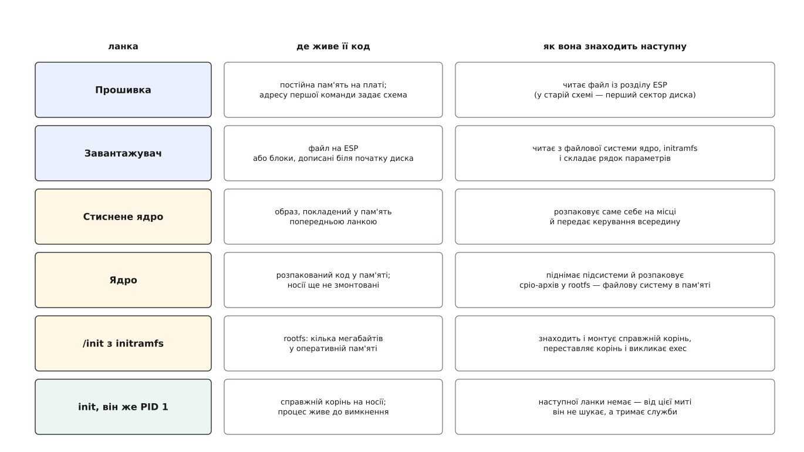
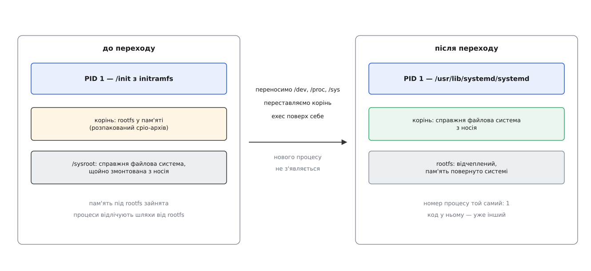

# Ланцюг завантаження: від прошивки до init

<preknowlist>
- [Ядро й простір користувача](root:sys-unix/kernel-and-userspace) — ядро і звичайні програми виконуються в різних режимах процесора, і межу між ними перетинають лише в чітко визначених місцях.
- [Процес: що це насправді](root:sys-unix/process-model) — процес є набором ресурсів ядра (адресний простір, таблиця дескрипторів, обліковий запис) з номером-ідентифікатором.
- [exec: заміна образу](root:sys-unix/exec-semantics) — виклик підміняє код і дані всередині вже наявного процесу, не створюючи нового: номер процесу лишається той самий.
- [PID і дерево процесів](root:sys-unix/pid-and-hierarchy) — процеси шикуються в дерево, а процес із номером 1 займає в ньому особливе становище.
- [Монтування й дерево монтувань](root:sys-unix/mount-model) — «корінь» є не каталогом, а вузлом окремого дерева монтувань, і цей вузол можна переставити.
- [Псевдо-ФС: procfs, sysfs, tmpfs, devtmpfs](root:sys-unix/pseudo-filesystems) — файлова система не зобов'язана лежати на носії: буває така, що цілком живе в пам'яті.
- [Модулі ядра](root:sys-unix/kernel-modules) — частина драйверів не вбудована в образ ядра, а лежить окремими файлами й довантажується вже під час роботи.
</preknowlist>

Коли на материнську плату подається живлення і сигнал Power Good скидає лінію RESET процесора, в оперативній пам'яті комп'ютера немає жодної програми. Сама динамічна пам'ять DRAM енергозалежна і після ввімкнення містить хаотичний шум, а інтегрований контролер пам'яті ще не знає частот і затримок встановлених модулів. Тому центральний процесор апаратно починає виконання з фіксованої фізичної адреси — вектора скидання (`0xFFFFFFF0` на архітектурі x86), який схемотехнічно відображений на енергонезалежну мікросхему постійної пам'яті SPI Flash на платі.

Увесь процес старту операційної системи — це **ланцюг передачі керування між спеціалізованими програмами**. Жодна ланка не може завантажити операційну систему самостійно: кожна з них виконує мінімально необхідну апаратну ініціалізацію, створює базове середовище виконання для наступного компонента, знаходить його на носії та передає йому структури зі станом системи.



*Кожен рядок дістає більше можливостей за попередній — і саме тому попередній не міг зробити його роботу сам. Останній рядок вибивається з ряду: він нікого не шукає.*

## Фаза 1. Прошивка: самотестування та пошук завантажувача

Код у постійній пам'яті материнської плати — **прошивка** (BIOS або UEFI). Її головне завдання полягає в тому, щоб перетворити набір мікросхем на працездатний комп'ютер і передати керування програмі на накопичувачі.

Оскільки оперативна пам'ять на старті недоступна, ранній код прошивки тимчасово налаштовує кеш-пам'ять процесора L2/L3 у режим швидкої статичної пам'яті (техніка *Cache-as-RAM*, CAR). Отримавши можливість створити стек викликів функцій мови C, прошивка вичитує параметри планок пам'яті через шину SMBus, конфігурує контролер DRAM, проводить калібрування сигналів та вмикає повноцінну оперативну пам'ять. Після цього прошивка сканує шину PCIe, виділяє діапазони адрес для контролерів дисків і відеокарти, будує таблиці конфігурації платформи ACPI та переходить до запуску завантажувача.

Історично спосіб передачі керування завантажувачу реалізовано двома різними архітектурами:

1. **Legacy BIOS:** прошивка нічого не знає про файлові системи. Вона звертається до диска через секторне переривання `INT 13h`, зчитує в пам'ять за адресою `0x7C00` рівно один нульовий сектор (Master Boot Record, MBR) розміром 512 байтів і стрибає на нього. Оскільки в доступні 446 байтів коду MBR неможливо вмістити драйвери файлових систем, завантажувачам доводилося використовувати складні багаторівневі проміжні ступені. Докладніше про те, чому секторна схема ламалася від найменшого переміщення блоків на диску, описано в [історичному нарисі](root:sys-unix/boot-chain/hist-chain-shape.md).
2. **Сучасний стандарт UEFI:** прошивка працює в 64-бітному режимі, розуміє таблицю розділів GPT і містить вбудований драйвер файлової системи FAT. Вона шукає спеціальний системний розділ EFI (ESP), знаходить на ньому виконуваний файл формату PE/COFF (наприклад, `\EFI\ubuntu\shimx64.efi` або `systemd-bootx64.efi`), завантажує його в пам'ять і запускає.

Прошивка UEFI надає завантажувачу два види сервісів: *Boot Services* (виділення пам'яті та доступ до дисків, що діють лише під час завантаження) і *Runtime Services* (доступ до енергонезалежних змінних NVRAM і годинника реального часу, які залишаються доступними ядру під час звичайної роботи). За увімкненого режиму Secure Boot прошивка перевіряє криптографічний цифровий підпис завантажувача за вшитими відкритими ключами перед його запуском.

## Фаза 2. Завантажувач: підготовка протоколу завантаження та вибір ядра

Завантажувач (GRUB 2, systemd-boot) — це програма, яка зв'язує прошивку із ядром операційної системи. Його задачі:
1. Зчитати власний файл конфігурації з диска та вивести користувачеві меню вибору ядра чи операційної системи.
2. Завантажити з файлової системи в оперативну пам'ять виконуваний образ ядра (`vmlinuz`) та початковий образ пам'яті (`initramfs`).
3. Сформувати рядок параметрів запуску ядра (`cmdline`), куди записуються параметри кореневого розділу (наприклад, `root=UUID=... ro quiet`).
4. Підготувати системні структури згідно з протоколом завантаження Linux: карту фізичної пам'яті E820, вказівник на рядок `cmdline`, адресу та розмір `initramfs` у структурі `boot_params` (`setup_header`).

Коли образ ядра та файлова система пам'яті завантажені в оперативну пам'ять, завантажувач викликає функцію прошивки `ExitBootServices()`, повністю звільняючи завантажувальні сервіси UEFI, і передає керування на точку входу ядра.

## Фаза 3. Ядро: декомпресія, ініціалізація підсистем і народження rootfs

Файл `vmlinuz` на диску є саморозпаковуваним архівом. На початку файлу міститься невеликий код розпаковувача, за яким розташоване стиснене ядро.

Керування приймає розпаковувач ядра. Він налаштовує початкові сторінки пам'яті, обирає випадкове зміщення в пам'яті для захисту KASLR (Kernel Address Space Layout Randomization), розпаковує справжній двійковий образ ядра `vmlinux` в оперативну пам'ять і стрибає на його головну точку входу `startup_64`.

У функції ядра `start_kernel()` розгортаються фундаментальні підсистеми:
- формується остаточна багаторівнева віртуальна пам'ять ядра, ініціалізуються розподільники сторінок Buddy Allocator та пам'яті об'єктів SLUB;
- встановлюється таблиця векторів переривань (IDT);
- опитуються пристрої на шинах через таблиці ACPI або дерево пристроїв (Device Tree);
- послідовно викликаються вбудовані функції ініціалізації драйверів (механізм `initcalls`).

Після завершення базової ініціалізації ядро створює екземпляр тимчасової файлової системи в пам'яті — **`rootfs`** (варіант `ramfs`/`tmpfs`), яка монтується як початковий корінь `/`. Далі ядро знаходить в оперативній пам'яті переданий завантажувачем образ `initramfs`, розпаковує його cpio-архів усередину `rootfs`, відкриває системну консоль `/dev/console` як стандартні потоки введення-виведення (файлові дескриптори 0, 1, 2) і викликає системний виклик `kernel_execve("/init", ...)`.

Ядро переходить із простору ядра в простір користувача: бінарник або скрипт `/init` усередині тимчасової `rootfs` стає першим процесом системи — **PID 1**.

## Фаза 4. initramfs: виявлення заліза та збирання сховища

Ядро не монтує справжній кореневий диск напряму, оскільки сучасні сховища надто різноманітні й складні. Справжній корінь може лежати на зашифрованому розділі LUKS, на програмному RAID-масиві, у групі томів LVM або на віддаленому сервері iSCSI/NFS. Якби ядро містило драйвери для всіх контролерів, шифрування та мережевих протоколів усередині свого нестисненого бінарника, воно роздулося б до сотень мегабайтів. Тому підготовка складного сховища переноситься у простір користувача — у середовище `initramfs`.

Усередині `initramfs` виконується сценарій `/init`:
1. Монтуються віртуальні файлові системи `/proc`, `/sys`, `/dev` (`devtmpfs`) та `/run`.
2. Запускається менеджер пристроїв `udevd`. Ядро надсилає повідомлення про знайдені шини та контролери через сокети Netlink. `udevd` зіставляє ідентифікатори заліза і через утиліту `modprobe` завантажує з архіву модулі ядра саме для тих контролерів дисків (NVMe, SATA, SAS), які реально присутні в машині.
3. Коли дискові розділи з'являються у каталозі `/dev`, сценарій розбирає блокову топологію: збирає масив RAID за допомогою `mdadm`, запитує в користувача або модуля TPM2 ключ розшифрування для `cryptsetup` (dm-crypt), активує логічні томи LVM через `vgchange`.
4. Отриманий кінцевий блоковий пристрій монтується в окремий каталог:
   ```sh
   mount -o ro /dev/mapper/vg_system-root /sysroot
   ```

Тепер справжній постійний диск системи підготовлений і змонтований у точці `/sysroot`, але поточний процес PID 1 усе ще виконує скрипт із тимчасової пам'яті `rootfs`.

## Фаза 5. Атомарний перехід switch_root

Система повинна зробити каталог `/sysroot` новим системним коренем `/`, повністю очистити пам'ять, яку займає тимчасова `rootfs`, і запустити повноцінний ініціалізатор `/sbin/init` (systemd), зберігши за ним номер PID 1.

Класичні системні виклики тут не працюють:
- `chroot()` лише змінює видимість каталогів для поточного процесу, але не переносить монтування системи й залишає `rootfs` заблокованою в оперативній пам'яті.
- `pivot_root()` повертає помилку ядра `EINVAL`, оскільки системна `rootfs` є первинним коренем простору імен монтувань VFS і не підлягає звичайній заміні.

Цю задачу вирішує спеціалізована процедура **`switch_root`**.



*Перехід не породжує нового процесу: номер 1 лишається за тим самим процесом, у якому просто замінили код.*

`switch_root` послідовно виконує такі атомарні кроки:
1. **Перенесення службових файлових систем:** точки монтування `/dev`, `/proc`, `/sys` та `/run` не можна демонтувати, бо на них тримаються відкриті файлові дескриптори ядра та активні структури. `switch_root` викликає системний виклик `mount()` із прапорцем `MS_MOVE` (еквівалент команди `mount --move`), переміщуючи ці дерева монтувань зі старого кореня у `/sysroot/dev`, `/sysroot/proc`, `/sysroot/sys` та `/sysroot/run`. Це зберігає активний стан пристроїв і сокетів без перезапуску.
2. **Очищення оперативної пам'яті:** перебуваючи у старій `rootfs`, утиліта рекурсивно видаляє всі файли (`unlink`) та каталоги (`rmdir`), крім каталогу `/sysroot` та точок монтування. Оскільки `rootfs` живе в пам'яті, знищення її метаданих миттєво повертає всі зайняті сторінки пам'яті назад у Buddy Allocator ядра.
3. **Зміна кореня:** виконується перехід у новий каталог `chdir("/sysroot")`, перенесення монтування нового кореня на кореневий вузол `mount(".", "/", NULL, MS_MOVE, NULL)`, а потім фіксація процесу через `chroot(".")` та `chdir("/")`.
4. **Заміна коду процесу через `execve`:** процес `/init` не завершується і не створює нащадків. Він викликає `execve("/sbin/init", argv, envp)`. Ядро заміщує образ скрипта в пам'яті виконуваним бінарником системного ініціалізатора (systemd) зі справжнього диска.

Номер **PID 1** залишається незмінним, відкриті дескриптори стандартних потоків вводу-виводу переносяться в новий процес, але тепер цей процес виконує код фінального системного менеджера на справжньому диску.

:::tabs
:::code boot-chain/c/main.c
:::code boot-chain/c/steps.h
:::code boot-chain/c/checks.c
:::code boot-chain/c/mounts.c
:::code boot-chain/c/wipe.c
:::code boot-chain/c/console.c
:::code boot-chain/c/log.h
:::code boot-chain/c/log.c
:::code boot-chain/cpp/main.cpp
:::code boot-chain/cpp/root_switch.hpp
:::code boot-chain/cpp/root_switch.cpp
:::code boot-chain/cpp/mount_ops.hpp
:::code boot-chain/cpp/mount_ops.cpp
:::code boot-chain/cpp/wipe.hpp
:::code boot-chain/cpp/wipe.cpp
:::code boot-chain/cpp/posix.hpp
:::

:::code boot-chain/sh/init.sh

*Той самий `/init` із фази 4, який доводить сховище до змонтованого `/sysroot` і останнім рядком віддає керування наведеній вище програмі.*

## Фаза 6. PID 1 і простір користувача

З миті запуску `/sbin/init` принцип естафети припиняється: PID 1 більше нікому не передає керування і працює аж до вимкнення живлення системи.

Ядро наділяє процес PID 1 унікальними правами та обов'язками:
- **Імунітет до сигналів:** сигнали за замовчуванням блокуються ядром; навіть сигнал примусового завершення `SIGKILL` не може вбити PID 1.
- **Аварійна зупинка (Kernel Panic):** якщо процес PID 1 аварійно завершується або падає, ядро негайно зупиняє всю систему, оскільки коректна робота простору користувача стає неможливою.
- **Усиновлення процесів-сиріт:** процеси, батьківські процеси яких завершилися раніше за них, автоматично перепідпорядковуються процесу PID 1. Він зобов'язаний постійно викликати `waitpid()`, вичитуючи статуси завершення померлих процесів і запобігаючи переповненню таблиці процесів зомбі-записами.

Сучасний системний менеджер **systemd** будує запуск простору користувача як орієнтований ациклічний граф цілей (targets) та служб (services). Він запускає незалежні служби паралельно на всіх доступних ядрах процесора, використовує механізм активації через сокети (створюючи сокети D-Bus та мережі до запуску самих демонів) та ізолює ресурси процесів за допомогою контрольних груп cgroups v2.

Побачити роботу кожної ланки цього ланцюга на реальній працюючій системі та перевірити стан записів прошивки, параметрів ядра й дерева служб можна у [покроковому розборі](root:sys-unix/boot-chain/proj-walk-the-chain.md).
