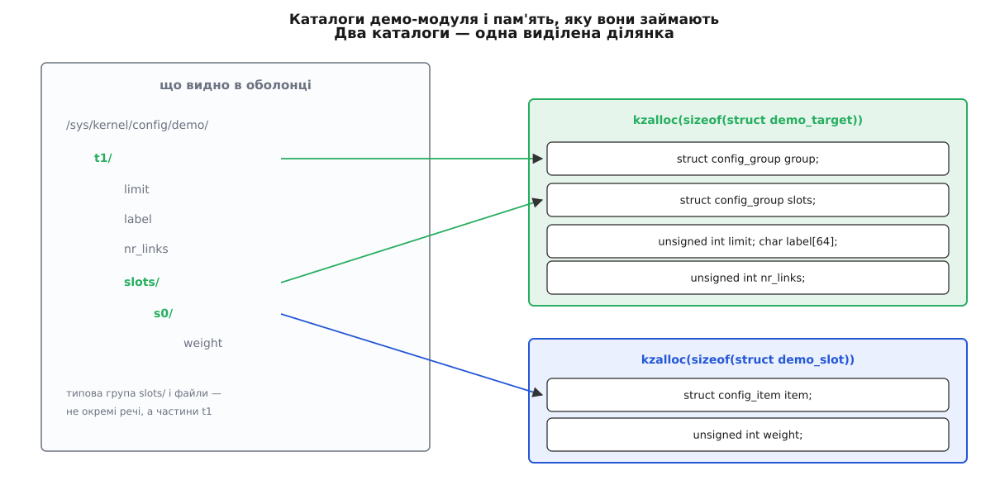

# ⚙️ Демо-модуль: власне піддерево в /sys/kernel/config

Дві сотні рядків мовою C — і в дереві налаштувань з'являється гілка `demo/`, де `mkdir` виділяє живий об'єкт у пам'яті ядра, `echo` міняє його поля, а `ln -s` оголошує зв'язок між двома об'єктами. Нижче — увесь код, який для цього потрібен, і сеанс в оболонці, де видно кожну відмову разом із її причиною.

Ось чого ми хочемо домогтися:

```
/sys/kernel/config/demo/
└── t1/                       ← mkdir створив об'єкт
    ├── limit                 ← число, 0…1024
    ├── label                 ← рядок
    ├── nr_links              ← лише читання: скільки посилань прийнято
    └── slots/                ← типова група, з'явилася сама разом із t1
        ├── s0/               ← mkdir створив підоб'єкт
        │   └── weight
        └── peer -> ../../t2  ← ln -s на сусідній об'єкт
```

Макет обрано не з примхи. `t1` мусить бути **групою**, бо всередині нього є `slots/`, а `s0` групою бути не мусить, бо дітей не має, — і в коді ця різниця вилазить одразу двома парами імен. Зв'язок між об'єктами ми теж робимо не напряму, а через `slots/`: дозвіл на посилання тоді лежить на окремому типі й не змішується з правилами самого об'єкта. Це той самий поділ, що в USB-гаджеті, де функції живуть окремо від конфігурацій, а `ln -s` каже, яка функція входить у яку.

Далі код іде шматками в тому порядку, у якому має лежати у файлі `configfs_demo.c`: кожен наступний шматок спирається на імена з попереднього.

## Дві структури й одна ділянка пам'яті

`configfs` не знає, що саме ви зберігаєте, — він бачить лише вкладений `config_item` (або `config_group`, якщо об'єкт має дітей). Тому все, що модуль хоче тримати, він кладе поруч у власну структуру й виділяє її [сам](root:sys-unix/kernel-memory-slab).

:::code proj-configfs-module/c/dvi-struktury-i-odna.c

Найважливіше тут — два `config_group` в одній структурі. Каталог `t1/` і каталог `t1/slots/` — це два різні вузли дерева, але одна-єдина ділянка, виділена одним викликом. Звідси випливає все подальше: `slots` не має власного звільнення, бо не має власної пам'яті, і зникає рівно тоді, коли зникає `t1`. А `demo_slot` виділяють окремо, бо його створює окремий `mkdir`.



*Три каталоги, дві виділені ділянки. Два з трьох каталогів — це поля однієї структури, тож `kfree` на неї буде один.*

## Три файли з двох функцій кожен

Атрибут — пара «показати» й «записати», яку макрос перетворює на `struct configfs_attribute` з готовим іменем файлу й правами.

:::code proj-configfs-module/c/try-faily-z-dvokh-funktsii.c

Буфер, що приїздить у `store()`, завжди завершений нулем — саме тому `kstrtouint()` спокійно читає його як рядок. Але `count` рахує й переведення рядка, яке додав `echo`; числові перетворювачі його терплять, а рядковий атрибут довелося б записати з «хвостом», тож у `label` ми зрізаємо його вручну.

Ім'я змінної, яку зробив макрос, збирається за жорстким взірцем: `CONFIGFS_ATTR(demo_target_, limit)` шукає функції `demo_target_limit_show` і `demo_target_limit_store`, а оголошує `demo_target_attr_limit`. Помилитися на один символ у префіксі — і компілятор скаржитиметься на невідоме ім'я в масиві, а не на макрос. `CONFIGFS_ATTR_RO` бере лише половину пари й ставить права `0444`; саме тому `nr_links` видно в `ls -l` як файл, у який не можна писати, — це не перевірка всередині коду, а режим доступу.

## Хто народжує і хто ховає

Тепер тип самого об'єкта й тип типової групи всередині нього.

:::code proj-configfs-module/c/khto-narodzhuie-i-khto.c

`demo_slots_type` навмисно не має `release()` — і це не забудькуватість. Пам'ять групи `slots` належить структурі `demo_target`, тож звільнити її окремо означало б звільнити чужий шматок посеред живої ділянки.

Аргументи `allow_link()` легко переплутати місцями. `src` — це **не** той, на кого показує посилання, а об'єкт каталогу, **у якому** посилання створюють; `target` — той, на кого показують. Тому перевірка «чи це взагалі наша річ» дивиться на `target->ci_type`, а лічильник росте у власника `src`. Дзеркальний `drop_link()` дістає ту саму пару, але відмовити вже не може: `rm` стався, і повертати нема чого. Не оголосили `allow_link` зовсім — `ln -s` поверне `EPERM`, бо ядро не вигадує зв'язків за вас, воно питає модуль.

## Корінь піддерева

Лишилося те, що створює самі об'єкти, і те, що вішає гілку `demo/` у дерево.

:::code proj-configfs-module/c/korin-piddereva.c

Тут `make_group()`, а не `make_item()`, і вибору немає: типові групи живуть у списку всередині `config_group`, тож об'єкт, який їх має, мусить бути групою. Для об'єкта без дітей — як `demo_slot` — беруть `make_item()` і `config_item_init_type_name()`; це рівно та сама робота на один рівень простіша. `configfs_add_default_group()` нічого не повертає: це один рядок, що вкладає групу в список власника, і виконати його треба до того, як об'єкт поїде назад у `configfs`.

## Що встигає статися між mkdir і ls

Порядок дій усередині варто знати, бо з нього випливають дві приємні властивості. Отримавши `mkdir`, `configfs` спершу бере посилання на модуль, якому належить тип батьківського каталогу, — саме тому `rmmod` потім відмовить. Далі він кличе ваш `make_group()`. І лише **після** того, як ваша функція повернула вказівник, `configfs` вплітає групу в список дітей батька, заводить каталог і аж тоді створює файли з масиву `ct_attrs`, а потім рекурсивно повторює те саме для кожної типової групи.

Наслідок перший: недобудованого об'єкта ззовні не видно ніколи. Поки ваш код виділяє пам'ять і розставляє початкові значення, каталогу ще немає — отже, ніхто не встигне прочитати `limit`, у який ви не встигли записати одиницю. Тому початкові значення ставлять саме в `make_group()`, до `return`, як зроблено з `t->limit` і `t->label`.

Наслідок другий: відмова не лишає сміття. Якщо ви повернули `ERR_PTR(-EINVAL)`, жодного файлу ще не створено й нічого не треба прибирати — досить звільнити те, що самі виділили. Це робить перевірки в `make_group()` найдешевшим місцем для будь-якої валідації.

[Складання модуля](root:sys-unix/kernel-modules) — звичайне, поза деревом ядра:

```make
obj-m := configfs_demo.o
KDIR  ?= /lib/modules/$(shell uname -r)/build

all:
	$(MAKE) -C $(KDIR) M=$(CURDIR) modules
clean:
	$(MAKE) -C $(KDIR) M=$(CURDIR) clean
```

## Сеанс: усе, що видно ззовні

```console
$ sudo insmod configfs_demo.ko
$ cd /sys/kernel/config/demo && sudo mkdir t1 t2
$ ls -F t1
label  limit  nr_links  slots/
$ cat t1/limit t1/label t1/nr_links
1
unnamed
0
$ echo 64 | sudo tee t1/limit > /dev/null
$ echo "камера на даху" | sudo tee t1/label > /dev/null
```

Тепер помилки — кожну з них видно в оболонці рівно такою, якою її повернув модуль:

```console
$ echo abc | sudo tee t1/limit
tee: t1/limit: Invalid argument              # kstrtouint → -EINVAL
$ echo 5000 | sudo tee t1/limit
tee: t1/limit: Numerical result out of range # наша перевірка → -ERANGE
$ sudo touch t1/mine
touch: cannot touch 't1/mine': Permission denied   # файлів тут не створюють
$ sudo ln -s ../t2 t1/slots/peer
$ cat t1/nr_links
1
$ ls -l t1/slots/peer
lrwxrwxrwx 1 root root 0 ... t1/slots/peer -> ../../t2
```

Зверніть увагу на дві різні відповіді: писали ви `../t2`, а `ls` показує `../../t2`. Шлях, який ви передали в `ln`, ядро розбирає **від поточного каталогу оболонки** (ви стояли в `demo/`), а показує його вже перерахованим від каталогу самого посилання. Саме через це в рецептах USB-гаджета пишуть `ln -s functions/acm.usb0 configs/c.1` — цей шлях правильний з кореня гаджета, а не з `c.1`.

Знищення:

```console
$ sudo mkdir t1/slots/s0
$ sudo rmdir t2
rmdir: failed to remove 't2': Device or resource busy   # EBUSY: на нього є посилання
$ sudo rmdir t1
rmdir: failed to remove 't1': Directory not empty       # ENOTEMPTY: усередині s0
$ sudo rmdir t1/slots
rmdir: failed to remove 't1/slots': Operation not permitted  # EPERM: типова група
$ sudo rm t1/slots/peer && sudo rmdir t1/slots/s0 && sudo rmdir t1 t2
$ sudo rmmod configfs_demo
```

Поки живий бодай один об'єкт, `configfs` тримає посилання на модуль-власник типу, і `rmmod` відмовить із «Module configfs_demo is in use». Порядок розбирання не запам'ятовують — його підказують коди помилок.

> 🔧 **Навіщо це.** Цей кістяк — не навчальна іграшка, а буквально та сама будова, що в `drivers/nvme/target/configfs.c` чи `drivers/usb/gadget/configfs.c`, тільки без предметної частини. Прочитавши двісті рядків вище, ви розпізнаєте в тих файлах усе, крім назв: те саме `make_group`, ті самі типові групи, ті самі `allow_link`. Різниця лише в тому, що там у `store()` замість присвоєння полю йде виклик у справжню підсистему.

## Пастки

**`NULL` — це не «помилка», це `-ENOMEM`.** Коли `make_item()` чи `make_group()` повертає `NULL`, `configfs` перетворює його на `ERR_PTR(-ENOMEM)`. Відмова через погане ім'я приїде до людини як «немає пам'яті», і шукати вона буде зовсім не там. Кожна відмова — свій `ERR_PTR(-…)`.

**`drop_item()` не звільняє.** Він робить `config_item_put()`, тобто прибирає те посилання, яке ви завели при виділенні; пам'ять звільнить `release()`, коли лічильник дійде до нуля — можливо, пізніше. `kfree` у `drop_item()` віддає ділянку, на яку ще хтось може дивитися. Якщо в `drop_item()` вам нічого робити, його можна не писати взагалі: тоді `config_item_put()` зробить сам `configfs`. А от `release()` для всього, що ви виділяли, обов'язковий — без нього ніхто не звільнить нічого, і витік буде тихий.

**`store()` повертає `count`.** Не нуль (запис на нуль байтів змусить оболонку крутитися) і не «скільки я насправді спожив»: коротка відповідь — це для простору користувача частковий запис, і `write` спробує дописати хвіст, викликавши `store()` вдруге з рештою рядка.

**4096 байтів і тиша.** Буфер атрибута — стала `SIMPLE_ATTR_SIZE`, тобто 4096, і це саме стала, а не розмір сторінки поточної машини. Запис обрізають до 4095 байтів і дописують нуль у кінці, а назовні віддають саме це, менше число: помилки не буде, `store()` побачить рядок, який виглядає цілим, — а оболонка, побачивши частковий запис, слухняно надішле хвіст другим викликом, і той хвіст приїде в `store()` уже як окреме самостійне значення. `show()` теж мусить вкластися в одну сторінку — цього за вас пильнує `sysfs_emit()`, який ще й перевіряє, що буфер починається рівно з початку сторінки (`configfs` віддає під нього окрему сторінку, тож перевірка проходить).

**Вказівник на `config_item` не можна просто зберегти.** Між тим, як ви його взяли, і тим, як скористалися, хтось може зробити `rmdir`. Хочете тримати — беріть `config_item_get()` і повертайте `config_item_put()`. А коли об'єкт узяли **в роботу** й хочете, щоб `rmdir` на нього відмовляв, а не просто чекав, — це `configfs_depend_item()` і потім `configfs_undepend_item()`; так `LIO` не дає прибрати сховок під живою сесією. Цю пару не можна кликати зсередини самих зворотних викликів `configfs` — вона бере ті самі внутрішні замки й заклинить сама на собі.

**Свої поля — свій замок.** `nr_links` вище чіпають лише зворотні виклики `configfs`, і цього досить. Щойно те саме поле почне читати робочий потік чи обробник переривання, знадобиться [власна синхронізація](root:sys-unix/kernel-locking): `configfs` серіалізує зміни **дерева**, а не вашу структуру.
