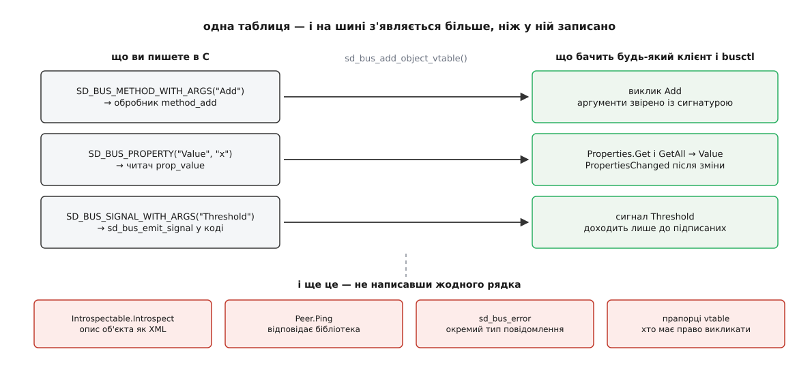

# ⚙️ Служба й клієнт на sd-bus: лічильник, який видно з `busctl`

Напишімо службу, до якої можна звернутися з чужої програми, з командного рядка й зі скрипта, не давши жодній із них ані рядка коду, — а потім клієнта до неї, і подивімось, де такий код зазвичай зависає.

## Що робимо

Служба бере ім'я `org.example.Counter` і виставляє один об'єкт `/org/example/Counter` з інтерфейсом `org.example.Counter1`: метод `Add(x) → x` додає крок і повертає нове значення, властивість `Value` віддає поточне, а сигнал `Threshold(x)` спрацьовує саме тоді, коли лічильник переступає межу вгору. Клієнт викличе метод двома способами, синхронно й асинхронно, і підпишеться на сигнал.

Пишемо на C: `sd-bus` є частиною `libsystemd`, і це C-бібліотека з C-шним двійковим інтерфейсом. Збірка одна на всі приклади:

```bash
cc counter.c -o counter $(pkg-config --cflags --libs libsystemd)
```

## Ідея: не розбирати повідомлення, а описати члени

Спокуса написати «прийшло повідомлення — подивимось, який у нього член, і зробимо `if`» веде до сотень рядків нудної перевірки: чи той інтерфейс, чи та сигнатура, як відповісти на `Introspect`, як обслужити `Properties.Get`. Усе це однакове для будь-якої служби, тож `sd-bus` просить не код, а **таблицю**: перелік членів із сигнатурами й вказівниками на ваші функції. З таблиці бібліотека сама виводить решту.



*Таблиця описує три ваші члени — а на шині з'являється ще й самоопис, стандартні інтерфейси й перевірка аргументів за сигнатурою.*

## Служба

:::code proj-dbus-service/c/sluzhba.c

Імена аргументів у `SD_BUS_ARGS` — не прикраса: вони потрапляють у самоопис, і `busctl introspect` покаже їх людині, яка вашої документації не читала. Прапорець `SD_BUS_VTABLE_PROPERTY_EMITS_CHANGE` обіцяє клієнтам, що про зміну `Value` вони дізнаються сигналом і опитувати не треба; обіцянку виконує рядок із `sd_bus_emit_properties_changed`. `SD_BUS_VTABLE_UNPRIVILEGED` знімає з методу типову вимогу привілеїв — без нього непривілейований клієнт дістане відмову ще до вашого обробника.

Тепер запуск:

:::code proj-dbus-service/c/sluzhba-2.c

Форма циклу випливає з того, що `sd_bus_process` обробляє **щонайбільше одне** повідомлення. Поки він повертає додатне число, у буфері може лежати ще щось, і засинати не можна; нуль означає «черга порожня» — аж тоді `sd_bus_wait` спить на дескрипторі з'єднання.

## Той самий цикл, але в `epoll`

`sd_bus_wait` годиться, поки шина — єдине джерело подій. Щойно з'являється своя мережа, свої таймери чи сигнали, дескриптор шини стає одним із багатьох ([select, poll, epoll](root:sys-unix/select-poll-epoll) — очікування готовності багатьох дескрипторів в одній точці; `epoll` тримає набір усередині ядра й віддає лише готові):

:::code proj-dbus-service/c/toi-samyi-tsykl-ale-v.c

Дві дрібниці тут коштують дорого. Маску подій треба перепитувати щоразу: доки вихідний буфер порожній, шині потрібен лише `POLLIN`, а щойно ви відправили щось велике — ще й `POLLOUT`. І `sd_bus_get_timeout` віддає **абсолютний** момент, а не тривалість; переводячи його в мілісекунди для `epoll_wait`, округляйте **вгору** — інакше цикл прокидатиметься на частку мілісекунди зарано й крутитиметься вхолосту. Повернення `epoll_wait` з `EINTR` — не помилка, а звичайне переривання сигналом ([EINTR і рестарт викликів](root:sys-unix/eintr-and-restart) — перерваний сигналом виклик повертає `EINTR`, і повторити його має програма).

## Клієнт

:::code proj-dbus-service/c/kliient.c

Різниця між двома викликами не в зручності, а в тому, хто чекає. `sd_bus_call_method` крутить цикл усередині себе, доки не побачить відповідь із потрібним номером, і на цей час ваша програма мертва. `sd_bus_call_async` лише кладе повідомлення в чергу відправлення й запам'ятовує, кому віддати відповідь; чекає той самий цикл, що обробляє все інше.

## Перевірка без жодного клієнта

```bash
busctl --user tree org.example.Counter
busctl --user introspect org.example.Counter /org/example/Counter
busctl --user call org.example.Counter /org/example/Counter \
       org.example.Counter1 Add x 4
busctl --user get-property org.example.Counter /org/example/Counter \
       org.example.Counter1 Value
busctl --user monitor org.example.Counter      # видно й виклики, і сигнали
```

Якщо `introspect` показує ваші члени з правильними сигнатурами, служба готова: далі жоден клієнт не спитає нічого, чого тут не видно.

## Пастки

**Синхронний виклик усередині обробника.** Найдорожча з усіх. Ваш `method_add` виконується *всередині* `sd_bus_process`; якщо звідти покликати `sd_bus_call_method` до іншої служби, цикл зупиниться, і ваша служба перестане відповідати на все, зокрема на виклик, якого чекає та сама інша служба. Дві служби, що синхронно кличуть одна одну, зависають надійно й обидві. Правило просте: з обробника — лише `sd_bus_call_async`, а відповідь клієнтові доробити в колбеку.

**Тайм-аут відповіді.** Розчепить зависання лише він: типово **25 секунд**. Змінити можна викликом `sd_bus_set_method_call_timeout()` або змінною оточення `SYSTEMD_BUS_TIMEOUT` — але змінну бібліотека читає **один раз** і запам'ятовує, тож підкрутити її на ходу не вийде. Для операції на хвилини тайм-аут не піднімають: відповідають одразу, а результат надсилають сигналом.

**Гонка з іменем.** Клієнт, запущений раніше за службу, дістане `org.freedesktop.DBus.Error.ServiceUnknown`. Три чесні виходи: описати службу файлом активації, щоб брокер підняв її сам; підписатися на `NameOwnerChanged` і чекати появи власника; або довірити порядок менеджерові служб — юніт із `Type=dbus` і `BusName=` вважається запущеним лише тоді, коли ім'я справді взято ([життєвий цикл служби](root:sys-unix/service-lifecycle) — стани юніта й те, за якою ознакою менеджер вирішує, що служба вже піднялася). Усередині служби гонка теж є, і вона тонша: реєструйте таблицю **до** `sd_bus_request_name`, бо ім'я — це сигнал «я готовий».

**Помилки.** `sd_bus_error` після невдалого виклику часто містить рядки з купи — `sd_bus_error_free` обов'язковий, інакше витік на кожній відмові. У службі не повертайте з обробника голий `-EINVAL`: клієнт дістане загальне `org.freedesktop.DBus.Error.InvalidArgs` і не відрізнить його від помилки самої бібліотеки. Іменована помилка через `sd_bus_error_set_const` — це те, за чим клієнт відрізнить «крок нульовий» від «служби немає».

**Дві шини.** Приклад бере сеансову: `sd_bus_open_user` читає `DBUS_SESSION_BUS_ADDRESS`, а без неї пробує `$XDG_RUNTIME_DIR/bus`; під `sudo` чи в `ssh` без сеансу немає ні того, ні того — виклик падає, хоча код правильний. Переїзд на системну шину додає ще одну сходинку: `sd_bus_request_name` там поверне `-EPERM`, доки ви не покладете правило в `/usr/share/dbus-1/system.d/`, яке дозволить вашому користувачеві володіти цим ім'ям. І перевіряйте потрібну шину: `busctl --user` і `busctl --system` показують різні світи, а `busctl` без прапорця — системний.
