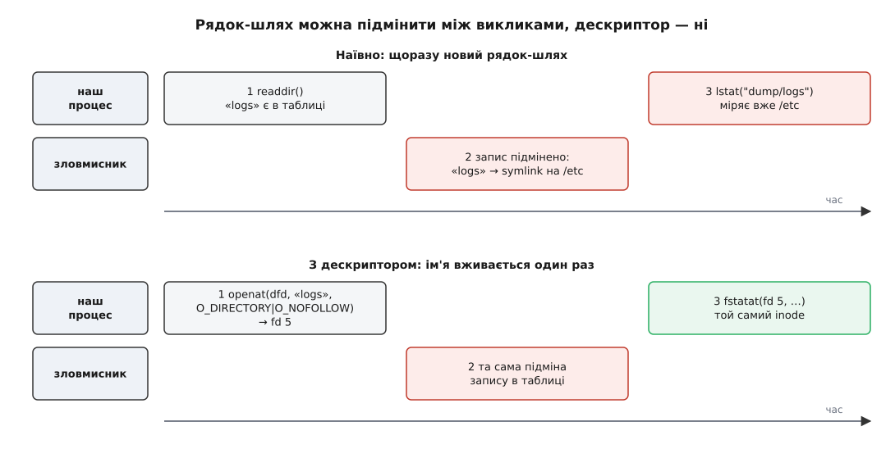

# ⚙️ Обхід каталогу, який не збити з дороги

Порахувати сумарний розмір піддерева здається задачею на десяток рядків: відкрити каталог, пройтися записами, для кожного взяти розмір, для підкаталогів повторити. Так її й пишуть — і поки в дерево не втручається ніхто, крім вас, воно навіть працює. Але щойно каталог доступний на запис ще комусь, ті самі десять рядків повертають неправильне число; а якщо це не лічильник, а прибиральник на кшталт `rm -r`, то й видаляють поза деревом. Причина в усіх випадках одна: **ім'я — це не адреса, а запит**, і кожен виклик із рядком-шляхом виконує цей запит наново.

Розберемо на цій задачі, як виглядає наївна версія, чому вона хибна в трьох різних місцях і як її переписати так, щоб дерево під ногами могли перекладати скільки завгодно.

## Наївна версія

:::tabs
:::code proj-walk-directory/c/naivna-versiia.c
:::code proj-walk-directory/cpp/naivna-versiia.cpp
:::

Логіка бездоганна, і на вашому робочому каталозі вона дасть правильну цифру. Хиби починаються там, де від логіки переходимо до того, що насправді робить кожен рядок.

### Пастка перша: між іменем і перевіркою минає час

`readdir()` видав нам ім'я з таблиці каталогу — і на цьому зв'язок із таблицею обірвався. Далі ми складаємо рядок і подаємо його в `stat()`, а `stat()` не має жодного поняття про той каталог, який ми відкрили: він бере шлях і проходить його з початку, складник за складником, [розв'язуючи кожне ім'я заново](root:sys-unix/path-resolution). Між моментом, коли ім'я вийшло з `readdir()`, і моментом, коли воно ж потрапило в `stat()`, таблиця могла змінитися — а зміна таблиці коштує один запис і робиться миттєво.



*Рядок-шлях доводиться розв'язувати на кожному виклику, тож підміна між викликами лишається непоміченою; дескриптор указує на inode і перейменування не помічає взагалі.*

Це класичний розрив між перевіркою й дією — те, що зветься [гонкою за станом](root:sf-tasks/atomicity-races). Відтворити його можна за півхвилини. Готуємо принаду:

```sh
$ mkdir -p dump/logs
$ dd if=/dev/zero of=dump/logs/big bs=1M count=8 status=none
```

І в сусідньому терміналі крутимо підміну:

```sh
$ while :; do
      mv dump/logs dump/logs.tmp && ln -s /usr dump/logs
      rm dump/logs && mv dump/logs.tmp dump/logs
  done
```

Наївний лічильник, запущений на `dump`, час від часу видаватиме розмір `/usr` — бо в невдалу мить `stat("dump/logs")` пішов за символьним посиланням, побачив каталог і рекурсія слухняно спустилася туди, куди її повели. Для лічильника це неправильна цифра. Для програми, яка на місці `stat()` робить `unlink()`, це вже видалення чужих файлів чужими руками — рівно та вразливість, через яку в GNU coreutils свого часу переписали `rm` на обхід із дескрипторами замість `chdir` і рядків-шляхів: мотивами називали і безпечність щодо потоків, і стійкість такого коду взагалі.

Спокуса відповісти «замінімо `stat` на `lstat`» зрозуміла, але допомагає лише наполовину. `lstat()` не йде за посиланням **в останньому складнику** шляху — а всі попередні складники розв'язуються як завжди, з переходом по посиланнях. Тобто підміна `dump` на посилання все одно спрацює. Рядок-шлях у принципі не можна зробити безпечним: хоч скільки прапорців додавай, кожен виклик усе одно починає розв'язання спочатку.

### Пастка друга: у рядка є стеля, у дерева — немає

`snprintf()` тихо обрізає те, що не вміщається, і повертає довжину, яку *хотів би* записати; наївна версія цього значення не дивиться. Обрізаний шлях — не помилка: він найчастіше вказує на цілком реальний, але **інший** об'єкт вище по дереву. Помилки не буде, буде неправильна відповідь.

Але навіть із нескінченним буфером вище голови не стрибнеш: ядро приймає шлях довжиною щонайбільше `PATH_MAX` — 4096 байтів разом із нульовим байтом — і на довшому повертає `ENAMETOOLONG`. А от саме дерево такої стелі не має: глибина вкладення нічим не обмежена, бо кожен окремий `mkdir` бачить короткий відносний шлях.

```sh
$ mkdir deep
$ (cd deep && for i in $(seq 1 3000); do mkdir d && cd d; done)
$ du -s deep        # GNU du проходить
$ python3 -c 'import os; os.stat("deep/" + "d/"*3000)'
OSError: [Errno 36] File name too long
```

Дерево цілком законне, у ньому лежать справжні файли — а наївний обхід просто не може до них дотягнутися. Заразом зауважте `char child[PATH_MAX]` усередині рекурсивної функції: чотири кілобайти на кожен рівень, і на глибині двох тисяч це вже вісім мегабайтів стека, тобто типова стеля потоку.

### Пастка третя: посилання, яке замикає обхід у коло

`stat()` іде за символьними посиланнями, тому посилання на батьківський каталог перетворює рекурсію на нескінченну:

```sh
$ ln -s .. dump/up
```

Тепер `dump/up` виглядає як каталог, у ньому знову є `up`, і так до вичерпання стека. Навіть без явного кільця посилання псує цифру: один каталог, на який ведуть три посилання, буде порахований чотири рази.

Тут відповідь справді проста — `lstat()` замість `stat()`, тоді посилання лишиться посиланням і в рекурсію не потрапить. Важливо інше: ця пастка єдина з трьох, яку помічають одразу й виправляють одним словом. Дві попередні одним словом не виправляються.

> 🔧 **Навіщо це.** Пастки виглядають екзотичними, доки не згадати, де саме такий код зазвичай працює: прибиральник тимчасових файлів у `/var/tmp`, збирач квот по домашніх каталогах, індексатор у службі резервного копіювання. Це рівно ті каталоги, у які має право писати хтось інший, і рівно ті програми, що ходять деревом із високими правами. Обхід із рядків-шляхів у такому місці — не «трохи неточний», а керований ззовні.

## Ідея: тримати не рядок, а дескриптор

Шлях — це питання «а що зараз лежить під цим іменем». [Файловий дескриптор](root:sys-unix/file-descriptor) — це вже дана відповідь: він указує прямо на inode, і жодне перейменування, видалення чи підміна запису в каталозі на нього не впливають. Каталог, який ви тримаєте відкритим, лишається тим самим каталогом, навіть якщо його ім'я вже нічого не значить.

Лишається навчитися питати «що всередині **цього** каталогу» замість «що лежить за цим рядком». Саме для цього існує [сімейство викликів, що відлічують шлях від дескриптора каталогу](root:sys-unix/at-family-syscalls): `openat()`, `fstatat()`, `unlinkat()`, `renameat()`. Кожен приймає дескриптор каталогу першим аргументом і відносне ім'я другим, і ядро розв'язує це ім'я не від кореня, а від того самого inode, який ви тримаєте.

Звідси випливає весь план обходу:

- на кожен каталог тримаємо відкритий дескриптор, поки не закінчимо з ним;
- імена, отримані з `readdir()`, вживаємо **лише** як однокомпонентні аргументи до `*at`-викликів; повних шляхів не будуємо взагалі;
- спуск на рівень нижче — це `openat(dfd, ім'я, O_DIRECTORY | O_NOFOLLOW)`, тобто «відкрий мені *ось цей* запис, і тільки якщо він справді каталог, а не посилання».

Однокомпонентне ім'я не має «попередніх складників», яких `O_NOFOLLOW` не покриває — тому в цій формі прапорець дає повну гарантію: якщо запис підмінили на посилання, `openat()` відмовить із `ELOOP`, а не піде кудись іще. Якщо запис підмінили на звичайний файл — відмовить із `ENOTDIR` завдяки `O_DIRECTORY`.

Повністю виключити підміну це не може: між `fstatat()` і `openat()` запис усе ще можуть замінити на *інший* каталог, і тоді порахуємо його. Але цей інший каталог у будь-якому разі лежить усередині того каталогу, дескриптор якого ми тримаємо, — тобто всередині нашого піддерева. Гарантія називається *утримання в межах*: цифра може стосуватися не зовсім тих файлів, зате обхід ніколи не виходить туди, куди його не пускали. Для лічильника це різниця між похибкою й нісенітницею, для прибиральника — між зайвим видаленням усередині свого каталогу й видаленням у `/etc`.

## Робочий обхід

Спершу — допоміжна множина. Файл із кількома іменами трапиться нам стільки разів, скільки його імен у дереві, а порахувати його треба один раз; ознакою файлу служить пара «номер пристрою + номер inode». Тримаємо їх у [хеш-множині](root:sf-algorithms/hash-table) з відкритою адресацією:

:::tabs
:::code proj-walk-directory/c/robochyi-obkhid.c
:::code proj-walk-directory/cpp/robochyi-obkhid.cpp
:::

Перед заголовками — `#define _GNU_SOURCE`; самі заголовки: `<dirent.h>`, `<errno.h>`, `<fcntl.h>`, `<limits.h>`, `<stdint.h>`, `<stdio.h>`, `<stdlib.h>`, `<string.h>`, `<sys/resource.h>`, `<sys/stat.h>`, `<unistd.h>`. Складається як `cc -O2 -Wall -o du du.c`.

## Дрібниці, на яких спотикаються

**`fdopendir()` забирає дескриптор.** Після вдалого виклику дескриптор належить потокові каталогу, і закриє його `closedir()`; закривати самому — подвійне закриття, тобто зіпсований дескриптор у сусідньому потоці програми. Але коли `fdopendir()` **не вдався**, дескриптор лишається вашим — у glibc він не закривається, — і якщо про це забути, кожен нечитабельний каталог у дереві забирає один дескриптор назавжди.

**`dirfd()`, а не збережена копія.** Формально після `fdopendir()` дескриптор «використовується реалізацією», і стандарт забороняє чіпати стан цього опису інакше, ніж функціями каталогу. `openat()` і `fstatat()` стану не змінюють — вони лише беруть дескриптор за точку відліку, — тож користуватися ним безпечно; але брати його треба через `dirfd()`, як і задумано, а не тримати власну копію в змінній.

**Буфер `readdir()` живе до наступного `readdir()`.** Повернений вказівник дивиться всередину структури потоку, і наступний виклик на тому ж потоці його перепише. Тому ім'я ми копіюємо одразу — і заразом уникаємо питання, чи вціліє воно через рекурсію. Із цієї ж причини один `DIR *` не можна віддавати двом потокам виконання; застарілий `readdir_r()` цієї задачі не розв'язує, і в manpage сьогодні рекомендують саме `readdir()` із власною синхронізацією.

**`d_type` — підказка, а не факт.** Поле типу в записі каталогу дозволяє впізнати каталог без звертання до inode, але заповнюють його не всі файлові системи: XFS, створена без `-n ftype=1` (у старіших `mkfs.xfs` це був типовий режим), повертає `DT_UNKNOWN` для всього. Наш обхід на нього не спирається взагалі, бо розмір усе одно доводиться питати в `fstatat()`. А от обхід, якому потрібен лише тип — щось на кшталт «знайди всі каталоги», — на `d_type` економить половину викликів, і саме він мусить мати запасну гілку через `fstatat()`.

**Одиниця `st_blocks` — завжди 512 байтів**, незалежно від розміру блока файлової системи. Це і є те, що рахує `du`, і звідси дві звичні несподіванки:

```
зайняте місце = st_blocks · 512

файл на 1 байт в ext4:      st_size = 1            st_blocks = 8  →  4096 байтів
розріджений файл на 1 ГіБ:  st_size = 1073741824   st_blocks = 0  →  0 байтів
```

Перший займає цілий блок, хоч і майже порожній; другий не займає нічого, хоч і величезний. Друге — не помилка обліку, а [розріджений файл](root:sys-unix/sparse-files): дірки в ньому просто не мають виділених блоків.

**Жорсткі посилання рахуються раз.** Саме тому наш обхід тримає множину `seen`, і саме тому `du` та звичайне додавання розмірів із `ls` дають різні цифри на дереві з [жорсткими посиланнями](root:sys-unix/hard-and-symbolic-links). Каталоги в цю множину не потрапляють: у них `nlink` завжди більший за одиницю через власний запис `.`, але в дереві кожен каталог трапляється рівно раз.

**Точки монтування — це рішення, а не деталь.** Зміна `st_dev` означає, що ми впираємося в межу [іншої файлової системи](root:sys-unix/mount-model). Спускатися туди чи ні — питання задачі, але відповісти на нього треба явно: інакше лічильник розміру каталогу випадково включить у себе примонтований мережевий том або `/proc`. У `du` це прапорець `-x`.

**Дескриптори закінчуються.** Один рівень глибини — один відкритий каталог, а типовий м'який [ліміт на кількість дескрипторів](root:sys-unix/resource-limits) — 1024. Тому обмеження глибини не декоративне: без нього глибоке дерево дає `EMFILE` посеред обходу, і програма мовчки недорахує піддерево. Альтернатива — закривати каталог і відкривати заново, коли доведеться повернутися, але тоді повернення знову йде за іменем, і гарантія втрачається; чесніше опустити стелю або підняти ліміт через `setrlimit()`.

## Скільки це коштує

Викликів на дерево з `N` записами й `D` каталогами виходить приблизно:

```
openat  + fdopendir + closedir :  D  разів
getdents64                     :  один на буфер записів (у glibc — десятки КіБ)
fstatat                        :  N  разів
```

Тобто вартість лінійна за **кількістю записів**, а не за обсягом даних. Виміряти каталог зі стогігабайтним фільмом — це один `fstatat()`; виміряти каталог зі ста тисячами порожніх файлів — сто тисяч. Домінує саме `fstatat()`: читання каталогу віддає багато імен за один виклик, а от кожен inode доводиться діставати окремо, і на холодному кеші кожен такий доступ може обернутися звертанням до диска в непередбачуваному місці. Звідси знайома річ: перший `du` на великому дереві повзе, другий пролітає — між ними спрацював [кеш записів каталогу й inode](root:sys-unix/vfs-layer).

Пам'яті витрачається `O(глибина)` на дескриптори й кадри стека плюс множина `seen` — а в ній лише файли з кількома іменами, тобто зазвичай крихти. Наївна версія, для порівняння, тримала на кожному рівні буфер на `PATH_MAX`.

## Готова альтернатива — і чому вона не завжди годиться

Писати це щоразу руками не обов'язково: у бібліотеці є `nftw()`.

:::tabs
:::code proj-walk-directory/c/hotova-alternatyva-i-chomu.c
:::code proj-walk-directory/cpp/hotova-alternatyva-i-chomu.cpp
:::

`FTW_PHYS` означає «не йти за символьними посиланнями» — у manpage прямо сказано, що саме цього ви й хочете; `FTW_MOUNT` тримає обхід у межах однієї файлової системи; третій аргумент обмежує кількість одночасно відкритих каталогів, і при перевищенні глибини обхід починає закривати й перевідкривати їх, тобто сповільнюється. Для разового скрипта чи власного каталогу цього досить.

Чого воно не дає — тієї самої гарантії. Реалізація в glibc складає повний шлях і викликає для нього `lstat()`, тож пастка перша нікуди не поділася, а стеля `PATH_MAX` лишилася на місці. Прапорець `FTW_CHDIR` пришвидшує роботу тим, що переходить у кожен каталог, — але робочий каталог належить усьому процесові, тобто це глобальний стан, спільний з усіма потоками. Через це в GNU coreutils і не користуються ані `nftw`, ані класичним `fts` із `chdir`: тамтешній `fts` із режимом `FTS_CWDFD` тримає дескриптор каталогу й ходить через `openat`/`fstatat`/`unlinkat` — точнісінько так, як зроблено вище.

Ядро вміє дати ще міцнішу гарантію. Виклик `openat2()`, доданий у Linux 5.6, приймає прапорці розв'язання: `RESOLVE_BENEATH` забороняє вийти за межі каталогу-якоря, `RESOLVE_NO_SYMLINKS` забороняє переходи по посиланнях у **всіх** складниках (а не лише в останньому, як `O_NOFOLLOW`), `RESOLVE_NO_XDEV` не пускає через точки монтування. Із ними перевірку `st_dev` можна не писати руками: за межу не пустить саме ядро.

## Чому це все одно не знімок

Лишається сказати те, чого не дає жодна з версій. Дерево вимірюють, поки в ньому живуть: файли створюються, ростуть і зникають протягом самого обходу. Перший `fstatat()` і останній розділені секундами або хвилинами, і сума складається з чисел, узятих у різні моменти. Стану, у якому дерево справді мало б порахований розмір, могло не бути ніколи.

Операції «заморозити простір імен» не існує, і це не недогляд: така заморозка означала б зупинку всіх, хто пише в будь-який каталог піддерева, на весь час обходу. Ціна незрівнянна з користю, тому її не платить ніхто — навіть `du` видає наближення й на цьому не наполягає.

Тому корисно розрізняти дві різні речі. **Свіжості** дескриптори не дають — цифра лишається наближеною. Що вони дають, так це **утримання**: кожен порахований об'єкт справді був досяжний ланцюжком каталогів, які ви тримали відкритими, і обхід у жодну мить не опинявся поза межами того, куди його пустили. Для лічильника це різниця між похибкою й вигадкою; для прибиральника — між зайвим видаленням у своєму каталозі й видаленням у чужому.

Коли ж потрібен саме знімок — його беруть рівнем нижче: миттєвий знімок підтому btrfs або пристрою через LVM дає незмінну копію, яку можна обходити скільки завгодно повільно й дістати цифру, що стосується одного моменту часу. Це вже не задача обходу каталогів, і розв'язується вона не в програмі.
