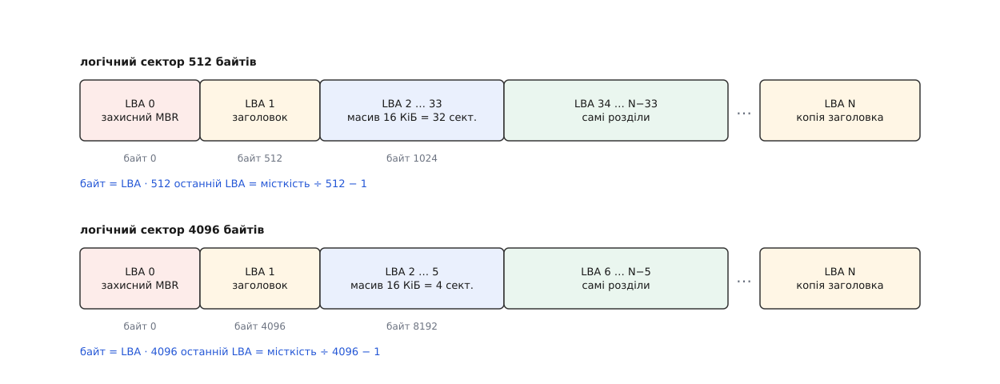

# ⚙️ Прочитати GPT власноруч: від підпису до переліку розділів

Напишемо програму, яка відкриває `/dev/sda` — або звичайний файл-образ — і друкує перелік розділів: межі, розмір, тип, назву. Без `lsblk`, без `libblkid`, без жодної бібліотеки, що знає про таблиці розділів. Інтерес тут не спортивний: усе, що робить ядро, розбираючи GPT, зводиться до двох читань і двох контрольних сум, і поки ці чотири дії лишаються чорною скринькою, «диск чомусь не бачиться» звучить як вирок, а не як діагноз.

## Порядок, у якому не можна переставити кроки

Заголовок GPT сам каже, де лежить решта таблиці: у ньому записано, з якого сектора починається масив записів, скільки їх і який завбільшки кожен. Виглядає як зручність — прочитав заголовок, узяв три числа, читаєш масив. Насправді це і є те місце, де програма-розбирач найлегше стає зброєю проти власної машини, бо всі три числа приходять із того самого носія, чию справність ми ще не перевіряли.

Звідси єдиний правильний порядок. Спершу підпис — вісім байтів `EFI PART` у секторі 1; не збігся, читати далі нема сенсу. Потім контрольна сума самого заголовка: беремо стільки байтів, скільки він сам про себе каже (поле `header_size`, зазвичай 92), обнулюємо в копії чотири байти поля суми — саме так її і рахували при записі, бо інакше значення залежало б від самого себе — і звіряємо. Тільки після цього числам із заголовка можна вірити, і аж тоді читати масив записів і рахувати другу суму, тепер уже по ньому.

Є ще одна перевірка, менш очевидна: заголовок мусить знати власне місце. У полі `my_lba` записано номер сектора, у якому він лежить; якщо взяли ми його з сектора 1, а він каже «я з сектора 976773167» — це не заголовок цього диска, а копія з іншого, і межі в ній чужі. Так само чинить ядро — у `block/partitions/efi.c` перевірка `my_lba` стоїть поруч із перевіркою суми.

Обидві суми — це [CRC32](root:com-modulation/crc): короткий залишок від ділення потоку байтів на сталий поліном, який ловить будь-яку одиничну зміну й майже будь-яку групову. UEFI бере той самий різновид, що в Ethernet і `zlib`: відбитий поліном `0xEDB88320`, початкове значення з самих одиниць, наприкінці — інверсія. У ядрі це видно дослівно: `efi_crc32()` — це `crc32(~0L, buf, len) ^ ~0L`.

Не зійшлася сума — не здаємося: таблиця записана двічі, і другу копію заголовка кладуть у найостанніший сектор пристрою. Тому нам потрібна місткість, а не лише файл: номер останнього сектора — це `місткість ÷ розмір_сектора − 1`.

> 🔧 **Навіщо це.** Якщо повірити числам до перевірки суми, чотири байти поля `num_partition_entries` замовлять пам'ять під `4294967295 × 128` байтів — близько 512 ГіБ на одну вставлену флешку. Ядро тут обережне, а от саморобний розбирач падає на першому ж покаліченому носії. Тому і в нашому коді після перевірки суми стоїть ще й груба стеля на кількість записів: заголовок міг лишитися цілим, але безглуздим.

## Код

Основна мова тут — C: ідеться про сирі структури з диска, де важать точні зсуви й порядок байтів, а читати найзручніше через `pread`, який бере зсув окремим аргументом і не рухає поточної позиції у файлі. Другою вкладкою — той самий розбір на Python, коли треба швидко зазирнути у файл-образ і не хочеться нічого складати.

:::tabs
:::code proj-parse-gpt/c/gptdump.c
:::code proj-parse-gpt/py/gpt.py
:::

## Що воно каже

Пробувати краще на образі, а не на робочому диску: файл, розмічений `sgdisk`, для нашої програми нічим не відрізняється від пристрою — а якщо потрібен справжній вузол у `/dev`, той самий файл підставляє [loop-пристрій](root:sys-unix/loop-device), який усе читання й запис пересилає у файл. Ось вивід на образі, зібраному для перевірки:

```
сектор 512 Б · останній LBA 131071 · копія таблиці: основна
диск 8FD49EBA-EF69-4037-84A7-7B890574AE31 · записів 128 по 128 Б

 1         34       2081       1.0 МіБ  C12A7328-F81F-11D2-BA4B-00A0C93EC93B  EFI System
 2       2082       6177       2.0 МіБ  0657FD6D-A4AB-43C4-84E5-0933C84B4F4F  swap
 3       6178     131038      61.0 МіБ  4F68BCE3-E8CD-4DB1-96E7-FBCAF984B709  корінь системи
```

Перший розділ починається з сектора 34, бо 32 сектори пішли під масив записів, ще два — під захисний MBR і заголовок. GUID типу в третьому рядку означає не «ext4» і не «файлова система»: це роль «корінь для x86-64» із [Discoverable Partitions Specification](https://uapi-group.org/specifications/specs/discoverable_partitions_specification/), за якою `systemd` знаходить корінь без `/etc/fstab`.

А тепер найцікавіше — зіпсуємо в образі один-єдиний байт усередині основного заголовка й запустимо ще раз:

```
сектор 512 Б · останній LBA 131071 · копія таблиці: РЕЗЕРВНА
диск 8FD49EBA-EF69-4037-84A7-7B890574AE31 · записів 128 по 128 Б

 1         34       2081       1.0 МіБ  C12A7328-F81F-11D2-BA4B-00A0C93EC93B  EFI System
 2       2082       6177       2.0 МіБ  0657FD6D-A4AB-43C4-84E5-0933C84B4F4F  swap
 3       6178     131038      61.0 МіБ  4F68BCE3-E8CD-4DB1-96E7-FBCAF984B709  корінь системи
```

Змінилося одне слово в першому рядку — межі, розміри й типи ті самі, бо взято їх із другої копії. Заради цієї миті все й затівалося: одна арифметична дія над байтами відрізняє «цілу таблицю» від «правдоподібного сміття», і ніякого іншого захисту в розмітки немає. Зіпсований байт при цьому лежав у полі `first_usable_lba` — числі, яке жоден із трьох розділів не використовує; сума впіймала його однаково, бо накриває заголовок цілком.

## Пастки

**Структура на диску й структура в пам'яті — різні речі.** Поля заголовка закінчуються на 92-му байті, але компілятор вирівнює розмір усієї структури на 8, бо всередині є `uint64_t`, — і `sizeof` без `packed` тихо дає 96. Жоден зсув усередині від цього не з'їде, все читатиметься правильно, і зламається рівно одне: сума, порахована по `sizeof(...)` замість `header_size`. Тому в коді стоять `__attribute__((packed))` і `_Static_assert` — щоб хибне число впало на складанні, а не через півроку на чужому диску. Загальне правило [вирівнювання полів](root:sf-apps/memory-alignment) працює проти нас щоразу, коли структура описує зовнішній формат.

**Числа на диску — молодшим байтом уперед.** Усі поля GPT записані в [порядку від молодшого байта](root:sf-algorithms/bits-bytes-endianness), тож на x86 їх можна читати «як є» — і саме тому помилку не видно роками, доки код не потрапить на big-endian машину. `le32toh`/`le64toh` на x86 не коштують нічого й розгортаються в порожнє місце, а на іншій архітектурі рятують. GUID до цього правила має власну примху: перші три поля записані від молодшого байта, останні вісім — просто масив, тож надрукований підряд він виглядатиме правдоподібно й буде неправильним.

**Сектор не завжди 512.** Це головна причина, чому в коді немає жодної константи 512 у розрахунках зсувів: усі числа в таблиці — номери секторів, а байтовий зсув виходить множенням на логічний розмір блока, який дає `BLKSSZGET`. На накопичувачі з логічним сектором 4096 заголовок так само лежить у секторі 1 — але це вже 4096-й байт, масив займає не 32 сектори, а чотири, і перший придатний сектор виявляється шостим, а не тридцять четвертим.



*Таблиця скрізь однакова, арифметика — ні: заголовок завжди в LBA 1, але це 512-й байт на одному пристрої й 4096-й на іншому.*

**Читання буферизоване й читання пряме — різні вимоги.** Наш `pread` іде через кеш сторінок, і ядро дозволяє йому будь-який зсув і будь-яку довжину. Але щойно до `open` додається `O_DIRECT` — а це доречно, коли треба гарантовано побачити носій, а не залишки чужого кешу, — [прямий ввід-вивід](root:sys-unix/buffered-and-direct-io) вимагає, щоб зсув, довжина й **адреса буфера** ділилися на логічний розмір блока; буфер тоді беруть через `posix_memalign`. Ядро перевіряє це одним виразом і на невиконання відповідає `EINVAL`, без пояснень.

**Останній сектор — включно.** У записі лежить не довжина, а номер останнього сектора, і він належить розділу. Розмір — це `(last − first + 1) × сектор`; забута одиниця дає помилку рівно в один сектор, яку ніхто не помічає, поки не порівняє свої числа з `blockdev --getsz`.

**Шістдесят чотири біти прапорців ми прочитали й не показали.** Дарма: саме там лежить відповідь на питання, чому розділ змонтувався тільки для читання або не змонтувався взагалі. Молодші біти визначає UEFI — нульовий позначає розділ, потрібний самій платформі, тож форматувати його не можна, а другий лишили під завантаження в режимі BIOS. Старші шістнадцять віддані типові розділу, і для тих типів, які шукає `systemd`, значення записані в [Discoverable Partitions Specification](https://uapi-group.org/specifications/specs/discoverable_partitions_specification/): біт 63 забороняє автоматичне монтування, біт 60 монтує лише для читання, біт 59 просить розтягнути файлову систему на весь розділ. Додати до виводу один шістнадцятковий стовпчик — робота на два рядки, а користі від нього більше, ніж від назви.

## Коли не сходиться жодна копія

Цінність чотирьох перевірок не в тому, що вони друкують розділи, а в тому, що кожна невдача називає свою причину.

Немає підпису ні в секторі 1, ні в останньому — байти на місці, але не ті. Або перші сектори перезаписали чужим: `mkfs` на цілий диск, `dd` з образу, необережний установник. Або з диском усе гаразд, а помилилися ми — узяли не той розмір сектора, і читаємо байт 512 там, де заголовок лежить із 4096-го; це перевіряється швидше за все інше, командою `blockdev --getss`.

Підпис є, а сума заголовка не сходиться — зіпсовано лічені байти в самому заголовку, і резервна копія майже напевно ціла: це 92 байти на протилежному кінці диска, куди одна локальна аварія не дістає. Заголовок цілий, а не сходиться сума масиву — побито вже записи, і рятує та сама друга копія, бо масив продубльовано разом із заголовком.

Мовчать обидві копії — таблиці немає, і жоден інструмент розмітки її не поверне. Далі шукають не таблицю, а самі файлові системи: `wipefs -n` показує всі знайдені на пристрої підписи, не чіпаючи їх, а відновлювачі на кшталт `testdisk` перебирають сектори в пошуках суперблоків і будують межі з того, що лежить усередині розділів.

## Скільки це коштує

Уся робота — два читання: один сектор і 16 КіБ масиву. Далі CRC32 по 92 байтах заголовка, CRC32 по 16384 байтах масиву й цикл на 128 кроків. Ані місткість диска, ані кількість розділів на це не впливають: розбір таблиці на терабайтному накопичувачі коштує рівно стільки ж, скільки на флешці, — частки мілісекунди й жодного звертання за межі перших тридцяти чотирьох секторів, поки з ними все гаразд.

Найдешевший спосіб переконатися, що розбір правильний, — звірити вивід із `sgdisk -p` і `blkid`. Якщо числа збіглися до сектора, лишається вміння, якого не дає жоден інструмент: там, де `parted` каже «таблиця пошкоджена», відмовила одна конкретна перевірка з чотирьох — і тепер зрозуміло, яка саме й що з нею робити.
