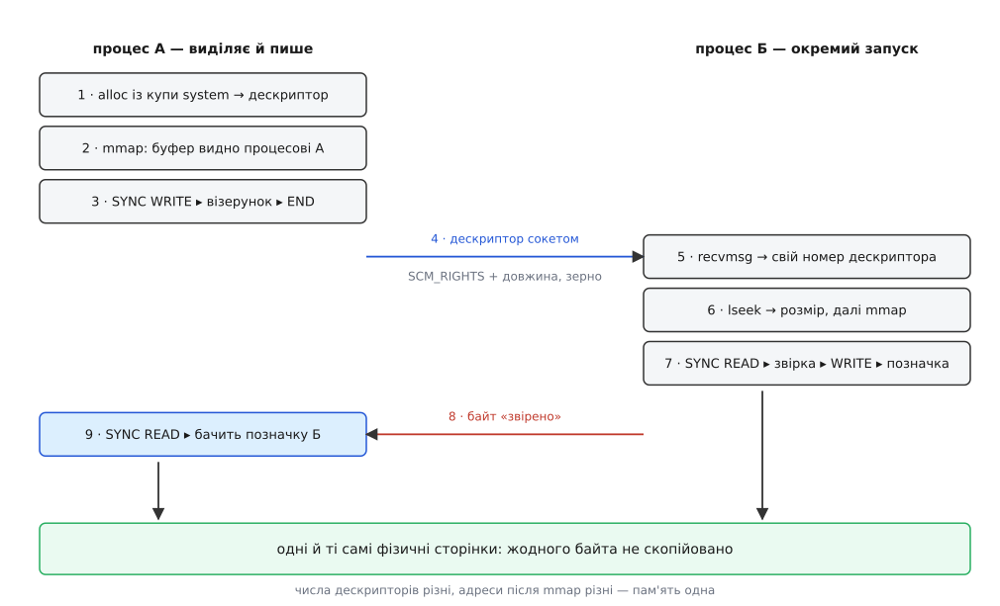

# ⚙️ Спільний буфер між двома процесами: від купи до SCM_RIGHTS

Ось програма на C, яка бере мегабайт із купи `/dev/dma_heap/system`, заповнює його візерунком і віддає геть неспорідненому процесові — так, що той дістає не копію, а ту саму пам'ять. Її варто зібрати й запустити: після цього спільний буфер перестає бути описом і стає результатом, який видно на екрані.

## Дослід, який має два різні закінчення

Демонстрація чогось варта лише тоді, коли може провалитися. Тому програма влаштована так.

Процес **А** виділяє буфер, відображає його собі й заповнює словами, порахованими з зерна — номера власного процесу. Далі він віддає дескриптор процесові **Б** і разом із ним крихітний заголовок: скільки байтів справді наші й з якого зерна зроблено візерунок. Б відображає той самий буфер у себе, звіряє кожне слово й друкує кількість розбіжностей.

Половина, заради якої дослід узагалі має сенс, починається тут. Б записує в останнє слово буфера свою позначку — і мовчки, нічого більше не пересилаючи, повідомляє одним байтом: готово. А читає це саме слово в себе. Якщо десь по дорозі пам'ять роздвоїлася, А побачить те, що клав сам. Якщо пам'ять справді одна — побачить чуже.

Обидві сторони — той самий виконуваний файл, запущений двічі з різними аргументами. Це важливо: процеси не родичі, ніхто нічого не успадкував через `fork`, у них не збігається жодна адреса й навіть номери дескрипторів різні. Спільним є рівно одне — те, що переїхало сокетом.



*Позначка, що повернулася до А, не могла подорожувати сокетом: сокетом їхав лише дескриптор.*

## Виділити те, чого нема кому виділяти

Жодного пристрою в досліді немає, тож немає й драйвера, якому пам'ять природно належала б. Експортером стає купа: `/dev/dma_heap/system` — звичайний символьний пристрій, який на прохання видає dma-buf зі звичайних сторінок.

Прохання надсилають через [ioctl](root:sys-unix/ioctl-interface). Структура запиту має чотири поля, і одне з них — вихідне: ядро кладе в `fd` номер нового [дескриптора](root:sys-unix/file-descriptor).

:::code proj-dmabuf-share/c/dmabuf-demo.c

Закриття купи одразу після виділення — не заощадження одного номера, а перевірка розуміння. Буфер живий, доки живе бодай одне посилання на нього, і посиланням є сам дескриптор, а не пристрій, з якого його дістали.

## Обрамлення, яке на вашій машині нічого не робить

Перш ніж читати чи писати відображену пам'ять, доступ треба обрамити з обох боків: `DMA_BUF_IOCTL_SYNC` зі `START` перед роботою і з `END` після неї, щоразу з чесно вказаним напрямком.

:::code proj-dmabuf-share/c/obramlennia-iake-na-vashii.c

У цих трьох рядках заховано найкоротшу пастку всієї теми. `DMA_BUF_SYNC_START` визначено як `(0 << 2)` — це нуль. Прапорець початку не додає нічого; насправді ядро розрізняє початок і кінець за відсутністю чи наявністю `DMA_BUF_SYNC_END`. Отже, `sync_start(fd, 0)` дало б `flags = 0`, а виклик із порожнім напрямком ядро відкидає з `EINVAL` — і це єдина помилка обрамлення, яку воно ловить. Напрямок, вказаний невірно, воно приймає мовчки.

## Дескриптор нічого не розповідає про вміст

Переїзд дескриптора між процесами робить `sendmsg` із керівною смугою `SCM_RIGHTS`; сама механіка складання цієї смуги — вирівнювання буфера, різниця між `CMSG_LEN` і `CMSG_SPACE`, обов'язковий хоча б один байт звичайних даних — розібрана окремо: [передати дескриптор своїми руками](root:sys-unix/unix-domain-sockets/proj-pass-a-descriptor.md).

Тут же цікаве інше: чим бути тому обов'язковому байтові. Дескриптор dma-buf уміє відповісти рівно на одне запитання про себе — свій розмір, і то через `lseek` до кінця. Ані довжини корисної частини, ані формату, ані зерна візерунка в ньому немає й не буде. Тому місце «звичайних даних» займає заголовок: усе, про що сторони мусять домовитися самі.

:::code proj-dmabuf-share/c/deskryptor-nichoho-ne.c

## Дві половини досліду

:::code proj-dmabuf-share/c/dvi-polovyny-doslidu.c

## Збірка й запуск

```
$ cc -O2 -Wall -o dmabuf-demo dmabuf-demo.c
$ ./dmabuf-demo recv &
$ ./dmabuf-demo send
Б: буфер 1048576 Б, звірено 262144 слів, розбіжностей 0
А: останнє слово тепер 0xb0b0b0b0, а клав 0x8fd41c73
```

Другий рядок — весь результат досліду. Число `0x8fd41c73` щоразу інше, бо зерном був номер процесу; незмінне те, що А більше його не бачить. Байт, який приїхав сокетом, ніс лише слово «готово» завдовжки один символ — а зміна на мегабайт далі виявилася на місці.

> 🔧 **Навіщо це.** Ця іграшка — скелет справжнього обміну кадрами. Клієнт Wayland робить рівно те саме: бере буфер, малює в нього й віддає композиторові дескриптор разом із описом формату; композитор відображає той самий буфер або передає його прямо в графічний драйвер. Різниця лише в тому, що замість візерунка там пікселі, замість `getpid` — узгоджений формат, а замість байта «готово» — огорожа, яку чекає не програма, а залізо.

## Другий дослід, вартий одного рядка

Поки код перед очима, варто перевірити ще одне твердження — те, що буфер живе, доки живе бодай одне посилання, і що жодного «власника» серед двох процесів немає.

Перенесіть у `do_send` виклик `close(buf)` угору, одразу за `send_fd`, — тобто А позбувається свого дескриптора, ще навіть не дочекавшись відповіді. Мегабайт при цьому нікуди не дівається: Б звіряє його як завжди й друкує ті самі нуль розбіжностей. Пам'ять переживає того, хто її просив, бо після `sendmsg` посилань на неї стало два, і закриття одного з них нічого не звільняє.

Саме відображення теж нікуди не дівається: `mmap` тримає власне посилання на буфер, тож адреси в А лишаються дійсними й без дескриптора. Зникає інша можливість — обрамити доступ. `DMA_BUF_IOCTL_SYNC` подають саме на дескриптор, а його вже нема, і останній крок досліду в такому варіанті доводиться викинути. Звідси практичне правило: буфер закривають, коли процесор до нього більше не піде, а не коли з нього востаннє прочитали.

## Де це ламається

**Обрамлення, пропущене безкарно.** Викиньте всі виклики `sync_start`/`sync_end` — на настільній машині програма й далі друкуватиме нуль розбіжностей. Кеші там когерентні, ядро в обрамленні нічого не робить, і код без нього виглядає правильним рівно доти, доки той самий буфер не почне заповнювати пристрій на платі без такої когерентності. Тоді помилка виявиться не крахом, а «іноді трохи не тим кадром» — і шукатимуть її в драйвері камери. Це найдорожчий різновид помилки, тому обрамлення пишуть завжди, а не тоді, коли без нього видно різницю. Чому саме воно потрібне — [когерентність кеша і DMA](root:hw-arch/cache-coherency-dma).

**`fd_flags` без `O_RDWR`.** Купа перевіряє лише те, що прапорці належать до дозволеної пари `O_CLOEXEC | O_ACCMODE`, і нуль її влаштовує. Але дескриптор, відкритий на читання, далі впирається у звичайну перевірку [відображення](root:sys-unix/mmap-model): `mmap` із `PROT_WRITE` і `MAP_SHARED` поверне `EACCES`. Помилка вилазить за десяток рядків від причини.

**Розмір, узятий не звідти.** Купа округлює прохання вгору до сторінки: попросили тисячу байтів — `lseek` покаже 4096. Відображати треба цю справжню довжину, бо `mmap` за межі буфера ядро відкине з `EINVAL`, а `munmap` з іншим числом лишить шматок відображення живим. І навпаки: довжину корисної частини знає лише заголовок, тому приймач звіряє її з розміром буфера, перш ніж бігти по масиву — переданому дескрипторові можна довіряти, переданому числу ні.

**`MAP_PRIVATE` замість `MAP_SHARED`.** Приватне відображення означає рівно те, що написано: зміни залишаються мої. Дослід із ним або не запуститься, або — що гірше — тихо перетвориться на роботу з власною копією сторінок, і Б не побачить нічого з написаного А. Спільний буфер відображають лише спільно.

**Купи немає взагалі.** `open` падає з `ENOENT`, якщо в ядрі вимкнено `CONFIG_DMABUF_HEAPS_SYSTEM`, і з `EACCES`, якщо вузол є, але належить `root` — на багатьох системах саме так, і тоді потрібні або `sudo`, або [правило udev](root:sys-unix/udev-rules), що віддає пристрій потрібній [групі](root:sys-unix/device-access-groups). Перевірити наявне можна одним поглядом: `ls /dev/dma_heap/`.

**Забутий `close`.** Іншого способу звільнити цю пам'ять немає: ані `free`, ані збирача сміття, ані власника, який колись схаменеться. Загублений дескриптор — це загублені мегабайти, причому в тій частині пам'яті, де їх найменше. Хто саме зараз тримає буфери, видно у `/sys/kernel/debug/dma_buf/bufinfo`: розмір, лічильник посилань та ім'я експортера на кожен живий dma-buf.

І окремо варто побачити те, чого в програмі немає. Немає копіювання — [жодного разу](root:sys-unix/zero-copy), навіть під час передачі. Немає домовленості про формат — вона проїхала окремим заголовком, бо дескриптор про вміст мовчить. І немає жодного запобіжника від того, щоб А переписав буфер саме тоді, коли Б його читає: тут обидві сторони чемно чекають одна на одну байтом у сокеті, а коли замість програм працюють пристрої, цю роль беруть на себе [огорожі](root:sys-unix/dma-fence-sync) — сигнали готовності, прив'язані до самого буфера.
