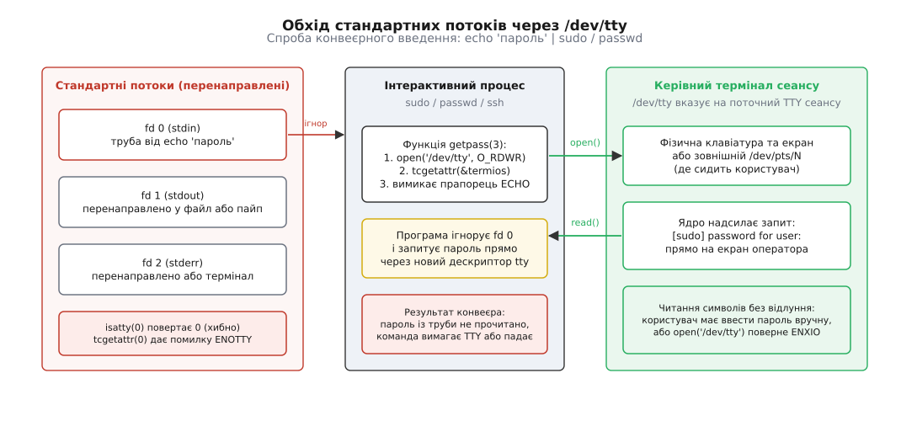
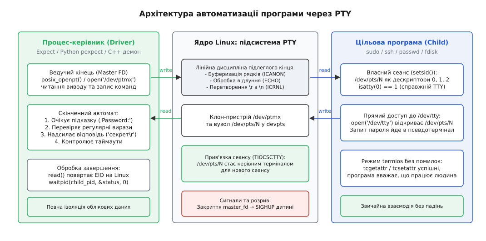
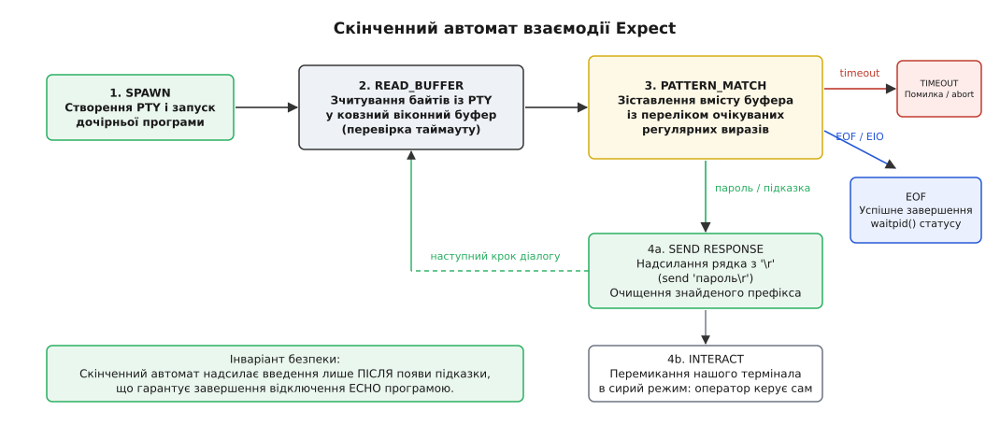

# Керувати програмою, що вимагає термінала

<preknowlist>
- [Файловий дескриптор](root:sys-unix/file-descriptor) — ціле число в таблиці процесу, що позначає відкритий файл; дескриптори 0, 1 та 2 для стандартних потоків `stdin`, `stdout`, `stderr`.
- [Труба й FIFO](root:sys-unix/pipe-and-fifo) — односпрямований анонімний буфер ядра між процесами без термінальної семантики.
- [TTY і termios](root:sys-unix/tty-and-termios) — лінійна дисципліна, канонічний режим, прапорці `ECHO`, `ISIG`, `ICRNL` та налаштування через структуру `termios`.
- [Псевдотермінал](root:sys-unix/pseudo-terminal) — пара ведучого (`/dev/ptmx`) і підлеглого (`/dev/pts/N`) пристроїв для емуляції термінальної лінії в ядрі.
- [Сеанси й групи процесів](root:sys-unix/sessions-and-process-groups) — лідер сеансу, виклик `setsid` та роль керівного термінала для доставки сигналів і прив'язки `/dev/tty`.
- [Буферизація стандартного введення-виведення](root:sys-unix/stdio-buffering) — перемикання між рядковим і повним буфером у `libc` залежно від перевірки `isatty()`.
- [Мультиплексування вводу-виводу: select, poll, epoll](root:sys-unix/select-poll-epoll) — очікування подій на дескрипторах і неблокуюче читання.
- [Семантика виклику exec](root:sys-unix/exec-semantics) — збереження відкритих дескрипторів, маски сигналів і керівного термінала при заміні образу процесу.
</preknowlist>

Спроба автоматизувати повсякденну адміністративну команду через звичайний конвеєр часто закінчується раптовою відмовою:

```sh
$ echo "SecretPass123" | passwd
passwd: You may not view or modify password information for root.

$ echo "SecretPass123" | sudo id
sudo: a terminal is required to read the password

$ cat commands.txt | ssh -T user@server
Pseudo-terminal will not be allocated because stdin is not a terminal.
```

Користувач передав правильні дані в потік стандартного введення, але програма відмовилася їх читати. Вона або негайно завершується з помилкою, або зависає, вимагаючи введення з клавіатури, або взагалі друкує запит пароля на екран повз усі налаштовані перенаправлення виводу (`> /dev/null 2>&1`).

Ця поведінка не є помилкою розробників утиліт `passwd`, `sudo` чи `ssh`. Це свідомий захисний механізм. Інтерактивні системні програми розраховані на живого оператора, який сидить за терміналом: вони вимагають двостороннього діалогу, контролюють відлуння символів для приховування секретів і навмисно обходять стандартні потоки введення-виведення, щоб унеможливити підміну чи перехоплення автентифікаційних даних через конвеєри.

Щоб програмно керувати такою програмою, звичайних труб і файлів недостатньо. Необхідно створити повноцінне термінальне середовище в ядрі, підпорядкувати його своєму процесу та реалізувати діалоговий автомат, здатний відстежувати стан підлеглої програми.

## Чому труба не рятує: бар'єр стандартних потоків

Конвеєр (`pipe`) в Unix — це простий байтовий канал у пам'яті ядра. Він уміє переносити послідовність байтів від одного процесу до іншого за принципом черги FIFO. Проте труба не має жодної термінальної семантики.

Утиліти, що вимагають автентифікації чи інтерактивного керування, висувають до свого середовища три вимоги, які анонімна труба виконати не здатна:

1. **Перевірка наявності термінала (`isatty`).** Багато програм на самому початку роботи виконують системну перевірку дескриптора `0` або `1`. Якщо функція `isatty(STDIN_FILENO)` повертає `0`, утиліта робить висновок, що працює у фоновому скрипті або пакетному завданні, і відмовляється запитувати пароль, щоб скрипт не завис на невизначений час.
2. **Керування відлунням введення (`ECHO`).** При введенні пароля символи не повинні відображатися на екрані. Для цього програма звертається до лінійної дисципліни термінала через виклики `tcgetattr()` та `tcsetattr()`, скидаючи прапорець `ECHO`. Для труби виклик `ioctl(fd, TCGETS, ...)` повертає помилку `ENOTTY` (*Inappropriate ioctl for device*). Зустрівши цю помилку, `sudo` чи `su` переривають роботу, вважаючи середовище небезпечним.
3. **Зміна режиму буферизації стандартної бібліотеки.** Стандартна бібліотека C (`glibc`, `musl`) автоматично обирає стратегію буферизації потоків `FILE*` залежно від типу базового дескриптора. Якщо потік зв'язаний із терміналом, вмикається рядкова буферизація (`_IOLBF`), і запит `Password: ` з'являється негайно. Якщо ж вихід перенаправлено в трубу, бібліотека перемикається на повну блочну буферизацію (`_IOFBF`, зазвичай 4096 або 8192 байти). Запит пароля осідає у внутрішньому буфері процесу і не потрапляє в трубу доти, доки буфер не заповниться або процес не викличе `fflush()`. У результаті зовнішній скрипт зависає в очікуванні підказки, яку дитина вже згенерувала, але ще не виштовхнула в ядро.

Але головна перепона криється ще глибше — у прямому зверненні процесу до керівного пристрою сеансу.

## Механізм `/dev/tty`: прямий вихід на керівний термінал

Коли програма викликає функцію `getpass(3)` або реалізує власне читання пароля (як це роблять OpenSSH чи OpenSSL), вона взагалі не використовує дескриптор `0` (`stdin`) і дескриптор `1` (`stdout`).

Замість цього вона виконує пряме відкриття спеціального пристрою `/dev/tty`.

Вузол `/dev/tty` (major 5, minor 0) — це спеціальний пристрій ядра Linux. Він не прив'язаний до конкретного заліза статично. Коли будь-який процес відкриває `/dev/tty`, ядро перевіряє структуру поточного сеансу процесу (`current->signal->tty`) і динамічно підставляє дескриптор того термінала, який є *керівним терміналом* для цього сеансу.



*Програма ігнорує перенаправлені дескриптори 0, 1, 2 і відкриває `/dev/tty` напряму. Запит пароля та читання клавіш відбуваються безпосередньо через керівний термінал сеансу.*

Якщо ви запускаєте команду у звичайному терміналі:

```sh
$ echo "supersecret" | passwd
```

Відбувається наступне:
- Оболонка створює анонімну трубу і підключає її до дескриптора `0` процесу `passwd`.
- Програма `passwd` починає виконання, ігнорує дескриптор `0` і викликає `open("/dev/tty", O_RDWR)`.
- Ядро повертає дескриптор вікна вашого емулятора термінала (наприклад, `/dev/pts/2`), оскільки процес `passwd` успадкував сеанс оболонки.
- `passwd` вимикає `ECHO` на цьому терміналі, друкує напис `New password:` прямо у вікно емулятора й очікує фізичних натискань клавіш від користувача.
- Байти `"supersecret\n"`, надіслані командою `echo` в трубу, залишаються лежати в буфері дескриптора `0` незатребуваними.

Якщо ж таку команду запустити в середовищі, де керівного термінала немає взагалі (наприклад, із системного демона `systemd`, планувальника `cron` або мережевого сервісу без виділеного TTY), виклик `open("/dev/tty")` повертає помилку `ENXIO` (*No such device or address*). Програма констатує відсутність термінала і негайно припиняє виконання.

Нижче наведено те, як класична функція читання пароля взаємодіє з `/dev/tty` та лінійною дисципліною на системному рівні:

:::tabs
@tab C
:::code driving-a-tty-program-d/c/mekhanizm-dev-tty-priamyi.c
@tab C++
:::code driving-a-tty-program-d/cpp/mekhanizm-dev-tty-priamyi.cpp
:::

Звідси випливає фундаментальний висновок: **щоб керувати програмою, яка звертається до `/dev/tty` або використовує `termios`, необхідно створити справжній псевдотермінал, призначити його керівним терміналом нового сеансу і запустити цільову програму всередині цього сеансу.**

## Створення псевдотермінала: підміна лінії на рівні ядра

Псевдотермінал (PTY) складається з двох кінців, зв'язаних між собою ядром Linux:
- **Ведучий кінець (manager/master)** — дескриптор, який утримує процес-супервізор. Усе, що ми записуємо у ведучий кінець, ядро сприймає так, ніби користувач набрав це на клавіатурі. Усе, що підлегла програма виводить на термінал, доступне нам для читання з ведучого кінця.
- **Підлеглий кінець (subsidiary/slave)** — пристрій у каталозі `/dev/pts/N`. Для підлеглої програми він виглядає як справжній апаратний термінал: має власну лінійну дисципліну, підтримує виклики `ioctl`, дозволяє вимикати `ECHO` і стає ціллю для `/dev/tty`.



*Архітектура автоматизації: процес-керівник тримає ведучий кінець PTY, тоді як дочірня програма запущена у власному сеансі, де підлеглий кінець PTY призначено керівним терміналом.*

### Покроковий алгоритм підпорядкування програми

Щоб підлегла програма беззастережно прийняла псевдотермінал за свій керівний термінал, процес створення дочірнього процесу повинен виконати сувору послідовність кроків:

1. **Відкриття ведучого кінця:** відкривається вузол `/dev/ptmx` (або викликається функція `posix_openpt()`).
2. **Розблокування підлеглого вузла:** виклики `grantpt()` та `unlockpt()` змінюють права на вузол `/dev/pts/N` і знімають внутрішнє блокування ядра.
3. **Отримання шляху підлеглого пристрою:** виклик `ptsname()` повертає шлях виду `/dev/pts/4`.
4. **Розгалуження (`fork`):**
   - **У дочірньому процесі:**
     - Закриваємо дескриптор ведучого кінця.
     - Викликаємо `setsid()`: процес стає лідером нового сеансу і відв'язується від успадкованого термінала батька.
     - Відкриваємо підлеглий пристрій `/dev/pts/4`.
     - Викликаємо `ioctl(slave_fd, TIOCSCTTY, 0)`: призначаємо відкритий підлеглий PTY керівним терміналом нового сеансу. Відтепер будь-який виклик `open("/dev/tty")` у цьому процесі чи його дітях вказуватиме саме на наш підлеглий кінець.
     - Дублюємо підлеглий дескриптор на стандартні потоки: `dup2(slave_fd, 0)`, `dup2(slave_fd, 1)`, `dup2(slave_fd, 2)`.
     - Закриваємо початковий `slave_fd`, якщо він більший за `2`.
     - Викликаємо `execvp()` для запуску цільової програми (`passwd`, `sudo`, `ssh`).
   - **У батьківському процесі:**
     - Обов'язково закриваємо `slave_fd` (якщо він відкривався в батькові). Якщо батьківський процес залишить підлеглий кінець відкритим у себе, закриття дескрипторів дитиною при її виході не призведе до обриву лінії, і читання з ведучого кінця ніколи не поверне ознаку кінця даних (`EIO`).
     - Переходимо до циклу керування через ведучий кінець `master_fd`.

Нижче наведено реалізацію створення керованого дочірнього процесу мовами C та C++.

:::tabs
@tab C
:::code driving-a-tty-program-d/c/pokrokovyi-alhorytm.c
@tab C++
:::code driving-a-tty-program-d/cpp/pokrokovyi-alhorytm.cpp
:::

У стандартних бібліотеках систем BSD та Linux існує допоміжна функція `forkpty()` (оголошена в `<pty.h>`), яка об'єднує всі ці кроки в один виклик. Проте розуміння індивідуальних дій (`posix_openpt`, `setsid`, `TIOCSCTTY`, `dup2`) критично необхідне: якщо пропустити `setsid`, дочірній процес залишиться в групі переднього плану батьківського сеансу, і натискання `Ctrl+C` у вашому терміналі вб'є як автоматизатор, так і керовану програму. Якщо пропустити `TIOCSCTTY`, утиліта `passwd` чи `ssh` знову впаде з помилкою відсутності TTY.

## Парадигма діалогової автоматизації: модель `expect`

Мати дескриптор псевдотермінала — це лише половина справи. Друга половина — правильна організація обміну повідомленнями.

Поширена помилка — спроба «сліпого запису» у ведучий кінець одразу після запуску процесу. Такий підхід неминуче стикається з трьома системними гонками:

1. **Гонка вимкнення `ECHO`.** Цільова програма (`sudo`) стартує в канонічному режимі з увімкненим прапорцем `ECHO`. Потім вона друкує `[sudo] password for user: ` і викликає `tcsetattr()`, щоб вимкнути відлуння. Якщо процес-супервізор надішле пароль до того, як ядро обробить `tcsetattr()`, байти пароля відлуняться назад у вихідний буфер у відкритому вигляді.
2. **Скидання черги введення (`tcflush`).** Багато автентифікаційних бібліотек перед читанням пароля викликають `tcflush(tty_fd, TCIFLUSH)`, щоб очистити випадково набрані користувачем символи. Якщо надіслати пароль занадто рано, ядро просто знищить його з черги, і програма зависне в очікуванні нового введення.
3. **Непередбачувані запити.** Програма може не запитати пароль (якщо сеанс sudo ще валідний), запитати підтвердження відбитка ключа SSH (`Are you sure you want to continue connecting (yes/no/[fingerprint])?`) або видати повідомлення про необхідність зміни пароля. Сліпий запис у такій ситуації надішле пароль замість відповіді `yes` і зірве автентифікацію.

Щоб надійно керувати діалогом, у 1990 році Дон Лібес (Don Libes) створив інструмент **Expect** та однойменну модель скінченного автомата.



*Скінченний автомат Expect: байти зчитуються в ковзний буфер, зіставляються з набором регулярних виразів, і відповідь надсилається лише після появи очікуваного стану.*

### Базові примітиви моделі Expect

Модель базується на чотирьох операціях:
- `spawn <команда>` — створення псевдотермінала і запуск процесу у новому сеансі.
- `expect <шаблони>` — читання байтів із ведучого кінця PTY у ковзний текстовий буфер і почергове зіставлення його вмісту з набором регулярних виразів. Блок `expect` підтримує гілки обробки таймауту (`timeout`) та завершення процесу (`eof`).
- `send <рядок>` — передача послідовності байтів у ведучий кінець PTY.
- `interact` — переведення термінала процесу-супервізора в сирий режим і передача прямого контролю людині-оператору.

Класичний скрипт мовою Tcl/Expect для зміни пароля виглядає так:

```tcl
#!/usr/bin/expect -f

set timeout 10
set user [lindex $argv 0]
set password [lindex $argv 1]

spawn passwd $user

expect {
    "Current password:" {
        send "$old_password\r"
        exp_continue
    }
    "New password:" {
        send "$password\r"
        exp_continue
    }
    "Retype new password:" {
        send "$password\r"
    }
    timeout {
        puts stderr "Помилка: перевищено час очікування відповіді від passwd"
        exit 1
    }
    eof {
        puts stderr "Помилка: passwd несподівано завершив роботу"
        exit 2
    }
}

expect {
    "password updated successfully" {
        puts "Пароль успішно змінено."
    }
    eof
}

catch wait result
set exit_code [lindex $result 3]
exit $exit_code
```

Зверніть увагу на закінчення рядка: у команду `send` передається символ `\r` (повернення каретки, ASCII `0x0D`), а не `\n`. У термінальній лінійній дисципліні за замовчуванням увімкнено прапорець `ICRNL`, який перетворює `\r` на `\n`. Натискання клавіші Enter на фізичній клавіатурі генерує саме байт `\r`.

### Сучасна діалогова автоматизація на Python: `pexpect`

У сучасній інженерній практиці для керування TTY-програмами найчастіше використовують бібліотеку `pexpect` (або її низькорівневе ядро `ptyprocess`):

:::code driving-a-tty-program-d/py/main.py

`pexpect` реалізує внутрішній ковзний буфер: щоразу, коли з дескриптора PTY зчитується чергова порція байтів, вони додаються до буфера, після чого скомпільовані регулярні вирази тестуються на всьому накопиченому тексті. Коли знайдено збіг, прочитана частина буфера відсікається, а залишок зберігається для наступних викликів `expect`.

## Власний діалоговий рушій на C та C++

Якщо вбудованих інтерпретаторів Tcl чи Python немає (наприклад, у мінімальних вбудованих системах, автономних системних агентах чи контейнерах без додаткових залежностей), діалоговий автомат на основі `poll()` реалізується безпосередньо системними викликами:

:::tabs
@tab C
:::code driving-a-tty-program-d/c/vlasnyi-dialohovyi-rushii.c
@tab C++
:::code driving-a-tty-program-d/cpp/vlasnyi-dialohovyi-rushii.cpp
:::

## Швидкі трюки командного рядка: `script`, `unbuffer` та вбудовані прапорці

Не для кожного завдання виправдано писати окремий скрипт на Python чи C++. Якщо єдина мета — обдурити перевірку `isatty()` або примусово увімкнути збереження кольорів ANSI у виводі команди, що йде в конвеєр, використовують готові утиліти.

### 1. `script -q -c "команда" /dev/null`

Утиліта `script` (входить до пакета `util-linux`) призначена для запису протоколу сеансу термінала. Але її прапорець `-c` запускає вказану команду всередині щойно створеного псевдотермінала:

```sh
# Звичайна команда gcc чи pytest вимикає кольори при перенаправленні в пайп:
$ pytest | cat
# вивід чорно-білий

# script підкладає PTY, змушуючи програму думати, що вона працює для людини:
$ script -q -c "pytest --color=yes" /dev/null | cat
# кольори ANSI збережено у вихідному потоці
```

Параметр `/dev/null` вказує утиліті `script` не створювати файл протоколу `typescript`, а `-q` вимикає друк повідомлень `Script started` / `Script done`.

### 2. `unbuffer`

Утиліта `unbuffer` (постачається разом із пакетом `expect`) запускає команду всередині PTY, запобігаючи перемиканню `libc` на блочну буферизацію:

```sh
# Потік виводу tcpdump застряє в буфері і не потрапляє в grep годинами:
$ tcpdump -n | grep "192.168.1.1"

# unbuffer надає tcpdump псевдотермінал — вивід іде рядок за рядком негайно:
$ unbuffer tcpdump -n | grep "192.168.1.1"
```

### 3. Вбудовані прапорці програм

Перш ніж створювати PTY-обгортку, варто перевірити, чи не має сама утиліта штатного механізму читання зі стандартного входу або файлового дескриптора:
- **`sudo -S`** — змушує `sudo` читати пароль зі стандартного введення (`stdin`) замість `/dev/tty`, друкуючи підказку в `stderr`:
  ```sh
  echo "password" | sudo -S command
  ```
- **`ssh -tt`** — примусово виділяє псевдотермінал на віддаленому сервері, навіть якщо локальний `ssh` не має власного термінала:
  ```sh
  ssh -tt user@remote "sudo systemctl restart nginx"
  ```
- **`cryptsetup --key-file -`** або **`gpg --passphrase-fd 0`** — дозволяють передавати ключі через захищені труби без емуляції TTY.

## Інженерні пастки, синхронізація та безпека

Створення надійного супервізора термінальних програм вимагає врахування низки системних крайових випадків Linux.

### Специфіка повернення `read()` на ведучому кінці: помилка `EIO`

В операційній системі Linux закриття останнього дескриптора підлеглого кінця (коли дочірній процес завершився або закрив термінал) викликає специфічну реакцію: виклик `read(master_fd, ...)` повертає `-1`, а змінна `errno` встановлюється в значення `EIO` (*Input/output error*).

У звичайних файлах і трубах кінець потоку позначається поверненням `0` (EOF). На псевдотерміналах Linux повернення `EIO` є штатною ознакою завершення роботи підлеглого процесу:

:::tabs
@tab C
:::code driving-a-tty-program-d/c/spetsyfika-povernennia.c
@tab C++
:::code driving-a-tty-program-d/cpp/spetsyfika-povernennia.cpp
:::

Головний цикл опитування повинен коректно сприймати як `0`, так і `EIO` як сигнал до виходу з циклу читання та переходу до очікування коду завершення через `waitpid()`.

### Обробка `POLLHUP` та втрата залишку виводу

Якщо для очікування даних із ведучого кінця використовується системний виклик `poll()` або `epoll()`, після завершення дочірнього процесу подія `POLLHUP` з'являється одночасно з наявністю залишку даних у буфері ядра.

Якщо програма-керівник побачить `POLLHUP` і негайно закриє дескриптор, не дочитавши дані через `read()`, останнє повідомлення програми (наприклад, `Password changed successfully` або текст помилки) буде безповоротно втрачено. Правило: читати з `master_fd` доти, доки `read()` не поверне `EIO` або `0`, і лише після цього закривати дескриптор.

### Захист облікових даних у пам'яті процесу

Автоматизація введення паролів через PTY створює ризик витоку секретів:
1. **Параметри командного рядка.** Ніколи не передавайте паролі через аргументи запуску (`argv` процесу). Таблиця аргументів будь-якого процесу відкрита для читання всім локальним користувачам системи через файл `/proc/<pid>/cmdline` та утиліту `ps aux`.
2. **Журналювання Expect.** Усі байти, що надсилаються у ведучий кінець, за замовчуванням повертаються лінійною дисципліною як відлуння, якщо `ECHO` ще не було вимкнено. Якщо ввімкнено логування (`pexpect.logfile` або `exp_internal 1`), паролі потраплять у відкритий лог-файл.
3. **Очищення пам'яті.** Після передачі пароля в PTY змінну з паролем необхідно негайно затерти нулями в пам'яті через функцію `explicit_bzero()` (у C) або `std::ranges::fill` (у C++), щоб секрет не потрапив у дамп пам'яті (`core dump`) чи файл підкачки (`swap`).

### Атака через ін'єкцію символів `TIOCSTI`

Історично інтерфейс TTY в Unix містив виклик `ioctl(fd, TIOCSCTTY, ...)` та `ioctl(fd, TIOCSTI, &byte)` (*Terminal Injection*). Останній дозволяв підлеглому процесу примусово вставити байт у чергу введення термінала так, ніби його щойно набрав користувач.

Це створювало класичну вразливість ескалації привілеїв: якщо непривілейований процес запускався супервізором у спільному терміналі, зловмисник міг через `TIOCSTI` "набрати" шкідливу команду в оболонці супервізора, яка виконувалася відразу після завершення дочірньої програми.

У ядрі Linux 6.2 виклик `TIOCSTI` було заблоковано за замовчуванням для непривілейованих процесів (параметр ядра `dev.tty.legacy_tiocsti = 0`). Але фундаментальним захистом залишається правильна ізоляція: використання виклику `setsid()` гарантує, що дочірній процес отримує власний ізольований сеанс і не має доступу до термінала батьківського процесу.

## Підсумок

Керування програмами, що вимагають інтерактивного термінала, спирається на розуміння меж абстракцій ядра Unix:

- Звичайні труби `pipe` переносять лише байти і не мають лінійної дисципліни, тому перевірки `isatty()` та налаштування `termios` на них завершуються помилками.
- Системні утиліти захищають паролі шляхом прямого відкриття пристрою `/dev/tty`, який динамічно зв'язується з керівним терміналом поточного сеансу повз стандартні дескриптори `0`, `1`, `2`.
- Псевдотермінал (PTY) надає повну емуляцію термінальної лінії в ядрі. Коректний запуск вимагає переведення дочірнього процесу в новий сеанс через `setsid()`, прив'язки підлеглого кінця через `ioctl(TIOCSCTTY)` та перенаправлення дескрипторів `0`, `1`, `2`.
- Надійна автоматизація неможлива без моделі скінченного автомата (`expect` / `pexpect`), оскільки надсилання введення має відбуватися суворо після переходу програми у стан готовності та вимкнення відлуння.
