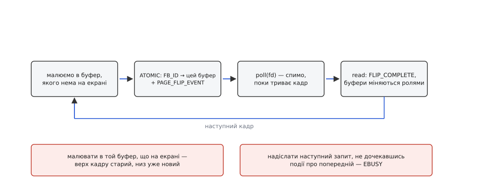

# ⚙️ Двісті рядків на C, які самі виставляють режим і крутять анімацію

Програма нижче бере на себе весь екран без графічного сервера, без бібліотек малювання й без драйвера тривимірної графіки: відкриває `/dev/dri/card0`, вибирає режим, робить два буфери й перемикає їх по вертикальній паузі. Складати її руками варто тому, що модель KMS складається з масок, номерів і властивостей, які легко переказати словами й майже неможливо правильно поєднати з першого разу — кожна помилка тут дає не виняток, а чорний екран.

## Що вона робить

Запускати треба з текстової консолі (`Ctrl+Alt+F3`), бо в графічному сеансі екран уже зайнятий. Програма знаходить під'єднаний монітор, бере його бажаний режим, малює в пам'ять вертикальну смугу, що їде вправо, і десять секунд показує кадри — рівно з тактом панелі. Потім повертає екран консолі.

Збирати так:

```
cc atomic-modeset.c -o atomic-modeset $(pkg-config --cflags --libs libdrm)
```

Чотири шматки коду нижче, складені підряд у тому ж порядку, і є цим файлом.

## Крок 1. Відкрити вузол і попроситися в господарі

Дві дрібниці на початку визначають, чи побачить програма взагалі бодай щось.

Перша: за замовчуванням ядро показує клієнтові стару, доатомарну картину світу — самі лише основні плоскості й жодних властивостей. Це навмисне: старі програми не мають раптом побачити ресурси, яких не розуміють. Тому клієнт мусить оголоситися сам, викликом `drmSetClientCap`. Прапорець `DRM_CLIENT_CAP_ATOMIC` за документацією ядра вмикає й `DRM_CLIENT_CAP_UNIVERSAL_PLANES` — але просити обидва явно не зайве: так одразу видно, на чому саме драйвер відмовив.

Друга: право виставляти режим має рівно один дескриптор на весь пристрій. `drmSetMaster` дасть його лише тоді, коли господаря немає взагалі; з-під працюючого композитора буде відмова, і це не збій програми, а правильна поведінка ядра. У справжніх програмах дескриптор не відкривають самі — його просять у [служби сеансів і місць](root:sys-unix/logind-sessions-seats), яка знає, чий сеанс зараз активний, і сама передає готовий дескриптор.

І одразу — тонкість, на якій ламаються навіть акуратні: **дві родини викликів libdrm повертають помилку по-різному**. Усе з `xf86drmMode.h` (`drmModeAtomicCommit`, `drmModeAddFB2`, `drmModeCreatePropertyBlob`) віддає **мінус errno** просто значенням, лишаючи глобальний `errno` недоторканим. А `drmIoctl`, `drmSetMaster` і `drmSetClientCap` з `xf86drm.h` поводяться як звичайні системні виклики: `−1` і код у `errno`. Надрукуєте `strerror(errno)` після невдалого `drmModeAtomicCommit` — отримаєте повідомлення від якоїсь давно минулої помилки й шукатимете причину не там.

:::code proj-atomic-modeset/c/atomic-modeset.c

Пошук властивості за іменем виглядає марнотратно — і таким є, якщо робити його щокадру. Але робиться він один раз на старті, і саме він робить програму сумісною наперед: чого ядро не має, того вона просто не знайде й не попросить.

## Крок 2. Скласти ланцюг із масок

Тепер найцікавіше. Треба знайти трійку «роз'єм — CRTC — основна плоскість», яку залізо погодиться з'єднати. Роз'єм знаходиться просто: перебрати всі й узяти той, у якого `connection == DRM_MODE_CONNECTED` і є хоч один режим. Режим беремо той, що позначений `DRM_MODE_TYPE_PREFERRED` — це рідна роздільність панелі, узята з EDID.

А далі — пастка, на яку натикаються всі. Роз'єм несе список кодерів, кодер несе `possible_crtcs`, плоскість несе свою `possible_crtcs`, і обидві ці маски **нумерують не об'єкти, а позиції в масиві** `res->crtcs[]`. Біт номер 1 не означає «CRTC з номером 1» — він означає «той CRTC, що лежить другим у масиві, який щойно віддало ядро». Номер об'єкта треба звідти дістати, а не вгадати.

![Три CRTC у масиві res->crtcs[] з номерами 41, 52, 63; маска possible_crtcs = 0b010 вмикає біт 1, тобто позицію 1, тобто CRTC із номером 52](img/possible-crtcs-mask.svg)

*Маска зберігає індекси, а не номери. Тому позицію треба запам'ятати разом із номером: номер піде у властивості, індекс — у наступні перевірки масок.*

Основна плоскість шукається так само: перебрати всі плоскості, лишити ті, чия маска містить наш індекс, і взяти з них ту, у якої властивість `type` дорівнює `DRM_PLANE_TYPE_PRIMARY`. Саме тут стає видно, навіщо був `UNIVERSAL_PLANES`: без нього ядро не покаже ні цієї властивості, ні половини плоскостей.

:::code proj-atomic-modeset/c/krok-2-sklasty-lantsiuh-iz.c

## Крок 3. Пам'ять під картинку

`DRM_IOCTL_MODE_CREATE_DUMB` виділяє простий лінійний прямокутник — саме те, чого досить, коли пікселі малює процесор. Ядро віддає ручку буфера, крок рядка й розмір. Крок майже ніколи не дорівнює `ширина × 4`: залізо любить вирівнювання, і адресу рядка треба щоразу рахувати від `pitch`, а не від ширини. Пропущене вирівнювання дає скошену картинку — класичний перший результат.

Далі три різні речі, які легко злити в одну. Ручка — це пам'ять. `ADDFB2` створює з неї **опис** для розгортки: формат `XRGB8888`, крок, зсуви. А `mmap` за псевдозсувом, який віддав `MAP_DUMB`, кладе ту саму пам'ять у [адресний простір процесу](root:sys-unix/mmap-model), щоб у неї можна було писати звичайним вказівником. Формат `XRGB8888` на машині з молодшим байтом попереду означає, що `uint32_t` виду `0x00RRGGBB` лягає в пам'ять байтами B, G, R, X — тобто звична арифметика `(r << 16) | (g << 8) | b` дає саме те, що очікує залізо.

Буферів два, і причина стара: поки розгортка читає один, малювати треба в інший ([подвійна буферизація](root:hw-motion/display-double-buffering)).

## Крок 4. Стан як список властивостей

Тепер збирається сам запит. Режим не передається структурою — його спершу кладуть у **блоб** (`drmModeCreatePropertyBlob`), а у властивість `MODE_ID` іде номер цього блоба; щоб вимкнути CRTC, туди пишуть нуль. Решта — прості числа: роз'ємові кажуть, до якого CRTC він тепер належить, CRTC вмикають властивістю `ACTIVE`, а плоскості дають буфер і дві прямокутні області.

Області різні за одиницями, і це ще одна пастка. `CRTC_X/Y/W/H` — цілі пікселі на екрані. `SRC_X/Y/W/H` — координати всередині буфера у форматі **16.16 з фіксованою комою**, тобто зсунуті на 16 біт уліво. Забути зсув означає попросити прямокутник розміром у частку пікселя; ядро чесно відмовить, а причина буде не очевидна.

:::code proj-atomic-modeset/c/krok-4-stan-iak-spysok.c

> 🔧 **Навіщо це.** Два виклики поспіль із тим самим запитом виглядають зайвиною, але саме `TEST_ONLY` перетворює здогад на знання. Композитор так питає «а чи потягне залізо це відео накладною плоскістю?» — і, діставши «ні», спокійно змішує кадр сам, не блимнувши екраном. Без роздільної перевірки єдиний спосіб дізнатися відповідь — зіпсувати картинку.

## Крок 5. Цикл кадру

Далі все просто, поки не порушено порядок. Малюємо в той буфер, якого зараз немає на екрані. Складаємо крихітний запит — одна властивість, `FB_ID` — і посилаємо його **без** `ALLOW_MODESET`: режим не міняється, отже це чиста підміна адреси, яку ядро зробить у паузі між кадрами. Прапорець `NONBLOCK` повертає керування одразу, `PAGE_FLIP_EVENT` замовляє сповіщення.

Потім чекаємо. Дескриптор `card0` — звичайне джерело подій, тож `poll` над ним стає в один ряд із сокетами й таймерами справжньої програми ([select, poll, epoll](root:sys-unix/select-poll-epoll)). Прочитане `read` — це потік записів змінної довжини: спільний заголовок `struct drm_event` із типом і довжиною, а за ним тіло. Нас цікавить `DRM_EVENT_FLIP_COMPLETE`, тіло якого — `struct drm_event_vblank` із номером кадру й міткою часу. Перебираючи буфер, довжину треба перевіряти, а не довіряти: нульова довжина в циклі означає вічний цикл.



*Дві помилки випадають просто з порушення цього кола: малювати в буфер, який ще показують, і слати наступний запит, не дочекавшись події про попередній.*

:::code proj-atomic-modeset/c/krok-5-tsykl-kadru.c

## Де воно ламається

Помилки тут майже не бувають «неправильним результатом» — вони бувають чорним екраном, і тому їх варто знати наперед.

**Чужий майстер.** `drmSetMaster` відмовляє, поки екран тримає композитор. Пропустити цей виклик теж не можна: без привілею ядро відхилить будь-яку зміну стану. Правильна відповідь у справжній програмі — не сперечатися за вузол, а взяти дескриптор від служби сеансів.

**`ALLOW_MODESET` на кожному кадрі.** Прапорець дозволяє ядру перебудувати конвеєр — а це вимкнення й увімкнення виходу, чорнота на десяті частки секунди й повна втрата ритму. У першому запиті він потрібен, у циклі — ні. Якщо кадровий запит раптом почав його вимагати, значить у стані змінилося щось іще, і саме це варто шукати.

**Малювання в буфер, який на екрані.** Розгортка читає пам'ять просто зараз; перезаписаний рядок з'явиться на склі негайно. Верх кадру лишиться старим, низ буде новим — точно той самий розрив, від якого й придумали два буфери.

**`EBUSY` на непідтверджений кадр.** Поки подія про попередню підміну не прочитана, наступний запит із `PAGE_FLIP_EVENT` отримає відмову. Це не збій, а захист: ядро тримає рівно один незавершений перехід на CRTC. Тому `poll` у циклі не для акуратності — без нього програма зупиниться на другому ж кадрі.

**Забуте прибирання.** Поки живий дескриптор, живий і майстер, а з ним і ваш режим на екрані. Ядро прибере все саме при закритті — але тільки якщо процес справді завершився; зависла програма лишає екран собі назавжди. Тому в циклі стоїть перехоплення `SIGINT`: `Ctrl+C` має вести до `DROP_MASTER`, а не в нікуди.

І останнє, чого в цій програмі немає навмисно. Пікселі малює процесор, тож на момент атомарного запиту буфер уже готовий — чекати нема на кого. Щойно малювати почне GPU, з'явиться проміжок між «команду подано» і «кадр дописано», і разом із плоскістю доведеться передавати вхідну огорожу через властивість `IN_FENCE_FD`: [дескриптор, який спрацює, коли автор буфера закінчить](root:sys-unix/dma-fence-sync). Без неї на екран поїде недомальований кадр — і жоден `TEST_ONLY` про це не попередить, бо помилки в конфігурації тут немає.
