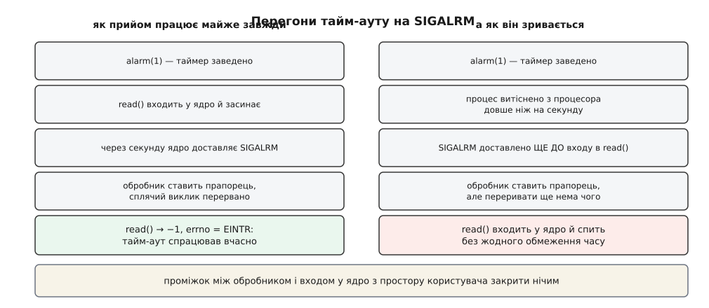

# ⚙️ Правильні обгортки навколо перерваних викликів

Це чотири шматки робочого C-коду, які закривають `EINTR` у справжній програмі, і — що важливіше за самі шматки — спосіб переконатися, що вони працюють. Без штучного потоку сигналів гілка обробки переривання роками лишається непройденою й уперше виконується в бою, коли адміністратор натиснув `Ctrl+Z`.

## Одна петля на два випадки

Виклик перервали, чи він просто віддав менше, ніж просили, — для того, хто передає буфер цілком, це та сама подія: робота не закінчена, потрібен ще оберт. Різниця рівно в одному — чи рушить покажчик перед наступним обертом.

:::code proj-retry-right/c/odna-petlia-na-dva-vypadky.c

Жодної гілки «а якщо і те, і те одразу» тут не потрібно: `n > 0` рухає покажчик, `EINTR` не рухає, обидва повертаються в ту саму умову циклу. Асиметрія між читанням і записом одна — у читання є кінець даних, у запису його немає, тож `write`, який повернув нуль на ненульовій довжині, означає зламану реалізацію, а не EOF.

Рядок `return -1` після часткової передачі варто прочитати уважно. Частина повідомлення в буфері вже лежить, але викликові вона не годиться: половина протокольного кадру — не дані. Якщо програмі все-таки треба знати, скільки саме встигло піти в мережу до розриву, це число віддають окремим вихідним параметром, а не вгадують із повернутого значення — інакше «дочитав до кінця» і «зламався на середині» стануть нерозрізненними.

Одне обмеження в цих обгорток є, і воно неочевидне: вони не бережуть тайм-аут сокета. Дескриптор із виставленим `SO_RCVTIMEO` перериванням не перезапускають — `recv` віддає `EINTR`, петля йде на новий оберт, і відлік двох обіцяних секунд починається з нуля. Під потоком сигналів обмеження просто зникає. Справжнє вичерпання часу, до речі, приходить не як `EINTR`, а як `EAGAIN`, і обгортка віддасть його викликові звичайним `-1` — розрізняти ці два `-1` доводиться тому, хто викликав ([блокуючий і неблокуючий режим](root:sys-unix/blocking-and-nonblocking) — чи чекає виклик на дані всередині ядра, чи одразу повертає `EAGAIN`). Найнеприємніше, що тайм-аут виставлено в іншому файлі, при створенні сокета, і в місці виклику його не видно взагалі.

## Цикл подій, який переживає переривання

:::code proj-retry-right/c/tsykl-podii-iakyi.c

Стійким цей цикл роблять три речі. Перша: `EINTR` веде на новий оберт, а не назовні — це не поломка, а повідомлення «поки ти спав, щось сталося»; назовні виходять лише інші коди, і саме тому перевірка `n < 0` розділена, а не злита в одне `return -1`.

Друга: прапорці, виставлені обробником, перевіряються на початку **кожного** оберту, а не в гілці `EINTR`. Сигнал міг прийти й тоді, коли цикл роздавав уже отримані події, — тоді ніякого `EINTR` не станеться взагалі, а зупинитися програма мусить так само швидко.

Третя, найменш очевидна: залишок часу рахує сама програма. Після переривання `epoll_wait` почав би відлік тайм-ауту з нуля ([select, poll, epoll](root:sys-unix/select-poll-epoll) — виклики, що чекають на готовність багатьох дескрипторів одразу й повертають список готових), тож дедлайн доводиться тримати у власній змінній. Годинник для нього — обов'язково `CLOCK_MONOTONIC`: `CLOCK_REALTIME` стрибає при вирівнюванні часу, і один стрибок назад підвісив би цикл на стільки, на скільки годинник перевели.

## Тайм-аут на блокуючому виклику — і чому він ненадійний

Той самий `EINTR` можна вживати навмисно: якщо завести таймер і **не** ставити `SA_RESTART`, будь-який блокуючий виклик дістає тайм-аут задарма.

:::code proj-retry-right/c/taim-aut-na-blokuiuchomu.c

> 🔧 **Навіщо це.** Петлі на `EINTR` тут немає навмисно — і це рівно та петля, яку сюди інстинктивно дописують «щоб було як скрізь». Дописали — і тайм-аут зник: сигнал приходить, виклик повертається, петля заганяє його назад у сон, і так довіку. Один і той самий код у цьому файлі означає протилежні речі залежно від того, хто саме перервав виклик, — тому обгортку з петлею і обгортку з дедлайном тримають окремими функціями з різними іменами.

І тепер про те, чому прийом усе-таки ненадійний. Обробник може відпрацювати за мить **до** входу в `read`: прапорець він виставить, а переривати ще нема чого — виклик тільки починається й спокійно засинає без жодного обмеження.



*Проміжок між перевіркою прапорця й входом у ядро існує завжди; закрити його з простору користувача нічим.*

Побачити перегони можна не чекаючи щасливого збігу — досить вставити затримку саме туди, де процес міг би загубити процесор:

```c
    alarm(1);
    struct timespec gap = { .tv_sec = 2, .tv_nsec = 0 };
    while (nanosleep(&gap, &gap) < 0 && errno == EINTR) { }  /* доспить залишок */
    ssize_t n = read(fd, buf, len);   /* повисне назавжди: сигнал уже був */
```

Заразом цей рядок показує чесний спосіб добирати недоспаний час: `nanosleep` кладе залишок у свій другий аргумент, і той самий буфер подається на наступний оберт.

## Те саме без перегонів

Перегони зникають, коли сигнал перестає бути перериванням і стає байтами в дескрипторі. Заблокований сигнал не доставляють — отже, він нічого не перериває й чекає, доки програма сама його прочитає ([маска сигналів і signalfd](root:sys-unix/signal-mask-signalfd) — як заблокувати сигнали для всіх потоків і читати їх як звичайні структури з дескриптора).

:::code proj-retry-right/c/te-same-bez-perehoniv.c

Заразом зникає й найпідступніше джерело `EINTR` у серверах. `SIGCHLD` від кожного завершеного нащадка приходить тоді, коли його ніхто не чекає, і вириває цикл із `epoll_wait`; заблокований і доданий у той самий канал, він стає звичайною подією в тому самому місці, де й дані, — а прибирання нащадків перестає бути окремою асинхронною історією.

`signalfd` є в Linux із 2.6.22 (2007), робоча підтримка в glibc — з 2.8; прапорці `SFD_CLOEXEC` і `SFD_NONBLOCK` з'явилися в 2.6.27 разом із виправленим викликом `signalfd4`. Там, де їх немає або де потрібна переносність, ту саму роль грає самоканал: обробник записує один байт у неблокуючий канал, а цикл подій читає його як звичайні дані.

```c
static int pipefd[2];                     /* обидва кінці — O_NONBLOCK */

static void on_signal(int sig) {
    int saved = errno;                    /* обробник мусить віддати errno цілим */
    unsigned char b = (unsigned char) sig;
    while (write(pipefd[1], &b, 1) < 0 && errno == EINTR) { }
    errno = saved;
}
```

Збереження `errno` тут не педантизм: обробник виконується посеред довільної точки програми, і `write` усередині нього залюбки затре `errno`, який перерваний виклик щойно поставив для перевірки на `EINTR` ([що можна робити в обробнику сигналу](root:sys-unix/async-signal-safety) — обробник перериває програму в будь-якому місці, тож звідти безпечно робити лише перелічені стандартом речі).

## Як зустріти EINTR навмисно

Написаний код нічого не варт, доки жоден тест не пройшов його гілками. Найдешевший спосіб — залити програму сигналами так, щоб `EINTR` траплявся на кожному виклику.

:::code proj-retry-right/c/iak-zustrity-eintr.c

Тут потрібен саме `ITIMER_REAL`: він рахує астрономічний час, а `ITIMER_VIRTUAL` — процесорний, якого сплячий процес не витрачає, тож із ним сигнал не прийшов би ніколи. Ціна — зайнятий `SIGALRM`, той самий, що й у `alarm()`. POSIX.1-2008 позначив `setitimer` застарілим, а POSIX.1-2024 прибрав зовсім; сучасна заміна — `timer_create` із довільним сигналом ([таймери процесу](root:sys-unix/process-timers) — інтервальні таймери й POSIX-таймери, які надсилають вибраний сигнал).

Коли перебирати код не хочеться, той самий потік влаштовують ззовні. `SIGWINCH` для цього зручний тим, що нічого не значить, — але саме тому в програмі має стояти порожній обробник без `SA_RESTART`: типова диспозиція `SIGWINCH` — ігнорувати, а проігнорований сигнал ядро прикриє прозорим перезапуском, і `EINTR` ви не побачите.

```sh
# 200 сигналів на секунду в живий процес
while kill -WINCH "$PID" 2>/dev/null; do sleep 0.005; done
```

Одного цього потоку, проте, замало: він проганяє гілку `EINTR`, але не гілку короткого результату. Її вмикають інакше — крихітним `SO_SNDBUF` на приймальному боці або читачем, який навмисно бере дані повільно; тоді `write_all` уперше отримує від `write` менше, ніж просив, і зсув покажчика теж стає перевіреним, а не просто написаним.

Лишається довести, що гілки справді виконувались. Найнадійніше — лічильник просто в обгортках (`static unsigned long eintr_hits;` з інкрементом у кожній гілці `EINTR`) і друк його наприкінці прогону: прогін, що завершився з нулем, не перевірив нічого й зеленим вважатися не має. Збоку те саме видно трасувальником ([strace і трасування викликів](root:sys-unix/syscall-tracing) — перехоплення системних викликів чужого процесу через ptrace): рядки з `EINTR` і `ERESTARTSYS` у виводі — це і є пройдені гілки, а їхнє співвідношення одразу показує, які виклики ядро переграло само, а які дійшли до програми.

## Що ламається найчастіше

`errno` живе рівно до наступного виклику libc — тому його зберігають **першим рядком** після перевірки результату, ще до `alarm(0)`, `close` чи `perror`. Маска сигналів переживає `execve`, тож нащадок успадкує заблокований `SIGTERM` і поводитиметься дивно: між `fork` і `exec` маску знімають. У багатопотоковій програмі замість `sigprocmask` вживають `pthread_sigmask` і ставлять маску до створення потоків, бо потік успадковує її від творця. І одне, чого не роблять ніколи: не загортають у петлю `close` — дескриптор у Linux уже закрито, і повтор влучить у чужий файл.
