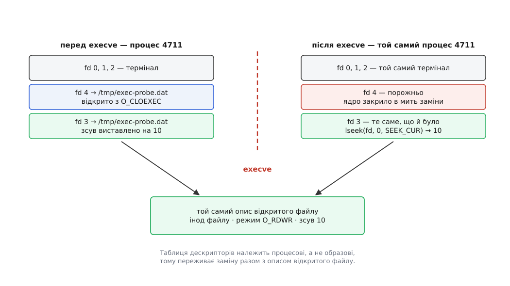

# ⚙️ Що насправді переживає exec: стенд і звітувач

Перелік уцілілого можна вивчити напам'ять, а можна поміряти на власній машині — і тоді правило «переживає те, на що можна послатися числом чи іменем; гине те, на що можна послатися лише адресою в старому образі» перестає бути формулюванням і стає спостереженням. Нижче — дві невеликі програми на C. **Стенд** виставляє перед заміною образу все, що взагалі можна виставити: два дескриптори з різними прапорцями, зсув усередині файлу, маску сигналів, відкладений сигнал, обробник і ігнорування, дві різні породи таймерів, `umask`, каталог, ліміт, `nice`, відображену сторінку пам'яті. Тоді він замінює себе **звітувачем**, який про стенд не знає нічого, крім кількох чисел, і чесно доповідає, що з усього цього дожило до першої його інструкції.

Майже все тут — чистий POSIX; лише дві перевірки, перелік дескрипторів і пошук адреси серед відображень, беруть дані з `/proc` і тому працюють тільки в Linux ([/proc: процеси як файли](root:sys-unix/proc-reading-process-and-kernel-state) — псевдофайлова система, де ядро показує стан кожного процесу звичайними файлами: `/proc/self/fd` — перелік відкритих дескрипторів, `/proc/self/maps` — перелік відображень пам'яті).

## Чому для цього потрібні двоє

Вимір має відбутися **після** заміни, інакше він нічого не доводить. Але після заміни в процесі виконується вже інша програма, і в неї немає жодного спогаду про «до»: її пам'ять збудовано з нуля, її змінні ніхто не заповнював. Програма не може поміряти саму себе крізь `exec` — після `exec` вона вже не вона.

Отже, потрібні двоє: той, хто виставляє, і той, хто дивиться. І потрібен канал, яким «до» дістанеться «після». Канал є, і він не хитрість: масиви аргументів та змінних оточення ядро копіює вбік ще перед точкою неповернення — саме тому, що стара пам'ять зникає. Тож усі еталонні значення — номери дескрипторів, ідентифікатор таймера, адреса відображеної сторінки, накопичений процесорний час — поїдуть у новий образ як текст ([argv, оточення й що успадковує дитина](root:sys-unix/argv-and-environment) — обидва масиви складає той, хто кличе `exec`, а не система, тож покласти в них можна що завгодно; звітувач дістане рівно сім змінних і жодної більше).

Що з чим порівнюємо:

| стенд виставляє | звітувач міряє | має вийти |
|---|---|---|
| `open()` без `FD_CLOEXEC`, зсув 10 | `lseek(fd, 0, SEEK_CUR)` | дескриптор живий, зсув 10 |
| `open(…, O_CLOEXEC)` | `fcntl(fd, F_GETFD)` | `EBADF` |
| `sigprocmask(SIG_BLOCK, {SIGUSR2})` | `sigprocmask(…, NULL, &set)` | заблоковано |
| `kill(getpid(), SIGUSR2)` під маскою | `sigpending()` | у черзі |
| обробник на `SIGUSR1` | `sigaction(SIGUSR1, NULL, &sa)` | `SIG_DFL` |
| `SIGTERM` → `SIG_IGN` | те саме | `SIG_IGN` |
| `alarm(300)` | `getitimer(ITIMER_REAL)` | лишилося ≈ 300 с |
| `timer_create` | `timer_gettime(id)` | `EINVAL` |
| `mmap` однієї сторінки | пошук адреси в `/proc/self/maps` | адреса нічия |
| `umask`, `chdir`, `setrlimit`, `setpriority` | `umask`, `getcwd`, `getrlimit`, `getpriority` | збігається |
| 0.15 с процесорного часу | `clock_gettime(CLOCK_PROCESS_CPUTIME_ID)` | не менше |
| `atexit()` | — | рядок не з'явиться |

Два рядки про таймери стоять поруч навмисно: різниця між ними — найгостріше місце всього досліду ([таймери процесу: alarm, setitimer, POSIX-таймери й timerfd](root:sys-unix/process-timers) — інтервальних таймерів у процесі рівно три, кожен названо сталою; POSIX-таймерів від `timer_create` може бути скільки завгодно, і кожен має ідентифікатор, виданий ядром тій програмі, яка його попросила).

## Стенд

:::code proj-exec-survivors/c/setup.c

Стенд навмисно бере програму й аргументи з власного командного рядка й передає їх далі як є. Через це він годиться не лише для звітувача: тим самим стендом можна запустити будь-що й подивитися, у якому стані воно прокинеться.

## Звітувач

:::code proj-exec-survivors/c/report.c

## Запуск

```
cc -O2 -Wall -Wextra -o setup  setup.c
cc -O2 -Wall -Wextra -o report report.c
./setup ./report
```

Приблизно такий вигляд має звіт (числа й шляхи, звісно, свої):

```
[стенд] pid 4711: fd 3 без CLOEXEC (зсув 10), fd 4 з O_CLOEXEC,
        SIGUSR2 заблоковано й надіслано собі, alarm(300),
        POSIX-таймер #0, сторінка на 0x7f2c9a3f1000, намелено 0.152 с

[звітувач] pid 4711, argv[0] = «./report»
позначки: «+» є в новому образі, «-» немає; «!» — не збіглося

  +   той самий номер процесу — у стенді був 4711, зараз 4711

  відкриті дескриптори нового образу:
     fd 0 → /dev/pts/3
     fd 1 → /dev/pts/3
     fd 2 → /dev/pts/3
     fd 3 → /tmp/exec-probe.dat

  +   дескриптор без FD_CLOEXEC — fd 3, зсув 10 (стенд лишив 10)
  -   дескриптор з O_CLOEXEC — fd 4: fcntl → Bad file descriptor
  +   SIGUSR2 у масці заблокованих
  +   відкладений SIGUSR2 — надісланий ще старій програмі
  -   обробник SIGUSR1 — був адресою в старому образі
  +   ігнорування SIGTERM — не адреса, а позначка
  +   alarm(300), він же ITIMER_REAL — лишилося 299.847 с із 300
  -   таймер від timer_create — ідентифікатор 0: timer_gettime → Invalid argument
  -   сторінка mmap зі старого образу — адреса 0x7f2c9a3f1000 не належить нікому
  +   той самий поточний каталог — «/tmp»
  +   той самий umask — 0027
  +   той самий RLIMIT_NOFILE — м'який ліміт 512
  +   те саме значення nice — nice = 5
  +   процесорний час не скинувся — стенд намолов 0.152 с, лічильник каже 0.153 с

невідповідностей: 0
```

Рядка «`[стенд] atexit пережив заміну`» у виводі немає — і його відсутність теж результат. Обробник, зареєстрований через `atexit`, — це адреса функції в таблиці, яку веде бібліотека С у пам'яті старого образу; ані таблиці, ані функції вже не існує, і викликати нема чого. Тому програма, яка робить `exec`, ніколи не «завершується» у звичному сенсі: жоден її прибиральник не спрацює.

## Три рядки, заради яких усе це

**Зсув.** Найважливіше в рядку про дескриптор — не те, що номер 3 досі відкритий, а те, що читання почнеться з десятого байта. Номер дескриптора — це індекс у таблиці процесу, а зсув живе не в ньому, а в **описі відкритого файлу** — окремій структурі ядра, на яку той індекс лише посилається ([опис відкритого файлу: що спільне після fork](root:sys-unix/open-file-description) — саме тут зберігаються режим відкриття, прапорці стану й поточна позиція; на один опис можуть посилатися кілька дескрипторів і кілька процесів). Заміна образу не чіпає ані таблиці, ані опису — тому нова програма продовжує рівно з того місця, де спинилася стара. На цьому тримається і `wc -l < data.txt`, і будь-яке інше перенаправлення.



*Таблиця дескрипторів належить процесові, а не образові, — тому нова програма читає з того самого місця, де спинилася стара.*

**Відкладений сигнал.** Звітувач бачить у черзі `SIGUSR2`, якого йому ніхто не надсилав: його надіслали програмі, якої вже немає. Черга й маска живуть у структурах ядра, тож заміна образу для них — не подія ([маскування сигналів і signalfd](root:sys-unix/signal-mask-signalfd) — маска — це бітова карта «цих поки не доставляти», і заблокований сигнал не зникає, а чекає розблокування). Перевірити це можна жорсткіше: додайте наприкінці звітувача розблокування `SIGUSR2` — і процес умить помре від сигналу, посланого старому образові. Оболонка покаже код 140, тобто 128 + 12, де 12 — номер `SIGUSR2` на x86-64 і arm64 ([код виходу як інтерфейс програми](root:sys-unix/exit-status) — завершення від сигналу оболонка позначає числом 128 плюс номер сигналу).

**Два таймери.** `alarm(300)` перейшов, `timer_create` — ні, і це не примха стандарту. Інтервальний таймер один на кожен із трьох названих сталими ґатунків: нова програма може спитати про `ITIMER_REAL` без жодного знання про стару. POSIX-таймер має ідентифікатор, виданий тому, кого вже немає; новий образ не має чим на нього послатися — а таймер, на який неможливо послатися, неможливо ані спинити, ані переналаштувати. Тому ядро видаляє такі таймери разом зі старим образом, і `timer_gettime` відповідає `EINVAL`: такого таймера в цьому процесі немає.

## Те саме без жодного рядка коду

Стенд бере програму з командного рядка, тож замість звітувача можна запустити будь-що. А частину перевірених величин ядро й само виписує в `/proc`:

```
$ ./setup /usr/bin/grep -E '^(Umask|SigBlk|SigIgn|SigCgt|SigPnd|ShdPnd)' /proc/self/status
Umask:	0027
SigPnd:	0000000000000000
ShdPnd:	0000000000000800
SigBlk:	0000000000000800
SigIgn:	0000000000004000
SigCgt:	0000000000000000
```

Ці маски — шістнадцяткові бітові карти, у яких сигнал із номером *n* займає біт *n−1*. Отже, `0x800` — це біт 11, тобто `SIGUSR2`: він і заблокований (`SigBlk`), і чекає в черзі всього процесу (`ShdPnd`). `0x4000` — біт 14, тобто `SIGTERM`, і він у переліку ігнорованих: позначка перейшла. А `SigCgt` — порожній, хоч стенд і ставив обробник на `SIGUSR1`: спіймані сигнали заміна скидає на типову дію ([диспозиція сигналу: обробник, ігнорування, типова дія](root:sys-unix/signal-disposition) — три можливі стани на кожен номер, і лише один із них є адресою в пам'яті процесу). Сам `grep` про дослід не знає нічого — він просто друкує те, що ядро написало про нього самого.

Зверніть увагу на повний шлях до `grep`. Стенд кличе `execve` напряму, а `execve` не знає про змінну `PATH` — пошук по каталогах роблять обгортки бібліотеки С й оболонки, у просторі користувача.

## Пастки

**`fflush(NULL)` перед заміною — не охайність, а необхідність.** Буфер `stdio` — звичайна пам'ять старого образу. Запустіть стенд у канал (`./setup ./report | cat`): вивід стає поблоковим, буфер не заповниться до кінця, і без `fflush` усі рядки стенда просто зникнуть — не «загубляться в дорозі», а ніколи не будуть записані. Це не властивість досліду, а найпоширеніша справжня помилка коду, який щось друкує перед `exec` ([буферизація stdio: порядкова, поблокова, без буфера](root:sys-unix/stdio-buffering) — режим бібліотека обирає за тим, куди веде дескриптор: термінал — порядково, файл чи канал — поблоково).

**Відносний шлях і `chdir`.** Стенд міняє каталог — і `./report` після цього означає вже інший файл. Тому шлях резолвиться `realpath` **до** зміни каталогу. Той самий підступ ловить кожного, хто пише запускалку: у вікні між розгалуженням і заміною можна змінити стільки, що аргументи самого `exec` перестають означати те, що означали, коли їх складали.

**Порядок: спершу маска, потім сигнал.** `kill(getpid(), SIGUSR2)` без попереднього блокування — це негайна смерть процесу: типова дія `SIGUSR2` — завершити. Переставте два рядки місцями, і замість звіту ви побачите «User defined signal 2».

**Довгий `alarm` — теж навмисно.** `alarm` і `setitimer(ITIMER_REAL)` — один і той самий таймер, і його типова дія теж убиває процес. З `alarm(1)` дослід просто не встиг би надрукувати звіт.

**Вимірювач змінює те, що міряє.** `opendir("/proc/self/fd")` сам відкриває дескриптор — і той з'являється у власному переліку; тому його доводиться відкидати через `dirfd`. Так само середовище, з якого ви запускаєте стенд, може лишити по собі власні дескриптори: усе, що не помічене `FD_CLOEXEC`, звітувач покаже чесно, і це не хиба стенда, а справжній стан процесу.

**Сирі системні виклики для таймера.** Тип `timer_t` у бібліотеці С непрозорий, і узаконеного способу передати його іншій програмі немає — що само по собі вже половина відповіді. Щоб спитати ядро прямо, стенд і звітувач ходять до `timer_create` і `timer_gettime` через `syscall()`: там ідентифікатор — звичайний `int`, виданий ядром. Побічний зиск — не потрібно підключати `librt`, як того вимагають старіші системи. Плата: на 32-бітних системах із 64-бітним `time_t` номерів `timer_settime` і `timer_gettime` може не бути взагалі (лишилися тільки їхні варіанти з суфіксом `64`; сам `timer_create` часових аргументів не має, тож він на місці), і замість очікуваного `EINVAL` звіт покаже `ENOSYS` — висновок той самий, причина інша.

**`nice` виставляється абсолютно.** `setpriority(…, 5)` не додає п'ятірку, а ставить п'ятірку. Якщо оболонка вже працює з `nice` більше за 5, то це вже підвищення пріоритету, і непривілейований процес дістане `EPERM`; стенд про це скаже й піде далі, а звіт покаже розбіжність у цьому рядку — саме для таких випадків там є знак «!» ([ліміти ресурсів: rlimit і ulimit](root:sys-unix/resource-limits) — так само працює й м'який ліміт дескрипторів: знижувати його вільно, піднімати назад — уже ні).

**Чого тут немає.** Найцікавіший наслідок заміни — підвищення прав через біт `setuid` — стенд не перевіряє: для цього потрібен окремий файл із власником і встановленим бітом, і в такого досліду інший обсяг ([setuid, setgid і підвищення прав](root:sys-unix/setuid-and-privilege)).

Коли якийсь рядок не збігається, найкоротший шлях до причини — подивитися, що насправді покликали: `strace -e trace=execve,timer_create,timer_gettime ./setup ./report` показує один-єдиний `execve` посеред потоку викликів, а поруч — обидва звертання до таймера й те, чим ядро на них відповіло ([трасування системних викликів](root:sys-unix/syscall-tracing)).
