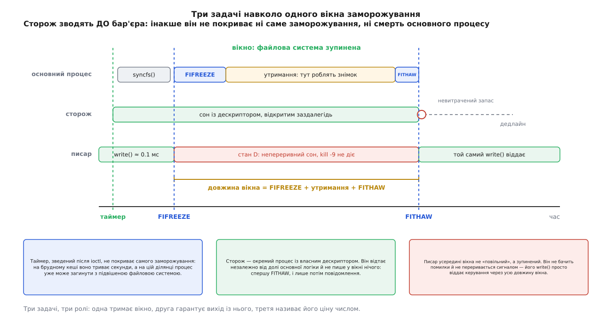

# ⚙️ Вікно з таймером безпеки: програма, яка заморожує ФС і називає ціну вікна

Ця програма робить чотири речі поспіль — відкриває точку монтування, зводить сторожа, заморожує файлову систему, утримує її й відтає, — а насамкінець друкує, скільки мілісекунд усе це коштувало тим, хто в цей час писав. Писати її варто не заради самого `ioctl`: там один рядок. Варто заради двох речей, яких у коротких прикладах зазвичай немає, — виходу з вікна, що не залежить від долі основного процесу, і числа, яке показує справжню ціну вікна для навантаження.

Мова тут безальтернативна. Заморожування просять [через `ioctl`](root:sys-unix/ioctl-interface) на відкритому дескрипторі, і потрібне повноваження [`CAP_SYS_ADMIN`](root:sys-unix/capabilities) — тобто зазвичай запуск від root. Пишемо на C, бо саме там системний виклик видно таким, як він є.

## Ідея: три ролі, три окремі задачі

Заморожування живе на суперблоці — не на процесі й не на дескрипторі. Звідси випливає асиметрія, яка й визначає всю будову програми: поставити заморожування — одна дія, а зняти його може вже не бути кому. Процес убили ззовні, він упав на своєму ж сегментному порушенні, обірвалася сесія ssh, з якої його запустили, — файлова система лишається зупиненою, і повернути її здатен тільки хтось живий із дескриптором у руках.

Тому програма розкладається на три задачі, які не залежать одна від одної.

**Основна** тримає вікно: заморожує, чекає, поки зроблять знімок, відтає. **Сторож** — окремий процес, який відтає за таймером, хай там що сталося з основною. **Писар** пише в циклі й міряє, скільки найдовше простояв один запис: це і є ціна вікна, виражена в мілісекундах для того, хто працює.



*Таймер зводять до бар'єра, а не після; писар у вікні не «повільний», а зупинений.*

## Сторож: чому таймер зводять першим

Спокуса зробити навпаки сильна — спершу заморозити, а вже потім, «маючи вікно», подбати про вихід. Проти цього є три окремі причини, і кожної досить.

Перша: сам `FIFREEZE` не миттєвий. Він чекає на писарів, які вже всередині, і вивозить на носій усі брудні сторінки. На томі з великим [кешем брудних сторінок](root:sys-unix/page-cache-durability) це не мілісекунди, а секунди. Таймер, зведений після виклику, цієї ділянки не покриває — а вона вже частина вікна, за яку платить навантаження.

Друга: саме на цій ділянці процес найлегше втратити. Поки `ioctl` не повернувся, ви не маєте куди вставити рядок із таймером, а файлова система вже може бути замороженою.

Третя, найпростіша: бюджет треба ставити на те, що ви обіцяли, — на повну довжину зупинки, а не на її хвіст.

:::code proj-freeze-window/c/storozh-chomu-taimer.c

Порядок двох останніх дій у сторожа не косметичний. Якщо повідомлення піде першим, а стандартний потік помилок перенаправлено у файл на тій самій файловій системі, сторож застрягне на власному звіті — усередині вікна, яке він мав закрити. Такий сторож гірший за жодного: він створює враження, що вихід є.

## Чому сторожеві не можна нічого писати

У замороженій файловій системі проходять читання й не проходить **жоден** запис. Не проходить `write()` у відкритий файл, не проходить створення файла, не проходить `mkdir`, не проходить дописування в журнал застосунку. Причому програма не отримує помилки: вона засинає [непереривним сном](root:sys-unix/process-states) — станом D, з якого задачу не витягти ні сигналом, ні `kill -9`, бо вона тримає внутрішні структури ядра посеред операції.

Звідси набір заборон, надмірний тільки на перший погляд. Сторож не пише лог. Не відкриває файлів. Не викликає `system("fsfreeze -u …")`, бо оболонка на першому ж кроці захоче кудись щось записати. Не покладається на буфери `stdio`, які можуть злитися саме в невдалу мить. Усе, що йому потрібно, — дескриптор, відкритий заздалегідь, і один системний виклик на ньому.

> 🔧 **Навіщо це.** Таймер усередині того самого процесу — через `alarm()` або [POSIX-таймер](root:sys-unix/process-timers) — теж дасть відтавання за розкладом, і на перший погляд це простіше за окремий процес. Але він тримається на процесі: `SIGKILL` в основну програму забирає з собою й таймер, а разом із ним — єдиний шлях назад. До того ж `ioctl` немає в переліку [безпечних для обробника сигналу](root:sys-unix/async-signal-safety) функцій, тож формально відтавання прямо з обробника — за межами гарантій стандарту. Окремий процес знімає обидва заперечення одним рухом: він переживає смерть батька й робить свій виклик у звичайному потоці керування.

## Писар: скільки коштує вікно тому, хто працює

Друга половина програми — вимірювальна. Писар пише в циклі невеликими порціями й тримає найдовшу тривалість одного запису. Поза вікном це десяті частки мілісекунди, у вікні — уся його довжина.

:::code proj-freeze-window/c/pysar-skilky-koshtuie.c

Звіт друкується не в обробнику сигналу, а в основному циклі: обробник лише ставить прапорець. Це та сама дисципліна, що й у сторожа, тільки з іншої причини — `fprintf` у переліку безпечних для обробника функцій теж немає.

## Головна частина

:::code proj-freeze-window/c/holovna-chastyna.c

Збирається без ключів: `cc -O2 -o freezewin freezewin.c`. Запускається від root на **окремому** томі — `./freezewin /mnt/test 1000`.

Рядок `if (thawed) kill(dog, …)` варто прочитати двічі. Сторожа знімають тільки тоді, коли відтавання справді вдалося; якщо `FITHAW` повернув помилку, сторож лишається жити й спробує ще раз за таймером. Зворотний порядок — убити сторожа, а потім відтавати — повертає програму рівно в те становище, від якого сторожа й заводили.

## Що видно в прогоні

Абсолютні числа залежать від носія, обсягу брудних сторінок і навантаження; важить не їхня величина, а співвідношення двох прогонів.

Без попереднього скидання:

```
FIFREEZE 2841.6 мс | утримання 1000.2 мс | FITHAW 1.9 мс | вікно 3843.7 мс
ПИСАР: записів 178, найдовший pwrite() = 3842.4 мс
```

З ключем `--sync`:

```
FIFREEZE 41.3 мс | утримання 1000.1 мс | FITHAW 1.4 мс | вікно 1042.8 мс
ПИСАР: записів 2604, найдовший pwrite() = 1041.6 мс
```

Просили вікно на секунду — у першому прогоні дістали майже чотири. Різницю з'їв сам `FIFREEZE`, якому довелося вивозити на носій усе накопичене. `syncfs()` не зменшив цієї роботи ні на байт: він виконав її **до** бар'єрів, поки писарі ще працювали нормально. Усередині вікна лишився тільки дрібний залишок — те, що набігло за проміжок між скиданням і заморожуванням.

Різниця в кількості записів каже те саме з іншого боку. Писар у другому прогоні зробив їх у чотирнадцять разів більше не тому, що став швидшим: ті самі три секунди скидання він провів працюючи, а не в стані D.

І останнє, що видно з обох прогонів: найдовший `pwrite()` писаря майже дорівнює всій довжині вікна. Ціна для навантаження — не «трохи повільніше», а рівно стільки, скільки триває зупинка.

## Пастки

**Писаря у вікні не вбити.** Спроба прибрати завислий процес під час вікна нічого не дає: `ps -o pid,stat,cmd -p …` показує `D`, а `kill -9` лягає в чергу й спрацює тільки після відтавання. Це не аварія, а нормальна поведінка непереривного сну — і саме тому вікном керує таймер, а не людина з клавіатурою. Побічний наслідок: задачі в стані D враховуються в [середньому навантаженні](root:sys-unix/load-and-pressure) нарівні з тими, що рахують, — тож моніторинг покаже стрибок рівно на довжину вікна, хоча процесор у цей час нічим не зайнятий.

**Повторне заморожування — `EBUSY`.** Вкладеності немає: другий `FIFREEZE` на вже замороженій файловій системі чесно відмовляє.

```c
if (ioctl(fd2, FIFREEZE, 0) < 0)
    fprintf(stderr, "FIFREEZE: %s\n", strerror(errno));   /* → Device or resource busy */
```

Прочитати цю відмову як «уже й так заморожено, отже, можна робити знімок» — груба помилка. `EBUSY` означає, що вікно тримає **хтось інший**, і ваше `FITHAW` обірве йому копіювання посеред роботи. Дзеркальний випадок: `FITHAW` на незамороженій системі повертає `EINVAL` — саме тому сторож не дивиться на код помилки, для нього «уже відтануло» є нормальним результатом.

**Сторож, що пережив своє вікно.** Якщо основну програму вбито після успішного відтавання, але до `kill(dog, …)`, сторож доживе до дедлайну й відтане те, що на той час встиг заморозити хтось інший. Тому запас беруть невеликий — секунди понад очікуване вікно, а не хвилини.

**Корінь без сторожа — це зупинена машина.** Заморожена коренева файлова система лишає систему в оманливо живому стані: читання йдуть, наявна оболонка відповідає, уже запущені програми не падають. Але перший же запис будь-де тихо стає в чергу — журнал системи, історія оболонки, `utmp` при новому вході. Практично це означає, що по ssh ви більше не зайдете, а `fsfreeze -u` набрати нема звідки. Лишаються тільки ті виходи, які не торкаються замороженого тому: команда з уже відкритої оболонки — або запис у `/proc/sysrq-trigger`, що спрацює, бо [procfs](root:sys-unix/pseudo-filesystems) є окремою псевдофайловою системою в пам'яті й до заморожування не має стосунку. Утиліта `fsfreeze` з `util-linux` власного таймера не має — сторожа треба приносити з собою.

**Знімок теж не повинен писати в заморожене.** Код, що стоїть у вікні замість `nanosleep`, підпадає під ті самі заборони, що й сторож. Знімок [через device mapper](root:sys-unix/device-mapper) їх не порушує — він працює з метаданими тому, а не з файлами на ньому. А скрипт, який дорогою запише рядок у `/var/log` тієї самої файлової системи, повисне в стані D і не вийде звідти, доки його не звільнить сторож.
