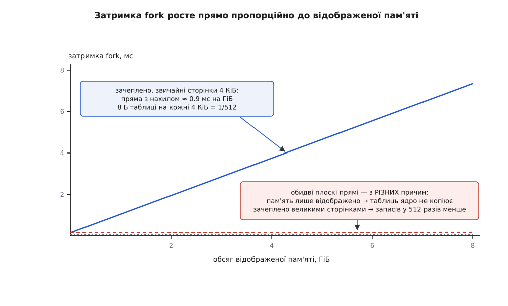
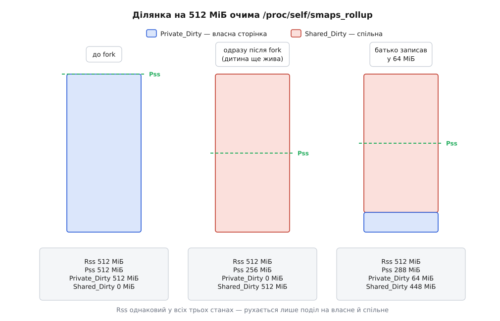

# ⚙️ Скільки коштує fork на цій машині: програма, яка це показує

Обидві статті витрат розгалуження — негайну копію таблиць сторінок і розтягнуті в часі копіювання при записі — можна не переказувати, а зміряти власноруч: ця програма на C будує залежність затримки `fork` від обсягу відображеної пам'яті й окремо рахує, скільки сторінок ядро справді скопіювало після розгалуження. Перше число має лягти на пряму з відомим наперед нахилом, друге — збігтися з кількістю зачеплених сторінок точно, до одиниць. Коли не збігається, винна одна з небагатьох добре відомих причин — і кожну з них видно тією ж програмою.

Усе нижче — Linux: `/proc/self/smaps_rollup` і прозорі великі сторінки є тільки тут. Виміри самі по собі (`clock_gettime`, `getrusage`) — POSIX і працюють будь-де.

## Два передбачення, які треба перевірити

Перед виміром варто записати, що саме має вийти, — інакше буде спокуса пояснити будь-яке число заднім числом.

**Перше.** Під час `fork` ядро копіює таблиці сторінок батька. На x86-64 зі сторінками 4 КіБ один запис нижнього рівня займає 8 байтів і описує одну сторінку. Отже, обсяг роботи прямо пропорційний обсягу **зачепленої** пам'яті, з коефіцієнтом 8/4096 = 1/512:

```
записів таблиці на 1 ГіБ  =  1 ГіБ / 4 КіБ         =  262144
байтів таблиці на 1 ГіБ   =  262144 · 8 Б          =  2 МіБ        (1/512 обсягу)
```

Отже, залежність затримки від обсягу має бути **прямою**, і її нахил — стала машини, а не програми.

**Друге.** Після повернення з `fork` усі сторінки батька позначено лише для читання, і кожен його запис у власні дані спричиняє [сторінковий виняток](root:sf-os/page-fault) з копіюванням однієї сторінки. Отже, число таких винятків має дорівнювати числу **зачеплених** сторінок — не всій пам'яті й не нулю. Механізм цілком — у статті про [копіювання при записі](root:sf-os/copy-on-write); тут потрібен лише його наслідок, який видно ззовні.

## Програма

Один файл, ніяких прав, ніяких залежностей. Збірка: `cc -O2 -Wall -Wextra -o forkcost forkcost.c`.

:::code proj-cow-observed/c/forkcost.c

Одна вимога до запуску: режим `lat 2048` справді **займає** два гігабайти оперативної пам'яті, бо зачіпає кожну сторінку. Не став обсяг більший за вільну пам'ять — інакше зміряєш не `fork`, а свопінг.

## Частина перша: пряма з нахилом 1/512

```
$ ./forkcost lat 2048
  МіБ   таблиці, КіБ    fork, мс   нахил, мс/ГіБ
   64            128       0.147              —
  128            256       0.201           0.86
  256            512       0.318           0.94
  512           1024       0.536           0.87
 1024           2048       0.994           0.92
 2048           4096       1.882           0.89
```

Стовпчик нахилу — це похідна, порахована між сусідніми рядками; саме він, а не абсолютна затримка, є величиною машини. Стала складова (тут близько 0.09 мс) — це створення облікового запису задачі, нового PID, копія таблиці дескрипторів і решта роботи, яка не залежить від обсягу пам'яті; у похідній вона зникає.

Тепер зіставмо нахил із передбаченням:

```
байтів таблиці на 1 ГіБ   =  2 МіБ                    (1 ГіБ / 4 КіБ · 8 Б)
виміряний нахил           ≈  0.90 мс на ГіБ
темп заповнення таблиць   =  2 МіБ / 0.90 мс          ≈  2.2 ГіБ/с
```

Трохи більше за два гігабайти за секунду — це в рази менше за швидкість звичайного копіювання пам'яті, і так і має бути: ядро не переписує таблиці блоком, а обробляє **кожен запис окремо** — знаходить сторінку, на яку той указує, збільшує їй лічильник посилань і лічильник відображень, знімає право запису в обох таблицях. Копіювання восьми байтів тут — найдешевша частина роботи.



*Нахил прямої — це стала машини: 8 байтів таблиці на кожні 4 КіБ пам'яті. Дві плоскі прямі внизу здобуто тією ж програмою; обидві означають «таблиць майже нема», але причини в них різні.*

### Прямої може не бути — і це теж вимір

Запусти той самий вимір режимом `lat-cold`, який ділянку відображає, але не зачіпає:

```
$ ./forkcost lat-cold 2048
  МіБ   таблиці, КіБ    fork, мс   нахил, мс/ГіБ
   64            128       0.061              —
    …              …           …               …
 2048           4096       0.062           0.00
```

Пряма зникла. Два гігабайти адресного простору обходяться так само, як шістдесят чотири мегабайти, — і це не похибка виміру, а задокументована поведінка ядра. Стовпчик «таблиці» тут бреше: він рахує, скільки записів **було б**, а їх нема. Приватну анонімну ділянку, у яку ще ніхто не писав, ядро при `fork` **пропускає цілком** — просто не заходить у неї. У функції `vma_needs_copy` (файл `mm/memory.c`) це видно дослівно:

```c
    if (src_vma->anon_vma)
        return true;
    /*
     * Don't copy ptes where a page fault will fill them correctly.  Fork
     * becomes much lighter when there are big shared or private readonly
     * mappings. ...
     */
    return false;
```

Поле `anon_vma` з'являється в ділянки лише тоді, коли в неї вперше щось записали. Немає його — немає жодної сторінки, яку варто описувати, і сторінковий виняток однаково заповнить запис правильно, коли до нього дійде черга. Тому **прогрів обов'язковий**: без нього програма міряє не ціну копіювання таблиць, а ціну відмови від нього.

> 🔧 **Навіщо це.** Звідси випливає різниця, яка збиває з пантелику при налагодженні служб: два процеси з однаковим `VSZ` можуть розгалужуватися за час, що відрізняється в сотні разів. Значення має не обсяг адресного простору, а обсяг **зачепленого** — приблизно те, що зветься `RSS`. Різницю між цими величинами й те, чому вони розходяться, розібрано в темі [як міряти пам'ять процесу](root:sys-unix/memory-accounting).

## Частина друга: рівно стільки сторінок, скільки зачеплено

Друга стаття витрат приходить після `fork` і розтягнута в часі. Щоб її спіймати, порахуємо двічі й двома незалежними способами: спершу очима ядра як обліковця подій, потім — очима ядра як обліковця пам'яті. Якщо обидва дадуть одне число, механізм справді той, на який ми думаємо.

Перший спосіб — `getrusage(RUSAGE_SELF, …)`, поле `ru_minflt`: число сторінкових винятків, обслужених без жодного вводу-виводу. Кожне копіювання при записі — саме такий виняток. Другий — приріст `Private_Dirty` у `/proc/self/smaps_rollup`, файлі, що подає підсумок по всіх ділянках процесу одним записом формату `smaps` (з'явився в ядрі 4.14). Про сам спосіб питати ядро файлами — тема [/proc: процеси як файли](root:sys-unix/proc-reading-process-and-kernel-state).

Тут ховається пастка, через яку вимір найчастіше й провалюють. Природно очікувати, що після `fork` у батька почне рости **`Rss`** — пам'ять же копіюється. Не росте. `Rss` не рухається взагалі: батько як відображав свої 512 МіБ, так і відображає, змінюються лише фізичні кадри під ними. Рухається інше — **чи є сторінка спільною**. Ядро вважає сторінку спільною, коли на неї вказує більш ніж один запис таблиці; одразу після `fork` спільними стають усі, а кожне копіювання при записі повертає одну сторінку в розряд власних.



*Ділянка та сама й `Rss` той самий у всіх трьох станах. Ціну копіювання видно як приріст `Private_Dirty` — і рівно вдвічі менший приріст `Pss`, бо друга половина сторінки лишається за дитиною.*

```
$ ./forkcost cow 512 64
  ділянка               : 512 МіБ, сторінка 4096 Б
  AnonHugePages         : 0 КіБ
  зачеплено сторінок    : 16384  (64 МіБ)
  ru_minflt приріст     : 16389
  Private_Dirty         : 132 → 65668 КіБ  (+65536)
  Shared_Dirty          : 524440 → 458904 КіБ  (-65536)
  Pss                   : 265120 → 297892 КіБ  (+32772)
  Rss                   : 528640 → 528652 КіБ  (+12)
  скопійовано сторінок  : 16384  (з приросту Private_Dirty)
```

Обидва способи дали те саме число, і воно те, яке передбачає арифметика:

```
зачеплено             =  64 МіБ / 4 КіБ    =  16384 сторінок
приріст Private_Dirty =  65536 КіБ         =  16384 · 4 КіБ
приріст Shared_Dirty  =  −65536 КіБ        =  рівно стільки ж пішло зі спільних
приріст Pss           =  32768 КіБ         =  16384 · 2 КіБ
приріст Rss           =  0
```

Зайвих винятків п'ять понад рівні 16384 — це власна дрібна робота програми: читання `/proc`, зростання стека, буфер `printf`. Дванадцять кілобайтів приросту `Rss` — звідти ж.

Приріст `Pss` удвічі менший за `Private_Dirty` — не збіг і не похибка. `Pss` ділить кожну спільну сторінку між тими, хто на неї вказує. До запису сторінка була спільною й давала батькові 2 КіБ; після — власною й дає всі 4 КіБ. Друга половина не зникла: вона перейшла до дитини, у якої стара сторінка теж стала власною. Саме тому **сумарна** пам'ять двох процесів росте на всі 4 КіБ за кожен зачеплений байт — і саме тому службі, що робить `fork` для знімка, тримають вільною пам'ять порядку половини її обсягу, а на записоємному навантаженні — і всі сто відсотків.

### Виняток без копіювання: чому дитина мусить бути жива

Режим `cow-dead` відрізняється однією дрібницею: канал закривають одразу, і дитину дочікуються **до** того, як батько починає писати.

```
$ ./forkcost cow-dead 512 64
  ділянка               : 512 МіБ, сторінка 4096 Б   [дитина вже завершилась]
  зачеплено сторінок    : 16384  (64 МіБ)
  ru_minflt приріст     : 16388
  Private_Dirty         : 524572 → 524572 КіБ  (+0)
  Shared_Dirty          : 0 → 0 КіБ  (+0)
  Pss                   : 526984 → 526988 КіБ  (+4)
  Rss                   : 528640 → 528652 КіБ  (+12)
  скопійовано сторінок  : 0  (з приросту Private_Dirty)
```

Винятків рівно стільки ж — а скопійовано нуль сторінок. Пояснення просте й важливе. Права запису знято з таблиці батька під час `fork`, і смерть дитини їх не повертає: ядро не ходить по чужих таблицях, щоб щось там полагодити. Тому виняток однаково стається на кожній сторінці. Але, увійшовши в обробник, ядро бачить, що на сторінку вказує вже тільки один — і копіювати нема сенсу: воно просто повертає право запису на місці.

Звідси два висновки, що прямо стосуються будь-якого виміру `fork`. По-перше, `ru_minflt` **сам по собі не є мірою скопійованого**: він рахує зупинки, а не копії. Зупинка теж не безкоштовна — вхід у ядро й вихід з нього, — але вона не тягне за собою ні пошуку вільного кадру, ні копіювання чотирьох кілобайтів, і фізичної пам'яті не додає ні на байт. Саме тому в парі з нею потрібен `Private_Dirty`. По-друге, значення має **час життя дитини**: та сама програма-батько заплатить зовсім різну ціну залежно від того, чи дитина ще жива, коли він пише. Тому в програмі дитина спить на читанні з [каналу](root:sys-unix/pipe-and-fifo) — це найдешевший спосіб тримати її живою, не даючи їй торкатися пам'яті.

## Пастки, через які числа брешуть

**Прозорі великі сторінки** псують обидві частини, і по-різному. У першій вони ділять кількість записів таблиці на 512 — нахил прямої падає до непомітного, і легко зробити хибний висновок «`fork` дешевий». У другій вони роблять протилежне: одиницею копіювання стає 2 МіБ, і **один змінений байт коштує двох мегабайтів**. Тому програма кличе `madvise(MADV_NOHUGEPAGE)` до першого дотику — після дотику це вже не подіє — і друкує `AnonHugePages`: якщо там не нуль, числа треба читати інакше. Загальний стан машини видно в `/sys/kernel/mm/transparent_hugepage/enabled`. Що таке ці сторінки й коли вони корисні — тема про [великі сторінки](root:sys-unix/huge-pages-tlb-reach); тут важливо лише, що вони мовчки міняють одиницю обліку.

**Годинник.** `CLOCK_MONOTONIC` тут не примха: `CLOCK_REALTIME` службою часу підтягують і зсувають, і на мілісекундному вимірі зсув видно як від'ємну затримку. Різницю двох шкал розібрано в темі [монотонний час проти настінного](root:sf-apps/monotonic-vs-wall-time). Другий бік — арифметика: перевести обидва моменти в мілісекунди й відняти означає втратити наносекунди в мантисі, бо `tv_sec` для монотонного годинника — це мільйони секунд від старту системи. Віднімати треба цілі поля.

**Мінімум, а не середнє.** Шум планувальника, переміщення між ядрами, зміна частоти процесора вміють тільки додати часу, ніколи не відняти. Тому з кількох повторів беруть найменше значення. Прив'язка до одного ядра (`taskset -c 3 ./forkcost lat`) прибирає ще частину розкиду.

**`_exit`, а не `exit`, у дитині.** Це не стильова дрібниця, а умова коректності виміру. `exit` запускає обробники `atexit` і спорожнює буфери стандартного вводу-виводу — тобто **пише в успадковану пам'ять**, а кожен такий запис у дитині сам породжує копіювання при записі й псує рахунок сторінок. До того ж дитина спорожнила б буфер, успадкований від батька, і вивід програми подвоївся б. `_exit` не робить нічого з цього: він одразу йде в ядро.

**Своп і надлишкові зобов'язання.** Режим `lat` із великим обсягом займає стільки пам'яті, скільки просить. Якщо вона не вміщується, вимір перетворюється на вимір диска. А при суворій політиці ядра `fork` великого процесу може взагалі отримати відмову — про це тема [overcommit і OOM-killer](root:sys-unix/overcommit-and-oom).

**Багатопотоковість.** `getrusage(RUSAGE_SELF)` підсумовує всі потоки процесу, тож у багатопотоковій програмі приріст `ru_minflt` міститиме й чужі винятки. Ця програма однопотокова навмисно.

## Що з цим робити далі

Найкорисніше — прогнати `lat` на тих машинах, де справді працюють твої служби, і записати нахил: він міняється між поколіннями процесорів і між гіпервізорами відчутно, а знаючи його, ціну розгалуження будь-якого процесу оцінюєш множенням у голові — за його `RSS`. Друга частина відповідає на питання іншого роду: коли процес після `fork` несподівано розпухає, вона показує, **скільки саме** сторінок він викуповує назад, — а далі лишається знайти, хто в них пише.
