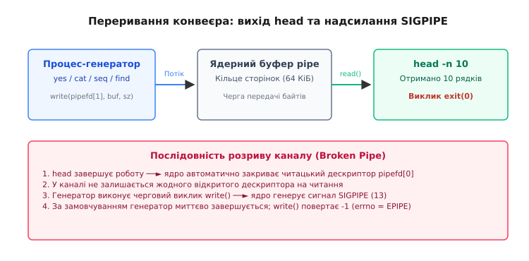
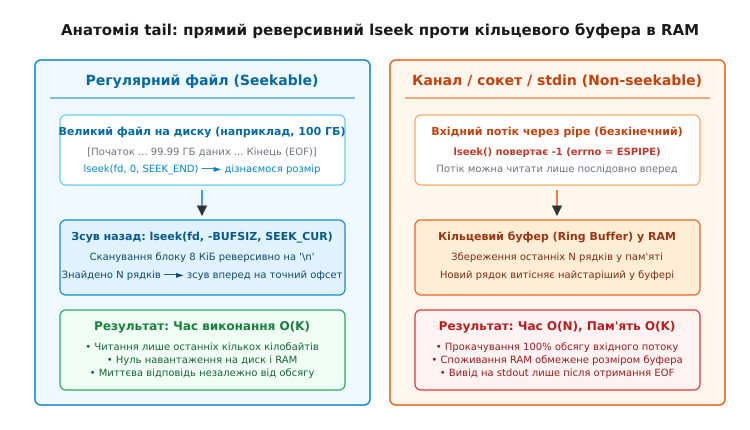
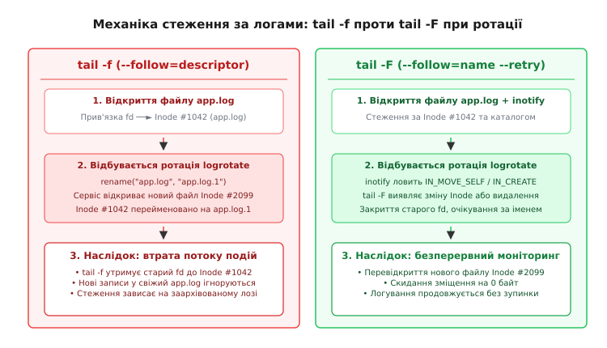

# Початок, кінець і стеження: head, tail -f, wc, split

<preknowlist>
- [Конвеєр: композиція процесів](root:sys-unix/pipeline-composition) — передача потоків даних між процесами через системні канали (`pipe`).
- [Файловий дескриптор](root:sys-unix/file-descriptor) — відкриті файлові описи в ядрі, числові дескриптори та системні таблиці.
- [Модель сигналів](root:sys-unix/signal-model) — доставка асинхронних сповіщень процесу, реакція на `SIGPIPE` та стандартна диспозиція.
- [inotify і fanotify](root:sys-unix/inotify-and-fanotify) — системні механізми сповіщення про файлові події та зміну стану файлової системи.
- [Буферизація stdio: порядкова, поблокова, без буфера](root:sys-unix/stdio-buffering) — режими буферизації стандартної бібліотеки C та затримки виводу в конвеєрах.
</preknowlist>

Коли системний конвеєр обробляє багатогігабайтний дамп бази даних або безкінечний потік системних журналів, інженеру майже ніколи не потрібен увесь масив інформації одночасно. Типові інженерні задачі вимагають або миттєвої перевірки перших кількох записів для верифікації структури заголовків, або стеження за свіжими подіями наприкінці файлу в режимі реального часу, або точного підрахунку метрик потоку, або нарізання гігантського архіву на ізольовані частини для паралельної обробки. Якщо для вибірки десяти перших рядків утиліта змушена була б вичитати 50 гігабайтів до самого кінця файлу, дискова підсистема витрачала б терабайти пропускної здатності на непотрібну роботу.

В операційних системах родини Unix цю проблему вирішує фундаментальний набір утиліт інспекції та сегментації текстових потоків із пакета GNU coreutils: `head`, `tail`, `wc`, `split` та `csplit`. Вони спроєктовані так, щоб оперувати фіксованими обсягами оперативної пам'яті `O(1)`, незалежно від розміру вхідних даних, досягати максимальної швидкості дискового вводу-виводу через векторні інструкції та системні виклики прямого позиціювання `lseek`, а також керувати життєвим циклом попередніх процесів у конвеєрі через механізм сигналів ядра.

Проте за оманливо простим інтерфейсом командного рядка ховаються складні системні механізми: доставка сигналів `SIGPIPE` при передчасному розриві конвеєра, принципова різниця між реверсивним скануванням дискових блоків та кільцевими буферами в RAM, відмінність прив'язки до відкритого файлового дескриптора від стеження за іменем у файловій системі при ротації журналів через `inotify`, а також буферизація стандартних потоків `stdio`.

---

## 1. Проблема потокових зрізів, метрик і раннього виходу

У потоковій моделі Unix дані передаються через анонімні канали (системний виклик `pipe`), де потік байтів не має фіксованого розміру і може бути потенційно нескінченним. Фільтри на початку та в середині конвеєра мусять уміти як швидко отримувати статистику про потік, так і припиняти обробку в момент, коли необхідна порція даних отримана.

### Утиліта `head`: семантика лімітів та ранній вихід

Утиліта `head` (від англ. *head* — голова, початок) призначена для вилучення початкового зрізу байтів або рядків із вхідного потоку. Її базовий синтаксис керується двома основними прапорцями:
- `-n N` (або просто `-N`): вивести перші `N` рядків (за замовчуванням `N = 10`).
- `-c N`: вивести перші `N` байтів. Суфікси `K`, `M`, `G` задають множники `1024`, `1024²`, `1024³`.
- Від'ємний ліміт `-n -K` або `-c -K`: вивести весь потік, **окрім** останніх `K` рядків або байтів (вимагає буферизації зсуву).

Головна архітектурна особливість `head` полягає в тому, що це утиліта з **раннім завершенням** (*early exit*). Досягнувши заданого лічильника рядків або байтів, `head` негайно виконує системний виклик завершення процесу `exit(0)`. Вона не дочитує вхідний файл чи потік каналу до кінця.

```
[Потік даних] ──► [read() порціями по 8 КіБ] ──► [Підрахунок '\n' або байтів]
                                                              │
                                     Ліміт досягнуто? ────────┴────► ТАК ──► exit(0)
                                                              │
                                                              └──► НІ ───► Наступний read()
```

Коли `head` працює всередині конвеєра (наприклад, `seq 1 10000000 | head -n 5`), виникає класична проблема розриву каналу зв'язку. Процес-генератор `seq` продовжує записувати дані в системний буфер каналу (`pipefd[1]`), але процес-читач `head` уже викликав `exit(0)` і припинив своє існування.

Під час завершення процесу `head` ядро операційної системи автоматично закриває всі відкриті файлові дескриптори цього процесу, зокрема читацький кінець каналу `pipefd[0]`. Коли генератор `seq` виконує наступний системний виклик `write(pipefd[1], buffer, size)` у канал, у якому не залишилося жодного відкритого читацького дескриптора, підсистема VFS ядра генерує процесу-письменнику сигнал `SIGPIPE` (числовий номер 13), а сам виклик `write()` повертає помилку `-1` із кодом `errno = EPIPE` (*Broken pipe*).

За замовчуванням диспозиція сигналу `SIGPIPE` — негайне аварійне завершення процесу (`SIG_DFL`). Завдяки цьому процес-генератор миттєво зупиняється ядром і не спалює ресурси процесора на обчислення непотрібних мільйонів рядків.


*Послідовність розриву каналу: вихід утиліти head, закриття дескриптора читання та доставка сигналу SIGPIPE процесу-генератору*

Нижче наведено мінімальну реалізацію логіки раннього виходу `head -n` із демонстрацією перехоплення та обробки сигналів на системному рівні:

:::tabs
:::code head-tail-and-following-d/c/utylita-head-semantyka.c
:::code head-tail-and-following-d/cpp/utylita-head-semantyka.cpp
:::

### Утиліта `wc`: побайтовий, рядковий та лексичний підрахунок

Утиліта `wc` (від англ. *word count* — підрахунок слів) збирає базові кількісні метрики тексту. Її опції визначають тип аналізу:
- `-c` (`--bytes`): підрахунок сирих байтів.
- `-m` (`--chars`): підрахунок символів (з урахуванням багатобайтового кодування UTF-8).
- `-l` (`--lines`): підрахунок кількості символів переводу рядка `\n`.
- `-w` (`--words`): підрахунок слів (послідовностей непорожніх символів, розділених пробілами, табуляціями чи `\n`).
- `-L` (`--max-line-length`): довжина найдовшого рядка у символах.

Незважаючи на простоту задачі, сучасна реалізація GNU `wc` оптимізована для досягнення пропускної здатності на рівні десятків гігабайтів за секунду:

1. **Оптимізація `wc -c` для регулярних файлів:** якщо вхідний потік є звичайним файлом на диску, `wc` навіть не читає його вміст. Вона виконує системний виклик `fstat(fd, &st)` і миттєво повертає значення поля `st.st_size` за час `O(1)`.
2. **Векторизований підрахунок `wc -l`:** для пошуку символів `\n` використовується функція `memchr()`, яка транслюється компілятором у векторні SIMD-інструкції (AVX2/SSE4.2 на x86_64). Процесор аналізує 32 або 64 байти за одну машинну інструкцію без побайтового циклу.
3. **Табличний аналіз `wc -w`:** підрахунок слів вимагає розпізнавання переходів між станами «всередині слова» та «пробіл». GNU `wc` використовує попередньо розраховану бітову таблицю класифікації `isspace()` для однобайтових локалей (`LC_ALL=C`), що усуває умовні переходи в гарячому циклі процесора.
4. **Багатобайтове декодування `wc -m`:** коли активна локаль UTF-8, утиліта викликає `mbrtowc()` або застосовує швидкий апаратний UTF-8 валідатор, який декодує послідовності від 1 до 4 байтів на символ.

| Опція | Що рахує | Складність алгоритму | Оптимізація ядра / libc |
| :--- | :--- | :--- | :--- |
| `wc -c` | Байти | `O(1)` для файлів, `O(N)` для pipe | Виклик `fstat() -> st_size` без читання файлу |
| `wc -l` | Символи `\n` | `O(N)` | SIMD `memchr()` (AVX2/AVX-512) блоками по 64 байти |
| `wc -w` | Слова | `O(N)` | Табличний скінченний автомат переходів станів |
| `wc -m` | UTF-8 символи | `O(N)` | Декодування змінної довжини `mbrtowc()` |

---

## 2. Анатомія `tail`: реверсивний зсув `lseek` проти кільцевого буфера в RAM

Утиліта `tail` (від англ. *tail* — хвіст, кінець) виконує завдання, симетричне до `head`: вона повертає останні `N` рядків (за замовчуванням 10) або `N` байтів вхідного файлу. Однак внутрішня організація `tail` кардинально відрізняється залежно від того, чи є вхідне джерело **позиційованим файлом** (*seekable file*) на блоковому пристрої, чи **непересувним потоком** (*non-seekable stream* на зразок pipe або сокета).


*Анатомія tail: прямий реверсивний lseek у файлах на диску проти кільцевого буфера в оперативній пам'яті для непересувних потоків*

### Робота з регулярними файлами: реверсивне позиціювання

Якщо вхідний файл розміром 100 ГБ зберігається на файловій системі, читання його від початку до кінця для виводу останніх 10 рядків було б неприпустимим марнотратством. `tail` перевіряє можливість позиціювання за допомогою системного виклику `lseek(fd, 0, SEEK_CUR)`.

Якщо виклик успішний, `tail` переходить на алгоритм реверсивного пошуку:
1. За допомогою `lseek(fd, 0, SEEK_END)` або `fstat()` визначається точний розмір файлу `S`.
2. Вказівник поточної позиції файлу переміщується назад від кінця файлу на розмір одного буфера вводу-виводу (зазвичай 8 КіБ або розмір системної сторінки пам'яті 4 КіБ):
   ```
   lseek(fd, -BUFSIZ, SEEK_END);
   ```
3. Буфер зчитується в оперативну пам'ять і сканується у зворотному напрямку (від останнього байта до першого) на наявність символу `\n`.
4. Якщо в межах поточного блоку знайдено необхідну кількість рядків `N`, `tail` обчислює точне байтове зміщення першого символу потрібного рядка, виконує фінальний `lseek(fd, target_offset, SEEK_SET)` і послідовно копіює хвіст файлу у стандартний вивід.
5. Якщо в поточному блоці символів `\n` недостатньо, вказівник зсувається ще на один блок назад від попередньої позиції:
   ```
   lseek(fd, -2 * BUFSIZ, SEEK_END);
   ```
6. Процес повторюється, доки не буде знайдено всі `N` рядків або доки вказівник не досягне нульового зміщення (початку файлу).

Часова складність вибірки хвоста регулярного файлу становить `O(K)`, де `K` — розмір запитуваного хвоста, і абсолютно не залежить від загального розміру файлу `N`. Вибірка 10 рядків із файлу розміром 1 ТБ триває менше 100 мікросекунд.

### Граничні випадки реверсивного сканування
- **Файл без символу `\n` наприкінці:** останній символ файлу не є переводом рядка. `tail` враховує цей байт як частину останнього рядка і не збільшує лічильник рядків передчасно.
- **Файл менший за розмір буфера:** якщо розмір файлу менший за `BUFSIZ`, `lseek` повертає помилку `EINVAL` при спробі зміщення за межі початку. `tail` перехоплює це, зсуває покажчик на зміщення `0` і читає файл звичайним прямим читанням.

### Робота з непересувними потоками: кільцевий буфер (Ring Buffer)

Коли `tail` отримує дані з конвеєра (`cat log | tail -n 10`) або сокета, спроба виконати виклик `lseek()` завершується помилкою ядра `-1` із кодом `errno = ESPIPE` (*Illegal seek*). Непересувний потік не дозволяє зазирнути в кінець без вичитування всіх попередніх байтів.

У цьому режимі `tail` розгортає в пам'яті **кільцевий буфер** (*circular ring buffer*):
- Виділяється масив покажчиків на рядки або фіксований буфер розміром `N` елементів.
- `tail` послідовно зчитує весь вхідний потік через `read()` від початку до кінця (`EOF`).
- Кожен новий зчитаний рядок записується в поточну позицію кільцевого буфера, витісняючи та звільняючи найстаріший рядок.
- Лише після отримання ознаки кінця файлу `EOF` (коли `read()` повертає `0`), `tail` розгортає кільцевий буфер і виводить накопичені `N` рядків у `stdout` у хронологічному порядку.

Часова складність у цьому випадку становить `O(N)` (необхідно прокачати 100% обсягу потоку через пам'ять), але просторова складність утримується на рівні `O(K)` (пам'ять витрачається лише на збереження `N` останніх рядків).

Реалізація реверсивного пошуку рядків у файлі через `lseek`:

:::tabs
:::code head-tail-and-following-d/c/robota-z-neperesuvnymy.c
:::code head-tail-and-following-d/cpp/robota-z-neperesuvnymy.cpp
:::

---

## 3. Механіка безперервного стеження: `tail -f` проти `tail -F` та ротація журналів

Стеження за появою нових записів у системних журналах — одна з найчастіших операцій у практиці адміністрування та налагодження розподілених сервісів. Прапорець `-f` (від англ. *follow* — слідувати) наказує утиліті `tail` не завершувати роботу після досягнення `EOF`, а очікувати на надходження нових байтів і негайно виводити їх на термінал.

Однак за простою назвою ховаються два принципово різні механізми: **стеження за дескриптором** (`tail -f` / `--follow=descriptor`) та **стеження за іменем файлу** (`tail -F` / `--follow=name --retry`).


*Поведінка tail -f та tail -F під час ротації журналів: втрата дескриптора проти автоматичного перевідкриття через inotify*

### `tail -f`: прив'язка до відкритого файлового дескриптора

Коли користувач запускає `tail -f /var/log/nginx/access.log`, відбувається наступне:
1. `tail` викликає системний виклик `open()`, отримує числовий файловий дескриптор `fd` і прив'язується до структури `struct file` у таблиці відкритих файлів ядра.
2. Внутрішній покажчик ядра вказує на конкретний дисковий вузол `struct inode` (наприклад, Inode #1042).
3. `tail` зчитує всі наявні дані до кінця файлу і переходить у режим очікування нових записів через механізм ядерних повідомлень `inotify` або періодичне опитування.

Проблема виникає, коли системна служба ротації журналів (`logrotate`) виконує планову ротацію:
1. Утиліта ротації перейменовує поточний файл: `rename("access.log", "access.log.1")`.
2. Демон Nginx отримує сигнал `SIGHUP` (або `SIGUSR1`), закриває старий дескриптор і створює абсолютно новий файл з іменем `access.log` (який отримує новий Inode #2099).
3. Процес `tail -f` продовжує тримати відкритий дескриптор `fd`, який усе ще вказує на старий Inode #1042 (який тепер у каталозі називається `access.log.1`).
4. **Результат:** `tail -f` застрягає на старому ротованому файлі. Оскільки Nginx більше нічого не пише в Inode #1042, екран термінала зависає, і всі свіжі події з нового `access.log` втрачаються.

### `tail -F`: стеження за шляхом у файловій системі та прапорець `--retry`

Прапорець `tail -F` є комбінацією двох опцій: `--follow=name` та `--retry`. Він повністю розв'язує проблему ротації логів:
- **`--follow=name`**: `tail` відстежує стан файлу за його шляхом (`pathname`), а не за статичним дескриптором. Якщо файл видаляється або замінюється іншим inode, `tail` закриває старий дескриптор і відкриває файл заново за його іменем.
- **`--retry`**: якщо під час ротації файл на коротку мить зникає з файлової системи (стан між `unlink`/`rename` та `creat`), `tail` не завершується з помилкою «No such file or directory», а продовжує циклічно намагатися відкрити цільовий шлях.

### Механізми виявлення змін: `inotify` проти періодичного опитування (`polling`)

У сучасних дистрибутивах Linux утиліта GNU `tail` використовує підсистему ядра `inotify` (від англ. *inode notify* — сповіщення про зміну іноду):
1. `tail` створює дескриптор сповіщень через `inotify_init1(IN_CLOEXEC)`.
2. Додається стеження на цільовий файл із маскою подій:
   - `IN_MODIFY`: у файл дописано нові байти.
   - `IN_ATTRIB`: змінено метадані (атрибути, права доступу).
   - `IN_DELETE_SELF`: файл було видалено з файлової системи.
   - `IN_MOVE_SELF`: файл було перейменовано/переміщено.
3. Додатково додається стеження на **батьківський каталог** цільового файлу з маскою `IN_CREATE | IN_MOVED_TO`, щоб миттєво відловити появу нового файлу з тим самим іменем після ротації.
4. Процес `tail` блокується у системному виклику `poll()` або `epoll_wait()`, витрачаючи 0% ресурсів процесора під час простою, і миттєво прокидається в мікросекунду появи нового запису.

Якщо файл розміщений на мережевій файловій системі (NFS, CIFS, GlusterFS) або віртуальній псевдофайловій системі (`/proc`, `/sys`), де ядерні події `inotify` не генеруються, `tail` автоматично перемикається на режим опитування (**stat polling**, прапорець `---disable-inotify`). У цьому режимі `tail` через заданий інтервал (за замовчуванням `--sleep-interval=1.0` с) викликає `fstat()` та `stat()`, порівнюючи значення `st_ino`, `st_dev` та `st_size`.

### Поведінка при стратегії ротації `copytruncate`

Деякі сервіси не вміють перевідкривати файли журналів за сигналом. Для них `logrotate` використовує директиву `copytruncate`: вміст `app.log` копіюється в `app.log.1`, після чого оригінальний файл обрізається до нуля викликом `truncate("app.log", 0)`.

При такому підході номер Inode залишається незмінним, але розмір файлу раптово зменшується (`st_size < previous_offset`). 
GNU `tail` виявляє цей стан, виводить у потік повідомлення:
```text
tail: app.log: file truncated
```
і автоматично скидає свій внутрішній вказівник читання на початок файлу: `lseek(fd, 0, SEEK_SET)`.

---

## 4. Розбиття потоків та файлів: `split` і `csplit`

Коли файл занадто великий для передачі мережею з обмеженням розміру пакета, запису на носії з файловою системою FAT32 (ліміт 4 ГБ) або для паралельної обробки в розподілених системах, його необхідно фрагментувати. В екосистемі Unix для цього існують дві комплементарні утиліти: `split` (розбиття за фіксованими квантами розміру) та `csplit` (контекстне розбиття за шаблонами).

### Утиліта `split`: розрізання за розміром та рядками

Утиліта `split` (від англ. *to split* — розщеплювати, ділити) читає вхідний потік байтів і записує його у послідовність вихідних файлів фіксованого розміру.

Основні режими розбиття:
1. **За фіксованим обсягом байтів (`-b` / `--bytes`):**
   ```bash
   split -b 100M large_archive.tar.gz part_
   ```
   Файл буде розрізано на сегменти рівно по 100 Мебібайтів (за винятком останнього шматка). Розбиття за байтами не зважає на межі рядків і може розрізати окремий символ або рядок навпіл.
2. **За фіксованою кількістю рядків (`-l` / `--lines`):**
   ```bash
   split -l 50000 access.log log_chunk_
   ```
   Кожен вихідний файл міститиме рівно 50 000 повних рядків тексту.
3. **За кількістю вихідних частин (`-n` / `--number`):**
   - `-n 4`: розбити файл на 4 приблизно однакові шматки за розміром байтів.
   - `-n l/4`: розбити на 4 частини, не розриваючи рядки всередині.
   - `-n r/4`: циклічний розподіл рядків (*round-robin*) між 4 файлами по черзі (ідеально для балансування навантаження між worker-процесами).

### Керування суфіксами та безпека конкатенації

За замовчуванням `split` додає до префікса двосимвольні літерні суфікси (`aa`, `ab`, `ac` ... `zz`). Якщо файлів більше за 676, утиліта повертає помилку переповнення суфікса.

Для створення надійних скриптів автоматизації використовуються такі прапорці:
- `-d` (`--numeric-suffixes`): використання десяткових числових суфіксів (`00`, `01`, `02`).
- `-a N` (`--suffix-length=N`): довжина суфікса з фіксованою кількістю знаків (наприклад, `-a 4` генерує `0000`, `0001` ... `9999`).

```bash
split -b 500M -d -a 3 big_dataset.iso dataset_part_
# Згенерує файли: dataset_part_000, dataset_part_001, dataset_part_002...
```

**Відновлення оригінального файлу** в Unix не вимагає спеціальних утиліт зворотного збирання. Оскільки конкатенація потоків байтів є базовою операцією, збирання виконується стандартною утилітою `cat`:

```bash
cat dataset_part_* > restored_dataset.iso
sha256sum big_dataset.iso restored_dataset.iso
```

Криптографічні хеші вихідного та зібраного файлу будуть абсолютно ідентичними, оскільки `split` гарантує побайтове збереження цілісності без додавання службових заголовків чи метаданих.

### Утиліта `csplit`: контекстне розбиття за регулярними виразами

Утиліта `csplit` (від англ. *context split* — контекстне розбиття) розділяє текстовий файл на частини на основі змісту — регулярних виразів або конкретних номерів рядків. Це необхідно, коли межі блоків даних визначаються маркерами початку секцій (наприклад, поштові скриньки mbox, дампи SQL-транзакцій, логи звітів або файли вихідного коду).

Синтаксис аргументів `csplit`:
```bash
csplit [опції] файл шаблон_1 [шаблон_2 ... шаблон_N]
```

Типи шаблонів:
- `/РЕГУЛЯРНИЙ_ВИРАЗ/`: розрізати файл перед рядком, що відповідає виразу (сам рядок стає першим рядком нового файлу).
- `/РЕГУЛЯРНИЙ_ВИРАЗ/+N` або `/РЕГУЛЯРНИЙ_ВИРАЗ/-N`: розрізати зі зміщенням на `N` рядків після або до знайденого збігу.
- `%РЕГУЛЯРНИЙ_ВИРАЗ%`: пропустити секцію даних від поточної позиції до знайденого збігу без збереження у файл (скидання непотрібних блоків).
- `N`: розрізати на конкретному абсолютному номері рядка `N`.
- `'{КІЛЬКІСТЬ}'`: повторити попередній шаблон задану кількість разів. Прапорець `'{*}'` означає повторення до кінця файлу (`EOF`).

Практичні опції `csplit`:
- `-f префікс`: назва префікса вихідних файлів (за замовчуванням `xx`).
- `-n N`: кількість цифр у суфіксі (за замовчуванням 2, що дає `xx00`, `xx01`).
- `-z` (`--elide-empty-files`): автоматично видаляти порожні результуючі файли (наприклад, якщо перший рядок вхідного файлу одразу збігається з шаблоном).
- `-s` (`--quiet`): придушити вивід розміру згенерованих файлів у стандартний потік помилок.

```bash
# Розбиття монолітного лог-файлу на окремі файли транзакцій
csplit -z -f transaction_ -n 3 server.log '/^=== START TRANSACTION ===/' '{*}'
```

---

## 5. Системні пастки: SIGPIPE у конвеєрах та буферизація вводу-виводу

Спільне використання утиліт інспекції у виробничих скриптах пов'язане з двома підступними системними проблемами: помилками завершення конвеєрів через прапорець `pipefail` та затримками виводу через буферизацію бібліотеки `stdio`.

### Пастка 1: Прапорець `set -o pipefail` та код повернення 141

У надійних shell-скриптах стандартом є встановлення суворого режиму виконання на початку файлу:
```bash
set -euo pipefail
```
Прапорець `set -e` перериває виконання скрипту, якщо будь-яка команда повертає ненульовий код виходу. Прапорець `set -o pipefail` змінює логіку конвеєра: кодом виходу всього конвеєра стає код виходу *останньої команди, що завершилася з помилкою*, а не просто останньої команди конвеєра.

Розглянемо типовий конвеєр:
```bash
grep "CRITICAL" /var/log/application.log | head -n 5
```
1. `head -n 5` отримує 5 рядків і миттєво виконує `exit(0)`. Його персональний код виходу — `0` (успіх).
2. Ядро закриває читацький дескриптор.
3. Процес `grep` намагається записати 6-й знайдений рядок, отримує сигнал `SIGPIPE` і завершується аварійно.
4. В операційній системі код виходу процесу, завершеного сигналом, дорівнює `128 + номер_сигналу`. Для `SIGPIPE` (сигнал 13) код становить:
   ```
   128 + 13 = 141
   ```
5. Через `set -o pipefail` весь конвеєр повертає загальний код виходу `141`.
6. Через `set -e` оболонка вважає, що сталася фатальна аварія, і **повністю перериває виконання скрипту**.

Для запобігання цій пастці у скриптах застосовують кілька інженерних підходів:

:::tabs
:::code head-tail-and-following-d/sh/main.sh
:::

### Пастка 2: Зависання потоку логів через поблокову буферизацію `stdio`

Коли адміністратор запускає моніторинг журналу з фільтрацією:
```bash
tail -f /var/log/nginx/access.log | grep "502 Bad Gateway" | cut -d' ' -f1,7
```
дуже часто спостерігається дивний ефект: помилки в реальній системі генеруються, але на екрані термінала нічого не з'являється протягом багатьох хвилин, після чого раптово вивалюється величезний блок із сотень рядків одразу.

Причина криється в автоматичній зміні режимів буферизації стандартної бібліотеки C (`glibc stdio`):
1. **Рядкова буферизація (`_IOLBF`):** коли стандартний вивід процесу спрямований на інтерактивний емулятор термінала (TTY), бібліотека скидає буфер після кожного символу `\n`.
2. **Поблокова буферизація (`_IOFBF`):** коли стандартний вивід спрямований у системний канал (`pipe`), бібліотека автоматично перемикається на блоковий режим і накопичує дані в буфері розміром 4096 або 8192 байти. Скидання (`flush`) у канал відбувається лише тоді, коли буфер заповниться повністю.

У наведеному конвеєрі `tail -f` віддає рядки швидко, але `grep` записує відфільтровані рядки у конвеєр до `cut`. Оскільки вивід `grep` — це канал, `glibc` всередині `grep` вмикає буфер 4 КіБ. Якщо помилки 502 виникають рідко (наприклад, один рядок на 100 байтів кожні кілька секунд), процес `grep` чекатиме накопичення 40 рядків (~4000 байтів), перш ніж передати хоч один байт утиліті `cut`.

Способи примусового скидання буферизації:

| Утиліта | Прапорець рядкової буферизації | Механізм роботи |
| :--- | :--- | :--- |
| `grep` | `grep --line-buffered` | Викликає `fflush(stdout)` після кожного знайденого рядка |
| `sed` | `sed -u` або `sed --unbuffered` | Читає та пише без внутрішнього накопичення буфера |
| `awk` | `awk '{ print; fflush(); }'` | Явний виклик функції скидання буфера всередині сценарію |
| Будь-яка | `stdbuf -oL -eL <команда>` | Перехоплює виклик `setvbuf()` через `LD_PRELOAD` до старту `main()` |

Виправлений конвеєр реального часу:
```bash
tail -f /var/log/nginx/access.log | grep --line-buffered "502 Bad Gateway" | stdbuf -oL cut -d' ' -f1,7
```

---

## 6. Зведена характеристика утиліт сегментації та інспекції

| Утиліта | Основні прапорці | Принцип роботи | Складність за часом | Споживання RAM | Поведінка з конвеєром |
| :--- | :--- | :--- | :--- | :--- | :--- |
| `head` | `-n N`, `-c N` | Читання з початку потоку | `O(K)` ліміту | `O(1)` | Ранній `exit(0)`, провокує `SIGPIPE` попереднику |
| `tail` | `-n N`, `-c N` | Реверсивний `lseek` для файлів / кільцевий буфер для pipe | `O(K)` для файлів, `O(N)` для pipe | `O(K)` розміру виводу | Читає до `EOF` (або блокується в `-f`) |
| `tail -f` | `-f` / `--follow=descriptor` | Стеження за відкритим файловим дескриптором | `O(1)` на кожну нову подію | `O(1)` | Застрягає на старому Inode при ротації |
| `tail -F` | `-F` / `--follow=name --retry` | Відстеження шляху через `inotify` + перевідкриття | `O(1)` на подію | `O(1)` | Автоматично перевідкриває файл після ротації |
| `wc` | `-l`, `-w`, `-c`, `-m` | Векторизоване сканування / `fstat` | `O(1)` для `-c` файлів, `O(N)` для решти | `O(1)` | Прокачує потік без збереження даних у пам'яті |
| `split` | `-b N`, `-l N`, `-d`, `-a` | Потоковий запис у ротовані файли | `O(N)` | `O(1)` (буфер вводу-виводу) | Зворотне збирання через простий `cat part_*` |
| `csplit` | `/REGEX/`, `'{*}'`, `-z` | Розбиття за шаблонами регулярних виразів | `O(N)` | `O(рядка)` | Дозволяє виділяти логічні блоки даних довільного розміру |
