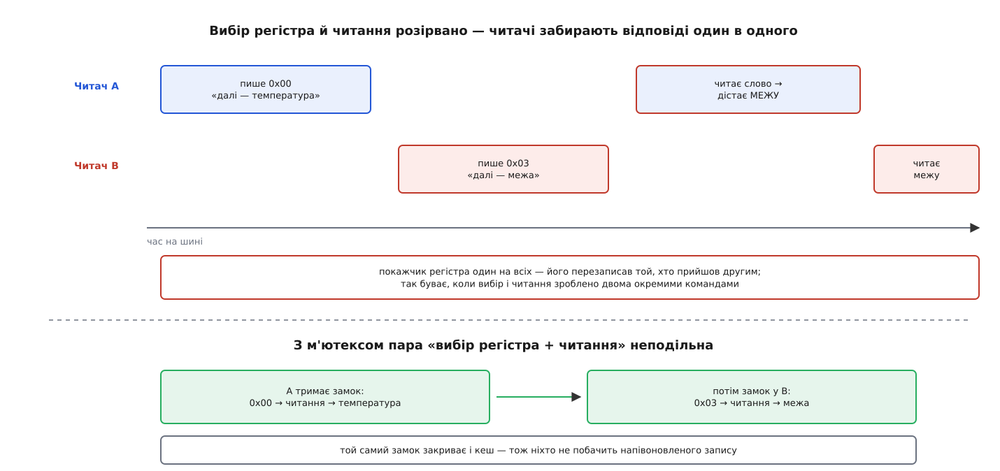
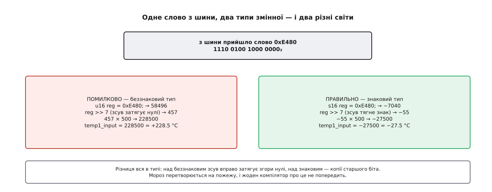

# ⚙️ Мінімальний драйвер hwmon для датчика на I²C

Ось повний текст робочого драйвера — трохи більше за сотню рядків, які перетворюють мікросхему на двох дротах у каталог `/sys/class/hwmon/hwmonN` з файлами `temp1_input`, `temp1_max` і `temp1_max_hyst`. Контракт hwmon іззовні виглядає простим, і саме тому три його гострі кути — знак у зсуві, спільний на всіх покажчик регістра в мікросхемі й реєстрація теплової зони — знаходять кожного, хто пише такий драйвер уперше.

## Що на платі й що має вийти

Беремо мікросхему, сумісну з LM75. У неї чотири шістнадцятибітні регістри, до яких ходять командою «прочитати слово»: `0x00` — виміряна температура, лише читання; `0x03` — межа, за якою мікросхема сама здіймає тривогу на своїй ніжці; `0x02` — гістерезис, поріг повернення. Дев'ять значущих бітів вирівняні вліво в слові, крок — пів градуса, старший біт — знак. Розмова йде по [шині I²C](root:com-devices/i2c): дві лінії, адреса пристрою, номер регістра, дані.

Слово на дротах їде старшим байтом уперед, а процесор у нас найімовірніше молодшим — тому в ядрі є окрема `i2c_smbus_read_word_swapped()`, яка переставляє байти сама. Це не косметика: звичайна `i2c_smbus_read_word_data()` віддасть те саме слово задом наперед, і температура вийде вигаданою.

Драйверу треба зробити рівно три речі: оголосити, які канали в нього є; вміти віддати й прийняти значення в мілі-градусах; прив'язатися до пристрою, коли той з'явиться на шині.

## Оголошення: канали, дії, чип

Оголошення — це два масиви й одна структура, і всі три статичні: нічого рахувати в них не треба.

:::code proj-hwmon-driver/c/oholoshennia-kanaly-dii.c

`HWMON_CHANNEL_INFO(temp, …)` — макрос, що збирає на місці анонімну структуру з полем `.type = hwmon_temp` і масивом конфігурацій, по одному слову на канал. Каналів тут один, тому слово одне; було б два датчики — два слова через кому, і ядро створило б `temp1_*` та `temp2_*`. Перший рядок описує не канал вимірювання, а сам чип: тип `hwmon_chip` — це місце для властивостей, які стосуються всієї мікросхеми.

## Три зворотні виклики

`is_visible` вирішує долю кожного оголошеного атрибута: `0` — файла не буде взагалі, `0444` — тільки читання, `0644` — ще й запис для власника. Її кличуть один раз, при реєстрації, і не питають більше ніколи; змінити права на ходу через неї не вийде.

:::code proj-hwmon-driver/c/try-zvorotni-vyklyky.c

`read` і `write` отримують ту саму трійку «тип, ознака, канал» — і перше, що варто помітити: `dev` у них **не** ваш `i2c_client`. Це пристрій hwmon, дитина вашого; його приватні дані ядро поставило само з того вказівника, який ви передали при реєстрації. Тому `dev_get_drvdata(dev)` тут повертає саме вашу структуру, а `to_i2c_client(dev)` поверне сміття.

:::code proj-hwmon-driver/c/try-zvorotni-vyklyky-2.c

Гілки `default` тут мали б ніколи не спрацювати: ядро питає лише про те, що драйвер сам оголосив. Але оголошення й обробник — два різні місця, і розходяться вони на диво легко: додали в маску `HWMON_T_CRIT`, а гілку в `switch` дописати забули. `-EOPNOTSUPP` («операція не підтримується») — усталена в підсистемі відповідь на таку комбінацію; читання файла впаде з виразною помилкою замість того, щоб віддати випадкове число з неініціалізованої змінної.

## Кеш і замок

Тепер найважче — і найкоротше на вигляд. Кожне читання `temp1_input` — це справжня транзакція на шині, і на дротах вона з двох кроків: спершу в мікросхему їде номер регістра, потім звідти читається слово. Покажчик регістра в мікросхемі **один на всіх**, тому розривати ці кроки не можна. Коли драйвер робить їх однією командою SMBus, цілість забезпечує ядро: `i2c_smbus_read_word_swapped()` — це один обмін, і адаптер на його час замкнено. А щойно драйвер розкладає читання на два окремі виклики або вичитує підряд кілька регістрів, які мають бути узгоджені між собою, кроки двох процесів перемішуються — і другий перезаписує покажчик між кроками першого.



*Помилка тут особливо підступна тим, що обидва читання успішні: жодного коду помилки, просто в `temp1_input` час від часу з'являється значення межі.*

Той самий м'ютекс закриває й кеш — інакше один потік міг би побачити оновлений час поруч зі старим значенням. Що таке [м'ютекс у ядрі й де ним не можна користуватися](root:sys-unix/kernel-locking), варто знати окремо: тут ми в контексті процесу, який має право спати, тож звичайний `mutex` доречний; в обробнику переривання довелося б брати спінлок.

:::code proj-hwmon-driver/c/kesh-i-zamok.c

`jiffies` — лічильник тиків ядра, `HZ` — скільки їх на секунду; порівнювати їх треба саме через `time_after()`, а не знаком «більше», бо лічильник переповнюється й на 32-бітній системі робить це за лічені тижні (детальніше — [час у ядрі](root:sys-unix/kernel-timekeeping)). Позначку часу оновлюємо **лише після успіху**: інакше невдале читання поставило б свіжий штамп, і півсекунди драйвер віддавав би старе значення, вважаючи його новим.

> 🔧 **Навіщо це.** Панель у стільниці, служба нагляду й збирач метрик легко опитують той самий датчик одночасно й із різною частотою. Без кешу вони втроє довше тримають шину, на якій, буває, висить не тільки термометр; без замка — час від часу читають чуже. Обидві біди мовчазні: у логах порожньо, у графіку — зубець.

## Знак, який легко загубити

`i2c_smbus_read_word_swapped()` повертає `int`, бо мусить лишити місце під від'ємні коди помилок. Значення слова приїжджає в ньому як додатне число від 0 до 65535 — і саме тут ламається перетворення, якщо взяти для нього беззнаковий тип.



*Над беззнаковим типом зсув вправо затягує згори нулі, над знаковим — копії старшого біта; компілятор не бачить у першому варіанті нічого підозрілого.*

:::code proj-hwmon-driver/c/znak-iakyi-lehko-zahubyty.c

У зворотному перетворенні замість зсуву вліво стоїть множення на 128 — те саме число, але без зсуву від'ємного значення, поведінка якого в C описана не для всіх випадків. `clamp_val()` тут не перестраховка: у `temp1_max` записує людина, і `echo 100000 > temp1_max` без затиску перетворився б на сміття в регістрі мікросхеми, яка мовчки почала б здіймати тривогу на випадковому порозі.

## Прив'язка: таблиця збігу й probe

Драйвер сам себе ні до чого не чіпляє. Він реєструється на шині з таблицею імен, а далі ядро зіставляє ці імена з описом заліза й кличе `probe` (як саме — [прив'язка драйвера до пристрою](root:sys-unix/driver-probe-and-binding)). Для I²C таблиць дві: `of_match_table` зіставляє рядок `compatible` із [дерева пристроїв](root:sys-unix/device-tree), `id_table` — старе ім'я, яким користуються платформи без дерева.

:::code proj-hwmon-driver/c/pryviazka-tablytsia-zbihu.c

Префікс `devm_` означає «прив'язано до життя пристрою»: і пам'ять, і пристрій hwmon ядро звільнить само при відв'язуванні драйвера, у зворотному до виділення порядку. Тому в цьому драйвері немає ані `remove`, ані жодного `kfree` — і немає цілого класу помилок, у яких пам'ять звільнили раніше, ніж зник файл, з якого її читають. Перевірка `i2c_check_functionality()` теж не формальна: не кожен контролер уміє команду «слово», і краще відмовитися в `probe`, ніж отримувати `-EOPNOTSUPP` на кожному читанні.

## `HWMON_C_REGISTER_TZ`: віддати температуру тепловому каркасу

Один прапорець у першому рядку оголошення робить те, чого драйвер не робить сам: ядро реєструє наші канали температури як джерела для теплового каркаса. Умови жорсткі й мовчазні. Перший елемент масиву `info` мусить бути саме типу `hwmon_chip` і нести `HWMON_C_REGISTER_TZ` у першому слові конфігурації; пристрій має походити з дерева пристроїв; драйвер має зворотний виклик `read`. Далі ядро обходить усі канали типу `hwmon_temp`, бере ті, що оголосили `HWMON_T_INPUT` і яким `is_visible` не повернула нуль, і реєструє кожен як сенсор теплової зони.

Користь з'являється тоді, коли в дереві пристроїв є зона, яка на нас посилається:

```
minisens: temperature-sensor@4c {
        compatible = "example,minisens";
        reg = <0x4c>;
        #thermal-sensor-cells = <1>;
};

thermal-zones {
        board-thermal {
                thermal-sensors = <&minisens 0>;
                trips { … };
                cooling-maps { … };
        };
};
```

З цієї миті політикою опікується вже [тепловий каркас ядра](root:sys-unix/thermal-management-framework): точки спрацювання, прив'язані вентилятори, обмеження частоти. Драйвер про це нічого не знає — він і далі просто віддає число. Якщо ж зони в дереві немає, ядро проковтне це мовчки: жодної помилки не буде, і прапорець просто ні на що не вплине. Це головна пастка — «увімкнув, а нічого не сталося» тут означає не зламаний драйвер, а незаповнене дерево.

## Читач із простору користувача

Каталог `hwmonN` — не адреса: номер відображає лише порядок реєстрації цього разу. Шукати треба за вмістом файла `name`.

:::tabs
:::code proj-hwmon-driver/py/main.py
:::code proj-hwmon-driver/c/hwmon-find.c
:::

Обидва варіанти читають каталог заново при кожному запуску — і це навмисно. Довготривала служба має або перечитувати `name` при старті кожної сесії, або тримати відкритим дескриптор `temp1_input`: він переживе перенумерування, але не переживе від'єднання пристрою й почне повертати помилку.

## Що зміниться на справжньому чипі

Тут один канал, і аргумент `channel` у зворотних викликах ні на що не впливає. На мікросхемі з шістьма входами він стає головним: `switch` розростається на два рівні, а кеш перестає бути одним значенням. У більшості наглядачів плати всі величини вичитуються однією серією транзакцій, тому вигідно тримати в структурі цілий знімок регістрів із однією позначкою часу — тоді шість файлів, прочитаних поспіль, покажуть узгоджену між собою картину, а не шість моментів із різницею в мілісекунди.

А ось `is_visible` на справжньому чипі зазвичай перестає бути таблицею констант. Одна й та сама мікросхема часто випускається в кількох варіантах — із термістором і без, із чотирма входами й із двома, — і драйвер, розпізнавши варіант у `probe`, ховає зайві атрибути, повернувши для них нуль. Саме тому `drvdata` передають у `is_visible` першим аргументом: на момент її виклику пристрою hwmon ще не існує, а знати, з чим маємо справу, вже треба.
