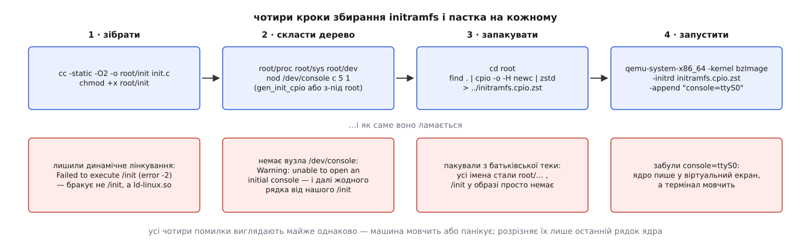

# ⚙️ Найменший робочий initramfs: /init на C, cpio й QEMU

Образ, який завантажує машину, поміщається в кількадесят кілобайтів: один статичний файл `/init`, три порожні теки й один вузол пристрою — більше в ньому нема нічого. Зібрати його руками варто саме тому, що нічого готового всередині не буде: усе, що зазвичай робить дистрибутив, доведеться назвати самому, і кожен пропущений крок ядро покарає окремим повідомленням.

## Що будуємо

Спершу — образ, який просто живе: `/init` монтує `/proc`, `/sys` і `/dev`, друкує кілька рядків у консоль і не завершується ніколи. Це вже повноцінна система: ядро плюс один процес.

Потім той самий `/init` доростає до справжньої роботи: монтує підготовлений диск у `/sysroot` і віддає йому керування через `switch_root`. На цьому кроці стає видно, чому одного `chroot` для переходу замало і чому його не можна розірвати на дві програми.

## Крок 1. Процес, який не має права завершитися

Два рішення визначають вигляд усього коду.

Перше — **статичне лінкування**. У щойно розпакованому корені немає ні `/lib`, ні динамічного завантажувача, тож програма мусить нести весь свій код усередині ([статичне й динамічне лінкування](root:sys-unix/static-and-dynamic-linking)). Один файл — жодних запитань про залежності.

Друге — **не повертатися**. Ядро запускає `/init` як [перший процес](root:sys-unix/init-and-pid1), а вихід першого процесу для нього фатальний: у `kernel/exit.c` на цей випадок стоїть `panic("Attempted to kill init! exitcode=0x%08x\n", …)`. Тому головний цикл програми — нескінченний, і заразом він ховає сиріт: усі осиротілі процеси дістаються саме PID 1, і поховати їх більше нікому.

:::code proj-tiny-initramfs/c/init.c

`mkdir` усередині `mount_one` не зайвий: rootfs записуваний, тож теку під монтування можна створити просто на місці, і образ не мусить її нести. `devtmpfs` тут — не примха: ядро **не** монтує його саме, коли завантаження йде через initramfs, і без цього рядка `/dev` лишиться порожнім ([псевдо-ФС: procfs, sysfs, tmpfs, devtmpfs](root:sys-unix/pseudo-filesystems)).

## Дерево образу і чому в ньому є `/dev/console`

```
root/
├── init          ← наш статичний файл, з правом на виконання
├── dev/
│   └── console   ← символьний вузол, старший 5, молодший 1
├── proc/
└── sys/
```

Вузол `/dev/console` мусить бути в архіві — до всякого `devtmpfs`. Перед запуском першого процесу ядро виконує `console_on_rootfs()`: відкриває `/dev/console` і робить із нього дескриптори 0, 1 і 2. Не відкрилося — у журнал іде `Warning: unable to open an initial console.`, і процес стартує **із закритими** стандартними потоками. Наслідок жорсткий: `printf` пише в нікуди, а перший же `open` у програмі отримує дескриптор 0 замість звичного числа. Ви бачите бездоганно завантажене ядро й повну тишу після нього.

Звідси й розвилка в способі пакування.

**Із-під суперкористувача** дерево збирають звичайними утилітами, і найкоротший шлях — потоковий:

```sh
cd root
find . | cpio -o -H newc | zstd -19 -T0 > ../initramfs.cpio.zst
```

`find .` дає імена виду `./init`; розпакувальник ядра відлічує їх від кореня, тож у образі виходить рівно `/init`.

**Від імені звичайного користувача** цей шлях ламається на одному місці: `mknod /dev/console` вам не дозволять, а власником усього стане ваш uid. Для крихітного образу другий бік майже байдужий — PID 1 і так root, — але без вузла консолі система німа. Тому дерево ядра несе окрему утиліту `gen_init_cpio`, яка бере права й вузли з текстового опису й нікого не питає про повноваження. Це один самодостатній файл, збирається без решти ядра:

```sh
cc -O2 -o gen_init_cpio usr/gen_init_cpio.c
```

Опис виглядає так (числа — вісімкові, останні три поля `nod` — тип вузла й пара номерів):

```
dir  /proc 755 0 0
dir  /sys  755 0 0
dir  /dev  755 0 0
nod  /dev/console 600 0 0 c 5 1
file /init root/init 755 0 0
```

```sh
./gen_init_cpio spec.txt | zstd -19 -T0 > initramfs.cpio.zst
```

Права `755` і власник `0 0` тут — просто числа в описі, а не наслідок того, ким ви є в системі.

Розмір готового образу визначає майже самотужки одна річ — libc. Статичний `/init`, зібраний звичайним `gcc`, тягне за собою кількасот кілобайтів glibc; той самий код під `musl-gcc -static` важить кілька десятків, і весь стиснений образ лишається в тих самих межах. Різниця пояснює, чому справжні образи будують навколо `busybox`: одна статична збірка «все в одному файлі» дешевша за десяток окремих утиліт, кожна зі своєю копією бібліотеки.

## Запуск

```sh
qemu-system-x86_64 \
    -kernel /boot/vmlinuz-$(uname -r) \
    -initrd initramfs.cpio.zst \
    -append "console=ttyS0" \
    -m 512M -nographic -no-reboot
```

`-nographic` виводить послідовний порт машини просто в термінал, а `console=ttyS0` наказує ядру покласти консоль саме на цей порт ([TTY і послідовний порт](root:sys-unix/tty-and-termios)). Без другої половини пари ядро друкує у віртуальний екран, якого ви не бачите. Вийти з QEMU — `Ctrl-A`, потім `X`; додати `-enable-kvm` варто хіба задля швидкості. Уся принада досліду саме в гостьовій машині: ламати перший процес тут можна скільки завгодно, бо паніка коштує одного натискання, а не перезавантаження вашого комп'ютера.

```
[    0.000000] Linux version 6.12 …
…
[init] PID 1, uid 0 — простір користувача живий
[init] proc     -> /proc
[init] sysfs    -> /sys
[init] devtmpfs -> /dev
[init] /proc/cmdline: console=ttyS0
```

Останній рядок вартий окремої уваги: `console=ttyS0` ядро вжило саме, а нам віддало той самий текст як звичайні дані. Усі `root=` і `rd.*` доводиться розбирати вже тут, у нашому коді, — ядро про них нічого не знає.

## Крок 2. Віддати корінь справжній системі

Готуємо диск і кладемо на нього другу програму — `stage2`, таку саму заготовку на три рядки, яка друкує свій PID і засинає:

```sh
truncate -s 64M rootdisk.img
mkfs.ext4 -q -F rootdisk.img
mkdir -p mnt && sudo mount -o loop rootdisk.img mnt   # через loop-пристрій
sudo mkdir -p mnt/dev mnt/proc mnt/sys mnt/sbin
sudo cp stage2 mnt/sbin/init
sudo umount mnt
```

Диск підключаємо до QEMU як `-drive file=rootdisk.img,format=raw,if=virtio` — усередині це буде `/dev/vda`. Тепер `/init` доростає до переходу.

:::code proj-tiny-initramfs/c/krok-2-viddaty-korin.c

Виклик у `main`, замість нескінченного циклу:

```c
    mkdir("/sysroot", 0755);
    if (mount("/dev/vda", "/sysroot", "ext4", MS_RDONLY, NULL) != 0)
        die("mount /dev/vda");
    switch_root("/sysroot", "/sbin/init");
```

Три речі в цьому коді неочевидні. Перехід іде не через [`pivot_root`](root:sys-unix/pivot-root), а через `MS_MOVE`: rootfs — основа [дерева монтувань](root:sys-unix/mount-model), і переставити його всередину нового кореня нема куди. `wipe` видаляє й той файл, який зараз виконується, — зникає лише ім'я, inode тримає живим сам процес, а останні сторінки повертаються на `exec`, коли образ у процесі заміщується новим ([exec: заміна образу](root:sys-unix/exec-semantics)). І саме тому видалення й `exec` мусить зробити **одна** програма: розірвати їх нема кому. Справжній `switch_root` з `util-linux` розкладає це трохи інакше — спершу переносить монтування й корінь, а прибирання віддає окремій дитині, яка ще й перевіряє, що старий корінь справді `ramfs` або `tmpfs`.

## Пастки



*Помилки різні, а вигляд майже однаковий: тиша або паніка. Розрізняє їх останній рядок, який ядро встигло надрукувати.*

**Динамічно злінкований `/init`.** Ядро знаходить файл, викликає `execve` — і дістає `ENOENT`. У журналі з'являється `Failed to execute /init (error -2)`, за ним обхід решти кандидатів і `No working init found.  Try passing init= option to kernel.` Плутає тут саме `-2`: файл, якого немає, — це не `/init`, а названий у ньому `ld-linux-x86-64.so.2`. Забули `-static` — і симптом вказує пальцем не туди.

**Забуте право на виконання.** Тут ядро не скаже нічого. Воно перевіряє доступ до `/init` через `init_eaccess`, мовчки визнає його непридатним і йде старою дорогою — монтувати те, що назване в `root=`. Позаяк `root=` ми не давали, усе закінчується панікою про кореневу файлову систему, а не про `/init`. Порада проста: `chmod +x` робіть у тій самій команді, що й компіляцію.

**Пакування не з тієї теки.** `find root | cpio -o -H newc` дає імена `root/init`, `root/dev/console` — архів розпакується бездоганно, просто `/init` у корені не з'явиться. Перевірити готовий образ дешево: `zstd -dc initramfs.cpio.zst | cpio -tv` показує рівно те, що побачить ядро.

**Ручна склейка архівів.** Буфер може містити кілька cpio поспіль (так доставляють мікрокод), але кожен наступний мусить починатися на межі чотирьох байтів: формат описаний як `ALGN(4) + шапка + ім'я + '\0' + ALGN(4) + дані`. Просте `cat a.cpio b.cpio` спрацює лише тоді, коли довжина першого файлу випадково кратна чотирьом; інакше хвіст буфера буде тихо втрачено — без жодного повідомлення. Доповніть перший архів нулями до кратності чотирьом.

**Забутий `mount --move /dev`.** Приберіть `/dev` зі списку `keep` — і після переходу консолі не стане: у щойно змонтованому корені `/dev` порожній, а `devtmpfs` лишився під накритим rootfs. `stage2` запуститься, але його `printf` піде в нікуди. Ті самі три рядки з `MS_MOVE` економлять не лише роботу, а й видимість.

**`/init`, який повернувся.** Замініть у `die` нескінченний цикл на `exit(1)` — і машина зупиниться з `Kernel panic - not syncing: Attempted to kill init!`. Це найкоротший спосіб побачити правило про перший процес на власні очі, і воно однакове для будь-якої причини: помилка, `return` з `main`, отриманий сигнал.

**`mount` віддає `ENODEV`.** Драйвер файлової системи в цьому ядрі зібраний модулем, а модулів у нашому образі немає. Додайте до `/init` рядок `show("/proc/filesystems")` — там перелічено рівно те, що ядро вміє без довантаження. Це і є в мініатюрі та сама причина, через яку справжній образ дистрибутива важить десятки мегабайтів.
